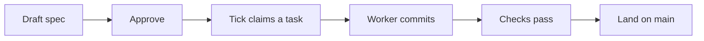

# Documentation style

This is how Avoozl's prose is written: the pages under `docs/`, `README.md`,
the specs under `.kiro/specs/`, the role prompts under `prompts/`, the skills,
and CLI help text. It is prescriptive. When a rule and a habit disagree, the
rule wins and the page gets fixed.

The short version: name the thing, show it working, then layer in the rest.

A page that follows it opens like this:

````markdown
# Flow

Flow settings control how work moves once delivery is on. They live under
`flow` in `.avoozl.json`, and a repository can override them.

```json
{
  "flow": {
    "localChecksFirst": true
  }
}
```
````

## Docs tree

Pages are Markdown under `docs/`, read on github.com as they are. Every page
is listed in `docs/README.md`, every relative link resolves, and no page uses
front matter or a `:::` container. `src/app/test/docs-links.test.mjs` checks
all three, so a new page goes into the index in the same commit.

Markdown is not auto-formatted. `npm run format` leaves it alone, so the rules
under [Mechanics](#mechanics) are yours to keep.

Two folders are records, not docs. `docs/research/` holds what was observed
when the research ran, and `docs/evidence/` holds generated receipts. Do not
edit them to match a later name or design. Regenerate a receipt instead.

## Current state only

Docs, specs, prompts and skills say what exists now. They carry no history.

| Not | Write |
| --- | --- |
| `avoozl tick` no longer takes `--once`. | `avoozl tick` runs one workspace tick. |
| This replaces the old router chat. | The tick plans each pass. |
| Renamed from `integrationBranch`. | Leave it out. |

Words that point at the past give it away: "no longer", "now", "used to",
"previously", "superseded", "renamed from", "new". A changed behavior is a
rewritten sentence, not a sentence about the change. The history lives in git
and in the commit message.

## Page shape

Every page opens the same way.

1. **An H1 that names the subject.** A noun phrase, sentence case, no
   punctuation: `# Delivery`, `# Manual tasks and task links`,
   `# Content rules`.
2. **Two sentences of intro, at most.** What it is, and what a reader reaches
   for it for. Not history, not motivation, not a promise about later
   sections.

   Sentences, with a subject and a verb. "How Avoozl lands a commit." is a
   description of the page rather than a statement about the subject. Write
   what is true instead: "Avoozl lands a commit after its checks pass on the
   exact head."
3. **An example inside the first screen.** A command, a settings snippet, or a
   diagram, before any subheading. If a concept cannot be shown in fifteen
   lines, show the smallest useful part of it and layer the rest.
4. **Everything else**, in layers.

A page owns one concept. If it needs two H1-sized ideas, it is two pages with a
link between them.

## Titles

Titles are short, and they are one of two kinds.

**Descriptive** is a noun phrase for the thing the section is about:

```text
Landing
Merge batches
Stop the line
Harness definitions
```

**Declarative or imperative** is a sentence that states the fact the section
proves, when the fact is the point:

```text
Approvals are commits on main
Run it without Kiro Crew
Approve a harness
```

Never write a title that describes the writing instead of the subject.

**A title that opens with "What" is banned**, whatever follows. It names the
question the section answers rather than the thing the section is about, so
every one of them reads the same. Name the subject:

| Banned | Write instead |
| --- | --- |
| What it does | Landing |
| What is stored | Stored state |
| What this costs | Cost |
| What a worker can run | Worker commands |
| What this does not do | Limits |

Put the answer in the title, not the question that finds it. If the answer to
"What a receipt omits" is "screenshots", the title is "Omitted screenshots".

The same applies to a title naming the document rather than its subject:

| Banned | Write instead |
| --- | --- |
| Why it's this way | The reason: "One claim per spec" |
| `Overview` | Delete it; that is the intro |
| `Introduction` | Delete it; that is the intro |
| Usage / How to use | The task: "Writing a plugin" |
| Advanced usage | The topic: "Merge batches" |
| Notes / Miscellaneous | Split it or drop it |

A section that covers a boundary is titled for the boundary, as "Limits",
rather than for the negation, as "What it will not do".

**A title does not append a clause about itself.** "Landing, and what CI does
about it" names its subject and then explains why the section exists, which is
the intro's job. Name the subject and stop.

A title listing several subjects is not this. "Workers, checks and landing"
lists what the section covers, and that is what a title is for.

**A title is not an epigram.** "One spec, many workers" and "Git, not SQLite"
pair or oppose two phrases to sound like a thesis. Every one has the same shape
and none says what its section is about. Say the fact plainly.

| Banned | Write instead |
| --- | --- |
| Git, not SQLite | Git owns the state |
| One spec, many workers | Shared specs |

**A title does not count its contents.** "Three landing modes" puts a number
where the subject goes, and it is wrong the first time a mode is added. Write
"Landing modes".

**A title names its object.** "Configuring one" makes a reader scroll up to
find out what "one" was. Write "Configuring a harness".

**A title never opens with an article.** "The", "A" and "An" push the
identifying word off the front, where a reader scanning an outline looks.
Write "Tick", not "The tick", and "Approvals are commits", not "An approval is
a commit". "One" standing in for an article is the same mistake: "One command
to land work" is "Landing work".

**A title never ends with "is" or "are".** "Where the settings are" stops one
word short of the answer. Write "Settings files".

Sentence case. No trailing colons or question marks outside an FAQ. Stop at
H5; reaching H6 means the page should split.

**A page may end with `## FAQ`** when readers keep arriving with questions its
own order cannot answer. Each entry is an H3 holding one complete question,
answered in two or three sentences and a link. Do not invent questions to fill
it.

## Openings

A section opens with a sentence, not with a list, a table or a code block. A
reader arriving at a heading needs to know what the list is a list of before
the first item means anything.

## Layering

Do not explain a concept completely and then illustrate it. Alternate.

> minimal example → the rule it shows → one more detail → the example that
> needs it → the edge → the error a reader sees when it goes wrong

Each example adds one idea to the one before it, and each one is real: a
command that runs, a settings file Avoozl accepts. Keep the running example's
names stable down the page so a reader tracks the change, not the cast.

Order sections so a reader can stop early and still be correct. The common case
comes first, the escape hatch last.

## Section length

A section is one idea, the example that shows it, and the error that catches it
being got wrong. Longer than that and it is two sections sharing a heading.

- **A long section without an example earns one.** Prose that runs past a
  screen with nothing to look at asks the reader to hold the rule in their
  head.
- **Cut before splitting.** A section is usually long because it says one thing
  twice. Delete the second one.
- **Split what survives into H3s.** Each subsection takes one part of the idea
  and its own example, and its title follows every rule above.
- **A wall of code is several examples.** One block that shows five settings
  teaches none of them. Break it into the smallest snippet per setting.

## Examples

An example is the page's evidence, so it is held to the same standard as the
prose around it.

- Tag every fence: `sh`, `json`, `js`, `text`, `mermaid`, `markdown`.
- Write commands as `avoozl ...`, the installed command, never
  `node cli.mjs ...`.
- Explain in prose above the block. Use a comment only for something the prose
  cannot point at.
- Show the error too. A page that teaches a rule shows the input that breaks it
  and what Avoozl prints.
- Use made-up names in examples: `owner/repo`, `W1`, `task-1`. Never a real
  person, a private repository, or a private tool.

### JSON layout

JSON in docs, specs, prompts and skills is pretty-printed across lines with a
2-space indent and one key per line. Never put an object or a list of objects
on one line.

```json
{
  "flow": {
    "stopTheLine": {
      "scope": "dependents"
    },
    "retro": {
      "everyTasks": 10,
      "slowFactor": 3
    }
  }
}
```

Not:

```text
{
  "flow": {
    "stopTheLine": { "scope": "dependents" },
    "retro": { "everyTasks": 10, "slowFactor": 3 }
  }
}
```

A list is expanded the same way, one item per line. A block must equal what
`JSON.stringify(value, null, 2)` writes for it, so a snippet can be made by
running that. `src/app/test/docs-json.test.mjs` checks every `json` fence.

### Diagrams

Prefer a Mermaid diagram where a flow, a state machine or a dependency graph
reads better drawn than told. github.com renders a `mermaid` fence.



Labels are one to three words. The prose under the diagram says what the
diagram cannot, once. Do not draw a list: three boxes in a row are a sentence.

## Cross-linking

Link generously. A page is a node, not a document.

- Link the first mention of any concept that has a page of its own, then use
  the bare term afterward on that page.
- Deep-link to the heading that answers the question, not the page top:
  `[merge batches](delivery.md#merge-batches)`.
- One page owns each concept. The rest link to it and state only what they
  need.
- **Send the reader; do not describe the destination.** Write "See
  [delivery.md](delivery.md#landing) for the landing order." Not "the
  delivery page covers this", and never a bare "see here" or a naked URL.
- Links between pages are relative and keep the `.md` extension. Links from a
  spec or skill to a doc page use the path from that file.

## Tables

Markdown pipe tables. A table drawn with spaces inside a code fence cannot wrap
or carry a link, and a narrow screen scrolls it sideways.

The source columns do not have to line up. Let a long cell be long rather than
padding every other row to meet it.

Tables compare several things across several axes, or list a closed set of
settings or commands. Two columns of key to value is a list. A table with one
row is a sentence.

## Alerts

GitHub alerts (`> [!NOTE]`, `> [!WARNING]`) have two jobs only:

- **Scope, at the top of a page**, when a reader is likely to reach for a
  feature they do not need.
- **A trap**, where the obvious reading is wrong and the result is silent, such
  as a setting that deletes work.

Two per page is a lot. An alert that restates the prose above it is deleted.

## Voice

Present tense, active, declarative. State what Avoozl does; the reader infers
the guarantee.

| Write | Not |
| --- | --- |
| Avoozl refuses the harness definition. | You may get an error. |
| The tick claims the next ready task. | The task should get picked up. |
| A push to main never force pushes. | Basically we try not to force push. |
| Spec lint fails on a `Status:` line. | Unfortunately this won't work. |

- **"You" for the reader, never "we".** There is no narrator.
- **No hedging** ("generally", "typically", "should usually") unless the
  imprecision is real, in which case name the condition instead.
- **No filler**: "simply", "just", "note that", "it is worth mentioning", "in
  order to", "basically". Cut the sentence or make it a claim.
- **Name the subject before counting it.** Write "The three landing modes are
  `direct`, `pr` and `off`", not "Three modes, three behaviors".
- **Use "a" or "an" for an unspecified singular thing.** Keep "one" when the
  number matters, as in "one claim per spec".
- **No marketing.** "Powerful", "seamless" and "effortless" say nothing
  checkable. State what Avoozl does, the condition that enables it, and its
  cost.
- **No product comparisons.** Name another tool only when it is a real
  dependency, harness or integration of the feature being documented. Research
  records may name alternatives, because that is their purpose.
- **No private names.** Public text names no internal tool, private host or
  person. Write "a private git host" or "a managed remote harness".
- **Own the limits in the same voice as the features.** State the unsupported
  case and its result. Never apologize, and never promise a later version.
- No emoji, no exclamation points, no rhetorical questions.

## Words

The vocabulary is fixed so a reader meets one word per idea.

- Use the words in [docs/glossary.md](../../../docs/glossary.md) with the
  meaning given there. A new term that looks like an old one goes into the
  glossary in the same commit.
- American spelling: color, behavior, canceled.
- **"Spelling" is about letters only.** It is not a word for a name, a syntax
  or a form. Write "the setting's name" or "the source form".
- **A function _returns_ a value.** Never "answers" for returning a value.
  Keep "answers" for answering a question.
- Backtick every identifier, filename, setting, flag, command and label value.
  Do not backtick an ordinary English word. Bold a UI label as it appears on
  screen: **Settings › Flow**, **Run anyway**.
- **Never "load-bearing"** unless it is physical. Say what depends on the thing
  and what breaks without it.
- **Never "honest".** Say what it does: "the report names every failed check".
- **Never non-inclusive terms.** Use primary, replica, allowlist, denylist.

## Specs, prompts and skills

The same rules apply, with these additions.

- A spec says what the code must do now. Requirements use SHALL, a design says
  how it works, and a task says what to build and how it is checked. History,
  status lines and "supersedes" notes stay out; spec lint refuses `Status:`
  lines.
- A role prompt or skill speaks to an agent. Use the imperative, one rule per
  bullet, and say what to do instead of what to avoid where both fit.
- A skill opens with front matter holding `name` and `description`. The
  description says what the skill covers and when to load it, in one
  paragraph.

## Mechanics

The rest is formatting, and none of it is negotiable per page.

- Hard-wrap prose at 80 columns. Do not reflow a paragraph you did not touch.
  Table rows and long links may run past.
- One blank line between blocks.
- No em dashes. Split the sentence in two, subordinate one clause to the other,
  or reorder it. Do not swap the dash for a semicolon or colon in the same spot.

  | Not | Write |
  | --- | --- |
  | The tick plans — the supervisor runs. | The tick plans each pass. The supervisor runs the sessions. |
- Straight quotes, not curly.
- Lists are parallel: all fragments or all sentences, all starting with the
  same part of speech.

## Checklist

Before a page lands:

- The H1 names the subject, and no heading below it describes the writing.
- The intro is two sentences or fewer, and an example is visible without
  scrolling.
- No heading counts its own contents, opens with an article, or ends in "is".
- The page says what exists now, with no "no longer", "superseded" or
  "renamed from".
- Every example is real and adds one idea to the one before it.
- Every JSON block is pretty-printed, 2-space indent, one key per line.
- A flow that reads better drawn is a Mermaid diagram.
- Every concept with a page of its own is linked on first mention.
- Every cross-reference says "see" and says what is on the other end.
- Tables are Markdown pipe tables; two-column key to value is a list.
- No "we", no filler, no marketing word, no hedge that hides a condition, no
  private name.
- Prose wraps at 80 columns and untouched paragraphs are unreflowed.
- A new page is listed in `docs/README.md`.
