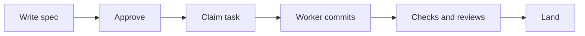

# Design: Avoozl

## Overview

This design says how Avoozl meets its requirements: who owns each kind of
state, the parts and how they connect, the workflows, and the page. Fact
numbers below `F31` refer to the requirements' facts; the facts below cite
the file or page they come from.

### Facts about Kiro Crew and Avoozl

| # | Fact | Evidence |
| --- | --- | --- |
| F31 | Kiro Crew script crons are Python callables that run with no LLM call. Their context offers `call_tool(server, tool, args)` for MCP tools, `notify`, `list_session_folders`, `create_session_folder`, `open_session(name, folder_id, agent, model)` returning a slot key, `send_to_session(slot, message)`, and `set_session_mode(slot, mode)`. Flow control is `Skip`, `Done`, and `Report`. The default script timeout is 30 seconds and can be raised per job. | Kiro Crew `docs/cron-and-scheduling.md` |
| F32 | An app manifest cron entry may name a `script` (Python callable) as well as a `command`. | Kiro Crew `apps/manifest_sections.py` `CronEntry` |
| F33 | An app backend can opt into a gateway-signed principal claim (`signedPrincipal: true`) on every proxied request. | Kiro Crew `apps/manifest_sections.py` `BackendConfig`; `apps/routes_proxy.py` |
| F34 | Local integration (`integrateRun`) lands a ready integration under a per-repository work lock, and refuses when the integration head is not the commit the caller reviewed. | `src/app/git/git.ts` `integrateRun` |
| F35 | Avoozl signs in to GitHub per owner: the credentials plugin that claims the owner, else `AVOOZL_GITHUB_TOKEN`, else `gh`. Tokens stay in the process's memory. | `src/app/github/github-credentials.ts` |

### GitHub and Kiro facts

| # | Fact | Evidence |
| --- | --- | --- |
| F37 | A parent issue can take sub-issues from other repositories of the same owner, up to 100 sub-issues per parent and eight levels of nesting. | [Adding sub-issues](https://docs.github.com/en/issues/tracking-your-work-with-issues/using-issues/adding-sub-issues); [REST sub-issues](https://docs.github.com/en/rest/issues/sub-issues) |
| F43 | A closing keyword can name an issue in another repository (`Fixes octo-org/octo-repo#100`). Keywords work only when the pull request targets the default branch. | [Linking a pull request to an issue](https://docs.github.com/en/issues/tracking-your-work-with-issues/using-issues/linking-a-pull-request-to-an-issue) |
| F44 | Issue types are set per organization or user, up to 25; the defaults are task, bug, and feature, so `Epic` exists only if the owner adds it. | [Managing issue types](https://docs.github.com/en/issues/tracking-your-work-with-issues/using-issues/managing-issue-types-in-an-organization) |
| F47 | A Kiro spec has `requirements.md` (or `bugfix.md` for bugfix specs), `design.md`, and `tasks.md`. Running all tasks builds a dependency graph from `tasks.md` and runs independent tasks in waves. | [Kiro specs](https://kiro.dev/docs/specs) |
| F48 | Kiro recommends one spec per feature under `.kiro/specs/<name>/`, stored in the repository beside the code, or in a central specs repository shared across projects. **Sync Files** can add tasks for new requirements and mark finished tasks. | [Kiro spec best practices](https://kiro.dev/docs/specs/best-practices) |
| F88 | GitHub issue search compares label qualifiers without case. `label:a,b` is OR, a repeated `label:` is AND, and `-label:a,b` excludes both. | [Searching issues and pull requests](https://docs.github.com/en/search-github/searching-on-github/searching-issues-and-pull-requests) |

An app cannot create a session from its Node backend (F21), but a script
cron the app declares can open a visible session in a folder with no LLM call
(F31).

---

## 1. Product thesis

Kiro Crew and other agent harnesses run agents. Git and GitHub store the
work. Avoozl turns an approved spec into landed code between them:

1. **Plan.** A spec's `tasks.md` is an ordered checklist of tasks with
   backticked IDs. The list order says which task waits for which
   (`src/app/specs/order.ts`).
2. **Gate.** Avoozl decides which tasks are ready from those waits, the
   spec issue's label filters and assignee, claims, open decisions and the
   stopped line.
3. **Dispatch.** A loop pass claims each ready task with a claim branch on
   origin and starts a worker in its own worktree, as a Kiro Crew chat or a
   process harness under the supervisor (§4.28).
4. **Prove.** Avoozl runs the repository's checks itself on the worker's
   exact commit, with no model involved, and runs review roles where policy
   asks.
5. **Land.** Work that passes lands by the repository's `landing` setting
   (§4.26), and the landing commit ticks the task in `tasks.md` (§4.41).
6. **Release.** The next pass recomputes readiness and starts what became
   ready.

## 2. Non-goals

- No chat, terminal, file browser, memory, or transcript store of its own.
- No webhook receiver or tunnel.
- No GitHub browser or CI view.
- No force push, admin merge, or skipped required check or review.
- No second writable copy of what git holds.
- No reading or writing another app's private data or routes.
- No private or company-internal integration in the public repository, named
  or implemented. Such integrations are separate packages loaded through the
  plugin seam (§4.8).
- No writes to GitHub milestones or Projects.

---

## 3. State ownership

### 3.1 One authority per kind of state

| State | Authority | Avoozl SQLite role |
| --- | --- | --- |
| Spec text | Git: the spec folder under `specs.path` on the specs branch (§4.45, FS1) | Cache |
| Approval | Git: an approver's authored commit of that exact text on the specs branch (§4.42) | Cache; `avoozl rebuild` reads it again |
| Repository policy | Git: `.avoozl.json` at an exact commit | Receipt of the commit applied |
| Task order | Git: the order of the checklist in `tasks.md` | Cache |
| Task done | Git: the `[x]` tick on the base branch, and its tick commit (§4.41) | Cache |
| Task claim | Git: the claim branch `avoozl/<spec>/<task>` on origin | Cache of the branches each read saw |
| Task running state | SQLite: attempts, worktrees, sessions, check runs | **Authoritative**; lost on rebuild except what git holds |
| Spec driver | GitHub: the spec issue's single assignee (§4.44); with no spec issue, this workspace | Cache |
| Spec issues and epic issues | GitHub, found by their issue marks (§3.4) | Cache |
| Kiro Crew sessions and transcripts | Kiro Crew | Binding: task ID to slot key |
| Process children | The supervisor (§4.28) | Binding: task ID to child record |
| Worktrees and branches | Git in the target repository | Receipt: path, branch, base |
| Pull requests and their checks | GitHub | Cache |
| Avoozl's own check runs | SQLite: command, exit code, output tail, commit | **Authoritative** |
| Landing record | Git: the tick commit (§4.42) | Cache |
| Activity | SQLite append-only log, pointing at real sources | **Authoritative** |
| Human decisions | SQLite | **Authoritative** |
| Plugin approvals | Machine-local settings: id, version, content hash | Receipt |

### 3.3 The rebuild test

Delete the SQLite file, run `avoozl rebuild`, then `avoozl tick`. The result
must equal the previous state for every spec, approval, task, wait, tick,
claim and landing record (Requirement 114). Running state such as session
bindings may be missing; the tick rediscovers them from session titles
(`avoozl:<task-id>`).

### 3.4 Issue marks

A spec issue's body holds one hidden line that names its spec, and an epic
issue's body holds one that names its epic
(`src/app/specs/spec-publication.ts`):

```html
<!-- avoozl-spec:reactor-timers -->
<!-- avoozl:epic runtime-flip -->
```

- A spec's issue is the oldest open issue, opened by a writer (owner,
  member, or collaborator), whose body holds the spec's mark. A newer open
  issue with the same mark is a duplicate.
- A spec issue is made as a sub-issue of its epic's issue when GitHub allows
  the link (F37).
- Publishing again writes nothing.
- `namespace` in the planning repository's `.avoozl.json` is an opaque ID
  for the workspace: `avz_` plus 16 lowercase letters or digits.
  `avoozl init` generates it once and it never changes. It salts the opaque
  name (`t-<hash>`) a private spec's task goes by on a public repository
  (`src/app/specs/spec-scheduler.ts` `publicTaskName`).
- A mark contains no local path, token, private name, or transcript text.

---

## 4. Canonical architecture

### 4.1 Components

```text
                          Kiro Crew gateway
 ┌───────────────────────────────────────────────────────────────────────┐
 │  Avoozl app (one install)                                             │
 │                                                                       │
 │  page (React, app SDK) ──useAppApi──▶ node backend ──┐                │
 │                                        (loopback,     │                │
 │                                         signed proxy) │                │
 │  MCP server (stdio) ◀── agents, skills ───────────────┤                │
 │                                                       ▼                │
 │  script cron "avoozl-tick" ──call_tool──▶  Avoozl core (operations)   │
 │        │  open_session / send_to_session        │                      │
 │        ▼                                        ├── SQLite workspace   │
 │  Kiro Crew sessions (workers,                   ├── Git (specs, policy,│
 │  reviewers, responders)                         │    claims, worktrees)│
 │                                                 └── GitHub REST/GraphQL│
 │  supervisor ──▶ process harness children (Claude Code, Codex, ...)    │
 └───────────────────────────────────────────────────────────────────────┘
```

- **Avoozl core**: `src/app/api/operations.ts` and the operation tables in
  `src/app/ops/`. UI, CLI, and MCP share it.
- **Node backend**: `avoozl app-backend`, the default command of
  `hosts/kirocrew/bin/avoozl.mjs`, declared with `signedPrincipal: true`
  (F33). It serves the page's API.
- **MCP server**: `avoozl mcp`, started through
  `hosts/kirocrew/bin/avoozl_mcp.py`, which finds `node` and runs
  `bin/avoozl.mjs mcp`. It serves the grouped `plans_*` tools.
- **Tick script cron**: `hosts/kirocrew/crons/tick.py`, declared in `crons`
  (F31, F32). It calls the MCP server and the session context methods and
  holds no other logic (§4.6).
- **Skills and agents**: the `avoozl` skills shipped in
  `hosts/kirocrew/skills/`, and three agents: `avoozl-reviewer`,
  `avoozl-responder` and `avoozl-check-decide`. Implementation tasks use the
  `worker` role's agent (§4.10).
- **Standalone page**: `src/app/serve/serve-server.ts` serves the same page
  on `127.0.0.1` when `serve.enabled` (§4.7).

### 4.2 App manifest shape

`hosts/kirocrew/app.json` declares the app. Its backend, MCP server and cron:

```json
{
  "mcpServers": {
    "avoozl": {
      "command": "python3",
      "args": [
        "bin/avoozl_mcp.py"
      ]
    }
  },
  "backend": {
    "type": "node",
    "entryPoint": "bin/avoozl.mjs",
    "healthCheck": "/health",
    "signedPrincipal": true
  },
  "crons": [
    {
      "name": "avoozl-tick",
      "every": 60,
      "script": "crons/tick.py:run",
      "silent": true,
      "persistent_session": false,
      "timeout": 120
    }
  ]
}
```

The backend's gateway grants are listed under `permissions.api`:

```json
{
  "permissions": {
    "api": [
      "/apps/avoozl/api/*",
      "/api/chat/slots/avoozl_*",
      "/api/reveal",
      "/api/usage/turns",
      "/api/models"
    ],
    "cron": true
  }
}
```

The manifest also lists the skills, the three agents, the notification
channels `decision`, `failure` and `untriaged`, the page at `/apps/avoozl`,
and `node` and `git` as required commands with `gh` optional: local work
needs no GitHub (Requirement 2.2).

### 4.3 Work model

A task is one checklist item in a spec's `tasks.md`: a backticked ID, a
title, and plain bullets under it (`src/app/specs/spec-facts.ts`). Tasks hold
no `$` fact bullets; spec lint reports one as `facts.removed-key`.

| Field | Values | Rule |
| --- | --- | --- |
| `id` | the backticked ID | Stable; the claim branch and the tick name it |
| `kind` | `package`, `leaf` | An item with sub-items, or one that links a spec, is a package. Only leaves dispatch |
| `repository` | registered repository ID | The front matter's `repo`, else the plan's repository |
| `manual` | `true` or absent | `(**MANUAL**)` at the end of the title. Never dispatched; a person marks it done (§4.16) |
| `status` | the workspace's statuses: `planned`, `partial`, `implemented`, `accepted`, `review`, `blocked`, `deferred`, `recorded` | Only `accepted` is complete |
| `decision` | open decision ID or null | Any open decision blocks readiness |

The waits come from the list (`waitsOf` in `src/app/specs/order.ts`).
Siblings run top to bottom, a task with children is a group, a group whose
title ends with `(**PARALLEL**)` runs its children side by side, and `##`
phases run in order. A leaf completes when it lands; a manual leaf completes
when a person marks it done. Every leaf runs its repository's checks (§5.2).

A leaf is **ready** when its spec is approved, every task it waits for is
ticked, no claim, open decision or stopped line holds it, its spec issue
passes the repository's label filters and assignee rule, its repository is
registered, and the workspace has free capacity
(`src/app/delivery/delivery.ts` `readyCandidates`, `readyLeaves`).

### 4.4 Repository policy in `.avoozl.json`

`.avoozl.json` holds the workspace's shared policy. Each registered
repository has an entry under `repositories`, and GitHub settings sit under
`github`. The values below are examples:

```json
{
  "repositories": {
    "app": {
      "baseBranch": "main",
      "checks": {
        "test": [
          "npm",
          "test"
        ]
      },
      "landing": "pr",
      "labels": {
        "require": [
          "ready"
        ],
        "exclude": [
          "hold"
        ],
        "stop": "avoozl:stopped"
      },
      "claims": {
        "staleHours": 24
      }
    }
  },
  "github": {
    "mode": "single-repo",
    "repositories": {
      "example/app": {
        "baseBranch": "main",
        "allowedActors": [
          "maintainer-login"
        ],
        "requiredChecks": [
          "build"
        ],
        "landing": {
          "mode": "pr",
          "pr": "ready"
        }
      }
    }
  }
}
```

A `repositories` entry accepts the keys in `REPOSITORY_KEYS`
(`src/app/settings/repository-settings.ts`), among them `checks`,
`landing` (`direct`, `pr` or `off`), `labels` (`require`, `exclude`,
`stop`), `claims` (`staleHours`), `executor`, `harness`, `sandbox`,
`isolation` and `flow`. An unknown key is refused by name.

The `github` block (`src/app/github/github-policy.ts`) accepts `mode`,
`planningRepository`, `epicIssueType`, `cacheSeconds`, `writesPerMinute`,
`writesPerHour` and `repositories`. Validation:

- `mode` is `local`, `plans-repo`, `single-repo`, or absent; `plans-repo`
  needs `planningRepository`.
- Each `github.repositories` entry accepts `checkout`, `folder`,
  `baseBranch`, `allowedActors`, `minimumPermission`, `approvalTrust`,
  `requiredChecks`, `priorityLabels`, `waitingLabels`, `discussions`,
  `conflicts` and `landing`.
- In a GitHub mode, each repository names a `baseBranch`, because GitHub
  closes issues only from merges into the default branch.
- A repository that names no allowed actor and no minimum permission uses
  `minimumPermission: write`.
- Each `plugins` entry follows §4.8, and `contentRules` follows §4.9.

No label is an order. The spec issue's labels act only through the
repository's `labels` filters: a spec runs on this runner only when its spec
issue carries every `require` label, each added by a writer, and no
`exclude` label, and the `stop` label stops it
(`src/app/specs/label-filters.ts`).
A labeled open issue that passes the filters and is assigned to this
runner's login, and is not a spec issue, becomes the one-task spec
`issue-<n>` (`src/app/specs/labeled-issues.ts`).

### 4.5 The tick

One operation, `workspace.tick`, exposed as MCP tool
`plans_maintain {action: "tick"}` and CLI `avoozl tick`. It is idempotent and
bounded (Requirement 26). `avoozl tick` runs one machine pass
(`src/app/tick/tick-pass.ts`): the tick for every enabled workspace, then the
hand-off of `process` session requests, the queued checks and the queued
notifications, with the supervisor pass around them.

The machine's `loop` setting decides what a pass starts. With no `loop`, the
tick reads and caches but starts and lands nothing. With it, each pass
starts and lands the kinds `loop.run` names: `specs`, `epics` or `issues`
(`src/app/tick/loop.ts`). `loop` lives only in machine configuration.

Order of one tick, per workspace (`src/app/tick/tick.ts`):

1. **Lock.** Take the workspace tick lock. If held, return
   `{skipped: "locked"}`.
2. **Load policy** from `.avoozl.json`. Invalid policy keeps the last valid
   one and raises a notice.
3. **Observe sessions.** Record the session statuses the script read.
4. **Reconcile** worker, verifier and review reports.
5. **Land.** Integrate verified work, land `pr` repositories through pull
   requests and push `direct` repositories, and finish landed work whose
   tick or claim branch delete did not go through.
6. **Stop the line** (§4.11) from base failures, named causes and the
   landing branch's checks.
7. **Integration branches.** Merge main into each epic's integration branch
   and read its head's checks.
8. **Read GitHub**: the open items read (§4.12), claim branches, and the
   label filters and assignees of the spec issues.
9. **Hold** new dispatch until every live session this cron opened has been
   observed.
10. **Respond** to discussions the policy names.
11. **Dispatch.** Claim each ready leaf on origin, then return its start.
    Queue Avoozl's own check runs and plugin checks.
12. **Return intents** to the script: sessions to open, messages to send,
    and notifications.

Bounds:

- While GitHub's rate limit holds calls back, no GitHub step runs; the steps
  reconcile from state, so the first tick after the wait does each pending
  write once.
- Plugin calls stop at a safe point inside a 45-second tick budget.
- Two ticks in a row with no outside change write nothing.

### 4.6 Dispatch through Kiro Crew

The script cron is the only code that opens Kiro Crew sessions (F31).
`hosts/kirocrew/crons/tick.py`:

```text
tick.py:run(ctx)
  args    = {cron: true, ...executor.observations()}
  intents = plans_maintain tick(args)
  if skipped: raise Skip()
  executor.keep_trust(intents.observe)
  for d in intents.dispatch: executor.start(d)  # open_session, bind
  for m in intents.messages: executor.send(m)   # send_to_session
  if nothing opened, sent or failed: raise Skip()
```

- Every `plans_*` tool takes its arguments as `{"action": ..., "input": {...}}`.
- With `cron: true`, `plans_maintain tick` runs the whole machine's pass
  first and returns the `kirocrew` starts and messages it released
  (`src/app/executors/kirocrew/cron-intents.ts`).
- A gateway restart drops a chat's trust mode, so every live worker chat
  gets it again before anything new is sent (Requirement 88.1).
- Session titles are `avoozl:<task-id> <short title>`, with
  `attempt <n>` after the ID from the second attempt, so bindings are
  rediscoverable (§3.3).
- The binding is recorded through `plans_session {action: "bind"}`, so a
  crash between open and send leaves a bound session the next tick messages.
- One refused message or failed start does not end the run; the run's
  summary names what did not get through.
- Kiro Crew refuses a session another cron job opened (`not_creator`), so
  the cron that opened a chat stays the one that sends to it and sets its
  trust mode.

The MCP tools are grouped by `plans_*` name in `src/app/mcp/mcp-tools.ts`,
each with actions. The ones dispatch uses: `plans_maintain` (`tick`),
`plans_session` (`bind`, `status`, `report`, `worktree`, `checks`,
`stop_line`), `plans_report`, `plans_prepare_worktree` and
`plans_post_reply`.

### 4.7 Security and exposure

- The node backend binds `127.0.0.1` on a port the gateway assigns, and
  every route except the gateway's health probe refuses a request without a
  valid gateway-signed principal with 401 (F33). There is no host option.
- The standalone page, kept up when the machine sets `serve.enabled`,
  binds `127.0.0.1` only. Every
  request is checked for Host, method and a live session cookie, and a write
  also for Origin, `Sec-Fetch-Site`, Content-Type and a CSRF header
  (`src/app/serve/serve-auth.ts`).
- A sandboxed process child reaches the network only through its own egress
  proxy on `127.0.0.1`, which tunnels to the hosts its harness definition
  lists (`src/app/executors/egress-proxy.ts`). Its MCP servers are reached
  through a per-session Unix socket broker
  (`src/app/executors/context-broker.ts`).
- Avoozl opens no other listener.
- GitHub credentials come from a credentials plugin, `AVOOZL_GITHUB_TOKEN`,
  or `gh` (F35), never from SQLite or `.avoozl.json`.
- Issue text, comments, and pull-request text are untrusted data in every
  brief. Briefs quote them inside a fenced block labeled as data.
- The responder has read tools only; its reply reaches GitHub through
  `plans_post_reply`, which screens it for secrets and machine paths before
  posting (F69).
- Content rules (§4.9) check every GitHub write, push, brief and approval
  against the rule sets `.avoozl.json` names; the terms stay out of Git, and
  findings never log them.
- Plugins run only after a person approves their exact version and hash,
  each in a local child process over stdio, with no port and no listener
  (§4.8).

### 4.8 Plugins and loading

Requirement 34. A plugin adds content rules, GitHub credentials, checks or
context from outside Avoozl. A manifest that provides any other part is
refused when it loads.

**Declaring a plugin.** A plugin is a package installed into Avoozl's
plugin folder, a local folder, or one commit of a git repository. Avoozl
never installs one during a tick; **Add plugin** in Settings does it. A
`plugins` entry declares each plugin:

```json
{
  "plugins": [
    {
      "id": "example-rules",
      "path": "../avoozl-example-rules",
      "contract": 1,
      "config": {
        "tokenEnv": "EXAMPLE_TOKEN"
      }
    }
  ]
}
```

Entries go in `.avoozl.json` (shared, reviewed in Git) or in this machine's
`plugins.json` beside the global Avoozl config (never committed). A private
integration whose name must not appear in a public repository is declared in
`plugins.json`. `config` is plain data passed to the plugin; credentials come
only from the environment, by the name `config` gives.

**Git sources.** An entry may name a git repository instead of a package or
a folder:

```json
{
  "id": "example-rules",
  "git": "https://git.example.com/team/rules-plugin.git",
  "ref": "v1.4.0",
  "subdir": "plugin",
  "contract": 1
}
```

`git` is a URL or a local repository path. `ref` is a tag, a branch, or a
full commit, and `subdir` is optional. The person's **Add** or **Update**
resolves `ref` to a full commit with `git ls-remote` and stores the pin in
machine-local settings. Avoozl then fetches that one commit with the
person's own git and credential helpers: hooks off, `fetch --depth 1`, no
submodules, no tags, LFS downloads off, and a check that the fetched commit
equals the pin. The `.git` folder is removed, so the plugin folder is plain
files (`src/app/plugins/plugin-git.ts`). Avoozl runs no `npm install`; a
plugin that lists dependencies it does not ship is refused. The tick reads
only the pinned folder. The approval stores the commit beside the version
and hash, so a new commit needs a new approval. A URL with a password or
token in it, a value starting with `-` or naming a `transport::` helper, and
a `subdir` that leaves the checkout are refused.

**Update checks** (`src/app/plugins/plugin-updates.ts`, R34.17). A timer in
the process that runs the tick passes once an hour and checks each plugin
whose last result is a day old. A git plugin gets one `git ls-remote` with
a 15-second limit; a package gets one GET of the registry's
`/-/package/<name>/dist-tags`; a folder compares its content hash with the
approved one. Results are cached in store meta `pluginUpdates`. A newer
version shows as the plugin's badge and one Needs you row,
`plugin-update:<id>`. **Check now** (`plugin.updates.check`) checks at once,
and `"updateChecks": false` in `plugins.json` turns the timer off. Nothing
is fetched or installed by a check.

**Manifest.** Each plugin ships `avoozl-plugin.json`:

```json
{
  "id": "example-rules",
  "version": "1.2.0",
  "contract": 1,
  "provides": [
    "rules"
  ],
  "entry": "index.mjs"
}
```

`provides` lists the plugin's parts: `rules`, `credentials`, `checks` and
`context`. `rules` and `credentials` run as code in a plugin child;
`checks` are check definitions that run as checks; `context` is data. The
manifest `id` must equal the entry's `id`, and `local` and `github` are
reserved.

**Consent.** Before the first load, and after any change of version or
content hash (a SHA-256 over the package's files), Settings shows the id,
version, parts, location, and hash, and loads the plugin only after a
person approves. The approval lives in machine-local settings. The tick and
`.avoozl.json` cannot approve a plugin.

**Running.** Avoozl starts each approved plugin as its own Node child
process and talks to it with JSON messages over stdio. It gives the plugin
no port. Avoozl lists the child's listening sockets after start and after
every call (`lsof`, `/proc`, or `netstat`), and stops and marks broken one
that listens; a child it cannot check counts as listening. Every reply is
checked against the contract and treated as untrusted data.

**Failure isolation.** Each call has a 20-second limit inside the tick's
budget (§4.5). When a plugin is missing, unapproved, crashes, times out,
replies with an invalid shape, or expects an unsupported contract version,
Avoozl marks it unavailable, shows the reason, and finishes the tick for
everything else. The next tick tries again.

**Contract version.** One integer, `contract`. Avoozl lists the versions it
supports and refuses others at load.

**Private integrations.** Nothing in the public Avoozl repository names a
company-internal tool. Tests use only the fake plugins under
`src/app/test/fixtures/plugins/`.

### 4.9 Content rules

Requirement 40. A company that uses Avoozl may need to keep private terms,
internal system names, private repository names, hostnames, and file
locations out of everything Avoozl writes. `src/app/content/content-rules.ts`
holds one matcher for every boundary.

#### Facts

| # | Fact | Evidence |
| --- | --- | --- |
| F67 | The release scan keeps public rules (secrets, home and temp paths) in the script and reads private terms from an untracked file, `rule: regex` per line with `#` comments, at `$AVOOZL_RELEASE_TERMS` or `.avoozl/local/release-terms.txt`. A missing file prints a warning and the scan goes on. | `scripts/check/release-scan.ts`; `src/app/content/content-rules.ts` `parseTerms` |
| F68 | `findPlanningLeak` decodes percent escapes and HTML character references, drops zero-width characters and backslashes, and matches the planning repository's `owner/name` with whitespace allowed between its characters, ignoring case. It returns `{field, form}`, never the text. | `src/app/content/content-rules.ts` `findPlanningLeak` |
| F69 | `screenReply` checks a reply per line against a secrets table, a paths table, and this machine's own roots. It returns `{kind, line}` and never the matched text. `postReply` refuses with 422 and posts nothing. | `src/app/github/github-respond.ts` `screenReply`, `postReply` |
| F70 | `secretReason` is a secrets table with a high-entropy check. It refuses workspace publications with 422 and a reason. | `src/app/content/content-rules.ts` `secretReason`; `src/app/workspace/workspace-repository.ts` |
| F71 | The secrets tables of F67, F69 and F70 differ in patterns and coverage. | Same files |
| F74 | `.avoozl/local/` is ignored (`local-ignore.ts` adds it for workspaces). Machine-local settings live at `~/.config/avoozl/config.json`, and shared configuration refuses absolute paths. | `src/app/workspace/local-ignore.ts`; `src/app/settings/layered-config.ts` |

#### Policy

`.avoozl.json` says which rule sets apply. It never holds a rule.

```json
{
  "contentRules": {
    "sets": [
      {
        "id": "company-terms"
      },
      {
        "id": "public-only",
        "action": "block",
        "boundaries": [
          "github",
          "diff"
        ],
        "repositories": [
          "example/app"
        ]
      },
      {
        "id": "trial-hostnames",
        "action": "report"
      },
      {
        "id": "example-rules",
        "plugin": "example-rules"
      }
    ]
  }
}
```

- `id` names the set. A set with no `plugin` reads its rules from a terms
  file: the path machine-local settings give in
  `contentRules.terms.<id>`, else `.avoozl/local/content-rules/<id>.txt` in
  the workspace. The path stays on the machine (F74).
- `plugin` names a `plugins` entry (§4.8) whose plugin provides `rules`.
- `action` is `block` (default) or `report`.
- `boundaries` narrows the set to some boundaries (table below); absent
  means all but `intake`, which a set must name. `repositories` narrows it
  to some registered repositories.
- Validation refuses an unknown boundary, an unknown repository, a duplicate
  `id`, an `id` starting with `builtin:`, a `plugin` that names no entry,
  and any key that could hold a rule (`terms`, `patterns`, `rules`,
  `pattern`, `regex`).

The terms file format is the release scan's (F67): `rule: regex` per line,
`#` comments, matched per line ignoring case. Before loading, Avoozl checks
with Git that the file is neither tracked nor inside a repository without
being ignored, and refuses it otherwise (`gitExposure`).

#### Boundaries

| Boundary | What is checked | Where | On a match |
| --- | --- | --- | --- |
| `plan` | Every spec file an agent saves, and every spec file at approval | `enforceSpec`: refuse mode for an agent's save, decide mode at approval | A save is refused with set, rule, file, and line; an approval is refused and opens a decision |
| `github` | Every GitHub write Avoozl makes | `guardGitHub` wraps the client in `operations.ts`; review output; responder replies | The write is refused; Avoozl's own write opens a decision |
| `brief` | Worker, reviewer and fix-task briefs, and stop reasons | Before a brief is sent (`delivery.ts`, `flow-line.ts`, `epic-context.ts`) | Brief not sent; decision |
| `diff` | Added lines, commit messages and ref names of a push | `avoozl content check --push`, the pre-push hook in each worktree Avoozl prepares (`push-head.ts`) | Push stopped, naming the rule |
| `activity` | Each activity log row | `activity-log.ts`, notification sinks | The row is saved redacted; no decision opens |
| `intake` | Incoming items | Only for a set that names it | The item is quarantined with a decision |

Sets may also list `proposal`, which matches nothing. The content hook
(`avoozl content hook`, §6.14) runs the same checks on an agent's shell call
before it writes to GitHub or pushes.

#### Built-in rule sets

Built-in sets are always on, and configuration cannot reach them
(`BUILTIN_SETS`):

| Set | From | Applies at |
| --- | --- | --- |
| `builtin:planning-repository` | `findPlanningLeak` (F68), plans-repo mode only | Linked branches, steering, briefs and pull requests |
| `builtin:reply-safety` | `screenReply` (F69) | Responder replies |
| `builtin:published-secrets` | `secretReason` (F70) | Workspace publications |
| `builtin:privacy` | `src/app/content/privacy.ts` | `github` text, and a pushed diff's commit messages, ref names and added lines |

The secrets tables (F71) stay separate.

#### Matching

`check({boundary, repository, target, text, added})` returns findings as
`{set, rule, boundary, target, line}`. A finding never carries the matched
text. The release scan imports the parser and keeps its own public rules and
file location.

Rules come from people the machine's owner trusts, but the text they run on
is untrusted. Each check runs in a `worker_threads` worker with a 2-second
limit; a timeout makes the sets in that check unavailable for it. A rule
that does not compile makes its set unavailable at load. A terms file holds
at most 2,000 rules.

#### Decisions and allow once

A block opens one decision per set and target, naming the set, rule id,
boundary, target, and line. The decision view shows the matched line only
when a person opens it, read again from the source; it is never stored.
**Allow once** (`content.allow`) takes a reason and records who, why, when,
the rule, the target, and the SHA-256 of the exact content. The next write
of that exact content at that target passes that rule once. Only a person
can allow: the app page and the CLI can, and the MCP tools that sessions
call cannot (403).

**Unavailable sets fail closed.** A set `.avoozl.json` names that is
missing on this machine, refused, from a missing, unapproved, or broken
plugin, or that timed out, blocks every boundary it covers and opens one
decision naming the set and the reason. The tick settles that decision when
the set is available again.

#### Rules plugins

A `rules` plugin's contract has one call, `ruleSets()`, returning
`{sets: [{id, version, rules: [{id, pattern}]}]}`. The usual consent, child
process, contract check, and time limit apply. Avoozl keeps the rules in
memory and writes none of them to SQLite, receipts, or Git; findings record
the set's `version`.

#### Allowed patterns

R40.15. A terms file takes two more line forms, for text the team means to
allow:

```text
codename: \bzorblat\b
host: \bbuild\d+\.corp\.example\b
allow: \bzorblat-public\b
allow host: \bbuild0\.corp\.example\b
```

- `allow: regex` cancels a match of any rule in the file on that line;
  `allow <rule>: regex` cancels only that rule's match.
- A match is dropped only when an allow pattern matches the same line.
- Allow patterns run in the same worker under the same time limit.
- They are as private as terms. `check` returns only a count of allowed
  matches per set and rule.
- Errors are line-numbered and never repeat the line.
- Only terms files take allow lines. A rules plugin returning `allow` in a
  set is refused.

#### Design choices

| Choice | Reason |
| --- | --- |
| Two layers: sets in `.avoozl.json`, terms outside Git | Reviewers see which rules apply; the list itself never lands in a repository |
| One matcher; built-in screens are built-in sets | One place to fix decoding and to prove findings never carry text |
| Built-in sets cannot be turned off | They guard credentials and plans-repo mode |
| Block and ask, never redact (except activity rows) | A silent rewrite changes meaning without anyone seeing it |
| Agent calls are refused in-call; Avoozl's own writes open a decision | The agent can fix its own text at once |
| Pre-push hook | A pushed branch on a public repository is already public |
| Fail closed when a set is unavailable | A missing file must not quietly turn the feature off |
| Allow once by content hash | One reviewed exception does not weaken the rule for the next write |
| Time limit in a worker thread | A synchronous regex cannot be stopped from the same thread |
| `report` action | A company can try a new list on real traffic before it blocks |

### 4.10 Agent and model per session

Every session Avoozl opens runs on this machine, on the executor its role
resolves to (§4.28). The crew snapshot (`src/app/tick/crews.ts`) lists the
Kiro Crew instances the app backend last read, so a binding on a crew that
stopped answering is not waited on.

#### Facts

| # | Fact | Evidence |
| --- | --- | --- |
| F75 | The tick opens every Kiro Crew session with `ctx.open_session(title, folder_id=, ...)`. | `hosts/kirocrew/executors/kirocrew.py`; Kiro Crew `cron_script_context.py` `open_session` |
| F83 | A worker finds its checkout through its Kiro Crew folder `Avoozl/<repository id>`, which exists only on this machine. The content-rules pre-push hook is installed per worktree on this machine. | `src/app/executors/kirocrew.ts`; §4.9 |

#### Roles

The `roles` setting has one row per role: `worker`, `checkDecide`,
`reviewer`, `responder` and `assist` (`src/app/agents/role-table.ts`).
Settings › Models edits it. A role's executor is the task's
`session.harness` pin, then the role's saved harness, then the
repository's executor. A missing key or `auto` keeps the role's default.
The binding records `agent`, `model` and `sessionReason`. A coding agent
outside Kiro Crew is a process harness (§4.28).

### 4.11 Flow: timing and stop the line

Requirements 43 to 48. Flow timing records where each task's time goes, and
stop the line pauses new work while a check that passed on the landing
branch fails. The `avoozl-retro` skill reads the timing and writes
retrospective reports; Insights lists them.

| Need | Practice | Avoozl feature |
| --- | --- | --- |
| A record of where time goes | **Value stream map**; **flow efficiency**; **DORA metrics** | Flow timing, always on (Requirement 43) |
| Failures fixed when introduced | **Andon / stop the line** | Stop the line (Requirement 44) |
| Checks before CI | Shift checks left | `flow.localChecksFirst` (Requirement 45) |

- **Timing is always on.** The data exists before anyone asks.
- **Every span names its source.** Some numbers are exact (from tool calls
  or GitHub timestamps) and some are coarse (from reports).
- **Stop the line pauses new work only.** A running chat is left alone,
  because stopping a chat mid-change loses work.

Flow timing stores no tokens, cost, prompts, or transcript text. Stop the
line opens no runs and pauses only dispatch.

#### Facts

| # | Fact | Evidence |
| --- | --- | --- |
| F90 | Kiro Crew stores each tool call as a transcript row with role `tool`, the row's `ts`, and `meta` holding `tool_call_id`, the ACP `kind` (read, edit, execute, and so on), the redacted `input`, and the MCP server and tool name when the backend sends them. | Kiro Crew `dashboard/chat_turn/tool_rows.py` |
| F91 | An app token may read `GET /api/chat/slots/<slot>` only for a slot the app owns; the answer holds the messages with their `meta`, with `limit` and an incremental `cursor=1` read. Avoozl's backend reads its tick-opened sessions this way, under the `/api/chat/slots/avoozl_*` grant in `app.json`. | Kiro Crew `dashboard/slot_ownership.py`, `dashboard/chat_api/slot_detail.py`; `src/app/executors/kirocrew/session-observer.ts` |
| F92 | No end time, duration, or exit code is stored with a tool row; only its start `ts`. A call's length is estimated as the gap to the next row. | F90 |
| F94 | A slot the app does not own answers 404 to the app token, so the owner's own chats give the app no tool rows. | Kiro Crew `slot_ownership.py` |
| F95 | GitHub check runs carry `started_at` and `completed_at`; pull request reviews carry `submitted_at`. | REST `commits/{sha}/check-runs`, `pulls/{n}/reviews` |
| F96 | Avoozl records the events timing needs: session bindings with role, attempt, `boundAt`, and `statusAt`; `plans_report` with `progress`, `done`, `blocked`, and `question`; and its own check runs. | `src/app/sessions/session-bindings.ts`, `src/app/delivery/delivery.ts`, `src/app/delivery/check-runs.ts` |

#### Timing model

A **span** is one stretch of one attempt in one stage. `recordSpan` in
`src/app/flow/flow.ts` writes it through the local telemetry recording API
with its task, stage, role, attempt, source (`tool-calls`, `markers` or
`events`), detail, start and end. `detail` holds a check name or a command
name (first word and subcommand), never output.

| Stage | Starts | Ends | Source |
| --- | --- | --- | --- |
| `queued` | Task becomes ready | Its worker session is bound | events |
| `coding` | Worker bound, or a phase marker `coding` | Next span in the attempt, or `done` | tool calls, markers, or events |
| `tests` | A shell call running a repository check, or marker `tests` | Next tool row or marker | tool calls or markers |
| `commands` | Any other shell call, or marker `commands` | Next tool row or marker | tool calls or markers |
| `checks` | Avoozl starts a declared check run | The run ends | events |
| `ci-wait` | First check run requested on the pushed head | Last required check run completed (F95) | GitHub check runs |
| `review` | Review role bound, or review requested on GitHub | Verdict reported, or review `submitted_at` | events, GitHub reviews |
| `rework` | Attempt 2 or later starts after a rejection or failed verification | That attempt's `done` | events |
| `merge` | Verified, or pull request approved | Integrated, or merged | events |
| `waiting` | `question`, or `blocked` on another task or a person | The answer arrives | events |

- **Source order.** Tool calls when readable, then phase markers, then
  events. A worker span with neither tool calls nor markers is `coding`.
- **Phase markers.** `plans_report` `progress` takes an optional `phase`
  (`coding`, `tests`, `commands`, `ci-wait`). Avoozl stamps the time it
  receives the marker.
- **Reading tool rows.** The backend reads each live tick-opened worker
  session with the incremental cursor beside the status read (F91), and
  keeps only `kind`, the command's first words, and `ts`
  (`ingestToolRows`). Shortcut: one read per live session per tick; batch it
  when Kiro Crew offers an app-scoped roster.
- **Restart.** An open span stays open across a restart and closes at the
  next event that ends it (Requirement 43.8).

Task timing (`taskTiming`) gives each task's lead time, stage totals and
attempts, computed on read. `flow.view` returns the window's timings, the
bottleneck stage, stops, flaky checks, and series by day and ISO week.
Insights shows lead time from the same spans.

#### Stop the line

```text
landing branch head moves ─▶ checks rerun on the integrated commit
   │ a check that passed before fails
   ▼
rerun once on the same commit ── passes ─▶ record "flaky", no stop
   │ fails again
   ▼
find culprit: last green .. first red
   one task commit ─▶ that task │ more ─▶ bisect (≤ 8 runs) │ else "unknown" + range
   ▼
stop: pause new dispatch in scope; running chats untouched
create fix task first in line; banner in the In flight heading
   ▼
fix integrates ─▶ checks pass on head ─▶ resume, close stop with time to fix
```

`src/app/flow/flow-line.ts` holds the line; stops are rows in `flow_stops`.

- **Breaking dependents.** When a verification fails, Avoozl runs the failed
  checks once on the task's unchanged base commit. A failure there is not
  the task's fault: it costs the writer no attempt, and Avoozl looks for the
  culprit in the base branch's history and stops the line. A worker's
  `blocked` report that names a task as the cause starts the same search
  from that task's commit.
- **Scope** (`flow.stopTheLine.scope`, default `dependents`). `dependents`
  pauses the culprit's transitive dependents and leaves unrelated work
  moving; with an unknown culprit it pauses the whole repository. `repo` and
  `all` widen it. The stopped check's result on other tasks' commits counts
  as not judged (Requirement 38): their gates stay shut until the line is
  green, and they lose no attempts.
- **Fix task.** A new leaf `<culprit-id>.fix-<n>` (or `line.fix-<n>` with an
  unknown culprit) in the culprit's repository. It takes the next free slot
  before any other ready leaf, and its brief allows a revert of the culprit
  commit.
- **Run anyway.** A person may resume dispatch while the stop stays open
  (`avoozl flow run-anyway`). It is recorded and shown on the banner. Agents
  and plugins cannot press it.
- **Needs you.** The stop goes into **Needs you** only when the fix task
  asks a question, is blocked on something only a person can do, or fails
  past its retry bound.

#### Pull the cord

Requirement 64. A person or an agent may stop the line for what no check
sees.

```text
Stop the line ─▶ dialog: scope + one-line reason ─▶ flow.stop
   │ reason passes the `brief` content rules, scope target exists
   ▼
flow_stops row { manual: true, by, scope, target, reason, openedAt }
   │ dispatch skips every task in scope (fix tasks too); running chats untouched
   ▼
banner: who, when, scope, reason, paused count ─▶ Resume (person) ─▶ flow.resume
```

- **Scope.** `all` pauses every task; `repo` every task in one repository;
  `spec` every task of one spec; `task` one task and its transitive
  dependents.
- **Who.** `flow.stop` is an `execute` operation. The page and the CLI pull
  as a person; an agent session pulls through `plans_session` action
  `stop_line`, and the stop names the session. `flow.resume` is person only
  and refuses agent and MCP callers with 403.
- **Never by itself.** A pulled stop has no check or fix task, so only
  Resume closes it.
- **CLI.** `avoozl flow stop --scope all|repo|spec|task [--repository ID]
  [--spec ID] [--task ID] --reason TEXT` and `avoozl flow resume STOP_ID`.

#### Stop all agents

Requirement 64.12 to 64.16. `avoozl flow stop --full --reason TEXT`, or the
dialog's second choice, is a full stop: nothing new starts anywhere, and
every running chat Avoozl opened stops at once.

```text
Stop all agents ─▶ confirm (replies in progress are lost; files are kept)
   ▼ flow.stop {full: true, reason}   (person only; MCP refused)
flow_stops row { manual, full, scope: all, by, reason, sessions: [] }
   ▼ for each live binding the tick opened (any role)
POST /api/chat/slots/<slot>/stop (app backend, app token)
   ├─ ok ─▶ binding interrupted; attempt outcome `interrupted`
   └─ refused ─▶ sessions[i].error; the session runs on
Resume ─▶ flow.resume ─▶ next tick: same worktree, branch, agent, model
```

- **Where the stop runs.** Only the app backend holds the app token, so a
  full stop needs its session stopper.
- **Attempts.** `interrupted` is not a failure for the retry limit, and an
  interrupted session is not live.
- **Same model.** The next worker attempt keeps the interrupted binding's
  agent and model.
- **Brief.** The next brief says the attempt was interrupted by a stop and
  tells the worker to read `git status` and `git log` in the kept worktree
  first.

#### Local checks first

`flow.localChecksFirst` (default `true`) is a flow setting Settings › Flow
edits. The worker prompt tells each worker to run the checks before it
reports done, and Avoozl then runs the declared checks itself on the
reported commit (§5.2).

#### One session per task

Each ready leaf gets its own worker session and worktree, and makes its own
commit. Checks and review run on that commit.

#### Configuration

```json
{
  "flow": {
    "stopTheLine": {
      "scope": "dependents"
    },
    "localChecksFirst": true,
    "verify": {
      "checkTimeoutSeconds": 1200
    }
  }
}
```

In `.avoozl.json` per workspace, overridable per repository under that
repository's entry (`repositories.<id>.flow`); a missing key means its
default (`src/app/flow/flow.ts` `FLOW_DEFAULTS`). There is no timing key.

### 4.12 Incoming items

Requirement 50. Incoming items are open GitHub issues and pull requests that
Avoozl reads into one SQLite list, and items an MCP caller sends in.
`src/app/intake/intake.ts` and `src/app/github/github-open-read.ts` hold
them.

#### Facts

| # | Fact | Evidence |
| --- | --- | --- |
| F108 | An MCP request carries Kiro Crew's caller block, which names a session key, not a person. Person-only operations refuse a session caller or MCP with 403. | `src/app/executors/kirocrew/app-mcp.ts`; `src/app/api/operation-policy.ts` |
| F112 | Each store table is its own SQLite table of `id` and JSON `body`, on an allowlist in `store.ts`; `incoming_items` and `intake_sources` are two. | `src/app/store/store.ts` |

#### The open items read

The tick makes one read-only GraphQL search per GitHub-mode repository at
most every 10 minutes, reading up to 10 pages. Each item the search returns
is an `incoming_items` row with source `github`, keyed `<source>\0<id>`, and
each repository's read state is its `intake_sources` row
`github:<repository>`. A row is rewritten only when it changes, so a quiet
tick writes nothing (Requirement 26).

#### Sources

GitHub is the built-in source `github`; it is never declared. Other sources
are declared under `intake.sources` in `.avoozl.json` or in this machine's
`plugins.json`, so a private name can stay off a public repository:

```json
{
  "intake": {
    "sources": {
      "script": {
        "via": "mcp",
        "repository": "example/app"
      }
    }
  }
}
```

`via` is `mcp` or `github`. A `github` source is a GitHub repository whose
issues may start work (`src/app/github/github-sources.ts`). `github`,
`local` and `retro` are reserved ids.

#### MCP submit

`plans_intake` action `submit_items` calls `intake.submit` with
`{source, items}` (1 to 100 items) for a source whose `via` is `mcp`. Each
valid item becomes a GitHub issue in the source's repository at once,
opened by Avoozl's sign-in with no labels, and its body says it was pushed
over MCP and is data. The open items read then picks it up like any other
issue. A source whose repository is not a GitHub repository under the
policy is refused, so no item lives only in this database. Each result is
`issue` with its number, or `refused` with a reason.

#### Operations

`intake.submit` (act), `intake.list` (observe: filters `source`, `kind`,
`state`, `untriaged`, 100 per page), `intake.view` (observe: one record
with its route, findings, and history) and `intake.sources`. A person's
**Plan this** and **Deliver this** (`intake.plan`, `intake.deliver`) and
**Confirm** (`intake.confirm`) refuse a session caller or MCP with 403
(F108); a GitHub item starts from its issue instead. The CLI is
`avoozl intake [list]`, `avoozl intake view SOURCE ID`,
`avoozl intake submit --source ID --file ITEMS.json`,
`avoozl intake sources`, `avoozl intake deliver|plan SOURCE ID` and
`avoozl intake confirm SOURCE ID --hash H`.

#### Keeping and deleting

A closed item tied to no task is deleted 30 days after it closed. An item
tied to a task stays while the task does.

### 4.13 Pull request feedback

Requirement 54. In `pr` landing, a required check that fails on the pull
request's exact head goes back to the task's worker chat, the same way a
landing conflict does.

```text
tick, queue head of a pr landing (landing-pulls.ts pullSteps.check)
  checks pending                 -> wait, reason "checks"
  a required check failed        -> pr-landing.ts:
      round < conflicts.maxAttempts -> message the worker chat: task ID,
                                       failed check names, round N of M
                                       (sendConflictBack)
      else                          -> task state "decision", Needs you item
                                       "<task>: pull request checks failed"
  checks pass, reviews missing   -> wait, reason "review"
```

The rounds are counted on the task's delivery record (`landingFailures`),
so a restart or a re-queued portion keeps the count. The message names the
check and its conclusion, never its log; the worker reads logs with `gh` in
its own worktree. Avoozl relays and the worker edits, so a branch has one
writer. `github.ts` has the reads a fuller loop would need
(`pullRequestHeads`, `pullRequestFeedback`: reviews, review threads,
comments, mergeable state), and no caller uses them, so review comments are
not relayed.

### 4.16 Manual tasks

Requirement 61. A manual task is a leaf only a person does, such as a team
review. Its title ends with `(**MANUAL**)`, before any refs, and its plain
bullets say what the person checks.

```markdown
- [ ] `review` Review with the team (**MANUAL**)
  - The team agreed the runtime and protocol results are good enough
```

- **Lint.** `manual.tag` refuses any other form of the word in a title, and
  `manual.group` refuses the tag on a group. A manual task that names
  `checks`, `agent`, `model` or `paths`, or has no repository, is
  `spec.manual-field` (`plan-quality.ts`).
- **Tick.** A manual task is never dispatched. Its waits work as for any
  task, and the tasks after it wait until it is settled.
- **Needs you.** Once ready it is a `needs-human` row with reason
  `manual-ready` (`page-views.ts`): "This manual task is ready."
- **Mark done.** The task drawer shows a **Manual** box with what to check
  and **Mark done** (`ManualTask.tsx`). The dialog offers **Done**,
  **Skipped** or **Refused**. Done and Skipped release the tasks that wait
  on it; Refused is a no-go and keeps them held. `task.manual.complete` and
  `task.manual.reopen` (`manual-tasks.ts`) are person only, from the page
  and the CLI; MCP refuses them (Requirement 56.2).
- **Flow.** The time from its last blocker finishing to Mark done is
  recorded as waiting on a person (`recordSpan`).

### 4.19 Activity log and Activity tab

Requirement 71. One table of who did what, from the page, the CLI, MCP,
GitHub and the tick.

```text
operations.execute ─▶ recordOperation ─┐
tick: snapshot before ─▶ steps ─▶ snapshot after ─▶ recordTickChanges ─┤
other callers (ticks, process sessions) ─▶ recordActivity ─────────────┤
                                                                       ▼
                       validate ─▶ screen (secrets, paths, `activity` sets)
                                                                       │
                                     clean ─▶ row │ match ─▶ redacted row
                                                                       ▼
            activity_log ─▶ activity.list ─▶ Activity tab, plans_view activity
                         ◀─ pruneActivity on each tick (retentionDays)
```

#### Table

`activity_log(seq, at, source, actor, kind, summary, target_id, link,
redacted, key UNIQUE)` in the workspace's SQLite, indexed by `at`. `key` is
set only for rows the tick derives, so a change two ticks (or two
processes) see is written once (`INSERT OR IGNORE`). Sources are `local`,
`github`, `plugin`, `mcp` and `tick`. Kinds are dotted names
(`/^[a-z][a-z0-9-]*(\.[a-z0-9-]+)*$/`, at most 64 characters), so a caller
adds one without a schema change.

#### One helper

`recordActivity(store, {source, actor, kind, summary, targetId, link, key,
at})` in `src/app/store/activity-log.ts`. It trims the summary to 200
characters, drops a target that is not a plain ID and a link that is not
`https:`, screens the row, and inserts it. A read-only store records
nothing. Bad input (an unknown source or kind) throws, so a caller's test
finds it. Every built-in caller wraps it so an action never fails because
its row could not be written.

#### Screening

Each of actor, summary, target and link is checked with `secretReason`
(builtin:published-secrets), the `PUBLISH_RULES` secret and path patterns,
and `check({boundary: "activity"})` against the content rule sets.
`activity` is in the boundary list and is not opt-in, so a set with no
`boundaries` list covers it. A finding or an unavailable set saves the row
redacted: time, source, kind, the summary "Redacted by content rules", and
null actor, target and link. No decision opens and no notification is sent;
the write it describes was already screened at its own boundary. The
matched text is never stored.

#### Recorded rows

| Where | Kind | Summary (Avoozl's words, IDs only) |
| --- | --- | --- |
| `task.start`, `run.start`, `session.request` | `dispatch` | Dispatched TASK |
| `session.send` | `session.send` | Sent a message to the TASK session |
| `task.update` to Deferred | `stop` | Stopped TASK (Deferred) |
| `task.update` with an agent or model | `model.switch` | TASK set to MODEL |
| `flow.stop`, `flow.resume` | `andon.pull`, `andon.resume` | Pulled or resumed the Andon cord for SCOPE |
| `integration.merge` | `merge` | Merged TASK |
| `plan.approve` | `approve` | Approved plan PLAN |
| `task.manual.complete`, `task.manual.reopen` | `task.done`, `task.reopen` | Marked manual task TASK done, skipped or refused |
| `plan.archive`, `task.archive`, `run.archive` and their undo | `archive`, `unarchive` | Archived THING |
| `plan.delete`, `report.delete` | `delete` | Deleted THING |
| `plugin.approve` | `plugin.approve` | Approved plugin ID |
| settings updates (configuration, GitHub, flow, Autopilot, models, conversations, content-rule sets and terms, activity) | `settings.save` | Saved NAME settings |
| a tick on the base branch (`spec-ticks.ts`) | `task.ticked`, `worker.released` | TASK is done: ticked in tasks.md on BRANCH |
| an approval commit read on the tick | `plan.approved` | names the commit, with its author as actor |
| GitHub verdicts | `github.pr-merged`, `github.close`, `github.close-held` | Closing pull request merged for TASK; ACTOR closed TASK's issue; the close is held |
| Project items | `github.board-deferred`, `github.board-resumed`, `github.board-ignored`, `github.release` | Board orders and ignored moves |
| projection conflicts | `github.conflict` | FIELD on TASK was changed outside Avoozl |
| incoming items | `intake.item` | New ITEM from SOURCE |

The GitHub and intake rows come from a diff of a small snapshot taken
before and after the tick (verdict states, Project item marks, the newest
incoming item and conflict fields), read with SQL where it can, so a tick
with no change parses no record and writes nothing.

#### Retention, reads and the tab

`activity.retentionDays` (default 30, 1-365) is a `.avoozl.json` key, read
and saved by `activity.settings.get` and person-only
`activity.settings.update` from the Activity tab's Keep activity field.
Each tick calls `pruneActivity`. `activity.list {source, kind, actor,
limit ≤ 100, offset}` returns `{items, total, sources, kinds, actors,
counts, retentionDays}` newest first, each item with its `repository` (its
task's, else the workspace's only one), and is `plans_view` action
`activity`. Action `recent` returns recent task events.

The Activity tab (icon `History`) uses `ViewHeading`, the shared filter
panel (Source, Kind, Actor), 100 rows per page with `ShowMore`, and a row
per entry: time, source, actor, summary, target. A task target opens the
drawer. Every GitHub thing in a row (repository, pull request and issue
numbers, commit, branch, check run, login) is a link that `github-links.ts`
builds from the row's `repository`, never from free text; each opens with
`target="_blank" rel="noopener noreferrer"` through `linkHref`. With no
GitHub repository the row is plain text. A redacted row says so.

### 4.21 Investigate before coding

Requirement 75. An investigation is an ordinary task whose plain bullets
name its findings file, and the task after it names that file in its own
bullets.

```markdown
- [ ] `ec-2.0` Find where sessions read context
  - `findings/ec-2.0.md` lists every read path with file and line
- [ ] `ec-2.1` Gather a session's context
  - Sessions read only the paths `findings/ec-2.0.md` keeps
```

The `avoozl-investigate` skill (`prompts/skills/avoozl-investigate.md`)
tells the worker how to write the findings and tells a reviewer how to try
to prove them wrong. A `(**MANUAL**)` task between the two lets a person
pick from the findings before code starts. Avoozl starts no investigation
session of its own.

### 4.23 Bringing work up to date

Requirement 77. A queued portion lands only on the base it was checked
against. When the base moves under a queued task, `stillQueued`
(`pr-landing.ts`) withdraws it with reason `base-moved`. The next pass
merges the base into the task's worktree with a merge commit, never a
rebase, and every check and review judges the merged head again before it
re-queues (`delivery.ts`, R77.5).

Avoozl never asks a writer to force push. `briefAllowed` refuses to send a
brief or message that holds `--force`, `--force-with-lease`, `push -f` or a
`+` refspec (`asksForcePush`).

### 4.25 Who merges a pull request

Requirement 80. `landing.pr` is the one setting for who merges a `pr`
landing's pull requests. A review approval cannot be the release signal:
GitHub refuses an approving review of one's own pull request, and Avoozl
opens pull requests as the owner. Ready for review can be, and GitHub
already shows it.

| `landing.pr` | Opens as | Who merges |
| --- | --- | --- |
| `draft` (default) | Draft | A person, after Ready for review or Approve |
| `ready` | Ready for review | A person |
| `auto` | Ready for review | Avoozl, once checks pass on the exact head |

**Setting.** `landingSettings` (`landing-config.ts`) reads `pr` from the
repository's landing block, then the workspace's top-level `landing.pr`,
then `draft`. `validateLandingConfig` and the landing block validator in
`github-policy.ts` refuse any other value. Settings › Autopilot shows the
workspace's value (`delivery.settings.update` with `landingPr`); a
repository's Landing tab shows its own (`PrModeFields`), whose first
choice is **The workspace's setting**. Both saves are person only.

**Open.** `pullSteps.prepare` sends `draft: pr === "draft"`.
`draft-pulls.test.ts` reads every `.createPullRequest(` call in `src/` and
fails on one that leaves it to GitHub's default.

**Wait.** `pullSteps.check` reads the required checks. A failed check fails
the portion, so the worker gets it back even on a draft (§4.13). Otherwise
a draft returns `{wait, reason: "draft"}` before any review read. Once
checks and reviews pass, `draft` and `ready` return `{wait, reason:
"merge"}` unless the queue entry's `mergeApproved.commit` is that exact
head; `auto` goes on to merge. A draft is never merged.

**Release and merge.** Ready for review on GitHub is seen by the next
tick's `prepare`, which reads the pull request anyway. **Approve** is
`landing.ready` (person policy), which calls `releaseDraft` and then
`markPullRequestReadyForReview`, or writes nothing when it is already
ready. **Merge** is `landing.merge` (person policy), which calls
`approveMerge`; it accepts only the head the last check saw pass. The next
tick checks that head again and merges it with `headGuardedMerge`; a moved
head merges nothing. A merge on GitHub is recorded by `observe`. Nothing
converts a pull request back to a draft. Avoozl never arms GitHub
auto-merge, so every merge it makes follows a check it read itself. A
pull request closed without landing fails its portion.

**One landing block per repository.**

```json
{
  "landing": {
    "pr": "draft"
  },
  "github": {
    "repositories": {
      "owner/name": {
        "landing": {
          "mode": "pr",
          "pr": "ready",
          "method": "squash"
        },
        "conflicts": {
          "maxAttempts": 2
        }
      }
    }
  }
}
```

| Key | Values | Default | When the block sets none |
| --- | --- | --- | --- |
| `landing.mode` | `direct`, `pr`, `off` | `off` | the `landing` of the checkout's repository row |
| `landing.pr` | `draft`, `ready`, `auto` | `draft` | the workspace's top-level `landing.pr` |
| `landing.method` | `squash`, `merge` | `squash` | the default |
| `landing.mergeBatch`, `landing.commitPrefix` | see `merge-batches` | none | the default |
| `conflicts.maxAttempts` | 0-10 | 2 | the default |

`landingSettings` is the one reader of the block. The landing code reads
the mode from the repository row, so the tick and the settings loader copy
`landing.mode` and `landing.commitPrefix` onto the row of each registered
checkout whose GitHub `owner/name` sets them. `conflicts.maxAttempts`
bounds the rounds a landing conflict or failed check goes back to its
worker chat (Requirement 87.6).

Settings › Repository setup › Edit › Landing has one **Who merges** section
(mode and `landing.pr`), **Merge method** and **Conflicts**. `direct`
landing and Local only have no merge setting: Avoozl lands the verified
commit after its checks pass.

### 4.26 Avoozl owns the coding loop

Requirements 86-92. The worker edits and commits; Avoozl reads the commit,
runs the checks and pushes. Nobody else pushes or merges, and a task is
claimed only through its claim branch.

```text
Pick ──> Prepare ──> Work ──> Verify ──> Land ──> Accept
Avoozl    Avoozl     chat     Avoozl     Avoozl   Avoozl (Stop the line)
```

- **Pick.** `rankReady` (`specs/ranking.ts`) ranks ready tasks by how many
  open tasks wait on them, then by the longest open chain below them, then
  by place in `tasks.md`. The claim is a branch `avoozl/<spec>/<task>`
  created on origin (`workers/claims.ts`); GitHub refuses a second create
  with 422, so two runners never hold one task.
- **Prepare.** `createWorktree` (`src/app/git/git.ts`) makes the task
  worktree on the claim branch. With `scripts/worktree` present it runs
  only the helper whose hash a person approved (R83.4); otherwise `git
  worktree add`. The base is the spec's integration branch when one exists
  (§4.32.3), else the repository's base branch.
- **Work.** The session opens with the worktree path in its brief, the
  task, its done bullets and one command to report:
  `avoozl runner report TASK done|blocked` (§4.28). The brief says: edit,
  run what you like, commit; do not push, open a pull request, merge,
  label or comment. A Kiro Crew chat opens with `project: false`, and its
  trust mode is set again on every tick, because a gateway restart loses
  it.
- **Verify.** On `done`, Avoozl reads `HEAD` of the worktree (never the
  chat's word for it), diffs it against the task's base, and sends a
  change to a protected path to Needs you (`verify.ts`). Checks run as
  their own job, off the tick, in the task worktree, each with a timeout
  (`check-runs.ts`). A failure goes back to the same session as one retry
  round (Requirement 8's bound).
- **Land.** One queue per base branch (`landing-queue.ts`), held by
  `withWorkLock` kind `integration`. One exact portion lands at a time;
  direct merge batches follow §4.32.5. After a direct landing the task's
  worktree and local branch are removed, and Avoozl deletes the claim
  branch it created (`landed-work.ts`).
- **Accept.** Stop the line (Requirement 64, `flow-line.ts`) watches the
  landing branch. A declared check that passed there and fails on a later
  commit, and again on one rerun, holds new dispatch in the stop's scope
  and puts a fix task first in line.

**Landing modes.** `direct` checks an exact merged portion or merge batch
against the current target base, then advances it with a guarded
fast-forward. `pr` proposes an exact verified portion from the target
repository or a fork; its own required checks and standing review govern
the merge (§4.25). `off` verifies only and pushes nothing. Nothing force
pushes.

A merge conflict goes back to the same worker session with the file list,
for the repository's `conflicts.maxAttempts` rounds (default 2, §4.25),
then to Needs you (`landing-conflicts.ts`). A pause from Stop the line
keeps the queue's order.

Every push passes the pre-push content rule first (Requirement 40): commit
messages, branch name and added lines. The push and the merge run in the
tick's own process, so Kiro Crew's push-to-main policy, which reads chat
shell commands, does not see them.

**Vanished sessions.** The executor's status is the only signal: Kiro
Crew's session list for a chat, the supervisor for a child. When it says
the session is `gone`, Avoozl opens one new session in the same worktree
with the same brief and the last report quoted as data. A quiet session or
an expired lease changes nothing. A second vanish for the same task opens a
Needs you item (`delivery.ts`).

**Lanes.** `lanes.local` (default 3, 0-32) and `lanes.reviewers` (default
1, 0-8) in the machine file (`~/.config/avoozl/config.json`) say how many
worker and reviewer sessions this machine runs (`tick/lanes.ts`). They
describe the machine, so the repository does not share them;
`.avoozl.json`'s `lanes` is read only when the machine file sets none.
`deliveryPolicy` sets `concurrency` from them. A ready task beyond the free
lanes waits, first in line, for the next tick.

shortcut: each workspace counts only its own live sessions against the
lanes, so two workspaces on one machine can run up to twice the lanes;
count across the catalog once a machine serves several busy workspaces.

**Ownership.** A spec runs on the machine whose login is the only assignee
of its spec issue (§4.44). Quiet sessions and expired leases release
nothing. Headless process workers need no Kiro Crew page.

**Approval.** An approver's commit on the specs branch is the approval
(§4.42).

### 4.27 Links to related GitHub items

Requirement 92. Avoozl links from specs and in-flight work to the GitHub
items they relate to. Discussion and full browsing stay on GitHub.

**One link set, from stored records only.** `scm-links.ts` is a pure read
model: it builds one link set per spec and one per task from rows the tick
and landing already write. It takes no GitHub client and makes no call.

| Link | Stored source |
| --- | --- |
| Spec issue | Spec publication |
| Spec working branch | The base a task was prepared from |
| Task branch and worktree | Worktree preparation |
| Task pull request and check state | The landing queue |
| Landed commit | Delivery records |
| Issues a spec or task came from | Labeled issues |

A URL is built only from a validated `owner/name`, number, branch name or
40-character SHA, never from a URL stored from issue or comment content. A
missing record shows as "none". Check state carries the head SHA it was
read for and its read time; when that head is not the task's current
commit it shows as stale, never as its old state.

**Where links show.**

| Surface | Links |
| --- | --- |
| Spec panel (`PlansView.tsx`) | Spec issue, working branch, open pull requests with a check dot each, issues it came from |
| Task drawer, Links tab (`TaskScmLinks.tsx`) | Branch, pull request, checks, landed commit, issue |
| In flight rows and claims | `PR #N` chip with a check dot; branch chip |

Every GitHub link is an anchor with `target="_blank"` and
`rel="noopener noreferrer"`. A worktree path is shown only in the local
app, as text, never as a link and never in a GitHub write.

### 4.28 Any harness runs the work

Requirements 93-98. The tick writes session requests; an executor runs
them.

```text
tick (planner) ──writes──> session requests {executor, role, task, ...}
                              │                         │
                     kirocrew executor            process executor
                     (Kiro Crew chats)            supervisor pass (each avoozl tick)
                                                  child = agent CLI in the worktree
                              │                         │
              runner report (chats) ┴ exit code + .avoozl/result.json (children) ──> Avoozl commits or reads HEAD
```

**Executor interface** (`executors.ts`). `start(role, task, worktree,
brief, model, permissionClass) -> sessionId`, `send(sessionId, text) ->
accepted | refused`, `status(sessionId) -> working | idle | exited <code> |
gone`, and optional `stop` and `usage`. The `kirocrew` executor drives
Kiro Crew through `hosts/kirocrew/crons/tick.py`; folders and project
directories are its private detail. The `process` executor hands the
request to the supervisor pass. A repository's `executor` setting picks
one (default `kirocrew`).

**Harness definitions** (`harness-definitions.ts`). One JSON file per
harness in the machine config, approved by hash like the worktree helper.
Commands are argv lists with named placeholders; nothing is passed through
a shell, and a placeholder may not sit next to shell text.

```json
{
  "name": "example-cli",
  "start": [
    "example-cli",
    "--cwd",
    "{worktree}",
    "--model",
    "{model}",
    "--prompt-file",
    "{brief_file}",
    "--sandbox",
    "{permission}"
  ],
  "resume": [
    "example-cli",
    "--resume",
    "{session}",
    "--message-file",
    "{message_file}"
  ],
  "permission": {
    "write": "workspace-write",
    "read": "read-only"
  },
  "writeRoots": [
    "{worktree}",
    "{tmp}",
    "{repository_cache_dirs}"
  ],
  "allow": [
    "{repository_allow_commands}"
  ],
  "cost": {
    "from": "output",
    "field": "total_cost_usd"
  }
}
```

| Topic | Rule |
| --- | --- |
| Permissions | Write roles get the harness's workspace-write sandbox, confined to the task worktree; read roles get read-only. A harness that cannot confine writes is refused for write roles unless the owner opts in per machine (`harness-unconfined.json`). |
| No skip flag | A definition with `bypassPermissions`, `danger-full-access` or any `--dangerously-*` flag is refused at load. One exception (R94.4d): `permission.write` may be exactly `danger-full-access` for a harness whose own sandbox cannot nest inside Avoozl's (Codex on macOS); such a child starts only inside Avoozl's sandbox with the task write roots, and with no Avoozl sandbox it is refused. |
| Write roots | Task folder, temp, and the cache directories in repository config. The worktree's git directory is in the main checkout, so the child only edits and Avoozl commits after it exits. |
| Allow-list | Per repository, the build and test commands an unattended child may run without a prompt (`harness-allow.ts`). `git push` is never on it. |
| Kiro Crew chats | Trust mode is set again each tick, or workers stall unattended. |
| Person-only | Children get `AVOOZL_CHILD=1`, and the CLI refuses person-only commands there. The child runs as the owner, so the sandbox is what keeps the database, credentials and the Kiro Crew home out of its reach. |

**Supervisor pass.** Each `avoozl tick` runs the supervisor pass
(`supervisor.ts`), which owns children: session id, pid, start time, exit
code and log file. It takes only `process` requests and starts each child
detached, so the child outlives the tick. A later pass finds it by pid and
start time, reads its result once it ends, and resumes it on a queued
message with the same session id; one it cannot find is `gone`. Whatever
runs the tick runs the pass: the app's cron on a Kiro Crew machine, a
launchd, systemd or cron timer, or a chat (`.kiro/specs/machine-server/`).

**Finishing.** A sandboxed child cannot reach the database, so a `process`
child ends by writing `.avoozl/result.json` in its folder (`state` `done`
or `blocked`) and exiting. The supervisor reads the exit code and the
file; Avoozl commits the changes and checks the diff. Avoozl never stages a
path under `.avoozl/`, whatever the repository's `.gitignore` says, and
refuses to land a worker commit that holds one (`commitWorkerChanges`,
`refuseAvoozlPaths`). A missing or bad file, or `done` with a non-zero
exit, is `exited <code>` and takes the retry path. Kiro Crew chats and
people use `avoozl runner report TASK done|blocked`; `next` and the report
are also the manual path.

**Prompts.** `prompts/<role>.md` holds each role's prompt, and
`prompts/skills/` the skills. The build writes the Kiro Crew agents and
skills from them, and `npm run check:hosts` fails on drift.

**UI.** In flight shows a `process` session's status, log tail and a
copyable attach command; Send message queues a `send`; Settings › Models
picks a harness, and where the role takes them an agent and model, per
role. Headless machines have `avoozl status` and `avoozl runner status
--json`.

**Roles table** (R98.5 to R98.8). One `roles` object in `.avoozl.json`
holds each role's settings (`agents/role-table.ts`):

```json
{
  "roles": {
    "worker": {
      "harness": "claude-code",
      "agent": "avoozl-worker",
      "model": "<model>"
    },
    "reviewer": {
      "harness": "kirocrew"
    },
    "checkDecide": {
      "model": "<other model>"
    }
  }
}
```

| Role | Fields | Runs |
| --- | --- | --- |
| `worker` | `harness`, `agent`, `model` | one task in its worktree |
| `reviewer` | `harness` | the task's head, read-only |
| `responder` | `harness` | one reply the GitHub policy names (`github-respond.ts`) |
| `checkDecide` | `harness`, `model` | a plugin check's decide call, offline in a snapshot |
| `assist` | `harness` | the standalone page's Open chat |

`validateRoles` refuses a role outside the table and a field the role does
not take, naming it. `resolveRoles` reads the table, and every reader goes
through it: `chatModel` and `roleHarness` for sessions, and the delivery
policy's worker agent and model. Settings › Models reads and writes it
(`models.settings.get`, `models.settings.update`). `delivery.reviewers[]`
keep their own `agent` and `model`, because each review role is a list
entry with its own id and focus, per repository.

Settings › Autopilot's Off and Autopilot picker goes through
`delivery.settings.update`: Autopilot sends `turnOn` and `loop`, which
writes the `delivery` block and this machine's `loop` (`writeMachineLoop`
in `tick/loop.ts`, checked by `validateLoop` first); Off sends `loop:
null`. Needs you adds one `needs-human` row with reason `autopilot-off`
while tasks are ready and `machineLoop` is null.

With `serve.enabled`, each tick keeps the standalone page (the
`standalone-web` spec) up on `127.0.0.1` only, signed in by a one-time
owner link from `avoozl link`, for machines with no Kiro Crew.

### 4.32 Branches and spec issues

Requirement 102. Git holds design, approvals, ticks and implementation. One
issue per spec holds ownership (its assignee) and discussion; SQLite caches
local execution. Tasks stay in the spec.

#### 4.32.1 Progress and completion are different things

| State | Meaning | May release |
| --- | --- | --- |
| Claimed | A claim branch `avoozl/<spec>/<task>` exists on origin | Nothing |
| Verified | The task passed its checks at an exact commit | Nothing yet |
| Landed | Its tick reached the spec's base branch (§4.41) | The tasks that wait on it |

Marks are outside the approved hash (`withoutMarks`,
`src/app/specs/spec-plans.ts`). A tick on the base branch completes the
task; a tick on any other branch does not. A group's box follows its
children.

#### 4.32.2 The tick identifies work

A landing commit carries no trailer. The tick on the base branch names the
task a landing completed and completes it.

#### 4.32.3 Bases and references

A spec's base is the branch on origin named exactly as its spec folder,
when it exists, for that spec and every spec it links; the outermost one
wins. Otherwise it is the repository's base branch
(`specs/integration-base.ts`). Avoozl creates and merges no integration
branch. Before a claim on one, the default branch is merged in when it
moved, with GitHub's merge call; a conflict changes nothing and holds every
claim on that branch in one Needs you item. When a branch
`avoozl/<spec>/work` exists in the checkout, a task starts from it and the
base is merged back into it after a portion lands (`spec-base.ts`).

References are fully qualified: source repository, branch and exact commit,
apart from the target repository and the base it lands on
(`QualifiedRef`, `push-head.ts`). Branch names alone are never identities.
Code and plans stay separate where the plan is private: code goes to the
code repository; the spec and its ticks stay in the planning repository.

- Workers run in isolated task worktrees and never push. Avoozl makes every
  push, so a sandboxed worker needs no GitHub credentials
  (`withoutPushCredentials` in `git.ts`).
- A portion names an exact commit and its tasks, never "the current head".
  Only a commit that passed its checks enters the landing queue
  (`verifiedEvidence`).

#### 4.32.3a Forks are ordinary source locations

A person may push work to their fork. Avoozl fetches and verifies those
commits and opens or observes a pull request against the registered
upstream repository (`landing-pulls.ts`). No upstream copy of the source
branch is made.

- **Registration.** Sources are registered by trusted repository setup only
  (`sources`: the repository identity and where to fetch it). A pull
  request may name a registered repository; it cannot add a fetch URL,
  local path or command. `verifyRelationship` checks the source's
  relationship to the target before a fetch.
- **Permissions.** Source push rights and target merge rights are separate
  (`landingRights`). Avoozl updates a pull request's source branch only
  when its own login may write there, and never pushes to a fork's
  maintainer-only branch. Without merge rights it keeps the portion queued
  and observes an authorized maintainer's merge. It relaxes no upstream
  review, check, fork workflow approval or secret restriction.
- **Issue home.** The spec issue stays in its registered home; a fork does
  not move it.

#### 4.32.4 Public writes carry no internal information

Requirement 102.16 to 102.25. The privacy scan (`content/privacy.ts`) runs
inside content rules as the always-on set `builtin:privacy`, before every
GitHub write, commit message, ref name and pushed range. A hit refuses the
write before it is made, names the rule and line but never the text, and a
false hit uses the allow-once path.

- **Text scope** (GitHub writes, commit messages, ref names) refuses
  hostname and IP literals, `*.corp`, `*.internal`, `*.local` and `*.lan`
  names, any domain on the owner's machine-local list
  (`privacy.internalDomains` in machine config), home paths
  (`/Users/<name>`, `/home/<name>`, `C:\Users\<name>`, `~/`), and this
  machine's own hostname and username, read at scan time.
- **Code scope** (a pushed diff's added lines) keeps only this machine's
  own names and the private domain list, because code and fixtures
  legitimately name `127.0.0.1` or a made-up home path.
- **Machine label.** A public record names a machine only by
  `machine.alias` in machine config; unset, a neutral two-word name is
  generated once and stored.
- Public branches and commit messages use opaque identifiers. The private
  domain list never enters a repository.

#### 4.32.5 Landing

- **Content rule in process.** Before every landing push, the outgoing
  range, added lines, commit messages and ref names are checked in
  process (`privacyScan`, `enforceDiff`), not by a shell hook. A hit fails
  the candidate like a check, so nothing is pushed.
- **Hold the lock briefly.** `withWorkLock` kind `integration` is held for
  the ref move and push.
- **`direct`.** A merge batch is up to the base's size limit of verified
  members, possibly from several specs (`merge-batch.ts`). A landing
  worktree stacks them in queue order on origin's current base, ticks each
  member's task in its merge commit, checks that exact candidate once and
  fast-forwards. A failed batch is narrowed to its culprit, which goes back
  to its worker; the members before it land (`merge-batches` spec).
- **`pr`.** A portion is one pull request at that exact commit, with its
  tasks ticked in a commit on top (`tickedHead`), so the checks run on the
  tick. Its head needs its own passing required checks and standing
  approval. Each portion lands alone. If the repository dismisses stale
  approvals, an update after approval means a new review, not a merge.
- **Guarded.** A `direct` push is a fast-forward from the recorded base
  head (`guardedFastForward`); a `pr` merge is guarded by the pull
  request's head (`headGuardedMerge`), both in
  `src/app/landing/guarded-push.ts`. Nothing force pushes.
- **Union paths (direct only).** `landing.unionPaths` names append-only
  files that merge with union semantics in the landing worktree. The union
  result still has to pass every check.

#### 4.32.6 Specs and review

| Role | Recorded | Used for |
| --- | --- | --- |
| Owner | The only assignee of the spec's issue | Runs the spec's tasks (§4.44) |
| Spec approver | The approval commit and its evidence | The design review (§4.42) |
| Code reviewers | CODEOWNERS and the repository's rules | Approving the spec's pull requests |

- Before a `pr` landing merges, Avoozl reads the repository's review rule
  (`branchReviewRule`, `src/app/github/github-branch-rules.ts`) and counts
  each reviewer's newest standing approval on the exact head.
- Avoozl adds no review rule of its own; it honors the repository's. Where
  a rule requires approval, GitHub will not let the author approve, so the
  pull request needs a second person.
- A parent spec links each member spec with a Markdown link in a task
  title, such as `Implement [epic context]`; the linked spec's tasks are
  that task's children (`specs/order.ts`).

#### 4.32.7 One owner per spec

The spec issue's single assignee runs the spec (§4.44). Each pass reads the
spec issues again; a spec this login does not own is not dispatched here.

#### 4.32.8 Refresh git and GitHub independently

| Cached | Invalidated by |
| --- | --- |
| Spec text | The specs branch head and the plan's hash |
| The spec issue's assignees | Conditional requests (`src/app/github/github.ts`) |
| Claim branches | Each pass's matching-refs read |
| Pull request reviews, checks and merge results | Their own reads, independent of branch commits |

A spec is parsed again only when its text changes. Ownership, approval and
CI change without a commit, so a branch change is never the only refresh
signal.

#### 4.32.9 A new owner

A person newly assigned to a spec issue gets the spec and its ticks from
git, its claims from the claim branches, and open pull requests from
GitHub (`avoozl rebuild`). Attempt logs, transcripts and queue order stay
on the machine that made them.

#### 4.32.12 Repository layouts

The same loop supports code and plans together, and public code with
private plans on their own specs branch (§4.45). Repository layout
determines visibility; a fork's location never chooses a different loop.

### 4.34 A role per repository decides where tasks live

Repository setup lists each repository with a read-only
role badge and View, Edit and Remove icon buttons. The role is chosen in
Edit and in Add repository.

| Role | Specs and their issues live in | Pull requests land in | Needs a GitHub remote |
| --- | --- | --- | --- |
| `local` | The workspace database | The repository | No |
| `code` | The planning repository | The repository | Yes |
| `planning` | The repository itself | None | Yes |
| `both` | The repository itself | The repository | Yes |

The role is the page's view of two stored keys, `github.mode` and
`github.planningRepository` (`settings-api.ts`):

| `github.mode` | Role of each repository | Roles that write it |
| --- | --- | --- |
| absent or `local` | `local` | all `local` |
| `plans-repo` | `planning` for `planningRepository`, `code` for every other GitHub repository | one `planning`, the rest `code` |
| `single-repo` | `both` for every GitHub repository | at least one `both` |

A repository with no GitHub remote is always `local`. Choosing `planning`
for a repository turns the old planning repository into `code`. The
backend refuses a mix the roles cannot make (`github-policy.ts`), such as
`plans-repo` with no `planningRepository`, and the page shows its one
line.

### 4.35 Task details hold the timeline

Requirement 106. The task drawer's **Timeline** tab lists the task's
records, each with its relative time and its exact time on hover, a page
at a time with `ShowMore` (`TaskDrawer.tsx`).

`taskTimeline` (`page-views.ts`) builds it from records the store already
holds: the task row's last change, each session's start and status, each
delivery record's state, and the integration commit. It makes no GitHub
call.

### 4.39 One intake list

Requirement 110. Every place work comes in is one entry under
`intake.sources`.

```json
{
  "intake": {
    "sources": {
      "github-example-app": {
        "via": "github",
        "repository": "example/app",
        "executionRepository": "app",
        "assignee": "example-bot",
        "autoStart": false,
        "provider": null,
        "model": null
      }
    }
  }
}
```

| `via` | Keys only it takes | Read by |
| --- | --- | --- |
| `github` | `executionRepository`, `workspaceRepository`, `assignee`, `autoStart`, `provider`, `model` | `github sync` |
| `mcp` | `labelFields`, `assigneeField` | `intake.submit` |

Both take `repository`. Who counts is the repository's own `allowedActors`
and `minimumPermission` (`github.repositories`); a source has none. Any
other `via` is refused, and `github`, `local` and `retro` are reserved
source ids (`intake.ts`).

**Load.** `github-sources.ts` owns the GitHub kind. `githubSources(value)`
returns the file's `via: github` sources by GitHub repository, each with id
`github-<owner>-<name>`; a second source for one repository is listed with
its error. `writeGitHubSources(value, {upsert, remove})` adds, replaces or
removes one, and `updateGitHubIssueIntake` and `updateUnifiedRepository` in
`repository-settings.ts` write through it.

**Pipeline.** `sourceMap` leaves GitHub sources out, so `intake.submit`
never sees them; GitHub items come in through the open items read and are
stored as source `github`. `intake.submit` makes each MCP item a GitHub
issue in the source's repository at once, with no labels and opened by
Avoozl's sign-in (§4.42). `intake.list` and `intake.view` read the stored
items.

### 4.40 Tasks in tasks.md

Requirement 111. A task is a checkbox line with an ID and a title. Under a
leaf, each plain bullet is one result someone can check; a group has none.
The list orders the tasks (`specs/order.ts`).

```markdown
---
repo: app
---

## Phase 1: Config

- [ ] `cfg-1` Validate config [R1.2]
  - An unknown key is reported with its JSON path
- [ ] `cfg-2` Report and recover (**PARALLEL**)
  - [ ] `cfg-2.1` Report unknown keys
    - Each unknown key is named once
  - [ ] `cfg-2.2` Keep the last good config
    - A bad file leaves the running config in place
- [ ] `cfg-3` Sign off on the error wording (**MANUAL**)
  - The owner has read every message in `errors.md`
```

- **Order.** Each task waits for the one above it in an untagged list.
  The children of a group tagged `(**PARALLEL**)` run side by side, and the
  task after the group waits for all of them. A nested group is in order
  unless its own title carries the tag. `waitsOf` derives the edges.
- **Kinds.** An item with sub-items, or one whose title links a spec, is a
  group; the rest are leaves. The `##` heading above a task is its phase.
- **Tags.** `(**PARALLEL**)` on a group and `(**MANUAL**)` on a leaf (§4.16)
  end the title, after any refs, written exactly.
- **Front matter.** `repo` names the one repository the spec changes. The
  spec's category is front matter in its prose file.

**Reader.** `spec-facts.ts` turns the front matter and the items into the
object `parseSpec` checks, `{tasks}`, with the line of each item. It reads
no task fact.

**Lint codes** (errors), from `spec-facts.ts`, `spec-plans.ts`, `order.ts`
and `graph.ts`:

| Code | When |
| --- | --- |
| `facts.removed-key` | Any `$key:` sub-bullet, or a refused front-matter key such as `checks`, with its fix |
| `frontmatter.removed-key` | A `kind`, `epic`, `integrationBranch` or `integrationSync` key |
| `facts.unknown-key` | An unknown front-matter key |
| `frontmatter.repo` | No `repo` in a workspace with more than one repository |
| `done.missing` | A leaf has no plain sub-bullet |
| `group.bullets` | A group has a plain sub-bullet |
| `group.box` | A group's box disagrees with its children |
| `parallel.size`, `parallel.leaf`, `parallel.tag` | The tag on a group of fewer than two, on a leaf, or written another way |
| `manual.tag`, `manual.group` | The manual tag written another way, or on a group |
| `link.missing`, `link.twice`, `link.children` | A spec group's link that names no folder, names one spec twice, or has sub-items |
| `graph.stale`, `graph.markers` | The graph block differs from the list, or its markers are broken |
| `spec.manifest-left` | A leftover `avoozl/manifest.json` |

**Revision hash.** `specHash` covers each prose file without a `Status:`
line, the task file without checkbox marks and front matter, and the
parsed front matter and items as one JSON text. Avoozl parses a revision
once, keeps it in SQLite, and parses again only when the hash changes.
Ticks stay outside it. A revision with a new hash needs a normal approval.

### 4.41 A tick on the base branch completes the task

Requirement 113. The commit that ticks a task is enough to mark it done.

**Read side.** On each tick, `applyBaseTicks` (`operations.ts`) takes each
approved spec and reads its task file from the specs branch by git
(`baseTasks`, `spec-ticks.ts`): `specs.branch` when set, else the
repository's `baseBranch` (§4.45). The working tree is never read, so an
unsaved edit and a worker branch count for nothing. A read runs again only
when the branch head or the approved revision moved. `applyTicks` compares
the `[x]` items with the database:

- A ticked item whose task is not done becomes `accepted`. Its
  `acceptanceEvidence.baseline` holds the file, line, branch and commit,
  and `integration` holds the commit that ticked it (`tickCommits`,
  below). One `task.ticked` Activity line is written.
- A parent's ticked box completes its open sub-items.
- An open worker session binding for the task is closed and one
  `worker.released` Activity line says so. Avoozl cannot close a chat
  itself; it stops observing and dispatching to it.
- Each read stores the ticked IDs under the meta key `spec-ticks:<plan>`.
  An ID that was ticked and is open again, on a done task, sets
  `task.untick`. Needs you shows it as an `untick` item;
  `conflicts.settle` with `reopen` returns the task to planned, and with
  `keep` clears the item.
- Marks stay outside the revision hash (`withoutMarks`), so none of this
  creates a revision, an approval or a GitHub change by itself.
- Lint reports `task.ticked-unknown-id` for a ticked item with no task ID.
- The read fetches `origin/<base>` (once per checkout and tick) and reads
  that, so a coworker's pushed tick reaches this machine. A checkout with no
  remote reads its own branch.

**Write side.** Each machine's SQLite is private, so the specs branch's
task file is how coworkers learn a task is done.

- Direct landing builds each candidate in a worktree (`stackMembers`,
  `merge-batch.ts`). Each member is merged with `--no-commit`, `tickEntry`
  ticks its task in the worktree, and one merge commit holds both.
  `tickedText` changes only the mark character of that line, then ticks a
  parent whose children are all ticked and that sits above a task just
  ticked. A spec group's box is ticked with its linked spec's last task
  when both are on one specs branch.
- `pr` landing pushes the verified commit with its ticks in a commit on top
  (`tickedHead`), so the merge carries them.
- A spec in another repository (`tickPlansRepo`): after the code lands,
  the planning checkout fetches the specs branch, ticks in a detached
  worktree, commits, and pushes without force; a rejected push fetches
  again and starts over. A tick that fails keeps the claim, and the next
  pass tries again (`landed-work.ts`).
- A group left open with every child ticked, as two landings on bases that
  lacked each other's tick can leave, is ticked in a commit of its own
  (`tickOpenGroups`).
- `tickCommits` runs one `git blame --first-parent --porcelain <head> --
  tasks.md` per read and gives each line's commit. With first parents
  only, a merge owns what it brought, so a landing merge, a merged pull
  request and a direct push each own their tick. `applyTicks` stores it as
  `task.tickCommit` once and uses it as the completing task's
  `integration.commit`. A fresh database finds the same commits from git.
- A task Avoozl landed has `integration.commit`, so the read side treats
  its tick as known (no Activity line, no worker released).
- A `Built:` line a person wrote is read into `task.built`. Avoozl writes
  none.

### 4.42 Git is the source of truth

Requirement 114. Git and GitHub hold everything that matters, so a lost
database loses nothing; the database is a cache.

**Approvals.** `approvalCommits` (`git-approvals.ts`) reads `git log` for
the spec's paths on the specs branch. A commit counts when `approverCheck`
accepts its evidence:

- `approvalTrust: "github"` (the repository setting's default) accepts a
  commit when GitHub says an approver merged the pull request whose merge
  commit it is, or an approver's GitHub-verified signature signs it. The
  author email proves nothing.
- `approvalTrust: "branch-protection"` is the repository's declaration that
  branch protection lets only approvers push to and merge into the specs
  branch, so it trusts the author: an email in `allowedActors`, a GitHub
  address for an approver's login, or the login GitHub reports for the
  commit.
- A login is an approver when `allowedActors` names it, or, with a
  `minimumPermission`, when it holds that permission. With no GitHub
  policy, the one approver is the checkout's own `user.email`.

The committer is not evidence. Each counted commit's spec files are read
with `git cat-file --batch` and hashed with `specHash`. `evidenceCache`
keeps what GitHub returned for each commit in a file, so a rebuild reads
it back instead of asking again.

**Approve.** `approveInGit` (`operations.ts`, used by `plan.approve`)
checks that the person git names here may approve, runs the database
approval on a scratch copy, then `commitApproval` builds one commit on the
approval base (`approvalBase`: `specs.branch`, else origin's default
branch, fetched) with the spec's reviewed files, authored by that person
and parented on the branch head. It pushes without force and moves the
local branch forward; a checked-out branch has only the spec paths of its
index reset. A spec whose text an approver already committed needs no new
commit. The receipt names the commit and the author email.

**Commit identity.** Every commit Avoozl makes (`commitWorkerChanges`,
ticks, landing commits, merge-forward commits) and every supervised
child's commit uses the checkout's own git identity as author and
committer, with no `Co-authored-by` trailer. Spec drafts stay on `spec/`
branches, and Approve squashes them onto the specs branch as the person
clicking, so a draft reaches it only through an approval. A tick commit
changes only marks, which `specHash` ignores, so it approves nothing new.

**Rebuild.** `workspace.rebuild` (CLI `avoozl rebuild`, person only)
refuses a database with plans, then runs `Operations.readFromGit` over
every spec folder: it creates a plan per folder and approves each one whose
current text matches an approval commit, owners first (`adoptApprovals`),
with ticked tasks starting done at their tick commit. Then it reads the
claim branches and the spec issues. Start times, tries, models and Flow
spans stay only in the database that recorded them.

**Approvals on the tick.** A spec pull request an approver merged, or an
approver's push, approves with no click. `Operations.applyMainApprovals`
runs on each tick after `applyBaseTicks`. It takes the plans whose text on
disk has no approval, groups them by checkout (`approvalCheckout`), and
reads each checkout's specs branch with `baseHead` (`spec-ticks.ts`),
using the fetch `applyBaseTicks` already made. When the head, a plan's hash
or the text on disk changed since the last read, it runs `approvalCommits`
over those specs. The approver check is kept per checkout and approvers
list, so each author is decided once. `adoptCommitted` approves a plan
whose disk text an approver committed; when the plan still holds an older
revision, the disk text is saved as the next revision first. Each approval
writes one Activity row (`plan.approved`, source `tick`, the author as
actor) naming the commit. It writes nothing to git.

### 4.43 Task IDs and refs in tasks.md

Requirement 115. A ref that names nothing is caught before approval, and a
task opens the text it cites.

**IDs.** `specItems` (`spec-plans.ts`) reads the first token as the ID, as
a code span or bare. `taskToken` (`spec-refs.ts`) writes an ID as a code
span, as `proposeSpecWork` does, and this repository's spec lint refuses a
bare one.

**Refs.** `splitRefs` takes a trailing `(...)`, then a trailing `[...]`,
off the title when the list's first entry starts with `§` or capitals and
a digit; a `(**MANUAL**)` or `(**PARALLEL**)` tag after the refs stays at
the end. `requirementIds` maps each `Requirement X:` heading (`R<n>` for a
number) and each numbered criterion under it to the line it is on, until
the next heading of the same or a higher level; `designIds` maps each
heading whose text starts with a section number. `resolveRefs` checks each
entry's form (`task.ref-form`) and that each end of a range exists
(`task.ref-unknown`). A proposal carries its refs as `{kind, ref, file,
line}`, and approval copies them onto the task.

**Page.** Tasks by phase shows a task's refs as chips (`TaskRefs.tsx`). A
chip opens the file's tab and scrolls to the marked block at or above the
ref's line.

The refs resolve in the spec's own files only, so a ref never breaks when
another spec moves. Ranges check their ends, not every member, because a
criterion list may skip numbers.

### FS1. Flexible spec folders

Requirement FS1. A spec may be one task list, may live outside
`.kiro/specs/`, and may hold notes beside its prose.

**Path.** `specs-path.ts` reads `specs.path` from the `.avoozl.json` at the
root of the checkout that holds the specs, else `.kiro/specs`:
`specsPath(root)` gives the checked path, `specsDirectory(root)` the folder
on disk, and `specFolderPath(root, name)` a spec's repository path. The
value is a relative path with no `.` or `..` folder, and the folder it
names may not be a symlink out of the checkout. The setting belongs to the
spec repository, not the workspace. `validateSpecs` in `layered-config.ts`
checks it. With a `specs.branch` setting (§4.45), the branch says where the
folder is read and the path says which folder.

**Files.** `readSpecFolder` reads every regular `.md` file directly in the
folder. `revisionFiles(files)` orders them: Kiro's in their usual order,
then the rest by name, and `specHash` reads that order. `parseSpec`
refuses a folder with no task list, a folder with two (`spec.tasks-twice`,
naming both files), and a folder with both prose kinds; a folder with no
`bugfix.md` is a feature spec.

**Task file.** `spec-tasks.ts` says where a spec's tasks are: `taskFile`
names `tasks.md`, or with none the one file whose `## Tasks` heading sits
outside a fence, and `specTasks` returns that file and its task text. The
task text of a single file keeps the file's line numbers: its front matter,
the section's lines and link definitions stay, other lines are blank, and
headings under `## Tasks` lose one `#`. So `specItems`, `headingPhases`,
ticks (`tickedText`, `baseTasks`, `tickCommits`) and diagnostics read it
as they read `tasks.md`. A proposed task goes at the end of the section
(`addTaskLines`). Approve writes every spec file and removes ones the
reviewed revision left out. A worker's brief names the spec's files and
folder as context (`specTextNotes` in `delivery.ts`).

**Refs.** `resolveRefs` checks a ref against its file when the spec has
it, and otherwise reports `task.ref-file-missing` naming the file.

### 4.44 The spec issue's assignee says who works on a spec

Requirement 116. A spec has one owner, and GitHub's assignee is the one
field everyone already sees.

**Rule.** `spec-assignee.ts` runs a spec on this machine only when its spec
issue, and the spec issue of every parent spec that links it, is assigned
to this runner's own login and to no one else:

| Spec issue assignees | Here |
| --- | --- |
| This login alone | Runs here |
| None | Not run: "its spec issue has no assignee" |
| Another login, or two or more | Not run: "its spec issue is assigned to LOGINS" |
| No spec issue at all | Runs here: the spec is not shared |

A person sets the assignee on GitHub; Avoozl never writes it. Reassigning
hands a spec off, and unassigning releases it.

**Calls.** `readSpecAssignees` reads the spec issues once per pass and
caches each spec's result; the ready rule reads the cache, and a spec
whose read fails keeps its last result. Reads are conditional requests,
and every write goes through the write pacer (`github-pacer.ts`).

**No spec issue.** The tick publishes the issue of each approval this
workspace adopts or makes (`publishApproved`, `spec-publication.ts`), and
`avoozl spec publish` (`spec.publish`) retries it. An issue the workspace
already holds for the spec is reused, and publishing again writes nothing.
Two machines that both hold an unpublished spec both run it.

### 4.45 The specs branch

Requirement 117. One setting says the branch specs live on.

**Setting.** `specs.branch` in `.avoozl.json`, checked by `validateSpecs`
in `layered-config.ts`. `specs-branch.ts` reads it: `specsBranchSetting`
gives the setting or null, and `specsBranch(store, workspaceRoot, root)`
gives the setting, else the checkout's repository `baseBranch`, else
`main`.

**Readers and writers.** Spec folders are read from the spec checkout on
disk (`specHomes`); a checkout with another branch checked out adds one
line to `homeErrors`. `applyBaseTicks` and `applyMainApprovals` read the
specs branch with `baseHead`. `tickPlansRepo` ticks there.
`approvalBase(root, {branch})` and `commitApproval(..., {branch})` make
Approve's commit there. Landing targets each code repository's base.

**Plans-repo mode.** The planning checkout holds `.avoozl.json` and is on
the specs branch; code repositories land on their own base.

### 4.46 Avoozl reads git and GitHub

Requirement 118. Every record Avoozl reads is a commit, a tick, a branch, a
pull request or an issue, and SQLite is rebuilt from them.

| Record | Where it lives |
| --- | --- |
| Approval | An approval commit on the specs branch (`git-approvals.ts`) |
| A spec pull request | A pull request, reviewed and merged on GitHub |
| Owner | The spec issue's assignee (§4.44) |
| Claim | A claim branch `avoozl/<spec>/<task>` on origin (`claims.ts`) |
| Landing | A guarded push or head-guarded merge (`guarded-push.ts`) |
| Task done | Its tick on the specs branch (§4.41) |

**Approval.** `applyMainApprovals` reads approval commits on the specs
branch (§4.45, `specsBranch`); `adoptCommitted(group, commits, branch)`
approves every spec a commit holds with its current text, in
`adoptApprovals` passes. **Approve** (`approveInGit`) writes the same
commit as the person; `plan.approve` is person only.

**Landing.** `merge-batch.ts` and `landing-pulls.ts` push or merge through
`guarded-push.ts`; `queueDirect` and `queuePullRequest` queue a verified
task.

**Machines.** Work runs on the owner's own machine, with its own
executors. In Local only mode this workspace runs every approved spec.

**Tests.** `src/app/git/test/git-approvals.test.ts`,
`src/app/landing/test/guarded-push.test.ts` and
`src/app/specs/test/spec-assignee.test.ts`.

## 5. Local workflow

An approved spec becomes landed commits through claims, a worker session per
task, Avoozl's own check runs, review rounds and the repository's landing
mode.



| Step | Who | What happens |
| --- | --- | --- |
| 1. Write | A person, Kiro, Spec Builder, or a chat with the `avoozl-spec` skill | Writes `.kiro/specs/<name>/` (§6.8) on a `spec/<name>` branch, runs `avoozl graph SPEC --write` and `avoozl spec lint SPEC` |
| 2. Approve | A person | Approval is a commit on the specs branch that an approver stands behind (`src/app/git/git-approvals.ts`): the merge of the spec's pull request, or **Approve** in the Specs view. MCP callers cannot approve |
| 3. Claim | The tick when `loop` is set, `avoozl next --claim`, or `plans_next` with `claim` | Picks the best ready task, creates its claim branch and its worktree, and writes its brief |
| 4. Work | A worker session on a free lane | Commits in the task worktree and reports `done` through `plans_report` or `avoozl runner report` |
| 5. Verify | Avoozl, then each review role | Runs the repository's checks on the exact commit and opens the review roles (§5.2) |
| 6. Land | The tick, `avoozl land`, or `plans_land` | Lands the verified commit by the repository's `landing` mode: `direct`, `pr` or `off` |

- **Failure.** A worker that reports `blocked`, or whose session ends with no
  report, fails its attempt. The next tick opens a new attempt on the same
  worktree with the cause quoted, up to `delivery.retries` (default 2), then
  opens a decision.
- **Quiet workers.** A session quiet for `delivery.quietMinutes` (default 15)
  is nudged with `send_to_session`, up to `delivery.nudges` (default 3). It is
  never replaced only because time passed (Requirement 8.2).
- **Integration branch.** A task lands on its repository's base branch, or on
  the integration branch named for its spec's folder, or on the repository's
  `integrationBranch`.

### 5.2 Review gates on a local delivery

Requirements 36 to 38. A reported commit lands only after Avoozl's check run
and every review role approve that exact commit.

#### Policy

Review roles live in the `delivery` block of `.avoozl.json`. A repository
entry under `repositories` may replace the workspace's list and its round cap.

```json
{
  "delivery": {
    "reviewers": [
      {
        "id": "conventions",
        "focus": "language and repository conventions",
        "agent": "avoozl-reviewer",
        "model": "model-b"
      },
      {
        "id": "correctness",
        "focus": "correctness and performance",
        "agent": "avoozl-reviewer",
        "model": "model-c"
      }
    ],
    "repositories": {
      "example-rewrite": {
        "reviewRounds": 5
      }
    }
  }
}
```

- The writer's model is `roles.worker.model` (**Settings › Models**). The tick
  passes each role's model to the session it opens, and each binding records
  the model it was opened on.
- Each reviewer has `id`, `focus`, `agent`, `model`, and `distinctFrom`
  (`model`, the default, or `session`). Validation refuses more than 8 roles,
  a repeated `id`, the `id` `checks`, a `focus` that is empty or longer than
  300 characters, and, for `distinctFrom: model`, a missing or `auto` model
  on either side or a reviewer model equal to the writer's.
- The checks role is always present, with id `checks`. Avoozl runs it itself
  (Checks in code, below), and no session judges checks.
- With no `reviewers` key, every repository gets `DEFAULT_REVIEWER` in
  `src/app/delivery/delivery.ts`: id `review`, agent `avoozl-reviewer`,
  `distinctFrom: session`. `reviewers: []` turns review off, for the
  workspace or for one repository.
- `reviewRounds` (default 3, 1 to 10, workspace or repository) caps the
  review rounds. Each `changes-requested` verdict fails the writer attempt
  with `review: <role id>`, which does not count against `retries`. At the
  cap the delivery is a decision with the cause `review requested changes
  in N rounds; open findings: <refs>`, and the tick sends one decision
  notice.
- The worker's rework brief asks it to fix each open defect or answer it in
  its done report. The next review brief quotes that report as an
  unverified claim and names the role's last reviewed commit. A closure may
  be `withdrawn` when the answer shows a finding was not a defect.
- `prompts/reviewer.md` is the reviewer's standing prompt: an independent
  session that ranks every defect, tries to defeat the change through other
  inputs, entry points and callers, judges whether each test would fail on a
  revert, attacks a findings file the task names first, labels each finding
  blocking, important or minor, and leaves style and other designs out.

#### Checks in code

The checks role makes no model call. The checks are the repository's, set in
its workspace repository config by a person (`repository.configure`).
`checks` maps a name (`^[a-z][a-z0-9-]{0,39}$`) to argv, or to
`{"run": [argv], "paths": [glob, ...]}`:

```json
{
  "test": [
    "npm",
    "test"
  ],
  "diff": [
    "git",
    "diff",
    "--check"
  ],
  "ui": {
    "run": [
      "npm",
      "run",
      "test:ui"
    ],
    "paths": [
      "src/ui/**"
    ]
  }
}
```

A check with `paths` runs only when the commit's diff against the base
touches a match; every other check always runs. Tasks never name checks. A
list of argv arrays also loads, each check named by its argv joined with
spaces and with no paths (`src/app/workspace/repository-checks.ts`). A check
runs with only the environment a process needs to start plus the names in
`checksEnv`; push and GitHub credentials never reach a check, even when
listed. `verify.checkTimeouts` is keyed by check name, with
`verify.checkTimeoutSeconds` (default 1200) for the rest.

- **Queue.** The tick queues one `check-run` record (in `flow_records`) per
  reported commit (`src/app/delivery/check-runs.ts`). The runs drain off the
  tick's path: per repository, oldest first, one at a time, under a work
  lock. Nothing starts while all agents are stopped. A run left `running` by
  a process that is gone goes back in the queue.
- **Run.** The checks run in the task worktree when it is at the exact
  reported commit, else in a clean detached worktree there. Each check the
  diff picks runs as argv with no shell and its own time limit, and records
  its exit code and the last lines of its output, redacted by the content
  rules and with the worktree path removed.
- **Verdict.** The next tick judges the run with `verdictCause`. A check not
  run, exit 126 or 127, or a timeout fails the check run, which is retried,
  not the writer's attempt. A non-zero exit fails the writer's attempt, and
  the tail is kept beside that check. A run for an older commit judges
  nothing. A repository with no checks is judged by its review roles alone.
- **Receipts.** The verification keeps role id `checks` and one entry per
  check (`name`, `command`, `exitCode`, `durationMs`). Timing records the run
  as role `checks`.

#### Flow

1. A worker reports `done` with commit C. The delivery opens round C.
2. The tick starts every role for round C: it queues the check run and opens
   each review role on a reviewer lane with its agent and model. Under
   `distinctFrom: model` it compares the reviewer's model with the writer's,
   using the model Kiro Crew reports it served when it reports one; if
   either is unknown, it opens a decision instead (Requirement 36.4).
3. A review brief names the task, its done bullets, commit C, the role's
   focus, and the role's open findings from earlier rounds, quoted as data.
   It names no other role's verdict. The reviewer reads at C and edits
   nothing.
4. A reviewer reports through `plans_report` kind `done` with `commit`,
   `verdict`, `findings`, and `closures`:

   ```json
   {
     "taskId": "rw.3",
     "kind": "done",
     "commit": "<C>",
     "verdict": "changes-requested",
     "findings": [
       {
         "id": "F1",
         "kind": "defect",
         "paths": [
           "src/x.py"
         ],
         "text": "..."
       }
     ],
     "closures": [
       {
         "finding": "2:correctness:F2",
         "state": "fixed",
         "note": "..."
       }
     ]
   }
   ```

   `plans_report` refuses, so the reviewer can correct it in the same
   session: a commit other than C; a finding with no path; `approved` with a
   defect listed or left open; `changes-requested` with no defect; an open
   finding with no closure; a closure that fails the changed-files check.

5. Verdicts are stored on the delivery as `verifications` entries with
   `role`, `model`, `verdict`, `findings`, and `closures`. Every entry names
   its round's commit, so an entry for an older commit counts for nothing.
6. When the checks role and every review role have approved round C, the
   delivery is `verified`. Before landing, when the landing branch moved
   past C's base, Avoozl merges it into the task's worktree (never a
   rebase); a new head opens round C' instead of landing (Requirement 36.9).
7. Any `changes-requested` fails the writer attempt whose commit is C, with
   the findings as its cause, and the retry path starts a new attempt whose
   brief quotes every open finding. Roles still running on C finish, and
   their verdicts stay as history.

**Open findings and closure.** A role's open findings are the findings of
its own earlier verdicts on this delivery that no later closure closed.
Finding references are `<attempt>:<role>:<id>`. For each closure Avoozl
compares the finding's paths between the earlier subject E and the current
subject C, using the task's own diff, not the base's: a path changed when
`git diff <merge-base(E)> E -- <path> | git patch-id --stable` differs from
the same for C. `fixed` needs at least one changed path, `unchanged` none. A
defect closed `unchanged` stays open. A person retrying a stopped delivery
with `avoozl retry TASK --dismiss REF --reason TEXT` may dismiss a finding;
a session cannot.

**Not run.** Avoozl's check run records a check it could not run as
`{name, command, exitCode: null, notRun: "<reason>"}`. A `notRun` reason, a
null exit code, 126, 127, and a picked check missing from the run read as
not run (Requirement 38.1). A worker's report lists no checks.

**GitHub pull-request reviews follow branch rules.** Avoozl reads the base
branch's rulesets and classic protection
(`src/app/github/github-branch-rules.ts`). Their required approving review
count is the count a `pr` landing needs on its head SHA, and with no such
rule reviews are not read. **Settings › Repository setup** shows the rule,
read only.

#### Why each choice

| Choice | Why |
| --- | --- |
| Reviews are roles on one delivery, not review tasks in the graph | A delivery already ties each judge to the writer's exact commit, retries, and holds history. Review tasks would need integration-free acceptance and edges from every dependent to every review, and the graph stays the person's plan |
| `distinctFrom: model` is the default for a listed role | A reviewer that shares the writer's model shares its blind spots. A new session alone is what `DEFAULT_REVIEWER` relies on |
| Unknown model shuts the gate | When neither the request nor Kiro Crew's report names a model, Avoozl cannot show the rule holds, so it asks a person |
| Split focus | Two reviewers with one focus each catch more than two reviewers skimming everything. The focus is text in policy so each repository picks its own |
| Verdicts name their commit; a moved head makes them stale | The review judges what lands. Comparing the stored commit is enough; no timer or invalidation step is needed |
| Re-review after a merge that changes the commit | A merge of the base can change behavior |
| Rework is a new attempt | The retry path keeps the worktree, quotes the cause, bounds retries, and keeps history |
| Closure checked in Avoozl, domain rules in the repository's checks | The fixed-or-unchanged check is generic: paths and diffs. What a change must contain is that repository's business, so its own script runs as a repository check |
| Task's own diff via patch-id | A plain diff between two commits also shows base changes after a merge, which would let `fixed` pass on someone else's edit |
| Not-run fails the check run, not the writer | A missing tool is not the writer's fault. It still never passes |
| No separate writer limit | Each task writes in its own worktree and landing merges one head at a time, so the machine's lanes are the only cap (Requirement 6.3) |

## 6. GitHub workflows

### 6.1 Design-first

A spec is written, linted and approved before any of its tasks start. The
plan layout is §6.8.

1. A person writes requirements (or a bugfix analysis), design and tasks in
   Kiro, Spec Builder, or a chat with the `avoozl-spec` skill (**Edit spec**
   in the Specs view). Each writes a Kiro spec folder on a `spec/<name>`
   branch.
2. `avoozl spec lint SPEC` (`plans_lint`) checks the folder, and
   `avoozl graph SPEC --write` writes its graph block. A chat with the
   `avoozl-spec-review` skill (**Review spec**) reviews the format and posts
   its findings. An optional `avoozl/critique.md` in the folder shows in the
   Specs view.
3. An approver merges the spec branch into the specs branch, or presses
   **Approve** in the Specs view. Approval pins the folder's hash at that
   commit.
4. The tick publishes the approved spec's issue (§6.9).
5. Worker sessions claim and deliver its ready tasks (§5).

Spec Builder's **Approve tasks** handoff and Kiro's **Run all Tasks** run the
checklist in their own sessions. The Specs view warns against both on a spec
Avoozl delivers.

### 6.6 GitHub modes

The mode follows from the repositories' roles (§4.34).

|  | Plans-repo mode | Single-repo mode |
| --- | --- | --- |
| Spec folders and spec issues | A planning repository | The code repository |
| Pull requests and landed code | The code repository each spec names | The same repository |
| Who codes tasks | Avoozl worker sessions | Avoozl worker sessions |
| Planning repository named in public | Never | Not applicable |

In plans-repo mode no pull request, branch, steering file or brief in a code
repository names the planning repository. The built-in content rule set
`builtin:planning-repository` (§4.9) checks each of them before it is
written and refuses a match (Requirement 28.8).

### 6.8 Plan layout: Kiro spec folders

Requirement 30. Every plan is a Kiro spec folder.

```text
.kiro/specs/<name>/
  requirements.md   (feature spec)   or   bugfix.md   (bugfix spec)
  design.md
  tasks.md
  avoozl/critique.md   (optional)
```

- **Where.** Plans-repo mode: the planning repository. Single-repo mode and
  no GitHub: the code repository. The folder lives under `specs.path`
  (default `.kiro/specs`) on the specs branch (`specs.branch`, default the
  repository's base branch).
- **Task list.** The tasks live in `tasks.md`, or in the `## Tasks` section of
  the spec's one Markdown file (`src/app/specs/spec-tasks.ts`). The prose
  files are optional.
- **Task IDs.** Every checklist item starts with an ID, written as a code
  span: ``- [ ] `cfg-1` Validate config``. A bare number path (`1`, `2.14`)
  becomes `<name>.<token>`; any other token is used as is. IDs are unique
  across the workspace.
- **Order and done.** Order comes from the list, a group tagged
  `(**PARALLEL**)` runs its children side by side, and a leaf's plain
  sub-bullets say what done means. A `[x]` mark on the specs branch completes
  its task (§4.41).
- **Front matter.** `repo` names the one repository the spec changes, and
  lint requires it in a workspace with more than one repository. `category`
  names the group the Specs view lists the spec under. Avoozl reads
  `category` from `requirements.md` or `bugfix.md`, never writes it, and
  never guesses one, so a spec without it is Uncategorized.
- **Validation** refuses: a folder with no task list; both `requirements.md`
  and `bugfix.md`; an item with no ID; an ID used twice; a leaf with no done
  bullet; a `$` fact bullet; and, after approval, an approved ID whose item
  text changed without a new approval. Kiro's **Sync Files** can add or mark
  tasks, and a renumbered item fails this check instead of moving to other
  work.

### 6.9 Linked specs and phases

Requirement 59. A parent spec groups specs that land together, and a phase
groups tasks inside one spec. Tasks are never issues.

A parent links each member spec with a normal Markdown link in a task title.
The task becomes a spec group whose children are the linked spec's phases:

```markdown
- [ ] `ctx-spec` Write the spec for [epic context]
  - `epic-context` lints clean on `spec/epic-context`
- [ ] `ctx-build` Implement [epic context]

[epic context]: ../epic-context/tasks.md
```

- `ctx-build`'s children are ready once `ctx-spec` is ticked and
  `epic-context` is approved. Specs that no spec group links do not wait on
  each other.
- Lint refuses a link to a missing spec folder (`link.missing`), one spec
  linked twice (`link.twice`), and a spec group with sub-items of its own
  (`link.children`). The front-matter keys `kind` and `epic` are refused with
  `frontmatter.removed-key`.

**Phases.** A task's phase is the nearest heading of level 2 or lower above
its item in `tasks.md`; otherwise **No phase**. The heading's text is the
title, and its slug is the ID, made unique within the spec by a `-2` suffix.
Phases order tasks like any untagged list and add no readiness of their own.

**GitHub.** Publication (`src/app/specs/spec-publication.ts`) makes one issue
per approved spec, in the repository that holds the spec, with a hidden mark
line. When the spec belongs to an epic, it also makes the epic's issue, with
`epicIssueType` when one is set, and makes the spec issue its sub-issue when
GitHub allows the link. An issue the workspace already holds is reused, and
publishing again writes nothing.

**Views.** The Graph shows one spec, an epic, or every spec, with drill-in
from a spec group to its linked spec's phases and tasks. The Specs view
filters by epic.

### 6.12 Security follow-ups

Requirement 83.

**S4, CLI gate.** `cliRefusal` in `src/app/mcp/mcp-policy.ts` runs at the
top of `localOrRequest` in `src/app/cli/cli.ts`. It uses `PERSON_ONLY` and
`mcpRefusal`, so the MCP and CLI lists cannot drift, and it refuses a
person-only operation only inside a supervisor child (`AVOOZL_CHILD`). In a
Kiro Crew agent session (`KIROCREW_SPAWNED=1` or `KIRO_SESSION_ID`) the CLI
runs the operation and notes it (`agentSessionNote`). The request for a
descriptor or 0600 file is in `docs/kirocrew-requests/`.

**S5, file modes.** `Store` creates `.avoozl` and `.avoozl/local` 0700 and the
database 0600 before SQLite opens it, and `tightenWorkspace` chmods existing
ones (and `-wal`, `-shm`) on open. A database named by `--db` outside
`.avoozl` leaves its folder alone. `privateFile` serves backup and export.
Node sets no modes on Windows, so there the files keep their folder's access.

**S6, worktree helper.** Creating a worktree hashes `scripts/worktree` and
compares it with the repository's `worktreeHelper`; a mismatch is a 409 that
shows the hash. The approval lives with the repository, beside the `checks`
that already run repository code.

**S7, plugin re-hash.** A plugin session hashes a local plugin folder again
with `contentHash` just before its child starts, and refuses a folder that
changed after approval.

**S8, checks env.** Repository settings take `checksEnv`, and every check's
environment is `checkEnvironment(env, allow)` in `src/app/git/git.ts`: the
start-up names plus `checksEnv`, even when `checksEnv` is absent, and never
the push or GitHub credentials.

| Choice | Why |
| --- | --- |
| Gate on Avoozl's own child marker | Nothing for the person to set up; a terminal is unaffected |
| Approval stored with the repository | Whoever edits `checks` already runs code there |
| Allowlist always on | A check never holds a token it was not given |

shortcut: S4 is a speed bump and S7 leaves a small window between the hash and
the child's read; upgrade S4 with the upstream request, S7 by copying first.

### 6.14 The content hook

Requirement 85. Usage in `docs/content-hook.md`.

`avoozl content hook` (`src/app/content/content-hook.ts`) is an agent's
pre-tool-use command. It reads the event, splits the shell line into
commands, and for a write command takes the text, labels and branch from its
arguments. For `git push` and `gh pr create` it also runs the `diff`
boundary over the commits not yet on the base branch, their messages and
added lines. It uses the `github` and `diff` boundaries and the repository's
rule sets as they are. A refusal is exit code 2 with the rule set, id and
place on stderr. Text it cannot read (`$(...)`, `$VAR`, a here-document it
cannot see) is refused with the reason.

A script that runs `gh issue comment` itself is not seen, because the hook
reads only the command line it is given.

shortcut: the hook reads command text. Upgrade when agent writes go through
one tool.

---

## 7. Kiro Crew integration map

| Feature | How Avoozl uses it | Interface |
| --- | --- | --- |
| Kiro Crew chat | The shipped skills (`avoozl`, `avoozl-spec`, `avoozl-work`, `avoozl-spec-review`, `avoozl-review`, and the rest in `hosts/kirocrew/app.json`) drive the Avoozl MCP tools | Skills and the `avoozl` MCP server |
| Kiro Crew sessions | One long-lived lane chat per worker and reviewer lane, in the folder `Avoozl/<workspace>`; each new task clears it and sends the brief | Script cron `open_session`, `reset-conversation`, `send_to_session` |
| Cron | The tick, every 60 seconds | App manifest cron `avoozl-tick`, `crons/tick.py:run` |
| Notifications | Decisions and failures, with a link to the session | App channels `decision`, `failure` and `untriaged`, pushed by the app backend to `POST /api/notifications/push` |
| Spec Builder and Kiro specs | The plan layout: Kiro spec folders, written by Kiro, Spec Builder, or the `avoozl-spec` skill (§6.8) | Files on disk |

## 8. Avoozl app user experience

The Avoozl page in Kiro Crew has seven views and opens on Insights
(`hosts/kirocrew/ui/src/nav-api.ts`). Every view reads the backend, which
calls the same operations as the CLI and MCP (Requirement 20.4).

| View | Shows |
| --- | --- |
| **Insights** | Read only: the Needs you count, claims in flight, ready tasks and whether Autopilot is on; each spec's burndown; task time and review rounds; saved retros |
| **Specs** | Spec folders by category, each with its graph, tasks and files; Import, Approve, Edit spec and Review spec |
| **Graph** | The task graph of a spec, an epic or all specs, with state colors and drill-in |
| **In flight** | Live sessions, claim branches, this machine's lanes, integration branches, Stop the line and Start now |
| **Needs you** | Decisions: failing checks, stopped lines, manual tasks, stale claims and anything else waiting on a person |
| **Activity** | The activity log, newest first, with filters |
| **Settings** | Workspaces, Repository setup, GitHub, Plugins, Epic context, Content rules, Flow, Models and Autopilot |

**Choosing a repository and workspace.** A workspace is a directory with
`.avoozl.json` and its SQLite file, and the machine catalog lists the known
workspaces. `avoozl repository configure ID --root PATH` registers a
repository: its local checkout, base branch and worktree root.

**Creating sessions.** Only the tick opens worker and reviewer sessions, on
this machine's lanes, each with a fixed header such as
`Avoozl · <workspace> · worker 2`.

**Linking tasks to sessions.** Each task stores its session bindings with role
(`worker`, `review:<role id>`, `responder`, `assist` or `check-decide`) and
attempt number. In flight's Open action opens a lane's chat or copies its
command.

### 8.7 Specs: the page's name

Requirement 62. People write `.kiro/specs/<name>/` folders, and the page says
spec wherever a person reads it. Inside Avoozl the record is a plan.

| Shown to people | Kept as is |
| --- | --- |
| Specs tab and heading; New spec, Edit spec, Review spec, Change spec | `plans_*` MCP tools; `plan.*` and `plans.*` operations |
| Spec filters and columns in every view | CLI commands and flags; `.avoozl.json` keys |
| Drawer, dialog, tooltip, aria and empty-state text; notices; page-shown operation messages | SQLite tables and columns; receipt and marker fields |
| `docs/`, README, shipped skills and agents | The Plans repo mode and its planning repository; `docs/research/`, `docs/evidence/` |

Plan as a verb stays (**Plan this**, "plan a goal"). The guard is
`hosts/kirocrew/ui/test/specs-name.test.ts`: it collects the page's JSX text
and string literals, matches `plan` and `plans` case-blind, and fails on any
match not in its allowlist. Each allowlist entry is one exact phrase with the
reason it stays, so a new string fails until someone decides.

### 8.9 Searchable pickers

Requirement 73. `Picker.tsx` is one combobox for every task and spec choice:
the Stop the line target, the filter panels' task and spec fields, Start now,
and the Models settings. Repositories keep their short select.

- **Items.** `{id, title, spec?, state?}`. The match is a lower-case
  substring test on `id`, `title` and `spec`, run over a list built once per
  item set; an ID that starts with the text sorts first. At most 50 results
  render, with "N more; type to narrow."
- **Keys.** Down and Up move the highlight, Home and End jump, Enter picks,
  Esc closes the list, and a second Esc clears the text. Tab leaves without
  picking.
- **ARIA.** The input is `role="combobox"` with `aria-expanded`,
  `aria-controls`, `aria-autocomplete="list"` and `aria-activedescendant`;
  the list is `role="listbox"` and each result is `role="option"` with
  `aria-selected`. The state shows as a small badge beside the title.

## 13. Open-source release gates

All must pass before a public release (task `7.6`):

1. README and `docs/getting-started.md` start from installing Avoozl.
2. With no `loop` in the machine file, the tick starts no work.
3. Public repositories work.
4. Every TCP listener binds loopback (`127.0.0.1`), and the page backends
   check their caller (§4.7).
5. No private names, internal systems (including any company-internal tool a
   private plugin serves), absolute paths, credentials, personal plans, or
   transcripts in the tree, history included
   (`scripts/check/release-scan.ts --tree --history`).
6. Third-party licenses of bundled code are audited, with notices in
   `THIRD_PARTY_NOTICES.md`.
7. Spec and research documents with machine-local paths stay out of the
   packages or use relative names; receipts under `docs/evidence/` are
   regenerated, not edited (AGENTS.md).
8. Only `AVOOZL_*` and the `avoozl` command work, and an unknown settings key
   fails to load, naming the file and key.
9. A fresh clone builds clean, and `npm test` and `git diff --check` pass.
10. The app package installs with `kirocrew app install` and passes P15.
11. The npm package and a signed GitHub release are published.
