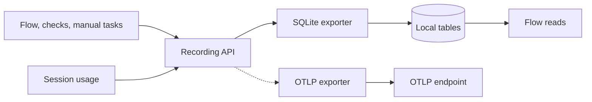
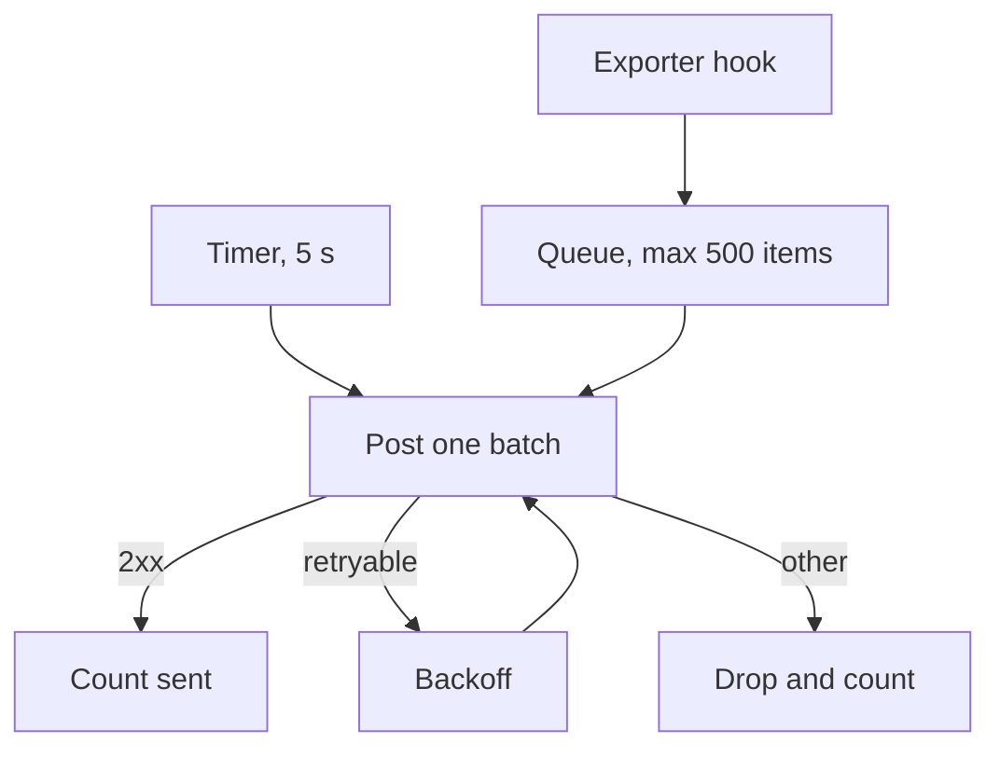

# Design: OpenTelemetry recording and export of task timing

`OT` numbers are in this spec's `requirements.md`. `SM` numbers and `§D`
sections of the `simplify` spec are in `.kiro/specs/simplify/`. Paths under
`src/app/` are in the Avoozl repository.

## D1. Shape (OT1, OT13)

Every writer of timing calls one recording API. The API hands each span and
point to the registered exporters.



The dotted line is the opt-in path. The folder `src/app/telemetry/` holds:

| File | Job |
| --- | --- |
| `stages.mjs` | `STAGES`, the closed list of stage names |
| `record.mjs` | The recording API, the allowlist and the exporter list |
| `sqlite-exporter.mjs` | Writes and prunes the local tables; the reads Flow uses |
| `usage.mjs` | Reads a session's usage rows and records them as points |
| `otlp.mjs` | Builds OTLP JSON bodies from recorded spans and points |
| `queue.mjs` | Holds items in memory, bounded, oldest dropped first |
| `send.mjs` | Posts a batch, retries, classifies failures, keeps the counters |
| `config.mjs` | Reads the machine setting and the `OTEL_EXPORTER_OTLP_*` environment |
| `state.mjs` | Reads and writes the instance ID in the state folder |
| `index.mjs` | `startTelemetry(context)`: registers the exporters and the send timer |

Flow imports from `src/app/telemetry/`, and `src/app/telemetry/` imports
nothing from `src/app/flow/`. Outside itself it reads session bindings, the
session executor's usage call (`gatewayUsageTurns`), the host config's state
folder and the store handle. Nothing here reads planning flow, corrections,
build receipts, retros or the fix-work flag. What Flow keeps (`taskTiming`,
the stop-the-line code, the Flow numbers MCP call) reads the tables in §D4.

## D2. The recording API (OT1)

```js
telemetry.span({
  key: "a1:1:coding:2025-11-20T03:00:00.000Z",
  taskId: "a1", repo: "acme/app", spec: "acme-cache",
  stage: "coding", role: "worker", attempt: 1, harness: "claude",
  source: "tool-calls", detail: "npm test",
  startedAt: "2025-11-20T03:00:00.000Z", endedAt: null,
});
telemetry.dropSpan(key);
telemetry.point({
  id: "slot-7@2025-11-20T03:04:00.000Z:input",
  name: "avoozl.tokens", kind: "sum", value: 18200, at,
  taskId: "a1", repo, spec, stage: "coding", role: "worker",
  harness: "claude", model: "model-x", attrs: { direction: "input" },
});
telemetry.finishTask({ taskId, repo, spec, finishedAt, outcome, firstPass,
  manual });
```

`span` derives `span_id` and `trace_id` (§D7) from the key and the task, and
upserts. When the row already holds these values it returns `false` and no
exporter sees it. `point` inserts by `id` and ignores a repeat. Each call is
checked against the allowlist (§D8) before any exporter runs.

`finishTask` reads the task's stage spans, then in one transaction:

1. records the root span `avoozl.task` from the earliest stage start to
   `finishedAt`, with `outcome`, `first_pass` and `attempts`;
2. records the task-level points: one `avoozl.task.lead_time`, one
   `avoozl.stage.duration` for each stage with time, and one
   `avoozl.tasks.finished`;
3. when the root row did not exist before, hands the OTLP exporter the
   trace (§D7).

A repeated `finishTask` finds the root row unchanged and does nothing. Flow's
pass over finished tasks calls it, so a task that finished while Avoozl was
stopped is recorded at the next pass. It reaches the OTLP exporter only if
that exporter is registered at that moment.

An exporter is `{name, onSpan?, onPoint?, onTrace?, status()}`. The SQLite
exporter is the write itself and runs first, inside the caller's
transaction. The OTLP exporter's hooks run after the commit, in a
`try/catch`, and only append to its memory queue.

### Instance ID

`state.mjs` makes `service.instance.id` once with `crypto.randomUUID()` and
keeps it in `<state folder>/telemetry.json`, the state folder that
`host-config.mjs` names. It lives outside SQLite, so a rebuild keeps it.

## D3. The local tables (OT2)

The tables are generic. A span names a trace, its parent and a task. A point
names a metric and a task. Dimensions Flow filters on are columns; the rest of
a point's attributes are one JSON text.

```sql
CREATE TABLE IF NOT EXISTS telemetry_spans(
  span_id TEXT PRIMARY KEY,
  key TEXT NOT NULL UNIQUE,
  trace_id TEXT NOT NULL,
  parent_span_id TEXT,
  name TEXT NOT NULL,
  task_id TEXT NOT NULL,
  repo TEXT,
  spec TEXT,
  stage TEXT,
  role TEXT,
  attempt INTEGER,
  harness TEXT,
  source TEXT,
  detail TEXT,
  started_at TEXT NOT NULL,
  ended_at TEXT,
  outcome TEXT,
  first_pass INTEGER,
  attempts INTEGER
);
CREATE INDEX IF NOT EXISTS telemetry_spans_task
  ON telemetry_spans(task_id, attempt, started_at);
CREATE INDEX IF NOT EXISTS telemetry_spans_trace
  ON telemetry_spans(trace_id);
CREATE INDEX IF NOT EXISTS telemetry_spans_stage
  ON telemetry_spans(stage, started_at);

CREATE TABLE IF NOT EXISTS telemetry_points(
  id TEXT PRIMARY KEY,
  name TEXT NOT NULL,
  kind TEXT NOT NULL,
  unit TEXT,
  at TEXT NOT NULL,
  value REAL NOT NULL,
  task_id TEXT,
  trace_id TEXT,
  repo TEXT,
  spec TEXT,
  stage TEXT,
  role TEXT,
  harness TEXT,
  model TEXT,
  attrs TEXT
);
CREATE INDEX IF NOT EXISTS telemetry_points_name
  ON telemetry_points(name, at);
CREATE INDEX IF NOT EXISTS telemetry_points_task
  ON telemetry_points(task_id, name);
```

| Row | Meaning |
| --- | --- |
| Root span | `name` is `avoozl.task`, `parent_span_id` and `stage` are null, `ended_at` is the finish time, `outcome`, `first_pass` and `attempts` are set |
| Stage span | `name` is `avoozl.stage.<stage>`, `parent_span_id` is the root's ID, `ended_at` is null while the stage is open |
| Sum point | One observation to add: `kind` is `sum`, `value` is the amount |
| Histogram point | One observation: `kind` is `histogram`, `value` is the seconds |

A stage span's `parent_span_id` is set from the trace's derived root ID, so
it is right before the root row exists. `key` is the stable string the writer
passes, so Flow can find and drop its own span. The tables hold only the
columns above: a field that is not a column, or a value the allowlist
refuses, is refused (§D8).

`attrs` holds `direction`, `outcome`, `first_pass`, `scope`, `kind` and
`event`, written with `JSON.stringify` and read only through the point's
name.

## D4. How Flow reads move (OT3)

Flow keeps its function names and return shapes. Their bodies read the local
tables, and the writers call the API.

| Flow code | Reads or writes | Moves to |
| --- | --- | --- |
| `listSpans(store, {taskId})` | `flow_spans` | `SELECT` on `telemetry_spans` where `parent_span_id IS NOT NULL` (and `task_id=?`), ordered by `started_at, span_id`, with `key` returned as `id` and `ended_at` as `endedAt` |
| `recordSpan(store, span)` | | `telemetry.span`, with the task's repository and spec |
| A dropped span in the tool-call path | | `telemetry.dropSpan` |
| `taskTiming` | `listSpans`, `task_deliveries` | Unchanged |
| A finished task in Flow's pass | | `telemetry.finishTask`, once per task with a stage span here |
| `putStop(store, stop)` | `flow_stops` | `flow_stops` as before, plus `telemetry.point` for `avoozl.stop_the_line.events` when a stop opens or closes |

Every writer of a span calls `recordSpan`: Flow's report, decision,
tool-call and sync paths in `flow.mjs`, the check runs in
`delivery/check-runs.mjs`, the plugin check decision in
`plugins/check-decide.mjs`, the manual task in `tasks/manual-tasks.mjs`, the
worker's phase mark and the rebuild from landing trailers in
`api/operations.mjs`. `recordSpan` hands `telemetry.span` the same fields, a
`key` equal to the id the writer builds, and the task's repository and spec,
so every span of one task names one trace.

Tokens and credits come from `usage.mjs`. On each app backend pass, for each
session the tick opened, it calls `gatewayUsageTurns(slot)` until the
session ends, and for each turn row it records up to three points:
`avoozl.tokens` with `direction` `input`, `avoozl.tokens` with `direction`
`output`, and `avoozl.credits`. A token point's `id` is
`<slot>@<ts>:<name>:<direction>` and a credit point's
`<slot>@<ts>:avoozl.credits`, so a turn read twice records once. The `stage`
is the stage span of the binding's attempt that holds `ts`, or
`unattributed`. Without a gateway there is no usage call and no point. Only
counts are recorded, never row text.

Flow's tests seed spans through `recordSpan`, and their assertions stay as
they are (OT3.2).

## D5. Retention, size and rebuild (OT2)

Retention is two fixed values and two caps in `sqlite-exporter.mjs`:

| Table | Age limit | Cap | Pruned to |
| --- | --- | --- | --- |
| `telemetry_spans` | 90 days | 200,000 rows | 180,000 rows |
| `telemetry_points` | 90 days | 1,000,000 rows | 900,000 rows |

A row is about 250 bytes, so the two tables stay near 300 MB at their caps.
Pruning is by trace for spans, so a trace is never left without its root:

1. A trace is finished when its root row exists. Its age is its newest
   `ended_at`, or `started_at` for an open span.
2. Delete each finished trace older than 90 days, oldest first.
3. While the table is over its cap, delete finished traces oldest first until
   it holds 90 percent of the cap. A trace with an open span and a time in
   the last 7 days is kept.
4. Delete points older than 90 days, then oldest first to 90 percent of the
   cap.

Pruning runs once when the database opens and then after every 500 writes, at
most once in 10 minutes, as its own transaction after the write's commit.

The tables are a local cache of what happened on this machine. `avoozl
rebuild` makes a fresh database from git: the points table starts empty, and
the spans table holds the stage spans each landing commit carries in its
`Avoozl-Span` trailers. Flow's next pass records those tasks' roots and
task points again. The OTLP
exporter keeps nothing in SQLite, so a rebuild does not touch it, and the
instance ID in the state folder is kept.

## D6. The OTLP setting and the environment (OT4, OT5, OT6)

The setting is one key in machine config:

```json
{
  "telemetry": {
    "enabled": true
  }
}
```

Everything else is the standard environment of the process that runs the
tick:

```sh
export OTEL_EXPORTER_OTLP_ENDPOINT=https://otlp.acme.example:4318
export OTEL_EXPORTER_OTLP_HEADERS="authorization=Bearer ${ACME_OTLP_TOKEN}"
avoozl tick
```

`config.mjs` returns `{enabled, endpoints, headerNames, headers, timeoutMs,
protocol, status}`. `headers` stays inside `send.mjs`'s closure and is not part
of any value `status()` returns.

| Case | `status` |
| --- | --- |
| No `telemetry` key, or `enabled` false | `off` |
| Enabled, no endpoint | `no-endpoint` |
| Protocol is not `http/json` (an unset one is) | `protocol` |
| Endpoint is `http` and the host is not loopback | `endpoint-not-allowed` |
| Otherwise | `ready`, then `sending` or `backing-off` |

`startTelemetry` registers the SQLite exporter when the database opens. In the
process that runs the tick it also starts a 5-second `unref`'d timer. Each
pass reads machine config: when the setting is on and the status is `ready`,
it registers the OTLP exporter and sends; when the setting is off it
unregisters the exporter and empties its queue. Any other process, such as a
CLI call or the MCP server, records to SQLite only.

`validateTelemetry(value)` sits beside `validateServe` and refuses a key other
than `enabled` and a value that is not a boolean. `assertNoMachineKeys` in
`landing-config.mjs` gains `telemetry`, so a `.avoozl.json` that holds it
fails with the file and the machine config path, as `serve` and
`notifications` do. Plugin lint refuses a manifest key `telemetry`. The
operation `telemetry.configure` is a `person(...)` entry in the operation
table; `telemetry.status` is `observe`, and its MCP policy is `notOnMcp`
because a chat has no use for it.

The code that builds an agent process's environment drops every name that
starts with `OTEL_` (OT6.6). A test starts a fake harness and reads its
environment.

## D7. The trace (OT7)

`trace_id` is the first 16 bytes of
`sha256("avoozl.trace\n" + repo + "\n" + spec + "\n" + taskId)` as 32 hex
characters. A span's ID is the first 8 bytes of
`sha256(instanceId + "\n" + key)`, and the root's is the same over
`instanceId + "\n" + "root:" + taskId`. The same input always gives the same
ID, so a repeated export replaces the earlier one in a backend that merges by
ID.

Two machines that each ran an attempt of one task share the trace ID and
each send a root of their own, so the trace shows both as siblings. A machine
sends only the spans in its own database, and a task it saw finish with no
local stage span sends nothing (OT7.6).

One trace for a task that landed:

```json
{
  "resourceSpans": [
    {
      "resource": {
        "attributes": [
          {
            "key": "service.name",
            "value": {
              "stringValue": "avoozl"
            }
          }
        ]
      },
      "scopeSpans": [
        {
          "scope": {
            "name": "avoozl"
          },
          "spans": [
            {
              "traceId": "5b8efff798038103d269b633813fc60c",
              "spanId": "eee19b7ec3c1b174",
              "name": "avoozl.task",
              "kind": 1,
              "startTimeUnixNano": "1763600000000000000",
              "endTimeUnixNano": "1763601800000000000",
              "attributes": [
                {
                  "key": "avoozl.outcome",
                  "value": {
                    "stringValue": "landed"
                  }
                }
              ]
            }
          ]
        }
      ]
    }
  ]
}
```

The example keeps one span and one attribute. A real root also holds
`avoozl.repo`, `avoozl.spec`, `avoozl.task.id`, `avoozl.first_pass` and
`avoozl.attempts`, and each stage span follows as a child with
`parentSpanId` set to the root's ID.

Times are the stored ISO strings converted to nanoseconds as decimal strings,
as OTLP JSON requires. IDs are lowercase hex, not base64. A span with no
`ended_at`, or one that ends before it starts, is skipped. `avoozl.attempts` is
the highest `attempt` among the spans, or 1. `avoozl.model` on a stage span is
the model of the token points inside the span's time, sent only when those
points name one model.

## D8. The allowlist (OT1, OT9)

`record.mjs` holds one table, and no other code adds a field:

```js
const FIELDS = {
  span: ["key", "taskId", "repo", "spec", "stage", "role", "attempt",
    "harness", "source", "detail", "startedAt", "endedAt"],
  point: ["id", "name", "kind", "unit", "value", "at", "taskId", "repo",
    "spec", "stage", "role", "harness", "model", "attrs"],
  export: ["repo", "spec", "task.id", "stage", "role", "attempt", "harness",
    "model", "source", "outcome", "first_pass", "attempts", "direction",
    "scope", "kind", "event"],
};
```

`span` and `point` refuse a field not in their list. A value is refused when
it is not a string, boolean or finite number; a string is longer than 128
characters or holds a control character; a `spec` holds a character outside
`A-Z a-z 0-9 . _ -`; a `stage` is not in `STAGES`; or a role, harness or
model does not match `A-Za-z0-9._:/-`. The caller passes the spec's folder
name (`task.planId`), never a path.

`detail` is a check or command name that passes the content rules, as Flow
shows it. It is recorded and never exported: `export` lists every attribute the
OTLP exporter may build, and `detail` and `taskId` on a metric are not in it.

The canary tests (OT9.5) check the list: they seed each forbidden field and
compare every table row and request body, so a field added elsewhere fails
even when nobody edits the table.

## D9. Instruments (OT8)

The OTLP exporter turns points into instruments, all with
`aggregationTemporality` 1 (delta):

| Instrument | From |
| --- | --- |
| `avoozl.task.lead_time` | One histogram data point per `histogram` point of that name |
| `avoozl.stage.duration` | One per stage point |
| `avoozl.tasks.finished` | One sum data point per point |
| `avoozl.tokens`, `avoozl.credits` | One sum data point per point |
| `avoozl.stop_the_line.events` | One sum data point per point |

Histograms use explicit bounds in seconds:
`[30, 60, 120, 300, 600, 1800, 3600, 7200, 14400, 28800, 86400]`. They are the
same for every histogram, so a backend can sum them across machines. A batch of
up to 100 points becomes one `resourceMetrics` body, and the task ID is left
off every data point.

Delta points suit Honeycomb, Datadog and a collector. A Prometheus-style
backend needs a collector's `deltatocumulative` step; the docs say so.

A stop-the-line event is one point of 1 when a `flow_stops` row appears
(`pulled`) and one when `closedAt` is set (`resumed`). `kind` is `manual` when
the row's `manual` is true, else `check`.

## D10. Queue, send and failure (OT10)



A hook appends one trace, or adds a point to the open points item (up to 100,
then another item). When the queue holds 500 items, the oldest is dropped and
`dropped` goes up by the item's trace or points. A timer pass sends up to 20
items in one traces request and one metrics request.

Hooks do no I/O and never await. The tick does not call the exporter. The
timer's pass reads machine config with one synchronous file read.

Retries are 1, 2, 4, 8 and 16 seconds, each with up to 25 percent jitter and
capped at 60, or the `Retry-After` value when the response has one. The fifth
failure drops the batch and adds it to `dropped`. A `4xx` other than `429`
adds it to `rejected`, with no retry: the endpoint will not take it.

`fetch` gets `redirect: "manual"` and `signal: AbortSignal.timeout(timeoutMs)`.
A reply with a redirect status counts as `http 3xx`.

Counters (`sent`, `queued`, `dropped`, `rejected`, `lastSuccessAt`,
`lastFailure`) live in memory. A send that succeeds after a timed-out request
that the endpoint did receive sends a batch twice, which a backend that merges
traces by ID shows once and a delta metric counts twice. A stop of Avoozl
loses the queue. The docs say so.

## D11. Settings, CLI and status (OT11)

`telemetry.status` returns:

```json
{
  "status": "backing-off",
  "failure": "http 503",
  "endpoint": "https://otlp.acme.example:4318",
  "protocol": "http/json",
  "headerNames": [
    "authorization"
  ],
  "sent": 41,
  "queued": 3,
  "dropped": 0,
  "rejected": 0,
  "lastSuccessAt": "2025-11-20T03:12:09.000Z",
  "local": {
    "spans": 5120,
    "points": 48210
  }
}
```

The endpoint is rebuilt from `URL.protocol`, `host` and `port`, so a user,
password, path or query in the variable never shows. `failure` is one of
`timeout`, `refused`, `tls`, `dns`, `http <status>`, built from the error's
`code` and the status, never from its message. `local` holds `count(*)` of
each table.

**Settings** shows these fields in a titled box **Telemetry**. The switch
calls `telemetry.configure`. The page reads `telemetry.status` through its
usual query and adds no timer of its own. The CLI has
`avoozl telemetry status|enable|disable`, as three entries in
`src/app/commands/`.

The box uses the components Settings already uses for other machine settings.
The change needs phone and desktop, light and dark screenshots for the owner,
shown in chat and not committed.

## D12. Security review (OT9, OT12)

Data that leaves the machine, when the OTLP exporter is on:

| Data | Example | Leaves |
| --- | --- | --- |
| Repository ID | `acme/app` | Yes |
| Spec folder name | `acme-cache` | Yes |
| Task ID | `1.2` | Yes, traces only |
| Role, harness, model | `worker`, `claude`, `model-x` | Yes |
| Stage names, times, outcome, first pass | `coding`, 14 minutes | Yes |
| Token and credit counts | 18200 input | Yes |
| Service instance ID | A random UUID | Yes |
| Stop-the-line kind, scope | `check`, `dependents` | Yes |
| Prompts, output, diffs, file contents | | Never |
| Titles, done text, commit messages | | Never |
| Check and command names, span `detail` | | Never |
| Paths, branch names, worktree paths | | Never |
| Names, emails, GitHub logins | | Never |
| Header values, tokens | | Never |

The local tables hold the same fields plus `detail` and the task ID on points,
and stay in Avoozl's database on this machine. They are as private as the
rest of that database.

A private repository's ID and spec name do leave, because the export is of no
use without them. The owner chooses the backend, and the switch is the
owner's. No setting hides these names (§D15).

Transport (OT12): `https`, or `http` to loopback for a local collector. The
system trust store decides certificate validity, and there is no setting that
skips it. A redirect is a failure, so a header never goes to a host the
owner did not name. The header names the owner sets are the only header
beyond content type and user agent.

Credentials (OT6.3): the header values live in the process environment. They
sit in a closure in `send.mjs`. No logger, status, error, state file or table
receives them. A test sets a header value to a canary and greps the log, the
state file, the status reply and every table.

A hostile or wrong endpoint can read what is in the table above and can
answer with a large body. The exporter reads no response body, so a large one
does nothing.

Exposure rule: the exporters open no listening socket and add no route. The
OTLP exporter makes outbound requests to the one endpoint the owner sets, so
nothing here makes Avoozl reachable by another machine.

## D13. Why Avoozl's own recording API and a hand-written OTLP exporter (OT14)

Three choices:

1. **SDK as the recording path.** Writers call the official `@opentelemetry/api`
   and `sdk-trace-base`, `sdk-metrics`. A small SQLite `SpanExporter` and
   `PushMetricExporter` write the local tables, and the official
   `exporter-*-otlp-http` packages send.
2. **Own recording API, official exporters for the wire.** Avoozl builds
   plain span and metric objects and passes them to the official OTLP/HTTP
   exporters.
3. **Own recording API, hand-written OTLP/HTTP JSON exporter.**

This spec takes 3. Choice 1 does not fit the data Avoozl records.

| Need | Official SDK as the recording path |
| --- | --- |
| Flow shows a stage that is still open | A `SpanExporter` sees a span only when it ends. Only a `SpanProcessor.onStart` sees an open one, and it cannot see a later change |
| Flow rewrites and drops spans after the fact: the tool-call sync replaces a span's times and removes spans it no longer finds | An ended SDK span is immutable. A change is a second span, which an OTLP backend shows as a duplicate |
| A span has the ID of its key, so a repeated trace replaces the earlier one | The tracer picks random IDs. A custom `IdGenerator` cannot see the key, and the span's parent is a live context, not a stored ID |
| Most spans are built after the work, from stored times | Spans take explicit start and end times; this works |
| A metric point keeps its task ID in the local table and loses it on export | The SDK aggregates in process. A task ID attribute makes one series per task, and a `PushMetricExporter` gets the aggregate, not each observation. A view drops the attribute for every exporter, not only OTLP |
| A usage row is recorded at the time of its turn, hours later | Instruments record at the time of the call, with no timestamp argument |

Choice 2 keeps those answers and swaps the wire code. It adds about 13
packages: `api`, `api-logs`, `core`, `resources`, `sdk-trace`, `sdk-trace-base`,
`sdk-metrics`, `sdk-logs`, `otlp-transformer`, `otlp-exporter-base`,
`semantic-conventions` and the two exporters. The current exporter packages
(0.301.x, on `sdk-trace` and `sdk-metrics` 3.1.x) declare Node 22.15 or later,
and Avoozl declares 22.13. The 0.x exporters and the 2.x and 3.x SDK
packages move on separate version numbers. Avoozl would build its objects in
the SDK's `ReadableSpan` and `ResourceMetrics` shapes, which are the SDK's
internal data types, and the exporters add their own headers, compression
and retry rules that OT12 pins down.

| | Official exporters (choice 2) | Hand-written OTLP/HTTP JSON (choice 3) |
| --- | --- | --- |
| Runtime dependencies | About 13 packages, in a package whose backend has none | None |
| Node floor | 22.15 | Avoozl's 22.13 |
| Wire correctness | Maintained upstream | The OTLP/JSON shape for traces and metrics is small and stable; a test checks it |
| `OTEL_EXPORTER_OTLP_*` | Read by the package, including variables Avoozl does not want, such as certificate and compression settings | Read by Avoozl: the eight names OT6 lists |
| Limits OT10 and OT12 set (`https` or loopback, no redirect, header names only, bounded queue, drop oldest, counters) | Wrapped around the package, or checked by tests of its behavior | Written into the exporter and tested directly |
| Windows | Works | Works; `fetch` and `crypto` are built in |
| Protocols | Protobuf and JSON | `http/json` only |
| Supply chain | More packages to audit and update | None added |

The cost of choice 3 is that protobuf and gRPC endpoints need a collector in
front, which every backend accepts, and that Avoozl follows the OTLP JSON
rules itself: lowercase hex IDs, 64-bit integers as strings, `camelCase`
field names. The exporter is two small files (`otlp.mjs`, `send.mjs`), and the
recording API and the exporter interface stay the same if a later change
swaps them for the official packages (§D15).

## D14. Tests and the proof (OT1 to OT14)

Unit tests use a temporary store and no network. The structure test builds one
trace body and one metrics body and checks each field's type against the OTLP
JSON rules. The fake collector is an `http.createServer` on `127.0.0.1` that
records each request and answers with a status the test sets.

The proof task runs Avoozl against a scratch repository with a bare remote,
as `scripts/proofs/` does for other features. It seeds one two-task spec as
an approved plan and lands both tasks by direct landing, with a scripted
worker commit standing in for the harness, first with OTLP off, then with
`telemetry.enabled` and the endpoint set to the fake collector's loopback URL.

With OTLP off, the collector receives no request and `taskTiming` for each
task reads from `telemetry_spans`. With it on, the collector gets one trace
for each task with the root and the stage spans, the metrics for both, and no
canary, and the root's times equal the stored spans'. The proof then sets the
collector to hold its reply open and lands a third task. It passes when the
task lands while the collector's request is still unanswered, which shows
landing never waits on the export. It then makes the collector answer `503`
and checks `telemetry.status` says **Backing off**. Last it runs `avoozl
rebuild` on an empty database and checks the points table is empty, the
spans table holds only the landing trailers' spans, and the instance ID is
unchanged.

## D15. Limits and choices

| Topic | Design |
| --- | --- |
| In-flight tasks | The OTLP exporter sends a task's trace when the task finishes. A task in flight shows in Avoozl's own page |
| Repository and spec names | They are sent as they are. No setting hashes or hides them |
| Metric temporality | Delta. A Prometheus-style backend needs a collector's `deltatocumulative` step, because cumulative totals would have to survive a rebuild |
| Logs | Not recorded and not exported. Traces and metrics carry the flow data |
| Records before enabling | Not sent. Export starts at the time it is switched on |
| Endpoints | One endpoint per machine, with no per-repository switch. A collector fans out |
| Protocols | `http/json` only. `http/protobuf` and gRPC need a collector in front |
| Outbox | None. The queue is in memory, and the local tables hold the full record |
| Local retention and caps | Fixed values in code (§D5), with no setting |
| Official exporter packages | Not used (§D13). `otlp.mjs` and `send.mjs` are the only files that hold wire code, and the recording API does not depend on them |
