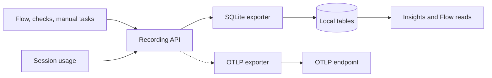
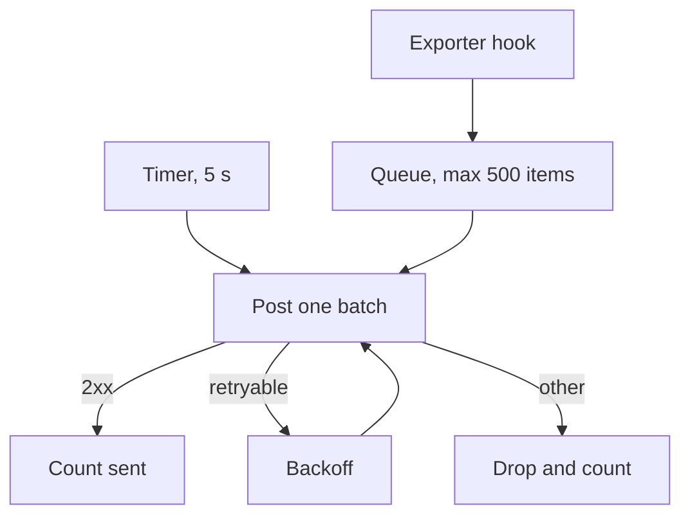
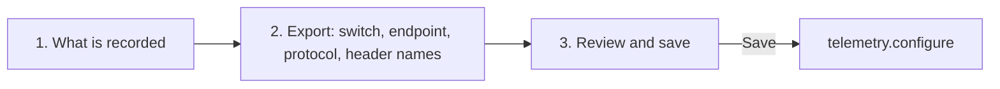

# OpenTelemetry recording and export of task timing

## Requirements

### Introduction

Avoozl records each task's timing as OpenTelemetry spans and metric points,
through one recording API. Two exporters receive what is recorded. The SQLite
exporter is built in and always on: it writes Avoozl's local store, and
Insights and Flow read from it. The OTLP exporter is a second, opt-in exporter beside it: it
sends the same data to any backend that takes OTLP, such as Grafana,
Honeycomb, Datadog or CloudWatch, so a team that runs Avoozl on several
machines can follow the flow of work in one place.

OTLP export is off by default, set only in machine config, best effort, and
never slows delivery. It sends one trace per task and metrics for lead time,
first-pass rate, tokens, credits and stop-the-line events, and nothing that
says what the work was. Avoozl holds no code for any one backend.

#### Words

| Term | Meaning |
| --- | --- |
| Recording API | The functions in `src/app/telemetry/record.ts` that every writer of timing calls: `span`, `dropSpan`, `point` and `finishTask` |
| Exporter | A sink the recording API hands each recorded span and point to |
| SQLite exporter | The built-in exporter. It writes `telemetry_spans` and `telemetry_points` in Avoozl's database |
| OTLP exporter | The opt-in exporter. It sends OTLP/HTTP JSON to an endpoint |
| OTLP | The OpenTelemetry protocol: the JSON body a backend or collector accepts at `/v1/traces` and `/v1/metrics` |
| Point | One observation of a metric: a name, a value, a time and attributes |
| Stage | One of the names in `STAGES`: `queued`, `coding`, `tests`, `commands`, `checks`, `ci-wait`, `review`, `rework`, `merge`, `waiting` |
| Stage span | A span for one stage of one task attempt, a child of the task's root span |
| Finished task | A task that landed, or a manual task a person marked done |
| Machine config | The `config.json` in this machine's Avoozl config folder, which `.avoozl.json` cannot set |
| Collector | An OpenTelemetry Collector or a vendor agent that takes OTLP and forwards it |

#### Scope

In scope: the recording API, the local tables and their retention, the
Insights reads, the OTLP exporter and its machine setting, status in Settings and the
CLI, and tests. Out of scope: logs, a pull-based metrics endpoint, protobuf
or gRPC, sampling, and any exporter other than these two.


#### Requirement OT1: One recording path

**User story:** As a maintainer, I want every timing record to go through one
API, so that the local store and any exporter see the same data.

##### Acceptance criteria

1. Avoozl SHALL record timing only through the recording API. No other code
   SHALL write `telemetry_spans` or `telemetry_points`, keep a table of its
   own for spans or usage, or call an exporter.
2. The API SHALL hand each recorded span and point to every registered
   exporter. The SQLite exporter SHALL be registered when the database
   opens, before any other, and no setting SHALL turn it off.
3. `span` SHALL record a span by a stable key, with `endedAt` unset while the
   stage is open, and SHALL replace the span of that key when called again.
   `dropSpan` SHALL remove one by key. `point` SHALL record one observation by
   a stable ID. `finishTask` SHALL record the task's root span and its
   task-level points.
4. Recording the same span key with the same values, or the same point ID
   twice, SHALL change nothing and SHALL reach no other exporter.
5. The API SHALL accept only the fields in the allowlist (§D8). It SHALL
   refuse a field that is not in it, and a string that is not allowed for
   its field.
6. A failure in an exporter other than the SQLite exporter SHALL NOT make a
   call to the API throw or wait. A SQLite write failure SHALL throw to the
   caller, as a database write does.

#### Requirement OT2: The local store

**User story:** As someone who reads Insights, I want timing kept on this
machine without any setup, so that Insights works before anyone has heard of
OTLP.

##### Acceptance criteria

1. The SQLite exporter SHALL write two generic tables, `telemetry_spans` and
   `telemetry_points`, with the columns §D3 gives: spans keyed by span ID,
   with trace ID, parent, task ID, stage and times; points keyed by ID, with
   name, kind, value, time, task ID and stage.
2. A span row SHALL hold the check or command name a stage ran in `detail`,
   and the OTLP exporter SHALL NOT send it.
3. Avoozl SHALL delete a finished trace whose newest time is older than 90
   days, and a point older than 90 days.
4. WHEN a table holds more than its cap THEN Avoozl SHALL delete the oldest
   finished traces, or the oldest points, until the table is at 90 percent of
   the cap. The caps are 200,000 spans and 1,000,000 points. It SHALL NOT
   delete a trace that has an open span and was active in the last 7 days.
5. Pruning SHALL run when the database opens and then after 500 writes, at
   most once in 10 minutes, and SHALL NOT run inside a write's transaction.
6. `avoozl rebuild` SHALL give a database whose spans and points tables are
   empty. Avoozl SHALL NOT recreate timing from git, GitHub or sessions.
7. The retention and caps SHALL be fixed values in code with no setting.

#### Requirement OT3: Insights reads the local store

**User story:** As someone who reads Insights, I want its numbers to come from
the same records an exporter sends, so that a backend and Insights agree.

##### Acceptance criteria

1. Insights' finished tasks, lead time, time per stage, review rounds and
   first-pass rate SHALL be queries on `telemetry_spans` and
   `telemetry_points`. These are the Insights view, the `insights.view`
   operation on MCP, and `avoozl insights`.
2. Flow's `listSpans` and `taskTiming`, which `flow.view` and `avoozl flow`
   read, SHALL read `telemetry_spans` through `listStageSpans`, and Flow's
   tests SHALL seed spans only through the recording API.
3. Stop-the-line state SHALL stay in `flow_stops`. Each stop and each resume
   SHALL also be recorded as a point.
4. Flow SHALL write no timing of its own. A Flow pass that finds a finished
   task calls `finishTask`.

#### Requirement OT4: OTLP export is off by default

**User story:** As a person who has not asked for telemetry, I want Avoozl to
send nothing off this machine, so that I never have to check.

##### Acceptance criteria

1. WHEN machine config has no `telemetry` key THEN the OTLP exporter SHALL not
   be registered, SHALL open no network connection and SHALL build no OTLP
   body. The SQLite exporter SHALL still record.
2. WHEN `telemetry.enabled` is `true` and no endpoint is set in the
   environment or machine config THEN the OTLP exporter SHALL stay idle and
   Settings SHALL show **Recording locally · export waiting for an
   endpoint**.
3. WHEN `telemetry.enabled` is `false` or removed THEN a running OTLP
   exporter SHALL stop at its next pass and drop its queue without sending.
4. Enabling SHALL send only what is recorded after it is enabled. Avoozl SHALL
   NOT read the local tables to send earlier records.

#### Requirement OT5: Machine config only

**User story:** As a person who runs Avoozl for a team, I want only the owner
of this machine to turn export on, so that a repository, a plugin or an agent
cannot start sending data out.

##### Acceptance criteria

1. The `telemetry` key SHALL be read from machine config only. A `telemetry`
   key in `.avoozl.json`, at the workspace or in a repository, SHALL be a
   configuration error that names the file and the machine config path.
2. A plugin part SHALL NOT read, write or declare telemetry settings, and
   plugin lint SHALL refuse a manifest that names one.
3. The operation that writes `telemetry` SHALL be person-only: MCP calls and
   app tokens SHALL be refused, as for every person-only operation.
4. The `telemetry` object SHALL take the keys `enabled` (`true` or
   `false`), `endpoint` (an endpoint OT12.1 allows, with no user, password,
   query or fragment), `protocol` (`http/json`) and `headers` (a list of at
   most 20 header names). It SHALL refuse any other key and any other value,
   and a header list entry that holds a value.
5. No agent prompt, brief or skill SHALL tell an agent how to change the
   setting.

#### Requirement OT6: Endpoint and headers from machine config and the OTLP environment

**User story:** As someone who already points other tools at a collector, I
want the standard OTLP variables to work, and as someone who starts Avoozl
from a desktop app, I want to save the endpoint in Settings, so that I
configure one place.

##### Acceptance criteria

1. The OTLP exporter SHALL read `OTEL_EXPORTER_OTLP_ENDPOINT`,
   `OTEL_EXPORTER_OTLP_TRACES_ENDPOINT`,
   `OTEL_EXPORTER_OTLP_METRICS_ENDPOINT`, `OTEL_EXPORTER_OTLP_HEADERS`,
   `OTEL_EXPORTER_OTLP_PROTOCOL`, `OTEL_EXPORTER_OTLP_TIMEOUT`,
   `OTEL_SERVICE_NAME` and `OTEL_RESOURCE_ATTRIBUTES`, with the meaning the
   OpenTelemetry specification gives them. A signal's own endpoint SHALL beat
   the shared endpoint, and only the shared endpoint gets `/v1/traces` or
   `/v1/metrics` appended.
2. A variable that is set SHALL beat the saved `telemetry.endpoint` and
   `telemetry.protocol`. With no endpoint variable, the saved endpoint SHALL
   be the shared endpoint.
3. The exporter SHALL support the protocol `http/json` only. It SHALL treat an
   unset protocol as `http/json`, and SHALL treat `grpc` and `http/protobuf`
   as unsupported: Settings SHALL show **Recording locally · export protocol
   not supported** and the exporter SHALL send nothing.
4. Header values SHALL come from `OTEL_EXPORTER_OTLP_HEADERS` on each start.
   Avoozl SHALL NOT write them to machine config, the database, a log, a
   receipt, a status reply or a test fixture.
5. WHEN `telemetry.headers` names a header that `OTEL_EXPORTER_OTLP_HEADERS`
   does not hold THEN the exporter SHALL send nothing and Settings SHALL show
   **Recording locally · export waiting for header values** and the missing
   name.
6. Settings, the status operation and the CLI SHALL show header names and
   never header values, and the endpoint as scheme, host and port only.
7. `OTEL_SERVICE_NAME` SHALL default to `avoozl`. `service.instance.id` SHALL
   be a random identifier Avoozl makes once per machine (§D2), so flow from
   several machines stays apart.
8. A process that Avoozl starts for an agent SHALL NOT receive any `OTEL_`
   variable from Avoozl's own environment, so a coding agent's own tools do
   not send to the team's backend by accident.

#### Requirement OT7: One trace per task

**User story:** As a lead, I want to open one trace for a task and see where
its time went, so that I find the slow stage without a database.

##### Acceptance criteria

1. Avoozl SHALL record, for each task attempt, one stage span per stage the
   attempt ran, named `avoozl.stage.<stage>`, and WHEN the task finishes THEN
   `finishTask` SHALL record a root span `avoozl.task` from the task's
   earliest stage start to its finish, the parent of every stage span.
2. WHEN `finishTask` records a root span for the first time and the OTLP
   exporter is registered THEN the exporter SHALL queue one trace: the root
   and the task's stage spans.
3. The trace ID SHALL be derived from the repository, spec folder and task ID
   alone, and each span ID from the machine's instance ID and the span's key,
   so a trace sent twice replaces the earlier one in a backend that merges by
   ID, and two machines that worked on one task add to one trace.
4. The root span SHALL carry `avoozl.repo`, `avoozl.spec`, `avoozl.task.id`,
   `avoozl.outcome` (`landed` or `done`), `avoozl.first_pass` (boolean) and
   `avoozl.attempts`.
5. A stage span SHALL carry `avoozl.repo`, `avoozl.spec`, `avoozl.task.id`,
   `avoozl.stage`, `avoozl.role`, `avoozl.attempt`, `avoozl.harness`,
   `avoozl.model` and `avoozl.source` (how Avoozl measured it:
   `tool-calls`, `markers` or `events`). An attribute with no recorded value
   SHALL be left out, not sent empty.
6. A task with no stage span in this machine's database SHALL send nothing
   from this machine.
7. Every span SHALL have status `unset`. Avoozl SHALL set no `error` status,
   because a slow stage is not an error.

#### Requirement OT8: Metrics

**User story:** As a lead, I want lead time, first-pass rate, token and
credit use, and stop-the-line events as numbers over time, so that I chart
them next to everything else.

##### Acceptance criteria

1. Avoozl SHALL record these metrics as points, and the OTLP exporter SHALL
   send them as these instruments:

   | Name | Kind | Unit | Attributes |
   | --- | --- | --- | --- |
   | `avoozl.task.lead_time` | histogram | `s` | repo, spec, outcome |
   | `avoozl.stage.duration` | histogram | `s` | repo, spec, stage, role |
   | `avoozl.tasks.finished` | sum | `{task}` | repo, spec, outcome, first_pass |
   | `avoozl.tokens` | sum | `{token}` | repo, spec, stage, role, harness, model, direction |
   | `avoozl.credits` | sum | `{credit}` | repo, spec, stage, role, harness, model |
   | `avoozl.stop_the_line.events` | sum | `{event}` | repo, scope, kind, event |

2. First-pass rate SHALL be the ratio of `avoozl.tasks.finished` with
   `first_pass` `true` to all of it. Avoozl SHALL NOT send a rate, so the
   backend computes it over any window and across machines.
3. An exported metric SHALL carry no task ID and no other attribute with more
   values than a repository, spec, stage, role, harness and model give. The
   local table keeps the task ID.
4. Metrics SHALL use delta temporality. Each point is sent once.
5. A manual task SHALL count in `avoozl.tasks.finished` and
   `avoozl.task.lead_time` with outcome `done`, and SHALL carry no
   `first_pass`, because first-pass rate leaves a person's step out.
6. `direction` SHALL be `input` or `output`. Avoozl SHALL read a session's
   token and credit rows from its executor and record each as a point once,
   by the row's session and time. WHEN the executor reports no rows THEN no
   token or credit point SHALL exist for that session. A point SHALL take the
   stage of the stage span that holds its time, or `unattributed`.
7. A stop-the-line event SHALL be recorded when a line stops (`event` is
   `pulled`, `kind` is `check` for Avoozl's own stop and `manual` for a
   person's or an agent's) and when it resumes (`event` is `resumed`). The
   stop's check name and reason SHALL NOT be recorded as a point attribute.

#### Requirement OT9: What is never sent

**User story:** As someone who owns the code, I want a short list of what
leaves the machine and a guarantee on the rest, so that I can approve the
export once.

##### Acceptance criteria

1. Every field the recording API accepts SHALL be in the allowlist (§D8), and
   every attribute the OTLP exporter sends SHALL be built from it.
2. Avoozl SHALL NOT record or export a prompt, a message, model output, a
   diff, a file's contents, a task title, a task's done text, a commit
   message, a command line, an issue or pull request text, or a person's name
   or email. It SHALL NOT export a check name, a span's `detail` or a branch
   name.
3. A file path SHALL NOT be recorded or exported. The spec folder's name SHALL
   be the only path-derived value, and a spec name that holds a character
   outside `A-Z a-z 0-9 . _ -` SHALL be refused.
4. The repository attribute SHALL be the repository's ID in Avoozl. A string
   value longer than 128 characters or with a control character SHALL be
   refused.
5. A test SHALL seed a task whose title, done text, branch, worktree path,
   session text and token-looking string each hold a canary, run recording
   and an export, and fail when any table row, request body, log line or
   status reply holds a canary. Another SHALL do the same with a canary in a
   span's `detail` and check only the OTLP body.

#### Requirement OT10: Best effort

**User story:** As someone who delivers with Avoozl, I want a dead collector
to cost me nothing, so that telemetry never becomes the reason work stalls.

##### Acceptance criteria

1. The OTLP exporter's hooks SHALL queue in memory and SHALL do no I/O. Sending
   SHALL run on the exporter's own timer in the process that runs the tick.
   The tick, a worker, a check and landing SHALL NOT await it or read its
   state.
2. A request SHALL time out after `OTEL_EXPORTER_OTLP_TIMEOUT` (default 10
   seconds, at most 30), and Avoozl SHALL run at most one request at a time.
3. The queue SHALL hold at most 500 items, where an item is one trace or up
   to 100 points. WHEN it is full THEN the exporter SHALL drop the oldest
   item and add its tasks or points to the dropped count.
4. WHEN a request fails with a network error, a timeout, `429`, `502`, `503`
   or `504` THEN the exporter SHALL retry with backoff from 1 second to 60
   seconds with jitter, SHALL honor `Retry-After`, and SHALL drop a batch
   after 5 attempts and count it.
5. WHEN a request gets any other status THEN the exporter SHALL drop that
   batch, count it as rejected, and NOT retry it.
6. The queue SHALL be in memory only. Items unsent at exit are lost, and
   Avoozl SHALL NOT replay them from the local tables.
7. A failing OTLP exporter SHALL NOT throw into the tick, SHALL NOT write a
   Needs you item, and SHALL NOT notify. Its failure SHALL show in Settings
   only.
8. The OTLP exporter SHALL write nothing to SQLite.

#### Requirement OT11: Settings and status

**User story:** As the machine's owner, I want to see whether telemetry is on
and whether it works, so that I notice a wrong endpoint without a backend.

##### Acceptance criteria

1. **Settings** SHALL have a box titled **Telemetry** whose first row,
   **Local store**, reads **On, always** with the local span and point
   counts, the 90-day retention and both row caps.
2. The status SHALL lead with **Recording locally ·** and then name the
   export: **export off**, **export waiting for an endpoint**, **export
   protocol not supported**, **export endpoint not allowed**, **export
   waiting for header values**, **exporting**, or **export backing off**
   with the failure's kind (`timeout`, `refused`, `tls`, `dns` or
   `http <status>`).
3. WHEN export is on THEN the box SHALL show the endpoint's scheme, host and
   port with where it came from, the protocol, each header name with where
   its value comes from, counts of sent, queued, dropped and rejected items
   and the time of the last success. Counts of items start at zero when
   Avoozl starts.
4. The box SHALL say that the `OTEL_EXPORTER_OTLP_*` environment of the
   process that runs Avoozl beats what is saved, that header values come only
   from `OTEL_EXPORTER_OTLP_HEADERS`, and that a process a desktop app starts
   may not inherit a shell's variables.
5. A **Set up export** button (**Change export** when export is on) SHALL
   open three steps: **What is recorded**, which lists what is recorded and
   says it is kept on this computer; **Export**, with an on/off switch, the
   endpoint, the protocol and the header names; and **Review and save**.
   **Save** SHALL call `telemetry.configure` once. The form SHALL refuse a
   header entry that holds a value, and an endpoint OT5.4 refuses, before it
   sends.
6. The heading and labels SHALL NOT say "OpenTelemetry" or "OTel". The word
   MAY appear once, in the protocol's help line.
7. `avoozl telemetry status` SHALL print the same status and counts.
   `avoozl telemetry enable` and `avoozl telemetry disable` SHALL write
   `telemetry.enabled` and keep the other keys, as a person-only
   operation.
8. A failure message SHALL name a kind from the list in criterion 2 and
   SHALL NOT hold a URL, a header value or a response body.

#### Requirement OT12: Transport and credentials

**User story:** As a security reviewer, I want the data to travel only over a
channel I can name, so that I can sign off.

##### Acceptance criteria

1. The OTLP exporter SHALL send only to an `https` endpoint, or to an `http`
   endpoint whose host is `localhost`, `127.0.0.1` or `::1`. Any other
   endpoint SHALL give **Endpoint not allowed** and send nothing.
2. The exporter SHALL verify the server's certificate with the system trust
   store, and SHALL NOT offer an option that turns verification off.
3. The exporter SHALL NOT follow a redirect.
4. The exporter SHALL log the endpoint's host and port when it starts, and
   SHALL log no header, no body and no URL with a user, a password or a query.
5. A request SHALL carry the headers from `OTEL_EXPORTER_OTLP_HEADERS`,
   `Content-Type: application/json` and a `User-Agent` of
   `avoozl/<version>`, and no other header.
6. The exporter SHALL make no other network call: no DNS lookup of any name
   but the endpoint's, no update check, and no call home.

#### Requirement OT13: Telemetry stands apart from Flow

**User story:** As a maintainer, I want the telemetry code to depend on as
little as possible, so that a change to Flow or Insights cannot break it.

##### Acceptance criteria

1. Code under `src/app/telemetry/` SHALL import nothing from `src/app/flow/`.
   Flow SHALL import the recording API and the reads from it. `STAGES` SHALL
   live in `src/app/telemetry/stages.ts`.
2. Code under `src/app/telemetry/` SHALL import, outside itself, only the
   session bindings, the telemetry settings validator and the store, and
   SHALL get the executor's usage rows from a reader its caller passes.
4. WHEN a stage is added to or removed from `STAGES` THEN recording and export
   SHALL follow it with no other change, and a test SHALL fail when a recorded
   stage name is not in `STAGES`.

#### Requirement OT14: No vendor code and no dependency

**User story:** As a maintainer, I want the export to stay small and neutral,
so that it costs nothing to carry.

##### Acceptance criteria

1. Avoozl SHALL add no runtime dependency for recording or export, and its
   package files SHALL gain no `@opentelemetry/*` package.
2. Avoozl SHALL hold no code, constant, URL or setting for any one backend.
   Docs MAY name Grafana, Honeycomb, Datadog and CloudWatch as example
   backends and show their endpoint variables as `OTEL_EXPORTER_OTLP_*`
   values.
3. The OTLP exporter SHALL use Node's built-in `fetch` and `crypto`, and SHALL
   work on Linux, macOS and Windows.
4. The test suite SHALL check each OTLP body against the structure the
   OpenTelemetry specification gives, with a local fake collector.

## Design

`OT` numbers are in [Requirements](#requirements). Paths under `src/app/`
are in the Avoozl repository.

### D1. Shape (OT1, OT13)

Every writer of timing calls one recording API. The API hands each span and
point to the registered exporters.



The dotted line is the opt-in path. The folder `src/app/telemetry/` holds:

| File | Job |
| --- | --- |
| `stages.ts` | `STAGES`, the closed list of stage names |
| `record.ts` | The recording API, the allowlist and the exporter list |
| `sqlite-exporter.ts` | Writes and prunes the local tables; `listStageSpans` for Flow |
| `usage.ts` | Reads a session's usage rows and records them as points |
| `otlp.ts` | Builds OTLP JSON bodies from recorded spans and points |
| `queue.ts` | Holds items in memory, bounded, oldest dropped first |
| `send.ts` | Posts a batch, retries, classifies failures, keeps the counters |
| `config.ts` | Reads the machine setting and the `OTEL_EXPORTER_OTLP_*` environment |
| `state.ts` | Reads and writes the instance ID in the state folder |
| `index.ts` | `startTelemetry(context)`: registers the exporters and the send timer |

Flow imports from `src/app/telemetry/`, and `src/app/telemetry/` imports
nothing from `src/app/flow/`. Outside itself it imports session bindings, the
telemetry settings validator and the store; the app backend passes it the
executor's usage reader (`gatewayUsageTurns`). Insights
(`src/app/insights/insights.ts`) queries the tables directly, and Flow reads
them through `listStageSpans` (§D4).

### D2. The recording API (OT1)

```js
telemetry.span({
  key: "a1:1:coding:2025-11-20T03:00:00.000Z",
  taskId: "a1", repo: "acme/app", spec: "acme-cache",
  stage: "coding", role: "worker", attempt: 1, harness: "claude",
  source: "tool-calls", detail: "npm test",
  startedAt: "2025-11-20T03:00:00.000Z", endedAt: null,
});
telemetry.dropSpan(key);
telemetry.point({
  id: "slot-7@2025-11-20T03:04:00.000Z:input",
  name: "avoozl.tokens", kind: "sum", value: 18200, at,
  taskId: "a1", repo, spec, stage: "coding", role: "worker",
  harness: "claude", model: "model-x", attrs: { direction: "input" },
});
telemetry.finishTask({ taskId, repo, spec, finishedAt, outcome, firstPass,
  manual });
```

`span` derives `span_id` and `trace_id` (§D7) from the key and the task, and
upserts. When the row already holds these values it returns `false` and no
exporter sees it. `point` inserts by `id` and ignores a repeat. Each call is
checked against the allowlist (§D8) before any exporter runs.

`finishTask` reads the task's stage spans, then in one transaction:

1. records the root span `avoozl.task` from the earliest stage start to
   `finishedAt`, with `outcome`, `first_pass` and `attempts`;
2. records the task-level points: one `avoozl.task.lead_time`, one
   `avoozl.stage.duration` for each stage with time, and one
   `avoozl.tasks.finished`;
3. when the root row did not exist before, hands the OTLP exporter the
   trace (§D7).

A repeated `finishTask` finds the root row unchanged and does nothing. Flow's
pass over finished tasks calls it, so a task that finished while Avoozl was
stopped is recorded at the next pass. It reaches the OTLP exporter only if
that exporter is registered at that moment.

An exporter is `{name, onSpan?, onPoint?, onTrace?, status()}`. The SQLite
exporter is the write itself and runs first, inside the caller's
transaction. The OTLP exporter's hooks run after the commit, in a
`try/catch`, and only append to its memory queue.

#### Instance ID

`state.ts` makes `service.instance.id` once with `crypto.randomUUID()` and
keeps it in `<state folder>/telemetry.json`, the state folder that
`src/app/settings/host-config.ts` names. It lives outside SQLite, so a
rebuild keeps it.

### D3. The local tables (OT2)

The tables are generic. A span names a trace, its parent and a task. A point
names a metric and a task. Dimensions Insights filters on are columns; the
rest of a point's attributes are one JSON text.

```sql
CREATE TABLE IF NOT EXISTS telemetry_spans(
  span_id TEXT PRIMARY KEY,
  key TEXT NOT NULL UNIQUE,
  trace_id TEXT NOT NULL,
  parent_span_id TEXT,
  name TEXT NOT NULL,
  task_id TEXT NOT NULL,
  repo TEXT,
  spec TEXT,
  stage TEXT,
  role TEXT,
  attempt INTEGER,
  harness TEXT,
  source TEXT,
  detail TEXT,
  started_at TEXT NOT NULL,
  ended_at TEXT,
  outcome TEXT,
  first_pass INTEGER,
  attempts INTEGER
);
CREATE INDEX IF NOT EXISTS telemetry_spans_task
  ON telemetry_spans(task_id, attempt, started_at);
CREATE INDEX IF NOT EXISTS telemetry_spans_trace
  ON telemetry_spans(trace_id);
CREATE INDEX IF NOT EXISTS telemetry_spans_stage
  ON telemetry_spans(stage, started_at);

CREATE TABLE IF NOT EXISTS telemetry_points(
  id TEXT PRIMARY KEY,
  name TEXT NOT NULL,
  kind TEXT NOT NULL,
  unit TEXT,
  at TEXT NOT NULL,
  value REAL NOT NULL,
  task_id TEXT,
  trace_id TEXT,
  repo TEXT,
  spec TEXT,
  stage TEXT,
  role TEXT,
  harness TEXT,
  model TEXT,
  attrs TEXT
);
CREATE INDEX IF NOT EXISTS telemetry_points_name
  ON telemetry_points(name, at);
CREATE INDEX IF NOT EXISTS telemetry_points_task
  ON telemetry_points(task_id, name);
```

| Row | Meaning |
| --- | --- |
| Root span | `name` is `avoozl.task`, `parent_span_id` and `stage` are null, `ended_at` is the finish time, `outcome`, `first_pass` and `attempts` are set |
| Stage span | `name` is `avoozl.stage.<stage>`, `parent_span_id` is the root's ID, `ended_at` is null while the stage is open |
| Sum point | One observation to add: `kind` is `sum`, `value` is the amount |
| Histogram point | One observation: `kind` is `histogram`, `value` is the seconds |

A stage span's `parent_span_id` is set from the trace's derived root ID, so
it is right before the root row exists. `key` is the stable string the writer
passes, so Flow can find and drop its own span. The tables hold only the
columns above: a field that is not a column, or a value the allowlist
refuses, is refused (§D8).

`attrs` holds `direction`, `outcome`, `first_pass`, `scope`, `kind` and
`event`, written with `JSON.stringify` and read only through the point's
name.

### D4. Readers and writers (OT3)

Insights' `telemetryInsights` queries `telemetry_spans` and
`telemetry_points` for finished tasks per day, lead time, time per stage,
review rounds and rework. Flow's code reads and writes through the API:

| Flow code (`src/app/flow/flow.ts`) | Reads or writes |
| --- | --- |
| `listSpans(store, {taskId})` | `listStageSpans`: stage spans of `telemetry_spans`, ordered by `started_at, span_id`, with `key` returned as `id` and `ended_at` as `endedAt` |
| `recordSpan(store, span)` | `telemetry.span`, with the task's repository and spec |
| A dropped span in the tool-call path | `telemetry.dropSpan` |
| `taskTiming` | `listSpans` and `task_deliveries` |
| A finished task in Flow's pass | `telemetry.finishTask`, once per task with a stage span here |
| `putStop(store, stop)` | `flow_stops`, plus `telemetry.point` for `avoozl.stop_the_line.events` when a stop opens or closes |

Every writer of a span calls `recordSpan`: Flow's report (including the
worker's phase marks), decision, tool-call and sync paths in `flow.ts`, the
check runs in `delivery/check-runs.ts`, the plugin check decision in
`plugins/check-decide.ts` and the manual task in `tasks/manual-tasks.ts`.
`recordSpan` hands `telemetry.span` the same fields, a `key` equal to the id
the writer builds, and the task's repository and spec, so every span of one
task names one trace.

Tokens and credits come from `usage.ts`. On each app backend pass, for each
session the tick opened, it calls `gatewayUsageTurns(slot)` until the
session ends, and for each turn row it records up to three points:
`avoozl.tokens` with `direction` `input`, `avoozl.tokens` with `direction`
`output`, and `avoozl.credits`. A token point's `id` is
`<slot>@<ts>:<name>:<direction>` and a credit point's
`<slot>@<ts>:avoozl.credits`, so a turn read twice records once. The `stage`
is the stage span of the binding's attempt that holds `ts`, or
`unattributed`. Without a gateway there is no usage call and no point. Only
counts are recorded, never row text.

Flow's tests seed spans through `recordSpan` (OT3.2).

### D5. Retention, size and rebuild (OT2)

Retention is two fixed values and two caps in `sqlite-exporter.ts`:

| Table | Age limit | Cap | Pruned to |
| --- | --- | --- | --- |
| `telemetry_spans` | 90 days | 200,000 rows | 180,000 rows |
| `telemetry_points` | 90 days | 1,000,000 rows | 900,000 rows |

A row is about 250 bytes, so the two tables stay near 300 MB at their caps.
Pruning is by trace for spans, so a trace is never left without its root:

1. A trace is finished when its root row exists. Its age is its newest
   `ended_at`, or `started_at` for an open span.
2. Delete each finished trace older than 90 days, oldest first.
3. While the table is over its cap, delete finished traces oldest first until
   it holds 90 percent of the cap. A trace with an open span and a time in
   the last 7 days is kept.
4. Delete points older than 90 days, then oldest first to 90 percent of the
   cap.

Pruning runs once when the database opens and then after every 500 writes, at
most once in 10 minutes, as its own transaction after the write's commit.

The tables are a local cache of what happened on this machine. `avoozl
rebuild` makes a fresh database from git, and both tables start empty: no
timing is read back from git, GitHub or sessions. The OTLP exporter keeps
nothing in SQLite, so a rebuild does not touch it, and the instance ID in
the state folder is kept.

### D6. The OTLP setting and the environment (OT4, OT5, OT6)

The setting is one object in machine config. The Telemetry form writes it:

```json
{
  "telemetry": {
    "enabled": true,
    "endpoint": "https://otlp.acme.example:4318",
    "protocol": "http/json",
    "headers": [
      "authorization"
    ]
  }
}
```

`headers` holds names only. Each value comes from the standard environment of
the process that runs the tick, which also beats the saved endpoint and
protocol:

```sh
export OTEL_EXPORTER_OTLP_HEADERS="authorization=Bearer ${ACME_OTLP_TOKEN}"
avoozl tick
```

Header values come from the environment and not from the credentials plugin:
that plugin hands out GitHub tokens per owner and host, and has no slot for
an OTLP header.

`config.ts` returns `{enabled, endpoints, endpoint, endpointFrom, protocol,
headerNames, missingHeaders, headers, timeoutMs, saved, status}`.
`endpointFrom` is `environment`, `machine` or null. `saved` is the saved
endpoint, protocol and header names, for the form. `headers` stays inside
`send.ts`'s closure and is not part of any value `status()` returns.

| Case | `status` |
| --- | --- |
| No `telemetry` key, or `enabled` false | `off` |
| Enabled, no endpoint in the environment or the setting | `no-endpoint` |
| Protocol is not `http/json` (an unset one is) | `protocol` |
| Endpoint is `http` and the host is not loopback | `endpoint-not-allowed` |
| `OTEL_EXPORTER_OTLP_HEADERS` is not name=value pairs | `bad-headers` |
| A saved header name has no value in `OTEL_EXPORTER_OTLP_HEADERS` | `missing-headers` |
| Otherwise | `ready`, then `sending` or `backing-off` |

`startTelemetry` registers the SQLite exporter when the database opens. In the
process that runs the tick it also starts a 5-second `unref`'d timer. Each
pass reads machine config: when the setting is on and the status is `ready`,
it registers the OTLP exporter and sends; when the setting is off it
unregisters the exporter and empties its queue. Any other process, such as a
CLI call or the MCP server, records to SQLite only.

`validateTelemetry(value)` in `src/app/settings/telemetry-config.ts` sits
beside `validateServe`. It refuses a key
other than the four above, an `enabled` that is not a boolean, an endpoint
that OT12.1 refuses or that holds a user, password, query or fragment, a
protocol other than `http/json`, and a `headers` entry that is not a header
name. `assertNoMachineKeys` in
`landing-config.ts` gains `telemetry`, so a `.avoozl.json` that holds it
fails with the file and the machine config path, as `serve` and
`notifications` do. Plugin lint refuses a manifest key `telemetry`. The
operation `telemetry.configure` is a `person(...)` entry in the operation
table; `telemetry.status` is `observe`, and its MCP policy is `notOnMcp`
because a chat has no use for it.

The code that builds an agent process's environment drops every name that
starts with `OTEL_` (OT6.8). A test starts a fake harness and reads its
environment.

### D7. The trace (OT7)

`trace_id` is the first 16 bytes of
`sha256("avoozl.trace\n" + repo + "\n" + spec + "\n" + taskId)` as 32 hex
characters. A span's ID is the first 8 bytes of
`sha256(instanceId + "\n" + key)`, and the root's is the same over
`instanceId + "\n" + "root:" + taskId`. The same input always gives the same
ID, so a repeated export replaces the earlier one in a backend that merges by
ID.

Two machines that each ran an attempt of one task share the trace ID and
each send a root of their own, so the trace shows both as siblings. A machine
sends only the spans in its own database, and a task it saw finish with no
local stage span sends nothing (OT7.6).

One trace for a task that landed:

```json
{
  "resourceSpans": [
    {
      "resource": {
        "attributes": [
          {
            "key": "service.name",
            "value": {
              "stringValue": "avoozl"
            }
          }
        ]
      },
      "scopeSpans": [
        {
          "scope": {
            "name": "avoozl"
          },
          "spans": [
            {
              "traceId": "5b8efff798038103d269b633813fc60c",
              "spanId": "eee19b7ec3c1b174",
              "name": "avoozl.task",
              "kind": 1,
              "startTimeUnixNano": "1763600000000000000",
              "endTimeUnixNano": "1763601800000000000",
              "attributes": [
                {
                  "key": "avoozl.outcome",
                  "value": {
                    "stringValue": "landed"
                  }
                }
              ]
            }
          ]
        }
      ]
    }
  ]
}
```

The example keeps one span and one attribute. A real root also holds
`avoozl.repo`, `avoozl.spec`, `avoozl.task.id`, `avoozl.first_pass` and
`avoozl.attempts`, and each stage span follows as a child with
`parentSpanId` set to the root's ID.

Times are the stored ISO strings converted to nanoseconds as decimal strings,
as OTLP JSON requires. IDs are lowercase hex, not base64. A span with no
`ended_at`, or one that ends before it starts, is skipped. `avoozl.attempts` is
the highest `attempt` among the spans, or 1. `avoozl.model` on a stage span is
the model of the token points inside the span's time, sent only when those
points name one model.

### D8. The allowlist (OT1, OT9)

`record.ts` holds one table, and no other code adds a field:

```js
const FIELDS = {
  span: ["key", "taskId", "repo", "spec", "stage", "role", "attempt",
    "harness", "source", "detail", "startedAt", "endedAt"],
  point: ["id", "name", "kind", "unit", "value", "at", "taskId", "repo",
    "spec", "stage", "role", "harness", "model", "attrs"],
  export: ["repo", "spec", "task.id", "stage", "role", "attempt", "harness",
    "model", "source", "outcome", "first_pass", "attempts", "direction",
    "scope", "kind", "event"],
};
```

`span` and `point` refuse a field not in their list. A value is refused when
it is not a string, boolean or finite number; a string is longer than 128
characters or holds a control character; a `spec` holds a character outside
`A-Z a-z 0-9 . _ -`; a `stage` is not in `STAGES`; or a role, harness or
model does not match `A-Za-z0-9._:/-`. The caller passes the spec's folder
name (`task.planId`), never a path.

`detail` is a check or command name that passes the content rules. It is
recorded and never exported: `export` lists every attribute the
OTLP exporter may build, and `detail` and `taskId` on a metric are not in it.

The canary tests (OT9.5) check the list: they seed each forbidden field and
compare every table row and request body, so a field added elsewhere fails
even when nobody edits the table.

### D9. Instruments (OT8)

The OTLP exporter turns points into instruments, all with
`aggregationTemporality` 1 (delta):

| Instrument | From |
| --- | --- |
| `avoozl.task.lead_time` | One histogram data point per `histogram` point of that name |
| `avoozl.stage.duration` | One per stage point |
| `avoozl.tasks.finished` | One sum data point per point |
| `avoozl.tokens`, `avoozl.credits` | One sum data point per point |
| `avoozl.stop_the_line.events` | One sum data point per point |

Histograms use explicit bounds in seconds:
`[30, 60, 120, 300, 600, 1800, 3600, 7200, 14400, 28800, 86400]`. They are the
same for every histogram, so a backend can sum them across machines. A batch of
up to 100 points becomes one `resourceMetrics` body, and the task ID is left
off every data point.

Delta points suit Honeycomb, Datadog and a collector. A Prometheus-style
backend needs a collector's `deltatocumulative` step; the docs say so.

A stop-the-line event is one point of 1 when a `flow_stops` row appears
(`pulled`) and one when `closedAt` is set (`resumed`). `kind` is `manual` when
the row's `manual` is true, else `check`.

### D10. Queue, send and failure (OT10)



A hook appends one trace, or adds a point to the open points item (up to 100,
then another item). When the queue holds 500 items, the oldest is dropped and
`dropped` goes up by the item's trace or points. A timer pass sends up to 20
items in one traces request and one metrics request.

Hooks do no I/O and never await. The tick does not call the exporter. The
timer's pass reads machine config with one synchronous file read.

Retries are 1, 2, 4, 8 and 16 seconds, each with up to 25 percent jitter and
capped at 60, or the `Retry-After` value when the response has one. The fifth
failure drops the batch and adds it to `dropped`. A `4xx` other than `429`
adds it to `rejected`, with no retry: the endpoint will not take it.

`fetch` gets `redirect: "manual"` and `signal: AbortSignal.timeout(timeoutMs)`.
A reply with a redirect status counts as `http 3xx`.

Counters (`sent`, `queued`, `dropped`, `rejected`, `lastSuccessAt`,
`lastFailure`) live in memory. A send that succeeds after a timed-out request
that the endpoint did receive sends a batch twice, which a backend that merges
traces by ID shows once and a delta metric counts twice. A stop of Avoozl
loses the queue. The docs say so.

### D11. Settings, CLI and status (OT11)

`telemetry.status` returns:

```json
{
  "status": "backing-off",
  "failure": "http 503",
  "endpoint": "https://otlp.acme.example:4318",
  "endpointFrom": "machine",
  "protocol": "http/json",
  "headerNames": [
    "authorization"
  ],
  "missingHeaders": [],
  "saved": {
    "endpoint": "https://otlp.acme.example:4318",
    "protocol": "http/json",
    "headers": [
      "authorization"
    ]
  },
  "sent": 41,
  "queued": 3,
  "dropped": 0,
  "rejected": 0,
  "lastSuccessAt": "2025-11-20T03:12:09.000Z",
  "local": {
    "spans": 5120,
    "points": 48210,
    "days": 90,
    "spanCap": 200000,
    "pointCap": 1000000
  }
}
```

The endpoint is rebuilt from `URL.protocol`, `host` and `port`, so a user,
password, path or query in the variable never shows. `failure` is one of
`timeout`, `refused`, `tls`, `dns`, `http <status>`, built from the error's
`code` and the status, never from its message. `local` holds `count(*)` of
each table, and the fixed retention and caps of §D5.

`telemetry.configure` takes any of `enabled`, `endpoint`, `protocol` and
`headers`, writes the ones given and keeps the rest of the object and the
file. An empty or null `endpoint` removes the key. It is the one person-only
entry that writes the setting, so an agent, MCP and the tick cannot change
it.

**Settings** shows a titled box **Telemetry**:

| Row | Shows |
| --- | --- |
| Local store | `On, always · 5,120 spans, 48,210 points · kept 90 days, at most 200,000 spans and 1,000,000 points` |
| Status | `Recording locally · export off`, or the export's state (OT11.2) |
| Endpoint, Protocol, Header names, counts, Last success | Only while export is on. Each header name says its value comes from `OTEL_EXPORTER_OTLP_HEADERS`, or that it is missing there |
| Note | The environment beats what is saved; header values come only from the environment; a desktop-started process may not inherit a shell's variables |

Its **Set up export** button (**Change export** when on) opens a dialog in
three steps, styled like **Add plugin**:



Step 2 refuses a header entry with `=` or `:` and an endpoint the server
would refuse, so **Next** stays off until both are fixed. There is no test
span button: the page's process may not run the exporter. The page reads
`telemetry.status` when it opens and after a save, and adds no timer of its
own. The CLI has `avoozl telemetry status|enable|disable`, as three entries
in `src/app/commands/`.

The box uses the components Settings already uses for other machine settings.
The change needs phone and desktop, light and dark screenshots for the owner,
shown in chat and not committed.

### D12. Security review (OT9, OT12)

Data that leaves the machine, when the OTLP exporter is on:

| Data | Example | Leaves |
| --- | --- | --- |
| Repository ID | `acme/app` | Yes |
| Spec folder name | `acme-cache` | Yes |
| Task ID | `1.2` | Yes, traces only |
| Role, harness, model | `worker`, `claude`, `model-x` | Yes |
| Stage names, times, outcome, first pass | `coding`, 14 minutes | Yes |
| Token and credit counts | 18200 input | Yes |
| Service instance ID | A random UUID | Yes |
| Stop-the-line kind, scope | `check`, `dependents` | Yes |
| Prompts, output, diffs, file contents | | Never |
| Titles, done text, commit messages | | Never |
| Check and command names, span `detail` | | Never |
| Paths, branch names, worktree paths | | Never |
| Names, emails, GitHub logins | | Never |
| Header values, tokens | | Never |

The local tables hold the same fields plus `detail` and the task ID on points,
and stay in Avoozl's database on this machine. They are as private as the
rest of that database.

A private repository's ID and spec name do leave, because the export is of no
use without them. The owner chooses the backend, and the switch is the
owner's. No setting hides these names (§D15).

Transport (OT12): `https`, or `http` to loopback for a local collector. The
system trust store decides certificate validity, and there is no setting that
skips it. A redirect is a failure, so a header never goes to a host the
owner did not name. The headers in `OTEL_EXPORTER_OTLP_HEADERS` are the only
headers beyond content type and user agent.

Credentials (OT6.4): the header values live in the process environment, and
machine config holds only their names. They
sit in a closure in `send.ts`. No logger, status, error, state file or table
receives them. A test sets a header value to a canary and greps the log, the
state file, the status reply and every table.

A hostile or wrong endpoint can read what is in the table above and can
answer with a large body. The exporter reads no response body, so a large one
does nothing.

Exposure rule: the exporters open no listening socket and add no route. The
OTLP exporter makes outbound requests to the one endpoint the owner sets, so
nothing here makes Avoozl reachable by another machine.

### D13. Own recording API and hand-written OTLP exporter (OT14)

Three choices:

1. **SDK as the recording path.** Writers call the official `@opentelemetry/api`
   and `sdk-trace-base`, `sdk-metrics`. A small SQLite `SpanExporter` and
   `PushMetricExporter` write the local tables, and the official
   `exporter-*-otlp-http` packages send.
2. **Own recording API, official exporters for the wire.** Avoozl builds
   plain span and metric objects and passes them to the official OTLP/HTTP
   exporters.
3. **Own recording API, hand-written OTLP/HTTP JSON exporter.**

This spec takes 3. Choice 1 does not fit the data Avoozl records.

| Need | Official SDK as the recording path |
| --- | --- |
| Flow tracks a stage that is still open | A `SpanExporter` sees a span only when it ends. Only a `SpanProcessor.onStart` sees an open one, and it cannot see a later change |
| Flow rewrites and drops spans after the fact: the tool-call sync replaces a span's times and removes spans it does not find | An ended SDK span is immutable. A change is a second span, which an OTLP backend shows as a duplicate |
| A span has the ID of its key, so a repeated trace replaces the earlier one | The tracer picks random IDs. A custom `IdGenerator` cannot see the key, and the span's parent is a live context, not a stored ID |
| Most spans are built after the work, from stored times | Spans take explicit start and end times; this works |
| A metric point keeps its task ID in the local table and loses it on export | The SDK aggregates in process. A task ID attribute makes one series per task, and a `PushMetricExporter` gets the aggregate, not each observation. A view drops the attribute for every exporter, not only OTLP |
| A usage row is recorded at the time of its turn, hours later | Instruments record at the time of the call, with no timestamp argument |

Choice 2 keeps those answers and swaps the wire code. It adds about 13
`@opentelemetry/*` packages. Avoozl would build its objects in the SDK's
`ReadableSpan` and `ResourceMetrics` shapes, which are the SDK's internal
data types, and the exporters add their own headers, compression and retry
rules that OT12 pins down.

| | Official exporters (choice 2) | Hand-written OTLP/HTTP JSON (choice 3) |
| --- | --- | --- |
| Runtime dependencies | About 13 packages, in a package whose backend has none | None |
| Wire correctness | Maintained upstream | The OTLP/JSON shape for traces and metrics is small and stable; a test checks it |
| `OTEL_EXPORTER_OTLP_*` | Read by the package, including variables Avoozl does not want, such as certificate and compression settings | Read by Avoozl: the eight names OT6 lists |
| Limits OT10 and OT12 set (`https` or loopback, no redirect, header names only, bounded queue, drop oldest, counters) | Wrapped around the package, or checked by tests of its behavior | Written into the exporter and tested directly |
| Windows | Works | Works; `fetch` and `crypto` are built in |
| Protocols | Protobuf and JSON | `http/json` only |
| Supply chain | More packages to audit and update | None added |

The cost of choice 3 is that protobuf and gRPC endpoints need a collector in
front, which every backend accepts, and that Avoozl follows the OTLP JSON
rules itself: lowercase hex IDs, 64-bit integers as strings, `camelCase`
field names. The exporter is two small files (`otlp.ts`, `send.ts`), and the
recording API and the exporter interface do not depend on them (§D15).

### D14. Tests and the proof (OT1 to OT14)

Unit tests use a temporary store and no network. The structure test builds one
trace body and one metrics body and checks each field's type against the OTLP
JSON rules. The fake collector is an `http.createServer` on `127.0.0.1` that
records each request and answers with a status the test sets.

The proof task runs Avoozl against a scratch repository with a bare remote,
as `scripts/proofs/` does for other features. It seeds one two-task spec as
an approved plan and lands both tasks by direct landing, with a scripted
worker commit standing in for the harness, first with OTLP off, then with
`telemetry.enabled` and the endpoint set to the fake collector's loopback URL.

With OTLP off, the collector receives no request and `taskTiming` for each
task reads from `telemetry_spans`. With it on, the collector gets one trace
for each task with the root and the stage spans, the metrics for both, and no
canary, and the root's times equal the stored spans'. The proof then sets the
collector to hold its reply open and lands a third task. It passes when the
task lands while the collector's request is still unanswered, which shows
landing never waits on the export. It then makes the collector answer `503`
and checks `telemetry.status` says **Backing off**. Last it runs `avoozl
rebuild` on an empty database and checks both tables are empty and the
instance ID is unchanged.

### D15. Limits and choices

| Topic | Design |
| --- | --- |
| In-flight tasks | The OTLP exporter sends a task's trace when the task finishes. A task in flight shows in Avoozl's own page |
| Repository and spec names | They are sent as they are. No setting hashes or hides them |
| Metric temporality | Delta. A Prometheus-style backend needs a collector's `deltatocumulative` step, because cumulative totals would have to survive a rebuild |
| Logs | Not recorded and not exported. Traces and metrics carry the flow data |
| Records before enabling | Not sent. Export starts at the time it is switched on |
| Endpoints | One endpoint per machine, with no per-repository switch. A collector fans out |
| Protocols | `http/json` only. `http/protobuf` and gRPC need a collector in front |
| Outbox | None. The queue is in memory, and the local tables hold the full record |
| Local retention and caps | Fixed values in code (§D5), with no setting |
| Official exporter packages | Not used (§D13). `otlp.ts` and `send.ts` are the only files that hold wire code, and the recording API does not depend on them |

## Tasks

Requirement refs (`OT1` to `OT14`) are in [Requirements](#requirements). `§D` refs are
sections of [Design](#design). Task IDs start with `ot-`.

Rules for every task: work in a task worktree; tests use isolated temporary
workspaces and a fake collector on `127.0.0.1`, and make no call to a real
backend; no real workspace data, machine configuration, credentials or
personal plans in the repository (AGENTS.md); never force push; add no
runtime dependency. Every task runs the repository's checks. Docs follow
`.kiro/skills/writing-documentation/SKILL.md`, and a JSON block in a doc or
spec is pretty-printed across lines. Screen changes need phone and desktop,
light and dark screenshots for the owner before merge, shown in chat and never
committed.

A group tagged `(**PARALLEL**)` holds tasks that share no file and may run at
the same time.

### Phase 1: Recording API and local store

- [x] `ot-1` Store and setting (**PARALLEL**)
  - [x] `ot-1.1` Local tables and the SQLite exporter [OT2.1, OT2.2, OT2.6] (§D3)
    - `src/app/telemetry/sqlite-exporter.ts` creates `telemetry_spans` and `telemetry_points` with the columns and indexes of §D3 when the database opens, and writes and reads them
    - Tests: a span upserts by key and is `false` the second time with equal values; a point inserts by ID and ignores a repeat; a stage span's `parent_span_id` is set before its root exists
    - Tests: a new database holds both tables empty
  - [x] `ot-1.2` The machine setting [OT4.1, OT4.3, OT5.1, OT5.2, OT5.4] (§D6)
    - Tests: `validateTelemetry` accepts `{"enabled": true}`, the four keys of §D6 and `{}`, and refuses another key, a non-boolean `enabled`, an endpoint that is not https or loopback http or that holds a user or query, a protocol other than `http/json`, a header entry that holds a value and a non-object, each with a message that names the key
    - Tests: a `telemetry` key in a workspace or repository `.avoozl.json` fails with the file and the machine config path, as `serve` does; a plugin manifest with a `telemetry` key fails plugin lint
    - Tests: with no `telemetry` key, `readTelemetryConfig` returns status `off`
- [x] `ot-1.3` The recording API and allowlist [OT1.1, OT1.2, OT1.3, OT1.4, OT1.5, OT1.6, OT9.1, OT9.3, OT9.4, OT13.1, OT13.2, OT13.4] (§D2, §D8)
  - `src/app/telemetry/record.ts` holds `span`, `dropSpan`, `point`, `finishTask` and the exporter list, with the SQLite exporter registered first and no way to unregister it; `stages.ts` holds `STAGES`
  - Tests: an unknown field, a stage outside `STAGES`, a spec name with a space or a slash, a string over 128 characters, a control character and a non-scalar are each refused; an equal repeat reaches no other exporter
  - Tests: a fake second exporter that throws or never returns does not make `span` or `point` throw or wait; a SQLite write failure throws to the caller
  - Tests: `finishTask` records the root span from the earliest stage start to the finish, one lead time, one duration per stage with time and one finished-task point; a second call records nothing; a manual task has outcome `done` and no `first_pass`
  - A test reads each file under `src/app/telemetry/` and checks it imports nothing from `src/app/flow/`

### Phase 2: Flow on the recording path

- [x] `ot-2.1` Every span writer calls the API [OT1.1, OT1.3, OT3.4] (§D4)
  - Flow's report (with the worker's phase marks), decision, tool-call and sync paths, the check runs, the plugin check decision and the manual task call `recordSpan` in `flow.ts`, which hands the key they build to `telemetry.span` with the task's repository and spec; the tool-call path drops a span with `telemetry.dropSpan`
  - Flow's pass over finished tasks calls `telemetry.finishTask` with the task's outcome and first-pass result from `taskTiming`, once per task, and skips a task with no stage span on this machine
  - Tests: Flow's span and timing tests pass with their seeding going through the API
- [x] `ot-2.2` Usage and stop events as points [OT8.6, OT8.7, OT3.3] (§D4, §D9)
  - `src/app/telemetry/usage.ts` reads each task session's turn rows with `gatewayUsageTurns`, on the app backend's pass, and records `avoozl.tokens` (input and output) and `avoozl.credits` points with the ID `<slot>@<ts>:<name>:<direction>` (`<slot>@<ts>:avoozl.credits` for credits)
  - `putStop` in `flow.ts`, which every writer of `flow_stops` calls, records an `avoozl.stop_the_line.events` point when a stop opens and when it closes, with `scope`, `kind` and `event`, and no check name or reason; `flow_stops` stays as it is
  - Tests: a turn row read twice records once; a point takes the stage of the span that holds its time and `unattributed` otherwise; a session with no usage call records none; a stop and its resume give one `pulled` and one `resumed` point
- [x] `ot-2.3` Insights and Flow read the local tables [OT3.1, OT3.2] (§D4)
  - `insights.view` and `avoozl insights` query `telemetry_spans` and `telemetry_points`; Flow's `listSpans` and `taskTiming` read `telemetry_spans` through `listStageSpans`
  - Tests: Flow's tests for lead time, time per stage and first-pass rate pass on the table, with spans seeded through the API
- [x] `ot-2.4` Retention and size cap [OT2.3, OT2.4, OT2.5, OT2.7] (§D5)
  - `sqlite-exporter.ts` prunes at open and after every 500 writes, at most once in 10 minutes, outside the write's transaction, by the rules and numbers of §D5
  - Tests with small caps passed in: a finished trace older than 90 days goes with its root and children; over the cap the oldest finished traces go until the table is at 90 percent; a trace with an open span active in the last 7 days stays; points go by age and then oldest first; pruning does not run inside a write

### Phase 3: OTLP exporter

- [x] `ot-3` Bodies and environment (**PARALLEL**)
  - [x] `ot-3.1` The environment and the endpoint check [OT6.1, OT6.2, OT6.3, OT6.4, OT6.5, OT6.6, OT12.1, OT12.5] (§D6)
    - Tests: a shared endpoint gets `/v1/traces` and `/v1/metrics` appended and a signal endpoint does not; a signal endpoint beats the shared one
    - Tests: protocol unset is `http/json`; `grpc` and `http/protobuf` give status `protocol`; an `http` endpoint on a non-loopback host gives `endpoint-not-allowed`, and `http://localhost`, `http://127.0.0.1` and `http://[::1]` pass
    - Tests: `OTEL_EXPORTER_OTLP_HEADERS` parses `a=1,b=2` into names and values, a malformed pair is refused by name, and `status()` holds names and never values; the endpoint shows scheme, host and port only
    - `state.ts` makes the instance ID once and returns it after; a file that cannot be read gives a fresh ID
  - [x] `ot-3.2` Trace and metric bodies [OT7.1, OT7.3, OT7.4, OT7.5, OT7.6, OT7.7, OT8.1, OT8.2, OT8.3, OT8.4, OT8.5] (§D7, §D9)
    - `otlp.ts` builds `resourceSpans` for one trace and `resourceMetrics` for up to 100 points, from recorded rows, through the export allowlist
    - Tests: the same trace built twice gives equal bodies; two instance IDs give equal trace IDs and different span IDs; a stage span's `parentSpanId` is the root's ID; IDs are lowercase hex of 32 and 16 characters; times are decimal strings; no span has status `error`
    - Tests: a first-pass task and a reworked one give two `avoozl.tasks.finished` data points that differ only in `first_pass`; a manual task has outcome `done` and no `first_pass`; no metric data point holds a task ID; histograms use the bounds of §D9 and delta temporality
    - Tests: `avoozl.model` is sent only when the token points inside a stage span name one model; a span's `detail` is never in a body
- [x] `ot-3.3` Queue, send and retry [OT10.2, OT10.3, OT10.4, OT10.5, OT10.6, OT10.8, OT12.2, OT12.3, OT12.4, OT12.6] (§D10)
  - Tests against the fake collector: a batch posts one traces request and one metrics request, each with `Content-Type: application/json`, a `User-Agent` of `avoozl/<version>` and the owner's header names
  - Tests: `503`, `429` with `Retry-After`, a reset connection and a timeout retry with backoff and fake timers; the fifth failure drops the batch and adds to `dropped`; a `400` adds to `rejected` and is not retried; a `302` is a failure of kind `http 302` and is not followed
  - Tests: with 501 items queued, the oldest is dropped and `dropped` counts it; only one request is in flight at a time; a stop of the exporter loses the queue and sends nothing from the tables
  - Tests: the log holds the endpoint's host and port at start, and holds no header value, body or full URL, checked with a canary header value
- [x] `ot-3.4` Register the exporter beside the tick [OT4.2, OT4.4, OT6.8, OT7.2, OT10.1, OT10.7] (§D6)
  - `startTelemetry` registers the SQLite exporter when the database opens; in the process that runs the tick it also starts the 5-second `unref`'d timer that registers or unregisters the OTLP exporter from machine config and sends; no other process registers it
  - The code that builds an agent process's environment drops every `OTEL_` variable, and a test starts a fake harness and reads its environment
  - Tests: with the setting off nothing is registered and no connection opens; turning it on registers the exporter and sees only later records; turning it off empties the queue without sending; an exporter that throws or whose collector never answers leaves a tick's result unchanged, writes no Needs you item and sends no notification
  - The tick, workers, checks and landing import nothing from `src/app/telemetry/` except the recording API

### Phase 4: Surfaces

- [x] `ot-4` Surfaces (**PARALLEL**)
  - [x] `ot-4.1` Operations and CLI [OT5.3, OT5.5, OT11.7, OT11.8] (§D6, §D11)
    - Two entries in `src/app/ops/telemetry.ts`: `telemetry.status` (`observe`, not on MCP) and `telemetry.configure` (person-only); and the CLI entries `avoozl telemetry status`, `enable` and `disable` in `src/app/commands/`
    - Tests: `telemetry.configure` called over MCP or with an app token is refused as person-only; an MCP tool list holds no telemetry tool; `enable` writes only `telemetry.enabled` to machine config and keeps its other keys; a save of endpoint, protocol and header names writes them and an empty endpoint removes it; a saved header with no value gives `missing-headers`; `status` prints the status, the counts and the local row counts, retention and caps and never a header value or a URL's path
    - No prompt, brief or skill under `prompts/` or `.kiro/` names the setting, checked by a test that reads them
  - [x] `ot-4.2` The Telemetry box in Settings [OT11.1, OT11.2, OT11.3, OT11.4, OT11.5, OT11.6] (§D11)
    - A titled box **Telemetry** in **Settings** with the **Local store** row first, the status, and, while export is on, the endpoint, protocol, header names, the four counts and the last success time; the note about the environment; and the three-step **Set up export** dialog of §D11
    - UI tests: the local row comes first; each status of §D6 and each failure kind shows its words after **Recording locally ·**; the dialog refuses a header value, and its Save calls `telemetry.configure` with the form; no header value, URL path, response text or "OpenTelemetry" is in the rendered box
    - Phone and desktop, light and dark screenshots are shown to the owner in chat

### Phase 5: Docs and proof

- [x] `ot-5.1` Docs [OT6.1, OT8.4, OT9.2, OT12.1, OT14.2] (§D5, §D12, §D13)
  - `docs/telemetry.md` opens with the machine setting and the two environment variables, then lists what Avoozl records locally and for how long, the caps, that a rebuild empties the tables, what OTLP exports, what is never sent, the transport rules, delta metrics with the collector step for Prometheus-style backends, and the limit that a stop or an outage loses unsent items; it names Grafana, Honeycomb, Datadog and CloudWatch only as example backends
  - `docs/README.md` lists the page, `docs/flow.md` links to it from Timing, and `docs/glossary.md` defines OTLP and exporter; the docs link and JSON tests pass
- [x] `ot-5.2` Canary and credential tests [OT9.2, OT9.5, OT6.4, OT12.4] (§D8, §D12)
  - Tests: a task whose title, done text, branch, worktree path, session text and token-looking string each hold a canary records and exports; no table row, request body, log line, status reply or state file holds one
  - Tests: a canary in a span's `detail` is in the local row and absent from every OTLP body
  - Tests: a header value set to a canary is absent from the log, the state file, the status reply, an error message and every table
- [x] `ot-p1` Proof: a fake collector receives a scratch-repository task [OT4.1, OT3.1, OT7.2, OT8.1, OT10.1, OT11.2, OT2.6] (§D14)
  - `scripts/proofs/ot-p1.ts` makes a scratch repository with a bare remote, seeds a two-task spec as an approved plan, and lands both tasks by direct landing, with a scripted worker commit standing in for the harness, first with telemetry off and then with it enabled in a temporary machine config and `OTEL_EXPORTER_OTLP_ENDPOINT` set to a fake collector on `127.0.0.1`
  - With it off, the collector received nothing and `taskTiming` for each task reads from `telemetry_spans`
  - With it on, the collector received one trace for each task with a root and its stage spans, the metrics for both tasks, and no canary; the root's times equal the stored spans'
  - With the collector holding its reply open, a third task lands before the collector answers; after the collector answers `503`, `telemetry.status`, which `avoozl telemetry status` calls, says `backing-off` in the process that runs the exporter
  - `avoozl rebuild` on an empty database leaves both tables empty and the instance ID unchanged
  - A receipt under `docs/evidence/` records the run, written only after the checks pass
