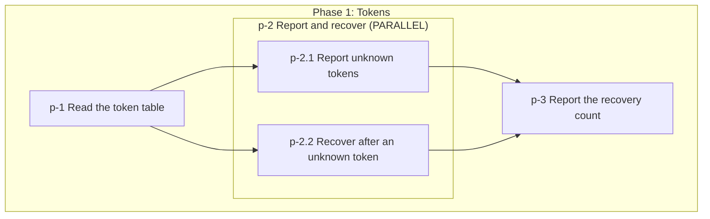

# Design: Avoozl as the landing spec's reference runner

`SM` numbers are in this spec's `requirements.md`. The landing spec is
`docs/github-workflow.md`; its section names are quoted as written there.
Line counts are `wc -l` of non-test source files at `e327dcbc`.

## D1. Shape

```text
 callers                         Avoozl                          git and GitHub
 -------                         ------                          --------------
 person at a terminal ---+
 Kiro Crew chat + skill -+--> CLI / MCP --> operations --+--> specs branch: tasks.md, ticks
 other harness + skill --+                     |          +--> claim branches avoozl/<spec>/<task>
 server loop (optional) -+                     |          +--> spec and epic issues, assignees
                                               |          +--> draft pull requests
 page (5 views) ----------> same operations    |
                                               v
                          graph builder, ranking, lint, checks, land
                                               |
                          SQLite cache  <------+  (avoozl rebuild makes it again)
```

Git and GitHub hold every fact. SQLite is a cache of what Avoozl read and of
the sessions this machine runs. The page, the CLI, MCP and the server loop
call one set of operations (`src/app/ops/`).

## D2. What stays

| Part | Where it lives |
| --- | --- |
| Spec format and lint | `specs/spec-plans.mjs`, `specs/spec-facts.mjs`, `specs/spec-refs.mjs`, `specs/plan-quality.mjs`, `specs/specs-path.mjs` |
| Graph and ranking | `api/page-views.mjs` graph read, `specs/spec-scheduler.mjs`, `mirror/release-ranking.mjs` (moves to `specs/ranking.mjs`) |
| Claims | `workers/runner.mjs`, `workers/manual-take.mjs`, a new claim call in `github/github.mjs` |
| Report | `workers/report-match.mjs`, `workers/report-command.mjs`, `workers/worker-briefs.mjs` |
| Land | `delivery/`, `landing/`, `git/`, `epics/integration-*.mjs` |
| Approval | `git/git-approvals.mjs` |
| Spec issues and assignees | `specs/spec-publication.mjs`, `github/github-marker.mjs`, the assignee check |
| Server loop | `tick/`, `executors/supervisor*.mjs` |
| Sessions | `executors/process.mjs`, `executors/kirocrew.mjs`, `executors/harness-*.mjs`, `executors/sandbox.mjs`, `sessions/` |
| Plugins | `plugins/` with `checks`, `credentials`, `context` and `rules` |
| GitHub access | `github/github-credentials.mjs`, `github/github-jobs.mjs`, `github/github-pacer.mjs`, `github/github-rate.mjs`, `cli/confirm-high-risk.mjs` |
| Safety | `content/`, `intake/stranger-input.mjs`, `executors/harness-allow.mjs`, `mcp/mcp-policy.mjs` |
| Page server | `serve/`, `executors/kirocrew/app-backend.mjs` |

## D3. Claims and the next task

`avoozl next --claim` and the MCP tool `plans_next` with `claim: true` run
one operation, `runner.next`:

1. Read the specs branch and the claim branches (`GET
   /repos/{owner}/{repo}/git/matching-refs/heads/avoozl/`) of each repository,
   through the pacer and the conditional-request cache.
2. Build the graph (§D8) and keep the ready tasks: the landing spec's "Ready
   tasks" list, with waits from §D19 and "no claim branch exists" read from
   step 1.
3. Rank them (§D3.1).
4. With `claim`, when the task's base is an integration branch, first merge
   the default branch into it as §D21 says. Then create the top task's claim
   branch at the base head with
   `POST /repos/{owner}/{repo}/git/refs`. On HTTP 422 take the next task. Stop
   after 10 refusals in one call and report "every ready task is claimed".
5. Make the task worktree on the claim branch and return the task, the
   worktree and the brief.

The claim branch is the lock. Avoozl's `bindings` row for a session points at
the task and the branch, so a lost cache is rebuilt from the branches.
`claims.staleHours` (repository setting, default 24) makes a claim branch
stale when its newest commit is older. A stale claim shows in Needs you for
the spec issue's assignee, with "Delete branch" (a high-risk job with the
confirm popup) and "Take over" (only after a hand-off, as the landing spec
says).

### D3.1 Ranking

One pure function, `rankReady(graph, inFlight)`, in `specs/ranking.mjs`:

| Key | Value | Order |
| --- | --- | --- |
| 1 | Open tasks that wait on it (§D19), directly or not | more first |
| 2 | Length of the longest open chain of waits below the task | longer first |
| 3 | Position in `tasks.md` | earlier first |

`unblockCounts` moves from `mirror/release-ranking.mjs` into this file, and
`pathsOverlap` and the paths hold in `specs/spec-scheduler.mjs` go. Two tasks
that change the same file meet at landing's merge of the base into the
claim branch; a conflict goes back to the worker
(`landing/landing-conflicts.mjs`). The function returns each task with its
three key values, and `avoozl next` prints them.

## D4. Landing

`delivery/delivery.mjs` keeps the landing spec's five steps. Changes:

- Step 2 ticks the box in the work commit when the spec and code share a
  repository, and in a commit on the claim branch before the checks
  otherwise. The tick for a spec in another repository is its own commit on
  that specs branch after the code lands.
- `pr` mode opens a draft pull request (`draft: true`) with `Closes #N` for a
  labeled issue. Avoozl never calls the merge, ready-for-review or
  auto-merge endpoints. The task stays claimed while the pull request is
  open. When the pull request merges, the next read sees the tick on the
  base and the task is done. When it closes unmerged, the task shows in
  Needs you with "Delete claim branch".
- `direct` mode keeps merge batches (`landing/merge-batch.mjs`) and the
  per-base queue (`landing/landing-queue.mjs`), and pushes a fast-forward.
- After landing, Avoozl deletes the claim branch it created.

Review output goes on the draft pull request, or on the spec issue in
`direct` mode, as the landing spec's "Review output" says. Avoozl keeps no
evidence bundle.

## D5. Label filters and labeled issues

Repository settings gain:

```json
{
  "labels": {
    "require": [
      "agent-ok"
    ],
    "exclude": [
      "needs-design"
    ]
  }
}
```

The filter is read on the spec issue on each loop pass. A `require` label
counts only when its newest `labeled` event's actor has write, maintain or
admin permission (one `GET /repos/{o}/{r}/collaborators/{login}/permission`
per actor, cached for the pass).

A labeled issue becomes a one-task spec in memory with the landing spec's
mapping; the issue's body is its one done bullet. Its graph has one node, its claim branch is
`avoozl/issue-<n>/issue-<n>`, and it lands like any task. When the issue's
title or body was written by a non-writer, `intake/stranger-input.mjs` marks
the task stranger input, and the worker runs in the process sandbox with
network off and no plugin context. Avoozl writes nothing to an issue except
the closing comment in `direct` mode.

## D6. The server loop

```json
{
  "loop": {
    "run": [
      "specs",
      "issues"
    ],
    "epics": [
      "v2"
    ],
    "every": "1m"
  }
}
```

`loop` is in this machine's config (`~/.config/avoozl/config.json`), never
in `.avoozl.json`. With no `loop`, the tick reads and caches but starts
nothing. With `loop`, each pass calls `runner.next` with `claim` until the
machine's lanes are full, starts a worker session on each claim through the
repository's worker harness, and calls `runner.land` for each reported task.
It uses only operations a caller can also call.

The supervisor runs the pass on a headless machine (`avoozl supervisor
--tick`); the Kiro Crew app backend runs it through the tick cron.

## D7. The surface

| Job | CLI | MCP tool | Skill |
| --- | --- | --- | --- |
| See the graph | `avoozl graph [SPEC] [--format text\|mermaid]` | `plans_graph` | any |
| Find the next task | `avoozl next` | `plans_next` | `avoozl-work` |
| Claim it | `avoozl next --claim` | `plans_next` with `claim` | `avoozl-work` |
| Finish it | `avoozl runner report TASK done\|blocked` | `plans_report` | `avoozl-work` |
| Land it | `avoozl land TASK` | `plans_land` | `avoozl-work` |
| Read state | `avoozl status`, `show`, `query` | `plans_query`, `plans_view` | any |
| Lint a spec | `avoozl spec lint [SPEC]` | `plans_lint` | `avoozl-spec` |
| Rewrite the graph block | `avoozl graph SPEC --write` | none (writes a file; a chat runs the CLI) | `avoozl-spec` |
| Rebuild the cache | `avoozl rebuild` | none (person) | none |

`plans_land` and `avoozl land` refuse a task the caller did not claim.
`avoozl spec lint` wraps the `lintSpec` that `scripts/check/spec-lint.mjs`
calls. Every other MCP tool that reaches a cut operation goes with it.

## D8. One graph builder

`graphOf(store, scope)` in `specs/graph.mjs` returns:

```text
{ scope, specs: [{ name, phases: [{ title, items: [item] }] }],
  edges: [{ from, to }] }
item = { id, title, state, manual, paths }                  a leaf
     | { id, title, state, parallel, items: [item] }        a group
```

`state` is `landed` (ticked on the specs branch), `claimed` (claim branch
exists), `ready`, `waiting` or `manual` for a leaf, and `group` for a group.
`parallel` is true for a group tagged `(**PARALLEL**)`. `edges` are the waits
between leaves that §D19 derives. The page's Graph (`graph.view`), the CLI
and `plans_graph` call it. Two printers read its output:
`graphText(graph, {width: 80})` and `graphMermaid(graph, {state})`.

For this `tasks.md`:

```markdown
## Phase 1: Tokens

- [x] `p-1` Read the token table
- [ ] `p-2` Report and recover (**PARALLEL**)
  - [ ] `p-2.1` Report unknown tokens
  - [ ] `p-2.2` Recover after an unknown token
- [ ] `p-3` Report the recovery count
```

the text, with no color, is:

```text
parser                           4 tasks: 1 landed 1 claimed 1 ready 1 waiting
Phase 1: Tokens
  landed   p-1    Read the token table
  group    p-2    Report and recover (PARALLEL)
  claimed    p-2.1  Report unknown tokens
  ready      p-2.2  Recover after an unknown token
  waiting  p-3    Report the recovery count
```

Order in the text is order in the list, so the text needs no edge column.
Children are indented under their group. A title is cut with `...` to fit 80
columns. Mermaid:

````text

````

A node ID is the task ID with each character outside `[A-Za-z0-9]` written
as `_`; when two IDs map to one node ID, the later gets `_2`, `_3` in file
order. A group is a nested `subgraph` whose ID is `g_` and its node ID; a
spec group's subgraph holds the linked spec's tasks (§D19.2). A
label is the task ID and its title with the refs and backticks dropped and
the tag written `(PARALLEL)`; a title's `"` is written `#quot;`. `--format mermaid` on the CLI adds
`classDef` lines for state; the graph block (§D9) leaves them out. Nothing
in the repository renders Mermaid today; GitHub and Kiro Crew render it in
Markdown.

## D9. The graph block

The block sits at the end of `tasks.md`:

````text
<!-- avoozl:graph start -->
```mermaid
...the builder's Mermaid, structure only...
```
<!-- avoozl:graph end -->
````

It goes in `tasks.md`, not `design.md`, because:

1. `tasks.md` is the one file every spec has; `design.md` is optional.
2. The block is made from `tasks.md` alone, so the tasks and their diagram
   change in one file, one diff and one approval.
3. Lint already reads `tasks.md` line by line, so it checks the block with no
   second file read.

The block holds IDs, titles, phases, groups and waits, and no state, so landing a
task does not change it. Lint parses `tasks.md`, builds the block's text and
compares it to the lines between the markers, ignoring trailing spaces. A
mismatch is `graph.stale` at the start marker, with the fix `avoozl graph
SPEC --write`. A start marker with no end marker, or two blocks, is
`graph.markers`. The task parser skips the lines between the markers.

## D10. Roles and skills

The role table keeps two rows:

| Role | Runs | Access | Off by default |
| --- | --- | --- | --- |
| `worker` | one task in its worktree on the claim branch | write | no |
| `reviewer` | the task's head, read-only; posts a comment-only review | read | yes |

Every other role becomes a skill or is cut:

| Role today | Becomes | Source |
| --- | --- | --- |
| `planner`, `planAnswer` | skill `avoozl-spec` | `prompts/planner.md`, `prompts/plan-answer-read.md` |
| `planReviewer` | skill `avoozl-spec-review` | `prompts/plan-review.md` |
| `prReview` | skill `avoozl-review` | `prompts/code-review.md` |
| `retro` | skill `avoozl-retro` | `prompts/retro.md` |
| `falsifier` | skill `avoozl-investigate` | `prompts/falsifier.md` |
| `verifier` | cut: Avoozl runs checks itself (`delivery/check-runs.mjs`) | |
| `responder`, `taskSummary`, `assist` | cut | |

Skills are generated the way the triage removal branch generates
`avoozl-answer`, `avoozl-review` and `avoozl-triage`: source in
`prompts/skills/<name>.md`, output in `kirocrew-app/skills/<name>/SKILL.md`,
and `npm run check:agents` fails on drift. The shipped skill set is
`avoozl-spec`, `avoozl-work`, `avoozl-review`, `avoozl-spec-review`,
`avoozl-retro`, `avoozl-investigate`, `avoozl-plugin`, `avoozl-rules`, and
the `avoozl-answer` and `avoozl-triage` skills the triage removal ships.
`avoozl-spec` writes the spec in the format of §D19 and §D20: one
repository per spec in front matter `repo`, each leaf's done bullets, order
only by the list, `(**PARALLEL**)` and `(**MANUAL**)` tags, and links for
member specs. It runs `avoozl graph SPEC --write`
and `avoozl spec lint SPEC`, and stops at a `spec/<name>` branch.
`avoozl-spec-review` reviews a spec for that same format: tags written
exactly, a done bullet a person can check on every leaf, order that matches
what each task needs, links that point at spec folders, and one repository
per spec. It also flags a branch on origin that has the spec's folder name
but holds other work (§D21.1). It posts its findings as review output and
changes no file.
`avoozl-work` is `prompts/worker.md` plus the claim, report and land calls.
`avoozl-costs` is cut with provider health.

The generated agents in `kirocrew-app/agents/` shrink to `avoozl-reviewer`;
a worker chat uses Kiro Crew's default agent with the worker brief.

## D11. Plugins

`PARTS` becomes `["rules", "credentials", "checks", "context"]`. `checks` and
`context` arrive with their own specs (`plugin-checks`, `epic-context`).
`pack`, `intake`, `template` and `policy` join the refused list with the
message "<part> is not a plugin part". `plugins/plugin-pack.mjs` goes.

## D12. Setup and rebuild

Setup is `avoozl repository configure ID --root PATH`, then `avoozl
rebuild`. Rebuild reads the specs branch, approvals, ticks, claim branches,
spec issues and draft pull requests, and fills the cache. It writes nothing
to GitHub. Branch rules and labels are the repository owner's to set on
GitHub; Avoozl reads branch rules (`github/github-branch-rules.mjs`) and
follows them.

## D13. The page

The page keeps five views. Each reads one or two operations and writes only
through operations the CLI or MCP also reach.

| View | What it is for | What it shows | Actions |
| --- | --- | --- | --- |
| Plans | Read specs; approval stays an approver's commit on GitHub | spec list by category; a spec's tabs: Overview (its graph block rendered, counts), Tasks, one tab per file | Run in a chat: write a spec, review a spec |
| Graph | See what is ready across specs | `graphOf` for a spec, an epic or all, with state colors and drill-in | Run in a chat: work this task |
| In flight | See what runs now | each claim branch: task, holder login, session link, newest commit, check state on its head, draft pull request link, integration branch lag | Stop session, Send message, Land (when checked) |
| Needs you | See what waits on a person | failing checks on a claim head, stop the line, `(**MANUAL**)` tasks ready to do, stale claims, draft pull requests waiting for a person, a pull request closed unmerged, plugin approvals | Mark manual task done, Delete branch, Open on GitHub, Run in a chat |
| Settings | Set this machine and each repository | repositories, landing mode, label filters, claim stale hours, harness per role, owner instructions per role, plugins, content rules, notifications, `loop` | Save, approve plugin |

The task drawer stays, smaller: title, done bullets, refs, waits-on and blocks
links, claim
branch, pull request, checks and landed commit.

"Run in a chat" opens a chat seeded with a skill name and the item's IDs:
a Kiro Crew chat when the page runs inside Kiro Crew, else a process session
of the worker harness. It reuses `chat-api.ts` and `design-chat.ts`.

Everything else is a skill or an MCP call: writing and reviewing specs,
retros, investigations, code review, Flow numbers, and Activity
(`avoozl activity` stays on the CLI).

## D14. Module audit: `src/app`

Verdicts: **keep** (it may shrink as callers go), **cut**, **skill** (deleted
once its skill ships), **in flight** (deleted by the approval cut-down,
mirror removal or triage removal before this spec starts).

| Folder | Lines | Keep | Cut | Skill | In flight | Notes |
| --- | ---: | ---: | ---: | ---: | ---: | --- |
| `agents/` | 1250 | 671 | 579 | | | cut `prompts.mjs` (retro overrides), `text-diff.mjs`; `role-table.mjs` drops to two rows |
| `api/` | 5794 | 5775 | 19 | | | cut `panel-view.mjs`; `page-views.mjs` keeps graph, In flight and Needs you reads |
| `cli/` | 644 | 644 | | | | |
| `commands/` | 2850 | 2850 | | | | entries for cut features go: `fix`, `integrator`, `gap-report`, `intake`, `planning`, `plan batches`, `plan review`, `plan finding`, `approval`, `seed`, `examples`, `spec offer`, `spec grants`, `setup`, `worker`, `driver`, `task supersede`, `task links`; adds `land`, `graph`, `spec lint` |
| `content/` | 2825 | 2825 | | | | content rules, hook, privacy scan |
| `delivery/` | 4644 | 3953 | | 691 | | `investigate.mjs` becomes `avoozl-investigate` |
| `epics/` | 932 | 932 | | | | `integration-branch.mjs` reads whether the spec's branch exists; `integration-sync.mjs` becomes the merge before a claim (§D21) |
| `executors/` | 6936 | 6021 | 915 | | | cut `box-*.mjs` and `egress-proxy.mjs` (contained sessions) |
| `flow/` | 8186 | 2311 | 4151 | 1724 | | keep `flow-line.mjs` (stop the line), `flow-checks.mjs`, `flow.mjs` (shrinks to stop-the-line settings); `flow-retro.mjs`, `retro-files.mjs` become `avoozl-retro`; cut build receipts and reports, CI waste, corrections, usage, planning flow, provider health, retro chat, memory and operations |
| `git/` | 1971 | 1698 | | | 273 | `repo-files.mjs` in flight |
| `github/` | 8834 | 5816 | 2003 | 148 | 867 | cut `github-intake`, `github-respond`, `github-reviews`, `github-setup`, `github-sources`, `setup-landing`, `source-backlinks`; `pull-request-snapshot` becomes `avoozl-review`; `github-items`, `github-pages` in flight |
| `intake/` | 3930 | 148 | 546 | | 3236 | keep `stranger-input.mjs`; cut `fix.mjs`, `stranger-holds.mjs`; intake and triage in flight |
| `landing/` | 3106 | 2526 | 580 | | | cut `landing-queue-view`, `landing-trailers`, `merge-path`; merge batches stay for `direct` |
| `mcp/` | 950 | 733 | 217 | | | cut `mcp-views.mjs` (in-chat views) |
| `mirror/` | 3091 | 47 | | | 3044 | `release-ranking.mjs` moves to `specs/ranking.mjs` |
| `ops/` | 6246 | 6246 | | | | entries go with their features |
| `plugins/` | 2542 | 2189 | 353 | | | cut `plugin-pack.mjs` |
| `reviews/` | 2748 | | 1711 | 1037 | | plan review tower cut; `plan-review-step.mjs` becomes `avoozl-spec-review`, `pr-review.mjs` becomes `avoozl-review` |
| `serve/` | 705 | 705 | | | | |
| `sessions/` | 1079 | 901 | 178 | | | cut `session-open.mjs` (the assist chat) |
| `settings/` | 2902 | 2728 | 174 | | | cut `chat-models.mjs`; `repository-settings.mjs` drops cut keys and gains `labels`, `claims` |
| `specs/` | 10213 | 3922 | 2263 | 1133 | 2895 | cut `design-extraction`, `gap-report`, `plan-archive`, `plan-retire`, `plans.mjs` (old plan files), `source-sync`, `spec-changed`, `task-outcomes`; `new-plan`, `spec-steering`, `templates` become `avoozl-spec`; approval and journal files in flight |
| `store/` | 1722 | 1722 | | | | `activity-log.mjs` stays for `avoozl activity` |
| `tasks/` | 2605 | 550 | 2055 | | | keep `manual-tasks`, `scm-links`, `issue-reference`; cut `evidence`, `supersede`, `task-dedup`, `task-files`, `task-notes`, `task-steps`, `task-summary`, `title-repeat` |
| `tick/` | 2280 | 2280 | | | | the tick plans the loop pass (§D6) |
| `workers/` | 5453 | 633 | 3027 | | 1793 | keep `runner`, `report-match`, `report-command`, `manual-take`, `worker-briefs`; cut `driver`, `driver-scope`, `working-heads`, `remote-runner`; grants, offers, results and driver generations in flight |
| `workspace/` | 4545 | 2337 | 2156 | | 52 | cut `demo`, `examples`, `sample-specs`, `instance`, `onboarding`, `repository-kind`, `repository-roles`, `repository-setup`, `setup-access`; `check-isolation.mjs` keeps `run: sandbox` and `unconfined` and drops `container`, `worker`, `strangers` and `strangerRoles` |
| **Total** | 98983 | 61163 | 20927 | 4733 | 12160 | |

`src/app/test/` (22571 lines of shared test helpers) loses each fixture its
feature took with it. `src/app/skills/avoozl/SKILL.md` becomes generated.

## D15. Module audit: the page

Every file in `kirocrew-app/ui/src/` (`.tsx` and `.ts`), grouped by view:

| Group | Lines | Verdict | Files |
| --- | ---: | --- | --- |
| Plans | 4685 | keep | `PlansView`, `plans-api`, `SpecGraph`, `EpicPanel`, `DocumentReader`, `markdown`, `spec-link`, `TaskRefs`, `files-api` |
| Graph | 2952 | keep | `GraphView`, `graph-layout`, `FocusTree`, `focus-tree`, `EdgeList`, `drag-pan` |
| In flight | 1891 | keep | `DeliveryView`, `DeliveryDetails`, `delivery-api`, `IntegrationBranches`, `WorkerLink`, `ReviewState`, `StopLine` |
| Needs you | 1903 | keep | `WaitingView`, `ConflictsView`, `conflicts-api`, `NeedsYouContext`, `needs-you-context`, `decision-link` |
| Settings | 7614 | keep | `SettingsView`, `settings-api`, `RepositoriesSettings`, `RepositoryModals`, `repo-edit-tabs`, `repository-rows`, `LandingFields`, `ModelsSettings`, `models-api`, `PluginsSettings`, `plugins-api`, `AddPlugin`, `ContentRulesSettings`, `content-api`, `IsolationPanel`, `isolation-form`, `PromptInstructions`, `NoticesSettings`, `notices`, `FolderPicker`, `SaveFooter`, `FlowSettings` (stop the line only) |
| Task drawer | 1582 | keep, smaller | `TaskDrawer`, `task-api`, `TaskScmLinks`, `drawer-context` |
| Run in a chat | 133 | keep, reshaped | `chat-api`, `design-chat`, `panel-chat` |
| Shell and shared parts | 6052 | keep | `App`, nav files, list-detail files, filters, `Picker`, refresh files, `WorkspaceView`, `WorkspacePill`, small parts |
| Dashboards: Home, Landing queue | 2030 | cut | `DashboardView`, `dashboard-api`, `HomeParts`, `home-api`, `LandingQueueView`, `landing-queue-api`, `recap-api`, `release-api` |
| Flow and Retros | 2754 | cut (skill `avoozl-retro`) | `FlowView`, `FlowCharts`, `FlowBuilds`, `FlowRail`, `FlowMemory`, `flow-api`, `RetrosView`, `CiFlow`, `PlanningFlow`, `builds-api`, `providers-api` |
| Activity | 608 | cut (CLI `avoozl activity`) | `ActivityView`, `activity-api` |
| Plan review | 1310 | cut (skill `avoozl-spec-review`) | `ReviewView`, `review-view`, `PlanReviewDecision`, `PlanReviewSummary` |
| Task extras | 1824 | cut | `TaskFiles`, `TaskNotes`, `notes-api`, `TaskSteps`, `TaskSummaryBox`, `Evidence`, `evidence-api`, `TaskForm`, `CitedFile` |
| Setup tower | 2822 | cut | `Onboard`, `onboarding-api`, `SetupWizard`, `setup-api`, `setup-facts`, `Demo`, `demo-api`, `TemplateStart`, `PackImport`, `InstanceName`, `instance-api`, `WorkflowMap`, `workflow-map` |
| New spec and fix drawers | 1575 | cut (skill `avoozl-spec`) | `NewPlanDrawer`, `new-plan-api`, `spec-builder-api`, `NewFixDrawer`, `fix-api`, `IntakeSources` |
| Driver and delivery settings | 1028 | cut | `Driver`, `driver-api`, `DeliverySettings` |
| Side panel | 1200 | cut | `Panel`, `PanelParts`, `panel-api` |
| Removed by in-flight work | 1976 | in flight | `MirrorSetup`, `mirror-setup-api`, `ForwardScreen`, `forward-api`, `SpecPullBox`, `SpecPullDecision`, `spec-pr-api`, `GitHubItemsView`, `github-items-api`, `TriageAgentView`, `TriageSetup` |

The kept groups hold 26812 lines; the cut groups hold 15151.

## D16. Example: a large rewrite on an integration branch

A team rewrites its client library, `acme/client`, over several months.

1. The tech lead creates the branch `client-v2` on origin from `main`, so
   the spec `client-v2` and every spec it links land there (§D21).
2. An approver merges the parent spec `client-v2`, with front matter
   `repo: client`. Its tasks link one member spec per area (§D19.2), each
   after a "Write the spec" task:

   ```markdown
   - [ ] `v2-areas` Areas (**PARALLEL**)
     - [ ] `v2-transport` Transport
       - [ ] `v2-transport-spec` Write the spec for [transport]
         - The transport spec is on `spec/client-v2-transport`
       - [ ] `v2-transport-build` Build [transport]
     - [ ] `v2-codegen` Code generation
       - [ ] `v2-codegen-spec` Write the spec for [codegen]
         - The codegen spec is on `spec/client-v2-codegen`
       - [ ] `v2-codegen-build` Build [codegen]
     - [ ] `v2-auth` Auth
       - [ ] `v2-auth-spec` Write the spec for [auth]
         - The auth spec is on `spec/client-v2-auth`
       - [ ] `v2-auth-build` Build [auth]

   [transport]: ../client-v2-transport/tasks.md
   [codegen]: ../client-v2-codegen/tasks.md
   [auth]: ../client-v2-auth/tasks.md
   ```

   Each member's front matter sets only `repo: client`.
3. Each member spec's pull request is assigned to the engineer who owns that
   area (`acme-alice`, `acme-bob`, `acme-carol`), so each spec issue is
   assigned to its engineer, and the parent's spec issue to the tech lead.
4. Each member's `tasks.md` opens with a design review task, such as
   ``- [ ] `tr-0` Design review: transport API (**MANUAL**)``. Every task
   below it waits for it. A person ticks it after the review meeting. The
   three areas run side by side, because `v2-areas` carries the tag.
5. Alice runs Avoozl on two machines with `loop.run: ["specs"]`. Her spec
   puts its retry and pooling tasks in a group tagged `(**PARALLEL**)`, so
   both machines claim one at a time from it; the refs API gives each task
   to one machine. Bob drives his spec from a chat with the `avoozl-work`
   skill and `avoozl next --claim`, with no server loop.
6. The team's checks plugin adds `api-parity`, a `phase`-stage check with a
   decide prompt that asks whether the phase's combined diff changes the
   public API. It runs once per phase on `client-v2`, and a failure shows in
   Needs you without blocking task landings.
7. The team's context plugin gives each worker a skill describing the
   library's module layout and read access to the team's design notes.
8. Tasks land on `client-v2` in `direct` mode. Before each claim, Avoozl
   merges `main` into `client-v2` when `main` has moved.
9. When every member spec is ticked, the tech lead merges `client-v2` into
   `main`. Avoozl never merges it.

The same flow runs under Issue Radar or any runner that follows the landing
spec.

## D17. Order

`sim-0` is a person's gate: a person ticks it once the approval cut-down,
the mirror removal and the triage removal are on main. Every other task waits
on it. Order from the list (`sim-2.1`, `sim-2.2`) lands before ranking and
the graph builder, which read its waits. Runner parts (phase 1) and the graph
(phase 2) come first, because the
cuts in phase 4 delete the code they replace. Skills (phase 3) ship before the
modules they replace are cut. The page (phase 5) changes last, after its
operations have settled. Docs and the live proof close the spec.

## D18. Open questions

1. **Graph block required?** Recommendation: optional (SM9.5). Specs written
   by hand or by other runners still lint, and `avoozl-spec` always writes
   one.
2. **The box for stranger text in labeled issues.** Recommendation: cut the
   box and run stranger-input tasks in the process sandbox with network off
   (SM5.4). A writer's label is the person's choice to run it, and the box is
   915 lines kept for one case.
3. **Plugin `phase` checks propose a fix through triage.** `plugin-checks`
   PK5.3 proposes a triage fix when a `phase` check fails, and triage is
   being removed. Recommendation: a failing `phase` or `branch` check is a
   Needs you item with "Run in a chat"; change PK5.3 in its own spec PR.
4. **Epic context's "you drive" test.** `epic-context` EC1 tests the driver
   table, which this spec removes. Recommendation: the test becomes "the
   spec issue is assigned to this runner's login and the task's claim branch
   was created by this machine".
5. **The side panel.** Recommendation: cut it (1200 lines); Needs you and In
   flight cover it, and a chat gets the same reads through `plans_query`.
6. **Activity page.** Recommendation: cut the page and keep `avoozl activity`
   and the activity log, since GitHub history covers most of it.

## D19. Order from the list

Every checkbox line is a task with a backticked ID and a title. The owner's
example:

```markdown
- [ ] `ec-2.1` Gather a session's context
- [ ] `ec-2.2` Reads, skills and the brief
- [ ] `ec-2.3` Ways out (**PARALLEL**)
  - [ ] `ec-2.4` The MCP relay
  - [ ] `ec-2.5` Hosts through the egress proxy
  - [ ] `ec-2.6` Kiro Crew chat workers
  - [ ] `ec-2.7` Stranger text never reaches it
- [ ] `ec-2.8` The chip, Activity and Settings
```

`ec-2.1` runs first, then `ec-2.2`. `ec-2.4` to `ec-2.7` wait for `ec-2.2`
and run side by side. `ec-2.8` waits for all four. `ec-2.3` is a group: no
one claims it, and its box follows its children.

A serial run inside a parallel group is an untagged child group:

```markdown
- [ ] `ec-1.2` Sources (**PARALLEL**)
  - [ ] `ec-1.1` The machine block
  - [ ] `ec-1.5` The plugin part
    - [ ] `ec-1.3` The part's manifest
    - [ ] `ec-1.4` Asks and the approval hash
```

`ec-1.1` runs beside `ec-1.5`; inside `ec-1.5`, `ec-1.3` runs before
`ec-1.4`. A nested group is in order unless its own title carries the tag,
even inside a parallel parent.

### D19.1 Deriving the waits

`waitsOf(spec)` in `specs/order.mjs` is the one function. For an item `x`:

| `x` | `first(x)` | `last(x)` |
| --- | --- | --- |
| leaf | `{x}` | `{x}` |
| group | `first` of its first child | `last` of its last child |
| group tagged `(**PARALLEL**)` | union of `first` of each child | union of `last` of each child |

A phase is a group of its top-level items, and a spec is a group of its
phases. For each pair of neighbors `a`, `b` in any untagged list (a phase's
items, an untagged group's children, the spec's phases), every leaf in
`first(b)` waits for every leaf in `last(a)`. The children of a tagged group
are not neighbors.

The result is a list of `{from, to}` edges between leaves with no edge that
another implies. The ready rule reads "every `from` of this leaf is ticked".
Ranking counts downstream tasks and chain length over the same edges, so
"unblocks most" still ranks a task that opens a parallel group of five above
one that opens a single task.

### D19.2 Linked specs

A parent spec links each member spec with a normal Markdown link in a task
title, inline or reference-style at the bottom of the file. A spec with such
a link is a parent, and it may hold tasks of its own:

```markdown
- [ ] `ctx-spec` Write the spec for [epic context]
  - `epic-context` lints clean on `spec/epic-context`
- [ ] `ctx-build` Implement [epic context]

[epic context]: ../epic-context/tasks.md
```

The parser resolves each link in a title against the `tasks.md` that holds
it. A link whose target is `<specs.path>/<name>/tasks.md` makes the task a
spec group; `ctx-build` above is one. Its children are the linked spec's
phases, so `first` and `last` (§D19.1) reach into the linked spec and the
linked spec's own list orders its tasks. `ctx-spec` is an ordinary leaf:
its worker writes `epic-context` on `spec/epic-context` and ticks
`ctx-spec` there, and the approver's merge lands both. `ctx-build`'s
children are ready once `ctx-spec` is ticked and `epic-context` is
approved.

A spec group's box is derived like any group's. The landing commit that
ticks a linked spec's last task also ticks the parent's box when both
`tasks.md` files are on one specs branch; otherwise the runner ticks the
parent in its own commit after the landing.

Specs no spec group links do not wait on each other.

### D19.3 Lint

| Error | When |
| --- | --- |
| `group.box` | A group's box is ticked while a child is open, or open while every child is ticked |
| `parallel.size` | A group tagged `(**PARALLEL**)` has fewer than two children |
| `parallel.leaf` | A task with no children carries the tag |
| `parallel.tag` | A title has the word `parallel`, in any casing, in parentheses or bold anywhere but as exactly `(**PARALLEL**)` at its end, such as `(**parallel**)`, `(**Parallel**)`, `(PARALLEL)`, `**PARALLEL**`, or `(**PARALLEL**)` before more title text |
| `facts.removed-key` | Any sub-bullet that starts with `$`, with its fix (§D20) |
| `frontmatter.removed-key` | A `kind`, `epic`, `integrationBranch` or `integrationSync` key, with its fix (§D20) |
| `frontmatter.repo` | No `repo` in a workspace with more than one repository |
| `done.missing` | A leaf has no plain sub-bullet |
| `group.bullets` | A group has a plain sub-bullet |
| `manual.tag` | A title has the word `manual`, in any casing, in parentheses or bold anywhere but as exactly `(**MANUAL**)` at its end |
| `manual.group` | A group carries `(**MANUAL**)` |
| `integration.foreign` (warning) | With origin readable: a branch named for the spec holds work that is not the spec's (§D21.1) |
| `link.missing` | A spec group links a spec folder that does not exist, and no earlier unticked task stands in the same list |
| `link.twice` | One spec is linked as a spec group more than once in the repository |
| `link.children` | A spec group has sub-items of its own |
| `facts.removed-key` | Any `$after` fact, with the fix "order tasks by the list; tag a group `(**PARALLEL**)` for tasks that run side by side" |

The tag ends the title and comes before any refs:
``- [ ] `ec-2.3` Ways out (**PARALLEL**) [EC7] (§D6)``. A group keeps its ID,
title and refs; it is never sent to a worker.

### D19.4 Rewriting the specs

`sim-2.2` rewrites every `tasks.md` under `.kiro/specs/` once, by hand with a
helper script it does not commit:

1. Read the spec's `$after` edges.
2. Order the leaves so each comes below everything it waited for. Tasks with
   the same waits that do not wait on each other go under one group tagged
   `(**PARALLEL**)`, and a serial run inside it becomes an untagged child
   group.
3. Where the old graph has no exact list form, add the fewest waits that keep
   every old one, and list each added wait in the commit message.
4. Turn each cross-spec `$after` into the order of spec groups in a parent
   that links both specs, or into a `(**MANUAL**)` gate task at the top of
   the waiting spec when none does.
5. Turn each epic item with `$plan` into a spec group linking that spec,
   preceded by a "Write the spec" task where `$step: design` stood and a
   `(**MANUAL**)` review task where `$step: review` stood. Delete every
   `kind`, `epic`, `integrationBranch` and `integrationSync` front-matter
   key.
6. Split each `$investigate: true` task into an investigation task whose
   done bullets name `findings/<id>.md` and the task itself, whose done
   bullets name that file.
7. Turn each `$done: X` into the plain bullet `X`, drop any other plain
   bullet that is a summary rather than a result, and move a `$manual: true`
   task's tag into its title as `(**MANUAL**)`.
8. Split a spec whose leaves name more than one `$repo` into one spec per
   repository, each with front matter `repo`, linked from a parent.
9. Delete every remaining `$` line and regenerate each graph block.

The same change makes lint refuse every `$` bullet and the removed keys,
removes their reads, and updates the "Task facts", "Front matter", "Epics",
"Ready tasks", "Next task", "Investigating first", "Labeled issues",
"Manual tasks and gates" and "Integration branches" sections of
`docs/github-workflow.md` and the task list and front matter sections of
`docs/specs.md`.

## D20. Tasks with no facts

A task is a checkbox line with an ID and a title. Under a leaf, each plain
sub-bullet is one result someone can check, and together they say what done
means. A group has no plain sub-bullets. Two tags may end a title, before any
refs, written exactly:

| Tag | On | Means |
| --- | --- | --- |
| `(**PARALLEL**)` | a group | its children run side by side (§D19) |
| `(**MANUAL**)` | a leaf | a person does it and ticks it; it is never given to an agent |

```markdown
---
repo: app
---

## Phase 1: Config

- [ ] `cfg-1` Validate config [R1.2]
  - An unknown key is reported with its JSON path
- [ ] `cfg-2` Sign off on the error wording (**MANUAL**)
  - The owner has read every message in `errors.md`
```

The repository is the spec's: front matter `repo`, which lint requires in a
workspace with more than one repository. A change across repositories is one
spec per repository, linked from a parent (§D19.2).

| Front matter | Meaning |
| --- | --- |
| `category` | the group a spec is listed under |
| `repo` | the one repository the spec changes |


Lint refuses every `$` sub-bullet and the removed front-matter keys with
these fixes:

| Removed | Fix |
| --- | --- |
| `$done` | write each result as a plain sub-bullet |
| `$manual` | end the title with `(**MANUAL**)` |
| `$repo` | set front matter `repo`; split a spec that changes two repositories into two linked specs |
| `$after` | order tasks by the list; tag a group `(**PARALLEL**)` for tasks that run side by side |
| `$type` | delete the line |
| `$paths` | delete the line; landing meets overlapping changes |
| `$investigate` | make the investigation its own task whose bullets name its findings file |
| `$plan`, `$step` | link the spec from the parent's task title |
| any other `$` bullet | delete the line |
| `kind` (front matter) | delete it; a spec that links other specs is a parent |
| `epic` (front matter) | link this spec from its parent's `tasks.md` |
| `integrationBranch`, `integrationSync` (front matter) | delete them; create a branch named for the spec on origin (§D21) |

An investigation is an ordinary task:

```markdown
- [ ] `ec-2.0` Find where sessions read context
  - `findings/ec-2.0.md` lists every read path with file and line
- [ ] `ec-2.0a` Pick the reads to keep (**MANUAL**)
  - `findings/ec-2.0.md` ends with the chosen reads
- [ ] `ec-2.1` Gather a session's context
  - Sessions read only the paths `findings/ec-2.0.md` keeps
```

The `avoozl-investigate` skill tells the worker how to write the findings
file and how a reviewer tries to prove it wrong.

Ranking holds no paths rule, and nothing holds a task back for sharing files
with a running task (§D3.1).

Flow keeps no fix-work share: `isFixWork`, the per-task `fix` flag,
`metrics.fixWork`, `fixShare` in the day and week buckets and `fixWork` in
the retro brief go from `src/app/flow/flow.mjs`, and the "Fix work" chart
goes with the Flow view (§D15).

## D21. Integration branches

A spec's base is the branch named exactly as its folder, when that branch
exists on origin: the spec in `.kiro/specs/client-v2/` lands on
`client-v2`. Every spec it links, directly or through other parents, lands
on the same branch; when several specs up a link chain have one, the
outermost wins. Otherwise the base is the default branch the specs branch is
based on, such as `main`. No front-matter key names a branch.

A person opts in by creating the branch on origin and finishes by merging
it into the default branch. Avoozl creates no integration branch and merges
none into the default branch.

Integration sync runs at every claim on the branch, and nowhere else.
Before claiming, Avoozl reads both heads. When the default branch has moved
since the integration branch last merged it, that is, the default branch's
head is not an ancestor of the integration branch's head, Avoozl merges the
default branch in as a merge commit and pushes it; otherwise nothing
happens. It never rebases: the branch is shared, and force pushes are
forbidden. The claim branch then starts from the merged head.

Tasks claimed together, such as the children of a `(**PARALLEL**)` group in
one pass, share one merged head. A sibling claimed later may start on a
newer head after `main` moved again. That is fine, because landing merges
the base into each claim branch before its checks (§D4).

A conflict becomes one Needs you item naming the branch and the conflicting
files, and Avoozl claims no task on that branch until a person resolves it
and pushes. The next claim reads the heads again, so the item clears on its
own once the merge is in.

### D21.1 A same-name branch that is not integration work

A branch whose name equals a spec folder's name is that spec's base, so a
branch made for something else would take the spec's landings. Two checks
catch it before any task lands:

- `avoozl-spec-review` reads origin's branches when it reviews a spec, and
  raises a finding when one has the spec's folder name and holds work that
  is not the spec's.
- Spec lint, when it runs with access to origin (`avoozl spec lint` and
  `plans_lint` on a configured repository), reports the warning
  `integration.foreign` for the same case. Lint without origin, such as
  `scripts/check/spec-lint.mjs` in CI, skips the check.

A branch holds work that is not the spec's when it has a commit that is not
on the default branch and is neither a merge of the default branch nor the
landing of a task of that spec or a spec it links (a commit that ticks one
of those tasks, or the merge of their claim branches). A branch with no
commit beyond the default branch is a new integration branch and passes.
The fix is to rename the branch or the spec folder.

The branch is not `avoozl/<spec>` because git keeps branches as paths: a
branch `avoozl/client-v2` and the claim branches `avoozl/client-v2/<task>`
cannot both exist, since one name would have to be a file and a folder at
once. It is not `spec/<spec>` because that name is the branch an approver
merges to approve the spec.
