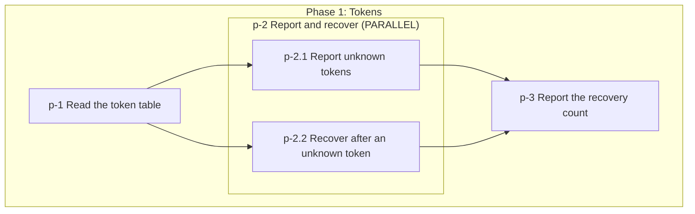

# Design: Avoozl as a Workflow v1 runner

`SM` numbers are in this spec's `requirements.md`. Workflow v1 is
`docs/github-workflow.md`; its section names are quoted as written there.

## D1. Shape

```text
 callers                         Avoozl                          git and GitHub
 -------                         ------                          --------------
 person at a terminal ---+
 Kiro Crew chat + skill -+--> CLI / MCP --> operations --+--> specs branch: tasks.md, ticks
 other harness + skill --+                     |          +--> claim branches and leases
 server loop (optional) -+                     |          +--> spec and epic issues, assignees
                                               |          +--> pull requests
 page (7 views) ----------> same operations    |
                                               v
                          graph builder, ranking, lint, checks, land
                                               |
                          SQLite cache  <------+  (avoozl rebuild makes it again)
```

Git and GitHub hold every fact. SQLite is a cache of what Avoozl read and of
the sessions this machine runs. The page, the CLI, MCP and the server loop
call one set of operations (`src/app/ops/`).

## D2. Code map

Paths are under `src/app/` unless they start with `hosts/`.

| Part | Where it lives |
| --- | --- |
| Spec format and lint | `specs/spec-plans.ts`, `specs/spec-facts.ts`, `specs/spec-refs.ts`, `specs/plan-quality.ts`, `specs/order.ts` |
| Graph and ranking | `specs/graph.ts`, `specs/ranking.ts`, `specs/spec-scheduler.ts` |
| Claims | `workers/claims.ts`, `workers/runner.ts`, `workers/manual-take.ts` |
| Report | `workers/report-match.ts`, `workers/report-command.ts`, `workers/worker-briefs.ts` |
| Land | `delivery/`, `landing/`, `git/` |
| Approval | `git/git-approvals.ts`, `specs/spec-approval.ts` |
| Spec issues and assignees | `specs/spec-publication.ts`, `specs/spec-assignee.ts`, `github/github-marker.ts` |
| Label filters and labeled issues | `specs/label-filters.ts`, `specs/labeled-issues.ts` |
| Integration branches | `specs/integration-base.ts`, `specs/integration-lint.ts`, `epics/integration-*.ts` |
| Server loop | `tick/`, `executors/supervisor.ts` |
| Sessions and lanes | `executors/process.ts`, `executors/kirocrew.ts`, `executors/harness-*.ts`, `executors/sandbox.ts`, `sessions/`, `tick/lanes.ts` |
| Roles | `agents/role-table.ts` |
| Plugins | `plugins/` with `checks`, `credentials`, `context` and `rules` |
| GitHub access | `github/github-credentials.ts`, `github/github-jobs.ts`, `github/github-pacer.ts`, `github/github-rate.ts`, `cli/confirm-high-risk.ts` |
| Safety | `content/`, `executors/harness-allow.ts`, `mcp/mcp-policy.ts` |
| Insights and retros | `insights/` |
| Page server | `serve/`, `executors/kirocrew/app-backend.ts` |
| Page | `hosts/kirocrew/ui/src/` |

## D3. Claims and the next task

`avoozl next --claim` and the MCP tool `plans_next` with `claim: true` run
one operation, `runner.next`:

1. Read the specs branch and the claim branches (`GET
   /repos/{owner}/{repo}/git/matching-refs/heads/avoozl/`) of each repository,
   through the pacer and the conditional-request cache.
2. Build the graph (§D8) and keep the ready tasks: Workflow v1's "Ready
   tasks" list, with waits from §D19 and "no claim branch exists" read from
   step 1.
3. Rank them (§D3.1).
4. With `claim`, when the task's base is an integration branch, first merge
   the default branch into it as §D21 says. Then create the top task's claim
   branch at the base head with `POST /repos/{owner}/{repo}/git/refs`, and
   take the next lease generation on it (Workflow v1 "Claims"). On HTTP 422
   take the next task. Stop after 10 refusals in one call and report "every
   ready task is claimed".
5. Make the task worktree on the claim branch and return the task, the
   worktree and the brief.

The claim branch is the lock, and the cache keeps the branches each read
saw, so a rebuilt cache finds every claim again. `claims.staleHours`
(repository setting, default 24) makes a claim branch stale when its newest
commit is older. A stale claim shows in Needs you for the spec issue's
assignee, with "Delete branch", a high-risk job behind the confirm popup.

### D3.1 Ranking

One pure function, `rankReady(ready, {edges, open})`, in `specs/ranking.ts`:

| Key | Value | Order |
| --- | --- | --- |
| 1 | Open tasks that wait on it (§D19), directly or not | more first |
| 2 | Length of the longest open chain of waits below the task | longer first |
| 3 | Position in `tasks.md` | earlier first |

Two tasks that change the same file meet at landing's merge of the base into
the claim branch; a conflict goes back to the worker
(`landing/landing-conflicts.ts`). The function returns each task with its
three key values, and `avoozl next` prints them.

## D4. Landing

`landing/landing-action.ts` picks the landing step for a checked task, and
`delivery/delivery.ts` runs Workflow v1's "Landing" section:

- The tick is in the work commit when the spec and code share a done branch,
  or in a commit on the claim branch before the checks. When the done branch
  is another branch, the tick is its own commit there after the code lands.
- `direct` mode keeps merge batches (`landing/merge-batch.ts`) and the
  per-base queue (`landing/landing-queue.ts`), pushes a fast-forward, and
  deletes the claim branch.
- `pr` mode opens the pull request as `landing.pr` says (`draft` by default,
  `ready`, or `auto`), with `Closes #N` for a labeled issue. Only `auto`
  makes Avoozl merge, through the merge API with `sha` set to the checked
  head; a person merges a draft or ready pull request. With `auto`, Avoozl
  arms GitHub auto-merge only where rule 17.7 allows it. The task stays
  claimed while the pull request is open. When it merges, the next read sees
  the tick on the base and the task is done. When it closes unmerged, the
  task shows in Needs you.
- `off` mode pushes the claim branch only, and a person lands it.

Review output goes on the pull request, or on the spec issue in `direct`
mode, as Workflow v1's "Review output" says.

## D5. Label filters and labeled issues

Repository settings take:

```json
{
  "labels": {
    "require": [
      "agent-ok"
    ],
    "exclude": [
      "needs-design"
    ]
  }
}
```

The filter is read on the spec issue on each loop pass. A `require` label
counts only when its newest `labeled` event's actor has write, maintain or
admin permission (one `GET /repos/{o}/{r}/collaborators/{login}/permission`
per actor, cached for the pass).

A labeled issue becomes a one-task spec in the cache with Workflow v1's
mapping; the issue's body is its one done bullet. Its graph has one node, its
claim branch is `avoozl/issue-<n>/issue-<n>`, and it lands like any task.
Avoozl writes nothing to an issue except the closing comment in `direct`
mode.

## D6. The server loop

```json
{
  "loop": {
    "run": [
      "specs",
      "issues"
    ],
    "epics": [
      "v2"
    ],
    "every": "1m"
  }
}
```

`loop` is in this machine's config (`~/.config/avoozl/config.json`), and
config load refuses it in `.avoozl.json`. With no `loop`, the tick reads and
caches but starts nothing. With `loop`, each pass calls `runner.next` with
`claim` until the machine's lanes are full, starts a worker session on each
claim through the repository's worker harness, and calls `runner.land` for
each reported task. It uses only operations a caller can also call.

Each `avoozl tick` runs the pass, from whatever timer runs it: launchd,
systemd or cron on a headless machine, the app's tick cron in Kiro Crew, or a
chat with the `avoozl-drive` skill.

## D7. The surface

| Job | CLI | MCP tool | Skill |
| --- | --- | --- | --- |
| See the graph | `avoozl graph [SPEC] [--format text\|mermaid]` | `plans_graph` | any |
| Find the next task | `avoozl next` | `plans_next` | `avoozl-work` |
| Claim it | `avoozl next --claim` | `plans_next` with `claim` | `avoozl-work` |
| Finish it | `avoozl runner report TASK done\|blocked` | `plans_report` | `avoozl-work` |
| Land it | `avoozl land TASK` | `plans_land` | `avoozl-work` |
| Read state | `avoozl status`, `show`, `query` | `plans_query`, `plans_view` | any |
| Lint a spec | `avoozl spec lint [SPEC]` | `plans_lint` | `avoozl-spec` |
| Rewrite the graph block | `avoozl graph SPEC --write` | none (writes a file; a chat runs the CLI) | `avoozl-spec` |
| See the lanes | `avoozl lanes` | none (a person reads them) | none |
| Rebuild the cache | `avoozl rebuild` | none (person) | none |

`plans_land` and `avoozl land` refuse a task the caller did not claim.
`avoozl spec lint` runs the `lintSpec` that `scripts/check/spec-lint.ts`
calls.

## D8. One graph builder

`graphOf(specs, options)` in `specs/graph.ts`, and `storeGraph(store, scope)`
over the cache, return:

```text
{ scope, specs: [{ name, draft, phases: [{ title, items: [item] }] }],
  edges: [{ from, to }] }
item = { id, title, state, manual }                         a leaf
     | { id, title, state, parallel, items: [item] }        a group
```

`state` is `landed` (ticked on the specs branch), `claimed` (claim branch
exists), `ready`, `waiting`, `manual` or `draft` (its spec is not approved)
for a leaf, and `group` for a group. `parallel` is true for a group tagged
`(**PARALLEL**)`. `edges` are the waits between leaves that §D19 derives. The
page's Graph (`graph.view`), the CLI and `plans_graph` read it. Two printers
read its output: `graphText(graph, {width: 80})` and
`graphMermaid(graph, {state})`.

For this `tasks.md`:

```markdown
## Phase 1: Tokens

- [x] `p-1` Read the token table
- [ ] `p-2` Report and recover (**PARALLEL**)
  - [ ] `p-2.1` Report unknown tokens
  - [ ] `p-2.2` Recover after an unknown token
- [ ] `p-3` Report the recovery count
```

the text, with no color, is:

```text
parser                           4 tasks: 1 landed 1 claimed 1 ready 1 waiting
Phase 1: Tokens
  landed   p-1    Read the token table
  group    p-2    Report and recover (PARALLEL)
  claimed    p-2.1  Report unknown tokens
  ready      p-2.2  Recover after an unknown token
  waiting  p-3    Report the recovery count
```

Order in the text is order in the list, so the text needs no edge column.
Children are indented under their group. A title is shortened with `...` to
fit 80 columns. Mermaid:

````text

````

A node ID is the task ID with each character outside `[A-Za-z0-9]` written
as `_`; when two IDs map to one node ID, the later gets `_2`, `_3` in file
order. A group is a nested `subgraph` whose ID is `g_` and its node ID; a
spec group's subgraph holds the linked spec's tasks (§D19.2). A label is the
task ID and its title with the refs and backticks dropped and the tag
written `(PARALLEL)` or `(MANUAL)`; a title's `"` is written `#quot;`. The
CLI's `--format mermaid` adds `classDef` lines for state; the graph block
(§D9) leaves them out.

## D9. The graph block

The block sits at the end of `tasks.md`:

````text
<!-- avoozl:graph start -->
```mermaid
...the builder's Mermaid, structure only...
```
<!-- avoozl:graph end -->
````

It goes in `tasks.md`, not `design.md`, because:

1. `tasks.md` is the one file every spec has; `design.md` is optional.
2. The block is made from `tasks.md` alone, so the tasks and their diagram
   change in one file, one diff and one approval.
3. Lint already reads `tasks.md` line by line, so it checks the block with no
   second file read.

The block holds IDs, titles, phases, groups and waits, and no state, so
landing a task does not change it. Lint parses `tasks.md`, builds the block's
text and compares it to the lines between the markers, ignoring trailing
spaces. A mismatch is `graph.stale` at the start marker, with the fix
`avoozl graph SPEC --write`. A start marker with no end marker, or two
blocks, is `graph.markers`. The task parser skips the lines between the
markers. A `tasks.md` with no block lints clean, so specs written by hand or
by other runners still lint.

## D10. Roles and skills

The role table (`agents/role-table.ts`) has five rows. It also holds the
`roles` setting each row reads (Settings › Models), and a `roles` entry that
names any other role is refused, naming it.

| Role | Runs | Access | On by default |
| --- | --- | --- | --- |
| `worker` | one task in its worktree on the claim branch | write | yes |
| `reviewer` | the task's head, read-only, in rounds with the worker until it approves or `reviewRounds` runs out | read | yes; `reviewers: []` turns it off |
| `responder` | one reply to a discussion or issue the GitHub policy names (`github/github-respond.ts`) | read | no; only when the policy names discussions |
| `checkDecide` | a plugin check's decide call, offline in a snapshot | read | only for a plugin check with a decide prompt |
| `assist` | the standalone page's Open chat, in the workspace root | read | only when a person starts it |

The reviewer is a separate session that never saw the worker's reasoning,
with the adversarial prompt `prompts/reviewer.md`. On `changes-requested` the
worker gets the findings and fixes or answers each; from the second round the
reviewer judges each earlier finding against what changed. At `reviewRounds`
(default 3) the task waits in Needs you with its open findings and does not
land.

Avoozl runs a commit's checks itself (`delivery/check-runs.ts`), so no
session judges checks; a repository with no checks is judged by its
reviewers alone. `hosts/kirocrew/agents/` holds `avoozl-reviewer`,
`avoozl-responder` and `avoozl-check-decide`; `prompts/` holds
`reviewer.md`, `responder.md`, `check-decide.md`, `assist.md`, and the
`worker.md` and `review.md` brief sections. A worker chat uses Kiro Crew's
default agent with the worker brief.

Writing a spec, reviewing a spec or a pull request, a retro and an
investigation are skills, and Avoozl starts no session for them. Each skill's
source is `prompts/skills/<name>.md`, its output is
`hosts/kirocrew/skills/<name>/SKILL.md`, and `npm run check:hosts` fails on
drift. The skills are `avoozl`, `avoozl-answer`, `avoozl-drive`,
`avoozl-investigate`, `avoozl-plugin`, `avoozl-retro`, `avoozl-review`,
`avoozl-rules`, `avoozl-spec`, `avoozl-spec-review`, `avoozl-triage` and
`avoozl-work`.

`avoozl-spec` writes the spec in the format of §D19 and §D20: one repository
per spec in front matter `repo`, each leaf's done bullets, order only by the
list, `(**PARALLEL**)` and `(**MANUAL**)` tags, and links for member specs.
It runs `avoozl graph SPEC --write` and `avoozl spec lint SPEC`, and stops at
a `spec/<name>` branch. `avoozl-spec-review` reviews a spec for that same
format: tags written exactly, a done bullet a person can check on every leaf,
order that matches what each task needs, links that point at spec folders,
and one repository per spec. It also flags a branch on origin that has the
spec's folder name but holds other work (§D21.1). It posts its findings as
review output and changes no file. `avoozl-work` is `prompts/worker.md` plus
the claim, report and land calls.

## D11. Plugins

`PARTS` in `plugins/plugins.ts` is `["rules", "credentials", "checks",
"context"]`. `checks` and `context` are defined by their own specs
(`plugin-checks`, `epic-context`). A manifest whose `provides` lists any
other part is refused with "<part> is not a plugin part."

## D12. Setup and rebuild

Setup is `avoozl repository configure ID --root PATH`, then `avoozl
rebuild`. Rebuild reads the specs branch, approvals, ticks, claim branches,
spec issues and pull requests, and fills the cache. It writes nothing to
GitHub. Branch rules and labels are the repository owner's to set on GitHub;
Avoozl reads branch rules (`github/github-branch-rules.ts`) and follows them.

## D13. The page

The page has seven views and opens on Insights. Each reads one or two
operations and writes only through operations the CLI or MCP also reach.
`hosts/kirocrew/ui/src/nav-api.ts` lists them.

| View | Purpose | Shows | Actions |
| --- | --- | --- | --- |
| Insights | See how work is going, read only | `insights.view`: a strip of the Needs you count, claims in flight, ready tasks, main's check state and whether `loop` (Autopilot) is on; each spec's burndown from the commits that changed its task list; tasks finished per day, lead time, time per stage, review rounds and rework from the local telemetry store; filters by spec, repository and 7, 30 or 90 days; saved retros newest first (`retro.list`), each opening in the file reader (`retro.read`) | Run a retro (Run in a chat with `avoozl-retro`) |
| Specs | Read specs; approval stays an approver's commit on GitHub | spec list by category; a spec's tabs: Overview (its graph block rendered, counts), Tasks, one tab per file | Run in a chat: write a spec, review a spec |
| Graph | See what is ready across specs | `graphOf` for a spec or all, with state colors and drill-in | Run in a chat: work this task |
| In flight | See what runs now | each live session; each claim branch: task, holder, newest commit and age, check state on its head, pull request link; each lane on this machine: role, state, task; integration branch lag | Send message, Stop the line, Open or copy a lane's session, Land (when checked) |
| Needs you | See what waits on a person | failing checks on a claim head, stop the line, `(**MANUAL**)` tasks ready to do, stale claims, pull requests waiting for a person, a pull request closed unmerged, closed lanes, plugin approvals | Mark manual task done, Delete branch, Resume a lane, Open on GitHub, Run in a chat |
| Activity | See what happened | `activity.list` rows newest first: time, source, who, what, target; filters by source, kind and actor, with Keep activity (days) under them | Open task, open on GitHub |
| Settings | Set this machine and each repository | repositories, landing mode, label filters and claim stale hours (a repository's Spec issues panel), harness per role, owner instructions per role, plugins, content rules, notifications, `loop` (Autopilot) | Save, approve plugin |

The task drawer shows the title, done bullets, refs, waits-on and blocks
links, claim branch, pull request, checks and landed commit.

"Run in a chat" opens a chat seeded with a skill name and the item's IDs
(`chat-api.ts`, `design-chat.ts`): a Kiro Crew chat when the page runs inside
Kiro Crew, else a process session of the worker harness. Edit spec seeds
`avoozl-spec`, Review spec `avoozl-spec-review`, a task `avoozl-work`, a
Needs you item `avoozl`, and Run a retro `avoozl-retro`. On the standalone
page the session runs read-only as `assist`, on the worker's harness unless
Settings › Models names one for `assist`.

Insights calls no GitHub API: the strip reads the store, the burndown reads
git history already fetched, and the charts read `telemetry_spans` and
`telemetry_points`. `avoozl insights` prints the same numbers. A retro's
report is saved by `retro.save`, the `avoozl-retro` skill's one write, as
`.avoozl/local/retros/<YYYY-MM-DD-HHMM>-<scope>.md` (UTC); `avoozl retro list`
and `avoozl retro read NAME` read them.

Activity links every GitHub thing in a row: repository, pull request and
issue numbers, commit, claim and integration branch, check run and login.
`github-links.ts` builds each URL from the row's known GitHub repository,
never from free text, and the link opens in a new tab with
`rel="noopener noreferrer"`. A repository with no GitHub remote shows plain
text. It makes no GitHub call.

## D16. Example: a large rewrite on an integration branch

A team rewrites its client library, `acme/client`, over several months.

1. The tech lead creates the branch `client-v2` on origin from `main`, so
   the spec `client-v2` and every spec it links land there (§D21).
2. An approver merges the parent spec `client-v2`, with front matter
   `repo: client`. Its tasks link one member spec per area (§D19.2), each
   after a "Write the spec" task:

   ```markdown
   - [ ] `v2-areas` Areas (**PARALLEL**)
     - [ ] `v2-transport` Transport
       - [ ] `v2-transport-spec` Write the spec for [transport]
         - The transport spec is on `spec/client-v2-transport`
       - [ ] `v2-transport-build` Build [transport]
     - [ ] `v2-codegen` Code generation
       - [ ] `v2-codegen-spec` Write the spec for [codegen]
         - The codegen spec is on `spec/client-v2-codegen`
       - [ ] `v2-codegen-build` Build [codegen]
     - [ ] `v2-auth` Auth
       - [ ] `v2-auth-spec` Write the spec for [auth]
         - The auth spec is on `spec/client-v2-auth`
       - [ ] `v2-auth-build` Build [auth]

   [transport]: ../client-v2-transport/tasks.md
   [codegen]: ../client-v2-codegen/tasks.md
   [auth]: ../client-v2-auth/tasks.md
   ```

   Each member's front matter sets only `repo: client`.
3. Each member spec's pull request is assigned to the engineer who owns that
   area (`acme-alice`, `acme-bob`, `acme-carol`), so each spec issue is
   assigned to its engineer, and the parent's spec issue to the tech lead.
4. Each member's `tasks.md` opens with a design review task, such as
   ``- [ ] `tr-0` Design review: transport API (**MANUAL**)``. Every task
   below it waits for it. A person ticks it after the review meeting. The
   three areas run side by side, because `v2-areas` carries the tag.
5. Alice runs Avoozl on two machines with `loop.run: ["specs"]`. Her spec
   puts its retry and pooling tasks in a group tagged `(**PARALLEL**)`, so
   both machines claim one at a time from it; the refs API gives each task
   to one machine. Bob drives his spec from a chat with the `avoozl-work`
   skill and `avoozl next --claim`, with no server loop.
6. The team's checks plugin adds `api-parity`, a `phase`-stage check with a
   decide prompt that asks whether the phase's combined diff changes the
   public API. It runs once per phase on `client-v2`, and a failure shows in
   Needs you without blocking task landings.
7. The team's context plugin gives each worker a skill describing the
   library's module layout and read access to the team's design notes.
8. Tasks land on `client-v2` in `direct` mode. Before each claim, Avoozl
   merges `main` into `client-v2` when `main` has moved.
9. When every member spec is ticked, the tech lead merges `client-v2` into
   `main`. Avoozl never merges it.

The same flow runs under any runner that follows Workflow v1.

## D19. Order from the list

Every checkbox line is a task with a backticked ID and a title. For
example:

```markdown
- [ ] `ec-2.1` Gather a session's context
- [ ] `ec-2.2` Reads, skills and the brief
- [ ] `ec-2.3` Ways out (**PARALLEL**)
  - [ ] `ec-2.4` The MCP relay
  - [ ] `ec-2.5` Kiro Crew chat workers
  - [ ] `ec-2.6` Comments that do not count never reach it
- [ ] `ec-2.7` The chip, Activity and Settings
```

`ec-2.1` runs first, then `ec-2.2`. `ec-2.4` to `ec-2.6` wait for `ec-2.2`
and run side by side. `ec-2.7` waits for all three. `ec-2.3` is a group: no
one claims it, and its box follows its children.

A serial run inside a parallel group is an untagged child group:

```markdown
- [ ] `ec-1.2` Sources (**PARALLEL**)
  - [ ] `ec-1.1` The machine block
  - [ ] `ec-1.5` The plugin part
    - [ ] `ec-1.3` The part's manifest
    - [ ] `ec-1.4` Asks and the approval hash
```

`ec-1.1` runs beside `ec-1.5`; inside `ec-1.5`, `ec-1.3` runs before
`ec-1.4`. A nested group is in order unless its own title carries the tag,
even inside a parallel parent.

### D19.1 Deriving the waits

`waitsOf(spec)` in `specs/order.ts` is the one function. For an item `x`:

| `x` | `first(x)` | `last(x)` |
| --- | --- | --- |
| leaf | `{x}` | `{x}` |
| group | `first` of its first child | `last` of its last child |
| group tagged `(**PARALLEL**)` | union of `first` of each child | union of `last` of each child |

A phase is a group of its top-level items, and a spec is a group of its
phases. For each pair of neighbors `a`, `b` in any untagged list (a phase's
items, an untagged group's children, the spec's phases), every leaf in
`first(b)` waits for every leaf in `last(a)`. The children of a tagged group
are not neighbors.

The result is a list of `{from, to}` edges between leaves with no edge that
another implies. The ready rule reads "every `from` of this leaf is ticked".
Ranking counts downstream tasks and chain length over the same edges, so
"unblocks most" still ranks a task that opens a parallel group of five above
one that opens a single task.

### D19.2 Linked specs

A parent spec links each member spec with a normal Markdown link in a task
title, inline or reference-style at the bottom of the file. A spec with such
a link is a parent, and it may hold tasks of its own:

```markdown
- [ ] `ctx-spec` Write the spec for [epic context]
  - `epic-context` lints clean on `spec/epic-context`
- [ ] `ctx-build` Implement [epic context]

[epic context]: ../epic-context/tasks.md
```

The parser resolves each link in a title against the `tasks.md` that holds
it. A link whose target is `<specs.path>/<name>/tasks.md` makes the task a
spec group; `ctx-build` above is one. Its children are the linked spec's
phases, so `first` and `last` (§D19.1) reach into the linked spec and the
linked spec's own list orders its tasks. `ctx-spec` is an ordinary leaf:
its worker writes `epic-context` on `spec/epic-context` and ticks
`ctx-spec` there, and the approver's merge lands both. `ctx-build`'s
children are ready once `ctx-spec` is ticked and `epic-context` is
approved.

A spec group's box is derived like any group's. The landing commit that
ticks a linked spec's last task also ticks the parent's box when both
`tasks.md` files are on one specs branch; otherwise the runner ticks the
parent in its own commit after the landing.

Specs no spec group links do not wait on each other.

### D19.3 Lint

| Error | When |
| --- | --- |
| `group.box` | A group's box is ticked while a child is open, or open while every child is ticked |
| `parallel.size` | A group tagged `(**PARALLEL**)` has fewer than two children |
| `parallel.leaf` | A task with no children carries the tag |
| `parallel.tag` | A title has the word `parallel`, in any casing, in parentheses or bold anywhere but as exactly `(**PARALLEL**)` at its end, such as `(**parallel**)`, `(**Parallel**)`, `(PARALLEL)`, `**PARALLEL**`, or `(**PARALLEL**)` before more title text |
| `facts.removed-key` | Any sub-bullet that starts with `$`, with its fix (§D20) |
| `frontmatter.removed-key` | A `kind`, `epic`, `integrationBranch` or `integrationSync` key, with its fix (§D20) |
| `frontmatter.repo` | No `repo` in a workspace with more than one repository |
| `done.missing` | A leaf has no plain sub-bullet |
| `group.bullets` | A group has a plain sub-bullet |
| `manual.tag` | A title has the word `manual`, in any casing, in parentheses or bold anywhere but as exactly `(**MANUAL**)` at its end |
| `manual.group` | A group carries `(**MANUAL**)` |
| `integration.foreign` (warning) | With origin readable: a branch named for the spec holds work that is not the spec's (§D21.1) |
| `link.missing` | A spec group links a spec folder that does not exist, and no earlier unticked task stands in the same list |
| `link.twice` | One spec is linked as a spec group more than once in the repository |
| `link.children` | A spec group has sub-items of its own |

The tag ends the title and comes after any refs:
``- [ ] `ec-2.3` Ways out [EC7] (§D6) (**PARALLEL**)``. A group keeps its ID,
title and refs; it is never sent to a worker.

## D20. Tasks with no facts

A task is a checkbox line with an ID and a title. Under a leaf, each plain
sub-bullet is one result someone can check, and together they say what done
means. A group has no plain sub-bullets. Two tags may end a title, before any
refs, written exactly:

| Tag | On | Means |
| --- | --- | --- |
| `(**PARALLEL**)` | a group | its children run side by side (§D19) |
| `(**MANUAL**)` | a leaf | a person does it and ticks it; it is never given to an agent |

```markdown
---
repo: app
---

## Phase 1: Config

- [ ] `cfg-1` Validate config [R1.2]
  - An unknown key is reported with its JSON path
- [ ] `cfg-2` Sign off on the error wording (**MANUAL**)
  - The owner has read every message in `errors.md`
```

The repository is the spec's: front matter `repo`, which lint requires in a
workspace with more than one repository. A change across repositories is one
spec per repository, linked from a parent (§D19.2).

| Front matter | Meaning |
| --- | --- |
| `category` | the group a spec is listed under |
| `repo` | the one repository the spec changes |

Lint refuses every `$` sub-bullet as `facts.removed-key` and the other
front-matter keys below as `frontmatter.removed-key`, with these fixes:

| Key | Fix |
| --- | --- |
| `$done` | write each result as a plain sub-bullet |
| `$manual` | end the title with `(**MANUAL**)` |
| `$repo` | set front matter `repo`; split a spec that changes two repositories into two linked specs |
| `$after` | order tasks by the list; tag a group `(**PARALLEL**)` for tasks that run side by side |
| `$type` | delete the line |
| `$paths` | delete the line; landing meets overlapping changes |
| `$investigate` | make the investigation its own task whose bullets name its findings file |
| `$plan`, `$step` | link the spec from the parent's task title |
| any other `$` bullet | delete the line |
| `kind` (front matter) | delete it; a spec that links other specs is a parent |
| `epic` (front matter) | link this spec from its parent's `tasks.md` |
| `integrationBranch`, `integrationSync` (front matter) | delete them; create a branch named for the spec on origin (§D21) |

An investigation is an ordinary task:

```markdown
- [ ] `ec-2.0` Find where sessions read context
  - `findings/ec-2.0.md` lists every read path with file and line
- [ ] `ec-2.0a` Pick the reads to keep (**MANUAL**)
  - `findings/ec-2.0.md` ends with the chosen reads
- [ ] `ec-2.1` Gather a session's context
  - Sessions read only the paths `findings/ec-2.0.md` keeps
```

The `avoozl-investigate` skill tells the worker how to write the findings
file and how a reviewer tries to prove it wrong.

Nothing holds a task back for sharing files with a running task (§D3.1).

## D21. Integration branches

A spec's base is the branch named exactly as its folder, when that branch
exists on origin: the spec in `.kiro/specs/client-v2/` lands on
`client-v2`. Every spec it links, directly or through other parents, lands
on the same branch; when several specs up a link chain have one, the
outermost wins. Otherwise the base is the default branch the specs branch is
based on, such as `main`. No front-matter key names a branch.

A person opts in by creating the branch on origin and finishes by merging
it into the default branch. Avoozl creates no integration branch and merges
none into the default branch.

Integration sync runs at every claim on the branch, and nowhere else.
Before claiming, Avoozl reads both heads. When the default branch has moved
since the integration branch last merged it, that is, the default branch's
head is not an ancestor of the integration branch's head, Avoozl merges the
default branch in as a merge commit and pushes it; otherwise nothing
happens. It never rebases: the branch is shared, and force pushes are
forbidden. The claim branch then starts from the merged head.

Tasks claimed together, such as the children of a `(**PARALLEL**)` group in
one pass, share one merged head. A sibling claimed later may start on a
newer head after `main` moved again. That is fine, because landing merges
the base into each claim branch before its checks (§D4).

A conflict becomes one Needs you item naming the branch and the conflicting
files, and Avoozl claims no task on that branch until a person resolves it
and pushes. The next claim reads the heads again, so the item clears on its
own once the merge is in.

### D21.1 A same-name branch that is not integration work

A branch whose name equals a spec folder's name is that spec's base, so a
branch made for something else would take the spec's landings. Two checks
catch it before any task lands:

- `avoozl-spec-review` reads origin's branches when it reviews a spec, and
  raises a finding when one has the spec's folder name and holds work that
  is not the spec's.
- Spec lint, when it runs with access to origin (`avoozl spec lint` and
  `plans_lint` on a configured repository), reports the warning
  `integration.foreign` for the same case. Lint without origin, such as
  `scripts/check/spec-lint.ts` in CI, skips the check.

A branch holds work that is not the spec's when it has a commit that is not
on the default branch and is neither a merge of the default branch nor the
landing of a task of that spec or a spec it links (a commit that ticks one
of those tasks, or the merge of their claim branches). A branch with no
commit beyond the default branch is a new integration branch and passes.
The fix is to rename the branch or the spec folder.

The branch is not `avoozl/<spec>` because git keeps branches as paths: a
branch `avoozl/client-v2` and the claim branches `avoozl/client-v2/<task>`
cannot both exist, since one name would have to be a file and a folder at
once. It is not `spec/<spec>` because that name is the branch an approver
merges to approve the spec.

## D22. Lane sessions

A machine runs a fixed set of lanes per workspace, each one long-lived
session on its role's harness. The tick starts a task only on a free lane.

```json
{
  "lanes": {
    "local": 3,
    "reviewers": 1
  }
}
```

`lanes` is in the machine file. The lanes are `worker-1` to `worker-N` and
`reviewer-1` to `reviewer-M`. Each session carries a header Avoozl sets:
`Avoozl · <workspace> · worker 2`, and `Avoozl · <workspace> · reviewer`
while `reviewers` is 1. `<workspace>` is the workspace folder's name.

| Harness | Where a workspace's lanes live | Header | New task | Review round | Person reads it |
| --- | --- | --- | --- | --- | --- |
| Kiro Crew | sidebar folder `Avoozl › <workspace>` | the chat title, pinned at open and set again on a tick that reads another | `POST /api/chat/slots/<slot>/reset-conversation` with `{"replay": false}`, then the brief | a new brief in the same chat | the chat |
| Claude Code | `~/.avoozl/lanes/<workspace>/<lane>/` | `--name` | `--session-id <uuid>` | `--resume <uuid>` | `claude --resume <uuid>` with the lane's `CLAUDE_CONFIG_DIR` |
| Codex | `~/.avoozl/lanes/<workspace>/<lane>/` | the first line of the prompt (`codex exec` names no session) | a new session | `resume --last`, the lane home's newest session | `codex resume --last` with the lane's `CODEX_HOME` |

A lane is free when no session bound to it is live and its last task's
outcome is recorded. A worker that went quiet keeps its lane: it is nudged,
never replaced.

### D22.1 Kiro Crew lanes

The tick cron opens a lane chat once with `open_session` and the header as
its name and title, in the folder `Avoozl/<workspace>` with no project
directory, because each brief names its worktree. A title given at open is
pinned, so Kiro Crew's own titles never replace it. For each later task the
cron clears the chat with `reset-conversation`, which Kiro Crew lets a cron
call for a chat it opened, then sends the brief. `replay: false` keeps the
earlier transcript out of the new context, while the tab still shows it.
A clear refused because a turn is running releases the request, and the
next tick tries again.

Trust is set when the chat opens and on every tick, because a gateway
restart drops it. The reviewer lane needs `trust` too: it runs git and the
repository's checks, and `trust_reads` allows no shell. Its agent,
`avoozl-reviewer`, has no file-writing tool, and its prompt forbids edits.

A session binding is keyed by its chat's slot. When a lane takes a new
task, the lane's earlier binding moves to the key `<slot>#<boundAt>` and
keeps every field, so the history of each attempt stays readable and a
report from the chat matches its current task.

### D22.2 Process lanes

A harness definition names three things for lanes:

```json
{
  "home": "CLAUDE_CONFIG_DIR",
  "label": [
    "--name",
    "{lane_header}"
  ],
  "sessions": "projects"
}
```

`home` is the variable that holds the harness's home. Avoozl sets it to the
lane folder and adds the folder to the child's read and write roots, so the
lane's sessions, transcripts and config stay in the lane folder and never in
the person's `~/.claude` or `~/.codex`. `label` is the argv that names a
session; a definition without one gets the header as the prompt's first
line. `sessions` is the folder under the home that holds session files.
Validation refuses a `home` that is not a `*_HOME` or `*_DIR` name, or that
names a GitHub, git, SSH, Kiro Crew or Avoozl variable.

A sign-in the harness keeps in its default home (a Claude.ai login, a
ChatGPT login for Codex) is not visible in a lane home, so a definition for
such a machine sets no `home`, and its sessions stay where the harness keeps
them. Sign-in by environment (an API key in `keepEnv`, or a managed
provider) works with a lane home. The definition's `homeFiles`, such as
`~/.claude/settings.json` or `~/.codex/config.toml`, are copied into the
lane home before each start, so a cloud provider's settings reach it.

A lane's start request names its lane, header and workspace. Each new task
starts a new session (`--session-id` with an id Avoozl chose). A rework run
after `changes-requested` lands on the lane its task last ran on and resumes
that task's harness session, which the binding records as
`harnessSession`. When a lane's next task starts, the supervisor deletes the
files under `<home>/<sessions>/` last written before the lane's previous
task began, so the previous task's sessions stay readable until then.

### D22.3 Reading a lane

`avoozl lanes` prints one row per lane:

```text
LANE        ROLE      HARNESS      STATE   TASK      OPEN
worker-1    worker    kirocrew     busy    task-1    kirocrew://chat/dashboard:avoozl-ws-worker-1
worker-2    worker    claude-code  free    -         CLAUDE_CONFIG_DIR=~/.avoozl/lanes/ws/worker-2 claude --resume 5b0c...
reviewer-1  reviewer  kirocrew     paused  -         Resume in Needs you
```

The In flight view shows the same rows, each with an Open action that opens
the chat or copies the command.

### D22.4 Closed lanes

A lane chat Kiro Crew reports closed, lost or gone pauses its lane. Needs
you shows one row, `Lane worker 2 was closed`, with Resume (`lane.resume`, a
person's). The next tick after Resume opens a new chat with the same
header. The task that was running there follows the vanished-session rule
(one automatic resume, on any free lane). Quiet or an expired activity lease
never pauses a lane.
