# Tasks: Avoozl as a Workflow v1 runner

Requirement refs (`SM1` to `SM20`) are in `requirements.md`; `§D` refs are
sections of `design.md`. Task IDs start with `sim-`. Tasks run in list order,
and each phase waits for the one above it.

## Phase 1: Runner core

- [x] `sim-1.1` Claim by claim branch [SM2.1, SM2.2, SM2.3, SM2.5] (§D3)
  - Tests with a fake GitHub: `runner.next` with `claim` creates `avoozl/<spec>/<task>` at the base head through the refs create call and takes a lease; a 422 makes it take the next ready task; ten refusals end with "every ready task is claimed"; a task with an existing claim branch is not ready
  - A rebuilt cache finds every claimed task from the claim branches alone
- [x] `sim-1.3` Stale claims in Needs you [SM2.4] (§D3)
  - Tests: a claim branch whose newest commit is older than `claims.staleHours` (default 24) gives one Needs you item for the spec issue's assignee; Delete branch runs as a high-risk job behind the confirm popup and the CLI prompt; Avoozl deletes no other runner's claim branch on its own
- [x] `sim-1.4` Landing modes and claim branch delete [SM4] (§D4)
  - Tests: `pr` mode opens the pull request from the claim branch as `landing.pr` says, and with `auto` merges it guarded by the checked head; a moved base is merged in and checked again; a merged pull request's tick marks the task done on the next read; a pull request closed unmerged gives a Needs you item
  - After landing in `direct` or `auto` mode, Avoozl deletes the claim branch it created, and a test checks the tick is in the work commit or in a commit on the claim branch before the checks
- [x] `sim-1.5` `avoozl land` and `plans_land` [SM7.1] (§D7)
  - `avoozl land TASK` and `plans_land` run one operation that lands a reported task by its repository's mode, and refuse a task the caller did not claim
- [x] `sim-1.6` Label filters [SM5.1, SM5.3] (§D5)
  - Tests: `labels.require` and `labels.exclude` load from repository settings; a spec runs only when its spec issue carries every require label and no exclude label; a require label added by a non-writer does not count; an exclude label added later does not unclaim a claimed task
- [x] `sim-1.7` Labeled issues as one-task specs [SM5.2, SM5.4] (§D5)
  - Tests: an open issue with a writer's require label and no spec becomes task `issue-<n>` with the issue's title, and its body as its one done bullet, claims `avoozl/issue-<n>/issue-<n>` and lands like any task; `pr` mode writes `Closes #<n>`; `direct` mode closes the issue with a comment naming the landed commit

## Phase 2: Order and the graph

- [x] `sim-2.1` Order from the list and parallel groups [SM16.1, SM16.2, SM16.3, SM16.4, SM16.5, SM16.6, SM16.8, SM16.9] (§D19.1, §D19.3)
  - `waitsOf` in `src/app/specs/order.ts` derives the waits, and the ready rule, ranking and lint read only it
  - Tests: the example in §D19 runs its first two tasks in order, then the tasks of its parallel group with no wait among them, then the task after the group; an untagged child group of a parallel group runs its children in order; the first item of a phase waits for the phase above; a group is never ready or claimed
  - Tests: lint reports `group.box`, `parallel.size`, `parallel.leaf` and `parallel.tag` as §D19.3 says; the tag after refs parses
- [x] `sim-1.2` Rank ready tasks by three keys [SM3] (§D3.1)
  - `rankReady` in `src/app/specs/ranking.ts` orders by downstream count, then longest chain, then file order, over the waits `waitsOf` derives, and a test covers each key breaking a tie left by the one before, including a task that opens a parallel group
  - `avoozl next` prints each ready task with its three key values
- [x] `sim-1.8` The server loop setting [SM6] (§D6)
  - Tests: with no `loop` in machine config the tick reads and starts nothing; `loop` in `.avoozl.json` is refused naming the machine file; `loop.run` with `specs`, `epics` and `issues` each claims, starts and lands only that kind of work, through the same operations the CLI calls
  - With the loop off, `avoozl next`, `avoozl graph` and every read still answer
- [x] `sim-2.5` Linked specs as spec groups [SM16.7, SM18] (§D19.2, §D19.3)
  - Tests: a title's inline or reference-style link to a spec folder's `tasks.md` makes a spec group whose children are that spec's tasks; its tasks are ready only after its own wait, the linked spec's approval and the linked spec's order; a link to a doc page leaves the task a leaf; the box is derived, and the last task's landing ticks the parent in the same commit on one specs branch or in its own commit otherwise
  - Tests: lint reports `link.missing` (allowed while an earlier unticked task stands in the same list), `link.twice` and `link.children`
- [x] `sim-2.6` Integration branches by name [SM19] (§D21)
  - Tests: a branch named for a spec's folder on origin is the base of that spec and of every spec it links, the outermost one winning; with no such branch the base is the default branch; Avoozl creates and merges no integration branch
  - Tests: before each claim on such a branch, a default branch that moved since its last merge is merged in with a merge commit and pushed, and an unmoved one changes nothing; two tasks of a parallel group claimed in one pass start on one merged head; a conflict gives one Needs you item naming the branch and files, and no task on that branch is claimed until the merge is in
  - Tests: with origin readable, lint warns `integration.foreign` for a same-name branch holding a commit that is neither a merge of the default branch nor a landing of the spec's or a linked spec's tasks, and passes a branch with no commit beyond the default branch; without origin it skips the check
- [x] `sim-2.2` Tasks with no facts [SM16.10, SM17] (§D19.3, §D20)
  - Every `tasks.md` under `.kiro/specs/` orders its tasks by the list and groups tagged `(**PARALLEL**)`, and spec lint shows 0 errors
  - Tests: lint reports every `$` bullet as `facts.removed-key`, `kind`, `epic`, `integrationBranch` and `integrationSync` as `frontmatter.removed-key`, and `frontmatter.repo`, `done.missing`, `group.bullets`, `manual.tag` and `manual.group` as §D19.3 says; a `(**MANUAL**)` leaf is never given to an agent
  - `docs/github-workflow.md` describes tasks with no facts, plain done bullets, list order, the `(**PARALLEL**)` and `(**MANUAL**)` tags, one repository per spec, linked specs and integration branches named for their spec, and lists only the front-matter keys of SM17.4
- [x] `sim-2.3` One graph builder with text and Mermaid output [SM8] (§D8)
  - `graphOf` in `src/app/specs/graph.ts` feeds `graph.view`, `avoozl graph` and `plans_graph`, reads waits from `waitsOf`, and no other module reads tasks and edges for a graph
  - Tests: `avoozl graph` prints by phase in list order with state and indentation, a parallel group's title ending `(PARALLEL)` and a person's task ending `(MANUAL)`, in at most 80 columns and no escape codes; `--format mermaid` prints a `flowchart` with one subgraph per phase and per group and one edge per derived wait; IDs with `.` or `-` map to node IDs as §D8 says, and two colliding IDs get distinct node IDs
  - `plans_graph` returns the same text and Mermaid as the CLI for the same scope
- [x] `sim-2.4` The graph block, its lint and `--write` [SM9] (§D9)
  - Tests: lint reports `graph.stale` when the block differs from the builder's output and `graph.markers` for an unclosed or second block; a `tasks.md` with no block lints clean; a tick does not change the block; the task parser skips the block's lines
  - `avoozl graph SPEC --write` replaces the block, or adds it at the end of `tasks.md`, and lint then passes
  - `avoozl spec lint [SPEC]` and `plans_lint` run `lintSpec`, and every graph block in `.kiro/specs/` lints clean

## Phase 3: Roles, skills, plugins and setup

- [x] `sim-3.1` Skills generated from `prompts/skills/` [SM10.2, SM10.3, SM10.4] (§D10)
  - Every skill SM10.2 lists is generated from `prompts/skills/<name>.md` into `hosts/kirocrew/skills/<name>/SKILL.md`, and `npm run check:hosts` fails when one differs from its source
  - `avoozl-spec` runs `avoozl graph SPEC --write` and `avoozl spec lint SPEC` and stops at a `spec/<name>` branch; `avoozl-spec-review` checks a spec for the §D20 format and posts findings without editing; `avoozl-work` claims with `avoozl next --claim`, reports with `avoozl runner report` and lands with `avoozl land`
  - A test checks every `avoozl` command and `plans_` tool a skill names exists
- [x] `sim-3.2` Five roles [SM10.1] (§D10)
  - `ROLE_TABLE` holds `worker`, `reviewer`, `responder`, `checkDecide` and `assist` and the `roles` setting; the reviewer is on unless a repository sets `reviewers: []`; a `roles` setting that names another role is refused naming it
  - `hosts/kirocrew/agents/` holds `avoozl-reviewer`, `avoozl-responder` and `avoozl-check-decide`
- [x] `sim-4.7` Plugin parts [SM11] (§D11)
  - `PARTS` is `rules`, `credentials`, `checks` and `context`, and a test checks a manifest listing another part is refused with "<part> is not a plugin part."
- [x] `sim-4.5` Setup from git [SM12] (§D12)
  - A test adds a repository with `avoozl repository configure ID --root PATH`, runs `avoozl rebuild`, and finds its specs, ticks, claims and spec issues, with no GitHub write
- [x] `sim-4.9` Person-only operations stay off MCP [SM7.3, SM7.5, SM15] (§D7)
  - A test checks every person-only operation is refused over MCP, and every operation has an MCP route, is person-only, or has a written reason for having none

## Phase 4: The page

- [x] `sim-5.1` Seven views [SM13.1, SM13.2] (§D13)
  - The nav lists Insights, Specs, Graph, In flight, Needs you, Activity and Settings, and the page opens on Insights
  - In flight shows each claim branch with holder, head, checks and pull request, and each lane from `lanes.view` with its role, state, task and an Open action (§D22.3); Needs you shows failing checks, stop the line, ready manual tasks, stale claims, pull requests waiting for a person, unmerged closes and plugin approvals; Settings edits labels, claim stale hours and `loop`
  - `npm run test:ui` passes
- [x] `sim-5.2` Run in a chat [SM13.3] (§D13)
  - Run in a chat on a spec, task or Needs you item opens a Kiro Crew chat seeded with the skill name and IDs inside Kiro Crew, and a worker-harness process session on the standalone page; a test checks the seed for each item kind

## Phase 5: Proof

- [x] `sim-6.2` Live proof: two machines, one spec [SM1.1, SM2, SM4] (§D16)
  - `docs/evidence/sim-6-2-two-machines.md` shows two Avoozl workspaces with `loop` on a scratch repository and one spec of four tasks with one parallel group of two: the two parallel tasks claimed by different workspaces, each task claimed once, each landed with its tick in the same commit, and the graph block linting clean before and after

## Phase 6: Lane sessions

- [x] `sim-7.1` Kiro Crew lane chats [SM20.1, SM20.2, SM20.3, SM20.4, SM20.5, SM20.8] (§D22, §D22.1, §D22.4)
  - Tests: `lanes.local` worker lanes and `lanes.reviewers` reviewer lanes (default 1) bound the tick's worker and review starts; each start names its lane and header, and a lane takes a new task only when its last one is recorded
  - Tests: the cron opens a lane chat once with its header in `Avoozl/<workspace>`, clears it with `reset-conversation` and `replay: false` before each later task, releases the request when the clear is refused, and sets `trust` on worker and reviewer lane chats on every tick
  - Tests: a lane's new binding moves the earlier one to `<slot>#<boundAt>` with every field kept; a closed lane chat pauses the lane, gives one Needs you row with Resume, and opens again only after `lane.resume`
- [x] `sim-7.2` Process lane sessions [SM20.2, SM20.3, SM20.4, SM20.6] (§D22.2)
  - Tests: a definition's `home` variable is set to `~/.avoozl/lanes/<workspace>/<lane>/` and that folder is a write root; Claude Code starts with `--session-id` and `--name`, Codex gets the header as its prompt's first line; a rework run resumes the task's session; the lane's older sessions are deleted when its next task starts, and no other file is
- [x] `sim-7.3` `avoozl lanes` [SM20.7] (§D22.3)
  - `avoozl lanes` and the `lanes.view` operation list each lane's role, harness, state, task and open command or link, and `avoozl lane resume LANE` runs `lane.resume`

```mermaid
flowchart TD
  subgraph s1["Phase 1: Runner core"]
    sim_1_1["sim-1.1 Claim by claim branch"]
    sim_1_3["sim-1.3 Stale claims in Needs you"]
    sim_1_4["sim-1.4 Landing modes and claim branch delete"]
    sim_1_5["sim-1.5 avoozl land and plans_land"]
    sim_1_6["sim-1.6 Label filters"]
    sim_1_7["sim-1.7 Labeled issues as one-task specs"]
  end
  subgraph s2["Phase 2: Order and the graph"]
    sim_2_1["sim-2.1 Order from the list and parallel groups"]
    sim_1_2["sim-1.2 Rank ready tasks by three keys"]
    sim_1_8["sim-1.8 The server loop setting"]
    sim_2_5["sim-2.5 Linked specs as spec groups"]
    sim_2_6["sim-2.6 Integration branches by name"]
    sim_2_2["sim-2.2 Tasks with no facts"]
    sim_2_3["sim-2.3 One graph builder with text and Mermaid output"]
    sim_2_4["sim-2.4 The graph block, its lint and --write"]
  end
  subgraph s3["Phase 3: Roles, skills, plugins and setup"]
    sim_3_1["sim-3.1 Skills generated from prompts/skills/"]
    sim_3_2["sim-3.2 Five roles"]
    sim_4_7["sim-4.7 Plugin parts"]
    sim_4_5["sim-4.5 Setup from git"]
    sim_4_9["sim-4.9 Person-only operations stay off MCP"]
  end
  subgraph s4["Phase 4: The page"]
    sim_5_1["sim-5.1 Seven views"]
    sim_5_2["sim-5.2 Run in a chat"]
  end
  subgraph s5["Phase 5: Proof"]
    sim_6_2["sim-6.2 Live proof: two machines, one spec"]
  end
  subgraph s6["Phase 6: Lane sessions"]
    sim_7_1["sim-7.1 Kiro Crew lane chats"]
    sim_7_2["sim-7.2 Process lane sessions"]
    sim_7_3["sim-7.3 avoozl lanes"]
  end
  sim_1_1 --> sim_1_3
  sim_1_3 --> sim_1_4
  sim_1_4 --> sim_1_5
  sim_1_5 --> sim_1_6
  sim_1_6 --> sim_1_7
  sim_1_7 --> sim_2_1
  sim_2_1 --> sim_1_2
  sim_1_2 --> sim_1_8
  sim_1_8 --> sim_2_5
  sim_2_5 --> sim_2_6
  sim_2_6 --> sim_2_2
  sim_2_2 --> sim_2_3
  sim_2_3 --> sim_2_4
  sim_2_4 --> sim_3_1
  sim_3_1 --> sim_3_2
  sim_3_2 --> sim_4_7
  sim_4_7 --> sim_4_5
  sim_4_5 --> sim_4_9
  sim_4_9 --> sim_5_1
  sim_5_1 --> sim_5_2
  sim_5_2 --> sim_6_2
  sim_6_2 --> sim_7_1
  sim_7_1 --> sim_7_2
  sim_7_2 --> sim_7_3
```

<!-- avoozl:graph start -->

<!-- avoozl:graph end -->
