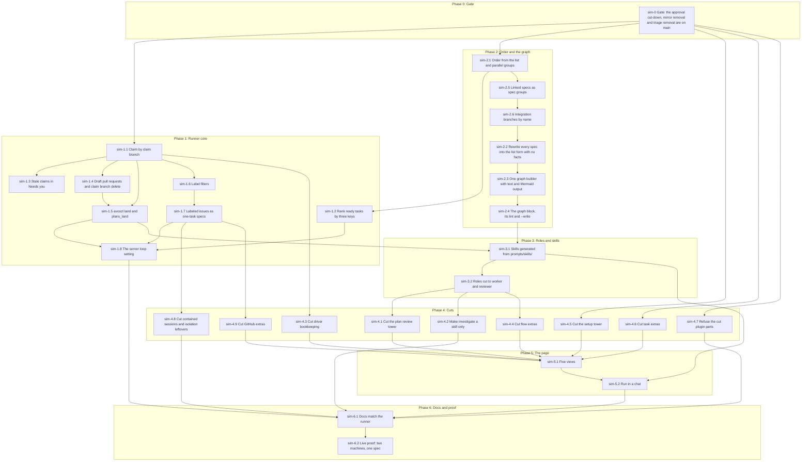

# Tasks: Avoozl as the landing spec's reference runner

Requirement refs (`SM1` to `SM19`) are in `requirements.md`; `§D` refs are
sections of `design.md`. Task IDs start with `sim-`.

This file orders its tasks with `$after` and marks `sim-0` with
`$manual`, which today's parser reads. `sim-2.2` rewrites it into list order
and the `(**MANUAL**)` tag with every other spec.

Every task waits on `sim-0`, the manual gate a person ticks once the approval
cut-down (branch `spec/approval-cutdown`), the mirror removal (branch
`spec/drop-mirror-5`) and the triage removal (branch `task/drop-triage`) are
on main.

Rules for every task: work in a task worktree; tests use isolated temporary
workspaces, real git with a bare remote and a fake GitHub; Avoozl runs the
repository's checks; no real workspace data, machine configuration,
credentials or personal plans in the repository (AGENTS.md); never force
push. A cut deletes the code, its tests, operation entries, CLI commands,
MCP tools, settings keys and schema properties together, and lowers
`scripts/check/dup-baseline.json` when the clone count drops. Screen changes
need phone and desktop, light and dark screenshots for the owner before
merge, shown in chat and never committed.

## Phase 0: Gate

- [ ] `sim-0` Gate: the approval cut-down, mirror removal and triage removal are on main
  - $manual: true
  - A person has checked that the approval cut-down, the mirror removal and the triage removal are on main, whichever branch each landed from

## Phase 1: Runner core

- [ ] `sim-1.1` Claim by claim branch [SM2.1, SM2.2, SM2.3, SM2.5] (§D3)
  - $after: sim-0
  - Tests with a fake GitHub: `runner.next` with `claim` creates `avoozl/<spec>/<task>` at the base head through the refs create call; a 422 makes it take the next ready task; ten refusals end with "every ready task is claimed"; a task with an existing claim branch is not ready
  - A rebuilt cache finds every claimed task from the claim branches alone
- [ ] `sim-1.2` Rank ready tasks by three keys [SM3, SM17.4] (§D3.1)
  - $after: sim-2.1
  - `rankReady` in `src/app/specs/ranking.mjs` orders by downstream count, then longest chain, then file order, over the waits `waitsOf` derives, and a test covers each key breaking a tie left by the one before, including a task that opens a parallel group
  - `unblockCounts` lives only in `ranking.mjs`, and `spec-scheduler.mjs`, `runner.next` and the page read it; `pathsOverlap` and the paths hold are gone
  - `avoozl next` prints each ready task with its three key values
- [ ] `sim-1.3` Stale claims in Needs you [SM2.4] (§D3)
  - $after: sim-1.1
  - Tests: a claim branch whose newest commit is older than `claims.staleHours` (default 24) gives one Needs you item for the spec issue's assignee; Delete branch runs as a high-risk job behind the confirm popup and the CLI prompt; Avoozl deletes no other runner's claim branch on its own
- [ ] `sim-1.4` Draft pull requests and claim branch delete [SM4] (§D4)
  - $after: sim-1.1
  - Tests: `pr` mode opens a draft pull request from the claim branch and never calls the merge, ready-for-review or auto-merge endpoints; a moved base is merged in and checked again; a merged pull request's tick marks the task done on the next read; a pull request closed unmerged gives a Needs you item
  - After landing in any mode, Avoozl deletes the claim branch it created, and a test checks the tick is in the work commit or in a commit on the claim branch before the checks
- [ ] `sim-1.5` `avoozl land` and `plans_land` [SM7.1, SM7.3] (§D7)
  - $after: sim-1.1, sim-1.4
  - `avoozl land TASK` and `plans_land` run one operation that lands a reported task by its repository's mode, and refuse a task the caller did not claim
- [ ] `sim-1.6` Label filters [SM5.1, SM5.3] (§D5)
  - $after: sim-1.1
  - Tests: `labels.require` and `labels.exclude` load from repository settings; a spec runs only when its spec issue carries every require label and no exclude label; a require label added by a non-writer does not count; an exclude label added later does not unclaim a claimed task
- [ ] `sim-1.7` Labeled issues as one-task specs [SM5.2, SM5.4, SM5.5] (§D5)
  - $after: sim-1.6
  - Tests: an open issue with a writer's require label and no spec becomes task `issue-<n>` with the issue's title, and its body as its one done bullet, claims `avoozl/issue-<n>/issue-<n>` and lands like any task; `pr` mode writes `Closes #<n>`; `direct` mode closes the issue with a comment naming the landed commit
  - A labeled issue whose title or body a non-writer wrote runs with network off and no plugin context, and its session record says why
- [ ] `sim-1.8` The server loop setting [SM6] (§D6)
  - $after: sim-1.2, sim-1.5, sim-1.7
  - Tests: with no `loop` in machine config the tick reads and starts nothing; `loop` in `.avoozl.json` is refused naming the file; `loop.run` with `specs`, `epics` and `issues` each claims, starts and lands only that kind of work, through the same operations the CLI calls
  - With the loop off, `avoozl next`, `avoozl graph` and every read still answer

## Phase 2: Order and the graph

- [ ] `sim-2.1` Order from the list and parallel groups [SM16.1, SM16.2, SM16.3, SM16.4, SM16.5, SM16.6, SM16.8, SM16.9] (§D19.1, §D19.3)
  - $after: sim-0
  - `waitsOf` in `src/app/specs/order.mjs` derives the waits, and the ready rule, ranking and lint read only it
  - Tests: the owner's example in §D19 gives `ec-2.1`, then `ec-2.2`, then `ec-2.4` to `ec-2.7` with no wait among them, then `ec-2.8`; an untagged child group of a parallel group runs its children in order; the first item of a phase waits for the phase above; a group is never ready or claimed
  - Tests: lint reports `group.box`, `parallel.size`, `parallel.leaf` and `parallel.tag` as §D19.3 says; the tag before refs parses; a spec that still has `$after` facts is read by them until `sim-2.2`
- [ ] `sim-2.5` Linked specs as spec groups [SM16.7, SM18] (§D19.2, §D19.3)
  - $after: sim-2.1
  - Tests: a title's inline or reference-style link to a spec folder's `tasks.md` makes a spec group whose children are that spec's tasks; its tasks are ready only after its own wait, the linked spec's approval and the linked spec's order; a link to a doc page leaves the task a leaf; the box is derived, and the last task's landing ticks the parent in the same commit on one specs branch or in its own commit otherwise
  - Tests: lint reports `link.missing` (allowed while an earlier unticked task stands in the same list), `link.twice` and `link.children`
- [ ] `sim-2.6` Integration branches by name [SM19] (§D21)
  - $after: sim-2.5
  - Tests: a branch named for a spec's folder on origin is the base of that spec and of every spec it links, the outermost one winning; with no such branch the base is the default branch; Avoozl creates and merges no integration branch
  - Tests: before each claim on such a branch, a default branch that moved since its last merge is merged in with a merge commit and pushed, and an unmoved one changes nothing; two tasks of a parallel group claimed in one pass start on one merged head; a conflict gives one Needs you item naming the branch and files, and no task on that branch is claimed until the merge is in
  - Tests: with origin readable, lint warns `integration.foreign` for a same-name branch holding a commit that is neither a merge of the default branch nor a landing of the spec's or a linked spec's tasks, and passes a branch with no commit beyond the default branch; without origin it skips the check
- [ ] `sim-2.2` Rewrite every spec into the list form with no facts [SM16.5, SM16.10, SM16.11, SM17] (§D19.3, §D19.4, §D20, §D21)
  - $after: sim-2.6
  - Every `tasks.md` under `.kiro/specs/`, epics included, orders its tasks by the list and groups tagged `(**PARALLEL**)` and has no `$after`; for each spec the derived waits include every old `$after` edge inside it, and the commit message lists each added wait
  - Each cross-spec `$after` is the order of spec groups in a parent that links both specs, or a `(**MANUAL**)` gate at the top of the waiting spec
  - No `integrationBranch` or `integrationSync` key is left; a spec that named an integration branch other than its folder name is listed in the commit message for a person to rename the branch or the folder
  - Every `$done` is a plain bullet, every `$manual` task carries `(**MANUAL**)`, a spec whose leaves named two `$repo` values is one spec per repository linked from a parent, and no `kind` front-matter key is left
  - Epic items with `$plan` and `$step` are spec groups and "Write the spec" or `$manual` review tasks, `$investigate` tasks are split into an investigation task naming `findings/<id>.md` and the task that names it, and no `epic` front-matter key is left
  - Tests: lint reports every `$` bullet as `facts.removed-key`, `kind`, `epic`, `integrationBranch` and `integrationSync` as `frontmatter.removed-key`, and `frontmatter.repo`, `done.missing`, `group.bullets`, `manual.tag` and `manual.group` as §D19.3 says; a `(**MANUAL**)` leaf is never given to an agent
  - Every `$` read is gone, and spec lint shows 0 errors
  - `docs/github-workflow.md` ("Task facts", "Front matter", "Epics", "Ready tasks", "Next task", "Investigating first", "Labeled issues", "Manual tasks and gates", "Integration branches") and `docs/specs.md` describe tasks with no facts, plain done bullets, list order, the `(**PARALLEL**)` and `(**MANUAL**)` tags, one repository per spec, linked specs and integration branches named for their spec, list only the keys of SM17.4, and name no `$` fact
- [ ] `sim-2.3` One graph builder with text and Mermaid output [SM8] (§D8)
  - $after: sim-2.2
  - `graphOf` in `src/app/specs/graph.mjs` feeds `graph.view`, `avoozl graph` and `plans_graph`, reads waits from `waitsOf`, and no other module reads tasks and edges for a graph
  - Tests: `avoozl graph` prints by phase in list order with state and indentation, a parallel group's title ending `(PARALLEL)` and a person's task ending `(MANUAL)`, in at most 80 columns and no escape codes; `--format mermaid` prints a `flowchart` with one subgraph per phase and per group and one edge per derived wait; IDs with `.` or `-` map to node IDs as §D8 says, and two colliding IDs get distinct node IDs; an epic or no name prints every member
  - `plans_graph` returns the same text and Mermaid as the CLI for the same scope
- [ ] `sim-2.4` The graph block, its lint and `--write` [SM9] (§D9)
  - $after: sim-2.3
  - Tests: lint reports `graph.stale` when the block differs from the builder's output and `graph.markers` for an unclosed or second block; a `tasks.md` with no block lints clean; a tick does not change the block; the task parser skips the block's lines
  - `avoozl graph SPEC --write` replaces the block, or adds it at the end of `tasks.md`, and lint then passes
  - `avoozl spec lint [SPEC]` and `plans_lint` run `lintSpec`, and every graph block in `.kiro/specs/` lints clean

## Phase 3: Roles and skills

- [ ] `sim-3.1` Skills generated from `prompts/skills/` [SM10.2, SM10.3, SM10.4] (§D10)
  - $after: sim-1.5, sim-2.4
  - `avoozl-spec`, `avoozl-work`, `avoozl-spec-review`, `avoozl-retro` and `avoozl-investigate` are generated from `prompts/skills/<name>.md` beside the ones the triage removal ships, and `npm run check:agents` fails when one differs from its source
  - `avoozl-spec` writes the spec in the §D20 format (no `$` facts, plain done bullets on every leaf, `(**PARALLEL**)` and `(**MANUAL**)` tags, one repository in front matter `repo`, spec links), and `avoozl-spec-review` checks a spec for that format, flags a same-name branch on origin that holds other work (§D21.1), and posts findings without editing; `avoozl-spec` runs `avoozl graph SPEC --write` and `avoozl spec lint SPEC`, and stops at a `spec/<name>` branch; `avoozl-work` claims with `avoozl next --claim`, reports with `avoozl runner report` and lands with `avoozl land`
  - Each skill reaches Avoozl only through the CLI or MCP tools, and a test checks every command or tool a skill names exists
- [ ] `sim-3.2` Roles cut to worker and reviewer [SM10.1] (§D10)
  - $after: sim-3.1
  - `ROLE_TABLE` holds `worker` and `reviewer`; the reviewer is off unless a repository turns it on; a `roles` setting that names another role is refused naming it
  - `kirocrew-app/agents/` holds only `avoozl-reviewer`, and the prompts of cut roles are gone from `prompts/`

## Phase 4: Cuts

- [ ] `sim-4.1` Cut the plan review tower [SM14.1, SM14.4] (§D14)
  - $after: sim-3.2
  - `src/app/reviews/` holds no `plan-review-*.mjs`, `plan-reviews.mjs` or `review-findings.mjs`; `pr-review.mjs` and `github/pull-request-snapshot.mjs` are gone; the plan review operations, CLI commands and MCP tools are gone
- [ ] `sim-4.2` Make investigate a skill only [SM14.4, SM17.5] (§D10, §D20)
  - $after: sim-3.2
  - `delivery/investigate.mjs`, the falsifier stage and every `$investigate` read are gone; the `avoozl-investigate` skill tells a worker to write the findings file its task's `$done` names, and a reviewer how to try to prove it wrong (SM17.5)
- [ ] `sim-4.3` Cut driver bookkeeping [SM2.5, SM14.1] (§D3)
  - $after: sim-1.1
  - `workers/driver.mjs`, `driver-scope.mjs`, `working-heads.mjs` and `remote-runner.mjs` are gone, with the `drivers` table and the `driver` and `worker` CLI commands; the assignee rule and claim branches decide who runs a task
- [ ] `sim-4.4` Cut flow extras [SM14.1, SM14.4, SM17.3] (§D14, §D20)
  - $after: sim-3.2
  - Build receipts and reports, CI waste, corrections, usage, planning flow, provider health, retro chats, retro memory and retro operations are gone from `src/app/flow/`, with `bin/build-receipt` and the `avoozl-costs` skill; `flow-retro.mjs` and `retro-files.mjs` are gone once `avoozl-retro` ships
  - Flow keeps no fix-work share: `isFixWork`, the task `fix` flag, `metrics.fixWork`, `fixShare` and the retro brief's `fixWork` are gone (SM17.3)
  - Stop the line and the worker's own check run still pass their tests
- [ ] `sim-4.5` Cut the setup tower [SM12] (§D12)
  - $after: sim-0
  - Demo mode, example installs, sample specs, instance names, onboarding, repository kinds and roles, setup access and `avoozl setup` are gone, with `seed`, `examples` and `setup` commands
  - A test adds a repository with `avoozl repository configure ID --root PATH`, runs `avoozl rebuild`, and finds its specs, ticks, claims and spec issues, with no GitHub write
- [ ] `sim-4.6` Cut task extras [SM4.5, SM14.1] (§D14)
  - $after: sim-0
  - Evidence bundles, supersede, dedup, title repeat, task notes, task steps, task files and task summaries are gone from `src/app/tasks/`, with their operations, commands and MCP tools; lint's summary-repeats-title check goes, since a task has no summary
- [ ] `sim-4.7` Refuse the cut plugin parts [SM11] (§D11)
  - $after: sim-0
  - `PARTS` is `rules`, `credentials`, `checks` and `context`; a manifest listing `pack`, `intake`, `template` or `policy` is refused with "<part> is not a plugin part"; `plugin-pack.mjs` is gone
- [ ] `sim-4.8` Cut contained sessions and isolation leftovers [SM14.1, SM15.1] (§D14)
  - $after: sim-1.7
  - `executors/box-*.mjs` and `egress-proxy.mjs` are gone; `isolation` accepts `run` (`sandbox` or `unconfined`), `network`, `readable`, `writable` and `prepare`, and refuses `container`, `worker`, `runtime`, `image`, `strangers` and `strangerRoles` naming the key; `intake/stranger-holds.mjs` is gone
- [ ] `sim-4.9` Cut GitHub extras [SM12.3, SM14.1] (§D14)
  - $after: sim-1.7
  - `github-intake`, `github-respond`, `github-reviews`, `github-setup`, `github-sources`, `setup-landing`, `source-backlinks`, `landing-trailers`, `merge-path`, `landing-queue-view`, `intake/fix.mjs`, `mcp-views.mjs`, `panel-view.mjs`, `session-open.mjs` and `chat-models.mjs` are gone; the specs files §D14 marks cut are gone
  - A test checks every person-only operation is still refused over MCP after the cuts

## Phase 5: The page

- [ ] `sim-5.1` Five views [SM13.1, SM13.2, SM13.4] (§D13, §D15)
  - $after: sim-4.1, sim-4.3, sim-4.4, sim-4.5, sim-4.6, sim-4.9
  - The nav lists Plans, Graph, In flight, Needs you and Settings; In flight shows each claim branch with holder, session, head, checks and pull request; Needs you shows failing checks, stop the line, ready manual tasks, stale claims, draft pull requests, unmerged closes and plugin approvals; Settings edits labels, claim stale hours and `loop`
  - Every group §D15 marks cut is gone with its API file and tests, and `npm run test:ui` passes
  - The owner has seen phone and desktop, light and dark screenshots of each view
- [ ] `sim-5.2` Run in a chat [SM13.3] (§D13)
  - $after: sim-3.1, sim-5.1
  - Run in a chat on a spec, task or Needs you item opens a Kiro Crew chat seeded with the skill name and IDs inside Kiro Crew, and a worker-harness process session on the standalone page; a test checks the seed for each item kind

## Phase 6: Docs and proof

- [ ] `sim-6.1` Docs match the runner [SM1] (§D1)
  - $after: sim-5.2, sim-1.8, sim-4.2, sim-4.7, sim-4.8
  - `docs/github-workflow.md`'s "Avoozl status" section lists nothing; `README.md` and `docs/` describe only kept parts, in the landing spec's terms; docs for cut features are gone
- [ ] `sim-6.2` Live proof: two machines, one spec [SM1.1, SM2, SM4] (§D16)
  - $after: sim-6.1
  - A receipt in `docs/evidence/` shows two Avoozl workspaces with `loop` on a scratch repository and one spec of four tasks with one parallel group of two: the two parallel tasks claimed by different workspaces, each task claimed once, each landed with its tick in the same commit, one in `pr` mode as a draft a person merged, and the graph block linting clean before and after

<!-- avoozl:graph start -->

<!-- avoozl:graph end -->
