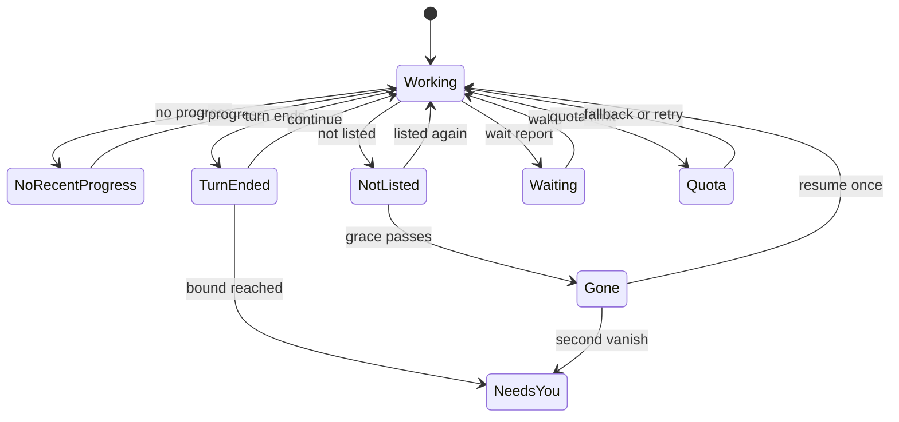

# Design: stalled workers

`SW` numbers are in this spec's `requirements.md`. `R` numbers and `§`
sections without a `D` are in `.kiro/specs/avoozl/`. Rule numbers such as
15.6 are [Workflow v1](../../../docs/github-workflow.md) rules.

## D1. The shape

Every worker attempt is in one state that Avoozl derives from what the
executor last said, the attempt's last report and the task's delivery row.
The tick acts on the state, and In flight shows it.



Recovery reuses what is there today. `reconcileDeliveries`
(`src/app/delivery/delivery.ts`) records each attempt's outcome and plans
messages; the planner starts attempts; `drainProcessRequests`
(`src/app/executors/process.ts`) and `observeSessions`
(`src/app/executors/kirocrew/session-observer.ts`) record what each executor
says. This spec adds three outcomes (`waiting`, `quota`, and a `turn-ended`
binding status for a resumable child), one guard, one state function and a
text table.

## D2. One active worker

`previousAttemptEnded(binding, now)` in `src/app/delivery/delivery.ts` is
the only test of whether a task may get a new attempt. It returns true when
the binding's status is in `FINAL_STATUSES` (`closed`, `lost`), when
`goneSettled(binding, now)` holds, or when the status is `idle` and the
report is final (`done`, `blocked`, `wait`). It returns false for any other
status, including a status Avoozl could not read: a failed read leaves the
stored status as it was (`observeSessions` and `drainProcessRequests` push an
error and skip the binding), so no read failure becomes evidence of an end.

Every path that opens a worker attempt calls it first: the planner's start
of a retry, the vanished resume, a wake, a quota retry that opens a new
attempt, and a fallback. A continue and a quota retry that resumes the same
session open no attempt, so they need no guard.

**Stop and fall back** (SW7.7) calls the executor's `stop`, then waits for a
later status read that passes the guard. The fallback starts on the first
tick after that read.

A table test lists each path and drives it with a fake executor that reads
`working`, then `idle` with no report, then a failed read. The path must
start nothing in all three.

## D3. States and their words

`workerState` (`src/app/delivery/worker-state.ts`) returns one state per
worker attempt, or per task in a timed or quota wait:

```json
{
  "state": "turn-ended",
  "since": "2026-11-24T16:38:00.000Z",
  "nextAt": "2026-11-24T16:42:00.000Z",
  "try": 2,
  "tries": 3
}
```

`workerStateText(state, {now})` (`src/app/delivery/worker-state-text.ts`)
turns it into the label, cause and next action. The page, `avoozl lanes` and
Needs you import the same function, so the strings live once. `{time}` is
`HH:MM` on a 24-hour clock in the viewer's local time, with the short month
and day first when the day is not today (`Nov 25, 14:00`). `{age}` is the
time since, in words: `1 minute`, `28 minutes`, `2 hours 5 minutes`,
`3 days`.

| State | Label | Cause | Next action |
| --- | --- | --- | --- |
| `working` | Working | Worker is running. Last progress report was {age} ago. | Nothing to do. |
| `working`, no report yet | Working | Worker is running. It has not reported yet. | Nothing to do. |
| `stalled` | No recent progress | Worker is still running. Last progress report was {age} ago. | Avoozl will not replace it. Open or message the session. |
| `stalled`, no report yet | No recent progress | Worker is still running. It has not reported in {age}. | Avoozl will not replace it. Open or message the session. |
| `turn-ended` | Turn ended | The worker's turn ended before a done report. | Continuing in the same session at {time} (try {try} of {tries}). |
| `not-listed` | Session not listed | Kiro Crew does not list the session. | Checking again until {time}. |
| `gone` on `kirocrew` | Session gone | Kiro Crew confirmed the session disappeared. | Retrying in the same worktree at {time}. |
| `gone` on `process` | Session gone | The supervisor confirmed the {harness} process is gone. | Retrying in the same worktree at {time}. |
| `waiting` | Waiting | Worker is waiting: {reason} | Resuming at {time}, or when you press Wake now. |
| `wait-held` | Waiting, held | Worker is waiting: {reason} | Wake-up was due at {time}. Held: {hold}. |
| `quota-fallback` | Quota limit | {primary} hit its usage limit. | Starting {fallback} in the same worktree at {time}. |
| `quota-retry` | Quota limit | {primary} hit its usage limit. No fallback is set. | Retrying {primary} at {time}. |
| `quota-refused` | Quota limit | {primary} hit its usage limit. Fallback {fallback} {refusal}. | {fix} Retrying {primary} at {time}. |
| `quota-running` | Quota limit | {primary} is waiting for its usage limit to reset. | Avoozl will not replace it while it runs. Stop and fall back to {fallback}, or let it wait. |
| `quota-running`, no fallback | Quota limit | {primary} is waiting for its usage limit to reset. | Avoozl will not replace it while it runs. |
| `needs-you`, turns | Needs you | The worker's turn ended {n} times without progress. | Last checkpoint: commit {sha}, report "{report}" at {time}. Open the session or retry the task. |
| `needs-you`, vanished | Needs you | The session disappeared twice without a report. | Last checkpoint: commit {sha}, report "{report}" at {time}. Open the session or retry the task. |

The holds, in the order `workerState` checks them, are `the spec is
stopped`, `Stop the line`, `Autopilot is off`, `the spec changed since the
lease`, `the spec is not approved` and `the spec issue is assigned to
someone else`. The refusals and their fixes are:

| Refusal | Fix |
| --- | --- |
| `is not approved on this machine` | `Approve it in Settings › Models.` |
| `changed since it was approved` | `Approve the new version in Settings › Models.` |
| `would loosen permissions: {field}` | `Choose a fallback with the same sandbox.` |

A row that ran on a fallback carries one more line under its state:
`Running on {fallback} because {primary} hit its usage limit at {time}.` A
checkpoint with no report reads `report none`. `{report}` is the first 120
characters of the report text.

The row shows the label in a chip, then `{label} · {elapsed}` where
`{elapsed}` is `duration(since)` from `src/app/insights/format.ts`, then the
cause and next action as one line. A `process` row keeps its
`processLine` and log tail below. The chip's colors come from `TONE`
(`hosts/kirocrew/ui/src/ui/tones.ts`): `ok` for Working, `warn` for every
recovering state, `danger` for Needs you, `muted` for Waiting. Nothing
animates. At 320px the chip, the label and the actions wrap onto their own
lines; `hosts/kirocrew/ui/test/` gets a phone-width layout test for one row
per state.

## D4. Turn ended

A turn has ended when a Kiro Crew chat reads `idle` with no final report,
or when a `process` child exited with no result file under a definition
that has `resume`. `drainProcessRequests` records that child as `idle`, the
way it records a child awaiting resume today, instead of `closed`, after
`commitChildWork` commits its changes. A child with a result file, a child
whose definition has no `resume`, and a child whose output matches its
`quota` key (D7) keep their own paths.

The continue replaces the check-in. `checkInStep` and `unansweredCheckIns`
(`src/app/sessions/session-bindings.ts`) become `continueStep` and
`unansweredContinues`, with this delay before continue `k` (counting from 0
since the last progress):

```text
delay(k) = min(continueMinutes * 2^k, continueMaxMinutes)
```

The delay counts from the later of the turn's end (`statusAt`) and the last
continue. Progress is a report newer than the last continue, or a worktree
`HEAD` other than the one recorded with the last continue. Progress resets
`k` to 0.

The message is one string per executor. A chat gets:

```text
Avoozl task {task}: your turn ended before a done report. Continue in the same worktree. When you reach a stopping point, report done, blocked, question or wait.
```

A child gets its resume prompt:

```text
Avoozl task {task}: your run ended before you wrote .avoozl/result.json. Continue in the same folder, then write the result file as your brief says.
```

When `k` reaches `continueAttempts`, `reconcileDeliveries` sets the
delivery to `decision` with `decisionStage: "turns"` and the checkpoint
(D9.4), and sends no more continues. A person's retry clears it, as today.

## D5. Gone and not listed

The vanished resume stays as it is in `reconcileDeliveries`: the first
settled `gone` since the last person's retry records a `vanished` attempt
with `lastReport`, marks the binding `lost`, and the next tick opens one
attempt in the same worktree. `failuresSince` keeps skipping `vanished`
attempts, so the resume costs nothing (SW4.3). A second settled `gone` opens
the decision, which now names the checkpoint.

What changes is what the page says. Before `GONE_GRACE_MS` passes the state
is `not-listed` with `nextAt = statusAt + GONE_GRACE_MS`. After it, the
state is `gone` with `nextAt` set to the next tick: the tick runs every
minute, so `{time}` is the next whole minute. A binding that reads
`working` again within the grace goes back to Working with nothing
recorded.

## D6. No recent progress

`stalled` is `working` with no progress for `stallMinutes`, measured from
the later of `boundAt` and the last report. It is a view only: no code path
reads it to act. The row's actions are the ones In flight has today:
`AttemptLink` for a chat, **Send message** for a child that accepts it, and
**Open session**.

## D7. Quota detection

A harness definition says how its quota limit looks with an optional
`quota` key. Avoozl reads it from the same bounded log tail as `cost`
(`readTail` in `src/app/executors/process-view.ts`), one JSON object per
line:

```json
{
  "quota": {
    "from": "output",
    "match": [
      {
        "field": "result",
        "pattern": "usage limit|limit reached|rate_limit_error"
      }
    ],
    "reset": {
      "field": "result",
      "pattern": "\\|([0-9]{10})$"
    }
  }
}
```

A line matches when it parses as an object whose dotted `field` is a string
matching `pattern`, case-insensitive. `reset` is optional: its one capture
group is read as epoch seconds or an ISO 8601 time, and anything else gives
no reset time. Patterns are at most 200 characters and must compile;
`parseHarnessDefinition` (`src/app/executors/harness-definitions.ts`)
refuses any other value, naming the key. Adding `quota` changes the
definition's hash, so a machine approves the definition again.

`quotaOf(definition, tail, status)` in `src/app/executors/process.ts` reads
the tail when the child exited with a non-zero code or no result file, and
when it reads `working` (for `quota-running`). An exit 0 with a `done`
result is never a quota limit.

Each harness Avoozl ships states its own signal:

| Harness | Signal | Reset time |
| --- | --- | --- |
| `claude-code` (`examples/harnesses/claude-code.json`) | The final `--output-format json` object, `is_error` true, with `result` matching `usage limit\|limit reached\|rate_limit_error` | The `\|<epoch>` suffix of `result` when present |
| `claude-code` on Bedrock (`examples/harnesses/bedrock/claude-code.json`) | The same object, with `result` matching `ThrottlingException\|ServiceQuotaExceededException\|Too many tokens` | None |
| `codex` (`examples/harnesses/codex.json`) | A `codex exec --json` event whose `error.message` or `message` matches `usage limit\|usage_limit_reached` | None |
| `codex` on Bedrock (`examples/harnesses/bedrock/codex.json`) | The same event, with `ThrottlingException\|ServiceQuotaExceededException` | None |
| `kirocrew` | None. The slot read names no provider error | None |

The patterns come from each CLI's documented output and from synthetic
fixtures under `src/app/executors/test/fixtures/quota/`. The live proof
(`stall-p1`) records each harness's real output once and corrects a pattern
that does not match it.

Claude Code in `-p` mode may wait through a limit instead of exiting. Its
child then reads `working`, and its log tail matches `quota`, which is
`quota-running`. Avoozl leaves it running (SW7.7).

## D8. Fallback

`roles.worker.fallback` in `.avoozl.json` names a harness, set in
**Settings › Models** beside the worker's harness. `fallbackFor(store,
primary)` in `src/app/agents/role-table.ts` returns the fallback or a
refusal. It loads the definition with `loadHarnessDefinition`, which checks
the approval hash on this machine, then compares the two sandboxes.

| Field | Refused when the fallback |
| --- | --- |
| Executor | is `kirocrew` and the primary is a `process` harness |
| Permission class | maps the worker to a class other than `write` |
| Write roots | lists a write root the primary does not (`sandboxWriteRoots`) |
| Allowed commands | has no `allow` argv while the primary has one, so the repository's allow-list would not bind it |
| Unconfined | is marked in `harness-unconfined.json` and the primary is not |

The harness's own inner mode (`permission.write`, such as `acceptEdits`) is
not compared: two CLIs' modes share no scale, and the inner-sandbox-off
value already runs only inside Avoozl's sandbox (R94.4d). Egress hosts are
not compared either. Each definition's `egress` lists its own model's API,
its approval covers that list, and the egress proxy enforces it.

With the shipped definitions, the Bedrock `claude-code` definition,
installed under its own name such as `claude-code-bedrock`, is a usable
fallback for `claude-code`. `codex` is refused as a fallback for
`claude-code` because it has no `allow` argv.

A fallback attempt is a new attempt (`attempt + 1`) with `fallback:
{from, harness, at}` on its binding and its delivery attempt, on the lane
the task ran on when it is free, else on any free worker lane. It gets the
approved brief, the last report quoted as data, and the worktree's `HEAD`
as its start. The attempt that hit the limit records `outcome: "quota"`,
which `failuresSince` skips. One task falls back once per quota limit: a
fallback that hits its own limit takes the retry path below with the
primary.

With no usable fallback, the delivery's `quota` state sets `nextAt` to the
reset time or to the exit plus `quotaRetryMinutes`. At `nextAt` the tick
sends the primary's session a continue when its definition has `resume`,
else opens a new attempt on the primary after the guard.

## D9. Timed waits

### D9.1 The report

A chat reports a wait from its worktree:

```sh
avoozl runner report task-1 wait --until 2026-11-24T14:00:00-06:00 --text "Check the hardware test result after 2 p.m."
```

A child writes the same in its result file:

```json
{
  "state": "waiting",
  "text": "Check the hardware test result after 2 p.m.",
  "until": "2026-11-24T14:00:00-06:00"
}
```

`REPORT_KINDS` gains `wait`, and `FINAL_REPORTS` holds it. `reportSession`
refuses a wait whose `until` is missing, has no zone, is not in the future
or is more than `waitMaxHours` ahead, and one whose text is empty or over
300 characters. `readChildResult` (`src/app/executors/supervisor.ts`)
accepts `waiting` with `until`. The worker brief in
`src/app/workers/worker-briefs.ts` gains one line naming the wait report.

### D9.2 The lease

The lease commit carries the wait after the lines rule 15.1 records:

```text
Lease parser/p-2 generation 1

Start: 0a1b2c3d4e5f60718293a4b5c6d7e8f901234567
Task: Report unknown tokens
Done: An unknown token is reported with its line and column
Wait: 2026-11-24T20:00:00Z
Reason: Check the hardware test result after 2 p.m.
```

`Wait` is UTC. `Reason` is one line; the pre-push content rule (R40) checks
it, because the lease commit is pushed. Each renewal (15.6) copies both
lines until the wake. The renewal that starts the woken attempt drops them.
Other runners read rule 15 lines only and ignore these two.

The attempt's outcome is `waiting`, and the delivery holds
`wait: {until, reason, at}` as a cache. `avoozl rebuild` reads the newest
lease commit of each claim this runner holds and writes `wait` again.

### D9.3 The wake

The planner wakes a task when `wait.until` has passed or a person woke it,
and the task is not held (D3's holds, read from the same checks the
planner runs for a claim today). The woken attempt opens after the guard,
in the same worktree, with the approved brief, the wait reason and the last
report quoted as data, on a free worker lane. It counts against no bound.

`avoozl wake TASK` and **Wake now** run one operation, `delivery.wake`,
class `protect` with policy `person("Only a person wakes a task.")`, as an
entry in `src/app/ops/delivery.ts` and a command entry in
`src/app/commands/`. It sets `wait.wokenAt`, and the next tick wakes the
task. A call over MCP or from a session caller is refused, as
`retryDelivery` refuses a session's reason today.

### D9.4 The checkpoint

The checkpoint every Needs you row of this spec shows is the worktree's
`HEAD` (seven characters), the last report's text and its time. It is read
when the decision opens and stored on the delivery as
`checkpoint: {commit, report, at}`, so the row reads the same after the
worktree changes.

## D10. The view

`deliveryView` (`src/app/api/page-views.ts`) adds `workerState` to each
session it sends, and adds one row per task whose delivery is in `waiting`
or `quota` with no live session. `summarize` in
`hosts/kirocrew/ui/src/in-flight-api.ts` keeps those rows in `inFlight`,
and `InFlightRow` (`hosts/kirocrew/ui/src/InFlight.tsx`) renders the chip
and the line from `workerStateText`. **Wake now** shows on `waiting` and
`wait-held` rows, and **Stop and fall back** on `quota-running` rows with a
usable fallback.

`avoozl lanes` prints each lane's state as `{label} · {elapsed} · {cause}
{next}`. Needs you rows of stage `turns`, a second vanish, and a refused
fallback use the same text.

## D11. Settings

The settings are whole numbers in `DELIVERY_LIMITS` and
`DELIVERY_DEFAULTS`, and `src/avoozl-config.schema.json` holds the same
bounds:

```json
{
  "delivery": {
    "continueMinutes": 2,
    "continueMaxMinutes": 30,
    "continueAttempts": 3,
    "stallMinutes": 30,
    "waitMaxHours": 72,
    "quotaRetryMinutes": 60
  },
  "roles": {
    "worker": {
      "harness": "claude-code",
      "fallback": "claude-code-bedrock"
    }
  }
}
```

`deliveryPolicy` refuses `checkInMinutes` and `missedCheckIns` with
`Use continueMinutes and continueAttempts.` A `continueMaxMinutes` below
`continueMinutes` is refused by name. `AGENT_ROLE_FIELDS` gains `fallback`
for the worker row only. `docs/delivery.md` "Time boxes and check-ins"
becomes "Time boxes and continues" and gains sections for timed waits and
quota limits.

## D12. Tests

Each state of D3 gets one test in `src/app/delivery/test/worker-state.test.ts`
with an isolated workspace, a bare remote and fake executors. Each test
reaches the state through the tick, reads `workerStateText`, and asserts
what the tick did: the message sent, the attempt opened, or nothing.
`src/app/executors/test/process-executor.test.ts` covers the child's turn
ended and quota exits with the fixtures. The guard's table test is D2's.

The workflow kit gets two cases under `workflow-kit/cases/`:
`claim-wait-renewed`, where a lease with a `Wait` line renewed within half
the stale hours is not stale and a second runner's resume stops (15.6,
15.7), and `claim-wait-stale`, where the same lease left unrenewed past the
stale hours is taken over (15.7, 15.8). Both run through the adapter's
`readLeases` and `takeOver` steps.
