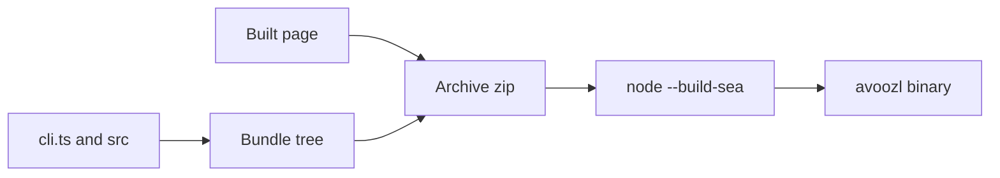

# Design: Avoozl as one standalone binary

`SB` numbers are in this spec's `requirements.md`. Labels are as in the
requirements: **V** read at `55ec5492` or run on this Mac with the official
Node v26.13.1 darwin-arm64 build, **A** assumed.

## D1. Shape

The binary is the official Node executable with Avoozl's bundle mounted
inside it as a read-only virtual file system. Its main script is the
bundle's `cli.mjs`, so the code runs as it does from the app folder.



The build writes this SEA configuration:

```json
{
  "main": "dist/binary/lib/binary-main.mjs",
  "mainFormat": "module",
  "output": "dist/binary/avoozl-darwin-arm64",
  "disableExperimentalSEAWarning": true,
  "useVfs": true,
  "vfsArchive": "dist/binary/archive.zip",
  "execArgvExtension": "none"
}
```

## D2. Observed Node behavior

Each row was run on this Mac in `/tmp/sea-test` with the official Node
v26.13.1 darwin-arm64 build, its checksum matched against the release's
`SHASUMS256.txt`, and each binary signed ad hoc.

| Check | Result | Label |
| --- | --- | --- |
| Homebrew `node` v26.13.1 runs `--build-sea` | Refuses: "Single executable application is disabled." `single_executable_application` is `false` | V |
| Official Node runs `--build-sea` on a CommonJS hello world | Builds and runs | V |
| `mainFormat: "module"` with no VFS | Runs; `import.meta.url` is the binary's own path | V |
| `node:sqlite` in a SEA, in memory and a WAL file on disk | Works | V |
| `useCodeCache: true` with an ESM main and no VFS | Builds and runs | V |
| `spawn(process.execPath, ["child", "x"])` | The child runs the embedded main again with `child x` as arguments | V |
| `spawn(process.execPath, ["-e", "..."])` | The child runs the embedded main with `-e` as an argument; Node does not evaluate it | V |
| `useVfs` with `vfsArchive` and an ESM main | `import.meta.url` is `file:///dev/null/vfs/1/cli.mjs`; static and dynamic relative imports, `readFileSync` and `readdirSync` on `new URL(..., import.meta.url)` work | V |
| `useVfs`: `import()` of an `.mjs` file on disk that imports a sibling | Works | V |
| `useVfs`: `createRequire(file)` of a `.cjs` file on disk | Works | V |
| `useVfs`: `writeFileSync` beside the main module | Did not throw; the docs say writes fail with `EROFS`. Not relied on (SB3.4) | V |
| Avoozl's real bundle (274 files, 660 KB zipped) in a `useVfs` binary | `--help`, `init`, `status`, `check` (SQLite) and `mcp` `initialize` plus `tools/list` all work | V |
| `avoozl --help` time, three runs | Binary 0.31 to 0.42 s; `node lib/cli.mjs` 0.57 to 0.70 s | V |
| Binary size, darwin-arm64 | 146,390,688 bytes; 44,563,075 gzipped | V |
| `useVfs` with `useCodeCache` or `useSnapshot` | Not allowed together (Node docs) | A: docs only |
| `execArgvExtension: "none"` ignores `NODE_OPTIONS` | Not run | A: docs only |
| Any Linux or Windows binary | Not run; this Mac has no such runner | A: sb-2.2 checks it |
| Hardened runtime and notarization | Not run; needs a Developer ID | A: sb-3.2 checks it |

The VFS (Node's `useVfs`) is "Stability 1.0, Early development" and was
added in v26.9.0
([VFS for assets](https://nodejs.org/api/single-executable-applications.html#virtual-file-system-vfs-for-assets)).
Without it, an ESM main can import only built-in modules, so the binary
needs it to load the bundle tree and plugin files from disk.

## D3. Build

`scripts/bundle/build-binary.ts` runs after `npm run build` and writes
`dist/binary/` (in `.gitignore`).

1. Check Node: version 26.9.0 or later and
   `process.config.variables.single_executable_application` true (SB1.3).
   The refusal names the official download.
2. Check the page with `uiBundleProblem(ui)` (SB1.4).
3. Copy `hosts/kirocrew/bin/lib` to `dist/binary/lib`, add
   `binary-main.mjs` (D4) and copy `hosts/kirocrew/ui/dist/standalone` to
   `dist/binary/lib/ui/dist/standalone`.
4. Write `archive.zip` with `zipFiles` from `node:zlib`, deflated.
5. Write the D1 configuration and run `process.execPath --build-sea`.
6. On macOS, sign ad hoc unless `AVOOZL_CODESIGN_IDENTITY` is set (D9).

The bundle input list in `scripts/bundle/build-kirocrew-app.ts` gains
`src/app/executors/egress-proxy-main.ts`. At `55ec5492` that program is
missing from the bundle, and `src/app/executors/egress-proxy.ts:17` names
it as `./egress-proxy-main.ts`, which Node does not run under
`node_modules`. **V**: the experiment's bundle has `egress-proxy.mjs` and
no `egress-proxy-main.mjs`.

CI and the release use `actions/setup-node` with a pinned exact Node
version, which installs the official build. A Node update is a one-line
change that the binary job checks on all three OSes.

## D4. Self-start

`src/app/runtime/self.ts` is the one module that says how to start Avoozl
and its programs (SB2.1). `isBinary` is `isSea()` from `node:sea`, read
once.

| Function | Outside binary mode | Binary mode |
| --- | --- | --- |
| `cliArgv()` | `[execPath, CLI_FILE]` | `[execPath]` |
| `programArgv(name)` | `[execPath, file of name]` | `[execPath, "__program", name]` |
| `scriptArgv(file)` | `[execPath, file]` | `[execPath, "__script", file]` |
| `cliCommand()` | `cliArgv()` shell-quoted | `cliArgv()` shell-quoted |
| `readPaths()` | The program file and its `package.json` lookups | `[execPath]` |

The program names are `supervisor-child`, `context-broker`,
`context-relay`, `serve`, `plugin-child` and `egress-proxy`, each mapped to
its module once. Each function takes `{binary}` so unit tests cover both
modes without a SEA.

`binary-main.mjs` is the SEA main. It reads `process.argv[2]`:

- `__program NAME`: removes the two words from `process.argv` and imports
  that program's module from the VFS.
- `__script FILE`: sets `process.argv` to `[execPath, FILE, ...rest]` and
  imports `FILE` from disk.
- Anything else: imports `./cli.mjs`.

It is not a command entry and not an operation (SB2.6), because no person
runs it.

### Call sites

Each of these moves to `self.ts`. **V** for every path and line.

| Place | At `55ec5492` | Binary mode |
| --- | --- | --- |
| `src/app/executors/supervisor.ts:45`, `:1055` | Spawns `supervisor-child` by file | `programArgv("supervisor-child")` |
| `src/app/executors/supervisor.ts:51`, `:740` | Spawns `context-broker-main` by file | `programArgv("context-broker")` |
| `src/app/executors/supervisor.ts:71`, `:770` | Writes `command: execPath, args: [CONTEXT_RELAY, ...]` into the agent's MCP config | `programArgv("context-relay")` |
| `src/app/executors/supervisor.ts:1007` | Adds the relay file and its `package.json` lookups to the sandbox read list | `readPaths()` |
| `src/app/executors/page-child.ts:18`, `:92`, `:114` | Spawns `serve-main` by file, on Windows through `Start-Process` | `programArgv("serve")` |
| `src/app/plugins/plugins.ts:71`, `:898` | Spawns `plugin-child` by file | `programArgv("plugin-child")` |
| `src/app/executors/egress-proxy.ts:17`, `:138` | Spawns `egress-proxy-main.ts` | `programArgv("egress-proxy")` |
| `src/app/plugins/plugin-check-run.ts:217` | Runs a plugin's `.mjs` with `execPath` | `scriptArgv(file)` |
| `src/app/workers/report-command.ts:9`, `:20` | `cliCommand()` with `CLI_FILE` | `cliCommand()` |
| `src/app/git/git.ts:248` | Credential helper `execPath CLI_FILE credential` | `cliCommand() + " credential"` |
| `src/app/content/content-rules.ts:2005` | Pre-push hook `exec execPath cli content check` | `cliCommand()` |
| `src/app/delivery/delivery.ts:414` | `CLI` path in a worker brief | `cliArgv()` |
| `src/app/cli/skill.ts:6` | `"node " + cli path` in the skill text | `cliCommand()` |

`src/app/cli/postinstall.mjs` and `src/app/cli/link-global.ts` are npm's
and never run from the binary (SB3.5). `src/app/sandbox-probes.ts` runs
`{node} -e` probes in tests and the live proof only, so it keeps a real
Node.

## D5. Runtime files

Code reads its data through `import.meta.url`, and the VFS serves those
reads, so no read needs a binary-mode branch (SB3.2). **V** for each path.

| File | Read by | In the archive |
| --- | --- | --- |
| `prompts/*.md` | `src/app/agents/prompts.ts:114` | Yes, from the bundle |
| `src/*.json` schemas | `src/app/settings/layered-config.ts:19`, `:69`; `src/app/settings/host-config.ts:26` | Yes, from the bundle |
| `src/executor-contract.json` | `src/app/executors/executors.ts:3` (JSON import) | Inlined by the bundler |
| `src/app/skills/avoozl/SKILL.md` | `src/app/cli/skill.ts:18` | Yes, from the bundle |
| `hosts/kirocrew/ui/dist/standalone` | `standaloneUiDirectory`, `src/app/serve/ui-bundle.ts:70` | Yes, added by D3 step 3 |
| `docs/plugins.md`, `docs/content-rules.md` | The page imports them with `?raw` (`PluginsSettings.tsx:33`, `ContentRulesSettings.tsx:45`) | Inside the page bundle |
| `examples/` | Tests only; people copy from the repository | No |

`standaloneUiDirectory` gains one candidate, `ui` beside the bundle root,
which only the binary has (SB3.3). The page server's reads of the page
files go through `node:fs` like every other read; sb-2.1 checks that the
VFS serves them, including any stream reads.

## D6. Kiro Crew app folder

`hosts/kirocrew/app.json` declares `"backend": {"type": "node",
"entryPoint": "bin/avoozl.mjs"}` and its MCP server is
`python3 bin/avoozl_mcp.py`, which finds `node` on `PATH` and runs
`bin/avoozl.mjs mcp` (**V**, `hosts/kirocrew/bin/avoozl_mcp.py:15`). Kiro
Crew runs the backend with Node, so the app keeps its own bundle and its
own Node (SB8.1). Its backend does not call the binary.

The app folder and the binary read the same `~/.config/avoozl` files and
the same workspace. A machine with both runs one supervisor, whichever
started first.

## D7. Same and changed

| Part | Binary mode |
| --- | --- |
| CLI commands, flags, help, exit codes | Same code, same results |
| MCP tools and policy | Same |
| Operation table and dispatcher (`src/app/api/operation-table.ts`, `src/app/ops/`) | Same |
| Workspace files, machine config, SQLite cache | Same format |
| Agent harness definitions | Same; harness programs come from `PATH` |
| How Avoozl starts itself and its programs | `self.ts` (D4) |
| Shell commands written for workers, git and hooks | Name the binary alone |
| Install | One file instead of Node plus a package |
| `postinstall`, global link | Not run |

## D8. Smoke script

`scripts/check/binary-smoke.ts BINARY` runs the built binary in a temp
home (`XDG_CONFIG_HOME`, `XDG_STATE_HOME`, `XDG_CACHE_HOME`, and on Windows
`LOCALAPPDATA` and `APPDATA`) with Node removed from `PATH`, and checks:

1. `--help` exits 0 and matches `node cli.ts --help` from the same source.
2. `init`, `status` and `check` on a temp workspace exit 0, and `status`
   names a SQLite database that exists.
3. `mcp` answers `initialize` and `tools/list` with the same tool names as
   the npm package.
4. `avoozl tick` on a workspace with one ready task and a stand-in process
   harness starts the session through `__program supervisor-child`, the
   stand-in runs `avoozl runner report TASK done` from the brief's command,
   and no Avoozl process is left when the session ends.
5. A fixture plugin loads in `plugin-child`, and a plugin `.mjs` check runs
   through `__script` and sees its own `process.argv`.
6. The page the tick hosts (`hostPage`, `src/app/executors/page-child.ts:40`)
   returns the standalone page's `index.html` and one of its scripts on
   `127.0.0.1`.
7. A pre-push hook and the credential helper it installs in a temp
   worktree name the binary and hold no `/dev/null/vfs` path.
8. With `NODE_OPTIONS=--require=/nonexistent.js`, `--help` still exits 0.

## D9. Targets, signing and size

Each target builds natively. Cross-builds must turn off code cache and
snapshots, and Node's own SEA tests skip macOS x64, so native runners are
the checked path
([platform support](https://nodejs.org/api/single-executable-applications.html#platform-support)).

| Target | Runner | Signing with secrets | Without |
| --- | --- | --- | --- |
| `darwin-arm64` | `macos-latest` | Developer ID, hardened runtime, notarized | Ad hoc |
| `darwin-x64` | `macos-15-intel` | Same | Ad hoc |
| `linux-x64` | `ubuntu-latest` | None | None |
| `linux-arm64` | `ubuntu-24.04-arm` | None | None |
| `win32-x64` | `windows-latest` | Authenticode with `signtool` | Unsigned |

On macOS, `--build-sea` changes the binary, so it is signed after the
build. The hardened runtime needs the
`com.apple.security.cs.allow-jit` and
`com.apple.security.cs.allow-unsigned-executable-memory` entitlements for
V8 (**A**: not run without a Developer ID). Notarization takes a ZIP of
the binary through `xcrun notarytool submit --wait`. A bare Mach-O cannot
be stapled, so Gatekeeper checks the ticket online on first run.

The secrets are `MACOS_CERTIFICATE`, `MACOS_CERTIFICATE_PASSWORD`,
`MACOS_NOTARY_KEY`, `MACOS_NOTARY_KEY_ID`, `MACOS_NOTARY_ISSUER`,
`WINDOWS_CERTIFICATE` and `WINDOWS_CERTIFICATE_PASSWORD`. Only the release
workflow reads them, on a tag push, never on a pull request.

The darwin-arm64 binary is about 146 MB, about 45 MB gzipped (**V**). The
Node runtime is nearly all of it; the archive is 660 KB. Other targets are
measured by sb-2.2 and stated in the docs.

## D10. Release

`.github/workflows/release.yml` runs on a `v*` tag. A build job per target
builds, signs, smoke-runs and archives its binary. A final job writes
`SHA256SUMS` with one `sha256  name` line per archive and creates a draft
GitHub release with the archives and `SHA256SUMS` attached. A person
publishes the draft. The npm package's `pack` check and its contents stay
as they are (SB7.4).

## D11. Risks

- **The VFS is early.** A Node release can change `useVfs`. The Node
  version is pinned, and the binary job runs on every change.
- **Windows VFS paths.** The mount point on Windows was not observed.
  SB2.5 and D8 step 7 catch a VFS path that leaks into a child.
- **A stray write into the VFS.** A write beside a module did not throw in
  D2. A test greps `src/app` for writes through `import.meta.url` or
  `import.meta.dirname`.
- **Two installs on one machine.** The app folder and a binary of another
  version can share one config and one supervisor. SB4.4 holds at one
  version only, and nothing checks a mixed pair.
- **Size.** About 146 MB per binary, against about 2.4 MB of bundle.
- **Signing secrets.** Without them, macOS warns on a browser download and
  Windows SmartScreen warns. `curl` downloads carry no quarantine flag on
  macOS (**A**).
