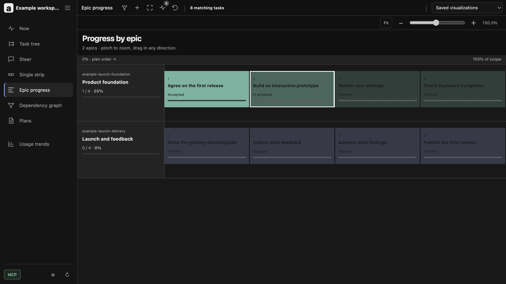

# Avoozl

Plans, tasks, and agents in one local workspace. Use the website, CLI, or MCP to work with the same plans and execution state.

```sh
git clone https://github.com/mtdowling/avoozl.git
cd avoozl
npm ci --ignore-scripts
npm run build:web
node cli.mjs init ../my-plans --name "My plans"
node cli.mjs serve --workspace ../my-plans
```

Open [localhost:9428](http://127.0.0.1:9428/). Node 22.13 or later is required for its built-in SQLite support; Node 26 is tested. Planning and browsing work without an agent account. Managed agents use your installed provider and its own authentication.

The website is a React application. assistant-ui renders conversations over
the same durable HTTP/SSE operations used by the extension, while Monaco edits
plan and workspace Markdown with preview and revision-safe saves. The production
assets are built locally; Monaco and its worker are not loaded from a CDN.



## Start empty or load examples

New workspaces contain no tasks or example plans. Add a task, write a proposal, or choose **Load examples** in the empty workspace or Settings.

```sh
node cli.mjs seed --workspace ../my-plans --example product-launch
```

The fictional product launch includes two epics, eight tasks, dependencies, a design document, an unapproved proposal, three saved views, and a walkthrough. Loading it again preserves changes and creates no duplicates. It never configures a repository, launches an agent, or approves the draft. Example tasks carry an `example` tag. They are ordinary editable tasks after loading.

CLI, UI, and MCP all call the same `workspace.seed` operation. MCP clients can list packs with `plans_examples` and load a requested pack with `plans_seed_example`, using `{"input":{"example":"product-launch"}}`. Managed worker connections cannot seed their own workspace.

## Keep code and data separate

The application checkout contains reusable software and example fixtures. Each workspace has its own configuration, state, and design files:

```text
my-plans/
  workspace.json
  state/workspace.sqlite
  plans/
```

SQLite owns live tasks, dependencies, evidence, approvals, conversations, and agent state. Markdown owns design prose. `/database.json` is an export of current state, not a file to edit.

Choose a workspace with `--workspace PATH` or `AVOOZL_WORKSPACE`. Configuration paths are relative to that workspace, so moving an ordinary workspace preserves them:

```json
{
  "version": 1,
  "name": "My plans",
  "dbPath": "state/workspace.sqlite",
  "documents": "plans",
  "port": 9428,
  "host": "127.0.0.1"
}
```

The application checkout, plan directory, and repositories being worked on can all live in different locations. For example:

```sh
node /opt/avoozl/cli.mjs init /srv/team-state --documents /srv/team-plans
node /opt/avoozl/cli.mjs serve --workspace /srv/team-state
```

Then configure a working repository such as `/home/you/projects/product` in Settings. Its code stays in that repository; plans stay in `/srv/team-plans`; the application stays in `/opt/avoozl`. Use `init --db PATH` to place SQLite independently too.

`--db`, `--documents`, `--host`, `--port`, and `--url` override configuration. `AVOOZL_URL` selects an endpoint for CLI and MCP clients. The earlier `AICOMMANDER_*` and `NUPP_WORKSPACE_*` names still work. `operator` in the workspace configuration, `AVOOZL_OPERATOR`, `AICOMMANDER_OPERATOR`, or `--operator` names the person this workspace acts for, defaulting to `git config user.name` and then the OS user; it is recorded on approval receipts as provenance, not as an authorization. Repository checkout paths, worktree directories, and provider authentication are machine-specific; configure those on each machine. Each workspace has one agent host and web server.

To adopt an existing SQLite workspace, write a configuration pointing to its existing database and Markdown directory, then start Avoozl with that workspace. Do not import a stale JSON export over a live database. Stop the previous web server before replacing it. Drain and stop the previous agent host only after its active work finishes; web reloads can preserve a compatible existing host.

## Connect an agent

The HTTP MCP endpoint is [localhost:9428/mcp](http://127.0.0.1:9428/mcp). A stdio client can launch this bridge with absolute paths:

```json
{
  "mcpServers": {
    "avoozl": {
      "command": "node",
      "args": [
        "/path/to/avoozl/cli.mjs",
        "mcp",
        "--workspace",
        "/path/to/my-plans"
      ]
    }
  }
}
```

Start the server first. The bridge connects to that workspace's endpoint. Existing `plans_*` tool names remain stable.

Export the portable agent workflow skill without starting the server:

```sh
node cli.mjs skill --workspace ../my-plans
```

Install that output as the `avoozl` skill in your agent client's skill directory. It contains this installation's paths and endpoint, not task records or credentials. Re-export after moving the application or workspace. Read the workspace and target repository's own guidance before acting.

## Plan and execute

Capture tasks through the UI or `task.capture`. For substantial work, draft one Markdown plan with design and proposed deliverables. Each deliverable uses a fenced `task` block:

````markdown
# Save preferences

Preserve the user's settings after restarting.

```task
{
  "id": "save-preferences",
  "title": "Persist preferences",
  "summary": "Restore saved preferences on startup.",
  "acceptance": ["A changed preference survives restart."],
  "requires": []
}
```
````

Use `plan.create`, `plan.save`, and `plan.get` to work on the draft. Approval identifies the exact document hash and database revision — those two checks are the authorization — and extracts tasks atomically. The receipt records the workspace operator, and `evidence` when a caller has something real to say. Indexing Markdown alone does not create ready work. The example proposal stays a draft until explicitly approved.

An agent that discovers adjacent work while implementing appends one proposal with `plan.propose` instead of creating a task: `{"id":"PLAN_ID","proposal":{"id":"local-id","title":"...","acceptance":["Observable check."]}}`. The appended block is validated by the same rules as approval and stays non-executable. The amended plan no longer matches its approval receipt, so it reads as having unapproved changes and its tasks are flagged for review until the next approval converts the proposal.

Configure a Git checkout, base branch, worktree directory, and acceptance commands in Settings before managed execution. Claude and Codex use their own harnesses and authentication. OpenHands can instead use a separately running, loopback-only Agent Server. Install the Avoozl Canvas App with `node cli.mjs openhands install-app`; it puts planning, work authorization, and acceptance inside Canvas while terminal, files, browser, chat, and steering stay native to OpenHands. The standalone Avoozl site retains the embedded surface as a compatibility client. See [the OpenHands setup](docs/openhands.md). Implementation runs own isolated worktrees; acceptance checks run against a clean committed head. Integration rebases, revalidates, and fast-forwards the configured checkout. Integration does not push. Scoped implementation, integration, and whole-head acceptance remain separate.

## Private GitHub planning and work intake

Avoozl can publish sanitized planning state to a Git branch, open a planning pull request, project merged design tasks into issues, and accept assigned issues labeled `avoozl:ready` through the same execution path. Repository registration verifies that GitHub reports the repository as private. Every later poll, issue projection, and planning pull-request operation repeats that check and fails before mutation if visibility changes.

```sh
gh auth login
node cli.mjs project configure code --workspace ../my-plans --json '{"root":"/path/to/code","baseBranch":"main","worktreeRoot":"/path/to/worktrees","checks":[["npm","test"]]}'
node cli.mjs github configure OWNER/CODE --workspace ../my-plans --project code --assignee YOUR_LOGIN --allowed-actors YOUR_LOGIN
node cli.mjs workspace-repo configure /path/to/private-planning-checkout --workspace ../my-plans --branch avoozl-workspace --directory .avoozl
node cli.mjs planning publish PLAN_ID --workspace ../my-plans
node cli.mjs planning reconcile --workspace ../my-plans
node cli.mjs github sync --workspace ../my-plans
```

The publication allowlist contains Markdown designs, exact approval receipts, task definitions, and structured review threads. SQLite, provider credentials, environment files, transcripts, terminal output, local repository roots, and absolute user paths are rejected. A second computer configures its own checkout and credentials, then runs `workspace-repo sync`; it does not copy the first computer's execution database.

```sh
node cli.mjs query --workspace ../my-plans --q 'ready:true'
node cli.mjs show TASK_ID --workspace ../my-plans
node cli.mjs task.update --workspace ../my-plans --json '{"id":"TASK_ID","status":"partial"}'
node cli.mjs plan.create --workspace ../my-plans --json '{"prompt":"Save preferences"}'
node cli.mjs workspace --workspace ../my-plans
node cli.mjs help
```

Shared operations accept `--json JSON` or `--input FILE`, with optional `--revision N` for optimistic writes. MCP exposes operation wrappers with an `input` object. Inspect `tools/list` for current schemas. The UI uses the same operations through `/api/command`.

## Back up and update

```sh
node cli.mjs backup --workspace ../my-plans --output ../my-plans-backup.sqlite
node cli.mjs export --workspace ../my-plans --output ../tasks-export.json
node cli.mjs reload --workspace ../my-plans
```

Back up the Markdown directory and configuration alongside the SQLite backup. Use the backup command rather than copying an active database file by itself: SQLite also uses a WAL file. The JSON export contains task and document state; a SQLite backup also preserves conversations, approvals, receipts, and other execution history.

The web process and agent host are separate. Reloading the website leaves agents running. Before updating host code, use `host drain`, let active work finish, then use `host stop`. Start `serve` after the update to launch its replacement. Do not launch replacement workers because a check-in is stale; inspect durable session and delivery records before resuming.

The default listener is loopback. Private LAN/VPN listening is available with `--host 0.0.0.0`. This is a trusted local workspace, without per-user authentication or public-internet hosting support. Do not expose an OpenHands-enabled workspace remotely until Avoozl has authenticated users and project-level authorization; terminal, files, browser state, and transcripts are all sensitive.

## Fork and customize

Fork this repository to retain an upstream relationship and bring in later improvements. Create your workspace separately, then change the UI, workflow, providers, or example packs in your fork. Your planning data stays independent of source updates. The repository can also be used as a GitHub template for a fresh independent history.

Application operations and SQLite storage live in `src/app/`. Shared models and browser assets live in `src/`. Provider adapters live in `src/app/providers/`. The exported workflow skill lives in `src/app/skills/avoozl/`. Add example packs under `examples/` and register them in `src/app/examples.mjs`; packs use stable IDs and installation receipts to preserve later edits.

Run `npm test` before sharing changes. Tests use disposable workspaces and provider fixtures; they do not require paid agent calls. CI runs on Linux, macOS, and Windows with Node 26.

## License

MIT. The bundled Marked renderer retains its own license in [src/MARKED-LICENSE.md](src/MARKED-LICENSE.md).

## VS Code client

An extension in [`extension/`](extension/README.md) brings plans, tasks, and the conversations this workspace owns into the editor. It is a client: it never starts a provider process and never opens a second writer for a conversation that already has an owner. Saving a plan records a draft revision and never approves it, a conflicting save cannot overwrite another client's revision, and stopping a conversation is reported as a cancellation rather than a failure.

```sh
node cli.mjs serve --workspace ../my-plans --ahp   # site, agent host, and the editor facade
node cli.mjs editor --workspace ../my-plans        # the editor settings to paste
node scripts/package-extension.mjs                 # build an installable .vsix
```

The editor facade translates owned sessions into Microsoft's Agent Host Protocol so they appear as native chat. It binds loopback only and requires a bearer token on every connection; the address `editor` prints contains that token, so treat it as a credential. Reach it from another machine through an authenticated tunnel or an SSH local port forward, never by publishing the listener.

The [implementation plan](docs/design/vscode-client.md) records what is built, what the implementation changed about its own assumptions, and which acceptance gates remain open: native clicked controls, a real-provider run, remote routing, and physical-phone parity. [The evidence](docs/evidence/vscode/README.md) is reproducible with `node scripts/vscode-evidence.mjs`. The website remains the phone companion, and no website feature has been retired. The [research handoff](docs/research/vscode/README.md) records the original investigation and which of its conclusions have since been corrected.
