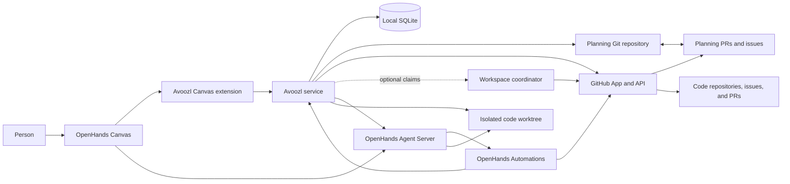
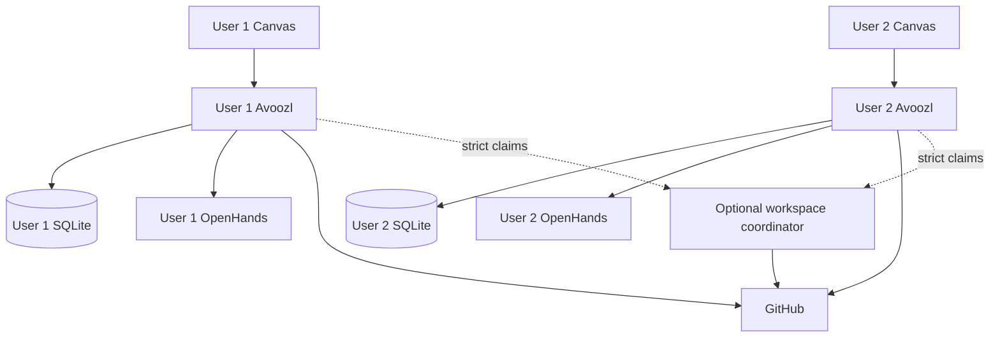

# Avoozl as the planning control plane for OpenHands and GitHub

**Status:** Product direction and implementation design
**Date:** November 11, 2026
**Audience:** Avoozl maintainers and early team adopters

## Summary

Avoozl should stop trying to be a complete agent environment.

OpenHands already provides the execution experience Avoozl would otherwise have
to build: conversation, terminal, files, browser, tool execution, and live agent
steering. GitHub already provides the collaboration substrate Avoozl would
otherwise have to build: identity, repositories, pull requests, review,
assignment, issues, permissions, history, and notifications.

Avoozl should become the control plane between them:

- Markdown design documents define intent, scope, acceptance criteria, and work.
- Avoozl helps people and agents improve, review, approve, and operationalize
  those documents.
- Git and GitHub publish the durable team record and project approved work into
  issues and pull requests.
- OpenHands executes approved tasks in isolated worktrees using the credentials
  and hardware of the computer doing the work.
- Avoozl preserves the chain from design paragraph to task, issue, conversation,
  code change, checks, integration, and acceptance.

The primary user interface becomes an Avoozl extension inside OpenHands Canvas.
Each user runs their own Avoozl service so planning policy, Git synchronization,
and task state survive OpenHands restarts and are not coupled to a particular
conversation. Teams that require atomic cross-user task claims may additionally
run a small workspace coordinator. The coordinator owns leases, not agents,
credentials, plans, or conversations.

This is not an OpenHands fork and it is not a GitHub replacement. It is the
planning and authorization layer that makes the two systems operate as one
product.

## Product thesis

The primary durable unit of intent is a reviewed Markdown design revision, not
a chat session. A repository issue may authorize narrower ad hoc work through
an immutable issue snapshot, but it does not replace design documents as the
product's planning model.

The durable unit of collaboration is a Git commit and its GitHub review history.

The durable unit of implementation is a task linked to an OpenHands
conversation, a code change, validation evidence, and an acceptance decision.

Avoozl's value is maintaining the boundaries and relationships between those
units:

1. Agents may propose and implement, but may not silently approve their own
   scope.
2. A document edit does not silently redirect active work.
3. "The agent stopped" is not the same as "the change integrated" or "the
   requirement was accepted."
4. GitHub collaboration state does not become a second, conflicting definition
   of the work.
5. Moving between computers does not require moving credentials, databases, or
   raw agent transcripts.

## Goals

### Planning

- Provide a first-class Markdown design editor inside OpenHands Canvas.
- Make deterministic plan quality checks cheap and immediate.
- Support structured AI feedback from one or several providers.
- Support review comments, suggested changes, replies, and iterative revision
  without reducing review to an unstructured chat transcript.
- Treat approved design documents as a source of executable tasks.
- Preserve synchronized design documents as the primary source even when a
  GitHub issue provides a faster path for bounded work.

### Delivery

- Project approved tasks into GitHub issues, including across several code
  repositories.
- Accept explicitly authorized, assigned repository issues as ad hoc tasks
  without requiring a planning document first.
- Launch and observe OpenHands conversations from those tasks.
- Preserve Avoozl's existing validation, integration, and acceptance boundaries
  when OpenHands replaces the direct agent harness.
- Keep a durable trace from design revision through completed code.

### Collaboration

- Support one person moving between multiple computers with different local LLM
  credentials.
- Support a team collaborating through protected GitHub repositories.
- Permit one planning repository to coordinate any number of code repositories.
- Keep each user's Avoozl service, OpenHands instance, credentials, and execution
  state independent.
- Optionally coordinate strict task claims without centralizing agent execution.
- Later, permit a primary Avoozl instance to lease execution to registered
  worker computers without placing credentials on the primary.

### Product shape

- Make OpenHands Canvas the normal single pane of glass.
- Keep Avoozl useful through CLI, MCP, and API interfaces.
- Eliminate duplicated chat, terminal, file, browser, and agent-session UIs.
- Install consistently on macOS, Linux, and Windows.

## Non-goals

- Building a second terminal, browser, file explorer, or chat client.
- Forking OpenHands or depending on unpublished OpenHands internals when a
  supported extension or server API exists.
- Using Git as a live message queue, lock service, or agent event transport.
- Using every Avoozl service as a continuous GitHub issue and pull-request
  poller.
- Sharing a SQLite file between computers.
- Synchronizing provider credentials, environment files, cookies, raw terminal
  output, worktrees, or complete OpenHands transcripts through GitHub.
- Automatically approving a plan because an agent revised it.
- Automatically redirecting an active implementation because its design
  document changed.
- Making GitHub issues the sole source of product intent or reducing Avoozl to a
  label-to-pull-request bot.
- Requiring GitHub issue projection for a private, local-only personal project.
- Saved visualizations, presentation decks, guided tours, or a separate
  visualization artifact library. Graphs and progress views may be rendered
  transiently from current state.
- Atomic implementation across several code repositories in the first release.
  Cross-repository work should initially be split into coordinated per-repository
  tasks.

## Product boundaries

| System                          | Owns                                                                                                                                                                                                         |
| ------------------------------- | ------------------------------------------------------------------------------------------------------------------------------------------------------------------------------------------------------------ |
| OpenHands                       | Conversation, terminal, files, browser, live tool execution, provider interaction, agent steering, and reviewed scheduled GitHub automations                                                                 |
| GitHub                          | Team identity, repositories, branches, pull requests, human review, issue assignment, code integration, notifications, and protected-branch policy                                                           |
| Avoozl                          | Design workflow, exact-revision approval, task derivation, dependency policy, issue projection, execution authorization, workspace selection, validation, integration evidence, acceptance, and traceability |
| Git planning repository         | Markdown designs, task definitions, review records, approval receipts, sanitized evidence, and durable product history                                                                                       |
| Per-user Avoozl SQLite database | That user's local execution state, indexes, event cursors, outbox state, and materialized views                                                                                                              |
| Optional workspace coordinator  | Atomic task claims, ownership epochs, fencing tokens, explicit handoffs, and protected-operation leases                                                                                                      |
| Local credential stores         | GitHub credentials, OpenHands provider credentials, Avoozl pairing secrets, and other machine-specific secrets                                                                                               |

SQLite continues to own live execution state and Markdown continues to own design
prose. Git synchronization does not turn the database into a portable file, and
OpenHands persistence does not become the authority for plans.

## Architecture



### The Canvas extension

The Avoozl extension supplies the product pages that OpenHands does not:

- Designs
- Design review
- Work and dependencies
- Run authorization and evidence
- Project and repository configuration
- Worker and synchronization diagnostics

Starting a task opens or deep-links to its native OpenHands conversation. The
terminal, files, browser, and chat remain native OpenHands surfaces.

The extension talks to Avoozl through an authenticated API. It does not directly
mutate the planning repository, the SQLite database, or GitHub.

### The Avoozl service

Avoozl runs independently of OpenHands as a per-user long-running process bound
to loopback by default. Team members do not share this process or its database.
Each user's OpenHands extension talks to that user's Avoozl service.

The service:

- performs all policy-bearing operations;
- synchronizes and validates the planning repository;
- records exact revisions and approvals;
- explicitly reconciles GitHub Queue state and recovers missed automation
  events;
- starts and associates OpenHands conversations;
- manages worktrees and validation;
- keeps durable outbox and event cursor state;
- obtains coordinator claims when a workspace requires strict exclusivity;
- registers workers and leases work when distributed execution is enabled.

OpenHands may start or health-check the local service for convenience, but
Avoozl must not depend on the lifetime of an individual OpenHands process.

### Supported OpenHands boundary

The integration must use pinned, supported OpenHands surfaces:

- Canvas extension APIs for UI integration;
- native Automations for reviewed scheduled GitHub watching and agent-launch
  triggers;
- Agent Server APIs for conversation creation, observation, steering, stop, and
  resume;
- bind-mounted or otherwise explicitly selected Avoozl worktrees;
- versioned compatibility checks during upgrades.

The existing embedded Canvas implementation is transitional. The target
direction is inverted: Avoozl pages live inside Canvas, rather than Canvas living
inside the Avoozl website.

## Installation and lifecycle

The intended installation is the same on all supported desktop operating
systems:

1. Install OpenHands.
2. Run `npx avoozl install`.
3. Open OpenHands and finish GitHub and workspace setup in the Avoozl extension.

`npx avoozl install` should:

- install a compatible Avoozl Canvas extension;
- install or update the Avoozl service;
- register a per-user background service:
  - `launchd` on macOS;
  - `systemd --user` on Linux;
  - a per-user Windows service or startup task on Windows;
- generate a local pairing credential and store it in the operating system
  credential store;
- bind the local API to loopback by default;
- perform an OpenHands/Avoozl compatibility check;
- leave provider and GitHub authentication to their respective explicit setup
  flows.

The installer must be idempotent. Updating Avoozl must preserve workspace data
and must refuse unsafe service replacement while Avoozl-managed work is active.

## Workspace repository model

Every Avoozl workspace selects one Git publication mode:

1. **Separate private planning repository — default.** This keeps designs,
   AI-review material, approval records, and internal evidence separate from
   public or broadly visible code repositories.
2. **Dedicated branch in a code repository.** A dedicated or orphan branch may
   contain the planning workspace without placing it on the normal code history.
3. **Directory on the code branch — explicit opt-in.** Suitable when designs are
   intended to ship with the code and have identical visibility.

Application source must remain independent of all concrete workspace paths and
repository names.

### Recommended layout

```text
.avoozl/
  workspace.yml
  review.yml
designs/
  <design-id>.md
reviews/
  <design-id>/
    <review-id>.json
approvals/
  <design-id>/
    <approval-id>.json
evidence/
  <task-id>/
    <acceptance-id>.json
```

Only portable, reviewed records belong here. Local caches, OpenHands
conversations, complete logs, and machine configuration do not.

### Project registry

One planning repository may coordinate several code repositories:

```yaml
planning:
  repository: example/private-planning
  documents: designs/

projects:
  javascript-sdk:
    repository: example/javascript-sdk
    baseBranch: main
    requiredChecks:
      - test
      - lint

  python-sdk:
    repository: example/python-sdk
    baseBranch: main
    requiredChecks:
      - test
      - typing
```

Checkout paths and credentials are machine-local overlays. They must not be
committed to the workspace configuration.

Each task names a project key rather than a path or repository URL. A single
design may define tasks in several projects and dependencies may cross project
boundaries.

Tasks that require code changes in multiple repositories should normally be
split into one task per repository with a coordination task for shared
acceptance. This avoids pretending that GitHub supplies an atomic multi-repo
merge.

## Design documents as the primary source of work

A design document contains normal Markdown prose plus strictly parsed task
blocks in a designated work section. For example:

````markdown
## Proposed work

```task
{
  "id": "client-retry-policy",
  "project": "javascript-sdk",
  "title": "Implement the documented retry policy",
  "summary": "Apply the shared retry decisions to the JavaScript client.",
  "dependsOn": ["retry-contract"],
  "acceptance": [
    "Retries conform to the design examples",
    "The required test suite passes"
  ]
}
```
````

Task IDs are stable within the workspace. Definition fields such as title,
summary, project, dependencies, and acceptance criteria are edited at their
source block. Runtime fields such as assignment, run state, evidence, pull
requests, integration, and acceptance are not written back into the prose as a
second authority.

Imported Markdown is untrusted input:

- only permitted files and strict JSON task blocks are parsed;
- task fields are schema validated;
- Markdown never executes commands;
- file size, symlink, path traversal, and repository boundary checks apply;
- pulling a commit never approves it or makes its tasks dispatchable.

### Change impact

When a canonical document changes, Avoozl computes and displays:

- tasks added, modified, or removed;
- dependency changes;
- affected active work;
- affected completed work;
- approvals invalidated by the changed revision.

The state transitions are deliberately conservative:

| Change                          | Result                                                                     |
| ------------------------------- | -------------------------------------------------------------------------- |
| Add a task                      | Create a proposed task; do not start it                                    |
| Modify an unstarted task        | Mark it as requiring review                                                |
| Remove an unstarted task        | Propose retirement                                                         |
| Modify or remove an active task | Keep the active run unchanged and require an explicit stop/replan decision |
| Modify a completed task         | Flag design drift; do not silently reopen or rewrite history               |

## Task provenance

Every task has exactly one immutable origin:

```text
design origin
  = planning repository + design blob + task block ID + approval receipt

issue origin
  = code repository + issue node ID + issue body hash
    + authorizing label event + authorization receipt
```

A design-origin task remains governed by its design. Its projected issue may
carry discussion, assignment, and status, but editing the issue cannot redefine
the task.

An issue-origin task remains governed by the issue snapshot that was authorized.
It must never later claim that a design revision authorized work which actually
started from an issue.

When issue work grows beyond the scope safely expressed in one issue, Avoozl
offers **Promote to design**. Promotion creates a draft design and links any new
design-origin tasks to the issue-origin predecessor. It does not mutate the
predecessor's provenance. Unstarted work may be explicitly superseded; active
or completed work retains its original history and is reviewed for drift.

After provenance and authorization are established, both origins use the same
readiness, claim, worktree, OpenHands, validation, integration, and acceptance
state machines.

## Planning experience in Canvas

### Editor

The Designs page provides:

- Monaco Markdown editing;
- rendered preview;
- split editor/preview mode;
- source and revision diffs;
- document outline;
- deterministic diagnostics;
- task-block diagnostics;
- branch, commit, and synchronization status;
- explicit save, publish, and review actions.

The existing editor, preview, diff, plan parser, source watcher, and exact-hash
approval work should be reused rather than replaced.

GitHub's normal editor remains useful for small changes and review, but it does
not provide the live custom schema and policy checks required here. Avoozl runs
those checks interactively; GitHub Actions or a GitHub App reruns the same
deterministic checks on publication.

### Deterministic guidance

The linter should check, when appropriate:

- intent and non-goals;
- constraints and explicit decisions;
- risks, rollout, and rollback;
- test and acceptance strategy;
- unresolved questions presented as decisions rather than hidden ambiguity;
- task schema and stable IDs;
- observable acceptance criteria;
- duplicate tasks and dependency cycles;
- design statements not covered by proposed work;
- proposed work that has no basis in the design.

Cheap deterministic checks run before AI review. AI review should not spend
tokens rediscovering syntax errors or missing required fields.

## Structured AI design review

### Single review

**Ask for feedback** starts one reviewer against an immutable document revision.
The reviewer receives the design, the review rubric, relevant project context,
and existing unresolved comments.

The reviewer returns structured comments rather than a replacement essay.

### Multi-provider review pipeline

Users may configure a sequence such as:

- Claude reviews, Codex revises;
- Codex reviews, Claude revises;
- one Claude model reviews, another Claude model revises;
- several independent reviewers followed by one synthesizer.

The default maximum is three rounds. Each pipeline also has token, cost, and
elapsed-time budgets.

Every round has an explicit role:

- **reviewer:** identify material problems;
- **reviser:** propose a patch addressing accepted feedback;
- **verifier:** determine whether material issues remain.

The default rubric instructs reviewers to:

- report correctness, completeness, feasibility, security, operability, or
  acceptance problems;
- explain the consequence of each finding;
- avoid stylistic preferences unless the wording creates real ambiguity;
- avoid repeating an existing finding;
- state explicitly when no material issues remain.

The loop stops early on:

- no material findings;
- no document change;
- repeated or semantically duplicate findings;
- revision oscillation;
- budget exhaustion;
- the configured maximum round count.

No review or revision automatically approves a document. Agent-created edits
remain drafts until a permitted human or protected team workflow approves an
exact revision.

### Review comments

Each AI comment records:

- review and comment IDs;
- exact Git blob or source hash;
- heading and line range;
- nearby context hash for re-anchoring;
- provider, model, role, and round;
- category and severity;
- explanation and optional suggested patch;
- state: `open`, `accepted`, `rejected`, `resolved`, or `outdated`;
- replies and disposition.

After editing, Avoozl attempts deterministic re-anchoring. A comment it cannot
re-anchor becomes outdated rather than silently moving to unrelated text.

Users may reply to several comments and send one batch response. The next
reviewer receives a packet containing:

- reviewed revision;
- current revision;
- their diff;
- open comments;
- replies;
- accepted and rejected suggestions.

A suggested patch applies only when its expected source hash matches. Avoozl
shows the resulting diff before accepting it.

AI review records may be stored as sidecars in the private planning repository.
Once a planning pull request exists, Avoozl may publish check annotations and a
summary with links. Human GitHub pull-request reviews remain the authority for
team approval; the initial implementation should not attempt fragile two-way
mirroring of every comment.

## Publication and team review

Publishing has separate states:

1. **Save local draft.** Update the local planning checkout only.
2. **Publish draft.** Commit and push a topic branch, create or update a draft
   planning pull request, and run checks. Do not request team review.
3. **Request team review.** Mark the pull request ready and request configured
   reviewers or CODEOWNERS.
4. **Approve and merge.** Required checks and human approvals pass; the protected
   canonical branch receives the exact reviewed commit.

For team work, protected merge into the canonical planning branch is the
publication authority. Avoozl records an approval receipt naming the exact
design blob, workspace commit, GitHub review decision, and identities involved.
An agent identity cannot satisfy a required human approval role.

For personal local-only work, the existing explicit exact-revision approval flow
remains available without GitHub.

Planning repository checks should include:

- Markdown and task schema validation;
- deterministic plan lint;
- dependency validation;
- review metadata validation;
- publication allowlist enforcement;
- secret scanning;
- annotations on the affected document and task blocks.

## Workflow stories

These stories describe the same control path for two operating models. The
three coordination signals must remain distinct:

- **label or design approval = authorization:** the work is permitted to run;
- **GitHub assignee = routing:** this person's Avoozl instances should consider
  the work;
- **activation lease = machine ownership:** one registered computer may create
  the worktree and act on the task.

The activation lease and Avoozl's local task lease are the execution locks.
GitHub is the durable collaboration, review, and audit record; labels,
assignments, comments, and commits are not a live distributed lock.

### Solo maintainer

1. The maintainer registers a local execution project and chooses which GitHub
   repositories Queue monitors. Avoozl Settings reports whether each repository
   has native OpenHands Automation coverage and opens the reviewed native setup
   flow; it never silently enables an automation that can launch an agent.
2. Connecting an eligible monitored repository installs and enables the
   reviewed, deterministic Avoozl intake Automation when its OpenHands
   credentials are ready. OpenHands schedules the read-only GitHub observation
   and submits complete repository snapshots to Queue. Public repositories use
   an explicit observation-only capability that cannot carry label
   authorization or mutate GitHub. **Sync** is the explicit recovery
   path when coverage is missing or a snapshot was missed. The maintainer
   reviews the item, its discussion, and Avoozl's unconfirmed overlap
   suggestions, then links it to existing work or creates a neutral task.
3. The maintainer authorizes bounded issue-origin work with the configured
   ready label. Design-origin work remains authorized by its exact reviewed
   design revision; its ready label is only the projected dispatch signal.
   Assignment routes the task to the maintainer.
4. The intake snapshot wakes Avoozl's normal authorization path; the watcher
   cannot launch an agent itself. Avoozl re-reads the issue, verifies the exact
   authorization and assignee, and only then dispatches eligible work. If two of
   the maintainer's computers can see the assignment, the workspace activation
   lease selects one machine. That Avoozl instance acquires its durable local
   task lease, creates the isolated worktree, and starts the task-bound
   OpenHands conversation.
5. The maintainer watches, steers, interrupts, resumes, and reviews the native
   OpenHands session. Finishing the agent turn does not complete the task.
6. Avoozl validates the committed worktree head, associates commits and the
   implementation pull request with the task, and preserves failures as
   evidence rather than calling them success.
7. GitHub owns pull-request discussion, required checks, approval, and merge.
   Avoozl records the merged commit as integration evidence, evaluates the
   task's acceptance criteria separately, and archives completed conversations
   without losing their transcripts or task links.

### Multi-user team

1. The team reviews and merges a design in the protected planning repository,
   or an authorized maintainer labels a bounded issue-origin task. Avoozl
   projects design tasks into the appropriate code repositories. Connecting an
   eligible monitored repository provisions its deterministic OpenHands intake
   Automation when credentials are ready; public repositories are
   observation-only. Avoozl Settings reports coverage and exposes repair,
   enable, and disable controls.
2. OpenHands continuously submits complete repository snapshots to each user's
   Avoozl intake. Team members review Queue items and overlap suggestions before
   confirming a link or creating a task. **Sync** remains recovery, not the
   normal observation loop. Nobody gains execution permission merely by opening
   an issue or pull request.
3. The ready signal identifies dispatchable work and GitHub assignment routes
   it to a person. Unassigning prevents a new claim but never kills or transfers
   an active run.
4. The deterministic watcher only submits the candidate snapshot. Avoozl
   applies authorization and routing checks before launch. That person's
   registered instances compete for the activation lease. One machine receives
   the fenced claim, creates the worktree, and owns the OpenHands conversation;
   every other instance observes it without acting.
5. The assignee and reviewers can follow progress and steer through OpenHands.
   Scope changes return to the design or issue review path instead of silently
   redirecting active work.
6. Avoozl validates the result and links commits and the pull request. GitHub
   handles team review and protected merge; Avoozl then records integration,
   requires an explicit acceptance decision, archives the completed session,
   and reconciles the task and parent design across collaborators.

### Pull-request review intake

A monitored open pull request enters Queue from the deterministic OpenHands
snapshot as review work, not as authorized implementation work. A separate
native OpenHands review automation may launch a configured review agent, but it
does not satisfy Avoozl intake or grant merge authority. A user can read the
discussion and checks, review possible task or design overlaps, confirm a link,
or create a neutral review task. **Review with agent** opens a repository-bound
OpenHands conversation for inspection. GitHub remains authoritative for review
decisions and merge. Avoozl retains the confirmed task association, review
evidence, commits, and merged revision, while integration and acceptance still
require their own transitions.

## GitHub issue projection

The desired team workflow is intentionally GitHub-native:

1. A design pull request is reviewed and merged.
2. Avoozl creates or updates one parent design issue.
3. Avoozl creates or updates sub-issues from the document's task blocks.
4. When a task's dependencies and policy permit dispatch, Avoozl applies
   `avoozl:ready`.
5. Team members self-assign or are assigned according to normal repository
   policy.
6. A reviewed native OpenHands Automation watches for ready issues assigned to
   that user's GitHub identity and initiates the launch path.
7. One permitted computer claims the task and starts its native OpenHands
   conversation.
8. The user watches, steers, interrupts, and reviews the work in Canvas.
9. Avoozl validates the result and the implementation pull request references
   the task issue.
10. Merge records integration and an explicit acceptance decision completes the
    task.
11. Avoozl reconciles the issue and evaluates design-level
    acceptance.

This is a Glorp-shaped workflow implemented directly by Avoozl; Glorp is not a
runtime dependency.

### Authority rules

- The design document owns scope, acceptance criteria, and dependencies.
- The GitHub issue owns team assignment, discussion, and implementation status.
- For a design-origin task, protected design approval authorizes the work and
  `avoozl:ready` is only a projected dispatch signal.
- The code pull request owns code review and merge evidence.
- OpenHands owns the live implementation session.
- Avoozl translates between these records and refuses contradictory
  transitions.

Issue body text is not permitted to silently redefine a task. Avoozl maintains a
clearly marked generated block and preserves human-authored discussion outside
it. Changing task scope requires changing and reviewing the design document.

Each projected issue records a stable task key and exact design revision. The
mapping is durable and idempotent, so reconciliation updates an issue instead of
creating duplicates.

### Cross-repository projection

The parent design issue normally lives in the planning repository. Each task
issue lives in the code repository selected by its `project` key. Dependencies
may reference issues in other repositories.

The GitHub App is installed on the planning repository and every participating
code repository with minimum required permissions. A normal workflow token is
not assumed to have cross-repository authority.

Only sanitized task fields are projected into a code repository. Private design
prose, AI-review packets, internal evidence, and unrelated planning data remain
in the private planning repository.

## Issue-origin work

Not every useful task needs a design document first. A registered code
repository may opt into issue-origin work:

1. An issue describes bounded work.
2. An authorized person applies `avoozl:ready`.
3. The issue is assigned to at least one GitHub identity mapped to an Avoozl
   user.
4. A reviewed native OpenHands Automation observes the configured GitHub event
   and initiates the launch path for the matching user.
5. Avoozl verifies the authorization event and current assignment, snapshots
   the issue, derives the task, and claims it before starting OpenHands.

The project key is resolved from the repository containing the issue.
`baseBranch`, required checks, worktree policy, and validation commands come
from the existing project registry. Issue intake therefore requires repository
registration, but not another per-issue execution configuration.

### Label, assignment, claim, and lease

These are four distinct decisions:

| Signal            | Meaning                                                                                    |
| ----------------- | ------------------------------------------------------------------------------------------ |
| `avoozl:ready`    | The work is authorized or, for design-origin issues, projected as dispatchable             |
| GitHub assignee   | Which user's Avoozl instances should consider the work                                     |
| Coordinator claim | Which user and computer owns the task across instances when strict coordination is enabled |
| Local task lease  | Which local run may act inside the owning Avoozl service                                   |

Assignment identifies a person, not a computer, and is never the execution
lock. If the same person has two active computers, both may observe the same
assigned issue. In strict mode the coordinator grants one task claim and
fencing token. Without a coordinator, the personal single-active-driver
assumption applies and cross-computer exclusivity is not guaranteed.

Multiple assignees are candidate routes, not multiple owners. The first valid
claim establishes ownership.

Unassigning an issue prevents a new matching instance from claiming it. It does
not stop, transfer, or invalidate an active run. Label removal similarly
withdraws unstarted readiness but does not silently terminate active work.

### Issue authorization receipt

For an issue-origin task, applying `avoozl:ready` is the authorization event.
The receipt records:

- repository and issue node IDs;
- normalized issue body hash;
- authorizing label and label event ID;
- actor identity;
- permission and allowlist decision;
- authorization timestamp;
- derived task schema version.

The task may start only if Avoozl can prove that the body being hashed has not
changed since the authorizing label event. A native automation trigger may
provide the event snapshot, but Avoozl must re-read and verify the issue before
a policy-bearing transition. If it cannot establish that the current body is
the authorized body, the label becomes a request requiring explicit
confirmation of the displayed hash. A Queue reconciliation result alone is
never an authorization receipt.

Later body edits do not rewrite the receipt:

- before a start, they invalidate readiness and require fresh authorization;
- during an active run, they create a scope-drift warning and do not redirect
  the agent;
- after completion, they do not rewrite accepted history.

### Who may authorize

Label permission is potentially permission to execute code on another person's
computer. A repository therefore configures:

- a minimum GitHub permission, defaulting to `write`;
- an Avoozl identity, team, or actor allowlist;
- whether an unauthorized label becomes a review request or is rejected;
- whether local confirmation is still required for sensitive projects.

An actor with label permission but without the configured execution authority
cannot cause automatic dispatch. Permission is checked when the event is
processed and recorded in the receipt.

### Issue parsing

Issue bodies are untrusted input, including when an authorized maintainer
applies the label. Avoozl applies the same import boundaries used for Markdown
plans and keeps run-scoped MCP deny-by-default.

Task definition precedence is:

1. one optional fenced `task` JSON block validated by the strict existing
   schema;
2. checklist items specifically under an `Acceptance criteria` heading;
3. default acceptance: configured required checks pass and a permitted human
   records explicit acceptance.

Arbitrary checklists elsewhere in the issue do not become acceptance criteria.
Markdown never becomes executable configuration, and commands suggested by the
issue remain subject to the registered project's execution policy.

### Scheduled watching and explicit reconciliation

Native OpenHands Automations own scheduled GitHub watching and agent-launch
triggers for monitored repositories. Enabling such an automation is a
code-execution decision: Avoozl Settings reports missing, partial, or healthy
coverage. Connecting a private repository with **continuous tracking** selected
is the explicit authorization to install and enable the deterministic watcher.
If credentials or runtime connectivity are missing, repository registration
still succeeds, coverage reports the blocker, and **Prepare watcher** or
**Repair watcher** completes the idempotent setup later. Loading configuration
files alone never mutates OpenHands.

The pinned OpenHands catalog's `github-issue-to-pr` and
`github-repo-monitor` templates launch their own agents and bypass Avoozl's
authorization, lease, provenance, validation, integration, and acceptance
boundaries. Avoozl therefore packages its own deterministic watcher and reports
the built-ins as related coverage only. The packaged watcher reads monitored
GitHub repositories, submits complete issue and pull-request generations, and
cannot launch an agent or mutate GitHub. Its repository-scoped capability is
bound to the repository node identity, expected visibility, and either
`authorization` or `observation-only` mode. Public repositories are always
observation-only, and the intake endpoint rejects authorization metadata from
that mode.

`queue.sync` remains an explicit operator action that lists and reconciles
issues, pull requests, discussions, checks, assignments, and associations for
Queue review and recovery. It does not continuously poll, launch agents, or
turn imported items into authorized work. The normal continuous path is the
packaged OpenHands watcher.

The integration uses a custom deterministic Avoozl intake Automation rather
than OpenHands' generic issue-to-pull-request automation. The intake action
submits the GitHub event snapshot to one narrow Avoozl endpoint with an
ingest-only credential. That credential can submit a candidate event and read
its receipt; it cannot approve a design, authorize a changed issue, acquire a
lease, start a run, mutate a task, accept work, integrate, merge, or call the
general Avoozl API.

Avoozl re-reads GitHub state, verifies authorization and assignee routing, and
then applies the activation and local task leases before asking OpenHands to
create the conversation. The supported installation must prove that this
intake endpoint is reachable from the actual OpenHands Automation runtime,
including its local or container network boundary, without exposing the
general Avoozl service beyond the authenticated local integration.

Avoozl records durable import cursors and trigger receipts, deduplicates
observations, and revalidates current GitHub state before every policy-bearing
transition. Missing Automation coverage leaves manual Queue review usable but
does not imply scheduled launching is active.

### Relationship to label-driven agent tools

Avoozl and native OpenHands Automations compose the common lower-level loop:

```text
OpenHands Automation watches GitHub
  -> filter label and assignee
  -> submit event snapshot with ingest-only authority
  -> Avoozl re-verifies authorization and routing
  -> acquire activation and local task leases
  -> create worktree
  -> OpenHands runs the steerable agent
  -> open pull request
  -> Avoozl validates, integrates, and records explicit acceptance
```

That loop is an intake and projection adapter, not Avoozl's product identity.
Avoozl would collapse into a Glorp-like label-to-pull-request tool if GitHub
issues became its sole source of truth or opening a pull request became its
definition of success.

The product remains differentiated by:

- synchronized design documents as the primary planning model;
- structured multi-model design review;
- exact and immutable task provenance;
- cross-repository task derivation and dependencies;
- native OpenHands observation, steering, interruption, and resume;
- explicit separation of agent completion, validation, integration, and
  acceptance;
- per-user execution with optional cross-user and cross-computer coordination;
- promotion from bounded issue work into reviewed design work.

The issue path is the fast on-ramp. The design path is the scalable planning and
authorization model.

### Completion boundaries

These states remain distinct:

- **agent finished:** the OpenHands conversation stopped or reported success;
- **implementation ready:** Avoozl validation passed and a code change exists;
- **integrated:** the required code pull request merged and required checks
  passed;
- **accepted:** design acceptance criteria were evaluated and recorded;
- **design complete:** all required tasks are accepted and the parent design can
  close.

Closing an issue must not manufacture missing validation or acceptance evidence.

## Work pickup, conversation reuse, and drain

Pickup is one policy transition, not a periodic instruction to create another
agent. A task is eligible only when its exact design or issue revision is
authorized, its dependencies and review state permit dispatch, its GitHub
assignment routes it to the current user when assignment applies, an activation
claim selects this machine, its execution project is configured, and no current
task or resource lease conflicts. An expired activity heartbeat is diagnostic;
it never proves that a live or disconnected worker may be replaced.

An explicit batch narrows the eligible set and supplies a concurrency ceiling.
The scheduler honors prerequisite integration, shared-resource exclusions, and
the configured per-project and batch limits before using a slot. Within those
constraints, an explicit user rank wins, then work that became ready earlier,
then the stable task ID. A batch restart pauses dispatch until a person resumes
the already authorized batch.

Before creating a run, pickup searches the task's canonical run history for the
newest substantive run in the selected project:

- an active run is adopted and observed; it is not duplicated;
- a completed run proceeds to validation without another agent turn;
- a disconnected run keeps its worktree and provider conversation, places the
  batch in attention, and resumes only through an explicit resume action;
- an interrupted or failed run remains visible evidence and requires an
  explicit retry or handoff decision;
- an integrated run is terminal for that worktree; follow-up work needs a new
  task or a separately authorized review conversation.

Archiving is presentation state, not deletion. Auto-archive may hide a completed
task or child conversation from the default list, but its task link, transcript,
worktree, commits, validation, and acceptance evidence remain addressable.
Acceptance may archive implementation conversations, but it does not archive or
compact the project Driver. Driver model or agent handoff creates a new Driver
generation and retains the predecessor; Driver condensation policy is
independent of child-conversation retention and task auto-archive.

The agent host has these lifecycle states:

| Host state | New pickup                            | Existing turns                           | Queued messages                                              | Batch behavior                                   | Stop                                                                       |
| ---------- | ------------------------------------- | ---------------------------------------- | ------------------------------------------------------------ | ------------------------------------------------ | -------------------------------------------------------------------------- |
| Running    | Allowed after policy and lease checks | Continue                                 | Delivered in order                                           | May dispatch within limits                       | Refused while runs or protected operations are active                      |
| Draining   | Refused before any wait begins        | Continue to a provider-reported boundary | Persisted but not delivered; steering and resume are refused | Running batches pause and their IDs are reported | Allowed only after active runs and validation/integration locks reach zero |
| Stopped    | Impossible                            | None                                     | Preserved in SQLite                                          | Preserved as paused                              | Already stopped                                                            |

Entering drain first flips the host gate, then pauses running batches, then
returns the exact active run summaries, paused batch IDs, and protected-operation
count. This ordering closes the race in which another claim could start while
the operator was waiting. Health reports the same remaining work. Resume reopens
the gate, resumes only the batches paused by that drain, reconnects durable
deliveries, and never synthesizes success or replaces a disconnected worker.

The Settings and diagnostics surfaces should explain this as **Drain for
update**, show the remaining run titles and states, and keep **Stop** unavailable
until the reported active and protected-operation counts are zero.

## OpenHands execution

Starting an implementation task causes Avoozl to:

1. confirm the exact authorized design or issue revision and current readiness;
2. acquire a local claim or, when configured, a coordinator claim and fencing
   token;
3. resolve the project and machine-local checkout;
4. create or validate an isolated worktree;
5. create an OpenHands conversation bound to the task and worktree;
6. provide bounded project, plan, acceptance, and tool context;
7. record the conversation ID and event cursor;
8. display the native conversation in Canvas.

The agent uses the OpenHands provider configuration on the executing computer.
Avoozl does not copy those credentials into the planning repository or the
workspace coordinator.

Agent/model routing is a deterministic policy applied when a Driver generation
or child conversation is created. A rule may select by workflow category, task
scope, declared risk, and an actually reported remaining-context percentage.
Explicit operator choices override policy. Each run records the selected rule,
inputs, and fallback source so a team can explain why a model was chosen.
Avoozl reads the non-secret agent-profile catalog from OpenHands before launch
and skips policy rules that name a missing profile. OpenHands still validates
the selected model when the conversation starts because its profile catalog is
not a complete provider entitlement list and credentials and usable profiles
are deliberately not synchronized.

Routing must preserve an honest unknown state. OpenHands conversation stats
report `per_turn_token` and `context_window` for supported agents; Avoozl uses
their ratio as context capacity and records both source values. Cumulative
prompt and completion tokens do not reveal remaining capacity or plan allowance
and are never substituted. If either context field is absent, threshold rules
do not match and the configured fallback applies. At a completed Driver turn, a
matching context-threshold rule creates a linked successor Driver and retains
the predecessor conversation. It never changes models or conversations during
an active turn, while an approval is pending, or while a message is queued.

Run-scoped Avoozl MCP access is deny-by-default. An implementation agent may:

- read its task, relevant design context, and allowed repository metadata;
- report activity and evidence;
- propose plan changes through an append-only proposal operation.

It may not:

- approve a plan;
- accept its own implementation;
- merge or integrate code;
- change project configuration;
- import arbitrary planning content;
- grant itself access to another task.

Existing worktree validation, expected-commit checks, integration locking, and
whole-head acceptance remain Avoozl responsibilities. OpenHands replaces the
agent harness, not these controls.

## Personal multi-computer operation

The first multi-computer mode targets one person using computer 1 at some times
and computer 2 at others. The computers may have different providers, models,
credentials, checkout paths, and hardware. They are not expected to drive the
same workspace concurrently.

### Portable state

Git and GitHub synchronize:

- designs and task definitions;
- review records and replies;
- exact-revision approval receipts;
- issue and pull-request references;
- sanitized validation and acceptance summaries;
- durable handoff records.

They do not synchronize:

- provider or GitHub credentials;
- OpenHands persistence databases;
- complete conversations and transcripts;
- Avoozl SQLite files, WAL files, or leases;
- absolute paths and checkout configuration;
- uncommitted worktrees;
- raw command output.

### Activation and synchronization

When a computer activates a workspace, Avoozl:

1. verifies the planning checkout and configured remote;
2. fetches and requires a fast-forward update;
3. refuses writes on divergence;
4. validates and imports portable records;
5. rebuilds or updates local materialized state;
6. records the active machine ID and remote revision locally.

Publication uses compare-and-swap expectations against the last observed remote
revision. Avoozl never force-pushes workspace history.

### Handoff

If no work is active, moving computers is simply sync, activate, and continue.

If work is unfinished:

1. stop or pause the active work explicitly;
2. commit and push the code branch where possible;
3. publish a sanitized handoff containing current commit, task state, validation
   summary, unresolved decisions, and next action;
4. sync the other computer;
5. create a new OpenHands conversation using that computer's credentials.

The raw conversation does not need to move. The design, repository state, and
handoff must be sufficient to resume responsibly.

Concurrent personal writers are not supported initially. Detection of another
active driver or a non-fast-forward publication fails closed.

A user who wants strict task ownership across their computers may connect each
computer's Avoozl service to the same optional workspace coordinator. This
coordinates claims and handoff without synchronizing either computer's local
database or requiring a Git commit for each claim.

## Team and multi-user operation

Every team member runs their own Avoozl service and OpenHands instance. They
share designs, reviews, issues, pull requests, and durable delivery records
through GitHub; they do not share provider credentials, conversations,
worktrees, or an Avoozl SQLite database.

Team mode requires:

- authentication tied to GitHub identities or organization membership;
- Avoozl roles such as author, reviewer, approver, integrator, and administrator;
- per-workspace and per-project authorization;
- audit records for policy-bearing operations;
- protected branches and required planning checks;
- conflict detection and explicit resolution;
- notifications and ownership rules.

Protected GitHub operations provide the durable authority boundary. A local
Avoozl service cannot manufacture a protected planning merge, another person's
review, or a code integration for which its GitHub identity lacks permission.
Local databases may disagree temporarily, but reconciliation must converge them
to the GitHub record or surface an explicit conflict.

Teams may initially treat GitHub assignment as a social claim. That is
appropriate when accidental duplicate starts are rare and visible. GitHub
assignment is not an atomic mutex, however, so teams requiring strict exclusive
claims use the optional workspace coordinator.

### Per-user topology



Each user's service applies the same workspace policy locally and authenticates
GitHub operations as that user. GitHub branch protection, required reviews, and
repository permissions remain authoritative for shared durable changes.

This preserves an important product property: joining a team does not require
placing every user's LLM credentials, conversations, source checkout, or
execution capacity behind one central Avoozl deployment.

### Optional workspace coordinator

The coordinator is a small GitHub-aware lease service. It is not a shared
Avoozl application server, agent host, planning database, transcript store, or
provider proxy.

It exists only when a workspace needs atomic coordination that GitHub does not
provide:

- exclusive task claims;
- transfer of a claim between users or computers;
- fencing of stale owners;
- integration and other protected-operation leases;
- later assignment of a team task to one user's Avoozl scheduler.

The coordinator stores:

- workspace and task IDs;
- exact approved design revision;
- claiming GitHub identity and an opaque Avoozl instance ID;
- claim state and timestamps;
- monotonically increasing ownership epoch and fencing token;
- branch, run, and pull-request references where useful;
- a minimal audit trail of claim, release, handoff, and takeover decisions.

It never stores:

- provider credentials or durable user GitHub credentials;
- prompts, transcripts, or raw agent events;
- source files or worktrees;
- complete plans or AI-review packets;
- local paths or machine configuration.

The deployment necessarily has its own GitHub App credential, held in its
deployment secret store rather than its claim database. Clients authenticate
with a short-lived GitHub-backed session or assertion. The coordinator does not
become a vault for users' normal GitHub tokens.

### Claim protocol

Claiming a task is a coordinator database transaction, not a Git commit:

1. A user's Avoozl service submits the workspace, task, approved revision, and
   authenticated GitHub identity.
2. The coordinator verifies current repository access and workspace policy
   through its minimum-permission GitHub App installation.
3. It atomically creates the claim if no current claim exists.
4. It returns an opaque claim ID and monotonically increasing fencing token.
5. The local Avoozl service records the claim and includes the token in
   operations requiring exclusive ownership.
6. GitHub issue assignment and status are updated asynchronously for people to
   see; they are not the mutex.

At minimum, starting an OpenHands implementation, transferring its ownership,
dispatching it to a worker, and integrating its result require the current
fencing token when coordinator mode is enabled. Editing or reviewing an
unrelated design does not.

The coordinator rejects an operation carrying an older token even if the old
owner comes back online. This prevents a resumed stale process from integrating
after an authorized takeover.

For repositories that require strict enforcement at merge time, the coordinator
also publishes an `avoozl/claim-current` check for the implementation pull
request. Branch protection requires that check, so bypassing a stale local
Avoozl process through the GitHub UI cannot silently integrate work from an old
ownership epoch. Normal repository administrators retain their explicit GitHub
override authority and its audit trail.

### Activity, uncertainty, and takeover

Activity heartbeat and task ownership are deliberately separate:

- heartbeat loss marks a claim `uncertain`;
- heartbeat loss alone never releases or reassigns the claim;
- the current owner may explicitly release or hand it off;
- an authorized user may explicitly take it over after reviewing the active
  run, branch, worker, and last known evidence;
- takeover advances the ownership epoch and invalidates every older fencing
  token.

This follows the existing rule that a disconnected worker is not replaced
solely because its activity lease expired.

### Coordinator failure

If the coordinator is unavailable:

- existing agent execution may continue locally;
- local events and evidence continue to be recorded;
- new strict claims, handoffs, takeovers, worker dispatches, and integration
  stop;
- GitHub and planning synchronization continue where they do not require an
  exclusive lease;
- recovery uses the coordinator's durable claim database and audit trail, not
  reconstruction from agent transcripts.

The coordinator therefore cannot expose provider credentials and does not sit
on the token-by-token execution path. Its unavailability reduces coordination
but does not kill an already running agent.

## Later distributed execution

After personal handoff and coordinator-backed claims are reliable, a user's
primary Avoozl instance may fan work out to that user's registered computers.

Each worker advertises bounded capabilities:

- accessible project keys;
- operating system and architecture;
- provider/model aliases without credentials;
- optional hardware capabilities;
- concurrency limit;
- current health and version compatibility.

The primary:

- remains that user's scheduler and policy authority;
- obtains the team claim before dispatch when coordinator mode is enabled;
- grants bounded worker leases under the current claim and fencing token;
- sends approved task context and repository coordinates;
- receives events, commit references, and sanitized evidence;
- reclaims only leases that are safely known to be inactive;
- never replaces a disconnected worker solely because an activity lease became
  old.

Workers do not elect a leader and do not coordinate through peer-to-peer Git
writes. GitHub is the durable result and history channel, the optional
coordinator owns the cross-user claim, and the user's Avoozl service owns worker
dispatch.

## Synchronization and secret safety

The publisher is an allowlist serializer, not a directory copier.

It may publish:

- approved Markdown and task definitions;
- structured AI review records intended for the planning repository;
- identities and hashes in approval receipts;
- issue, pull-request, and commit references;
- command names, exit status, timestamps, and redacted summaries;
- sanitized acceptance evidence.

It must never publish:

- tokens, passwords, cookies, auth headers, or environment values;
- provider configuration or operating-system credential-store contents;
- OpenHands persistence, raw transcripts, or raw conversation events;
- raw terminal output, complete logs, stdout, or stderr;
- SQLite databases, WAL files, or journal files;
- absolute filesystem paths;
- credential-bearing repository URLs;
- local machine configuration, worktrees, or scratch directories.

### Physical separation

- Runtime data lives under the platform's application-data directory.
- Credentials live in the operating system credential store.
- The synchronized workspace uses a dedicated checkout.
- Repository configuration contains logical project keys, not local paths.
- Staging names explicit allowed files; it never uses `git add .` or
  `git add -A`.

### Publication checks

Before commit and push, Avoozl rejects:

- unexpected files or fields;
- binaries where text is required;
- symlinks and path traversal;
- oversized records;
- known credential formats, private keys, connection strings, and
  credential-bearing URLs;
- high-entropy values in fields that should contain prose;
- staged changes outside the allowlist.

GitHub secret scanning, push protection, custom patterns, protected branches,
and disabled force-pushes provide additional defenses. A private repository is
not treated as a secret store.

False-positive overrides are one-shot approvals for an exact content
fingerprint. There is no workspace-wide "disable secret scanning" switch.

Tests must seed fake secrets in every serializable field and attempt symlink,
path traversal, unexpected-file, and staged-diff escapes. If a real secret is
published, rotation and revocation come before history rewriting.

## Local and remote change monitoring

Avoozl monitors local Markdown with a bounded file watcher:

- permitted Markdown roots only;
- no symlink traversal;
- file size limits;
- debounce and stable-read checks;
- parse and impact preview before state changes.

It checks the remote planning repository:

- on startup;
- before editing, approval, and publication;
- when Canvas regains focus;
- on configurable polling;
- through an explicit **Sync** action.

This polling is Git fetch synchronization for the planning repository, not
continuous GitHub issue or pull-request watching. Native OpenHands Automations
own scheduled GitHub triggers. Avoozl's explicit `queue.sync` operation remains
the manual Queue reconciliation and recovery path, so a loopback-only personal
service does not require an inbound public webhook.

Remote commits are not trusted merely because Git accepted them. Imports use the
same validation, secret-safety, schema, identity, and approval rules as local
publication.

## User interface after the pivot

### Retained and moved into Canvas

- design list, editor, preview, diff, and diagnostics;
- design review threads and AI feedback controls;
- tasks, dependencies, readiness, and progress;
- transient dependency graphs and filtered work views;
- run authorization and evidence;
- project, GitHub, synchronization, and worker configuration;
- audit and reconciliation diagnostics.

### Native OpenHands

- conversation and chat;
- terminal;
- files and diffs during implementation;
- browser;
- agent controls and steering;
- live execution event presentation.

### Retained non-UI interfaces

- CLI for scripting, diagnostics, installation, and recovery;
- MCP for bounded agent and tool integration;
- API for Canvas, GitHub reconciliation, and workers.

### Removed after migration

- embedded or proxied Canvas;
- standalone Avoozl chat and transcript presentation;
- duplicate terminal, file, and browser views;
- direct provider-specific conversation harnesses;
- external session discovery whose only purpose was to reconstruct another
  agent UI;
- saved visualization, presentation, and tour features.

The Avoozl HTTP root may show a recovery handoff when opened outside Canvas, but
it does not expose the product pages or a second full UI.

## Traceability model

Avoozl should be able to answer:

- Was this task authorized by a design revision or an issue snapshot?
- For a design-origin task, which paragraph and task block produced the GitHub
  issue and which reviews approved it?
- For an issue-origin task, which body hash and label event authorized it?
- Who started the OpenHands conversation, on which authorized task?
- Which worktree and commit did it produce?
- Which validation and required checks ran?
- Which pull request integrated the work?
- Which acceptance criteria were evaluated?
- Did the governing design or issue change after implementation began or
  completed?

The design-origin trace is:

```text
design revision
  -> review comments and approvals
  -> task definition
  -> GitHub issue
  -> OpenHands conversation
  -> code branch and pull request
  -> validation and integration
  -> acceptance receipt
```

The issue-origin trace begins:

```text
issue snapshot
  -> label authorization receipt
  -> task definition
  -> OpenHands conversation
  -> code branch and pull request
  -> validation and integration
  -> acceptance receipt
```

Node IDs and immutable hashes should be stored where available. Mutable URLs,
titles, and branch names are presentation data, not identity.

## Failure behavior

The system fails toward non-dispatchable state:

- invalid or divergent planning history prevents publication and new starts;
- an unverified design revision is not ready;
- an issue whose body cannot be proven to match its authorizing label event is
  not ready;
- an unauthorized label actor cannot cause automatic dispatch;
- loss of GitHub authorization stops reconciliation and projection;
- inability to establish the selected worktree stops conversation creation;
- an unknown OpenHands compatibility version disables starts, not planning;
- a failed outbox operation remains durable and retryable;
- multiple open implementation attempts are surfaced, not silently selected;
- stale worker activity alone does not authorize duplicate execution;
- coordinator loss prevents new strict claims, handoffs, takeovers, worker
  dispatches, and integration while allowing existing local execution to
  continue;
- an outdated coordinator fencing token cannot perform a protected operation;
- failed evidence import cannot produce acceptance.

Existing active work remains visible during partial outages. Recovery should not
require reconstructing authority from a transcript.

## Migration from the current product

The current codebase already contains useful foundations:

- OpenHands create, observe, interrupt, and resume integration against a pinned
  release;
- Monaco editing, Markdown preview, and revision diff;
- structured task-block parsing and exact-hash approval;
- local Markdown source synchronization;
- worktree creation, validation, integration, and acceptance boundaries;
- batching and concurrency control.

The pivot should refactor these capabilities behind the target boundaries rather
than rewrite them.

The major migrations are:

1. move Avoozl product pages into a Canvas extension;
2. replace the embedded Canvas proxy with native OpenHands navigation;
3. add issue-origin provenance, explicit Queue reconciliation, and the
   ready-label/assignee launch adapter for reviewed native OpenHands
   Automations;
4. introduce the portable workspace repository schema and safe publisher;
5. make Git revision identity first-class in approval and reconciliation;
6. add structured design review and multi-provider review pipelines;
7. add GitHub App-based multi-repository projection;
8. add personal cross-computer synchronization and handoff;
9. add per-user team operation and the optional workspace coordinator;
10. add per-user registered-worker dispatch;
11. retire duplicated execution UIs and provider harnesses after parity is
    verified.

Compatibility names such as the existing `plans_*` MCP methods and
`NUPP_WORKSPACE` environment aliases remain supported while public surfaces
evolve.

## Delivery plan

Each increment must leave the existing application usable and must include
isolated temporary-workspace tests.

| Increment                    | Outcome                                                                                                                                                                                                                                                                                                                      | Depends on |
| ---------------------------- | ---------------------------------------------------------------------------------------------------------------------------------------------------------------------------------------------------------------------------------------------------------------------------------------------------------------------------- | ---------- |
| 0. Boundary spike            | Prove a pinned Canvas extension can securely pair with a separately running Avoozl service, deep-link to a native conversation, and reach an ingest-only Avoozl endpoint from the supported local or container Automation runtime on macOS, Linux, and Windows                                                               | —          |
| 1. Issue-work vertical slice | In one registered repository, review and enable the deterministic Avoozl intake Automation for an authorized `avoozl:ready` issue assigned to the current user, submit an exact event snapshot with ingest-only authority, enforce Avoozl leases, start a native steerable run, validate it, and require explicit acceptance | 0          |
| 2. Portable workspace        | Add repository modes, logical project registry, portable schemas, allowlist serialization, import validation, and secret-safety tests                                                                                                                                                                                        | 0          |
| 3. Git synchronization       | Add fast-forward activation, compare-and-swap publication, divergence handling, and local materialized-state hydration                                                                                                                                                                                                       | 2          |
| 4. Canvas planning extension | Move designs, editor, preview, diff, diagnostics, and synchronization status into Canvas                                                                                                                                                                                                                                     | 0, 3       |
| 5. Plan quality              | Add deterministic design guidance, task coverage checks, cross-project dependency validation, and GitHub annotations                                                                                                                                                                                                         | 2, 4       |
| 6. Structured review         | Add revision-bound comments, suggestions, re-anchoring, replies, dispositions, and review sidecars                                                                                                                                                                                                                           | 4          |
| 7. AI review pipelines       | Add provider/model review sequences, default three-round limit, budgets, anti-nitpick rubric, deduplication, and stop conditions                                                                                                                                                                                             | 6          |
| 8. Planning publication      | Add draft publication, planning pull requests, request-review state, protected merge receipts, and required checks                                                                                                                                                                                                           | 3, 5       |
| 9. GitHub App                | Install with minimum permissions, map identities, support cross-repository projection and explicit reconciliation, and prove cross-repository access                                                                                                                                                                         | 1, 8       |
| 10. Design issue projection  | Create parent and cross-repository task issues, apply readiness, preserve human text, reconcile assignment and PR links, and enforce stable mappings                                                                                                                                                                         | 9          |
| 11. Unified execution        | Run design-origin and issue-origin tasks through the same OpenHands, worktree, validation, integration, acceptance, and provenance machinery                                                                                                                                                                                 | 1, 4, 10   |
| 12. Personal multi-computer  | Add activation ownership, safe synchronization, durable handoff, and different-local-provider support                                                                                                                                                                                                                        | 3, 11      |
| 13. Per-user team mode       | Add GitHub-backed identity, roles, project authorization, audit, conflict surfacing, and reconciliation across independent user services                                                                                                                                                                                     | 9, 11      |
| 14. Optional coordinator     | Add atomic claims, fencing tokens, explicit handoff and takeover, integration leases, outage behavior, and minimum-permission GitHub identity checks                                                                                                                                                                         | 13         |
| 15. Registered workers       | Add per-user outbound worker registration, capabilities, fenced worker leases, event/evidence return, and disconnected-worker safety                                                                                                                                                                                         | 12, 14     |
| 16. UI retirement            | Remove duplicate execution surfaces, provider harnesses, and embedded Canvas after migration and recovery coverage                                                                                                                                                                                                           | 11, 15     |

The first two go/no-go proofs are:

1. a Canvas extension can reliably and securely call the independent Avoozl
   service across supported platforms; and
2. a reviewed native Automation can reach the ingest-only Avoozl endpoint and a
   ready issue assigned to the current user can produce a native, steerable
   OpenHands conversation in an Avoozl-selected worktree without giving the
   Automation start, approval, lease, integration, or acceptance authority.

If either fails against supported OpenHands APIs, the product must revisit the
integration boundary before building later increments.

## Acceptance criteria for the pivot

The pivot is successful when:

- a new user can install OpenHands and then install Avoozl with one cross-platform
  command;
- normal planning and implementation work happens from OpenHands Canvas without
  opening a second full Avoozl UI;
- a design can be edited, linted, reviewed by multiple configured models,
  revised, discussed, and published without losing exact-revision identity;
- protected merge of a planning revision projects stable task issues into one or
  several code repositories;
- a registered repository issue can independently authorize bounded work through
  an exact body snapshot, trusted label event, and matching assignee;
- the packaged OpenHands watcher can be prepared inactive, explicitly enabled,
  disabled from Avoozl, and can initiate scheduled work for an authorized
  assigned issue while explicit Queue reconciliation remains a usable recovery
  path;
- design-origin and issue-origin tasks converge on the same steerable execution,
  validation, integration, and explicit acceptance lifecycle without confusing
  their authority;
- a permitted user can start a projected task in a native OpenHands conversation
  bound to the correct isolated worktree;
- Avoozl distinguishes agent completion, validation, integration, acceptance,
  and design completion;
- one person can stop on one computer and safely continue on another without
  copying credentials, databases, or transcripts;
- team members can collaborate with GitHub identities and permissions while
  each using their own Avoozl service, OpenHands instance, local database, and
  credentials;
- a workspace can optionally enforce atomic claims and safe takeover through a
  coordinator that never receives source code, transcripts, or provider
  credentials;
- a later primary instance can dispatch bounded work to registered computers
  without turning GitHub into a live scheduler;
- publication tests demonstrate that secrets and machine-local data cannot enter
  the planning repository through supported Avoozl operations;
- the complete authorization and delivery trace remains inspectable after local
  OpenHands conversation data is gone.

## Final product definition

Avoozl is a design-driven software delivery control plane.

It turns reviewed Markdown into authorized, traceable work; admits bounded
GitHub issues as a fast path; uses GitHub for durable human collaboration; uses
OpenHands for rich agent execution; and keeps the policy boundaries that neither
system owns on its own.

For one person, it is a portable planning brain that can use whichever computer
and model are appropriate without synchronizing secrets. For a team, it is the
shared contract between design review, issue assignment, agent execution, code
integration, and acceptance.

That is the product. Everything that duplicates OpenHands execution UX or
GitHub collaboration UX should justify itself against this boundary.
