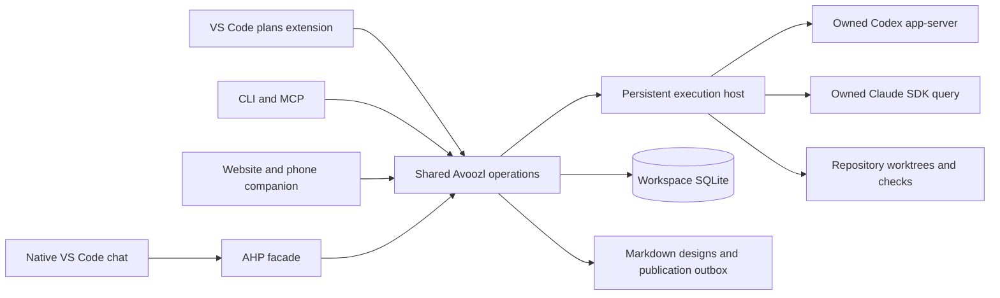
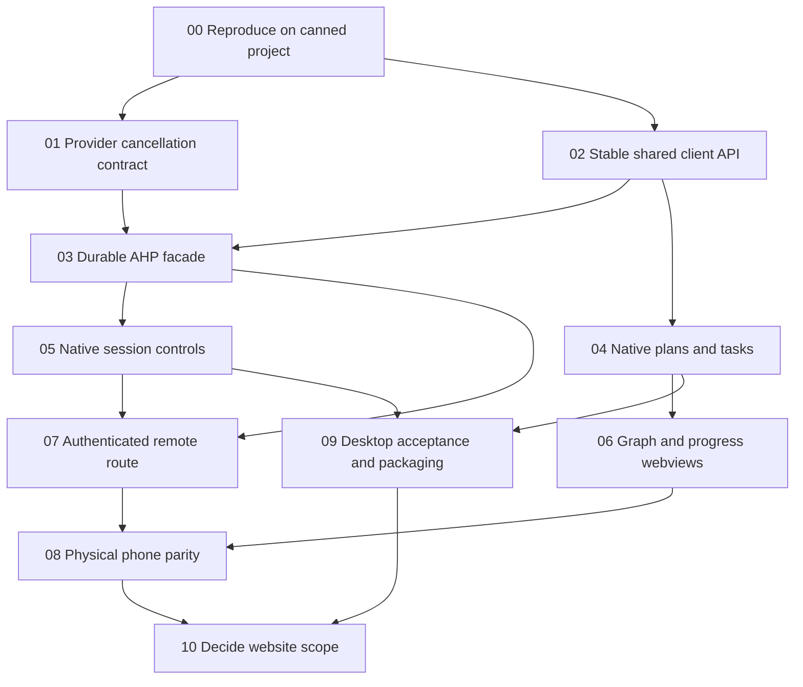

# VS Code client for Avoozl

Status: implementation design, November 9, 2026. The proof is experimental; this document does not announce a shipped extension or authorize a production cutover.

Build a VS Code client for Avoozl's existing planning and execution backend. Use a fictional project on a second computer for implementation and acceptance. No Nupp checkout, personal workspace, account token, or original experiment directory may be required.

The goal is to make plans, tasks, code, diffs, and agent conversations convenient in one editor. Retiring the website is a possible later outcome, conditional on measured desktop and phone parity. Keep the website operational while the new client is built. The database, workflow, CLI, MCP, and execution host remain useful with either client.

## Decisions

- Avoozl owns each managed provider process. VS Code and the website are clients of that owner. Never open a second live provider writer to make native chat appear.
- Expose the existing host through Microsoft's Agent Host Protocol (AHP). Keep provider-specific translation behind an adapter. Use normal VS Code extension APIs for plans, task views, Markdown editing, and webviews.
- Use the working, undocumented native conversation navigation command behind a version/capability check. Do not confuse successful command return with opening the intended transcript.
- Use the ordinary desktop editor as the initial extension target. Treat the desktop Agents window, full browser editor, and browser Agents client as separate surfaces with separate acceptance results.
- Keep Markdown as design prose and SQLite as live execution state. Reuse existing operations, reviewed hashes, receipts, worktrees, and validation/integration behavior.
- Keep Claude and Codex support and provider/model selection. Do not assume a GitHub Copilot subscription replaces those accounts.
- Do not replace the backend language, migrate the database, rebuild the scheduler, or implement a second generic chat application for this project.
- Preserve the mobile website until an authenticated, usable replacement passes the phone checklist below. A tunnel running successfully is only transport setup.

## What the investigation established

These results came from isolated fixtures on one Mac. They are evidence for the architecture, not cross-platform acceptance. [The research handoff](../research/vscode/README.md) separates observations from remaining work.

| Boundary            | Observed result                                                                                                                                                                                                                              | Limit                                                                                                                                                                                  |
| ------------------- | -------------------------------------------------------------------------------------------------------------------------------------------------------------------------------------------------------------------------------------------- | -------------------------------------------------------------------------------------------------------------------------------------------------------------------------------------- |
| Workspace extension | Ordinary browser editor ran a remote Node extension, a task tree, and a small graph webview.                                                                                                                                                 | Not the finished UI, and not proof that the same contribution appears in the Agents window.                                                                                            |
| Host ownership      | A second Codex process could read the thread but could not resume it while its original writer lived. Resume worked after owner exit.                                                                                                        | Direct provider takeover is a deliberate ownership transfer, not a live sharing mechanism.                                                                                             |
| Native chat         | Real Claude and Codex adapter output appeared in native browser-editor chat through AHP.                                                                                                                                                     | First-round marker-only results were superseded by real controls.                                                                                                                      |
| Real approvals      | Native UI approved Claude Write and Bash calls and Codex command execution; an earlier test also declined a Codex command.                                                                                                                   | The prototype only offers allow once and deny. Session grants and other permission kinds need explicit mapping.                                                                        |
| Execute then cancel | Both providers' approved fixture processes actually started. Native Cancel stopped both processes before their normal completion marker.                                                                                                     | Codex reported interrupted. Claude's current adapter reported failed after a successful stop. Fix and test this distinction.                                                           |
| Questions           | A real Claude question was answered through native UI. A real Codex structured question was answered through its adapter.                                                                                                                    | Native Codex question presentation still needs its own end-to-end acceptance.                                                                                                          |
| Recovery            | Facade restart preserved a real pending Claude question and provider owner. Retried turn ID produced one delivery. Host death invalidated pending approval and required explicit resume.                                                     | Not a proof of exactly-once delivery across every crash boundary.                                                                                                                      |
| Plans               | Real native Markdown save reached disposable SQLite, stayed draft, rejected a stale save, and extracted tasks only after approval of the reviewed hash.                                                                                      | The production editor UX and multiple-client conflict handling remain to implement.                                                                                                    |
| Delivery            | A real fixture coding run committed, validated, rebased over another fixture-main commit, revalidated, and integrated.                                                                                                                       | Backend RPC test; native integration controls were not exercised.                                                                                                                      |
| Desktop             | Installed desktop Agents window connected to the custom WebSocket host and registered both providers.                                                                                                                                        | Clicked native controls were in the browser editor.                                                                                                                                    |
| Navigation          | Exact host-owned conversations opened using the internal workbench command.                                                                                                                                                                  | Undocumented argument/resource contract must be compatibility-tested.                                                                                                                  |
| Provider handoff    | A completed SDK-created Claude session appeared in its official extension after programmatic discovery was enabled.                                                                                                                          | The tested wrapper bypasses occupancy checks. Do not use it for live shared ownership.                                                                                                 |
| Remote              | An authenticated temporary tunnel connected both the full remote editor and browser Agents in regular Safari. The editor read a fresh host-written marker while Agents stayed connected. iPhone emulation activated a compact mobile layout. | The custom facade is not routed through the tunnel gateway; the remote host showed zero managed chats. Same-agent remote controls and physical-phone acceptance remain separate gates. |

The approval-to-execution proof checks provider request IDs, native AHP actions, a fixture-written PID and start time, process death, and absence of the normal completion file. It does not infer cancellation merely from a stopped spinner or an interrupted turn label.

## Architecture



The extension must work when the application checkout, workspace directory, and working repositories are different paths. Configure a workspace endpoint or workspace configuration file. Resolve repository files on the machine that owns the repository. A browser UI must not turn a host path into a path on the phone.

Existing seams to reuse:

- [Workspace configuration](../../src/app/config.mjs) and [initialization](../../src/app/workspace.mjs).
- [Shared operations](../../src/app/operations.mjs), [HTTP server](../../src/app/server.mjs), and [MCP](../../src/app/mcp.mjs).
- [Persistent host](../../src/app/agent-host.mjs), [remote manager](../../src/app/remote-manager.mjs), and [run manager](../../src/app/manager.mjs).
- [Claude adapter](../../src/app/providers/claude.mjs) and [Codex adapter](../../src/app/providers/codex.mjs).
- [Plans](../../src/app/plans.mjs), [source synchronization](../../src/app/source-sync.mjs), and [Git workflow](../../src/app/git.mjs).

Do not make the AHP facade another writer of authoritative run records. A derived projection/cache is acceptable. It must be rebuildable from persisted execution events and committed commands, with a recorded source cursor and schema version. The experiment used separate SQLite for its AHP projection, not a replacement task database.

"Rebuildable" implies two things the experiment did not do. The fold must be deterministic, so every value in projected state comes from the event log rather than from the host clock; otherwise a rebuild silently differs from the original. And the fold must not read mutable records for facts about the moment an event happened, because by the time an event is folded those records have moved on.

## Session and event contract

Use one stable mapping per workspace, run, and chat. Include a workspace namespace so two workspaces cannot collide. Persist these mappings; do not derive them from mutable titles or the currently selected folder. The task links to an Avoozl run/AHP session that we control. Provider application deep links are optional and do not block this design.

| AHP/client intent           | Existing backend seam               | Required behavior                                                                                                                                                                                                                                                     |
| --------------------------- | ----------------------------------- | --------------------------------------------------------------------------------------------------------------------------------------------------------------------------------------------------------------------------------------------------------------------- |
| List/open a conversation    | Runs plus events                    | Resolve its exact run; never start a replacement implicitly.                                                                                                                                                                                                          |
| Send a turn                 | `run.send`                          | Carry a stable submission ID. Reconnecting/retrying must not send twice.                                                                                                                                                                                              |
| Answer an approval/question | `run.answer`                        | Match the exact pending request, allowed option, workspace, and run. Reject stale answers. Because `dispatchAction` is a notification with no reply channel, a rejection must also push a corrective action, or the client keeps showing a decision the host refused. |
| Interrupt                   | `run.interrupt`                     | Record intent, request provider interruption, wait for its acknowledgement, and show truthful terminal state.                                                                                                                                                         |
| Explicit resume             | `run.resume`                        | Resume through the owner; do not quietly create another provider session.                                                                                                                                                                                             |
| Validate/integrate          | `run.validate`, `integration.merge` | Retain existing expected-commit checks and acceptance distinctions.                                                                                                                                                                                                   |
| Plan read/save/approve      | Existing plan operations            | Retain expected Markdown hash and immutable approval/extraction receipt.                                                                                                                                                                                              |

Order events by a durable server sequence, not arrival timestamps. Replay requires snapshot plus cursor, history pagination, and bounded catch-up. Show interrupted, failed, disconnected, waiting for input, and waiting for approval distinctly. Never relabel all errors following a Cancel click as cancellation: preserve unexpected provider errors and their causal relationship.

Implement full tool lifecycle from the provider tool ID. Permission request IDs are different identifiers. Preserve their correlation, command/input, confirmation scope, streamed output, exit result, and cancellation. A tool that ran must not become a skipped/never-executed tool in the UI. The prototype needs this correction; do not copy its reducer plumbing as a finished implementation.

The mechanism behind that requirement is the protocol reducer itself: ending a turn rewrites every tool call that has not reached a terminal state as cancelled with reason `skipped`. So the correction is about ordering, not labelling — give each open tool call a truthful terminal transition before the turn ends. Whichever of the provider's tool item or its permission request arrives first must create the tool call, because the two providers disagree on that order.

Normalize Claude's cancellation result in its provider adapter only when supported by a tested intentional-interruption contract. The observed SDK result had `is_error` and a diagnostic ending in `stop_reason=tool_use`; the adapter checks `is_error` before its own interruption flag. Do not match that exact diagnostic text as a permanent API. Test interrupted commands, actual tool failures, interrupted acquisition, and errors racing with Cancel separately.

Codex supports active steering through `turn/steer`; Claude redirects an active turn by interrupting and then sending. Queued messages remain durable. Do not silently reinterpret a queued message as active steering. Advertise supported capabilities and disable unsupported controls with a clear reason.

Note which queue controls the native editor dispatches on its own: it sends `chat/pendingMessageRemoved` and `chat/queuedMessagesReordered`. Refusing a control the editor already offers leaves its UI disagreeing with the host, so either support it or expect the divergence. Withdrawing a delivery is only honest while it has not reached the provider, and reordering must change the order without rewriting any durable delivery.

Model changes must be host operations, not UI-only selections. Existing startup selection works; live model-change probes used provider APIs directly. Record requested and actual model and when the change takes effect. Use provider catalogs rather than hardcoded model names from this machine.

## Native editor UX

Provide an Avoozl activity/sidebar view with Now, attention needed, ready work, task tree, plans, and linked sessions. Keep rows dense and controls small. Selecting a task opens details or its source context; an explicit conversation action opens that task's exact native chat. Keep implementation, integration, component acceptance, and whole-head acceptance separate.

Use a native Markdown document backed by the shared plan operations. The experiment used a `FileSystemProvider`; reuse that approach only if it preserves normal editor save, dirty state, previews, search, and link resolution. Save sends the expected hash. On conflict keep the local buffer and offer reload, compare, or resolve. Saving must never approve a plan. Approval shows the exact reviewed revision and proposed extracted task/dependency set, and invokes the existing transactional operation.

Port the useful task graph, epic progress tracks, single strip, filtering, zoom, and task details as webviews. Reuse rendering code where practical. Keep large views bounded by viewport and paginate history. Stop animation/polling when hidden. Do not rebuild the site's custom agent chat in a webview when native chat already satisfies the behavior.

For native navigation, the tested command was:

```js
await vscode.commands.executeCommand(
  "workbench.action.chat.openSessionInEditorGroup",
  { resource: registeredSessionResource },
);
```

The local browser registration used `agent-host-claude:/<session-id>` and `agent-host-codex:/<session-id>`. Desktop remote registrations use different prefixes. Resolve the URI from the connected provider/authority; do not construct a universal hardcoded scheme. Check command availability and tested version first. Verify visible transcript identity after navigation. Generic `vscode.open(ahpChatUri)` returned successfully but opened a text document in the experiment.

The `agent-host-${provider}` form is confirmed in the 1.138.0 bundle, but no API returns the registered resource, so the form cannot simply be looked up either. The workable approach is to take the channel identifiers from the host that owns the run, derive candidates, try them in order, and verify each attempt. Verification needs an independent signal, because an extension cannot read the chat UI: ask the host which chat channel a client subscribed to just after the attempt. Absent that signal, report the result as unverified rather than as success.

**Implementation result: this does not work through `chat.remoteAgentHosts` on 1.138.0, and no URI form will make it work.** Tested by hand at the editor, with the findings below. The plan assumed one integration shape where there are two, and only the other one supports a chat editor:

- The editor registers a chat **editor** contribution — `registerChatSessionContribution`, which is also what adds the scheme to `chatSessionsService.getContentProviderSchemes()`, which is in turn what registers the editor for that scheme — only for its **own** agent host's providers.
- For a host configured through `chat.remoteAgentHosts`, the registration path calls only `registerChatSessionItemController`. A remote host's sessions can therefore appear in the session list, but there is no editor registered to open one. Every candidate resource fails with `Unable to resolve resource`, including the editor's own `agent-host-session://<provider>/<id>` form.
- Three real defects were found on the way, all now fixed, and each worth knowing independently: the command takes a `Uri` and calls `.with()` on it, so a string fails with `o.with is not a function`; advertising a provider named `claude` collides with the editor's built-in `claude` provider, so `agent-host-claude:/<id>` resolves against the built-in host and reports `Session not found on backend`; and a token carried in the address's query string is wrong on two counts — the editor has a `connectionToken` field for it, and `fb()` derives a session's authority from the address, so a query string forces an opaque `hex-` encoding of it.
- The research's working observation came from the other shape: a VS Code **Server** started with `--agent-host-bridge-port`, which makes the facade the editor's _own_ agent host rather than an additional remote one. The desktop application exposes no such flag; the string does not appear in its bundle.

So native chat for owned sessions needs the bridge shape, which means the standalone server package rather than the desktop app. **That route now passes**: with the facade bridged in as the editor's own agent host, the session opens in a real chat editor and its Allow and Cancel controls drive the run. Through `chat.remoteAgentHosts` it still cannot, on this build, and the extension's verified-candidate-then-fallback behaviour reports exactly that rather than implying otherwise.

Both providers pass this acceptance: `native-controls-claude.json` and `native-controls-codex.json`.

One hazard found while automating it, worth recording because it is a property of the tooling and not of this product: a throwaway `--user-data-dir` is **not** an isolated identity. VS Code resolves signed-in sessions from the system keychain, so a fresh profile still had the operator's chat account available; a keystroke sent while the command palette was not focused landed in that chat's input, submitted a partial command as a prompt, and started an agent turn nobody asked for. `scripts/cdp.mjs` now refuses to type unless the palette is confirmed open, and the desktop check disables the chat surface in its profile. Automation that drives a real editor has to assume every keystroke reaches something.

The clicks are driven rather than hand-performed, by `scripts/vscode-drive.mjs`: a real mouse press at each control's own coordinates through the Chrome DevTools Protocol, with nothing dispatched to the facade and no DOM event synthesised, so the editor still decides what every click means. That makes the acceptance repeatable instead of a one-off anecdote, and the receipt says plainly that a driver, not a person, pressed the buttons. A person clicking instead is the same check without `--drive`.

**A second constraint, found while exercising the bridge shape: the editor lists only those of a host's sessions whose working directory is, or contains, an open folder.** The workbench's session list drops everything else before any UI sees it:

```js
_matchesAnyFolder(candidates, folders) {
  return candidates.some(c => folders.some(f => isEqualOrParent(c, f.uri)));
}
```

The candidates are the session's `workingDirectories` (plus a `project.uri`, and a `_meta.multiRoot.workspaceFile` match for multi-root windows). Every run here works in its own Git worktree, which is a **sibling** of the repository, not a child — so an editor opened on the repository lists none of its runs, and the symptom is indistinguishable from a host that advertised nothing. This cost three rounds of clicking to find, because `listSessions` was answered correctly every time; the facade's call log is what eventually showed the host returning the session and the editor discarding it.

Two consequences, both now implemented:

- The clicked-control check opens the run's worktree, not the fixture repository.
- `ChatNavigator` checks containment before attempting the command, and offers to open the worktree instead of reporting an unverified attempt. A containment rule in the editor must not be reported as a host or protocol fault. `/health` carries each session's worktree so a client can make that distinction.

This is also a product constraint, not only a test detail: an editor window opened on the repository will never list worktree-based runs, so the task-to-conversation path has to open the worktree window. It is a further reason the website's steering remains the general surface.

If the internal command changes, provide a graceful session-picker/manual-open fallback. Proposed `chatSessionsProvider` APIs are another possible fallback for a private installation with explicit opt-in. They are not generally usable for a Marketplace release; a single-user opt-in is possible, with compatibility maintenance. Do not call the approach impossible merely because a proposal is involved.

## Remote access and the website decision

There are three different questions:

1. Can an authenticated remote client reach the host?
2. Does that client expose the Avoozl-owned sessions and the plans extension?
3. Is the result convenient on a physical phone while desktop work stays open?

A successful result for one is not evidence for the others. The browser Agents client and full browser editor must each be tested. The latter can run a remote workspace extension. The former is an agent-focused UI; custom extension placement must be demonstrated rather than assumed.

Microsoft documents one client at a time for a full Remote Tunnels server instance. That does not by itself establish the behavior of a shared AHP host with a local desktop client and a phone client. Test the actual combination and record whether one disconnects the other, duplicates commands, or causes competing provider owners. AHP multi-client fixture success alone is insufficient.

The facade must integrate with the chosen remote discovery/routing mechanism. In the test, `code tunnel` started or selected a native VS Code host; it did not discover the separate custom AHP listener automatically. Merely adding a local WebSocket address to a desktop renderer does not make that host available through the tunnel. Prototype an explicit supported registration/bridge route, including the tunnel gateway selection handshake, before claiming our sessions are remotely available. If this requires depending on private registry internals, compare that maintenance cost with retaining website steering or a private opt-in session-provider extension for the full remote editor.

Use authenticated tunnels or an authenticated private-network route. Do not publish an anonymous AHP/WebSocket listener, copy host credentials into browser storage, or expose the current website as though its loopback assumptions were a remote authorization system. Registration/authentication and transport must not change task or provider ownership. Preserve existing services during the experiment; use separate profiles, workspace, repository, and ports. Remove the temporary tunnel after testing.

Phone acceptance requires a physical phone, its real browser and soft keyboard, and an outside-home connection such as cellular. Viewport emulation is supplementary. Test:

- Find the selected workspace, blocked work needing input, and a running task without typing a command.
- Open that task's exact live conversation and read streaming output and tool details.
- Approve/deny a real harmless fixture tool and answer a structured question.
- Send a follow-up, distinguish queued from delivered, and steer where supported.
- Cancel a running fixture tool and verify the actual process stops.
- Switch apps, lock/unlock, reconnect, reopen history, and retry a submission without duplication.
- Read a plan and useful graph detail with practical touch targets and zoom.
- Keep desktop connected during all of this; verify its transcript and controls remain current.
- Confirm the intended Claude/Codex accounts and models work without an unintended provider/subscription change.

Treat the website as the default phone companion until all required phone behaviors pass. Then explicitly choose which website pages or controls can be retired. Do not delete server APIs, the MCP, or the durable host as part of removing UI. Retain remote steering if any required replacement control is missing or awkward. Keep an operational rollback until the new client has been used on real work.

## Delivery graph and work packages



These packages are proposed work in this one document. Review the plan before extracting execution tasks. Dependencies below are prerequisites; parallel track membership is scheduling advice, not a blocking edge.

| ID     | Track    | Deliverable and acceptance                                                                                                                                                                      | Prerequisites  |
| ------ | -------- | ----------------------------------------------------------------------------------------------------------------------------------------------------------------------------------------------- | -------------- |
| VSC-00 | Proof    | Fresh-machine canned project, version manifest, fixture accounts, source/evidence accessible in this repo. Reproduce markers and at least one real tool path without original paths/data.       | None           |
| VSC-01 | Host     | Define and fix intentional cancellation/error semantics for both providers. Real approved process starts and stops; run/tool status agrees; actual failures remain failures.                    | VSC-00         |
| VSC-02 | API      | Stable client facade for workspace/task/plan/run/approval operations and sequenced event/history reads. Preserve authorization, conflict handling, and idempotency.                             | VSC-00         |
| VSC-03 | Host     | Versioned, authenticated AHP translation and durable replay. Tool output/results, questions, queue/steer, models, usage, and subagent attribution map honestly. Restart/crash/retry tests pass. | VSC-01, VSC-02 |
| VSC-04 | Editor   | Sidebar/task details/source links and native Markdown read/save/review/approval. Conflicting editor saves cannot overwrite; saving never approves.                                              | VSC-02         |
| VSC-05 | Editor   | Exact task-to-native-chat link, approvals, question answers, cancellation, queue/steer and reconnect. Both providers tested through real native controls.                                       | VSC-03         |
| VSC-06 | Visuals  | Graph, progress tracks, strip and filters in webviews, bounded rendering, task/session selection and accessible navigation.                                                                     | VSC-04         |
| VSC-07 | Remote   | Authenticated dev tunnel/private route reaches the intended owned sessions; full editor and browser Agents results separated; desktop remains connected.                                        | VSC-03, VSC-05 |
| VSC-08 | Phone    | Physical phone checklist above passes on a non-home network, with evidence for required controls and layouts.                                                                                   | VSC-06, VSC-07 |
| VSC-09 | Release  | Installable extension, version/capability compatibility suite, safe updates, lifecycle/drain behavior, diagnostics and rollback. Desktop real-work flow passes.                                 | VSC-04, VSC-05 |
| VSC-10 | Decision | Explicit parity matrix and decision about website pages/controls. Delete only replaced surfaces with a tested rollback and lower maintenance cost.                                              | VSC-08, VSC-09 |

After VSC-00, host/API work and editor work can proceed independently once the shared client contract is agreed. Visuals can follow native plans while remote transport work follows native sessions. Do not start all UI tracks by duplicating an unreviewed API or inventing a second state model.

## Canned project and verification

Use Avoozl's fictional `product-launch` pack to test planning, dependencies, filters, and draft approval. It does not configure or launch agents automatically. Create a separate, disposable Git repository for execution, with one trivial application, a deterministic check, and an authored slow command that writes a PID/start marker and a different normal-completion marker. Configure that repository explicitly as an execution project.

```sh
npm ci --ignore-scripts
node cli.mjs init ../vscode-fixture --name 'VS Code fixture'
node cli.mjs seed --workspace ../vscode-fixture --example product-launch
node cli.mjs serve --workspace ../vscode-fixture
```

Those commands exist now. Extension/AHP launch and installation commands should be added by implementation with documented options, not copied from the original machine's private paths. A fresh workspace starts empty; do not auto-import production JSON, approve example drafts, start agents, or register a tunnel as part of installation.

The implementation added:

```sh
node scripts/vscode-fixture.mjs                  # workspace, example pack, disposable repository
node scripts/vscode-fixture-host.mjs <root>      # agent host with a real-process fixture provider
node cli.mjs serve --workspace <ws> --ahp        # site, agent host, and the editor facade
node cli.mjs editor --workspace <ws>             # the editor settings to paste, including the token
node scripts/vscode-evidence.mjs                 # the end-to-end receipt
node scripts/package-extension.mjs               # an installable .vsix
```

`node cli.mjs editor` prints an address containing the facade's bearer token. It is a credential: do not commit it, paste it into a shared document, or publish it in evidence.

Use protocol fixtures for routine CI. Add opt-in real-provider tests for the contracts fixtures cannot prove. Record requested/actual model, provider/session/run/request/tool/turn IDs, source commit, client/server versions, and exact assertions. Redact credentials and personal paths before publishing evidence. A single successful run is a point in a compatibility matrix, not a promise that every newer version works.

Essential automated tests include duplicate and racing answers, permissions that expire during reconnect, cancel-before-acquisition, cancel while executing, provider errors racing with cancellation, facade crash before/after command acknowledgement, projection rebuild, out-of-order/replayed events, concurrent Markdown saves, review-hash approval retry, model changes at turn boundaries, and host drain with active work. Exercise both clients against the same fixture. Large transcript/graph tests must measure bounded rendering/history, not merely load a large JSON object into memory.

Pin the AHP package used for the implementation and record VS Code desktop/web/server and provider versions in diagnostics. Negotiate supported protocol versions and reject incompatible contracts clearly. The package version is not the wire version: the pinned 1.0.0 package speaks `["1.0.0","0.9.0"]`, while VS Code 1.138.0 offers `0.9.0` and below. A host that answers with its own preferred version instead of one the client offered is refused by a real editor. Probe optional methods/capabilities instead of advertising an unsupported feature or converting unknown actions into successful no-ops. Re-run native navigation and approval/cancel smoke tests on upgrades.

## Implementation status, November 9, 2026

Implemented on a second computer against the canned `product-launch` fixture
and a separate disposable Git repository. No Nupp checkout, personal
workspace, account token, or original experiment directory was used. The
website, CLI, MCP, and agent host keep working unchanged; the facade and the
extension are both opt-in additions.

### What the implementation changed about this plan

Several assumptions above turned out to be wrong or incomplete. They are
corrected here rather than left for the next reader to rediscover.

- **Protocol version negotiation was the first real blocker.** This document
  and the research handoff both record "AHP package: 1.0.0", and the prototype
  answered `protocolVersion: "1.0.0"` unconditionally. A real editor rejects
  that. VS Code 1.138.0 offers `["0.9.0","0.7.0","0.6.0","0.5.2","0.5.1"]`,
  and the library's own `SUPPORTED_PROTOCOL_VERSIONS` is `["1.0.0","0.9.0"]`.
  The npm package version is not the wire version. The facade negotiates with
  `negotiateProtocolVersion`, selects `0.9.0` for the installed editor, and
  rejects an unsupported offer with `-32005` plus `supportedVersions`.
  Outgoing actions are filtered per client by `ACTION_INTRODUCED_IN`, so a
  client never receives an action newer than the version it negotiated.
- **`dispatchAction` is a fire-and-forget notification, not a request.** A
  client applies the action optimistically and the server echoes it once
  accepted; there is no reply channel for a refusal. So "reject stale answers"
  is not enough on its own — a refusal leaves the editor showing work that
  never happened. The facade therefore pushes a _corrective_ action (a
  `chat/error` for a refused turn, a `chat/pendingMessageRemoved` for a
  refused queued message) and answers with a JSON-RPC error when a client did
  supply an id.
- **The protocol reducer is what turns a tool that ran into a skipped one.**
  `endTurn` rewrites every non-terminal tool call as
  `cancelled`/`ToolCallCancellationReason.Skipped`. The fix is ordering: give
  every open tool call a truthful terminal transition _before_ ending the
  turn. A call that was confirmed and therefore executed is completed with an
  unsuccessful result; a call that was never confirmed is cancelled, which is
  accurate. When the provider supplies its own tool result during a pending
  stop, that result is kept and relabelled as stopped rather than failed.
- **A rebuildable projection has to be deterministic.** Turn timing taken from
  the host clock made a replay produce different state from the original fold.
  All timing now comes from the durable event's own timestamp, and the rebuild
  test asserts byte-identical state.
- **The projection must not read mutable records for event-time facts.** An
  early version decided "was a stop pending when this tool ended?" from the
  current run record, which by fold time had already moved on. Interruption
  intent is now tracked from the ordered event log, which is also what makes a
  replay reach the same conclusion.
- **The native editor dispatches queue controls this host had refused.**
  VS Code sends `chat/pendingMessageRemoved` and
  `chat/queuedMessagesReordered`. Refusing them is honest but leaves the
  editor's own queue UI wrong, so the host grew the matching operations:
  `run.unsend` withdraws only a delivery that never reached the provider, and
  `run.queue` reorders without rewriting any durable delivery. Controls that
  genuinely cannot be supported — truncating a durable transcript, completing
  a client-contributed tool — are refused by name with the reason.
- **Smaller protocol details the prototype had wrong.** `session/configChanged`
  carries the values map itself, not a `{schema, values}` object. The reducer
  flattens `ToolCallResult` onto the tool call rather than nesting it under
  `result`. An emptied `inputNeeded` is removed rather than left as `[]`. A
  `ChatInputAnswer` is `{state, value: {kind, value}}`, not a bare value.
- **Model catalogs must come from the session's own factory.** `models()` built
  a provider adapter directly, bypassing the configured factories, so the
  catalog could describe a different provider from the one a session would
  use. It now reads through the same factory, and a model that is not in that
  catalog is refused.
- **Two adapter races, found by tests rather than by reasoning.** A terminal
  turn event arriving while an interrupt was in flight cleared the record the
  reply read; and an optimistically auto-confirmed tool kept `executed` set
  when a permission request later superseded it, which would have reported a
  never-run tool as having run.
- **Editor session resources are registered as `agent-host-<provider>:/<uuid>`.**
  Confirmed in the 1.138.0 bundle. There is still no API to ask for the
  registered form, so the extension derives candidates from the host's own
  channel list, tries them in order, and verifies each attempt.
- **The provider comes from the channel's scheme, not from the `provider`
  field.** `_toAgentHostSessionResource` reads `cu.provider(sessionUri)`,
  which is the URI's scheme, and registers `agent-host-<scheme>`. Our channels
  were `ahp-session:/<uuid>` — the protocol documentation's own example — so
  every session mapped to a provider named `agent-host-ahp-session` that
  nothing had registered: the session was dropped from the list and could not
  be opened, while `listSessions` was answered correctly every time. Channel
  identifiers now carry the advertised provider (`avoozl-claude:/s-<uuid>`),
  with the kind in the identifier rather than the scheme, and the projection
  schema is bumped so an older derived database rebuilds.
- **A malformed action is not rejected, it crashes the client.** Our
  `session/activeClientSet` named the client `client` instead of
  `activeClient`, so the reducer stored `undefined`, which serialised as
  `null`, which made the editor throw `Cannot read properties of null (reading
  'customizations')` inside its own URI mapping. The session simply never
  opened, with nothing on the wire to suggest why. The active client is now a
  conformant `SessionActiveClient` with its required `tools`, and a test
  rejects a hole in `activeClients`.
- **The sessions list is in a sidebar that is hidden by default.** With
  `chat.viewSessions.enabled` on, the list still has zero width until
  `agentSessions.showAgentSessionsSidebar` runs. An empty chat panel therefore
  looks the same as a host advertising nothing, which is why this took several
  rounds to find; the driven check now reveals the sidebar by name first.
- **Node version.** Unflagged `node:sqlite` needs Node 22.13 or 23.4 and
  later. This machine began on 23.3.0, which required
  `NODE_OPTIONS=--experimental-sqlite`, and was upgraded to 26.13.0 mid-work,
  where no flag is needed. `package.json` already states `>=22.13`.

### Delivered

| ID     | State        | Evidence                                                                                                                                                                                                                                                                                                            |
| ------ | ------------ | ------------------------------------------------------------------------------------------------------------------------------------------------------------------------------------------------------------------------------------------------------------------------------------------------------------------- |
| VSC-00 | Done         | `scripts/vscode-fixture.mjs` builds a fresh workspace, the optional `product-launch` pack, and a disposable repository with a deterministic check and an authored slow command. `scripts/vscode-evidence.mjs` writes a redacted receipt. Nothing requires the original machine, its database, or any credential.    |
| VSC-01 | Done         | `src/app/providers/cancellation.mjs` defines the contract; both adapters use it. `src/app/test/cancellation.test.mjs` covers interrupted commands, real tool failures, interrupted acquisition, errors racing with cancellation, the undecidable completion race, and the in-flight-terminal race.                  |
| VSC-02 | Done         | `src/app/client.mjs` publishes `CLIENT_API_VERSION`, the operation allowlist, and the idempotency and conflict rules through `client.describe`. The extension refuses a mismatched major version.                                                                                                                   |
| VSC-03 | Done         | `src/app/ahp/` with version negotiation, per-client authorization, durable replay, rebuild-from-zero, bounded history, and honest tool lifecycle. 29 tests in `ahp-projection.test.mjs` and `ahp-facade.test.mjs`, the latter driven by the protocol library's own client over real WebSocket traffic.              |
| VSC-04 | Done         | `extension/src/plans.js` and `trees.js`. A conflicting save cannot overwrite another revision, saving never approves, and approval shows the reviewed hash with the exact task and dependency set it would create.                                                                                                  |
| VSC-05 | Done         | Clicked-control acceptance passes through the bridge route: `scripts/vscode-native-check.mjs --server DIR --drive` opens the session from the editor's sessions list, clicks **Allow once**, waits for the real child process, and clicks **Cancel** — 14 of 14 checks, receipt in `docs/evidence/vscode/native-controls.json`. The approval and the cancellation are attributed to the same editor client in the facade's dispatch trail, the process died of `SIGTERM`, the tool stayed `completed` and unsuccessful, and the run is `interrupted` with no error. Six defects were found and fixed getting there, four of them ours. |
| VSC-06 | Done         | `extension/src/webviews.js` with graph, progress, and timeline. Rendering reuses the workspace's own model modules over a CSP limited to that one origin; the payload is paged, hidden panels receive nothing, and keyboard navigation works.                                                                       |
| VSC-07 | **Blocked**  | A tunnel was attempted and the GitHub device login succeeded, but this network does not resolve Microsoft's relay hostnames, so no tunnel could register and nothing was published. The SSH route needs no relay and is now emitted by `avoozl editor --ssh HOST`, unexercised.                                     |
| VSC-08 | **Blocked**  | Depended on an off-network route to this machine, which the relay block prevents. Nothing about phone behaviour is claimed.                                                                                                                                                                                         |
| VSC-09 | **Partial**  | `scripts/package-extension.mjs` produces an installable `.vsix` with no build dependency. `scripts/vscode-desktop-check.mjs` accepts a real-work flow in the desktop application, driven through its own view and editor: the extension activates, the Avoozl view lists this workspace's attention-needed work and plans, a plan draft opens, saving it records a new revision and records no approval, the pending request is surfaced, and diagnostics read. 10 of 10 attempted checks pass; receipt in `docs/evidence/vscode/desktop-flow.json`. Three steps are recorded as **not attempted**, not as passes: answering the modal decision dialog from an automated click, the command it would have started, and stopping it. The desktop application also has no agent-host bridge, so an owned session has no native chat there at all. |
| VSC-10 | **Not done** | No website surface has been retired, and none should be until VSC-08 passes.                                                                                                                                                                                                                                        |

### What was proven with the real editor

- VS Code desktop **1.138.0** connected to the facade, negotiated **0.9.0**,
  and appeared as a `vscode-editor-window` client subscribed to `ahp-root://`.
  That required the negotiation correction above; the prototype's hardcoded
  `1.0.0` would have been refused.
- The packaged extension installed into an isolated profile, activated on
  `onStartupFinished`, and connected to the fixture workspace, logging the
  negotiated client API version.

### What was proven without a provider account

`scripts/vscode-evidence.mjs` runs 22 checks over the real protocol, using the
protocol library's own client — the same wire messages an editor sends — and a
fixture provider that starts real child processes:

- An approval dispatched over the protocol reaches the provider, and an actual
  child process starts, identified by the PID it wrote itself.
- A `chat/turnCancelled` dispatch stops that actual process: the recorded PID
  is gone, the command recorded `SIGTERM`, and its normal-completion marker is
  absent.
- The transcript records the tool as **completed and unsuccessful**, with
  "Stopped by cancellation after it had started running" — not as skipped.
- The run is **interrupted**, not failed, carries no `error`, and retains the
  provider's own diagnostic separately.
- The same request cannot be answered twice; the second attempt is a 409.

### Website parity, as it actually stands

Nothing has been retired. This is the current state of the comparison VSC-10
will eventually decide, not a recommendation to remove anything.

| Capability                          | Website | Extension | Note                                                                            |
| ----------------------------------- | ------- | --------- | ------------------------------------------------------------------------------- |
| Attention needed, running, ready    | yes     | yes       | Same operations behind both.                                                    |
| Task tree and details               | yes     | yes       |                                                                                 |
| Task graph, epic progress, timeline | yes     | yes       | The extension pages the payload; the website renders the whole set.             |
| Plan drafting and approval          | yes     | yes       | The extension adds a reviewed-revision preview before approval.                 |
| Conversation transcript             | yes     | partial   | Native chat shows it; opening a specific one depends on an unpublished command. |
| Approve, deny, answer a question    | yes     | partial   | Protocol path proven; clicked-control acceptance outstanding.                   |
| Cancel, resume, queue, steer        | yes     | yes       | Steering is Codex only, and the extension says so rather than offering it.      |
| Model change                        | yes     | yes       | Both record requested against actually-reported model.                          |
| Validate, integrate, accept         | yes     | yes       | Kept as three separate, explicit actions in both.                               |
| Diff of a conversation's changes    | no      | yes       | New: `run.changes` plus the editor's own diff view.                             |
| Prompt search, presentations, tours | yes     | no        | Not ported.                                                                     |
| Usage charts                        | yes     | no        | Not ported.                                                                     |
| Trash and restore                   | yes     | no        | Not ported.                                                                     |
| Example pack installation           | yes     | yes       |                                                                                 |
| Phone use                           | yes     | unproven  | The website stays the phone companion.                                          |

### Real providers, and a finding that changes a plan assumption

`scripts/vscode-real-provider.mjs` runs the production adapters against real
provider sessions. **Codex 0.167.0 passes all ten of its checks** — it asks
permission before running anything, an actual process starts, the run ends
`interrupted` rather than `failed`, with no error, and Codex reports the
interruption itself.

It also contradicts this plan's opening claim that "native Cancel stopped both
tested providers' commands":

> **Codex's `turn/interrupt` ends the turn but does not stop a command it has
> already spawned.** The interrupt was acknowledged, the turn went to
> `interrupted`, and the child process was still running twenty seconds later.
> It only died when the app-server process itself was stopped, and it never
> received a signal: its `.interrupted` marker was never written.

A user who clicks Cancel would otherwise be told the work stopped when it had
not. So the host now records what an acknowledgement actually covers —
`interrupt.acknowledged` carries `scope: "turn"` and
`spawnedWork: "stopped" | "keeps-running" | "unknown"`, taken from the
provider's declared capability — and the transcript says plainly that a command
the provider started keeps running and the worktree is where to check. Codex
declares `keeps-running` from this observation; Claude is left `"unknown"`
rather than assumed, because it has not been verified here.

Claude's own interruption run is **not done**: both providers on this machine
route through AWS Bedrock, and the credential profile the environment names
(`AWS_PROFILE`) is not configured, so a real Claude turn fails before it asks
permission. That failure is itself partial evidence, recorded by the harness: a
genuine provider failure stayed `failed`, kept the provider's own message, and
had no cancellation attached.

### The gaps, stated plainly

- **No native control was clicked, and on this build none can be.** Five
  attempts were made at the editor, each one fixing a real defect. The
  outcome is that VS Code 1.138.0 registers no chat editor for a host
  configured through `chat.remoteAgentHosts`, so the conversation cannot be
  opened and there is no Allow or Cancel to click. `scripts/vscode-native-check.mjs`
  stands the whole thing up and verifies the clicks when a build does support
  it; the remaining work is the bridge shape, using the standalone VS Code
  Server with `--agent-host-bridge-port`, not more URI guessing.
- **Claude's real interruption is untested here.** Codex passed its real run
  in full; Claude cannot start a turn on this machine because the AWS profile
  its SDK needs is not configured. Whether Claude's interruption reaches a
  command it already spawned is therefore still `"unknown"` rather than
  assumed either way.
- **Remote routing is blocked by network policy, not by design.** A tunnel was
  attempted with the operator's own GitHub device login, which succeeded; the
  tunnel then never reported a URL because this network does not resolve
  Microsoft's relay hostnames (`global.rel.tunnels.api.visualstudio.com` and
  `*.devtunnels.ms` both time out, while `github.com` and `vscode.dev`
  answer). Nothing was ever registered and no service was installed. The
  better route needs no relay at all: `chat.remoteAgentHosts` accepts
  `sshConfigHost`, `sshHostName`, `sshUser`, `sshPort` and `connectionToken`,
  so an editor elsewhere can reach this machine's loopback facade over SSH.
  `avoozl editor --ssh HOST` now emits exactly that, though it is unexercised
  here and those fields are not a documented extension contract. What the
  implementation does guarantee is that the facade never becomes publicly
  reachable by accident: it refuses any non-loopback bind outright, and every
  socket must present a bearer token at the HTTP upgrade. The supported remote
  routes are therefore an authenticated tunnel whose _remote extension host
  runs on this machine_ (where the facade stays on loopback), or an SSH local
  port forward. Neither has been exercised here.
- **The browser Agents client remains unaddressed.** It connects to its own
  native host; nothing here changes that.

## Handoff to the implementation agent

Start with this document and the research handoff. Work in the Avoozl repository on another computer against the canned fixture. First reproduce and publish a compact evidence receipt for VSC-00 and VSC-01; then implement the shared API/AHP contract and editor client. Keep normal Avoozl operation available throughout.

Do not use Nupp acceptance commands or its current database. Do not revive an original provider session, depend on the original account/profile, install the experiment as production, or treat its hardcoded ports and URI prefixes as supported interfaces. Do not open GitHub issues for the remaining work. Track it through the approved plan and Avoozl's normal workflow.
