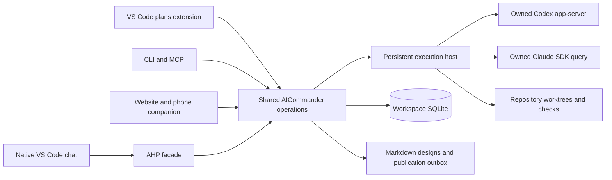
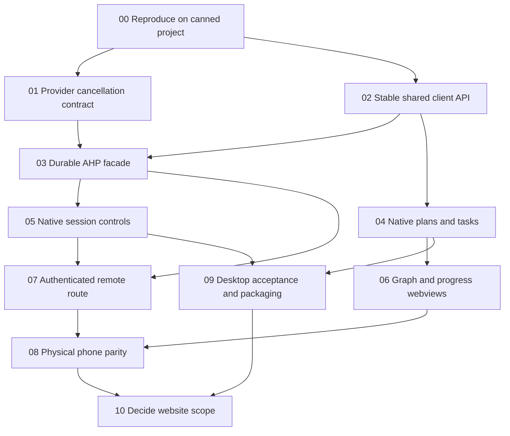

# VS Code client for AICommander

Status: implementation design, November 9, 2026. The proof is experimental; this document does not announce a shipped extension or authorize a production cutover.

Build a VS Code client for AICommander's existing planning and execution backend. Use a fictional project on a second computer for implementation and acceptance. No Nupp checkout, personal workspace, account token, or original experiment directory may be required.

The goal is to make plans, tasks, code, diffs, and agent conversations convenient in one editor. Retiring the website is a possible later outcome, conditional on measured desktop and phone parity. Keep the website operational while the new client is built. The database, workflow, CLI, MCP, and execution host remain useful with either client.

## Decisions

- AICommander owns each managed provider process. VS Code and the website are clients of that owner. Never open a second live provider writer to make native chat appear.
- Expose the existing host through Microsoft's Agent Host Protocol (AHP). Keep provider-specific translation behind an adapter. Use normal VS Code extension APIs for plans, task views, Markdown editing, and webviews.
- Use the working, undocumented native conversation navigation command behind a version/capability check. Do not confuse successful command return with opening the intended transcript.
- Use the ordinary desktop editor as the initial extension target. Treat the desktop Agents window, full browser editor, and browser Agents client as separate surfaces with separate acceptance results.
- Keep Markdown as design prose and SQLite as live execution state. Reuse existing operations, reviewed hashes, receipts, worktrees, and validation/integration behavior.
- Keep Claude and Codex support and provider/model selection. Do not assume a GitHub Copilot subscription replaces those accounts.
- Do not replace the backend language, migrate the database, rebuild the scheduler, or implement a second generic chat application for this project.
- Preserve the mobile website until an authenticated, usable replacement passes the phone checklist below. A tunnel running successfully is only transport setup.

## What the investigation established

These results came from isolated fixtures on one Mac. They are evidence for the architecture, not cross-platform acceptance. [The research handoff](../research/vscode/README.md) separates observations from remaining work.

| Boundary            | Observed result                                                                                                                                                                                                                              | Limit                                                                                                                                                                                  |
| ------------------- | -------------------------------------------------------------------------------------------------------------------------------------------------------------------------------------------------------------------------------------------- | -------------------------------------------------------------------------------------------------------------------------------------------------------------------------------------- |
| Workspace extension | Ordinary browser editor ran a remote Node extension, a task tree, and a small graph webview.                                                                                                                                                 | Not the finished UI, and not proof that the same contribution appears in the Agents window.                                                                                            |
| Host ownership      | A second Codex process could read the thread but could not resume it while its original writer lived. Resume worked after owner exit.                                                                                                        | Direct provider takeover is a deliberate ownership transfer, not a live sharing mechanism.                                                                                             |
| Native chat         | Real Claude and Codex adapter output appeared in native browser-editor chat through AHP.                                                                                                                                                     | First-round marker-only results were superseded by real controls.                                                                                                                      |
| Real approvals      | Native UI approved Claude Write and Bash calls and Codex command execution; an earlier test also declined a Codex command.                                                                                                                   | The prototype only offers allow once and deny. Session grants and other permission kinds need explicit mapping.                                                                        |
| Execute then cancel | Both providers' approved fixture processes actually started. Native Cancel stopped both processes before their normal completion marker.                                                                                                     | Codex reported interrupted. Claude's current adapter reported failed after a successful stop. Fix and test this distinction.                                                           |
| Questions           | A real Claude question was answered through native UI. A real Codex structured question was answered through its adapter.                                                                                                                    | Native Codex question presentation still needs its own end-to-end acceptance.                                                                                                          |
| Recovery            | Facade restart preserved a real pending Claude question and provider owner. Retried turn ID produced one delivery. Host death invalidated pending approval and required explicit resume.                                                     | Not a proof of exactly-once delivery across every crash boundary.                                                                                                                      |
| Plans               | Real native Markdown save reached disposable SQLite, stayed draft, rejected a stale save, and extracted tasks only after approval of the reviewed hash.                                                                                      | The production editor UX and multiple-client conflict handling remain to implement.                                                                                                    |
| Delivery            | A real fixture coding run committed, validated, rebased over another fixture-main commit, revalidated, and integrated.                                                                                                                       | Backend RPC test; native integration controls were not exercised.                                                                                                                      |
| Desktop             | Installed desktop Agents window connected to the custom WebSocket host and registered both providers.                                                                                                                                        | Clicked native controls were in the browser editor.                                                                                                                                    |
| Navigation          | Exact host-owned conversations opened using the internal workbench command.                                                                                                                                                                  | Undocumented argument/resource contract must be compatibility-tested.                                                                                                                  |
| Provider handoff    | A completed SDK-created Claude session appeared in its official extension after programmatic discovery was enabled.                                                                                                                          | The tested wrapper bypasses occupancy checks. Do not use it for live shared ownership.                                                                                                 |
| Remote              | An authenticated temporary tunnel connected both the full remote editor and browser Agents in regular Safari. The editor read a fresh host-written marker while Agents stayed connected. iPhone emulation activated a compact mobile layout. | The custom facade is not routed through the tunnel gateway; the remote host showed zero managed chats. Same-agent remote controls and physical-phone acceptance remain separate gates. |

The approval-to-execution proof checks provider request IDs, native AHP actions, a fixture-written PID and start time, process death, and absence of the normal completion file. It does not infer cancellation merely from a stopped spinner or an interrupted turn label.

## Architecture



The extension must work when the application checkout, workspace directory, and working repositories are different paths. Configure a workspace endpoint or workspace configuration file. Resolve repository files on the machine that owns the repository. A browser UI must not turn a host path into a path on the phone.

Existing seams to reuse:

- [Workspace configuration](../../src/app/config.mjs) and [initialization](../../src/app/workspace.mjs).
- [Shared operations](../../src/app/operations.mjs), [HTTP server](../../src/app/server.mjs), and [MCP](../../src/app/mcp.mjs).
- [Persistent host](../../src/app/agent-host.mjs), [remote manager](../../src/app/remote-manager.mjs), and [run manager](../../src/app/manager.mjs).
- [Claude adapter](../../src/app/providers/claude.mjs) and [Codex adapter](../../src/app/providers/codex.mjs).
- [Plans](../../src/app/plans.mjs), [source synchronization](../../src/app/source-sync.mjs), and [Git workflow](../../src/app/git.mjs).

Do not make the AHP facade another writer of authoritative run records. A derived projection/cache is acceptable. It must be rebuildable from persisted execution events and committed commands, with a recorded source cursor and schema version. The experiment used separate SQLite for its AHP projection, not a replacement task database.

## Session and event contract

Use one stable mapping per workspace, run, and chat. Include a workspace namespace so two workspaces cannot collide. Persist these mappings; do not derive them from mutable titles or the currently selected folder. The task links to an AICommander run/AHP session that we control. Provider application deep links are optional and do not block this design.

| AHP/client intent           | Existing backend seam               | Required behavior                                                                                             |
| --------------------------- | ----------------------------------- | ------------------------------------------------------------------------------------------------------------- |
| List/open a conversation    | Runs plus events                    | Resolve its exact run; never start a replacement implicitly.                                                  |
| Send a turn                 | `run.send`                          | Carry a stable submission ID. Reconnecting/retrying must not send twice.                                      |
| Answer an approval/question | `run.answer`                        | Match the exact pending request, allowed option, workspace, and run. Reject stale answers.                    |
| Interrupt                   | `run.interrupt`                     | Record intent, request provider interruption, wait for its acknowledgement, and show truthful terminal state. |
| Explicit resume             | `run.resume`                        | Resume through the owner; do not quietly create another provider session.                                     |
| Validate/integrate          | `run.validate`, `integration.merge` | Retain existing expected-commit checks and acceptance distinctions.                                           |
| Plan read/save/approve      | Existing plan operations            | Retain expected Markdown hash and immutable approval/extraction receipt.                                      |

Order events by a durable server sequence, not arrival timestamps. Replay requires snapshot plus cursor, history pagination, and bounded catch-up. Show interrupted, failed, disconnected, waiting for input, and waiting for approval distinctly. Never relabel all errors following a Cancel click as cancellation: preserve unexpected provider errors and their causal relationship.

Implement full tool lifecycle from the provider tool ID. Permission request IDs are different identifiers. Preserve their correlation, command/input, confirmation scope, streamed output, exit result, and cancellation. A tool that ran must not become a skipped/never-executed tool in the UI. The prototype needs this correction; do not copy its reducer plumbing as a finished implementation.

Normalize Claude's cancellation result in its provider adapter only when supported by a tested intentional-interruption contract. The observed SDK result had `is_error` and a diagnostic ending in `stop_reason=tool_use`; the adapter checks `is_error` before its own interruption flag. Do not match that exact diagnostic text as a permanent API. Test interrupted commands, actual tool failures, interrupted acquisition, and errors racing with Cancel separately.

Codex supports active steering through `turn/steer`; Claude redirects an active turn by interrupting and then sending. Queued messages remain durable. Do not silently reinterpret a queued message as active steering. Advertise supported capabilities and disable unsupported controls with a clear reason.

Model changes must be host operations, not UI-only selections. Existing startup selection works; live model-change probes used provider APIs directly. Record requested and actual model and when the change takes effect. Use provider catalogs rather than hardcoded model names from this machine.

## Native editor UX

Provide an AICommander activity/sidebar view with Now, attention needed, ready work, task tree, plans, and linked sessions. Keep rows dense and controls small. Selecting a task opens details or its source context; an explicit conversation action opens that task's exact native chat. Keep implementation, integration, component acceptance, and whole-head acceptance separate.

Use a native Markdown document backed by the shared plan operations. The experiment used a `FileSystemProvider`; reuse that approach only if it preserves normal editor save, dirty state, previews, search, and link resolution. Save sends the expected hash. On conflict keep the local buffer and offer reload, compare, or resolve. Saving must never approve a plan. Approval shows the exact reviewed revision and proposed extracted task/dependency set, and invokes the existing transactional operation.

Port the useful task graph, epic progress tracks, single strip, filtering, zoom, and task details as webviews. Reuse rendering code where practical. Keep large views bounded by viewport and paginate history. Stop animation/polling when hidden. Do not rebuild the site's custom agent chat in a webview when native chat already satisfies the behavior.

For native navigation, the tested command was:

```js
await vscode.commands.executeCommand(
  "workbench.action.chat.openSessionInEditorGroup",
  { resource: registeredSessionResource },
);
```

The local browser registration used `agent-host-claude:/<session-id>` and `agent-host-codex:/<session-id>`. Desktop remote registrations use different prefixes. Resolve the URI from the connected provider/authority; do not construct a universal hardcoded scheme. Check command availability and tested version first. Verify visible transcript identity after navigation. Generic `vscode.open(ahpChatUri)` returned successfully but opened a text document in the experiment.

If the internal command changes, provide a graceful session-picker/manual-open fallback. Proposed `chatSessionsProvider` APIs are another possible fallback for a private installation with explicit opt-in. They are not generally usable for a Marketplace release; a single-user opt-in is possible, with compatibility maintenance. Do not call the approach impossible merely because a proposal is involved.

## Remote access and the website decision

There are three different questions:

1. Can an authenticated remote client reach the host?
2. Does that client expose the AICommander-owned sessions and the plans extension?
3. Is the result convenient on a physical phone while desktop work stays open?

A successful result for one is not evidence for the others. The browser Agents client and full browser editor must each be tested. The latter can run a remote workspace extension. The former is an agent-focused UI; custom extension placement must be demonstrated rather than assumed.

Microsoft documents one client at a time for a full Remote Tunnels server instance. That does not by itself establish the behavior of a shared AHP host with a local desktop client and a phone client. Test the actual combination and record whether one disconnects the other, duplicates commands, or causes competing provider owners. AHP multi-client fixture success alone is insufficient.

The facade must integrate with the chosen remote discovery/routing mechanism. In the test, `code tunnel` started or selected a native VS Code host; it did not discover the separate custom AHP listener automatically. Merely adding a local WebSocket address to a desktop renderer does not make that host available through the tunnel. Prototype an explicit supported registration/bridge route, including the tunnel gateway selection handshake, before claiming our sessions are remotely available. If this requires depending on private registry internals, compare that maintenance cost with retaining website steering or a private opt-in session-provider extension for the full remote editor.

Use authenticated tunnels or an authenticated private-network route. Do not publish an anonymous AHP/WebSocket listener, copy host credentials into browser storage, or expose the current website as though its loopback assumptions were a remote authorization system. Registration/authentication and transport must not change task or provider ownership. Preserve existing services during the experiment; use separate profiles, workspace, repository, and ports. Remove the temporary tunnel after testing.

Phone acceptance requires a physical phone, its real browser and soft keyboard, and an outside-home connection such as cellular. Viewport emulation is supplementary. Test:

- Find the selected workspace, blocked work needing input, and a running task without typing a command.
- Open that task's exact live conversation and read streaming output and tool details.
- Approve/deny a real harmless fixture tool and answer a structured question.
- Send a follow-up, distinguish queued from delivered, and steer where supported.
- Cancel a running fixture tool and verify the actual process stops.
- Switch apps, lock/unlock, reconnect, reopen history, and retry a submission without duplication.
- Read a plan and useful graph detail with practical touch targets and zoom.
- Keep desktop connected during all of this; verify its transcript and controls remain current.
- Confirm the intended Claude/Codex accounts and models work without an unintended provider/subscription change.

Treat the website as the default phone companion until all required phone behaviors pass. Then explicitly choose which website pages or controls can be retired. Do not delete server APIs, the MCP, or the durable host as part of removing UI. Retain remote steering if any required replacement control is missing or awkward. Keep an operational rollback until the new client has been used on real work.

## Delivery graph and work packages



These packages are proposed work in this one document. Review the plan before extracting execution tasks. Dependencies below are prerequisites; parallel track membership is scheduling advice, not a blocking edge.

| ID     | Track    | Deliverable and acceptance                                                                                                                                                                      | Prerequisites  |
| ------ | -------- | ----------------------------------------------------------------------------------------------------------------------------------------------------------------------------------------------- | -------------- |
| VSC-00 | Proof    | Fresh-machine canned project, version manifest, fixture accounts, source/evidence accessible in this repo. Reproduce markers and at least one real tool path without original paths/data.       | None           |
| VSC-01 | Host     | Define and fix intentional cancellation/error semantics for both providers. Real approved process starts and stops; run/tool status agrees; actual failures remain failures.                    | VSC-00         |
| VSC-02 | API      | Stable client facade for workspace/task/plan/run/approval operations and sequenced event/history reads. Preserve authorization, conflict handling, and idempotency.                             | VSC-00         |
| VSC-03 | Host     | Versioned, authenticated AHP translation and durable replay. Tool output/results, questions, queue/steer, models, usage, and subagent attribution map honestly. Restart/crash/retry tests pass. | VSC-01, VSC-02 |
| VSC-04 | Editor   | Sidebar/task details/source links and native Markdown read/save/review/approval. Conflicting editor saves cannot overwrite; saving never approves.                                              | VSC-02         |
| VSC-05 | Editor   | Exact task-to-native-chat link, approvals, question answers, cancellation, queue/steer and reconnect. Both providers tested through real native controls.                                       | VSC-03         |
| VSC-06 | Visuals  | Graph, progress tracks, strip and filters in webviews, bounded rendering, task/session selection and accessible navigation.                                                                     | VSC-04         |
| VSC-07 | Remote   | Authenticated dev tunnel/private route reaches the intended owned sessions; full editor and browser Agents results separated; desktop remains connected.                                        | VSC-03, VSC-05 |
| VSC-08 | Phone    | Physical phone checklist above passes on a non-home network, with evidence for required controls and layouts.                                                                                   | VSC-06, VSC-07 |
| VSC-09 | Release  | Installable extension, version/capability compatibility suite, safe updates, lifecycle/drain behavior, diagnostics and rollback. Desktop real-work flow passes.                                 | VSC-04, VSC-05 |
| VSC-10 | Decision | Explicit parity matrix and decision about website pages/controls. Delete only replaced surfaces with a tested rollback and lower maintenance cost.                                              | VSC-08, VSC-09 |

After VSC-00, host/API work and editor work can proceed independently once the shared client contract is agreed. Visuals can follow native plans while remote transport work follows native sessions. Do not start all UI tracks by duplicating an unreviewed API or inventing a second state model.

## Canned project and verification

Use AICommander's fictional `product-launch` pack to test planning, dependencies, filters, and draft approval. It does not configure or launch agents automatically. Create a separate, disposable Git repository for execution, with one trivial application, a deterministic check, and an authored slow command that writes a PID/start marker and a different normal-completion marker. Configure that repository explicitly as an execution project.

```sh
npm ci --ignore-scripts
node cli.mjs init ../vscode-fixture --name 'VS Code fixture'
node cli.mjs seed --workspace ../vscode-fixture --example product-launch
node cli.mjs serve --workspace ../vscode-fixture
```

Those commands exist now. Extension/AHP launch and installation commands should be added by implementation with documented options, not copied from the original machine's private paths. A fresh workspace starts empty; do not auto-import production JSON, approve example drafts, start agents, or register a tunnel as part of installation.

Use protocol fixtures for routine CI. Add opt-in real-provider tests for the contracts fixtures cannot prove. Record requested/actual model, provider/session/run/request/tool/turn IDs, source commit, client/server versions, and exact assertions. Redact credentials and personal paths before publishing evidence. A single successful run is a point in a compatibility matrix, not a promise that every newer version works.

Essential automated tests include duplicate and racing answers, permissions that expire during reconnect, cancel-before-acquisition, cancel while executing, provider errors racing with cancellation, facade crash before/after command acknowledgement, projection rebuild, out-of-order/replayed events, concurrent Markdown saves, review-hash approval retry, model changes at turn boundaries, and host drain with active work. Exercise both clients against the same fixture. Large transcript/graph tests must measure bounded rendering/history, not merely load a large JSON object into memory.

Pin the AHP package used for the implementation and record VS Code desktop/web/server and provider versions in diagnostics. Negotiate supported protocol versions and reject incompatible contracts clearly. Probe optional methods/capabilities instead of advertising an unsupported feature or converting unknown actions into successful no-ops. Re-run native navigation and approval/cancel smoke tests on upgrades.

## Handoff to the implementation agent

Start with this document and the research handoff. Work in the AICommander repository on another computer against the canned fixture. First reproduce and publish a compact evidence receipt for VSC-00 and VSC-01; then implement the shared API/AHP contract and editor client. Keep normal AICommander operation available throughout.

Do not use Nupp acceptance commands or its current database. Do not revive an original provider session, depend on the original account/profile, install the experiment as production, or treat its hardcoded ports and URI prefixes as supported interfaces. Do not open GitHub issues for the remaining work. Track it through the approved plan and AICommander's normal workflow.
