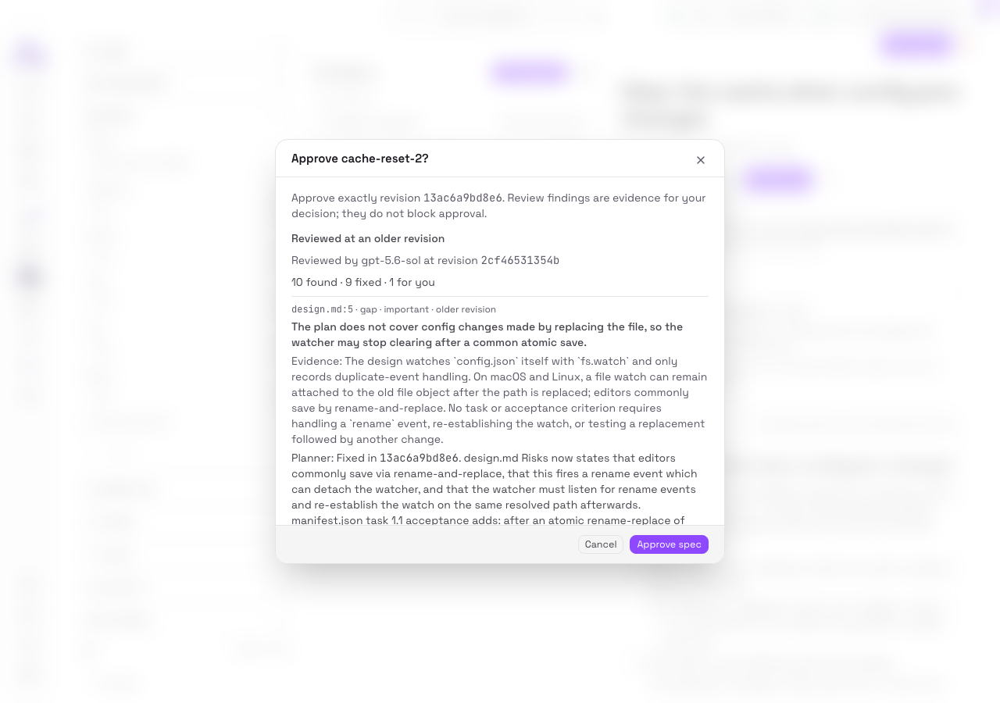
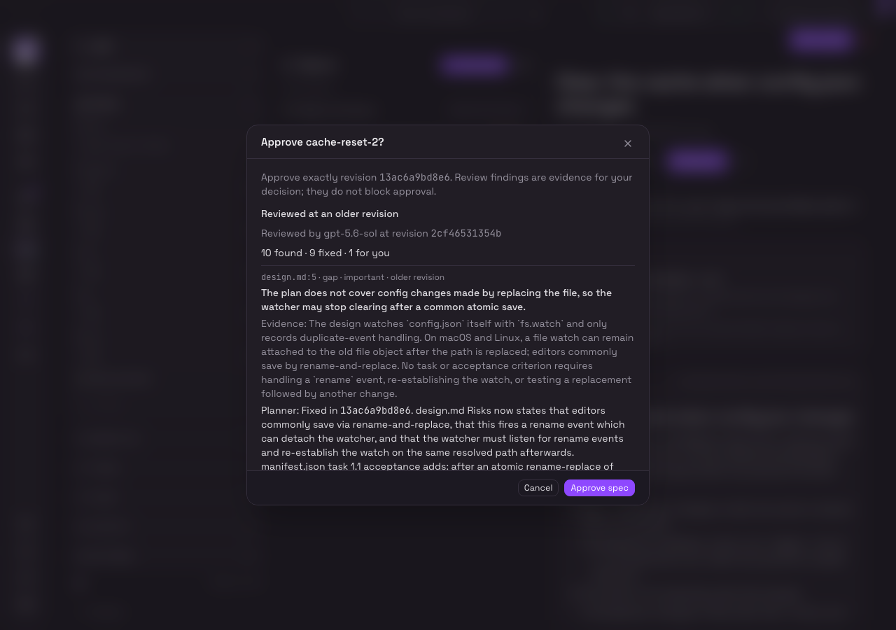
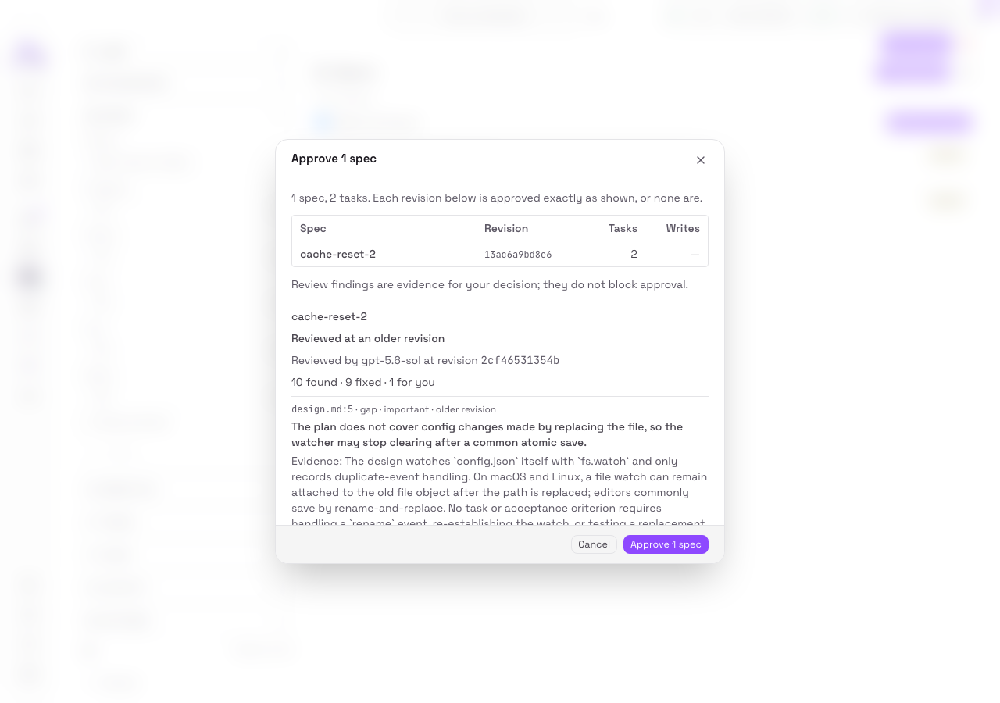
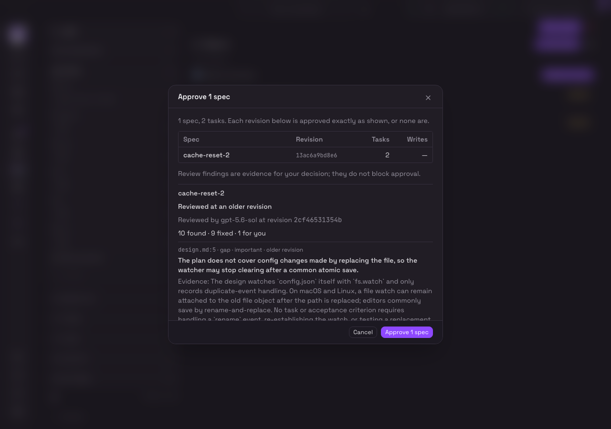
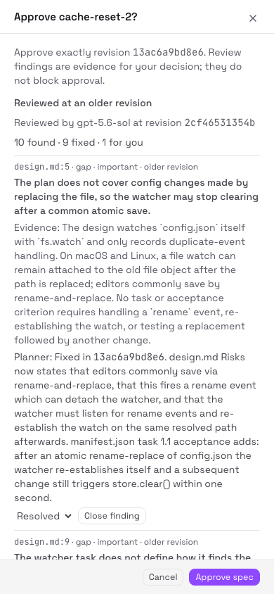
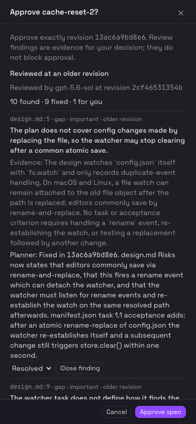
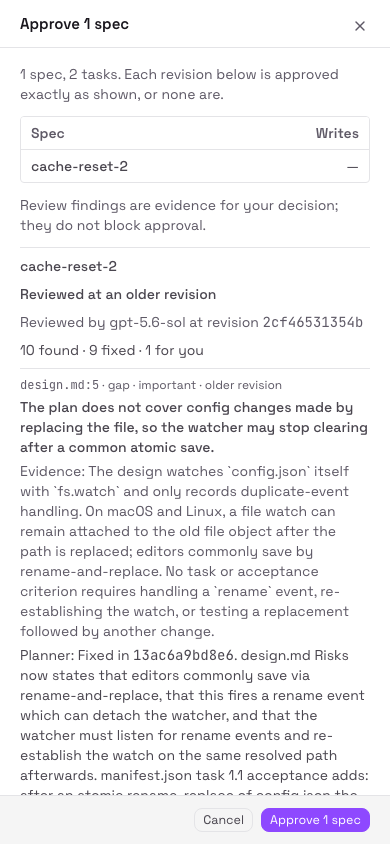
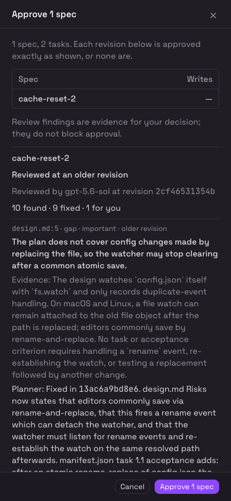

# P63 live: a draft is reviewed on another model and the person sees it at approval

Proof P63 (Requirement 99, design §4.29), run 2026-11-17 00:39–03:31 UTC
on a Mac, with real Kiro Crew chats in a throwaway Kiro Crew 0.12.2.4
(own home, port 5697), on Avoozl `main` plus the fixes below. Nothing was
approved and nothing was written to GitHub.

**Verdict: partial. P63 stays unticked.** P63 actions 1–4 and the two
Approve dialogs of action 6 passed live on spec `cache-reset-2`. Action 5 (a
hand edit) and the Approve click of action 6 were not run: approval is the
owner's click, and the dialogs were captured first. See "Left for the owner".
A first spec, `cache-reset`, found the bugs listed under "Bugs found first";
it stays a draft and proves nothing on its own.

## Setup

- A scratch workspace `p63` in the throwaway Kiro Crew's own catalog, and a
  scratch code repository `app` whose only remote is a local bare
  repository. `src/cache/store.mjs` exists; `src/cache/watch-config.mjs` does
  not.
- `.avoozl.json`: `models.planner = claude-sonnet-4.6`,
  `planReview = {mode: auto, rounds: 2}`. `models.planReviewer` was unset at
  first, then set to `gpt-5.6-sol`.
- The New spec request (person-only, from the CLI as the owner) asked for a
  draft whose design names `src/cache/watch-config.mjs` as an existing
  helper, and whose tasks.md says task 1.2 waits for 1.1 without a
  `requires` edge. Those are the planted wrong reference and hidden order.
- The tick opened every chat: the planner in chat folder `Avoozl › Specs`
  (project directory = the workspace), the reviewer, and the planner answer
  chats.

Two hands-on steps, both in the throwaway Kiro Crew only:

1. Each planner answer chat was set to trust mode (`POST /api/chat/mode`),
   so its `plans_save_plan` and `plans_answer_review` calls did not wait on a
   tool approval nobody was watching. This is the chat's tool approval, not
   plan approval.
2. The first draft used completion `merged-pr`, which spec lint refuses on a
   repository with no GitHub route. One chat message asked the planner to
   use `integrated` instead. The New spec brief does not say which
   completions a local repository allows; that is a separate gap.

## Results

| Expected | Seen |
|---|---|
| No review with no reviewer set | Round skipped: "Pick a Plan reviewer model in Settings › Models." No chat opened. |
| No review on the writer's model | `planReviewer = claude-sonnet-4.6` (the planner) was refused when the config loaded: "models.planReviewer must differ from the named planner model." |
| A different model finds the wrong reference at the right line | Round 1 (revision `6ad9346e`, writer claude-sonnet-4.6, reviewer gpt-5.6-sol): `wrong-reference`, blocking, `design.md:9`. Line 9 is "The watcher reuses the existing helper `src/cache/watch-config.mjs`." |
| … and the hidden order | `hidden-order`, important, `tasks.md:8`. Line 8 is "1.2 must wait until 1.1 is merged."; the manifest had no `requires`. |
| The writer answers each finding | The answer chat fixed all 5 round-1 findings and stored revision `2cf46531` with `plans_save_plan`, then answered each one `fixed` with that hash. |
| A new hash gets a fresh round | Round 2 reviewed `2cf46531` and found 5 more. The second answer chat fixed 4 (revision `13ac6a9b`) and answered 1 (`conflict`, the overlap with the older `cache-reset` draft) with a reason. Then the round limit (2) stopped it. |
| Both Approve dialogs show the counts | Both say "Reviewed by gpt-5.6-sol at revision 2cf46531354b · 10 found · 9 fixed · 1 for you", with each finding, its evidence and the planner's answer. Shots below. |
| Approval is unchanged | Both dialogs say findings "do not block approval"; "Approve spec" and "Approve 1 spec" stay enabled. Not pressed: both specs are still `draft`, the `approvals` table is empty. Approval itself is not proven here. |
| No GitHub write | The workspace has no GitHub repository; `github_issues` and `outbox` are empty. The scratch remote is a local folder. |

Round 1 findings (revision `6ad9346e`): wrong-reference `design.md:9`, gap
`requirements.md:3`, gap `avoozl/manifest.json:11`, hidden-order
`tasks.md:8`, conflict `design.md:9`. Round 2 (revision `2cf46531`):
conflict `avoozl/manifest.json:5`, untestable `requirements.md:3`, gap
`requirements.md:10`, gap `design.md:9`, gap `design.md:5`.

## Screenshots

What the person sees at approval, captured from the real Avoozl page in
headless Chrome with the throwaway Kiro Crew's sign-in. Kiro Crew's first-run
setup cards were skipped first (nothing imported, no setting changed).

| | Light | Dark |
|---|---|---|
| Approve one spec, desktop 1280 |  |  |
| Approve 1 spec (batch), desktop 1280 |  |  |
| Approve one spec, phone 390 |  |  |
| Approve 1 spec (batch), phone 390 |  |  |

## Bugs found first

Each was fixed in its own pull request, merged after Linux, macOS and
Windows passed, and copied into the throwaway Kiro Crew before the
`cache-reset-2` run.

| PR | Bug |
|---|---|
| #309 | Avoozl never saved the model Kiro Crew reports for a chat. |
| #313 | The New spec page opened the planner chat itself, so Avoozl never knew the writer. The tick opens it now. |
| #315 | The script cron passes its identity only in `KIROCREW_SESSION_KEY`; every tick's session take was refused. |
| #316 | Spec-writing planner chats ran outside the workspace and could not write the spec folder. |
| #343 | Kiro Crew 0.12.2.4's one-slot read names no model; Avoozl now reads it from the chat's usage rows. |
| #345 | A reviewer submits mid-turn, before its model is known; findings now wait for the model instead of being skipped. |
| #346 | Each backend client minted its own app token and ended the others'; 0.12.2.4 answers that with a bare 403. |
| #354 | A folder reload stored a planner's edits with no writer, so its own save was refused. |

## Left for the owner

- Action 5: edit a spec file of `cache-reset-2` by hand and let the tick
  reload it. Expected by the spec: a fresh round on the new hash, old findings
  marked older. By design §4.29 a hand reload has no writer model, so that
  round is skipped ("The model that wrote this revision is unknown") unless a
  person presses Review anyway. The first spec showed exactly that skip
  (revision `d2f92102`). Whether P63's "fresh round" means this skip or an
  unproven Review anyway is the owner's call.
- Action 6: press Approve and check that it succeeds as it would with no
  review, with no GitHub write.

## Not shown

- One model service outage ended a planner answer turn on the first spec
  ("Kiro cannot reach the network"). It did not recur on `cache-reset-2`.
- The person-only "Review anyway" button was not pressed.
