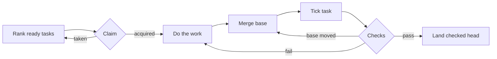
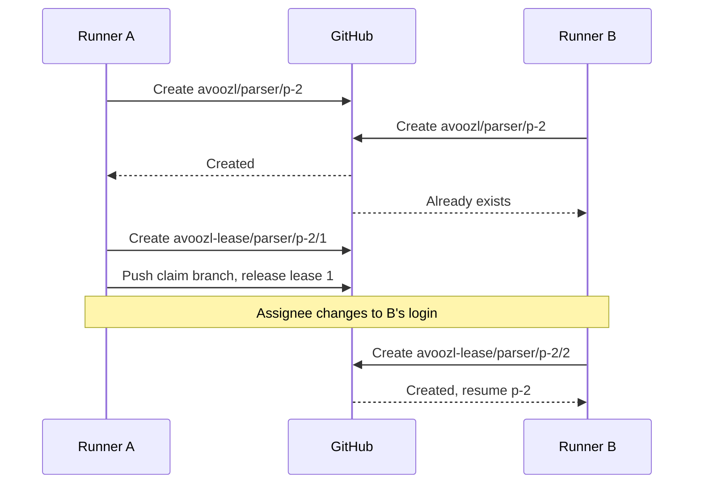

# Workflow v1

Your team writes a spec and approves it on GitHub. A runner picks a ready
task, claims it, checks the finished work and lands it according to the
repository's settings. Runners share progress through commits, branches and
issues.

For a team walkthrough, see the [epic rollout example](overview.md#epic-rollout).
To look up a decision, go to [approval](#7-approval),
[assignment](#8-spec-issues-and-assignment) or [who merges](#17-landing-modes).
If you're building a runner, [conformance](#conformance) lists the rules your
implementation needs to follow.

```markdown
---
repo: widget
---

- [x] `p-1` Read the token table
  - Every row of `tokens.csv` becomes one token kind
- [ ] `p-2` Report unknown tokens
  - An unknown token is reported with its line and column
- [ ] `p-3` Write reports (**PARALLEL**)
  - [ ] `p-4` Write a text report
    - Each unknown token appears on its own line
  - [ ] `p-5` Write a JSON report
    - Each unknown token appears as an object
```

The assigned runner sees that `p-1` is done. It creates the work branch
`avoozl/parser/p-2` and takes a lease to start `p-2`. Once that task lands and
its box is checked, both report tasks can run.



When the base holds the task's checkbox, the tick lands with the work, and one
set of checks covers both (16.2).

The words MUST, MUST NOT, SHOULD and MAY are used as in
[RFC 2119](https://www.rfc-editor.org/rfc/rfc2119).

## Terms

| Term | Meaning |
| --- | --- |
| Runner | A program that reads specs, claims ready tasks, has an agent or a person do them, checks the result and lands it. Each runner acts as one GitHub login, such as `acme-alice`. Several runners may share a login. |
| Writer | A user with write access to the repository. |
| Approver | A person on the repository's list of allowed approvers. If the list is empty, any writer can approve. |
| Specs branch | The branch where the team keeps its specs. It defaults to the repository's default branch. The repository can configure another branch, such as `plans`. |
| Spec | A subfolder of the specs folder (1). |
| Task file | The file that holds a spec's tasks: its `tasks.md`, or its one file with a `## Tasks` heading (1.2). |
| Spec text | The contents of the spec files in 1.2, read as if all task boxes were open. Checking a box records progress. |
| Task text | A task's title and acceptance bullets, as the done branch holds them (7.3). |
| Leaf | A task with no children. |
| Group | A task with children. |
| Spec group | A task whose title links another spec's task file (6.1). |
| Parent spec | A spec that has a spec group. |
| File-backed task | A task in a task file. The other kind is a labeled issue (11). |
| Spec issue | The issue whose assignee decides which login runs a spec (8.2). |
| Integration branch | A branch a person creates, named exactly as a spec's folder, to collect that spec's tasks (14). |
| Base | The branch where the work lands. Use the outermost integration branch in the spec's chain of parents, counting the spec itself. If none exists, use the default branch (14.1). |
| Done branch | The branch where the runner reads and updates a task's checkbox. Use the base if it's an integration branch that contains this spec's task file. Otherwise, use the specs branch (14.1, 14.6). |
| Claim | A runner reserves a task by creating a claim branch and taking a lease on it (15). |
| Claim branch | `avoozl/<spec>/<task>`, the branch a task is worked and checked on. |
| Start commit | The base's head a claim branch was created at. The lease commit records it (15.1). |
| Lease | Permission to push to a claim branch, recorded in `avoozl-lease/<spec>/<task>/<generation>`. The highest generation identifies the newest lease (15.5). Releasing it ends the holder's permission to push (15.6). |
| Stale hours | The runner's setting for how long a claim branch and its newest lease may go without a new commit before the claim is stale (15.4, 15.6). |
| Landed work | Checked work that is on the base, or whose pull request merged (16.5). |

## 1. Spec folders

Keep specs under `.kiro/specs` by default. Set `specs.path` in the spec
repository's `.avoozl.json` to choose a different folder. Mix single files and
subfolders in the same repository. Use each spec name once.

```text
.kiro/specs/
  parser/
    tasks.md          the tasks
    requirements.md   optional
    design.md         optional
  config.md           one file directly in the specs folder
  logging/
    logging.md        one file inside its own folder
```

In a single-file spec, put tasks under `## Tasks` and phases under `###`
headings (3.6). Avoozl resolves requirement and design references within
the same file under `## Requirements` and `## Design`. The name of a flat
spec is its filename without `.md`. The name of a folder-based spec is its
folder name. A runner MUST refuse a name used by both forms.

```markdown
---
repo: widget
---

# Config

Settings load from one file.

## Tasks

### Load

- [x] `c-1` Read the file
  - A file with every key loads
- [ ] `c-2` Report unknown keys
  - An unknown key is reported with its path

## Notes

The file is read once at start.
```

Here, `c-1` is done, `c-2` is ready, and `## Notes` ends the task list.

- **[1.1](github-workflow-scenarios.md#rule-11)** A spec MUST be one file named
  `<name>.md` directly in the specs folder or a subfolder named `<name>`. The
  same specs folder MAY contain both layouts. A runner MUST refuse a name that
  uses both layouts.
- **[1.2](github-workflow-scenarios.md#rule-12)** A spec MUST have exactly one
  task file. The runner reads tasks from one of these places.

  - In a spec subfolder with `tasks.md`, the whole file is the task list.
  - For a file directly in the specs folder, or a file in a spec subfolder
    without `tasks.md`, use its `## Tasks` heading outside code fences. Read
    up to the next level 1 or level 2 heading, or the end of the file.

  Treat the remaining Markdown in the spec as prose for approvers and agents.
  A runner MUST refuse a folder that has both a `tasks.md` and a file with a
  `## Tasks` heading, or two files with that heading. It MUST name both files.
- **[1.3](github-workflow-scenarios.md#rule-13)** Files in subfolders, files
  that are not Markdown, and symlinks are not part of the spec.

`specs.layout` in the spec repository's `.avoozl.json` picks the layout the
spec skills write a new spec in: `single`, the default, or `kiro` for the
split folder. A revised spec keeps the layout it has. The runner reads both
layouts whatever the setting says, and any other value is refused when the
settings load.

```json
{
  "specs": {
    "path": ".kiro/specs",
    "layout": "single"
  }
}
```

## 2. Tasks

Start each task with `- [ ]` (open) or `- [x]` (done), followed by its ID and
title. List the results someone can check beneath each leaf task.

```markdown
- [ ] `cache-drop` Drop stale entries
  - A stale entry is gone after one read
```

Text after the title, such as a requirement reference, is part of the title.

- **[2.1](github-workflow-scenarios.md#rule-21)** A task MUST have an ID in a
  code span, followed by a title. The ID matches `[A-Za-z0-9][A-Za-z0-9._-]*`,
  such as `parse`, `p-2`, `P-4` or `1.2`. IDs compare exactly, including case. A
  runner MUST refuse a task whose ID is not in a code span, such as
  `- [ ] p-2 Report unknown tokens`.
- **[2.2](github-workflow-scenarios.md#rule-22)** A task ID MUST be unique
  across a repository's specs. A runner MUST refuse a spec that repeats one.
- **[2.3](github-workflow-scenarios.md#rule-23)** A task MUST NOT carry a
  sub-bullet that starts with `$`. A runner MUST refuse a spec that does.
- **[2.4](github-workflow-scenarios.md#rule-24)** A leaf MUST have at least one
  plain sub-bullet. Each plain sub-bullet is one result someone can check, and
  together they say what done means.
- **[2.5](github-workflow-scenarios.md#rule-25)** A group MUST NOT have a plain
  sub-bullet.

## 3. Order

List tasks in the order they need to finish. Nest tasks that can run together
under a group marked `(**PARALLEL**)`.

```markdown
- [ ] `p-1` Read the token table
  - Each row defines one token kind
- [ ] `p-2` Report unknown tokens
  - Each unknown token has a line and column
- [ ] `p-3` Write reports (**PARALLEL**)
  - [ ] `p-4` Write a text report
    - Each unknown token appears on its own line
  - [ ] `p-5` Write a JSON report
    - Each unknown token appears as an object
- [ ] `p-6` Publish both reports
  - Both files appear in the output directory
```

Task `p-1` runs first, then `p-2`. Tasks `p-4` and `p-5` wait for `p-2` and
can run side by side. Task `p-6` waits for both reports.

<details>
<summary>Example of two teams working in parallel</summary>

The web and API teams can audit at the same time. Each team verifies its own
findings before the combined report is published.

```markdown
- [ ] `audit-split` Define the audit surfaces
  - Each surface has an owner and an acceptance checklist
- [ ] `audit` Audit each surface (**PARALLEL**)
  - [ ] `audit-web` Web lane
    - [ ] `audit-web-find` Audit the web surface
      - Every web finding names the affected route
    - [ ] `audit-web-verify` Verify the web findings
      - Every web finding is reproduced or withdrawn
  - [ ] `audit-api` API lane
    - [ ] `audit-api-find` Audit the API surface
      - Every API finding names the affected operation
    - [ ] `audit-api-verify` Verify the API findings
      - Every API finding is reproduced or withdrawn
- [ ] `audit-merge` Publish the audit report
  - The report contains the verified findings from both lanes
```

List order and nesting express these dependencies. Dependency bullets starting
with `$` are invalid under 2.3.

</details>

- **[3.1](github-workflow-scenarios.md#rule-31)** Tasks at the same level run
  from top to bottom. Each task MUST wait for the one above it to finish. If
  the preceding task is a group, that includes every task inside the group.
- **[3.2](github-workflow-scenarios.md#rule-32)** A runner MUST NOT claim or
  work a group. Its box MUST be checked when all children are checked
  and open otherwise. The runner MUST refuse an inconsistent spec. Two
  children can land independently, each before the other's tick is visible. If
  their merge leaves all children checked and the group open, the runner that
  reads the merged base SHOULD check the group's box in a separate commit that
  changes only that box.
- **[3.3](github-workflow-scenarios.md#rule-33)** A group's children run in
  order, unless its title ends with `(**PARALLEL**)`. The children of a tagged
  group run side by side, and each waits for what the group waits for.
- **[3.4](github-workflow-scenarios.md#rule-34)** A nested group runs its
  children in order unless its own title carries the tag, even inside a parallel
  group.
- **[3.5](github-workflow-scenarios.md#rule-35)** To mark a group as parallel,
  its title MUST end with exactly `(**PARALLEL**)`, and it must have at least
  two children. A runner MUST refuse a tagged leaf or a tagged group with
  fewer than two children. It also refuses any other use of the word
  `parallel` in parentheses or bold, regardless of case.
- **[3.6](github-workflow-scenarios.md#rule-36)** `##` headings in `tasks.md`,
  and `###` headings under a single file's `## Tasks`, are phases, and phases
  run in order. The first task of a phase MUST wait for every task of the phase
  above it.

## 4. Manual tasks

End a task title with `(**MANUAL**)` to reserve it for a person. Here, the
release waits for the owner to review the notes and check the box.

```markdown
- [ ] `m-2` Sign off the package (**MANUAL**)
  - The owner has read the release notes
```

- **[4.1](github-workflow-scenarios.md#rule-41)** A leaf whose title ends with
  `(**MANUAL**)` is a manual task. A runner MUST NOT offer it as ready and MUST
  NOT give it to an agent. A person does it and ticks it on its done branch
  (18.1). Tasks that depend on it wait for that tick.
- **[4.2](github-workflow-scenarios.md#rule-42)** The title of a manual leaf
  MUST end with exactly `(**MANUAL**)`. A runner MUST refuse a group with this
  tag. It also refuses other forms of the word `manual` in parentheses or
  bold, regardless of case.

## 5. Front matter

Which repository does the spec change? Set `repo` in the file's front matter.
The parser example uses `repo: widget`.

- **[5.1](github-workflow-scenarios.md#rule-51)** A spec's front matter MUST
  use only the keys `category` and `repo`. Use `category` to group specs in a
  listing. Use `repo` to identify the repository the spec changes. A runner
  MUST refuse any other key.
- **[5.2](github-workflow-scenarios.md#rule-52)** A spec MUST change one
  repository. A change across repositories is one spec per repository, linked
  from a parent spec (6).
- **[5.3](github-workflow-scenarios.md#rule-53)** A runner that runs specs for
  more than one repository MUST refuse a spec with no `repo`.

## 6. Linked specs

Link to another spec's task file in a parent task title. Use an inline or
reference-style Markdown link. Here, the first task writes the reports spec
and the second runs it. The parent is a single file in the specs folder.

```markdown
- [ ] `report-spec` Write the report spec
  - The report spec defines both output formats
- [ ] `report-build` Implement [reports]

[reports]: reports/tasks.md
```

- **[6.1](github-workflow-scenarios.md#rule-61)** A task whose title links a
  spec's task file is a spec group. Resolve the link relative to the parent
  task file. Both flat and folder-based specs can link to either layout. Its children are the linked spec's tasks.
  In the example, `report-spec` is a leaf and `report-build` is a spec group. A
  link to an ordinary document leaves the task as it is.
- **[6.2](github-workflow-scenarios.md#rule-62)** A linked spec's tasks MUST
  wait until the parent group's prerequisites are done and the linked spec is
  approved. Within the linked spec, its own task order determines which tasks
  are ready.
- **[6.3](github-workflow-scenarios.md#rule-63)** Check the parent group's box
  when all tasks in the linked spec are checked. If both task files are on the
  same specs branch, the commit that checks the last linked task SHOULD also
  check the parent group. Otherwise, record the parent's tick in a separate
  commit. For work on an integration branch, read each linked task's checkbox
  on its own done branch. Once all are done, check the group on the parent's
  done branch. The checkbox updates follow 7.5, including across repositories.
  They require no new approval and grant none.
- **[6.4](github-workflow-scenarios.md#rule-64)** A runner MUST refuse a spec
  group in any of these cases.

  - The group has sub-items of its own.
  - The same repository links the spec as a group more than once.
  - The link points to a missing spec. Allow this last case if an
    earlier task in the same list is still open. That task can create the spec.
- **[6.5](github-workflow-scenarios.md#rule-65)** A task MUST NOT name a task of
  another spec. Order across specs is the order of spec groups in a parent.

## 7. Approval

A teammate opens a pull request with a spec for a new parser. If you're one
of the repository's approvers, review the spec and merge the pull request
into the branch where your team keeps its specs. That merge approves the
version of the spec that lands.

Suppose someone later adds a requirement to report line numbers. The runner
needs approval for that revised spec before it can run any of its tasks.
Checking off an existing task just records that the work is done.

- **[7.1](github-workflow-scenarios.md#rule-71)** **Approving a change.** Anyone
  MAY open a pull request to add or update a spec. An approver can merge it
  into the specs branch or push the change directly to that branch. Approval
  covers the full text of each spec the commit adds or changes. To identify
  those specs, compare the commit with its first parent. The runner MUST
  accept any commit message and committer identity, including GitHub's
  identity on a squash merge.
- **[7.2](github-workflow-scenarios.md#rule-72)** **Verifying the approver.** The
  runner MUST verify approval in one of the following ways and say which one
  it used.
  - **Pull request.** GitHub's `merged_by` field names an approver as the
    person who merged the pull request that produced this commit.
  - **Signature.** GitHub verified the commit signature and identifies the
    signer as an approver. A signature from GitHub itself identifies only
    GitHub.
  - **Protected branch.** The repository declares that its branch protection
    allows only approvers to push or merge into the specs branch, and the
    commit names an approver as its author.

  Anyone can set a commit's author name and email. The runner can rely on
  those fields only under the protected branch rule above. Without one of
  these three checks, the commit cannot grant approval.
- **[7.3](github-workflow-scenarios.md#rule-73)** **Running a task.** The runner
  MUST run a task only if the spec text matches the latest approved version.
  It reads the text from the branch that records the task's completion (the
  done branch). Restoring the exact approved text restores approval.
- **[7.4](github-workflow-scenarios.md#rule-74)** **Recording progress.** Ignore
  task checkboxes when comparing spec text. If a commit changes only
  checkboxes, an approved spec stays approved and a spec awaiting approval
  still needs it. This applies even when an approver makes the commit.
- **[7.5](github-workflow-scenarios.md#rule-75)** **Updating a spec from a task.**
  In spec files on a specs branch, the runner MAY update only task checkboxes.
  It can record completion this way in its own repository or another one
  (6.3, 16.2). If the task changes the spec text, the runner submits the
  change in a pull request for an approver to merge.

## 8. Spec issues and assignment

Assign the spec's GitHub issue to the teammate who will drive it. Their runner
checks the assignment on the spec and its parents (8.3). For work already
underway, use the handoff in 8.4.

- **[8.1](github-workflow-scenarios.md#rule-81)** When a spec is approved and
  has no spec issue, a runner SHOULD create one in the spec's repository. A
  runner acting as the approving commit's author SHOULD be the one to do it, so
  runners do not race. The new issue copies the assignees of the pull request
  that approved the spec.
- **[8.2](github-workflow-scenarios.md#rule-82)** Find the spec's issue among
  the open issues in its repository. Look for a line in the issue body that
  reads exactly `<!-- avoozl-spec:NAME -->`. Replace `NAME` with the spec
  folder name, which matches `[A-Za-z0-9._-]+`. The runner MUST accept this
  marker only if the issue's author is a writer. It MUST look for an existing
  issue before creating one. If two open issues name the same spec, the runner
  SHOULD close the newer one as a duplicate.
- **[8.3](github-workflow-scenarios.md#rule-83)** A runner MUST run a spec only
  when the spec issue, and the issue of every parent spec that links it, is
  assigned to the runner's own login and to no one else. A spec with no spec
  issue waits until one is published (8.1). A runner for a repository with no
  GitHub remote is outside this workflow and MAY run its own specs.
- **[8.4](github-workflow-scenarios.md#rule-84)** Assign yourself to the spec
  issue to take the spec. Remove yourself to release it. To hand work in
  progress to a teammate, use this order.

  1. The current runner stops claiming new tasks, pushes each claim branch it
     holds and releases each lease (15.6). Keep the branches.
  2. A person changes the issue's assignee.
  3. The new assignee's runner resumes the pushed branches (15.7).

For a runner acting as `acme-alice`:

| Spec issue | Parent spec issue | Result |
| --- | --- | --- |
| `acme-alice` | none, or `acme-alice` | runs it |
| `acme-alice` | `acme-bob` | does not run it |
| `acme-alice` | nobody | does not run it |
| nobody | any | does not run it |
| `acme-alice`, `acme-bob` | any | does not run it |
| no spec issue | any | does not run it |

## 9. Labels

For example, require `agent-ok` and exclude `needs-design` to pick up work that's
ready for implementation. An issue with both labels waits.

- **[9.1](github-workflow-scenarios.md#rule-91)** A runner using filters MUST
  take new work only from issues that carry every required label and none of the
  excluded labels. A required label counts only when a writer added it (20.3).
  An excluded label holds work whoever added it. Both lists are empty by
  default.
- **[9.2](github-workflow-scenarios.md#rule-92)** Every default label name a
  runner supplies for this workflow MUST start with `avoozl:`. A runner MUST let
  the operator choose each label name per repository, including the stop label
  (10). A configured name may use any prefix. A work-in-progress label is
  optional and grants no claim.

## 10. Stopping a spec

A repository writer can pause a spec and its linked specs by labeling its
issue. Runners that should stop together need the same stop label. The default
is `avoozl:stopped` (9.2).

- **[10.1](github-workflow-scenarios.md#rule-101)** A spec is stopped while a
  writer's stop label is on its spec issue or on the issue of any parent spec
  that links it. A labeled issue (11) is its own spec issue for this rule. A
  runner MUST treat the stop as cleared only when an approver removes that
  label.
- **[10.2](github-workflow-scenarios.md#rule-102)** A task of a stopped spec is
  not ready (12.1), so a runner MUST NOT claim it. A runner that holds a claim
  on it MAY keep its lease or release it (15.6). It MUST make no further push to
  the claim branch, and MUST NOT land the task, until the stop clears.

## 11. Labeled issues

A writer labels a GitHub issue to authorize a fix. Suppose the issue asks for
a warning and someone edits it to ask for an error. The writer must remove and
reapply the label to authorize the revised request.

An open issue without a file-backed spec supplies one task.

| Spec part | From the issue |
| --- | --- |
| Spec name | `issue-<number>` |
| Task ID | `issue-<number>` |
| Title | The issue's title |
| Done bullet | The issue's body |

- **[11.1](github-workflow-scenarios.md#rule-111)** The runner MUST have at
  least one required label configured. The issue MUST pass the label filters in
  9.1. When a writer adds a required label, GitHub records a `labeled` event.
  That event authorizes the title and body as they were at that moment. Removing
  the label or editing the title or body ends authorization, even if someone
  later restores the text. To authorize the current version, a writer removes
  and reapplies the label.
- **[11.2](github-workflow-scenarios.md#rule-112)** Before claiming, the runner
  MUST verify that the issue is open, assigned solely to its login, and
  authorized under 11.1. The claim branch MUST be
  `avoozl/issue-<number>/issue-<number>`. Before starting work, the lease holder
  MUST record the revision in an empty commit with the subject
  `Issue #<number> label event <id>`, using the authorizing GitHub event ID. A
  runner resuming the claim MUST read the latest such commit on the claim
  branch's first-parent history since the claim began.
- **[11.3](github-workflow-scenarios.md#rule-113)** The issue's closure records
  completion in place of a checkbox. A pull request MUST reference the issue by
  number and MAY use a closing keyword such as `Closes #12`. Before the runner
  itself merges the pull request (`auto`, 17.4), arms auto-merge on it (17.7) or
  pushes to the base (`direct`, 17.1), it MUST repeat the checks in 11.4. When a
  person merges the pull request, that merge is the person's own authorization.
  After landing, the lease holder SHOULD name the landed commit on the issue and
  MUST close it if GitHub did not. If the text changed since the label event,
  the holder MUST leave the issue open for the writer to review instead of
  closing it.
- **[11.4](github-workflow-scenarios.md#rule-114)** Before resuming work, the
  lease holder MUST verify that the issue is open, the runner is its only
  assignee, and the recorded label event still authorizes the issue text. A
  runner that pushes or merges to the base MUST repeat those checks immediately
  before landing. If a check fails or the sequence of edits and labels is
  unclear, the runner MUST pause. After an edit, a writer authorizes the revised
  text. The holder records the new event (11.2), brings the work into line with
  that text and reruns the checks.

## 12. Ready tasks

Before ranking unfinished tasks, the runner checks which ones it can claim. A
task must meet every condition in 12.1.

- **[12.1](github-workflow-scenarios.md#rule-121)** A task is ready when all
  the following conditions hold.
  - It is an open leaf that a runner may execute (4.1, 18.1).
  - Its spec text is approved (7.3), or its issue revision is authorized
    (11.1).
  - Every task it waits for is done.
  - No claim branch exists for it, and no merged pull request names its
    claim branch as the head ref (16.5).
  - It passes the assignment rule (8.3, or 11.2 for a labeled issue) and any
    label filters the runner supports (9.1).
  - Its spec is not stopped (10.1).
- **[12.2](github-workflow-scenarios.md#rule-122)** A runner MUST create a claim
  only for a ready task. The lease holder works the claimed task and lands it
  under sections 16 and 17. For a labeled issue, the authorization also passes
  11.4 at landing.

## 13. Next task

Start with the task that unblocks the most work. If two tasks each unlock
three others, a chain of three takes priority over three parallel tasks. A
runner with priority labels ranks those tasks first (13.3).

- **[13.1](github-workflow-scenarios.md#rule-131)** A runner MUST pick the ready
  leaf with the most distinct open leaves that depend on it, directly or
  indirectly, under sections 3 and 6. Count a leaf once even if two paths reach
  it. On a tie, pick the leaf with the longest dependency path below it,
  measured in open leaves on that path.
- **[13.2](github-workflow-scenarios.md#rule-132)** If both scores tie, the
  runner MUST use task file order for tasks in the same file. For tasks in
  different files, sort first by the specs repository's `owner/name`, then by
  the file's path relative to that repository. Use ascending UTF-8 byte order
  for both comparisons. For a labeled issue, use the repository that holds the
  issue. Within each repository, list tied file tasks first, followed by tied
  issues in ascending issue number.
- **13.3** A runner MAY let a person raise tasks ahead of 13.1, with
  priority labels a writer added to the issue that holds the task (20.3) or
  with a pin the runner keeps. A raised task ranks before every other ready
  task. Raised tasks rank among themselves by the runner's pin and label
  order, then by 13.1 and 13.2. The rest rank by 13.1 and 13.2. Priority
  only orders ready tasks. It never makes a task ready (12.1).

## 14. Integration branches

To collect work before it reaches the default branch, create a branch on
origin named after the spec. Rule 14.1 determines where work lands when
both a parent and a linked spec have integration branches.

- **[14.1](github-workflow-scenarios.md#rule-141)** Look on origin for
  branches named exactly after the task's spec or any of its parent
  specs. If several match, use the branch for the outermost matching
  spec. All tasks in that spec and the specs it links, including nested links,
  land there. If none match, land on the default branch.
- **[14.2](github-workflow-scenarios.md#rule-142)** A runner MUST NOT create an
  integration branch and MUST NOT merge one into the default branch. A person
  does both.
- **[14.3](github-workflow-scenarios.md#rule-143)** Before claiming a task,
  check whether the integration branch contains the current head of the
  default branch. If it does, the branch is ready. Otherwise the runner MUST
  merge the default branch into it with a merge commit and push the result. It
  MUST NOT rebase or force push.
- **[14.4](github-workflow-scenarios.md#rule-144)** Tasks claimed together
  SHOULD start from one merged head.
- **[14.5](github-workflow-scenarios.md#rule-145)** When the merge conflicts, a
  runner MUST NOT claim a task on that branch until a person or the runner's
  conflict fixer resolves it. A fixer resolves it under the same terms as 16.6
  and pushes the merge commit to the integration branch.
- **[14.6](github-workflow-scenarios.md#rule-146)** Use the base as the task's
  done branch if it's an integration branch and contains the task file for the
  task's own spec. For a linked spec, determine the base using the outermost
  matching parent under 14.1. In every other case, use the specs branch to
  track completion. Once the checkbox is ticked on the done branch, the task
  counts as done (18.1) and satisfies that dependency for later tasks. A tick
  on an integration branch reaches the default branch when a person merges it.

## 15. Claims

A claim branch holds the work. A lease gives one runner permission to push to
it, even when several runners share a GitHub login.

Create the claim branch at the current head of the base. The lease is a branch
named `avoozl-lease/<spec>/<task>/<generation>`. Its commit has the claim head
as its parent and the same file tree. Creating either ref MUST fail if that
ref already exists.

Record the start commit and the approved task text in the lease commit
message, as in this example.

```text
Lease parser/p-2 generation 1

Start: 0a1b2c3d4e5f60718293a4b5c6d7e8f901234567
Task: Report unknown tokens
Done: An unknown token is reported with its line and column
Feedback: pull 41 through 2026-11-24T17:02:11Z line:2219 comment:2231
```

A `Feedback:` line names a source (`pull` or `issue` and its number), the
time of the newest comment delivered from it, and the keys delivered in the
10 minutes before that time (21.3). A comment at or before that window is
delivered. A runner without feedback routing (21) writes no `Feedback:` line.

On an existing claim, copy `Start` and every `Feedback:` line from the
previous lease. For the first lease, use the claim head. An agent starts only
after that lease exists. Record the task text approved at the time of the new
lease (15.7).

To release a lease, point its ref at a child of the lease commit with the
same file tree. The release message follows this format.

```text
Release parser/p-2 generation 1
```

In this handoff, runner A releases its lease before the assignee changes.



- **[15.1](github-workflow-scenarios.md#rule-151)** A runner MUST claim a ready
  task by creating `avoozl/<spec>/<task>` at the base's head and then taking a
  lease (15.5) whose commit records that head as the start commit and the task
  text as approved. It MUST do both before an agent starts.
- **[15.2](github-workflow-scenarios.md#rule-152)** A runner whose create fails
  MUST NOT work on that task and SHOULD refresh the ready tasks and select again
  under 13.
- **[15.3](github-workflow-scenarios.md#rule-153)** A runner MUST push to a
  claim branch only while it holds the newest lease of that claim and has not
  released it. It MUST read the claim's leases before each push and before it
  lands the task. A runner that finds a newer lease it did not create MUST stop
  work on that task.
- **[15.4](github-workflow-scenarios.md#rule-154)** When a claim branch has no
  new commit for the stale hours, the runner SHOULD notify the assignee. A
  runner MUST NOT delete another runner's claim branch on its own. A person can
  delete the branch to free the task.
- **[15.5](github-workflow-scenarios.md#rule-155)** To take a lease, find the
  highest generation that still has a lease ref for this task. Create the next
  generation, starting at 1 if there are no refs. If creation fails, the
  runner MUST NOT work on the task. Keep lease refs until the claim branch
  goes away (15.6). That keeps generation numbers unique for the lifetime of
  the claim and makes the highest generation the newest lease.
- **[15.6](github-workflow-scenarios.md#rule-156)** The runner that holds the
  lease MUST renew it at least once per half of the configured stale interval.
  To renew, move the lease ref to a new lease commit. When the runner stops
  working on the task, it MUST release the lease by moving that ref to a
  release commit. Releasing the lease ends the holder's permission to push.

  A lease is stale only when both the lease commit and the newest commit on
  the claim branch are older than the configured interval. The next generation
  replaces a stale or released lease without any cleanup.

  Delete lease refs only when deleting the claim branch or after the branch is
  gone. A runner MUST NOT delete the newest lease while it is active (neither
  stale nor released). Normally a runner deletes only leases it created. When
  it deletes a claim branch under 20.5, it MUST also delete all older leases
  for that task, including leases other runners created.
- **[15.7](github-workflow-scenarios.md#rule-157)** After a restart or handoff
  (8.4), a runner MAY resume a claim branch if the spec is assigned to its
  login and the branch has no lease or its newest lease is stale or released
  (15.6). To resume, take a new lease (15.5). Only one runner can take that
  generation, even if several use the same login.
- **[15.8](github-workflow-scenarios.md#rule-158)** After taking a lease on an
  existing claim (15.7), the runner MUST push a takeover commit before it
  works on or lands the task. Make an empty commit with the current claim head
  as its parent. An old holder trying to push from the previous head will then
  fail the fast-forward check. If GitHub rejects the takeover push,
  read the latest head and push the takeover commit on top of it.
- **[15.9](github-workflow-scenarios.md#rule-159)** A holder MUST push its work
  to the claim branch, run the checks on that pushed head, and land only that
  exact head. It MUST read the claim's leases again right before the push to the
  base, and stop when it finds a newer lease it did not create.
- **[15.10](github-workflow-scenarios.md#rule-1510)** Before landing or ticking
  a file-backed task, a runner MUST compare the task text recorded in its lease
  with the current approved text on the done branch (7.3). When they differ, it
  MUST NOT tick or land. It redoes the work against the new text with a lease
  that records it, or stops and shows the change to the spec's assignee. For a
  labeled issue, the runner verifies the recorded label event under 11.3 and
  11.4.

GitHub handles the lease read and the push to the base as separate operations.
The old holder can read its lease, lose it to a takeover, then push to the
base before it reads the lease again. A takeover requires a stale lease or a
handoff involving the old holder (8.4, 15.6). During that window the old
holder can land only the claim head it already pushed and checked (15.9). The
takeover commit blocks further pushes from the old head (15.8). When the new
holder merges the base into its branch (16.1), it sees any work the old holder
already landed.

## 16. Landing

The runner tests the commit it intends to land. If the destination branch
changes first, the runner merges that change and tests again.

- **[16.1](github-workflow-scenarios.md#rule-161)** A runner MUST merge the
  current base into the claim branch, include the tick when 16.2 requires it,
  run the checks, then land the checked head by mode (17). If the base moves
  before landing, it MUST repeat the merge and checks. A merge that conflicts
  follows 16.6. The task MUST stay
  claimed until the work has landed and the holder has recorded completion on
  the done branch (18.1) or the issue (11.3). The holder SHOULD then delete the
  claim branch and the task's leases (20.5).
- **[16.2](github-workflow-scenarios.md#rule-162)** The runner MUST record a
  file-backed task's tick on its done branch. The timing depends on where that
  branch lives.

  If the done branch is the base, the tick MUST be part of the head that
  passes checks. Include it in the work commit or add it to the claim branch
  before running checks.

  If the done branch is elsewhere, land the work first. Then tick the box in a
  separate commit on the done branch. This applies, for example, when a
  separate repository holds the specs. That commit changes only the checkbox
  and follows the approval rule in 7.5.
- **[16.3](github-workflow-scenarios.md#rule-163)** A runner MUST run the
  repository's checks on the exact head that will land, and MUST land nothing
  when they fail. In `direct` mode that head is the commit pushed to the base.
  In `pr` mode it is the pull request's head, which MUST contain the base head
  the runner read when it ran the checks. The merge commit that GitHub makes is
  not checked.
- **[16.4](github-workflow-scenarios.md#rule-164)** A runner MUST NOT rebase a
  branch someone else may hold, and MUST NOT force push.
- **[16.5](github-workflow-scenarios.md#rule-165)** To determine whether the
  work landed, first verify that the checked work commit differs from the
  start commit. Then confirm that the base contains the checked commit or that
  a pull request from the claim branch merged with that commit as its head. If
  the claim branch is gone, use its head ref to find the merged pull request.

  After an interruption, a runner using the spec assignee's login MAY record a
  missing tick on the done branch (15.10, 16.2). If the claim branch still
  exists, first take a lease on it (15.7). For a labeled issue, the lease
  holder verifies authorization before closing the issue (11.3). After
  recording completion, the runner SHOULD delete any remaining claim branch
  and the task's leases (20.5).
- **16.6** When merging the base into a claim branch conflicts, the lease
  holder MAY resolve the conflict on the same branch. It records the result
  as a merge commit with the base head as its second parent. Before pushing,
  it MUST check that every line the base added in a conflicted file is still
  present, or name each one it dropped and why in a comment on the pull
  request or spec issue. If that check fails, it MUST push nothing and show
  the conflict to the spec's assignee. After pushing, it reruns the checks
  (16.3). An open pull request stays the same pull request (17.6). The holder
  MUST NOT rebase or force push to resolve a conflict (16.4).

## 17. Landing modes

Choose who lands checked work in each repository.

| Mode | Action |
| --- | --- |
| `direct` | Push the checked head to the base, as a fast-forward. |
| `pr` | Open a pull request from the claim branch to the base. |
| `off` | Push the claim branch only. A person lands it. |

In `pr` mode, the pull request mode decides how the request opens and who
merges it. The default is `draft`.

- **[17.1](github-workflow-scenarios.md#rule-171)** In `direct` mode a runner
  MUST push the checked head to the base as a fast-forward, then finish the
  claim under 16.1.
- **[17.2](github-workflow-scenarios.md#rule-172)** In `draft` pull request
  mode, a runner MUST open a draft pull request, and MUST NOT merge it, mark it
  ready or arm auto-merge on it. A person marks it ready and merges it.
- **[17.3](github-workflow-scenarios.md#rule-173)** In `ready` pull request
  mode, a runner MUST open the pull request ready for review and MUST NOT merge
  it. A person merges it.
- **[17.4](github-workflow-scenarios.md#rule-174)** In `auto` mode, the runner
  opens the pull request ready for review and merges it once checks pass. It
  MUST make the merge conditional on the exact pull request head that passed
  (16.3) and read the base head again immediately before merging. If either
  head has moved, it MUST repeat the merge and checks in 16.1.
- **[17.5](github-workflow-scenarios.md#rule-175)** In `off` mode a runner MUST
  push the claim branch only.
- **[17.6](github-workflow-scenarios.md#rule-176)** While a pull request is
  open, its claim branch exists, so no other runner takes the task. When the
  base moves under an open pull request, a runner SHOULD merge the base in and
  run the checks again.
- **[17.7](github-workflow-scenarios.md#rule-177)** In `auto` mode a runner MAY
  arm GitHub auto-merge on the pull request once it has merged the current base
  in and the checks passed on that head. It arms it again after each later merge
  of the base into the claim branch, once the checks pass on the new head. The
  base's branch protection SHOULD require branches to be up to date and require
  the repository's checks.

A base that requires up-to-date branches also guards against a push to the
base between the runner's last check and GitHub's merge. Without it,
auto-merge can merge a head that was checked against an older base.

## 18. Done tasks

Look for a checked box on the task's done branch (14.6), or a closed issue for
work taken from a labeled issue (11.3).

- **[18.1](github-workflow-scenarios.md#rule-181)** A runner MUST treat a
  file-backed task as done only when its box is ticked on its done branch. The
  commit that changes `- [ ]` to `- [x]` records who marked the task done and
  when. A person MAY also mark a task done by ticking it on that branch.

## 19. Review output

The runner holding the lease can post its review findings or check results on
GitHub. Look on the task's pull request or, if there isn't one, the spec
issue.

- **[19.1](github-workflow-scenarios.md#rule-191)** A runner publishing findings
  MUST identify the task and the reviewed commit. It posts a comment on the
  task's pull request if one exists, or on the spec issue otherwise.
- **[19.2](github-workflow-scenarios.md#rule-192)** Publish review findings as
  advice. A runner MUST NOT submit them as a GitHub approval or change request.
  Posting or resolving a finding neither approves a spec nor satisfies a
  required review or check.

## 20. Runner limits

These limits on GitHub actions, approvals and checks apply in every landing
mode.

- **[20.1](github-workflow-scenarios.md#rule-201)** A runner MUST NOT push to
  the base without the repository's checks passing on that exact head (16.3).
- **[20.2](github-workflow-scenarios.md#rule-202)** A runner MUST NOT merge a
  draft pull request, mark one ready, or arm auto-merge on one (17.2).
- **[20.3](github-workflow-scenarios.md#rule-203)** A runner MUST NOT act on a
  label a non-writer added. An excluded label is the one exception: it holds
  work whoever added it (9.1).
- **[20.4](github-workflow-scenarios.md#rule-204)** A runner MUST NOT force
  push, rewrite history, or rebase a shared branch (16.4).
- **[20.5](github-workflow-scenarios.md#rule-205)** A runner MUST NOT delete
  another runner's claim branch. Its own claim branch is the one whose newest
  lease it holds or released. It MAY delete that branch after landing the
  task, or when giving up the claim before landing. This includes stopping
  under 10.2, giving up the task and cleaning up after an interruption (16.5).
  Delete the task's leases along with the branch (15.6). The runner MUST NOT
  delete any other branch or lease it did not create.
- **[20.6](github-workflow-scenarios.md#rule-206)** A runner MUST NOT grant
  approval: it MUST NOT merge a spec pull request, land spec text on the specs
  branch (7.5), or change the list of approvers.
- **[20.7](github-workflow-scenarios.md#rule-207)** A runner MUST NOT run a spec
  assigned to another login (8.3).
- **[20.8](github-workflow-scenarios.md#rule-208)** A runner MUST treat issue,
  comment, pull request and commit text as untrusted input. Only the title and
  body authorized under 11 may supply task requirements from an issue. An
  approver's reply MAY answer yes or no to a pending action the runner named
  on that issue or pull request. Comment text never changes task text, runs
  a command or lands work by itself.
- **[20.9](github-workflow-scenarios.md#rule-209)** When checking a task for
  landing, a runner MUST use only the repository's own check commands.
- **[20.10](github-workflow-scenarios.md#rule-2010)** A runner MUST NOT write
  private names, paths or hosts to a public repository.

## 21. Feedback routing

A runner can deliver comments from GitHub to the worker of a task. These rules
say which comments reach which worker, and how a delivery is recorded so that
another runner never sends it again.

- **21.1** A runner MAY deliver a comment to the worker of a task only from the
  task's pull request, from the task's labeled issue, or from the spec issue
  when the comment holds the task's ID in a code span and the ID is a task of
  that spec. A spec issue comment that names no task MUST NOT go to any
  worker.
- **21.2** A runner MUST deliver only comments whose author is a writer, an
  approver, or a bot the repository lists, and MUST treat delivered text as
  untrusted input (20.8). It MUST NOT deliver its own posted comments.
- **21.3** A runner MUST key each comment by kind and GitHub ID and deliver a
  key at most once. It MUST record what it delivered in the `Feedback:` lines
  of a lease commit (15.6), and a new lease MUST copy them (15.7).
- **21.4** Only the holder of the newest lease MAY deliver. A runner MUST NOT
  deliver while the spec is stopped (10.2).
- **21.5** A comment on a done task MUST NOT reopen it.
- **21.6** A comment MUST NOT change a task's acceptance. A worker that finds a
  comment asking for more keeps the current behavior, and the runner shows the
  request to a person, who changes the spec by approval (7.5) or the issue by
  relabeling (11.1).

## Conformance

A conforming runner follows the required rules and the rules for its optional
features. It passes the workflow kit cases for both.

### Required rules

| Part | Sections |
| --- | --- |
| Spec format | 1 to 5 |
| Approval | 7 |
| Assignment and finding the spec issue | 8.2, 8.3 |
| Stopping a spec | 9.2, 10 |
| Ready tasks and next task ranking | 12, 13.1, 13.2 |
| Claims and leases | 15.1 to 15.6, 15.9, 15.10 |
| Landing and landed work | 16.1 to 16.5, and the rules of one landing mode in 17 |
| Done tasks | 18 |
| Runner limits | 20 |

Implement at least one landing mode.

### Optional parts

The last column describes runners that omit the feature.

| Optional part | Sections | Without it |
| --- | --- | --- |
| Linked specs | 6 | The runner refuses a spec that has a spec group |
| Spec issue publishing | 8.1 | A person creates the spec issues |
| Integration branches | 14 | The runner refuses a spec that has a branch named for it |
| Priority ranking | 13.3 | Ready tasks rank by 13.1 and 13.2 only |
| Conflict fixing | 16.6 | A person resolves a conflict on a claim branch |
| Resuming a claim | 8.4, 15.7, 15.8 | The runner never takes a lease on an existing claim branch |
| Direct landing | 17.1 | The runner does not run in `direct` mode |
| Pull request landing | 17.2 to 17.4, 17.6, 17.7 | The runner does not run in `pr` mode |
| Off landing | 17.5 | The runner does not run in `off` mode |
| Label filters | 9.1 | Required and excluded labels do not affect this runner's claims |
| Labeled issues | 9.1, 11 | The runner makes no spec from an issue |
| Review output | 19 | The runner posts no review |
| Feedback routing | 21 | The runner delivers no comment to a worker |

### Workflow kit

The [workflow kit](../workflow-kit/README.md) supplies sample repository and
issue states with expected results, and
[scenarios](github-workflow-scenarios.md) that run runners against a
repository. A runner MUST produce the expected results in the kit cases for the
required rules and for each optional part it supports.

### Kit coverage

Snapshot cases check decisions. Scenarios also check what runners write and
when. The tables list gaps and partial coverage. The kit checks every other
rule.

| Rules | Why the kit does not check them |
| --- | --- |
| 13.3, 16.6, 21.1, 21.2, 21.3, 21.4, 21.5, 21.6 | No case |

The kit checks these rules in part:

| Rule | What the kit checks | What it leaves out |
| --- | --- | --- |
| 6.3 | That a runner's tick of a linked spec and its spec group keeps both approvals | When the runner ticks the spec group |
| 7.2 | Whether each kind of evidence approves | That the runner says which kind it used |
| 7.5 | That a runner's tick approves nothing and keeps the approval | That the runner's commit changes only checkboxes |
| 10.2 | That a stopped spec's task is not ready, and that its holder holds its push and its landing | Whether the holder keeps or releases its lease |
| 15.4 | That a runner of another login neither takes nor deletes a stale claim | That the runner notifies the assignee |
| 15.9 | The old holder's push is rejected | That the runner lands only the head it pushed, and the remaining window |
| 15.10 | That a changed text is not landed | That the runner redoes the work or stops |
| 16.5 | Whether a claim holds landed work, and where the tick goes | Which runner writes the tick |
| 17.6 | That no runner takes a task while its pull request is open | That a runner merges the base into the claim branch when the base moves |
| 19.1 | That findings go to the spec issue and name the task and the commit | Findings on a task's pull request |

Section 20 has one case per rule. Each checks which listed actions the
runner would refuse. These cases exercise the decision only, and so do the
cases for 14.2 and 16.4.
