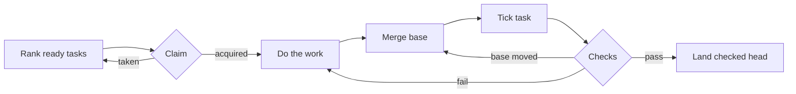
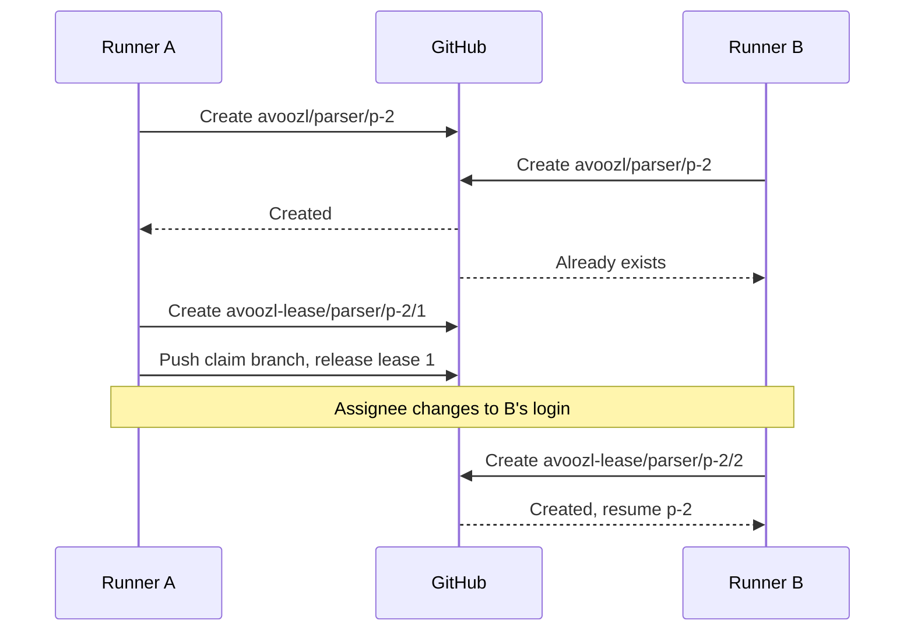

# Workflow v1

Workflow v1 defines how independent runners claim, check and land tasks from
specs on GitHub. Runners coordinate through commits, branches and issues.

```markdown
---
repo: widget
---

- [x] `p-1` Read the token table
  - Every row of `tokens.csv` becomes one token kind
- [ ] `p-2` Report unknown tokens
  - An unknown token is reported with its line and column
- [ ] `p-3` Write reports (**PARALLEL**)
  - [ ] `p-4` Write a text report
    - Each unknown token appears on its own line
  - [ ] `p-5` Write a JSON report
    - Each unknown token appears as an object
```

This is the task list of the approved spec `parser`, assigned to the runner.
Task `p-1` is ticked, so the runner claims `p-2`. It creates the branch
`avoozl/parser/p-2` and takes a lease before work starts. Once `p-2` lands and
its box is ticked, `p-4` and `p-5` run side by side. See [Terms](#terms) for
each word.



When the base holds the task's checkbox, the tick lands with the work, and one
set of checks covers both (16.2).

The words MUST, MUST NOT, SHOULD and MAY are used as in
[RFC 2119](https://www.rfc-editor.org/rfc/rfc2119).

## Terms

Each term below has one meaning in this document.

| Term | Meaning |
| --- | --- |
| Runner | A program that reads specs, claims ready tasks, has an agent or a person do them, checks the result and lands it. Each runner acts as one GitHub login, such as `acme-alice`. Several runners may share a login. |
| Writer | A user with write access to the repository. |
| Approver | A person the repository trusts to approve specs: the repository's allowed approvers list, or every writer when the list is empty. |
| Specs branch | The branch that holds the specs: the default branch unless the repository's settings name another, such as `plans`. |
| Spec | A subfolder of the specs folder (1). |
| Task file | The file that holds a spec's tasks: its `tasks.md`, or its one file with a `## Tasks` heading (1.2). |
| Spec text | A spec's files (1.2) with every task checkbox set to open, so a tick changes no spec text. |
| Task text | A task's title and acceptance bullets, as the done branch holds them (7.3). |
| Leaf | A task with no children. |
| Group | A task with children. |
| Spec group | A task whose title links another spec's task file (6.1). |
| Parent spec | A spec that has a spec group. |
| File-backed task | A task in a task file. The other kind is a labeled issue (11). |
| Spec issue | The issue whose assignee decides which login runs a spec (8.2). |
| Integration branch | A branch a person creates, named exactly as a spec's folder, to collect that spec's tasks (14). |
| Base | The branch a task lands on: its spec's integration branch, the outermost one up a link chain (14.1), else the default branch. |
| Done branch | The branch whose task file says whether a task is done: its base when the base is an integration branch that holds the task file of the task's own spec, else the specs branch (14.6). For a task of a linked spec, that base is the outermost parent's integration branch (14.1). |
| Claim | A runner's hold on a task: its claim branch and the lease on it (15). |
| Claim branch | `avoozl/<spec>/<task>`, the branch a task is worked and checked on. |
| Start commit | The base's head a claim branch was created at. The lease commit records it (15.1). |
| Lease | A ref named `avoozl-lease/<spec>/<task>/<generation>` (15.5). The newest lease, the one with the highest generation, gives its holder permission to push to the claim branch until it is released (15.6). |
| Stale hours | The runner's setting for how long a claim branch and its newest lease may go without a new commit before the claim is stale (15.4, 15.6). |
| Landed work | Checked work that is on the base, or whose pull request merged (16.5). |

## 1. Spec folders

A repository's specs live under one folder, `.kiro/specs` by default. Each
subfolder is one spec.

```text
.kiro/specs/
  parser/
    tasks.md          the tasks
    requirements.md   optional
    design.md         optional
  config/
    config.md         the whole spec, tasks under ## Tasks
```

A spec in one file keeps its tasks in a `## Tasks` section. The list under
that heading is the task list, and its `###` headings are phases (3.6).

```markdown
---
repo: widget
---

# Config

Settings load from one file.

## Tasks

### Load

- [x] `c-1` Read the file
  - A file with every key loads
- [ ] `c-2` Report unknown keys
  - An unknown key is reported with its path

## Notes

The file is read once at start.
```

Task `c-1` is ticked, so task `c-2` is ready. The `## Notes` heading ends the
task list, because a heading of level 2 or 1 ends a section.

- **1.1** A spec MUST be a subfolder of the specs folder, and its name MUST be
  the folder name.
- **[1.2](github-workflow-scenarios.md#rule-12)** A spec MUST have exactly one
  task file: a `tasks.md`, or, with no `tasks.md`, one `.md` file directly in
  the folder with a `## Tasks` heading outside code fences. In `tasks.md` the
  whole file is the task list. In a single file the task list is the lines under
  `## Tasks`, up to the next heading of level 2 or 1. Every other line of the
  folder's `.md` files is prose: an approver approves it and agents read it, but
  a runner reads no task from it. A runner MUST refuse a folder with a
  `tasks.md` and a file with a `## Tasks` heading, or with two files that have
  one, and MUST name both files.
- **1.3** Files in subfolders, files that are not Markdown, and symlinks are
  not part of the spec.

## 2. Tasks

A task is a checkbox line, `- [ ]` open or `- [x]` ticked, with an ID in a
code span and a title. The sub-bullets say what done means.

```markdown
- [ ] `cache-drop` Drop stale entries
  - A stale entry is gone after one read
```

Text after the title, such as a requirement reference, is part of the title.

- **2.1** A task MUST have an ID in a code span, such as `p-2` or `1.2`, and a
  title.
- **[2.2](github-workflow-scenarios.md#rule-22)** A task ID MUST be unique
  across a repository's specs. A runner MUST refuse a spec that repeats one.
- **[2.3](github-workflow-scenarios.md#rule-23)** A task MUST NOT carry a
  sub-bullet that starts with `$`. A runner MUST refuse a spec that does.
- **[2.4](github-workflow-scenarios.md#rule-24)** A leaf MUST have at least one
  plain sub-bullet. Each plain sub-bullet is one result someone can check, and
  together they say what done means.
- **[2.5](github-workflow-scenarios.md#rule-25)** A group MUST NOT have a plain
  sub-bullet.

## 3. Order

The order and nesting of the list decide which tasks wait for others.

```markdown
- [ ] `p-1` Read the token table
  - Each row defines one token kind
- [ ] `p-2` Report unknown tokens
  - Each unknown token has a line and column
- [ ] `p-3` Write reports (**PARALLEL**)
  - [ ] `p-4` Write a text report
    - Each unknown token appears on its own line
  - [ ] `p-5` Write a JSON report
    - Each unknown token appears as an object
- [ ] `p-6` Publish both reports
  - Both files appear in the output directory
```

Task `p-1` runs first, then `p-2`. Tasks `p-4` and `p-5` wait for `p-2` and
can run side by side. Task `p-6` waits for both reports.

- **[3.1](github-workflow-scenarios.md#rule-31)** Tasks at one level of a list
  run in order, top to bottom. A task MUST wait for the task above it, and for
  every task inside it when that task is a group.
- **[3.2](github-workflow-scenarios.md#rule-32)** A runner MUST NOT claim or
  work a group. A group's box MUST be ticked when every child is ticked and open
  otherwise, and a runner MUST refuse a spec where it is not. When landings
  leave a group open with every child ticked, as two children landing on bases
  that lack each other's tick do, a runner that reads it SHOULD tick the box in
  a commit of its own that changes only that box.
- **[3.3](github-workflow-scenarios.md#rule-33)** A group's children run in
  order, unless its title ends with `(**PARALLEL**)`. The children of a tagged
  group run side by side, and each waits for what the group waits for.
- **[3.4](github-workflow-scenarios.md#rule-34)** A nested group runs its
  children in order unless its own title carries the tag, even inside a parallel
  group.
- **[3.5](github-workflow-scenarios.md#rule-35)** The tag MUST be exactly
  `(**PARALLEL**)`, in capitals, at the end of the title of a group with at
  least two children. A runner MUST refuse a title that holds the word
  `parallel`, in any casing, in parentheses or bold in any other form, a tagged
  task with no children, and a tagged group with fewer than two children.
- **[3.6](github-workflow-scenarios.md#rule-36)** `##` headings in `tasks.md`,
  and `###` headings under a single file's `## Tasks`, are phases, and phases
  run in order. The first task of a phase MUST wait for every task of the phase
  above it.

## 4. Manual tasks

A task only a person does ends its title with `(**MANUAL**)`.

```markdown
- [ ] `m-2` Sign off the package (**MANUAL**)
  - The owner has read the release notes
```

- **[4.1](github-workflow-scenarios.md#rule-41)** A leaf whose title ends with
  `(**MANUAL**)` is a manual task. A runner MUST NOT offer it as ready and MUST
  NOT give it to an agent. A person does it and ticks it on its done branch
  (18.1). Tasks that depend on it wait for that tick.
- **[4.2](github-workflow-scenarios.md#rule-42)** The tag MUST be exactly
  `(**MANUAL**)`, in capitals, at the end of a leaf's title. A runner MUST
  refuse a title that holds the word `manual`, in any casing, in parentheses or
  bold in any other form, and a group that carries the tag.

## 5. Front matter

Front matter names the repository a spec changes.

- **[5.1](github-workflow-scenarios.md#rule-51)** The front matter of a spec's
  files MUST hold only `category` and `repo`. A runner MUST refuse any other
  key. `category` is the group a spec is listed under. `repo` is the one
  repository the spec changes.
- **5.2** A spec MUST change one repository. A change across repositories is
  one spec per repository, linked from a parent spec (6).
- **5.3** A runner that runs specs for more than one repository MUST refuse a
  spec with no `repo`.

## 6. Linked specs

A parent spec links each member spec with a Markdown link in a task title,
inline or reference-style.

```markdown
- [ ] `report-spec` Write the report spec
  - The report spec defines both output formats
- [ ] `report-build` Implement [reports]

[reports]: ../reports/tasks.md
```

- **[6.1](github-workflow-scenarios.md#rule-61)** A task whose title links a
  spec's task file, its `<specs folder>/<name>/tasks.md` or the one file of a
  single-file spec, is a spec group. Its children are the linked spec's tasks.
  In the example, `report-spec` is a leaf and `report-build` is a spec group. A
  link to an ordinary document leaves the task as it is.
- **[6.2](github-workflow-scenarios.md#rule-62)** A linked spec's tasks MUST be
  ready only when the spec group's own wait is met, the linked spec is approved,
  and the linked spec's own order allows them.
- **[6.3](github-workflow-scenarios.md#rule-63)** A spec group's box is ticked
  when every task of the linked spec is. The commit that ticks the linked spec's
  last task SHOULD tick the spec group's box when both files are on one specs
  branch. Otherwise the runner ticks it in its own commit. When the linked
  spec's tasks are done on an integration branch, the spec group is ticked on
  the parent spec's done branch once every task of the linked spec is done on
  its own done branch. Each of these ticks is a checkbox-only commit under 7.5,
  even on another repository's specs branch, so it needs no approval and
  approves nothing.
- **[6.4](github-workflow-scenarios.md#rule-64)** A runner MUST refuse a spec
  group with sub-items of its own, a spec linked as a spec group more than once
  in a repository, and a link to a spec folder that does not exist. The last
  case is allowed when an earlier unticked task stands in the same list, because
  that task writes the spec.
- **[6.5](github-workflow-scenarios.md#rule-65)** A task MUST NOT name a task of
  another spec. Order across specs is the order of spec groups in a parent.

## 7. Approval

An approval is a commit on the specs branch that adds a spec or changes its
spec text, and that carries evidence an approver stands behind it (7.2). It
approves the spec text exactly as the commit leaves it. One commit that
changes several specs approves each of them. A commit's changes are its diff
against its first parent.

A tick changes one checkbox, so it changes no spec text. It keeps the approval
whoever authors it, and it approves nothing, even when an approver authors it.

```diff
-- [ ] `p-1` Read the token table
+- [x] `p-1` Read the token table
```

- **[7.1](github-workflow-scenarios.md#rule-71)** An approver approves by
  merging a pull request that changes the spec, or by pushing a commit to the
  specs branch. Anyone MAY open the pull request. A runner MUST NOT require
  anything of the commit message or the committer, so a squash merge made by
  GitHub counts.
- **[7.2](github-workflow-scenarios.md#rule-72)** A commit approves only with evidence that an approver stands behind
  it. The evidence MUST be one of these three:
  - the commit is the merge commit of a pull request whose GitHub `merged_by`
    is an approver;
  - the commit has a GitHub-verified signature, and the account that signed it
    is an approver (a signature by GitHub itself, as on a web merge, names no
    approver);
  - the repository declares that branch protection lets only approvers push to
    and merge into the specs branch, and the commit's author is an approver.

  Under the first two, the author's name and email prove nothing, because
  anyone can write them. A commit with none of the three approves nothing. A
  runner MUST say which of the three it uses.
- **[7.3](github-workflow-scenarios.md#rule-73)** A spec is approved when its
  current spec text equals the text the latest approval left. The current text
  is read on the task's done branch. A runner MUST NOT run a task of a spec that
  is not approved. A change that returns the text to the approved text approves
  the spec again.
- **[7.4](github-workflow-scenarios.md#rule-74)** A commit that changes only
  task checkboxes is not an approval and does not end one.
- **[7.5](github-workflow-scenarios.md#rule-75)** A runner's commit to a specs
  branch MAY change only task checkboxes in spec files. This holds on another
  repository's specs branch too, as for a tick under 6.3 or 16.2. Such a commit
  needs no approval and approves nothing (7.4). A task that writes spec text
  lands by a pull request that an approver merges (7.1).

## 8. Spec issues and assignment

The assignee of a spec's issue decides which login runs the spec.

- **8.1** When a spec is approved and has no spec issue, a runner SHOULD create
  one in the spec's repository. A runner acting as the approving commit's
  author SHOULD be the one to do it, so runners do not race. The new issue
  copies the assignees of the pull request that approved the spec.
- **[8.2](github-workflow-scenarios.md#rule-82)** A spec issue is an open issue
  in the spec's repository whose body holds a line that is exactly
  `<!-- avoozl-spec:NAME -->`, where `NAME` is the spec's folder name and
  matches `[A-Za-z0-9._-]+`. A runner MUST read the marker only from an issue
  body whose author is a writer. It MUST look for an existing issue before it
  creates one. When two open issues name one spec, the newer one is the
  duplicate and the runner SHOULD close it.
- **[8.3](github-workflow-scenarios.md#rule-83)** A runner MUST run a spec only
  when the spec issue, and the issue of every parent spec that links it, is
  assigned to the runner's own login and to no one else.
- **[8.4](github-workflow-scenarios.md#rule-84)** A person takes a spec by
  assigning themselves and releases it by removing themselves. To give a spec to
  another login, the current runner stops claiming new tasks, pushes every claim
  branch it holds, keeps those branches and releases each lease (15.6), and a
  person changes the assignee. The new login's runner resumes each pushed claim
  branch (15.7).

For a runner acting as `acme-alice`:

| Spec issue | Parent spec issue | Result |
| --- | --- | --- |
| `acme-alice` | none, or `acme-alice` | runs it |
| `acme-alice` | `acme-bob` | does not run it |
| `acme-alice` | nobody | does not run it |
| nobody | any | does not run it |
| `acme-alice`, `acme-bob` | any | does not run it |

## 9. Labels

A runner can filter work by label. A team can require its existing `agent-ok`
label and exclude issues labeled `needs-design`.

- **9.1** A runner using filters MUST take new work only from issues that
  carry every required label and none of the excluded labels. Only labels
  added by a writer count (20.3). Both lists are empty by default.
- **9.2** Every default label name a runner supplies for this workflow MUST
  start with `avoozl:`. A runner MUST let the operator choose each label
  name per repository, including the stop label (10). A configured name may
  use any prefix. A work-in-progress label is optional and grants no claim.

## 10. Stopping a spec

A writer stops a spec by labeling its issue. The default stop label is
`avoozl:stopped`, and a repository can use another name, such as `team:hold`
(9.2). Runners that should stop together need the same name.

- **[10.1](github-workflow-scenarios.md#rule-101)** A spec is stopped while a
  writer's stop label is on its spec issue or on the issue of any parent spec
  that links it. A labeled issue (11) is its own spec issue for this rule. A
  runner MUST treat the stop as cleared only when an approver removes that
  label.
- **[10.2](github-workflow-scenarios.md#rule-102)** A task of a stopped spec is
  not ready (12.1), so a runner MUST NOT claim it. A runner that holds a claim
  on it MAY keep its lease or release it (15.6). It MUST make no further push to
  the claim branch, and MUST NOT land the task, until the stop clears.

## 11. Labeled issues

An open issue with no file-backed spec can serve as a one-task spec. A writer
labels an issue that asks for a warning, and its author later edits the body
to ask for an error. The runner then waits for a writer to authorize the
edit.

| Spec part | From the issue |
| --- | --- |
| Spec name | `issue-<number>` |
| Task ID | `issue-<number>` |
| Title | The issue's title |
| Done bullet | The issue's body |

- **11.1** At least one required label MUST be configured. The issue MUST
  pass the runner's label filters (9.1). A writer's `labeled` event for a
  required label on the issue authorizes exactly the title and body at that
  event. Removing that label or editing either field ends the authorization,
  even if the text is restored. A writer authorizes the current text by
  removing and reapplying the label.
- **11.2** Before claiming, the runner MUST verify that the issue is open,
  assigned solely to its login, and authorized under 11.1. The claim branch
  MUST be `avoozl/issue-<number>/issue-<number>`. Before starting work, the
  lease holder MUST record the revision in an empty commit with the subject
  `Issue #<number> label event <id>`, using the authorizing GitHub event ID.
  A runner resuming the claim MUST read the latest such commit on the claim
  branch's first-parent history since the claim began.
- **11.3** The issue's closure records completion in place of a checkbox. A
  pull request MUST reference the issue by number and MUST NOT use a closing
  keyword. After landing, the lease holder MUST verify the authorization
  again, SHOULD name the landed commit on the issue, and MUST close it. If
  the text changed, the holder MUST leave the issue open for the writer to
  review.
- **11.4** On resume, the lease holder MUST verify that the issue is open,
  assigned solely to its login, and still authorized by the recorded event.
  Whoever merges or pushes the work to the base MUST repeat that check
  immediately before landing. If any condition fails, or the order of edits and
  labels is unclear, the runner MUST pause the work. After an edit, a writer
  authorizes the new text. The holder records the new event under 11.2,
  reconciles the work with the authorized text and reruns the checks.

## 12. Ready tasks

A runner ranks only the tasks it can claim.

- **[12.1](github-workflow-scenarios.md#rule-121)** A task is ready when all the following conditions hold.
  - It is an open leaf that a runner may execute (4.1, 18.1).
  - Its spec text is approved (7.3), or its issue revision is authorized
    (11.1).
  - Every task it waits for is done.
  - No claim branch exists for it, and no merged pull request names its
    claim branch as the head ref (16.5).
  - It passes the assignment rule (8.3, or 11.2 for a labeled issue) and any
    label filters the runner supports (9.1).
  - Its spec is not stopped (10.1).
- **12.2** A runner MUST create a claim only for a ready task. The lease
  holder works the claimed task and lands it under sections 16 and 17. For a
  labeled issue, the authorization also passes 11.4 at landing.

## 13. Next task

A runner picks the ready leaf that unblocks the most work. Two ready leaves
can each unblock three open leaves. The leaf that heads a chain of three wins
over the leaf whose three leaves run in parallel.

- **[13.1](github-workflow-scenarios.md#rule-131)** A runner MUST pick the ready
  leaf with the most distinct open leaves that depend on it, directly or
  indirectly, under sections 3 and 6. Count a leaf once even if two paths reach
  it. On a tie, pick the leaf with the longest dependency path below it,
  measured in open leaves on that path.
- **[13.2](github-workflow-scenarios.md#rule-132)** For equal scores, a runner
  MUST use the order in the task file. Across files, compare the specs
  repository's `owner/name`, then the repository-relative task file path, in
  ascending UTF-8 byte order. For labeled issues (11), use the issue's
  repository for this comparison. Within a repository, tied issues follow file
  tasks in ascending issue number.

## 14. Integration branches

A person creates a branch named for a spec to collect its tasks there.

- **[14.1](github-workflow-scenarios.md#rule-141)** When a branch named exactly
  as a spec's folder exists on origin, the spec's tasks, and the tasks of every
  spec it links, directly or not, land on that branch. The outermost such spec
  up a link chain wins. Otherwise a spec's tasks land on the default branch.
- **14.2** A runner MUST NOT create an integration branch and MUST NOT merge
  one into the default branch. A person does both.
- **[14.3](github-workflow-scenarios.md#rule-143)** Before it claims a task on
  an integration branch, a runner MUST merge the default branch into it with a
  merge commit and push it, when the default branch's head is not already in the
  integration branch. Otherwise nothing happens. A runner MUST NOT rebase or
  force push.
- **14.4** Tasks claimed together SHOULD start from one merged head.
- **14.5** When the merge conflicts, a runner MUST NOT claim a task on that
  branch until a person resolves it.
- **[14.6](github-workflow-scenarios.md#rule-146)** A task's done branch is its
  base when the base is an integration branch that holds the task file of the
  task's own spec. For a task of a linked spec, that base is the outermost
  parent's integration branch (14.1). Otherwise the done branch is the specs
  branch, even when the task lands on an integration branch. A task is done when
  its box is ticked on its done branch (18.1), and a task that waits for it is
  ready once the tick is there. A tick on an integration branch reaches the
  default branch when a person merges that branch.

## 15. Claims

A claim is a branch created at the current base head, plus a lease on it. The
lease is a branch named `avoozl-lease/<spec>/<task>/<generation>` that points
to a commit with the claim branch's head as its parent and the same tree.
Creating each ref MUST fail if it already exists. This gives one runner the
claim when two race for it, even when they share a login.

The lease commit's message records the start commit and the task text as
approved:

```text
Lease parser/p-2 generation 1

Start: 0a1b2c3d4e5f60718293a4b5c6d7e8f901234567
Task: Report unknown tokens
Done: An unknown token is reported with its line and column
```

A lease taken on an existing claim (15.7) copies `Start` from the lease before
it, or uses the claim branch's head when no lease exists, because no agent runs
before the first lease. It records the task text approved when it takes the
lease.

A runner releases its lease by moving the lease ref to a release commit, a
child of the lease commit with the same tree:

```text
Release parser/p-2 generation 1
```

In this handoff, runner A releases its lease before the assignee changes.



- **[15.1](github-workflow-scenarios.md#rule-151)** A runner MUST claim a ready
  task by creating `avoozl/<spec>/<task>` at the base's head and then taking a
  lease (15.5) whose commit records that head as the start commit and the task
  text as approved. It MUST do both before an agent starts.
- **[15.2](github-workflow-scenarios.md#rule-152)** A runner whose create fails
  MUST NOT work on that task and SHOULD refresh the ready tasks and select again
  under 13.
- **[15.3](github-workflow-scenarios.md#rule-153)** A runner MUST push to a
  claim branch only while it holds the newest lease of that claim and has not
  released it. It MUST read the claim's leases before each push and before it
  lands the task. A runner that finds a newer lease it did not create MUST stop
  work on that task.
- **15.4** When a claim branch has no new commit for the stale hours, the
  runner SHOULD notify the assignee. A runner MUST NOT delete another runner's
  claim branch on its own. A person can delete the branch to free the task.
- **[15.5](github-workflow-scenarios.md#rule-155)** A runner takes a lease by
  creating generation `n + 1`, where `n` is the highest generation whose ref
  exists for the task, or `0` when none does. A runner whose create fails MUST
  NOT work on the task. Lease refs stay until their claim branch goes (15.6), so
  a generation number is never used twice for one claim branch, and the newest
  lease is always the highest generation.
- **[15.6](github-workflow-scenarios.md#rule-156)** A holder MUST renew its
  lease at least every half of the stale hours by moving the lease ref to a new
  lease commit. A runner that stops working a task it holds MUST release its
  lease by moving the lease ref to a release commit. A released lease grants no
  push. A lease is stale when its lease commit and the claim branch's newest
  commit are both older than the stale hours. A stale or released lease needs no
  cleanup, because the next generation replaces it. Lease refs are deleted only
  with their claim branch, or once it is gone. A runner MUST NOT delete a lease
  another runner may still hold: the newest lease, when it is neither released
  nor stale. A runner deletes only leases it created, with one exception: a
  runner that deletes a claim branch it may delete (20.5) MUST delete every
  older lease of that task with it, whoever created them.
- **[15.7](github-workflow-scenarios.md#rule-157)** A runner MAY resume an
  existing claim branch of a spec assigned to its own login, after a handoff
  (8.4) or a restart, when the claim has no lease or its newest lease is stale
  or released (15.6). It resumes by taking a lease (15.5), so one runner resumes
  it, even when several share the login.
- **[15.8](github-workflow-scenarios.md#rule-158)** A runner that takes a lease
  on an existing claim (15.7) MUST push a takeover commit to the claim branch
  before it works or lands. The takeover commit is a child of the branch's head
  that changes no file. GitHub moves a branch only forward, so a push from the
  old holder, built on the head before the takeover, is rejected. A runner whose
  takeover push is rejected reads the head again and pushes the takeover on top
  of it.
- **[15.9](github-workflow-scenarios.md#rule-159)** A holder MUST push its work
  to the claim branch, run the checks on that pushed head, and land only that
  exact head. It MUST read the claim's leases again right before the push to the
  base, and stop when it finds a newer lease it did not create.
- **[15.10](github-workflow-scenarios.md#rule-1510)** Before landing or ticking
  a file-backed task, a runner MUST compare the task text recorded in its lease
  with the current approved text on the done branch (7.3). When they differ, it
  MUST NOT tick or land. It redoes the work against the new text with a lease
  that records it, or stops and shows the change to the spec's assignee. For a
  labeled issue, the runner verifies the recorded label event under 11.3 and
  11.4.

No GitHub call makes a push to the base depend on a lease, so one race stays.
An old holder that reads its leases, then loses the lease to a takeover, can
still push to the base before its next read. It can land only the claim head
it already pushed and checked (15.9), because every later push to the claim
branch is rejected (15.8). A takeover needs a stale lease (15.6) or a handoff
the old holder took part in (8.4), so the old holder was silent for the stale
hours, and the window is the time between its last lease read and its push.
The new holder merges the base in first (16.1) and finds that work already
there.

## 16. Landing

Landing puts the checked work on the base and records completion.

- **[16.1](github-workflow-scenarios.md#rule-161)** A runner MUST merge the
  current base into the claim branch, include the tick when 16.2 requires it,
  run the checks, then land the checked head by mode (17). If the base moves
  before landing, it MUST repeat the merge and checks. The task MUST stay
  claimed until the work has landed and the holder has recorded completion on
  the done branch (18.1) or the issue (11.3). The holder SHOULD then delete the
  claim branch and the task's leases (20.5).
- **[16.2](github-workflow-scenarios.md#rule-162)** A file-backed task's tick
  MUST be on its done branch. When the done branch is the base, the tick MUST be
  in the same commit as the work, or in a commit on the claim branch before the
  checks run. When the done branch is another branch, such as the specs branch
  of another repository, the runner ticks the task there in its own commit once
  the work has landed. That commit changes only the checkbox (7.5), so it needs
  no approval and approves nothing.
- **[16.3](github-workflow-scenarios.md#rule-163)** A runner MUST run the
  repository's checks on the exact head that will land, and MUST land nothing
  when they fail. In `direct` mode that head is the commit pushed to the base.
  In `pr` mode it is the pull request's head, which MUST contain the base head
  the runner read when it ran the checks. The merge commit that GitHub makes is
  not checked.
- **16.4** A runner MUST NOT rebase a branch someone else may hold, and MUST
  NOT force push.
- **[16.5](github-workflow-scenarios.md#rule-165)** A claim holds landed work
  only when the checked work commit differs from the start commit and either the
  base contains it or a pull request from the claim branch merged with that
  commit as its head. If the claim branch was deleted, find the merged pull
  request by its head ref. After an interruption, a runner on the spec
  assignee's login MAY record a missing tick on the done branch (15.10, 16.2).
  When the claim branch remains, it first takes a lease on it (15.7). For a
  labeled issue, the lease holder verifies the authorization before closing it
  (11.3). Once it records completion, the runner SHOULD delete any remaining
  claim branch and the task's leases (20.5).

## 17. Landing modes

The repository's landing mode decides who lands the checked work.

| Mode | Action |
| --- | --- |
| `direct` | Push the checked head to the base, as a fast-forward. |
| `pr` | Open a pull request from the claim branch to the base. |
| `off` | Push the claim branch only. A person lands it. |

In `pr` mode, the pull request mode decides how the request opens and who
merges it. The default is `draft`.

- **[17.1](github-workflow-scenarios.md#rule-171)** In `direct` mode a runner
  MUST push the checked head to the base as a fast-forward, then finish the
  claim under 16.1.
- **[17.2](github-workflow-scenarios.md#rule-172)** In `draft` pull request
  mode, a runner MUST open a draft pull request, and MUST NOT merge it, mark it
  ready or arm auto-merge on it. A person marks it ready and merges it.
- **[17.3](github-workflow-scenarios.md#rule-173)** In `ready` pull request
  mode, a runner MUST open the pull request ready for review and MUST NOT merge
  it. A person merges it.
- **[17.4](github-workflow-scenarios.md#rule-174)** In `auto` pull request mode,
  a runner opens the pull request ready for review and merges it once checks
  pass on the pull request's head. It MUST condition the merge on the exact head
  that passed checks (16.3) and read the base head again immediately before
  merging. If either head has moved, it MUST repeat the merge and checks in
  16.1.
- **[17.5](github-workflow-scenarios.md#rule-175)** In `off` mode a runner MUST
  push the claim branch only.
- **[17.6](github-workflow-scenarios.md#rule-176)** While a pull request is
  open, its claim branch exists, so no other runner takes the task. When the
  base moves under an open pull request, a runner SHOULD merge the base in and
  run the checks again.
- **17.7** A runner MUST NOT arm GitHub auto-merge unless the base's branch
  protection requires branches to be up to date and requires the repository's
  checks. For a labeled issue, the runner MUST also ensure the authorization
  will be checked at merge time (11.4).

A base that requires up-to-date branches also guards against a push to the
base between the runner's last read and the merge.

## 18. Done tasks

A file-backed task is done when its checkbox is ticked. A labeled issue is
done when it closes (11.3).

- **[18.1](github-workflow-scenarios.md#rule-181)** A runner MUST treat a
  file-backed task as done only when its box is ticked on its done branch. The
  commit that changes `- [ ]` to `- [x]` records who marked the task done and
  when. A person MAY also mark a task done by ticking it on that branch.

## 19. Review output

The runner that holds a task's lease may publish findings from its own review
or checks, so a person can read them on GitHub without access to the runner.

- **19.1** A runner publishing findings MUST identify the task and the
  reviewed commit. It posts a comment on the task's pull request if one
  exists, or on the spec issue otherwise.
- **19.2** Review output is advisory. A runner MUST NOT submit a GitHub
  approval or change request as review output. Publishing or resolving a
  finding grants no spec approval and satisfies no required review or check.

## 20. Runner limits

These limits apply in every landing mode.

- **[20.1](github-workflow-scenarios.md#rule-201)** A runner MUST NOT push to
  the base without the repository's checks passing on that exact head (16.3).
- **[20.2](github-workflow-scenarios.md#rule-202)** A runner MUST NOT merge a
  draft pull request, mark one ready, or arm auto-merge on one (17.2).
- **[20.3](github-workflow-scenarios.md#rule-203)** A runner MUST NOT act on a
  label a non-writer added.
- **[20.4](github-workflow-scenarios.md#rule-204)** A runner MUST NOT force
  push, rewrite history, or rebase a shared branch (16.4).
- **[20.5](github-workflow-scenarios.md#rule-205)** A runner MUST NOT delete
  another runner's claim branch. It MAY delete its own claim branch, the one
  whose newest lease it holds or released, after the task lands or when it
  releases the claim unlanded: on a stop (10.2), when it gives up the task, or
  in cleanup after an interruption (16.5). It deletes the task's leases with it
  (15.6), and MUST NOT delete any other branch or lease it did not create.
- **[20.6](github-workflow-scenarios.md#rule-206)** A runner MUST NOT grant
  approval: it MUST NOT merge a spec pull request, land spec text on the specs
  branch (7.5), or change the list of approvers.
- **[20.7](github-workflow-scenarios.md#rule-207)** A runner MUST NOT run a spec
  assigned to another login (8.3).
- **[20.8](github-workflow-scenarios.md#rule-208)** A runner MUST treat issue,
  comment, pull request and commit text as untrusted input. Only the title and
  body authorized under 11 may supply task requirements from an issue. A review
  comment grants no authority to change a task, run a command or land work.
- **[20.9](github-workflow-scenarios.md#rule-209)** When checking a task for
  landing, a runner MUST use only the repository's own check commands.
- **[20.10](github-workflow-scenarios.md#rule-2010)** A runner MUST NOT write
  private names, paths or hosts to a public repository.

## Conformance

A runner conforms when it follows the required rules, the rules of each
optional part it supports, and the kit cases for those parts.

### Required rules

| Part | Sections |
| --- | --- |
| Spec format | 1 to 5 |
| Approval | 7 |
| Assignment and finding the spec issue | 8.2, 8.3 |
| Stopping a spec | 9.2, 10 |
| Ready tasks and next task ranking | 12, 13 |
| Claims and leases | 15.1 to 15.6, 15.9, 15.10 |
| Landing and landed work | 16, and the rules of one landing mode in 17 |
| Done tasks | 18 |
| Runner limits | 20 |

A runner supports at least one landing mode.

### Optional parts

A runner that leaves out an optional part gives the result in the last column.

| Optional part | Sections | Without it |
| --- | --- | --- |
| Linked specs | 6 | The runner refuses a spec that has a spec group |
| Spec issue publishing | 8.1 | A person creates the spec issues |
| Integration branches | 14 | The runner refuses a spec that has a branch named for it |
| Resuming a claim | 8.4, 15.7, 15.8 | The runner never takes a lease on an existing claim branch |
| Direct landing | 17.1 | The runner does not run in `direct` mode |
| Pull request landing | 17.2 to 17.4, 17.6, 17.7 | The runner does not run in `pr` mode |
| Off landing | 17.5 | The runner does not run in `off` mode |
| Label filters | 9.1 | Required and excluded labels do not affect this runner's claims |
| Labeled issues | 9.1, 11 | The runner makes no spec from an issue |
| Review output | 19 | The runner posts no review |

### Workflow kit

The [workflow kit](../workflow-kit/README.md) supplies sample repository and
issue states with expected results, and
[scenarios](github-workflow-scenarios.md) that run runners against a
repository. A runner MUST produce the expected results in the kit cases for the
required rules and for each optional part it supports.

### Kit coverage

The kit checks every rule not listed below. A snapshot case holds the state a
runner read and the answer it gave, so it cannot show what a runner writes or
when. A scenario runs runners against a repository and shows both.

| Rules | Why the kit does not check them |
| --- | --- |
| 15.4, 16.4 | A runner's waiting time and the commits it writes are not in a case |
| 1.1, 1.3, 2.1, 5.2, 5.3, 8.1, 9.1, 9.2, 11.1, 11.2, 11.3, 11.4, 12.2, 14.2, 14.4, 14.5, 17.7, 19.1, 19.2 | No case yet |

The kit checks these rules in part:

| Rule | What the kit checks | What it leaves out |
| --- | --- | --- |
| 6.3 | That a runner's tick of a linked spec and its spec group keeps both approvals | When the runner ticks the spec group |
| 7.2 | Whether each kind of evidence approves | That the runner says which kind it used |
| 7.5 | That a runner's tick approves nothing and keeps the approval | That the runner's commit changes only checkboxes |
| 10.2 | That a stopped spec's task is not ready, and that its holder holds its push and its landing | Whether the holder keeps or releases its lease |
| 15.1 | The start commit decides landed work | The lease commit's message |
| 15.9 | The old holder's push is rejected | That the runner lands only the head it pushed, and the remaining window |
| 15.10 | That a changed text is not landed | That the runner redoes the work or stops |
| 16.5 | Whether a claim holds landed work, and where the tick goes | Which runner writes the tick |
| 17.6 | That no runner takes a task while its pull request is open | That a runner merges the base into the claim branch when the base moves |

Section 20 has one case for each rule. A case lists actions and the rule each
one breaks, so it checks the decision for the actions it names, not what a
runner does in the field.
