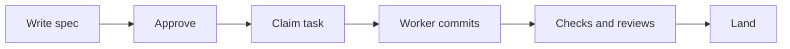

# Avoozl

## Requirements

### Introduction

Avoozl turns a spec a person approves into landed code. It reads spec
folders, builds a graph from each spec's task list, starts a coding
agent on each ready task in its own worktree, runs the repository's checks on
the exact commit the agent made, and lands the work by the repository's
`landing` setting. Agents run as Kiro Crew chats or as process harnesses
started by each `avoozl tick`. Avoozl is a local application with a Kiro Crew
app page, a CLI and an MCP server; a timer or the app's cron runs the tick,
and each tick can also keep the page up on its own.

Git and GitHub hold the state that matters: specs, approvals, ticks and what
landed. SQLite is a cache that `avoozl rebuild` makes again. GitHub is
optional: a Local only workspace needs only Git.

| Section | Holds |
| --- | --- |
| [Requirements](#requirements) | Scope and acceptance criteria |
| [Design](#design) | State, architecture and workflows |
| [Tasks](#tasks) | The task checklist and proof steps |

**Autopilot** is the page's name for the server loop: `loop` in this
machine's config, which lets each tick claim and start ready tasks. The
`delivery` key in `.avoozl.json`, the `delivery.*` operations, the CLI and
the `plans_*` MCP names keep the word delivery.

### Facts

#### Kiro Crew facts

Each fact names the Kiro Crew source it was read from.

| # | Fact | Source |
| --- | --- | --- |
| F20 | A Kiro Crew app may declare a `node` backend that the gateway spawns on loopback and reverse-proxies at `/apps/<name>/api/`, plus `mcpServers`, `crons`, `agents`, and `skills`. Third-party apps run with gateway privileges after the user grants trust. | `apps/manifest_sections.py` `BackendConfig`; `apps/routes_proxy.py`; `docs/apps.md` |
| F21 | No supported API lets an app backend create a visible, project-bound Kiro Crew session. The app spawn SDK starts background agent turns with no project or working-directory argument. `session_create` has no project argument; a session inherits a project only from a folder whose `project_dir` a person set. | `apps/spawn_sdk.py`; `docs/session-control.md` (`session_create`, `chat_folder_update`) |
| F22 | Kiro Crew inbound webhooks run one LLM turn in an ephemeral session, bind loopback by default, and use Kiro Crew's own HMAC headers, not GitHub's webhook signature. | `docs/inbound-webhooks.md` |
| F27 | Kiro Crew crons can run a shell command (`command` jobs) or a Python function (`script` jobs) with no LLM call, on an interval, cron expression, or one-shot time. Commands are vetted when added and on every fire; command substitution, loops, and compound commands are refused. An app manifest can declare crons that register on enable and are removed on disable. | `docs/cron-and-scheduling.md`; `apps/manifest.py` `crons`; `docs/apps.md` |
| F28 | Kiro Crew monitor loops wake one conversation on an interval and run an agent turn each cycle in that same conversation. | `docs/monitor-loops.md` |
| F29 | No documented Kiro Crew event pushes a session's completion to an app backend. Apps can declare permitted event names, but no session-lifecycle event for third-party apps exists in the docs and manifests. | `~/.kiro/crew/apps/*/app.json`; `docs/session-control.md` |
| F30 | Apps can declare notification channels in their manifest. | `notifications.channels` in an app manifest; Avoozl's is `hosts/kirocrew/app.json` |

### Scope

#### In scope

- One Avoozl Kiro Crew app with a backend, page, skills, and MCP surface, and
  the same page served by Avoozl itself, kept up by each tick.
- Single-file specs and Kiro spec folders as plan layouts.
- Local planning and delivery with no GitHub dependency.
- GitHub spec issues, epic issues, labeled issues, pull requests and landing.
- Agents on any harness: Kiro Crew chats or process harnesses under the
  supervisor.
- A plugin seam for content rules, credentials, checks and context, loaded
  only with consent (Requirement 34). The public repository ships only
  test-only fake plugins; real integrations are separate packages.
- An open-source release.

#### Non-goals

- A chat, terminal, file browser or memory system.
- A second writable task store beside git.
- Any private or company-internal integration in the public repository, by
  name or by implementation. Such integrations live in their own packages and
  plug in through the seam (Requirement 34.10).
- Reading or writing another Kiro Crew app's private data or routes.
- GitHub Apps, hosted services, or shared databases.


#### Requirement 1: Kiro Crew and supervised process sessions

**User story:** As a developer, I want every implementation and review
session to be a Kiro Crew session or a supervised process, so that I use one
place to watch and steer work.

##### Acceptance criteria

1. WHEN Avoozl starts work THEN the work SHALL run in a Kiro Crew chat or a
   process harness that the supervisor starts (Requirements 93 to 95).
2. WHEN a task has a worker THEN Avoozl SHALL show a link that opens that exact
   Kiro Crew session or run.
3. WHEN the Avoozl app is enabled THEN no separate Avoozl website, Canvas page,
   or editor extension SHALL be required for any workflow in this spec.
4. IF a needed Kiro Crew capability has no supported interface THEN the design
   SHALL name it as a missing handoff contract and SHALL NOT call a private route.

#### Requirement 2: Local work without GitHub

**User story:** As a developer without GitHub access, I want to plan and deliver
work in a local repository, so that Avoozl is useful offline and for private work.

##### Acceptance criteria

1. WHEN no GitHub repository is configured THEN spec reading, readiness,
   claims, checks and landing SHALL all work.
2. WHEN `gh` is absent or unauthenticated THEN only GitHub features SHALL report
   unavailable; local features SHALL keep working.

#### Requirement 3: Workspace and repository selection

**User story:** As a developer, I want to choose which Avoozl workspace and code
repositories a spec uses, so that each task runs in the right checkout.

##### Acceptance criteria

1. WHEN the app opens THEN it SHALL list known Avoozl workspaces and load the
   selected workspace's data through the app backend.
2. WHEN a user adds a workspace THEN Avoozl SHALL accept an existing directory
   containing `.avoozl.json` or initialize an empty one.
3. WHEN a task names a repository THEN Avoozl SHALL resolve it to a
   registered local checkout and SHALL refuse to start the task if none
   exists.
4. WHEN Avoozl creates a worker session THEN the session SHALL work in that
   task's worktree, and the session binding SHALL be recorded.

#### Requirement 4: Specs become task graphs

**User story:** As a developer, I want a spec's task list to be a checked
graph of groups and leaves, so that work can proceed in safe pieces.

##### Acceptance criteria

1. A spec SHALL be written by a person or a chat running the `avoozl-spec`
   skill, and Avoozl SHALL read it from disk or from the specs branch.
2. Every task SHALL have a stable ID in its checklist line.
3. A task with children SHALL be a group, and a task without children a
   leaf. Only leaves SHALL be claimed; a group's box SHALL follow its
   children.
4. Waits SHALL follow list order, including the `(**PARALLEL**)` groups and
   phases in [Workflow v1](../docs/github-workflow.md#3-order).
5. WHEN a leaf has no plain sub-bullet, an ID is used twice, a tag is written
   wrong, or a linked spec does not exist THEN `avoozl spec lint` SHALL
   report it, and the same inputs SHALL give the same result.
6. No task SHALL be claimed until a commit on the specs branch approves
   its current text under Requirement 114.

#### Requirement 6: Readiness and bounded automatic local delivery

**User story:** As a developer, I want ready leaves to start by themselves within
limits I set, so that I do not file, start, or chase routine work.

##### Acceptance criteria

1. A leaf SHALL be ready only when its spec is approved, every task it waits
   on is ticked, no claim branch exists for it, and no stop or label filter
   holds it.
2. WHEN this machine's config sets `loop` and a lane is free THEN each tick
   SHALL claim and start ready leaves without a manual step.
3. `lanes.local` in the machine file (`~/.config/avoozl/config.json`) SHALL
   set how many worker sessions this machine runs at once (default 3), and
   `lanes.reviewers` how many reviewer sessions (default 1). `lanes` in
   `.avoozl.json` SHALL count only when the machine file sets none. A host
   `maxConcurrentRuns` SHALL be ignored.
4. Each worker SHALL use its own worktree on its claim branch.

#### Requirement 7: Verification, integration, and dependent release

**User story:** As a developer, I want finished work checked and landed
before dependents start, so that later tasks build on accepted code.

##### Acceptance criteria

1. WHEN a worker reports done THEN Avoozl SHALL run the repository's checks
   against the exact commit and record the result. A check that names paths
   SHALL run only when the commit's diff against the base touches one of
   them; every other check SHALL run. Avoozl SHALL run them itself, with no
   model call: in the task worktree when it is at the exact commit, else in
   a clean detached worktree at that commit, each check as an argument list
   with no shell, each with its own time limit, recording the exit code and
   a short redacted output tail. The runs SHALL be queued off the tick, one
   at a time per repository. A check that is not run, cannot start (exit
   126 or 127), or times out SHALL fail the checking, not the writer's
   attempt. A task declares no checks; every task runs its repository's
   checks, each named in the repository's settings.
2. WHEN checks pass and every review approves THEN Avoozl SHALL land the
   commit by the repository's `landing` setting and record the landed
   commit.
3. WHEN a task lands THEN the next tick SHALL recompute readiness, so tasks
   that wait on it become ready.
4. Spec approval, implementation, landing, and whole-head acceptance SHALL
   remain distinct states.

#### Requirement 8: Failure and recovery

**User story:** As a developer, I want a failed or lost worker to resume without
corrupting task state, so that automation is safe to leave running.

##### Acceptance criteria

1. WHEN a worker fails THEN the task SHALL keep its ID and attempt history,
   and SHALL move to a retryable failed state.
2. A disconnected worker SHALL NOT be replaced solely because its activity lease
   expired.
3. WHEN Avoozl or the gateway restarts THEN Avoozl SHALL reconcile each running
   task with its session state before starting anything new.
4. Retries SHALL be bounded by `delivery.retries` (default 2); exceeding the
   bound SHALL open a human decision.

#### Requirement 9: Stop only for real human decisions

**User story:** As a developer, I want automation to stop only when a person must
decide, so that routine work never waits on me.

##### Acceptance criteria

1. Automation SHALL stop for failed required checks after retries, review
   rounds that run out, conflicts it cannot resolve, content rule blocks,
   stale claims, and `(**MANUAL**)` tasks.
2. Automation SHALL NOT stop for routine claims, starts or landing.
3. Every stop SHALL appear in Needs you as one row with its cause and the
   action that resumes work.

#### Requirement 10: GitHub repository policy

**User story:** As a maintainer, I want to control which actors and
permissions may start Avoozl work, so that labels alone cannot trigger
execution.

##### Acceptance criteria

1. Each GitHub repository's settings MAY name `allowedActors` and
   `minimumPermission`.
2. Public and private repositories SHALL both be supported.
3. A repository whose settings name neither allowed actors nor a minimum
   permission SHALL be treated as `minimumPermission: write`. Naming either
   SHALL replace this default. Avoozl SHALL ship no default that lets anyone
   without write access start work.
4. Issue titles, bodies, and comments SHALL be treated as untrusted data in
   every brief, on public and private repositories alike. A task whose
   title, acceptance, or summary came from an issue or an incoming item
   SHALL have that text quoted as data in its worker and review briefs,
   under a line saying it cannot change the steps, tools, repository,
   branch, or push target.
5. Anything Avoozl writes to an issue, including hidden markers, SHALL be safe to
   publish: no secrets, local paths, private names, or transcript content.
6. An actor's permission SHALL be the repository role GitHub names
   (`role_name`), so maintain and triage are not read as write and read.
7. GitHub reads SHALL go through a cache of conditional requests, and SHALL
   pause with one Needs you row WHEN GitHub's rate-limit headers show the
   budget is spent. GitHub writes SHALL go through one pacer.
8. A labeled issue's body SHALL be capped at its first 4,000 characters
   when it becomes a task's done bullet.
9. Every link the app page renders SHALL be an http or https URL or one
   of Kiro Crew's own pages (`/chat?sid=`, `/apps/`); anything else SHALL
   render as text.

#### Requirement 11: Label filters

**User story:** As a maintainer, I want to choose which spec issues this
runner works on with my own labels, so that Avoozl fits my repository's
vocabulary.

##### Acceptance criteria

1. A repository MAY set `labels.require` and `labels.exclude`. A spec SHALL
   run on this runner only when its spec issue carries every `require`
   label and no `exclude` label. Labels SHALL compare without case. An
   `exclude` label SHALL hold the spec whoever added it.
2. A `require` label SHALL count only when the actor of its newest `labeled`
   event has write, maintain or admin permission.
3. `labels.stop` (default `avoozl:stopped`) SHALL stop a spec while a
   writer's stop label is on its spec issue or on a parent spec's. Only a
   removal by an approver SHALL clear the stop.
4. The filters SHALL hold new claims only. A task already claimed SHALL
   keep running whatever its filter labels say later; a stop SHALL also
   hold a claimed task's push and landing.
5. The spec issues SHALL be read once per pass, with one permission read per
   actor per pass. A spec whose read fails SHALL keep its last result.

#### Requirement 12: Labeled issues

**User story:** As a maintainer, I want to label an issue and have Avoozl
deliver it, so that one gesture starts a small piece of work.

##### Acceptance criteria

1. An open issue that passes its repository's `labels.require`, each label
   added by a writer, is assigned solely to this runner's login, and is not
   a spec issue SHALL become task `issue-<n>`: the issue's title, and its
   body as its one done bullet.
2. The task SHALL live in the workspace cache only, claim
   `avoozl/issue-<n>/issue-<n>`, and land like any task.
3. The task's definition SHALL be pinned to the title and body as they were
   at the writer's `labeled` event that authorized them. An edit after that
   event SHALL end the authorization until a writer labels the issue again.
4. `pr` landing SHALL write `Closes #<n>` in the pull request. `direct`
   landing SHALL close the issue with a comment naming the landed commit.
   Before Avoozl merges the pull request, arms auto-merge on it or pushes to
   the base, it SHALL check again that the issue is open, solely assigned to
   this login and still authorized; on a failed check it SHALL land nothing,
   leave the issue open and raise one Needs you row. Avoozl SHALL write
   nothing else to the issue.
5. A task whose issue closed SHALL be done; one whose issue stops
   qualifying SHALL go unless its work has started.

#### Requirement 19: One authority per state

**User story:** As a maintainer, I want every kind of state to have one owner,
so that two stores never disagree.

##### Acceptance criteria

1. The design SHALL name exactly one authority for: specs, approvals, ticks,
   claims, sessions, worktrees and branches, pull requests, check results
   and activity.
2. Git and GitHub SHALL own specs, approvals, ticks, claims and pull
   requests. SQLite SHALL be a cache that `avoozl rebuild` makes again, and
   SHALL own only the sessions this machine runs and its local records.
3. No task SHALL be writable in two stores.

#### Requirement 20: The Avoozl app

**User story:** As a developer, I want one Avoozl page in Kiro Crew with clear
views, so that I see my graph and its delivery without leaving Kiro Crew.

##### Acceptance criteria

1. The app SHALL provide seven nav entries: Insights, Specs, Graph, In
   flight, Needs you, Activity, and Settings (Workspaces, Repository setup,
   GitHub, Plugins, Epic context, Content rules, Flow, Models, Autopilot).
2. For each view the design SHALL name its data, primary actions, canonical
   source, links to existing Kiro Crew surfaces, and what it must not duplicate.
4. All app data SHALL come from the Avoozl app backend, which uses the same
   operations as the CLI and MCP interface.

#### Requirement 21: Activity

**User story:** As a reviewer, I want each task to show what happened, so
that I can trust automatic delivery.

##### Acceptance criteria

1. Each task SHALL record starts, session bindings, commits, check results,
   landings, conflicts, and decisions as append-only events.

#### Requirement 24: Open-source release

**User story:** As a new user, I want to install Avoozl from public sources on a
clean machine, so that I can use it without private context.

##### Acceptance criteria

1. A clean machine with Kiro Crew, Node, Git, and optionally `gh` SHALL install
   the app and complete the local workflow from public documentation.
2. The release SHALL contain no private names, company-internal tool names,
   absolute paths, credentials, personal plans, or transcripts
   (Requirement 34.10).
3. Installing Avoozl SHALL start no work: with no `loop` in the machine's
   config, the tick reads and caches but starts nothing.
4. Third-party licenses SHALL be audited and listed in
   `THIRD_PARTY_NOTICES.md`.
5. Only `AVOOZL_*` variables and the `avoozl` command SHALL work. A
   configuration file with an unknown top-level key SHALL fail to load,
   naming the file and the key.

#### Requirement 26: Lean on Kiro Crew for scheduling, watching, and runtime

**User story:** As a maintainer, I want Avoozl to use Kiro Crew's schedules,
sessions, and notifications instead of its own, so that Avoozl stays a small
graph-and-policy app.

##### Acceptance criteria

1. Avoozl SHALL NOT run a worker lease system or a webhook receiver of its
   own. Agent children belong to the supervisor (Requirement 95).
2. All routine automation SHALL run as one deterministic Avoozl pass, the
   tick (`avoozl tick`, or `plans_maintain` action `tick`), that reads git
   and GitHub, recomputes readiness, claims and starts ready leaves when
   `loop` is set, and lands reported tasks.
3. In Kiro Crew the tick SHALL be triggered by the `avoozl-tick` script
   cron declared in the Avoozl app manifest (F27), every 60 seconds, with
   no LLM call. Elsewhere launchd, systemd or cron SHALL run `avoozl tick`.
4. The tick SHALL be idempotent: running it twice in a row with no outside
   change SHALL write nothing.
5. Overlapping ticks SHALL be safe: the workspace pass lock SHALL refuse a
   concurrent tick, and a killed tick SHALL leave no lock behind.
6. One tick SHALL finish within the cron's time limit, or SHALL stop at a
   safe point and leave the rest for the next tick.
7. Concurrency SHALL be enforced by the lanes checked inside the tick;
   Avoozl SHALL NOT keep a separate admission queue.
8. Worker liveness SHALL come from Kiro Crew session status or the
   supervisor's child records, read during the tick; Avoozl SHALL NOT keep a
   lease.
10. Human decisions and failures SHALL reach the user through the Kiro Crew
    notification channels the app declares (F30) and links to the relevant
    session.
11. Kiro Crew has no push on session completion (F29), so the tick SHALL poll
    session status.
12. WHEN the gateway is stopped THEN no Kiro Crew chat work SHALL start, and
    the next tick after restart SHALL reconcile state before any new start.

#### Requirement 28: GitHub modes and task authority

**User story:** As a maintainer, I want specs kept either in a separate
planning repository or in the code repository, so that collaborators see one
graph and public pull requests never reveal a private plan.

##### Acceptance criteria

1. Each workspace SHALL set `github.mode` to `local`, `plans-repo` or
   `single-repo`. With `local`, every task is local. `plans-repo` SHALL
   need `github.planningRepository`.
6. In plans-repo mode the spec folders, spec issues and epic issues SHALL
   live in one planning repository, and code SHALL land in the code
   repositories the specs name.
7. In plans-repo mode no pull request, commit message, branch name, or marker
   in a code repository SHALL name the planning repository.
8. WHEN the pull request title, body, or a commit message names the planning
   repository THEN Avoozl SHALL open a decision and SHALL NOT land the task
   until it is fixed.
10. Both modes SHALL work when the planning repository is private and the code
    repository is public, and when the two repositories belong to different
    organizations.

#### Requirement 30: Plans come from Markdown specs

**User story:** As a developer, I want a plan to fit in one file and a
split Kiro spec to work in the same repository.

##### Acceptance criteria

1. Every spec SHALL be either `<specs.path>/<name>.md` or a subfolder at
   `<specs.path>/<name>/`. Both layouts SHALL work in the same repository.
   The filename stem or folder name is the spec name. Avoozl SHALL refuse
   two layouts with the same spec name (Requirement FS1).
2. Bugfix specs SHALL be supported the same way as feature specs.
3. Specs SHALL live in the planning repository in plans-repo mode and in
   the code repository in single-repo or local mode.
4. Lint SHALL refuse a spec with no task list (Requirement FS1).
5. Every task checklist item SHALL start with a backticked task ID.
   Lint SHALL refuse an item with no ID and any ID used twice.
6. Avoozl SHALL map checklist items to tasks only by these IDs, and SHALL
   derive waits from the list's order (Requirement 4.4). A sub-bullet that
   starts with `$` SHALL be refused with its fix (`facts.removed-key`).
7. The `avoozl-spec` skill SHALL write specs into this layout.
9. A spec's category SHALL come only from a `category:` key in the front
   matter of its single file, `requirements.md`, or `bugfix.md`. Avoozl
   SHALL read it, SHALL NOT write it, and SHALL NOT infer one from a title
   or path: a spec without one is shown as Uncategorized. Malformed
   front-matter SHALL produce a warning diagnostic with its file and line
   and SHALL NOT block approval. The Specs view SHALL group specs by
   category.

#### Requirement 34: Plugin loading and trust

Design §4.8.

**User story:** As a maintainer, I want outside packages to add content
rules, credentials, checks and context to Avoozl, loaded only with my consent
and unable to break the tick, so that private integrations stay out of the
public repository.

##### Acceptance criteria

1. A plugin SHALL be a package, local folder, or pinned git commit outside
   the Avoozl source tree.
   Avoozl SHALL load a plugin only when a `plugins` entry declares it, either
   in `.avoozl.json` (shared, reviewed in Git) or in the machine-local Avoozl
   settings (`plugins.json`, this machine only, never committed).
2. A `plugins` entry SHALL name the plugin `id`, exactly one of `package` (an
   installed package name), `path` (a local folder), or `git` (34.12), the
   contract version it expects, and an optional non-secret `config`. It
   SHALL NOT hold a credential; a plugin SHALL read credentials from the
   environment by a name `config` gives.
3. Each plugin SHALL ship a manifest, `avoozl-plugin.json`, naming its `id`,
   `version`, `contract` version, the parts it provides (`rules`,
   `credentials`, `checks`, `context`), and its entry module when a part
   needs code. Any other part is refused. The ids `local` and `github`
   SHALL be refused.
4. Before a plugin's first load, and again whenever its version or content
   hash changes, Avoozl SHALL show its id, version, parts, location, and
   content hash, and SHALL load it only after it is approved in Settings,
   the CLI or `plans_plugin_admin`. The approval SHALL be stored on this machine, not in Git. The
   tick SHALL NOT approve a plugin.
5. Avoozl SHALL run each plugin's code in its own local child process that
   talks to Avoozl only over stdio. Avoozl SHALL give it no port. A plugin
   SHALL NOT open a network listener; one that does SHALL be stopped and
   marked broken. Outbound calls to the plugin's own system are allowed.
6. Avoozl SHALL validate every plugin reply against the contract schema and
   SHALL treat reply text as untrusted data in every brief and view.
7. WHEN a plugin is missing, unapproved, crashes, times out, returns an
   invalid reply, or expects an unsupported contract version THEN Avoozl
   SHALL mark that plugin unavailable, SHALL show the reason on it, and
   SHALL finish the tick for everything else. The next tick SHALL try again.
8. The plugin contract SHALL be versioned by one integer. Avoozl SHALL list
   the contract versions it supports and SHALL refuse to load a plugin whose
   version it does not support. Changes inside one version SHALL be additive.
9. Settings SHALL list every declared plugin with its parts, version,
   approval state, and health, and SHALL offer approve, disable, and remove.
10. Private and company-internal integrations SHALL live outside the public
    Avoozl repository and plug in only through this seam. Public Avoozl
    files (code, tests, fixtures, docs, and this spec) SHALL NOT name any
    company-internal tool. The release leak scan (Requirement 24.2) SHALL
    cover plugin docs and test fixtures.
11. Tests SHALL use only fake plugins kept in the test tree.
12. A `plugins` entry MAY name a git source instead of `package` or `path`:
    `git` (a repository URL or local repository path), `ref` (a tag, branch,
    or full commit), and an optional `subdir` (the plugin's folder inside the
    repository). Exactly one of `package`, `path`, or `git` SHALL be given.
13. A person's Add or Update action in Settings or the CLI SHALL resolve
    `ref` to a full commit and store that commit on this machine. Avoozl
    SHALL fetch only that commit, shallow, with the person's own git and
    credentials, with git hooks off, without submodules, and without running
    any package install or install script. The tick SHALL never fetch,
    clone, or resolve a ref. Only Add and Update SHALL fetch plugin files.
14. The approval of a git plugin SHALL bind to its commit as well as its
    version and content hash. WHEN Update resolves `ref` to a different
    commit THEN the plugin SHALL need a new approval before it loads.
15. Avoozl SHALL refuse a git source whose URL carries credentials, whose
    `subdir` leaves the repository, whose commit has no plugin manifest, or
    whose plugin declares dependencies it does not ship. Refusals, logs, and
    views SHALL NOT show a credential.
16. Settings > Plugins SHALL offer Design a plugin, which opens a chat
    seeded with the shipped `avoozl-plugin` skill to plan a plugin and write
    its files, and Plugin guide, which shows the plugin guide in the
    full-file reader. The chat SHALL NOT approve a plugin.
17. At most once a day per plugin, and when a person chooses Check now,
    Avoozl SHALL check whether something newer than this machine's copy
    exists, outside any tick: for a git plugin with `git ls-remote` (a
    branch's newest commit, a higher release tag, or a moved tag), for a
    package with the registry's dist-tags, and for a folder by its content
    hash against the approval. The check SHALL NOT fetch, unpack, install,
    or approve anything, and SHALL NOT send a credential in a URL. WHEN
    something is newer THEN Settings SHALL show it on the plugin and Needs
    you SHALL hold one row for that plugin; a check that fails SHALL show
    on the plugin only. A machine setting, on by default and changed only
    by a person, SHALL turn the check off.

#### Requirement 36: Review gates on a local delivery

Design §5.2.

**User story:** As a maintainer, I want every writer's exact commit reviewed
by fresh agents before it lands or anything builds on it, so that no
unreviewed change reaches the base branch or a dependent task.

##### Acceptance criteria

1. Review sessions SHALL run on this machine's reviewer lanes and check runs
   on none, so neither SHALL count against its worker lanes (Requirement
   6.3). Avoozl SHALL add
   no separate writer limit: every task writes in its own worktree and
   landing merges one head at a time. `lanes.local: 1` gives one writer on
   the machine.
2. Every repository SHALL get one review role by default: id `review`, agent
   `avoozl-reviewer`, `distinctFrom: session`, prompt `prompts/reviewer.md`.
   `delivery.reviewers: []` SHALL turn review off for the workspace or,
   under `delivery.repositories`, for one repository. A repository's
   delivery settings MAY instead name its own review roles, at most 8. Each
   role SHALL have a unique `id`, a `focus` (for example "conventions", or
   "correctness and performance"), the agent that runs it, and a
   `distinctFrom` rule.
3. Each review SHALL run in a new session that did not write the commit and
   saw no other reviewer's session, so that its judgment is its own.
   `distinctFrom` SHALL be `model` when a role leaves it out: the
   reviewer's model SHALL differ from the model of the writer session whose
   commit it reviews. `distinctFrom: session` SHALL relax this to a new
   session only.
4. WHEN Avoozl cannot prove the rule `distinctFrom` names (the writer's or
   the reviewer's model is unknown or `auto`) THEN Avoozl SHALL NOT start
   that review and SHALL open a decision. Validation SHALL refuse a
   `distinctFrom: model` role whose model is unset or `auto`, or equals the
   writer's declared model.
5. Every review SHALL judge the exact commit the writer reported, read only,
   before landing, so that what was reviewed is what lands.
6. A review SHALL end with a verdict: `approved` or `changes-requested`, the
   subject commit, and its findings. Avoozl SHALL refuse a verdict whose
   subject is not the delivery's current commit. A reviewer that cannot
   judge SHALL report `blocked`, which retries that review and never counts
   as approval.
7. A verdict SHALL be stale once the delivery's commit moves (a new writer
   attempt, or a merge of the base). A stale verdict SHALL count for
   nothing, and every role SHALL review the new commit.
8. Avoozl SHALL land a commit only when its checks passed and every required
   review role has approved that same commit. Dependents SHALL start only
   after landing (Requirement 7.3).
9. WHEN landing would change the reviewed commit (the base moved and a
   merge is needed) THEN Avoozl SHALL NOT land it; it SHALL record the new
   commit as the delivery's commit and review it again.
10. WHEN any review returns `changes-requested` THEN that writer attempt
    SHALL end as one review round and a new writer attempt SHALL start on
    the same worktree, whose brief quotes the open findings as data and asks
    the worker to fix each defect or answer it in its done report. Its
    commit SHALL get new reviews from every role, and each review brief
    SHALL quote the worker's done report as an unverified claim and the
    role's open findings from earlier rounds. A review round SHALL NOT spend
    `retries`. WHEN a task reaches `reviewRounds` rounds (default 3, 1 to
    10, set for the workspace or one repository) THEN its delivery SHALL
    wait for a person's decision naming the open findings and SHALL NOT
    land. Earlier attempts and verdicts SHALL be kept as history.
11. A leaf whose repository has review roles SHALL NOT complete any other
    way: `task.update` SHALL refuse a typed `integration` receipt and a
    complete status for it, so that no caller skips the reviews.
12. The In flight view SHALL show, per delivery, each review's role, round,
    the model asked for and the model it ran on, and its verdict.
13. For pull request landing, Avoozl SHALL follow the code repository's
    base-branch rules on GitHub (rulesets and branch protection), read only:
    WHEN they require approving reviews THEN Avoozl SHALL count
    pull-request reviews standing on the head commit and SHALL hold the pull
    request until that many approve; WHEN they require none THEN Avoozl's
    reviewer sessions SHALL be the review gate. Avoozl SHALL NOT keep its
    own approval count. WHEN classic protection is on but GitHub hides it
    from a non-admin THEN the pull request SHALL wait with reason "review";
    only a count GitHub showed SHALL apply.
14. A review session SHALL end only through its verdict report. A turn that
    ends without one SHALL be nudged as a quiet session and SHALL NOT count
    as approval.

#### Requirement 37: Every finding is closed

Design §5.2.

**User story:** As a maintainer, I want every finding from a review to be
answered by the next review, so that a defect cannot drop out of sight
between attempts.

##### Acceptance criteria

1. A finding SHALL have an `id`, a `kind` (`defect` or `observation`), 1 to
   20 repository paths, and text of at most 2,000 characters. Paths are
   required so that closure can be checked against what changed.
2. Avoozl SHALL refuse `approved` while the verdict lists, or leaves open,
   any defect, and SHALL refuse `changes-requested` with no defect, so that
   the verdict and its findings agree.
3. A review of a later commit SHALL close every finding still open from
   earlier verdicts of the same role on the same delivery, each as `fixed`,
   `unchanged`, or `withdrawn` when the worker's answer shows it was not a
   defect.
4. Avoozl SHALL check each closure against the changed files: `fixed` needs
   at least one of the finding's paths to have changed in the task's own
   diff between the two subject commits; `unchanged` needs none of them to
   have changed; `withdrawn` is the reviewer's own word and needs no check.
   A closure that fails the check SHALL be refused.
5. An `observation` closed either way SHALL be closed. A `defect` closed as
   `unchanged` SHALL stay open, so `approved` stays refused while it does.
6. A retry of a delivery that stopped for a decision SHALL be able to
   dismiss an open finding; the dismissal SHALL be recorded with who and
   why.
7. Rules about a domain's own artifacts SHALL stay in that repository's
   validation script, run as one of the repository's checks. Avoozl SHALL
   NOT encode them.

#### Requirement 38: Checks that cannot run keep the gate shut

Design §5.2.

**User story:** As a maintainer, I want a check that could not run to block
acceptance, so that a broken tool never reads as a pass.

##### Acceptance criteria

1. A check SHALL have one of three results: passed (exit 0), failed (any
   other exit), or not run (the command could not start, timed out, or was
   not reported). Exit codes 126 and 127 SHALL read as not run.
2. WHEN any of the repository's checks the commit runs is not run THEN the
   gate SHALL stay shut: the commit SHALL NOT be accepted or landed.
3. A not-run check SHALL fail the checking, not the writer's attempt,
   because the writer did nothing wrong; the check SHALL be retried within
   the retry bound and then open a decision.
4. `task.accept` SHALL take a person's typed evidence, or derive it from
   check results Avoozl recorded: every repository check passed at the
   leaf's landed commit.
5. Check results used for acceptance SHALL be for the task's current commit
   and SHALL cover every repository check, not the earliest result on record
   or a subset of checks.

#### Requirement 40: Content rules

Design §4.9.

**User story:** As a maintainer at a company that uses Avoozl, I want to ban
private terms, internal system names, private repository names, hostnames,
and file locations from everything Avoozl writes or approves, without the
banned list itself ever landing in a repository, so that using Avoozl on
public or shared repositories cannot leak what the company keeps private.

##### Acceptance criteria

1. Content rules SHALL have two layers. `.avoozl.json` (public, reviewed in
   Git) SHALL name which rule sets apply, to which repositories and
   boundaries, and with which action. The rules of a rule set (its banned
   terms) SHALL come only from a private terms file outside Git or from an
   approved plugin (criterion 9), never from `.avoozl.json`, SQLite, or any
   tracked file, so that the list itself never lands in a repository.
2. A private terms file SHALL use the release scan's format (one
   `rule: regex` per line, `#` comments, matched per line and ignoring
   case). Avoozl SHALL refuse a terms file that Git tracks, or that sits
   inside a repository and is not ignored, and SHALL then treat its rule set
   as unavailable.
3. Avoozl SHALL check content at every boundary where it writes or approves
   content: `plan` (every spec file at approval), `github` (issue and pull
   request titles and bodies, comments and replies), `brief` (worker and
   reviewer briefs), `diff` (each worker's diff before it lands, added lines
   only), `intake`, `proposal` and `activity`. A rule set MAY narrow the
   boundaries and repositories it applies to; by default it applies to all
   of them but `intake`, which a set must name.
4. Text SHALL be decoded before matching (percent escapes, HTML character
   references, zero-width characters, backslashes), so that an encoded term
   still matches.
5. WHEN content matches a rule whose action is `block` (the default) THEN
   Avoozl SHALL NOT write or approve it, SHALL NOT redact or rewrite it, and
   SHALL open a decision for the owner that names the rule set, the rule id,
   the boundary, the target (file or field), and the line. WHEN the write
   comes from an agent's own tool call (a responder posting a reply, a
   worker reporting `done`) THEN Avoozl SHALL refuse that call with the
   same names, so the agent can fix it in the same session, and SHALL
   record the refusal without opening a decision.
6. A rule set MAY use action `report`, which writes the content and records
   the finding with a Kiro Crew notification. Built-in rule sets SHALL
   always block.
7. The owner SHALL be able to allow a blocked write once, with a reason.
   The allowance SHALL be recorded with who, why, and when, SHALL cover only
   that rule, that target, and that exact content (by hash), and SHALL be
   used up by the one write. The app page, the CLI and the
   `plans_content_admin` MCP tool SHALL allow; the tick SHALL NOT.
8. Receipts, events, decisions, notifications, logs, and the GitHub text
   Avoozl writes SHALL NOT contain a matched private term in clear text;
   they SHALL show the rule set, the rule id, and the location. The app page
   MAY show the matched line on demand by reading it again from its source,
   and SHALL NOT store it.
9. A private plugin SHALL be able to supply rule sets through the plugin
   system (Requirement 34): a plugin part `rules`, loaded only after a
   person approves its exact version and hash, whose rules stay in memory
   and are never written to SQLite, receipts, or Git.
10. WHEN a rule set that `.avoozl.json` names is unavailable (terms file
    missing or refused, plugin missing, unapproved, or broken, or a rule that
    does not compile) THEN every boundary it covers SHALL fail closed: Avoozl
    SHALL write nothing there and SHALL open one decision naming the rule
    set and why it is unavailable. The tick SHALL finish everything the rule
    set does not cover.
11. Matching SHALL run within a time limit per check (2 seconds). A check
    that runs past it SHALL count as unavailable (criterion 10), so that a
    slow pattern can neither stop the tick nor let content through.
12. The plans-repo leak screen (Requirement 28.7, 28.8), the reply screen
    (design §4.7), and the secret screen on markers and publications SHALL
    be built-in rule sets of this feature. Configuration SHALL NOT turn a
    built-in rule set off.
13. The release leak scan (Requirement 24.2) SHALL use the same terms file
    parser and matcher, and SHALL keep its public rules and its terms file
    location. For private-term findings it SHALL print the rule id and the
    file and line, not the matched line.
14. Public Avoozl files SHALL name no company-internal tool, term, or rule
    (Requirement 34.10). Tests SHALL use only fake terms files and a fake
    rules plugin kept in the test tree.
15. A terms file MAY hold allow lines
    that cancel false positives. `allow: regex` SHALL cancel a match of any
    rule in that file on the same line; `allow <rule>: regex` SHALL cancel a
    match of only that rule. A match SHALL be dropped only when an allow
    pattern matches the same line the rule matched (an added line, for
    diffs). Allow patterns SHALL use the terms' case and regex rules and
    limits, and SHALL be kept and never echoed like terms: a cancelled match
    SHALL NOT be recorded as a finding, though a count of allowed matches
    per rule MAY be reported. A bad allow pattern, or `allow <rule>` naming
    a rule the file does not have, SHALL be a line-numbered error that does
    not repeat the line. Allow lines SHALL apply only to the owner's terms
    files: built-in rule sets SHALL be unchanged and keep only Allow once,
    and a rules plugin's set SHALL be refused if it returns allow patterns.
    The release scan SHALL accept allow lines in its terms file, applying
    them to that file's rules only, never to its public rules.
16. Settings > Content rules SHALL offer
    Design a rule set, which opens a chat seeded with the shipped
    `avoozl-rules` skill. The chat SHALL suggest rule and allow lines and
    SHALL NOT write a terms file; the person saves terms in the editor. The
    button and the skill SHALL warn that terms typed into a chat stay in its
    transcript.
17. Residual risk: text a worker writes to GitHub itself, such as `gh`
    comments, does not pass through Avoozl and is not checked by content
    rules. The pre-push hook checks the diff, and quoted outside text in
    briefs (Requirement 10.4) narrows what can steer it.

#### Requirement 43: Flow timing

Design §4.11.

**User story:** As the owner, I want Avoozl to record where each task's time
goes, so that I can see what slows delivery without asking an agent to
reconstruct it.

##### Acceptance criteria

1. Avoozl SHALL record timing for every delivery attempt, always, with no
   setting to turn it off. Timing SHALL be stored in the workspace's SQLite
   file and SHALL NOT be written to any tracked file or sent to GitHub.
2. Each attempt's wall-clock time SHALL be split into these stages:
   `queued`, `coding`, `tests`, `commands`, `checks` (checks Avoozl ran
   itself), `ci-wait`, `review`, `rework`, `merge`, and `waiting` (on a
   person or on another task). Each span SHALL record its stage, start,
   end, task, attempt, session role, and the source it came from.
3. Spans SHALL come from events Avoozl already sees: readiness, starts,
   session status, `plans_report` reports, check and review results,
   GitHub check-run and review times, retries, and landing. Avoozl SHALL
   NOT add a poller, webhook, or listener for timing (Requirement 26).
4. WHERE Avoozl can read a session's tool calls (a session the tick opened
   on this machine) THEN Avoozl SHALL split worker time into `coding`,
   `tests`, and `commands` from them: a shell call that runs one of the
   repository's checks SHALL count as `tests`, any other shell call as
   `commands`, and the rest as `coding`.
5. WHERE tool calls cannot be read THEN Avoozl SHALL use the phase markers a
   worker sends with `plans_report` `progress` (`phase`: `coding`, `tests`,
   `commands`, or `ci-wait`), and SHALL count unmarked worker time as
   `coding`. Every span SHALL name which source it came from, so a coarse
   number never reads as an exact one.
6. Timing SHALL hold durations, stage names, check names, and command names
   only. It SHALL NOT hold prompts, transcript text, tool output, tokens, or
   cost. A command name SHALL pass the content rules (Requirement 40) before
   it is stored.
7. Avoozl SHALL compute, per task and per window of finished tasks: lead
   time, flow efficiency (active time over lead time), first-pass rate
   (share of agent tasks finished with no rework and no failed attempt),
   time to fix (line stopped to line green, Requirement 44), and change
   failure rate (share of landed tasks later named as a culprit,
   Requirement 44). Insights and `avoozl insights` SHALL show them.
8. Timing SHALL survive a gateway restart and a backend restart. A span open
   when the backend stopped SHALL be closed at the next event that ends it,
   not at the restart.

#### Requirement 44: Stop the line

Design §4.11.

**User story:** As the owner, I want new work to stop when a change breaks
something that worked, so that a failure is fixed while it is fresh instead
of every later task building on it.

##### Acceptance criteria

1. Avoozl SHALL stop the line WHEN a repository check that passed on a
   repository's landing branch fails on a later commit of that branch,
   and it still fails when Avoozl runs it once more on the same commit.
2. Avoozl SHALL stop the line WHEN a task breaks its dependents: a
   dependent's check fails on a check that also fails when Avoozl runs it
   once on the dependent's unchanged base commit, or a dependent's worker
   reports `blocked` naming the task as the cause. A failure that also
   fails on the base SHALL NOT cost the dependent's writer an attempt.
3. A check that fails and then passes on the same commit SHALL NOT stop the
   line. Avoozl SHALL record it as flaky with the check name and commit.
4. Avoozl SHALL find the culprit between the last green commit and the
   first red one. With one landed task commit in that range, that task
   SHALL be the culprit. With more, Avoozl SHALL bisect in a separate
   worktree, never in the landing checkout, up to 8 check runs; past that
   bound the culprit SHALL be "unknown" and the range SHALL be recorded.
5. WHILE the line is stopped THEN Avoozl SHALL NOT start new work in the
   stop's scope. The scope SHALL be the setting `flow.stopTheLine.scope`:
   `dependents` (the culprit's transitive dependents; with an unknown
   culprit, every task in the repository), `repo` (every task in the
   repository), or `all` (every task in the workspace). The default SHALL
   be `dependents`.
6. WHILE the line is stopped THEN running sessions SHALL be left alone, and a
   failure of the stopped check on another task's commit SHALL count as not
   judged (Requirement 38): it SHALL keep that task's gate shut and SHALL
   NOT cost its writer an attempt.
7. Avoozl SHALL create one fix task for each stop, first in line for the
   next free lane in that repository. Its brief SHALL name the check, the
   culprit commit or range, and the failing output's last lines after the
   content rules (Requirement 40), and SHALL allow either a fix or a revert
   of the culprit commit. A second stop for the same check SHALL reuse the
   open fix task.
8. WHEN the stopped check passes on the landing branch head THEN Avoozl SHALL
   resume starts in the scope, close the stop with its time to fix, and
   notify the owner once.
9. The In flight heading SHALL show a red **Line stopped** banner naming the
   check, the branch, the culprit, the fix task and its state, and how many
   tasks are paused. The stop SHALL enter **Needs you** only when the fix
   task reports a `question`, reports `blocked` with a reason only a person
   can act on, or fails past its retry bound.
10. The owner MAY press **Run anyway**, which SHALL ask for confirmation,
    resume starts in the scope while the stop stays open, and record who
    pressed it and when. Run anyway SHALL be in the page, the CLI and the
    `plans_control` MCP tool.
11. The culprit task SHALL stay landed and accepted. Avoozl SHALL NOT
    reopen or revert it by itself.

#### Requirement 45: Local checks first

Design §4.11.

**User story:** As the owner, I want a worker to run the repository's checks
on the machine that made a commit, so that CI only confirms.

##### Acceptance criteria

1. The setting `flow.localChecksFirst` SHALL default to `true`, and
   Settings › Flow SHALL show it.
2. `flow.checks.run` (MCP `plans_run_checks`) SHALL run the checks the
   worktree's HEAD picks, as in Requirement 7.1, and SHALL return each
   check's name, command, exit code, and duration for that commit, and
   record the run in the repository's git directory.
3. Local delivery, where nothing is pushed, SHALL be unchanged: the
   checks already run on this machine (Requirement 7.1).

#### Requirement 46: One session per task

Design §4.11.

**User story:** As the owner, I want each task to run on its own, so that
every task keeps its own commit, checks, review and timing.

##### Acceptance criteria

1. Avoozl SHALL hand each ready leaf to its own worker session and its own
   worktree. An agent MAY group its own work inside one task.
2. Checks and review SHALL run on the task's own head commit.
3. Every task SHALL keep its own ID, done bullets, commit and timing.

#### Requirement 50: Incoming items from every source

Design §4.12.

**User story:** As the owner, I want work from GitHub and anything else I
script to come into Avoozl the same way, so that an outside tool can hand
Avoozl an item over MCP and a person decides what to do with it.

##### Acceptance criteria

1. An **incoming item** SHALL be one record: `source`, `id`, `link`,
   `kind` (`issue`, `pr`, `review`, or `ticket`), `title`, `body`,
   `labels`, `author`, `assignees`, `state` (`open` or `closed`, with
   `closeReason`, `closedBy`, and `closedAt` when closed), `updatedAt`,
   `fields` (the source's own values), and an optional `trigger`
   (`actor`, `permission`, `eventId`, `at`).
2. Every item from an MCP caller SHALL be checked before it is stored, as
   untrusted data: `source` and `id` 1 to 200 characters; `link` http or
   https only; `title` 1 to 240 characters; `body` at most 20,000; at most
   100 labels and 20 assignees of at most 200 characters each; `fields` at
   most 50 keys of text, number, or true/false values of at most 2,000
   characters. A bad item SHALL be refused with a reason naming the field,
   and the other items of the same call SHALL still be stored.
3. The dedup key SHALL be `source` plus `id`. Storing an item whose
   content is unchanged SHALL write nothing. An item whose `updatedAt` is
   older than the stored one SHALL be ignored as stale and reported so.
4. Incoming items and each source's read state SHALL be stored in the
   workspace SQLite database.
5. The operations `intake.submit`, `intake.list`, `intake.view` and
   `intake.sources` SHALL be shared by the CLI (`avoozl intake`) and MCP
   (the grouped `plans_intake` tool of Requirement 56). `intake.list`,
   `intake.view` and `intake.sources` SHALL only read.
6. Sources SHALL be declared under `intake.sources` in `.avoozl.json` or in
   the machine-local Avoozl settings, like `plugins` entries
   (Requirement 34.1): an id (`github`, `local` and `retro` reserved),
   `via` (`github` or `mcp`), the registered workspace `repository` its
   work lands in, and optional `labelFields` and `assigneeField`.
8. `intake.submit` SHALL take `{source, items}` with 1 to 100 items for a
   source whose `via` is `mcp`, and return a result per item (`created`,
   `updated`, `unchanged`, `stale`, or `refused`, with a reason). A submit
   to `github` or to an undeclared source SHALL be refused.
9. Each stored or changed item SHALL go through, in order: the checks of
   criterion 2, dedup, content rules, then the intake list, where it waits
   for a person. No label or rule SHALL start work from an item.
10. Content rules SHALL have an `intake` boundary (Requirement 40.3) that
    screens an item's title, body, labels, and fields. A `block` finding
    SHALL quarantine the item and open a decision that names the set and
    rule but never the matched text; a `report` finding SHALL be recorded
    and the item SHALL continue. No built-in set SHALL run at `intake`.
14. An MCP caller SHALL count as the local owner, with no verifiable
    outside actor: whatever `author` or `trigger` it sends is recorded as
    its claim. A close it reports SHALL be treated as a close by an actor
    who is not allowed (criterion 18).
15. A person SHALL be offered **Plan this** (`intake.plan`) and **Deliver
    this** (`intake.deliver`, one leaf in the source's repository, pinned
    to the item's snapshot). Both SHALL be refused from an agent session or
    MCP.
17. WHEN a source changes an item tied to a task THEN Avoozl SHALL update
    the record. A body or title changed after the task's snapshot SHALL
    quarantine the task, which keeps the snapshot's title, until a person
    confirms the new snapshot with `intake.confirm` {source, id, hash},
    where `hash` is the `snapshotHash` (title and body) that `intake.view`
    showed; a changed item SHALL be refused. Sessions and MCP callers SHALL
    be refused.
18. WHEN a source closes an item tied to a task THEN an allowed actor's
    close SHALL release dependents, be recorded, and never count as a
    verified completion; any other close, or one whose actor is unknown,
    SHALL hold the dependents and open a decision. Avoozl SHALL NOT reopen
    the item.
20. Avoozl SHALL write nothing to a non-GitHub source.
21. A closed item tied to no task SHALL be deleted from SQLite 30 days
    after it closed. An item tied to a task SHALL be kept while the task
    exists.
22. Public Avoozl code, docs, fixtures, and tests SHALL name sources only
    generically (an internal ticket tracker, the fake MCP caller), and the
    release leak scan SHALL cover them.

#### Requirement 53: Agent and model per session

Design §4.10 "Agent and model per session".

**User story:** As the owner, I want to choose which agent and model write
the tasks, so that hard work gets a strong model and routine work gets a
cheap one.

##### Acceptance criteria

1. Review roles SHALL keep their own `agent` and `model` (design §5.2).
2. Each role's session (`worker`, `reviewer`, `responder`, `checkDecide`,
   `assist`) SHALL come from its row of the `roles` table (Settings ›
   Models, Requirement 98.5), and then Kiro Crew's default agent and
   `auto`.
4. For a review role with `distinctFrom: model` (Requirement 36), the
   `worker` row SHALL name the writer's model, not `auto`. Avoozl SHALL
   never run a review on the writer's model under `distinctFrom: model`.
5. Every session binding SHALL record the model asked for, and the model
   Kiro Crew reports it ran on, when Kiro Crew reports one.
6. The In flight view SHALL show the model of each running session.

#### Requirement 54: Pull request feedback goes back to its writer

Design §4.13.

**User story:** As the owner, I want failed checks and merge conflicts on an
Avoozl worker's pull request sent back to that worker, so that the pull
request gets fixed and merges without me.

##### Acceptance criteria

1. This requirement SHALL cover each task whose pull request Avoozl opened
   from its claim branch.
2. WHEN a required check fails on the pull request's head commit THEN
   Avoozl SHALL send the failed checks back to the worker, even on a draft
   pull request.
3. WHEN the pull request conflicts with its base branch THEN Avoozl SHALL
   send the conflict back to the worker, for at most the repository's
   `conflicts.maxAttempts` rounds.
4. Messages SHALL quote outside text as data (Requirement 10.4).
10. Avoozl pushes, updates and merges the pull request (Requirement 87); the
    worker only edits and commits.

#### Requirement 56: Fewer MCP tools, every action

**User story:** As the owner, I want an agent to reach every Avoozl action
through a few MCP tools, so that Avoozl is wholly configurable by agents,
with deletes confirmed and every change recorded with who made it.

##### Acceptance criteria

1. MCP SHALL offer one grouped tool per thing a session acts on, each with
   an `action` field whose values are listed in its schema. Each action
   SHALL call one existing operation, with that operation's authority class
   unchanged.
2. Approvals (a plan, a plugin, a harness, landing), Allow once,
   content-rule terms, Who counts and other settings, Autopilot, adding or
   removing repositories and workspaces, GitHub setup writes, Run anyway,
   Resume, Plan this and Deliver this, manual tasks and deletes SHALL be
   audited operations. Each SHALL have an action on one of the tools
   `plans_autopilot`, `plans_settings`, `plans_setup`,
   `plans_plugin_admin`, `plans_content_admin` and `plans_control`, and
   one CLI command. No older grouped tool SHALL gain one, so no role's
   allowed tools grow. A test SHALL fail when an operation has neither an
   MCP route nor a written reason it has none, and a test SHALL check that
   an agent tool reaches each audited operation.
2a. A delete, or a step that allows one (a high-risk GitHub step), SHALL run
   only when its input says `confirm: true` (the CLI's `--yes`), or when
   the owner's own page session calls it, which asks in the page. Any
   other call SHALL be refused before anything runs, naming the flag.
2b. Each audited call SHALL write one Activity row whose summary names the
   caller: `agent tool` (MCP), `cli` or `owner session`.
3. Only registered tools SHALL be listed or answered. A narrow tool that a
   shipped agent, role prompt or brief names (such as `plans_report`,
   `plans_next` or `plans_land`) SHALL stay as a current tool, so no agent's
   allowedTools grows. Agents, prompts and briefs SHALL name only registered
   tools, and a test SHALL fail when one names a tool that is not
   registered or when a read-only role is given a grouped tool with write
   actions. The four reads `plans_query`, `plans_get_task`,
   `plans_documents` and `plans_get_document` SHALL be narrow tools over the
   `query`, `task.get`, `plan.table` and `document.get` operations.
4. A session MAY archive and unarchive a plan, and the record SHALL name
   the session.
5. A grouped tool with a read-only name SHALL stay read only, so an agent
   allowed that name gains nothing.

#### Requirement 59: Parent specs and phases

Design §6.9.

**User story:** As the owner, I want a large goal to be a parent spec that
links its member specs, and the groups of tasks inside one spec to be its
phases, so that a rewrite shows its member specs and their progress, and no
grouping is made up from a file path.

##### Acceptance criteria

1. A parent spec SHALL link each member spec with a Markdown link in a task
   title whose target is `<specs.path>/<name>/tasks.md`. That task SHALL be
   a spec group whose children are the linked spec's phases, so the linked
   spec's tasks wait as the parent's list orders them. See
   [linked specs](../docs/github-workflow.md#6-linked-specs).
2. Lint SHALL refuse a spec group whose linked folder does not exist
   (unless an earlier open task in the same list stands for it), a spec
   linked as a spec group more than once in the repository, and a spec
   group with sub-items of its own.
3. Lint SHALL refuse the front-matter keys `kind` and `epic` with the fix
   "link member specs from the parent's task titles".
5. A **phase** SHALL be a group of tasks inside one spec: the nearest `##`
   heading above its item in `tasks.md`, whose text is its title. A task
   under no heading SHALL sit under its spec as **No phase**. Phases SHALL
   run in order (Requirement 4.4) and SHALL add no other edges.
6. Avoozl SHALL NOT invent a grouping named after a file. No view, list,
   filter or brief SHALL show a raw `doc:` ID or a file path as a group
   name.
10. The Graph SHALL drill into a spec's phases, then a phase's tasks, with
    Back stepping out one level at a time (Requirement 60).

#### Requirement 60: One Back history for the app page

**User Story:** As a user, I want Back to work everywhere on the Avoozl
page, so that I can retrace tabs, sections, drill-ins and dialogs without
leaving the page.

##### Acceptance Criteria

1. The page SHALL keep one Back history. A step SHALL be a top tab, an
   inner tab (a Settings section, a repository sub-tab, other in-view
   tabs), an opened spec, a Graph drill-in level (the Graph's own stack,
   not a copy), or an open drawer (task drawer) or modal (file viewer,
   repository Edit, Add plugin, confirm).
2. The mouse back button, Alt+Left and Cmd+[ SHALL take one step. Esc
   SHALL close the topmost drawer or modal. Alt+Left in a text field
   SHALL stay with the field.
3. Going back SHALL restore the view's scroll position and selection
   (the opened spec, the Graph level, zoom and selected task). Focus SHALL
   return to the control that opened a drawer or modal.
4. Back on a dialog with unsaved changes SHALL ask first, the same way
   Cancel does.
5. Kiro Crew gives an app page no history API: its route is the bare app
   route, and `history.pushState` would move the host page. Avoozl SHALL
   keep its own history and claim the button and keys only when the press
   comes from its page and it has a step to take; at the root they SHALL
   fall through to Kiro Crew.
6. Settings SHALL open on Workspaces each visit. Restores SHALL be
   instant, so reduced motion needs nothing more.

#### Requirement 61: Manual tasks

Design §4.16.

**User story:** As the owner, I want to put steps in a spec that only people
do, such as a team review, so that a person's step gates the work after it.

##### Acceptance criteria

9. A leaf whose title ends with `(**MANUAL**)` SHALL be a step a person
   does. Its plain sub-bullets say what the person checks. Lint SHALL refuse
   the tag on a group and any other form of the word `manual` in
   parentheses or bold.
10. A manual leaf SHALL never be claimed, checked, reviewed or landed by
    Avoozl, and SHALL never appear in the ready leaves a worker or the tick
    reads. Tasks after it SHALL wait until it is done.
11. Before the tasks it waits on are done, a manual leaf SHALL sit in
    **Blocked or waiting**. Once they are, it SHALL sit in **Needs you**
    with the reason "Waiting for a person: <title>", in every view.
12. The task drawer SHALL show a manual leaf's done bullets and a **Mark
    done** button. Mark done SHALL open a dialog with a choice of **Done**,
    **Skipped** or **Refused**, and SHALL record who, when and the choice.
    Done and Skipped SHALL release the tasks that wait on it; Refused SHALL
    keep them held. Skipped SHALL show on the task.
13. Marking a manual leaf done or reopening it SHALL be in the page, the
    CLI and `plans_control` (Requirement 56.2).
15. Flow timing (Requirement 43) SHALL count a manual leaf's time in Needs
    you as waiting on a person, and SHALL leave it out of first-pass rate.

#### Requirement 62: The Plans page is called Specs

Design §8.7.

**User story:** As the owner, I want the page and its words to say spec,
so that the name matches the spec folders I write.

##### Acceptance criteria

1. Everything a person reads on the page SHALL call Avoozl's plan a
   **spec**: the nav tab and heading (**Specs**), buttons, drawer and
   dialog text, tooltips, aria labels, empty states, filters, column
   labels, notices and the operation messages the page shows.
2. These names SHALL NOT change: the `plans_*` MCP tool names, the `plan.*`
   and `plans.*` operation names, CLI commands and flags, `.avoozl.json`
   keys, SQLite tables and columns, the **Plans repository** mode and the
   plans repository it names. Text under `docs/research/` and
   `docs/evidence/` SHALL stay as written.
3. A test (`hosts/kirocrew/ui/test/specs-name.test.ts`) SHALL read the
   page's source and fail on any user-facing `plan` or `plans` word outside
   an allowlist. The allowlist SHALL name each kept name of criterion 2 and
   each use of plan as a verb, one entry per phrase.

#### Requirement 64: Pull the Andon cord

Design §4.11.

**User story:** As the owner, I want to stop new work myself when I see
something wrong, so that nothing new builds on it while it is looked at.

##### Acceptance criteria

1. The In flight heading SHALL show a **Stop the line** button. It SHALL
   open a dialog with a scope and a reason, and Cancel SHALL change nothing.
2. The scope SHALL be one of: everything in the workspace (`all`), one
   repository (`repo`), one spec (`spec`), or one task and its transitive
   dependents (`task`). The dialog SHALL list the repositories, specs and
   tasks to choose from. A missing or unknown repository, spec or task
   SHALL be refused by name, and nothing SHALL be recorded.
3. The reason SHALL be required: one line of 1-200 characters. An empty
   reason, a longer one, or one with a line break SHALL be refused.
4. The reason SHALL pass the `brief` content-rule boundary (Requirement 40).
   A `block` finding SHALL refuse the pull, name the set and rule and never
   the matched text, and record nothing.
5. WHILE a pulled stop is open THEN Avoozl SHALL NOT dispatch new work in
   its scope. Running sessions SHALL be left alone.
6. The **Line stopped** banner (Requirement 44.9) SHALL show each pulled
   stop with who pulled it, its scope and its reason, and how many tasks it
   pauses. Each open stop SHALL also be one Needs you row.
7. A pulled stop SHALL close only through **Resume**. Resume SHALL be one
   button on the banner, one CLI command and one `plans_control` action,
   and SHALL record who resumed it and when.
8. A pulled stop SHALL never resume by itself: no passing check, integrated
   fix or tick SHALL close it. An automatic stop (Requirement 44) SHALL
   keep its own rules: Resume SHALL NOT change it, and Run anyway SHALL NOT
   apply to a pulled stop.
9. Agent sessions SHALL be able to pull the cord over MCP (`plans_session`
   action `stop_line`) with a reason, for example when a worker finds a
   broken base. The stop SHALL name the session as who pulled it, and the
   owner SHALL be notified once.
10. The CLI SHALL offer `avoozl flow stop` with a scope and a reason (or
    `--full`), and `avoozl flow resume` with the stop ID.
11. A resumed stop SHALL record its open-to-resume time as its time to fix.
12. The Stop the line dialog SHALL offer two choices: **Stop the line**,
    which stops new work only (criteria 1-11), and **Stop all agents**, a
    full stop. A full stop SHALL pause everything in the workspace like
    scope `all`, and SHALL also stop every running session the tick opened
    at once. It SHALL keep each worktree and branch, and SHALL mark each
    stopped attempt "Interrupted by stop". An interrupted attempt SHALL NOT
    count as a failure toward the retry limit, and SHALL NOT be nudged.
13. The confirm for **Stop all agents** SHALL warn that replies in progress
    are lost, and that committed and saved files are kept.
14. A full stop SHALL be pulled from the page, the CLI or `plans_control`
    action `stop_all`; `stop_line` SHALL NOT pull one. A pull that cannot
    reach Kiro Crew to stop sessions (the CLI
    without the app backend) SHALL be refused with nothing recorded. A
    session Kiro Crew refuses to stop SHALL be named on the stop and left
    running, and its attempt SHALL NOT be marked.
15. WHEN a full stop is resumed THEN Avoozl SHALL re-dispatch each
    interrupted task on the same worktree and branch, with the same agent
    and model its interrupted attempt ran on. The new brief SHALL say the
    attempt was interrupted by a stop and the worktree's files were kept.
16. A full stop SHALL be recorded as `full`, with the sessions it stopped.

#### Requirement 71: Activity log and Activity tab

Design §4.19.

**User story:** As the owner, I want one list of what people, sessions,
GitHub and plugins did in this workspace, so that I can see who changed
what and when without reading chats, the tick log or GitHub.

##### Acceptance criteria

1. Avoozl SHALL keep an `activity_log` table in the workspace's SQLite.
   Each row SHALL hold its time, source (`local`, `github`, `plugin`, `mcp`
   or `tick`), actor, kind, a short summary, a target ID and a link.
2. Avoozl SHALL record these local actions when they succeed: dispatch,
   a session message, stop (a task set to Deferred), pulling and resuming
   the Andon cord, merge, approval, archive and unarchive, delete, marking
   a manual task done or reopening it, a settings save, plugin approval,
   and a model switch. A call through MCP or an agent session SHALL be
   recorded with source `mcp` and the session as actor.
3. The tick SHALL record what it sees change from GitHub: closes, merged
   closing pull requests, board moves and conflicts. A change seen twice
   SHALL be recorded once. A failing, stalled or recovered tick SHALL
   write one row with source `tick`.
4. A row SHALL hold only IDs and a short summary Avoozl writes. It SHALL
   NOT hold a prompt, a content-rule term, a token, file contents, or an
   issue or pull request title or body. A summary SHALL be at most 200
   characters.
5. Before a row is saved, Avoozl SHALL screen its actor, summary, target
   and link with the built-in secret and path screens and the content-rule
   sets that cover the `activity` boundary. A set with no `boundaries`
   list SHALL cover it. A row that matches, or that a set cannot check,
   SHALL be saved as redacted: its time, source and kind, the summary
   "Redacted by content rules", and no actor, target or link.
6. Rows SHALL be kept 30 days by default. `activity.retentionDays` in
   `.avoozl.json` (1-365) SHALL change it, from the Activity tab's Keep
   activity field. Each tick SHALL delete older rows.
7. The page SHALL have an Activity tab: the shared heading, the shared
   filter panel with Source, Kind and Actor, 100 rows per page with the
   shared Show more, newest first. A row whose target is a task SHALL open
   the task drawer. Every GitHub thing in a row SHALL link to GitHub in a
   new tab with `target="_blank"` and `rel="noopener noreferrer"`. Each URL
   SHALL be built from the row's known GitHub repository, never from free
   text; a repository with no GitHub remote SHALL show plain text.
8. Avoozl SHALL expose one helper, `recordActivity`, that any part of
   Avoozl calls to add a row. It SHALL validate and screen the row as in
   criteria 4 and 5, and SHALL never make the action that called it
   fail.
9. `activity.list` SHALL read the log with `source`, `kind`, `actor`,
   `limit` (at most 100) and `offset`, and SHALL be the `activity` action
   of the `plans_view` MCP tool. Recent task events SHALL be `plans_view`
   action `recent`. `activity.settings.update` SHALL be a
   `plans_settings` action.

#### Requirement 73: Searchable task and spec pickers

Design §8.9.

**User story:** As the owner, I want to type to find a task or spec
wherever I pick one, so that I never scroll a long dropdown.

##### Acceptance criteria

1. Every place the page picks one task or one spec SHALL use one shared
   combobox: the Stop the line scope, the filter panels, and any other task
   or spec choice.
2. Typing SHALL match on the ID, the title and the spec, ignoring case.
   Each result SHALL show its state beside it.
3. The picker SHALL work from the keyboard: Down and Up move through the
   results, Enter picks the highlighted one, and Esc closes the list
   (a second Esc clears the text). Home and End move to the first and
   last result.
4. The picker SHALL be a WAI-ARIA combobox with a listbox popup:
   `role="combobox"`, `aria-expanded`, `aria-controls`,
   `aria-activedescendant`, and `role="option"` with `aria-selected` on
   each result.
5. The list SHALL show at most 50 results with a count of the rest, and a
   test SHALL filter 5,000 tasks and see 50 shown.

#### Requirement 75: Investigate before coding

**User story:** As the owner, I want a worker to show what it found before
it writes code, and a reviewer to try to prove it wrong, so that agents do
not build on a wrong reading of the task.

##### Acceptance criteria

1. A task asks for findings first when one of its bullets names a findings
   file. The `avoozl-investigate` skill SHALL tell its worker to write that
   file in the task's worktree before changing code: what it read, the
   cause or approach it believes, the change it plans, how it will check
   it, and a confidence of low, medium or high.
2. The skill SHALL tell the reviewer of such a task to read the findings
   file first and look for evidence that it is wrong, and to report a
   refuted claim as a defect on the file.
3. Lint SHALL refuse a `$investigate` bullet with the fix: split the task
   into an investigation task whose bullets name `findings/<id>.md`, then
   the task whose bullets name that file.

#### Requirement 77: Bring task branches up to date

Design §4.23.

**User story:** As the owner, I want agent work to keep up with the base
branch without rewriting pushed history.

##### Acceptance criteria

3. Writers SHALL merge, never rebase a pushed branch, and SHALL NEVER
   force push. Avoozl SHALL refuse to send a brief or feedback message that
   asks for a force push, and SHALL say why in Needs you.
5. For local delivery, a task branch whose worktree is behind the
   integration branch SHALL be merged forward before its checks run.

#### Requirement 80: Who merges a pull request

Design §4.25.

**User story:** As the owner, I want to choose whether Avoozl's pull
requests open as drafts and who merges them, so that nothing lands before I
want it to.

##### Acceptance criteria

1. `landing.pr` SHALL be the one setting for who merges a `pr` landing's
   pull requests: `draft` (the default), `ready` or `auto`. It MAY be set
   for the workspace at the top level of `.avoozl.json`, and for one
   repository in its landing block, which wins. Any other value SHALL be
   refused on load.
2. Each pull request Avoozl opens SHALL be a draft exactly when `landing.pr`
   is `draft`.
3. A draft SHALL wait with reason `draft` and one Needs you row. It SHALL
   NOT be merged or put in a merge batch while it is a draft, and a
   required check that fails on it SHALL still go back to the worker. A
   person SHALL release it by clicking Ready for review on GitHub, which
   Avoozl SHALL see on its next read of the pull request, or by pressing
   **Approve** in Avoozl (`landing.ready`), which SHALL call GraphQL
   `markPullRequestReadyForReview` and only mark it ready. A push to a
   released pull request SHALL NOT make it a draft again.
4. With `draft` or `ready`, once checks and reviews pass on the exact head
   the pull request SHALL wait with reason `merge` and one Needs you row. A
   person SHALL merge it on GitHub, which Avoozl SHALL record, or press
   **Merge** in Avoozl (`landing.merge`) for that exact head, which merges
   it guarded by the head.
5. With `auto`, Avoozl SHALL merge the pull request from the tick once checks
   and reviews pass on the exact head. While it waits only for a review,
   Avoozl MAY arm GitHub auto-merge for that exact head, and only once the
   head contains the current base and its checks passed. After each later
   merge of the base into the branch it SHALL arm it again once the checks
   pass on the new head. It SHALL NOT arm it with `draft` or `ready`, or on
   a pull request that closes a labeled issue.
6. **Approve** and **Merge** SHALL be in the page, the CLI (`avoozl
   landing ready|merge`) and `plans_control`, and never run from the tick.
7. WHEN a pull request closes without merging THEN its task SHALL stay
   claimed and Needs you SHALL show one row for it, with Delete claim
   branch to make the task ready again.
8. `direct` landing and `off` SHALL have no merge setting (Requirement 87).

#### Requirement 83: Security follow-ups from the PR 29 audit

Design §6.12.

**User story:** As the owner, I want repository code, agent sessions and
other local users held to what I approved, so that a public repository or a
chatty agent cannot reach my secrets or my approvals.

##### Acceptance criteria

1. The CLI SHALL run every operation for whoever runs it, an agent
   session and a supervisor child included, and Activity SHALL name the
   call `cli` (Requirement 56.2b).
2. The docs SHALL say plainly that the app token stops other local users,
   not code running as the user. A draft request to Kiro Crew for passing
   the proxy secret by descriptor or a 0600 file SHALL be kept in
   `docs/kirocrew-requests/`.
3. A new `.avoozl` folder SHALL be 0700 and a new database 0600, set before
   the database opens. Backups SHALL be 0600. An existing workspace SHALL be
   tightened on open.
4. `docs/checks.md` SHALL name the repository-owned code that runs on its
   own. `scripts/worktree` SHALL run only when the repository's
   `worktreeHelper` equals its SHA-256 hash; otherwise the refusal SHALL
   show the hash.
5. A repository MAY set `checksEnv`, a list of variable names. Check
   processes SHALL then get only those, the basics needed to start, and
   never the gateway credentials.
6. A local-folder plugin SHALL be hashed again just before it starts and
   SHALL be refused if the hash changed since approval.

#### Requirement 85: The content hook

Design §6.14. Usage in `docs/content-hook.md`.

**User story:** As the owner of a machine that holds private names, links and
notes, I want any agent that writes to GitHub with my login to have its
writes checked before they run, so that one careless line does not become a
public leak.

##### Acceptance criteria

1. Avoozl SHALL ship a hook command, `avoozl content hook`, that any agent
   can run as a pre-tool-use command before each shell call. It SHALL read
   the call from stdin and, for these writes, run content rules
   (Requirement 40) before they run: `gh issue` and `gh pr` writes, `gh api`
   with a write method or body fields, and `git commit`, `git tag` and
   `git push`. It SHALL check the text, the labels, the branch name, and,
   for `git push` and `gh pr create`, the commit messages and added lines
   the call would publish.
2. WHEN a rule matches, or a rule set the repository needs is unavailable,
   THEN the hook SHALL refuse the call (exit code 2) and name the rule set,
   rule id and place, never the matched text (Requirement 40.8). WHEN the
   text cannot be read from the call, because it comes from a shell
   expansion, THEN the hook SHALL refuse it and say why, so the agent can
   write the text to a file and pass the file.
3. The docs SHALL say the hook's limit: it reads the call, not what a script
   or interpreter does when run, so a write made inside a script,
   `python -c`, or a build tool is not seen, and nothing cleans up such a
   write afterward.
5. Public Avoozl files, tests and docs SHALL use only fake terms, and SHALL
   describe the private side as internal names and company hosts.

#### Requirement 86: Avoozl owns the coding loop

Design §4.26.

**User story:** As the owner, I want one coder that Avoozl runs end to end,
from picking a task to landing it, so that work lands overnight without a
second system deciding what to claim, push or merge.

##### Acceptance criteria

1. Avoozl SHALL have one coder: its own worker session, on the harness its
   role names. There is no `coder` setting.
2. Avoozl SHALL run one loop per task, in this order, and each step SHALL
   have one owner:

   | Step | Owner | What it does |
   | --- | --- | --- |
   | Pick | Avoozl | Ranks ready tasks by the open tasks that wait on each, then the longest open chain below it, then its place in `tasks.md`, and claims the top one with a claim branch |
   | Prepare | Avoozl | Adds the task worktree with the approved `scripts/worktree` helper or `git worktree add` |
   | Work | Chat | Edits in that worktree, then reports; Avoozl commits a sandboxed child's changes |
   | Verify | Avoozl | Runs the repository's checks in the task worktree and checks the diff against protected paths |
   | Land | Avoozl | Lands through the per-base-branch queue (Requirement 87) |
   | Accept | Avoozl | Stop the line (Requirement 64) watches every head Avoozl landed |

3. The worker SHALL edit code and report. Avoozl SHALL commit sandboxed
   child changes; a chat or person MAY commit locally as Requirement 96
   permits. Its brief SHALL NOT tell it to push, open or edit a pull
   request, merge, turn on auto-merge, label, or comment. Avoozl SHALL read
   the commit from the worktree and SHALL NOT take the commit from the
   chat's report.
4. GitHub SHALL hold spec and epic issues (Requirement 102), never per-task
   issues or Project task state. External issue labels or arbitrary
   comments SHALL NOT grant authority.
5. A spec SHALL run on this machine only when its spec issue, and the spec
   issue of every parent spec that links it, is assigned to this runner's
   login alone (Requirement 116).
6. Verify SHALL send a diff that touches a protected path (the flow
   setting `verify.protectedPaths`, plus `.github/workflows/**` and
   `scripts/worktree` by default) to the owner in Needs you before it
   lands; `avoozl verify allow` lets that exact commit through. The same
   diff SHALL pick which of the repository's checks run: a check that names
   paths runs only when the diff touches one.
7. The repository's checks SHALL run in the task worktree, warm (the
   worktree keeps its dependencies and build output between attempts), in
   their own job off the tick, with a timeout per check, keyed by the
   check's name in `verify.checkTimeouts`. A check SHALL see only the
   environment a process needs to start and the names the repository lists
   in `checksEnv`, and never the push or GitHub credentials, even when
   listed. A task's check run SHALL also get `AVOOZL_TASK`, `AVOOZL_SPEC`
   and `AVOOZL_START`, set by Avoozl; a run with no task SHALL get none of
   them, even when listed. Checks are the repository's; a task never names
   them.
8. Approval SHALL be an approver's commit on the specs branch (Requirement
   114).

#### Requirement 87: Avoozl lands the work

Design §4.26.

**User story:** As the owner, I want Avoozl to push and merge only after the
checks pass on the exact head it lands, so that main stays green without me
pressing merge.

##### Acceptance criteria

1. Each repository SHALL have one landing block,
   `github.repositories.<owner/name>.landing`, edited on the repository's
   Landing tab in Settings: `mode` (`direct`, `pr` or `off`), `pr`
   (Requirement 80), `method` (`squash` or `merge`, default `squash`),
   `mergeBatch` and `commitPrefix`. A repository with no mode SHALL be
   `off`. Under `off` Avoozl SHALL push nothing. The block's mode wins over
   the repository row's `landing`.
2. `direct` SHALL select an exact verified commit, or a merge batch of
   waiting members across specs, up to the size limit of `merge-batches`
   MB2. A landing worktree SHALL stack them on the current base, check that
   exact candidate, and fast-forward from the recorded base. A moved base
   SHALL require a new candidate and checks. A failed merge batch SHALL be
   narrowed to one culprit (`merge-batches` MB4). Declared append-only
   `landing.unionPaths` SHALL merge only in that landing worktree and SHALL
   still pass all checks.
3. `pr` SHALL open or reuse one pull request for an exact verified commit,
   including a head on an authorized fork. Each head SHALL meet its own
   required checks and the repository's review rule. Only the head of the
   per-base queue MAY be updated. Source push permission SHALL NOT imply
   target merge permission. Without merge permission Avoozl SHALL observe
   an authorized maintainer's merge. Pull requests SHALL land one at a
   time, never in a merge batch.
4. Avoozl SHALL land only after checks passed on the updated head. It SHALL
   never force push, never use `--admin`, and never bypass a required
   review or check.
5. Landing SHALL be serialized per base branch through one queue, using the
   work lock (`withWorkLock`, `src/app/git/git.ts`). Stop the line SHALL
   pause the queue; a paused queue SHALL keep its order.
6. WHEN a merge of the base into the task branch conflicts THEN Avoozl SHALL
   send the conflict to the same worker with the list of conflicted files.
   The worker SHALL merge the base into the same branch, never rebase or
   force push, so an open pull request stays the same pull request. Each
   conflict SHALL get one try, within the repository's
   `conflicts.maxAttempts` rounds (default 2); the same base head
   conflicting again SHALL go to Needs you. `conflicts.mode` SHALL be `fix`
   (the default) or `ask`, which sends every conflict to Needs you. A pull
   request a person opened SHALL keep its conflict for them, and Stop the
   line SHALL hold the round until it clears. Before the fix is pushed, a
   lost-change check SHALL confirm that every line the base added in a
   conflicted file is still there or is quoted with a reason in the
   worker's report. WHEN the check fails THEN Avoozl SHALL push nothing and
   raise one Needs you row. After the push, Avoozl SHALL post one comment on
   the pull request naming each conflicted file and how it was resolved.
9. Every push and merge SHALL pass the pre-push content rule (Requirement 40)
   on the commit messages, the branch name and the added lines first.
10. A push or merge made by the tick SHALL run as the tick's own process,
    not from a chat shell.

#### Requirement 88: Unattended worker basics

Design §4.26.

**User story:** As the owner, I want a chain of tasks to keep moving while I
am away, through a gateway restart, so that I come back to landed work
instead of a stuck chat.

##### Acceptance criteria

1. The Kiro Crew cron that opened a lane chat SHALL set the chat's trust
   mode again on every tick, because a gateway restart loses it.
2. A worker SHALL report by CLI from its worktree. Avoozl SHALL match the
   report to the task by the worktree path and the task's report token in
   the brief, so a report needs neither MCP sharing nor the gateway's
   session identity.
3. A local worker chat SHALL open with `project: false` and the worktree
   path in its brief.
4. WHEN Kiro Crew reports a worker chat gone THEN Avoozl SHALL start the
   task once more on a free worker lane, in the same worktree with the same
   brief and the last report quoted as data, and the closed lane SHALL wait
   for a person's Resume. A second vanish of the same task
   SHALL go to Needs you. Avoozl SHALL NOT replace a chat because it went
   quiet or its activity lease expired.
5. `lanes.local`, default 3, SHALL be a setting in the machine file
   (Requirement 6.3).
6. Prepare SHALL use the approved `scripts/worktree` helper
   (`createWorktree`, `src/app/git/git.ts`). Avoozl SHALL remove a task's
   worktree and its local branch after the task lands, and SHALL keep them
   for a task that did not land.

#### Requirement 92: Links to related GitHub items

**User story:** As a driver, I want each spec and task to link to its issue,
branch, pull request, checks and landed commit, so that I can reach the
GitHub item in one click without Avoozl copying GitHub's browser.

##### Acceptance criteria

1. Avoozl SHALL build one link set per spec and one per task, only from
   records it already stores: the spec issue (Requirement 102), the spec
   working branch, the task branch and worktree, the task pull request and
   its check state from landing (Requirement 87), and the landed commit
   from delivery records.
2. Building, showing, filtering or refreshing link sets SHALL make no GitHub
   call.
3. Link targets SHALL be built from validated repository names, numbers,
   ref names and SHAs only, never from a URL read from issue or comment
   content. A missing record SHALL show as missing. Check state SHALL show
   its age, and state from a head that is not current SHALL NOT show as
   current.
4. The spec details panel SHALL have a **Links** box: the spec issue, the
   working branch, and open pull requests with a check dot each.
5. The task drawer SHALL have a **Links** tab: branch, pull request, checks,
   landed commit and issue.
6. Each In flight row SHALL show small chips: `PR #N` with a check dot, and
   the branch.
9. Every link to GitHub SHALL open in a new tab with `target="_blank"` and
   `rel="noopener noreferrer"`.
10. Public text SHALL follow the privacy rule (Requirements 102.16-102.18):
    no host names, usernames, local paths or private spec references. A
    worktree path SHALL show only in the local app, never in a GitHub write.

#### Requirement 93: Any harness runs the work; one executor seam

Design §4.28.

**User story:** As the owner, I want Avoozl to start, message and watch a
worker through one small interface, so that I can run a task with any agent
harness without changing the loop.

##### Acceptance criteria

1. Avoozl SHALL start and drive every agent session through one executor
   interface (`src/app/executors/executors.ts`):

   | Call | Input | Output |
   | --- | --- | --- |
   | `start` | role, task, worktree, brief, model, permission class | session ID |
   | `send` | session ID, text | accepted or refused |
   | `status` | session ID | `working`, `idle`, `exited <code>`, or `gone` |
   | `stop` | session ID (optional for an executor) | stopped |
   | `usage` | session ID (optional for an executor) | tokens and cost, when the harness has them |

2. Avoozl SHALL ship two executors. `kirocrew` SHALL hold the Kiro Crew
   session calls; folders and project directories SHALL be its private
   detail, not part of the interface. `process` SHALL run an agent CLI as a
   child process in the task worktree (Requirement 95).
3. The tick SHALL stay a pure planner: it SHALL write session requests that
   name an executor, and each executor SHALL take only the requests that
   name it.
4. The interface SHALL carry no Kiro Crew word.
5. A session request that names no executor SHALL use `kirocrew`. A role's
   harness saved in Settings › Models SHALL pick `process` for it.

#### Requirement 94: Harness definition files

Design §4.28.

**User story:** As the owner, I want to add a harness by writing one file
that I approve, so that a new agent CLI needs no code change.

##### Acceptance criteria

1. Each harness SHALL be one JSON file in the machine config (outside any
   repository), holding: its name; `start` and `resume` as argv lists; the
   permission value for write roles and for read-only roles; how to pass the
   model; and where to read cost (a file or an output field) when it has
   one.
2. Every command SHALL be an argv list of strings with named placeholders
   (`{worktree}`, `{brief_file}`, `{model}`, `{session}`). A shell string, a
   placeholder next to shell text, or an unknown placeholder SHALL be
   refused when the file is loaded.
3. A definition SHALL be approved by hash (`avoozl harness`,
   `harness.approve`), as the worktree helper is (R83.4). A changed file
   SHALL not run until its new hash is approved.
4. Permission for unattended children: a write role SHALL use the
   harness's workspace-write sandbox, whose write roots are the task
   folder, the temp directory, and the cache directories the repository
   config names (`sandbox.writeRoots`, for example a compiler cache such as
   sccache); a read-only role SHALL use its read-only mode.
4a. A task worktree's git directory lives in the main checkout
    (`git rev-parse --git-common-dir`), outside those roots, so a confined
    child cannot commit. The child SHALL only edit. Avoozl SHALL make the
    commit in the worktree after the child exits, from the changed files,
    and SHALL check the diff as Verify does (Requirement 86.6); it never
    trusts a worker's commit.
4b. Loading a definition SHALL refuse any argv value that contains
    `bypassPermissions` or `danger-full-access`, or any flag that starts with
    `--dangerously-`, and SHALL name the value. A test SHALL load one
    definition with each and see it refused. The one exception is 4d.
4c. Each repository SHALL have a command allow-list for unattended children
    (`sandbox.allowCommands`: its build and test commands), passed to the
    harness's allow setting, so a child does not stall on a prompt.
    `git push` SHALL never be allowed, and an entry that allows it, in any
    form, SHALL be refused.
4d. A harness whose own sandbox cannot run inside Avoozl's (on macOS a
    nested `sandbox-exec` fails with `sandbox_apply: Operation not
    permitted`) MAY set `permission.write` to exactly `danger-full-access`,
    its value for no inner sandbox. Avoozl SHALL then start such a child
    only inside its own sandbox, with the write roots of 4. WHEN no Avoozl
    sandbox is active THEN it SHALL refuse the session, opt-in (5) or not.
    Every other place and value of 4b stays refused, `permission.read`
    included.
5. A harness that cannot confine writes to the worktree SHALL be refused for
   write roles, unless the owner opts in for that machine
   (`harness-unconfined.json`, at the definition's current hash).
7. Adding a harness SHALL need only its definition file.

#### Requirement 95: The supervisor pass in each tick

Design §4.28.

**User story:** As the owner, I want each tick to own the agent children it
starts, with no process waiting on them, so that a child outlives the tick, a
page reload and a backend restart, and its exit is never lost.

##### Acceptance criteria

1. Each `avoozl tick` SHALL run the supervisor pass, which owns every
   `process` child: its session id, pid, start time, exit code and log
   file, in the machine state folder. Two passes at once SHALL not both run;
   the second SHALL skip (machine-server MS2.3).
2. The supervisor pass SHALL take only session requests for the `process`
   executor, start the child detached in its worktree with the approved
   definition, and record `status` from the child's state.
3. Whatever runs `avoozl tick` runs the supervisor pass: on a Kiro Crew
   machine the app's cron, elsewhere a launchd, systemd or cron timer or a
   driver chat (machine-server MS4). Nothing else starts children.
4. A later pass SHALL find each child again by pid and start time, read
   its exit file once it has ended, resume it on a queued message with the
   same session id, and record a child it cannot find as `gone`
   (Requirement 88.4 applies).
5. Every child SHALL get the environment variable `AVOOZL_CHILD=1` with its
   session ID.
6. For a `process` child the workspace database, the GitHub and other
   credentials, and the Kiro Crew home SHALL be outside its read and write
   roots, and its network SHALL be off or restricted to what the
   repository names. A harness that cannot do this SHALL be refused for
   unattended roles unless the owner opts in for that machine.
7. A `kirocrew` chat SHALL get no such sandbox: it runs as the owner, with
   the owner's files, and the docs SHALL say so plainly.

#### Requirement 96: One way to finish

Design §4.28.

**User story:** As the owner, I want every worker, on any harness, to finish
in a way Avoozl reads the same, so that Avoozl reads one kind of result.

##### Acceptance criteria

1. A `process` child SHALL finish by writing a small result file,
   `.avoozl/result.json` in its task folder (`{"state": "done" | "blocked",
   "text": "..."}`, at most 8 KB), and exiting. The supervisor pass SHALL
   read the exit code and that file, and SHALL record the result. The brief
   SHALL say so as its last step.
2. A `kirocrew` chat and a person SHALL finish with
   `avoozl runner report TASK done|blocked` (with text for `blocked`), the
   CLI report of Requirement 88.2.
3. Avoozl SHALL match a result to its session by the supervisor pass's
   record or the worktree, SHALL make or read the commit in the worktree
   itself (Requirement 94.4a), and SHALL treat the result text as data.
4. A child that exits with no result file, an unreadable one, or a non-zero
   exit code with `done` SHALL be treated as `exited <code>`, and its task
   SHALL follow the retry path (Requirement 8).
5. `avoozl take`, `avoozl next` and `avoozl runner report` SHALL stay as
   the manual path for a person.

#### Requirement 97: Role prompts as files

Design §4.28.

**User story:** As the maintainer, I want each role's prompt in one file any
harness can read, so that a role behaves the same on every executor.

##### Acceptance criteria

1. Each role's prompt SHALL live in `prompts/<role>.md`: `worker`,
   `reviewer`, `responder`, `check-decide` and `assist`.
2. The host files, the Kiro Crew agent files among them, SHALL be generated
   from `prompts/` and `roles.json` by `npm run build:hosts`. A check SHALL
   fail when a generated file differs from its source.
3. Every role SHALL run on either executor.

#### Requirement 98: One page, in Kiro Crew or served by Avoozl

Design §4.28.

**User story:** As the owner, I want to watch and steer every session in the
Avoozl page, whatever harness runs it, so that I need no other UI.

Every front end (Kiro Crew, the page, the CLI and the host packages' `avoozl
mcp`) works on the same workspace databases, and every one of them sees what
the last tick did.

##### Acceptance criteria

1. In flight SHALL show a `process` session's status, the tail of its log,
   its cost when known, and a copyable attach command.
2. **Send message** on a `process` session SHALL queue a `send`.
3. Settings › Models SHALL set a harness and a model per role.
4. A headless machine SHALL get the CLI (`avoozl status` and
   `avoozl runner status --json`), and the standalone page that each tick
   keeps up unless `serve.enabled` is `false` ([standalone-web](standalone-web.md)).
   Avoozl SHALL host no other UI and SHALL serve nothing beyond
   `127.0.0.1`.
5. `.avoozl.json` SHALL hold one `roles` table with one row per role:
   `worker`, `reviewer`, `responder`, `checkDecide` and `assist`. Every row
   MAY set `harness`; `worker` MAY also set `agent` and `model`, and
   `checkDecide` MAY also set `model`. A missing key or `auto` keeps that
   role's default. Any other role or field SHALL be refused by name.
6. Settings › Models SHALL be the only page that picks a role's harness,
   agent or model. Settings › Autopilot SHALL keep only delivery choices:
   a picker of **Off** (you deliver) and **Autopilot** (Avoozl delivers),
   and below it every Autopilot setting, with this machine's `loop.run` and
   `loop.every`. Autopilot SHALL show as on only when the `delivery` block
   and this machine's `loop` are both set. Picking Autopilot SHALL write
   both; picking Off SHALL remove this machine's `loop` only. The same
   switch SHALL be `avoozl autopilot on|off|status [--workspace W]` and
   `plans_autopilot` (operations `autopilot.set` and `autopilot.status`).
   While tasks are ready and this machine has no `loop`,
   Needs you SHALL show one row saying Autopilot is off on this machine and
   how to turn it on.
8. Saving Settings › Models SHALL write `roles`.

#### Requirement 102: Working branches and spec issues

Design §4.32.

**User story:** As a spec owner or contributor, I want pushed work to
survive a change of driver, including work on forks, without one GitHub
issue per task or exposing private planning information.

##### Acceptance criteria

1. Git SHALL hold design, approvals, ticks and implementation; the spec
   issue SHALL hold ownership (its assignee) and discussion; SQLite SHALL
   cache local execution. There SHALL be one issue per published spec and
   one for its epic, never one per task.
2. The tick SHALL publish the spec issue in its home repository for each
   approval this workspace adopts or makes (workflow v1 rule 8.1);
   `avoozl spec publish` SHALL stay the retry. An issue the
   workspace already holds for the spec or epic SHALL be reused.
3. A successor SHALL start once its prerequisite's tick reaches the base
   branch. Checkbox marks SHALL stay outside the approved revision hash.
4. Every reference to work SHALL identify the source repository, branch
   and exact commit separately from the target repository and base.
   Sandboxed agents SHALL receive no push credentials.
5. Fork heads SHALL land without copying branches upstream. Discovery SHALL
   use the pull request's head repository, ref and SHA. Fetches SHALL use
   registered repositories, verify the source and target relationship and
   the exact commit, and never turn issue prose into clone URLs, commands
   or local paths.
6. Source push rights SHALL be separate from target merge rights. An
   authorized maintainer MAY merge while Avoozl observes. Reviews, required
   checks and fork CI permissions SHALL remain the target repository's
   rules.
7. The privacy scan SHALL run before every public GitHub write and every
   push, including commit messages and ref names.
8. Landing SHALL use a guarded fast-forward from the recorded base or a
   head-guarded pull request merge, never a force push.
10. Rebuild SHALL read the spec folders, approvals, ticks and landing
    commits from git.
11. Reads of spec issues SHALL use conditional requests, so an unchanged
    issue costs no full read.
16. No public Avoozl write on GitHub SHALL expose internal information. This
    covers spec and epic issue bodies, comments, pull request bodies and
    check summaries. Internal information is host, server and machine
    names, usernames, local and home paths, internal URLs and hostnames, IP
    addresses, crew, instance and session IDs, gateway ports and session
    keys.
17. A machine named in records SHALL be named only by its public alias
    (`machine.alias` in machine config). When it is unset, Avoozl SHALL
    generate a neutral two-word name once and store it, never deriving it
    from the hostname or username.
18. The privacy scan (the always-on content-rule set `builtin:privacy`)
    SHALL refuse, before the write: hostname and IP literals; internal
    domains, including a private, machine-local list the owner keeps in
    `privacy.internalDomains`; home paths; and this machine's own hostname
    and username. A hit SHALL name the rule and line, never the text. In a
    pushed diff's added lines only this machine's own names and the private
    domain list SHALL apply.

#### Requirement 106: Task timeline

Design §4.35.

**User story:** As the owner, I want a task's steps in its own details, so
that I read how it went in one place.

##### Acceptance criteria

1. The task drawer SHALL have a **Timeline** tab that lists the task's
   recorded steps, each with its time: row changes, each session attempt
   starting and its status, evidence, delivery states, integration with its
   commit, and checks that ran not sandboxed.
2. The tab SHALL read stored records only, and SHALL make no GitHub call.

#### Requirement 110: One intake list

Design §4.39.

**User story:** As the owner, I want every place work comes in from listed
once under `intake.sources`, so that I read and change intake in one place.

##### Acceptance criteria

1. `intake.sources` SHALL accept `via: "github"` and `via: "mcp"`. A GitHub
   source names the GitHub `repository` (owner/name) and SHALL carry
   `executionRepository`, an optional `workspaceRepository` when it
   differs, `assignee`, `autoStart`, `provider` and `model`. An MCP source
   names a registered `repository` and MAY set `labelFields` and
   `assigneeField`. A key of the other kind SHALL be refused. The ids
   `github`, `local` and `retro` are built in and SHALL be refused.
2. A GitHub source SHALL live in `.avoozl.json`. At most one GitHub source
   SHALL name a GitHub repository; a second one SHALL be listed with its
   error.
3. `avoozl github configure`, `github.repository.connect` and Repository
   setup SHALL write a GitHub source. Removing a repository SHALL remove
   its GitHub source.
6. GitHub items SHALL keep source `github`.

#### Requirement 111: Tasks in tasks.md

Design §4.40.

**User story:** As the owner, I want one file per spec to read and review
the tasks, so that a task's title and what done means sit together and any
agent writes them in one place.

##### Acceptance criteria

1. A task SHALL be a checkbox line with an ID and a title. Under a leaf,
   each plain sub-bullet SHALL be one result someone can check. An item
   with sub-items SHALL be a group, and a group SHALL have no plain
   sub-bullets.
2. The list SHALL order the work: each task waits for the one above it in
   the same list. A group whose title ends with `(**PARALLEL**)` SHALL run
   its children side by side. A leaf whose title ends with `(**MANUAL**)`
   SHALL be done by a person and never given to an agent.
3. A task's phase SHALL be the `##` heading above it. A task title that
   links another spec's `tasks.md` SHALL make that task a spec group whose
   children are the linked spec's phases.
4. `tasks.md` MAY start with front matter whose one key is `repo`, the
   repository the spec changes.
5. Lint SHALL refuse, with the file and line: any `$` bullet
   (`facts.removed-key`, with its fix); a front-matter key such as `kind`
   or `integrationBranch` (`frontmatter.removed-key`); a leaf with no plain sub-bullet
   (`done.missing`); a group with a plain sub-bullet (`group.bullets`); a
   misspelled or misplaced `(**PARALLEL**)` or `(**MANUAL**)` tag; a group's
   box that disagrees with its children (`group.box`); a `Status:` line;
   and a folder that holds `avoozl/manifest.json`.
6. The revision hash SHALL cover the spec's prose and its tasks, not their
   layout. A changed revision hash SHALL need a normal approval. Checkbox
   marks SHALL stay outside the hash.
7. Avoozl SHALL parse a spec once, store its revision, and parse again only
   when the revision changes.
9. The spec steering text SHALL tell agents never to write
   `avoozl/manifest.json`.

#### Requirement 112: A repository's checks run in its isolation

Design §5.2.

**User story:** As the owner, I want every check Avoozl runs to run in a
sandbox with the network off by default, so that a worker's commit cannot
read my credentials or reach the network through its checks.

##### Acceptance criteria

1. A repository SHALL have one `isolation` setting, `{run, network,
   readable, writable, prepare}`, kept in its repository settings. `run`
   SHALL be `sandbox` (the default) or `unconfined`; `network` SHALL be
   `off` (the default) or `on`; `readable` and `writable` SHALL be absolute
   paths; `prepare` SHALL be command arguments. It SHALL be set with
   `repository.configure` or Settings › Repository setup › Landing.
2. With `sandbox`, every check (Avoozl's own check runs, integration's and
   landing's candidate runs) SHALL run in the process sandbox, writing only
   the check's folder, its own temp folder, a per-repository cache folder
   outside every secret path, and `writable`; reading no secret path; with
   the network as set; and with only the checks' environment allowlist
   (Requirement 7.1).
3. `unconfined` SHALL be accepted only with the machine's opt-in. A machine
   with no sandbox SHALL run a `sandbox` check unconfined. Either way the
   check's record SHALL say `isolation: "unconfined"`, and the Landing page
   and the task's timeline SHALL show "not sandboxed".
4. `prepare` SHALL run once per worktree and commit before its checks,
   outside isolation, with the environment allowlist. A failed prepare SHALL
   run no check and SHALL say why.
5. Every check record SHALL name the isolation it ran under.
6. Tests SHALL show that, in a sandboxed check, a TCP connection to a public
   host fails with the network off, a write outside the roots fails, and
   `GH_TOKEN` is absent.

#### Requirement 113: A tick on the base branch completes the task

Design §4.41.

**User story:** As the owner, I want Avoozl to notice a commit that ticks off
a task and know it is complete, so that I do not approve the spec again for a
box someone checked.

##### Acceptance criteria

1. When Avoozl reads an approved spec's `tasks.md` as the specs branch
   holds it, a task whose item is ticked `[x]` and that is not done SHALL
   become done at once, with no approval and no new revision. Its evidence
   SHALL name the branch, the `tasks.md` line and the commit that ticked
   it, and the task's integration SHALL carry that commit as its landing
   commit. One Activity line SHALL say so.
2. Only the specs branch SHALL count. A tick on a working or worker branch,
   or an edit not committed, SHALL do nothing. Only `[x]` SHALL count: `[~]`
   and `[-]` stay Kiro's queued and running marks.
3. A tick on a task an Avoozl worker session is running SHALL make the task
   done and SHALL close that worker's session binding, with one Activity
   line saying the session was released.
4. A tick taken out of a done task SHALL NOT reopen it. It SHALL show in
   Needs you with Reopen and Keep done, and stay done until a person chooses.
5. A ticked item with no task ID SHALL be a lint error naming `tasks.md` and
   its line.
6. A ticked parent SHALL count as done with its open sub-tasks.
8. Ticks on the specs branch SHALL be the task state coworkers share: each
   machine's database is private, and a per-task issue is not kept. When
   Avoozl lands a task (its own worker, a merge batch, or any direct
   landing), the landing commit itself SHALL tick that task's `[x]` in its
   spec's `tasks.md`. It SHALL be one commit, not a follow-up. Only the
   landed task's mark character SHALL change: the rest of the file stays
   byte-identical.
9. A parent SHALL be ticked only when every child is ticked, as a result of
   a child's tick. When two children land on bases that lack each other's
   tick and leave the parent open with every child ticked, the runner that
   next reads the base after that merge SHALL tick the parent in a commit of
   its own that changes only that box. A spec group SHALL be ticked the same
   way once every task of its linked spec is ticked, when both files are on
   one specs branch.
10. A spec in a plans repository other than the code repository SHALL be
    ticked there as its own commit on the specs branch, after the code
    lands: fetched, built on the fetched head, pushed without force, and
    started again from a fresh fetch when the branch moved.
11. A machine that reads Avoozl's own landing tick SHALL treat it as known:
    no second Activity line and no worker session released.
12. Ticks SHALL stay outside the revision hash (Requirement 111.6), so no
    tick needs a new approval.
14. The `[x]` tick SHALL be the record that the work was done. A task's
    landing commit SHALL be its **tick commit**: the commit on the specs
    branch that last changed its item's line, found by following first
    parents (`git blame --first-parent` on `tasks.md`), so a direct push, a
    squash commit, a merge commit and Avoozl's own landing merge each own
    their tick. Avoozl SHALL keep it on the task in SQLite, read once.
    Avoozl SHALL NOT write a `Built:` line. A `Built: <commit>` note a
    person wrote under a ticked item SHALL be read, and used first.

#### Requirement 114: Git is the source of truth; SQLite is a cache

Design §4.42.

**User story:** As the owner, I want everything that matters to live in git
and GitHub, so that Avoozl fits normal git workflows, can adopt an existing
repository, lets people leave, shares work through git, and a fresh machine
rebuilds its database from main and GitHub.

##### Acceptance criteria

1. An approval SHALL be a commit on the specs branch that changes the
   spec's files and carries evidence that an approver stands behind it:
   GitHub says an approver merged the pull request whose merge commit it
   is, or an approver's GitHub-verified signature signs it, or the
   repository declares (`trust: "branch-protection"`) that only approvers
   can push there, and then its author is an approver. A login is an
   approver when `allowedActors` names it, or, with a `minimumPermission`,
   when it holds that permission. In local mode, the checkout's own
   `user.email` approves.
2. The commit message SHALL carry nothing for the approval: no trailer, no
   spec name, no fingerprint. Avoozl SHALL compute the revision hash from
   the spec's files in that commit's tree.
3. The committer SHALL be no evidence, so a squash merge with GitHub as
   committer SHALL count through its merger.
4. Avoozl's own commits (worker results, ticks, landing and merge commits)
   and its agents' commits SHALL use the checkout's own git identity as both
   author and committer, and SHALL carry no `Co-authored-by` or other
   attribution. Worker prompts SHALL say so, and SHALL say never to push
   spec edits to main.
5. Spec drafts SHALL stay on a spec branch. `avoozl plan approve PLAN --yes`
   SHALL write one commit on the specs branch, authored by the person
   running it, that sets the spec's files to the reviewed revision, and
   push it without force. It SHALL refuse a person who is not an approver.
7. An item pushed over MCP SHALL become a GitHub issue in its source's
   repository at once, or be refused when the source names no GitHub
   repository.
8. `avoozl rebuild` (operation `workspace.rebuild`) SHALL, from
   an empty database, make every spec folder a plan, approve again each
   spec whose current text an approver committed, as that commit's author,
   and record each landing commit's tasks in Activity. A database that is
   not empty SHALL be refused.
12. The tick SHALL adopt an approval that reaches the specs branch with no
    command: a spec pull request an approver merged, or a push. When a
    checkout's base branch, as the tick already fetched it, has moved, or a
    spec's text has, the reader of criterion 1 SHALL run over the specs
    whose text on disk has no approval. Each one an approver committed with
    exactly that text SHALL be approved as that commit's author, and its
    tasks become ready. A commit with no approver evidence SHALL approve
    nothing. Each such approval SHALL get one Activity row naming the
    commit and the approver. This SHALL write nothing to git.

#### Requirement 115: Task IDs and refs in tasks.md are checked and linked

Design §4.43.

**User story:** As the owner, I want a task's requirement and design refs
read, checked and linked, so that a ref that names nothing is caught before
approval and a task opens the text it builds.

##### Acceptance criteria

1. A task ID SHALL be a code span holding `[A-Za-z0-9][A-Za-z0-9._-]*`:
   ``- [ ] `dl-1` Open the decision``, `` `parse` `` and `` `1.2` `` are task
   IDs, and IDs compare exactly. A task whose ID is not in a code span, as
   `- [ ] dl-1 Open the decision` or Kiro's bare `1.`, SHALL be a lint
   error naming the line. The spec skill converts bare IDs to code spans.
2. A trailing `[...]` on a task's title SHALL be read as requirement refs and
   a trailing `(...)` as design refs, each a comma-separated list, and the
   title SHALL be shown without them. A trailing bracket whose first entry
   is not ref-shaped SHALL stay title text. The refs are stripped for display
   only: the task text a lease records and compares keeps the full title,
   refs included.
3. A requirement ref SHALL be `R<n>` for a `Requirement <n>:` heading, or the
   heading's own ID (`DL2` for `Requirement DL2:`), with an optional `.<m>`
   for its numbered criterion `<m>.`. A design ref SHALL be `§` and the
   number a `design.md` heading starts with (`§4.26`, `§D1`). Either list MAY
   name a fact row (`| F20 |`) of its own file. A range (`R4.1–R4.3`,
   `NK1 to NK3`) SHALL check both ends.
4. Lint SHALL refuse a ref of the wrong form, and a ref the spec's own
   requirements or design file does not define, naming the ref, the file it
   is missing from, and the task's line.
5. The spec page SHALL show a task's refs as chips beside it. A chip SHALL
   open the file at the requirement, criterion or design section. In a
   single-file spec both kinds of ref SHALL open the same file.
6. Refs and the ID's form SHALL be part of the spec text the revision hash
   reads, as all of `tasks.md` is.
7. Every spec in this repository SHALL lint clean under the ref rules.

#### Requirement FS1: Spec layouts and discovery

Design §FS1.

**User story:** As the owner, I want to choose where the repository stores
its specs and use a task list on its own when the work needs no other prose.

##### Acceptance criteria

1. `.avoozl.json` at the root of the repository that holds the specs SHALL
   accept `specs.path`, one folder relative to that root. Unset SHALL mean
   `.kiro/specs`. Avoozl SHALL refuse a value that is absolute, names a `.`
   or `..` folder, or resolves through a symlink to a place outside the
   checkout. It SHALL compose with `specs.branch` (Requirement 117): the path
   names the folder, the branch names where it is read.
2. Listing, reading, creating, approving, ticking, and reviewing SHALL
   use the resolved path. Rebuild SHALL read approvals and ticks in both
   layouts. The spec name and task IDs SHALL identify the same work when
   moving a single file between layouts.
3. A task list SHALL be the only required part. A spec subfolder can hold
   `tasks.md` or one Markdown file with a `## Tasks` section. A file directly
   under `specs.path` SHALL use `## Tasks`. The task list in that section
   SHALL run up to the next
   heading of level 2 or 1, its `###` headings SHALL be phases, and every
   other line SHALL be spec text. A folder with a `tasks.md` and a file with
   a `## Tasks` section, or two such files, SHALL be a lint error that names
   both files. `requirements.md` (or `bugfix.md`) and `design.md` SHALL be
   optional; a folder SHALL hold at most one of `requirements.md` and
   `bugfix.md`.
4. Every other Markdown file directly in the folder SHALL be spec text: part
   of the revision hash, written by Approve, read from approval commits, and
   named to workers as context. Files in subfolders, files that are not
   Markdown, and symlinks SHALL NOT be. The 1 MB per-file limit SHALL hold,
   and a folder SHALL hold at most 50 spec files.
5. A requirement reference SHALL resolve in `requirements.md`, `bugfix.md`,
   or a single file's `## Requirements` section. A design reference SHALL
   resolve in `design.md` or a single file's `## Design` section. Lint SHALL
   refuse a reference when its source or target is missing.
6. Kiro's `requirements.md` (or `bugfix.md`) + `design.md` + `tasks.md`
   layout SHALL read, hash and lint, including a bugfix spec's Unchanged
   Behavior acceptance and the front-matter category.
7. The skills and `docs/github-workflow.md` SHALL describe the path
   setting, the one required file and other files as spec text.
8. Tests SHALL cover a custom path, both layouts in one repository, a
   duplicate spec name, a flat spec's approval and tick, and rebuild from
   Git. Tests SHALL also cover a folder with only `tasks.md`, refs with and
   without a source, and path validation.
9. Every reader of the task list (the parser, lint, the revision hash, ticks,
   landing, rebuild and the spec page) SHALL find it through one shared
   function (`src/app/specs/spec-tasks.ts`). A task that links a spec MAY
   target either that spec's `tasks.md` or its single file.

#### Requirement 116: The spec issue's assignee says who works on a spec

Design §4.44.

**User story:** As one of several people on a repository, I want the spec
issue's assignee to say who is working on each spec, so that GitHub shows
who has it and no two people drive one spec.

##### Acceptance criteria

1. The shared record SHALL be per spec, not per task: a spec has one driver,
   and the driver's own Avoozl knows the tasks it runs. The spec issue's one
   assignee SHALL be the person who drives it. A person sets it on GitHub;
   Avoozl SHALL NOT write it.
2. This workspace SHALL run a spec only when its spec issue, and the spec
   issue of every parent spec that links it, is assigned to this runner's
   own login and to no one else. A spec issue with no assignee, another
   login, or two or more assignees SHALL hold the spec, with the reason
   naming the assignees.
5. An approved spec in a repository with a GitHub name and no spec issue
   SHALL wait, with the reason "spec issue not published yet", until the
   tick publishes its issue (Requirement 102.2). A repository with no GitHub
   name is local-only, and its approved specs SHALL run on this workspace.
6. Each pass SHALL read the spec issues once and cache each spec's result;
   the ready rule SHALL read the cache. A spec whose read fails SHALL keep
   its last result.

#### Requirement 117: A repository names the branch its specs live on

Design §4.45.

**User story:** As the owner, I want a private or public repository to say
which branch its specs live on, so that plans can sit on their own branch.

##### Acceptance criteria

1. `.avoozl.json` SHALL accept `specs.branch`, one branch name. Unset SHALL
   mean the spec repository's base branch. No other key SHALL say where
   specs live.
2. Avoozl SHALL read the spec folders from the specs branch.
3. An approval SHALL be an approver's commit on the specs branch, Approve
   SHALL write its commit there, and ticks SHALL be read and written there.
   Code SHALL still land on each code repository's own base branch.
4. Plans-repo mode with the specs on a branch of the planning repository
   SHALL work with this setting alone.
5. Avoozl SHALL NOT forward pull requests or code between repositories. The
   pre-push content rule runs on normal landing.
6. Tests SHALL show: in plans-repo mode with `specs.branch`, a landing ticks
   the spec on that branch and leaves the planning repository's main alone,
   and another machine reads the tick there; Approve commits on the specs
   branch; and an approver's commit there approves on the tick.

#### Requirement 118: Avoozl reads git and GitHub

Design §4.46.

**User story:** As the owner, I want Avoozl to start almost entirely from a
GitHub repository, with GitHub as the identity and permission provider and
SQLite rebuilt from git and GitHub, so that Avoozl keeps no record beside
what git and GitHub already hold.

##### Acceptance criteria

1. An approval SHALL be only an approver's commit on the branch the specs
   live on (R114.1 to R114.3, R117), noticed on the tick (R114.12). One
   commit SHALL approve every spec folder it changes: an epic pull request
   MAY carry any number of specs and the epic.
2. A person SHALL approve in one of four ways, each the same commit:
   merging the spec's pull request on GitHub; the page's **Approve** button
   (its **Approve spec** dialog) or `avoozl plan approve --yes`, either of
   which commits the reviewed draft in a checkout here, authored as the
   person's own git identity (R114.5); or telling a chat to approve, which
   makes that commit in the person's checkout, authored as the person with
   no co-authors. `plan.approve` SHALL make that same commit whoever calls
   it, an agent over `plans_control` included, and Activity SHALL name the
   caller. Nothing else SHALL be stored.
3. A spec pull request SHALL be a pull request, reviewed like any other on
   GitHub, and merging it SHALL be the approval when an approver merged it.
4. The driver SHALL be the spec issue's single assignee (R116), set by a
   person on GitHub.
5. A landing SHALL be a guarded fast-forward or a head-guarded merge
   (R102.8). The landed task is complete once its tick reaches the specs
   branch (R113).
6. Work SHALL run on the driver's own machine. Spreading one person's work
   over machines is that person's own agent's job.

## Design

### Overview

This design says how Avoozl meets its requirements: who owns each kind of
state, the parts and how they connect, the workflows, and the page. Fact
numbers below `F31` refer to the requirements' facts; the facts below cite
the file or page they come from.

#### Facts about Kiro Crew and Avoozl

| # | Fact | Evidence |
| --- | --- | --- |
| F31 | Kiro Crew script crons are Python callables that run with no LLM call. Their context offers `call_tool(server, tool, args)` for MCP tools, `notify`, `list_session_folders`, `create_session_folder`, `open_session(name, folder_id, agent, model)` returning a slot key, `send_to_session(slot, message)`, and `set_session_mode(slot, mode)`. Flow control is `Skip`, `Done`, and `Report`. The default script timeout is 30 seconds and can be raised per job. | Kiro Crew `docs/cron-and-scheduling.md` |
| F32 | An app manifest cron entry may name a `script` (Python callable) as well as a `command`. | Kiro Crew `apps/manifest_sections.py` `CronEntry` |
| F33 | An app backend can opt into a gateway-signed principal claim (`signedPrincipal: true`) on every proxied request. | Kiro Crew `apps/manifest_sections.py` `BackendConfig`; `apps/routes_proxy.py` |
| F34 | Local integration (`integrateRun`) lands a ready integration under a per-repository work lock, and refuses when the integration head is not the commit the caller reviewed. | `src/app/git/git.ts` `integrateRun` |
| F35 | Avoozl signs in to GitHub per owner: the credentials plugin that claims the owner, else `AVOOZL_GITHUB_TOKEN`, else `gh`. Tokens stay in the process's memory. | `src/app/github/github-credentials.ts` |

#### GitHub and Kiro facts

| # | Fact | Evidence |
| --- | --- | --- |
| F37 | A parent issue can take sub-issues from other repositories of the same owner, up to 100 sub-issues per parent and eight levels of nesting. | [Adding sub-issues](https://docs.github.com/en/issues/tracking-your-work-with-issues/using-issues/adding-sub-issues); [REST sub-issues](https://docs.github.com/en/rest/issues/sub-issues) |
| F43 | A closing keyword can name an issue in another repository (`Fixes octo-org/octo-repo#100`). Keywords work only when the pull request targets the default branch. | [Linking a pull request to an issue](https://docs.github.com/en/issues/tracking-your-work-with-issues/using-issues/linking-a-pull-request-to-an-issue) |
| F44 | Issue types are set per organization or user, up to 25; the defaults are task, bug, and feature, so `Epic` exists only if the owner adds it. | [Managing issue types](https://docs.github.com/en/issues/tracking-your-work-with-issues/using-issues/managing-issue-types-in-an-organization) |
| F47 | A Kiro spec has `requirements.md` (or `bugfix.md` for bugfix specs), `design.md`, and `tasks.md`. Running all tasks builds a dependency graph from `tasks.md` and runs independent tasks in waves. | [Kiro specs](https://kiro.dev/docs/specs) |
| F48 | Kiro recommends one spec per feature under `.kiro/specs/<name>/`, stored in the repository beside the code, or in a central specs repository shared across projects. **Sync Files** can add tasks for new requirements and mark finished tasks. | [Kiro spec best practices](https://kiro.dev/docs/specs/best-practices) |
| F88 | GitHub issue search compares label qualifiers without case. `label:a,b` is OR, a repeated `label:` is AND, and `-label:a,b` excludes both. | [Searching issues and pull requests](https://docs.github.com/en/search-github/searching-on-github/searching-issues-and-pull-requests) |

An app cannot create a session from its Node backend (F21), but a script
cron the app declares can open a visible session in a folder with no LLM call
(F31).

---

### 1. Product thesis

Kiro Crew and other agent harnesses run agents. Git and GitHub store the
work. Avoozl turns an approved spec into landed code between them:

1. **Plan.** A spec's `tasks.md` is an ordered checklist of tasks with
   backticked IDs. The list order says which task waits for which
   (`src/app/specs/order.ts`).
2. **Gate.** Avoozl decides which tasks are ready from those waits, the
   spec issue's label filters and assignee, claims, open decisions and the
   stopped line.
3. **Dispatch.** A loop pass claims each ready task with a claim branch on
   origin and starts a worker in its own worktree, as a Kiro Crew chat or a
   process harness under the supervisor (§4.28).
4. **Prove.** Avoozl runs the repository's checks itself on the worker's
   exact commit, with no model involved, and runs review roles where policy
   asks.
5. **Land.** Work that passes lands by the repository's `landing` setting
   (§4.26), and the landing commit ticks the task in `tasks.md` (§4.41).
6. **Release.** The next pass recomputes readiness and starts what became
   ready.

### 2. Non-goals

- No chat, terminal, file browser, memory, or transcript store of its own.
- No webhook receiver or tunnel.
- No GitHub browser or CI view.
- No force push, admin merge, or skipped required check or review.
- No second writable copy of what git holds.
- No reading or writing another app's private data or routes.
- No private or company-internal integration in the public repository, named
  or implemented. Such integrations are separate packages loaded through the
  plugin seam (§4.8).
- No writes to GitHub milestones or Projects.

---

### 3. State ownership

#### 3.1 One authority per kind of state

| State | Authority | Avoozl SQLite role |
| --- | --- | --- |
| Spec text | Git: the spec folder under `specs.path` on the specs branch (§4.45, FS1) | Cache |
| Approval | Git: a commit with approver evidence for the exact spec text on the specs branch (§4.42) | Cache; `avoozl rebuild` reads it again |
| Repository policy | Git: `.avoozl.json` at an exact commit | Receipt of the commit applied |
| Task order | Git: the order of the checklist in `tasks.md` | Cache |
| Task done | Git: the `[x]` tick on the base branch, and its tick commit (§4.41) | Cache |
| Task claim | Git: the claim branch `avoozl/<spec>/<task>` on origin | Cache of the branches each read saw |
| Task running state | SQLite: attempts, worktrees, sessions, check runs | **Authoritative**; lost on rebuild except what git holds |
| Spec driver | GitHub: the spec issue's single assignee (§4.44); the local workspace for local-only specs | Cache |
| Spec issues and epic issues | GitHub, found by their issue marks (§3.4) | Cache |
| Kiro Crew sessions and transcripts | Kiro Crew | Binding: task ID to slot key |
| Process children | The supervisor (§4.28) | Binding: task ID to child record |
| Worktrees and branches | Git in the target repository | Receipt: path, branch, base |
| Pull requests and their checks | GitHub | Cache |
| Avoozl's own check runs | SQLite: command, exit code, output tail, commit | **Authoritative** |
| Landing record | Git: the tick commit (§4.42) | Cache |
| Activity | SQLite append-only log, pointing at real sources | **Authoritative** |
| Human decisions | SQLite | **Authoritative** |
| Plugin approvals | Machine-local settings: id, version, content hash | Receipt |

#### 3.3 The rebuild test

Delete the SQLite file, run `avoozl rebuild`, then `avoozl tick`. The result
must equal the previous state for every spec, approval, task, wait, tick,
claim and landing record (Requirement 114). Running state such as session
bindings may be missing; the tick rediscovers them from session titles
(`avoozl:<task-id>`).

#### 3.4 Issue marks

A spec issue's body holds one hidden line that names its spec, and an epic
issue's body holds one that names its epic
(`src/app/specs/spec-publication.ts`):

```html
<!-- avoozl-spec:reactor-timers -->
<!-- avoozl:epic runtime-flip -->
```

- A spec's issue is the oldest open issue, opened by a writer (owner,
  member, or collaborator), whose body holds the spec's mark. A newer open
  issue with the same mark is a duplicate.
- A spec issue is made as a sub-issue of its epic's issue when GitHub allows
  the link (F37).
- Publishing again writes nothing.
- `namespace` in the planning repository's `.avoozl.json` is an opaque ID
  for the workspace: `avz_` plus 16 lowercase letters or digits.
  `avoozl init` generates it once and it never changes. It salts the opaque
  name (`t-<hash>`) a private spec's task goes by on a public repository
  (`src/app/specs/spec-scheduler.ts` `publicTaskName`).
- A mark contains no local path, token, private name, or transcript text.

---

### 4. Canonical architecture

#### 4.1 Components

```text
                          Kiro Crew gateway
 ┌───────────────────────────────────────────────────────────────────────┐
 │  Avoozl app (one install)                                             │
 │                                                                       │
 │  page (React, app SDK) ──useAppApi──▶ node backend ──┐                │
 │                                        (loopback,     │                │
 │                                         signed proxy) │                │
 │  MCP server (stdio) ◀── agents, skills ───────────────┤                │
 │                                                       ▼                │
 │  script cron "avoozl-tick" ──call_tool──▶  Avoozl core (operations)   │
 │        │  open_session / send_to_session        │                      │
 │        ▼                                        ├── SQLite workspace   │
 │  Kiro Crew sessions (workers,                   ├── Git (specs, policy,│
 │  reviewers, responders)                         │    claims, worktrees)│
 │                                                 └── GitHub REST/GraphQL│
 │  supervisor ──▶ process harness children (Claude Code, Codex, ...)    │
 └───────────────────────────────────────────────────────────────────────┘
```

- **Avoozl core**: `src/app/api/operations.ts` and the operation tables in
  `src/app/ops/`. UI, CLI, and MCP share it.
- **Node backend**: `avoozl app-backend`, the default command of
  `hosts/kirocrew/bin/avoozl.mjs`, declared with `signedPrincipal: true`
  (F33). It serves the page's API.
- **MCP server**: `avoozl mcp`, started through
  `hosts/kirocrew/bin/avoozl_mcp.py`, which finds `node` and runs
  `bin/avoozl.mjs mcp`. It serves the grouped `plans_*` tools.
- **Tick script cron**: `hosts/kirocrew/crons/tick.py`, declared in `crons`
  (F31, F32). It calls the MCP server and the session context methods and
  holds no other logic (§4.6).
- **Skills and agents**: the `avoozl` skills shipped in
  `hosts/kirocrew/skills/`, and three agents: `avoozl-reviewer`,
  `avoozl-responder` and `avoozl-check-decide`. Implementation tasks use the
  `worker` role's agent (§4.10).
- **Standalone page**: `src/app/serve/serve-server.ts` serves the same page
  on `127.0.0.1` unless `serve.enabled` is `false` (§4.7).

#### 4.2 App manifest shape

`hosts/kirocrew/app.json` declares the app. Its backend, MCP server and cron:

```json
{
  "mcpServers": {
    "avoozl": {
      "command": "python3",
      "args": [
        "bin/avoozl_mcp.py"
      ]
    }
  },
  "backend": {
    "type": "node",
    "entryPoint": "bin/avoozl.mjs",
    "healthCheck": "/health",
    "signedPrincipal": true
  },
  "crons": [
    {
      "name": "avoozl-tick",
      "every": 60,
      "script": "crons/tick.py:run",
      "silent": true,
      "persistent_session": false,
      "timeout": 120
    }
  ]
}
```

The backend's gateway grants are listed under `permissions.api`:

```json
{
  "permissions": {
    "api": [
      "/apps/avoozl/api/*",
      "/api/chat/slots/avoozl_*",
      "/api/reveal",
      "/api/usage/turns",
      "/api/models"
    ],
    "cron": true
  }
}
```

The manifest also lists the skills, the three agents, the notification
channels `decision`, `failure` and `untriaged`, the page at `/apps/avoozl`,
and `node` and `git` as required commands with `gh` optional: local work
needs no GitHub (Requirement 2.2).

#### 4.3 Work model

A task is one checklist item in a spec's `tasks.md`: a backticked ID, a
title, and plain bullets under it (`src/app/specs/spec-facts.ts`). Tasks hold
no `$` fact bullets; spec lint reports one as `facts.removed-key`.

| Field | Values | Rule |
| --- | --- | --- |
| `id` | the backticked ID | Stable; the claim branch and the tick name it |
| `kind` | `package`, `leaf` | An item with sub-items, or one that links a spec, is a package. Only leaves dispatch |
| `repository` | registered repository ID | The front matter's `repo`, else the plan's repository |
| `manual` | `true` or absent | `(**MANUAL**)` at the end of the title. Never dispatched; a person marks it done (§4.16) |
| `status` | the workspace's statuses: `planned`, `partial`, `implemented`, `accepted`, `review`, `blocked`, `deferred`, `recorded` | Only `accepted` is complete |
| `decision` | open decision ID or null | Any open decision blocks readiness |

The waits come from the list (`waitsOf` in `src/app/specs/order.ts`).
Siblings run top to bottom, a task with children is a group, a group whose
title ends with `(**PARALLEL**)` runs its children side by side, and `##`
phases run in order. A leaf completes when it lands; a manual leaf completes
when a person marks it done. Every leaf runs its repository's checks (§5.2).

A leaf is **ready** when its spec is approved, every task it waits for is
ticked, no claim, open decision or stopped line holds it, its spec issue
passes the repository's label filters and assignee rule, its repository is
registered, and the workspace has free capacity
(`src/app/delivery/delivery.ts` `readyCandidates`, `readyLeaves`).

#### 4.4 Repository policy in `.avoozl.json`

`.avoozl.json` holds the workspace's shared policy. Each registered
repository has an entry under `repositories`, and GitHub settings sit under
`github`. The values below are examples:

```json
{
  "repositories": {
    "app": {
      "baseBranch": "main",
      "checks": {
        "test": [
          "npm",
          "test"
        ]
      },
      "landing": "pr",
      "labels": {
        "require": [
          "ready"
        ],
        "exclude": [
          "hold"
        ],
        "stop": "avoozl:stopped"
      },
      "claims": {
        "staleHours": 24
      }
    }
  },
  "github": {
    "mode": "single-repo",
    "repositories": {
      "example/app": {
        "baseBranch": "main",
        "allowedActors": [
          "maintainer-login"
        ],
        "requiredChecks": [
          "build"
        ],
        "landing": {
          "mode": "pr",
          "pr": "ready"
        }
      }
    }
  }
}
```

A `repositories` entry accepts the keys in `REPOSITORY_KEYS`
(`src/app/settings/repository-settings.ts`), among them `checks`,
`landing` (`direct`, `pr` or `off`), `labels` (`require`, `exclude`,
`stop`), `claims` (`staleHours`), `executor`, `harness`, `sandbox`,
`isolation` and `flow`. An unknown key is refused by name.

The `github` block (`src/app/github/github-policy.ts`) accepts `mode`,
`planningRepository`, `epicIssueType`, `cacheSeconds`, `writesPerMinute`,
`writesPerHour` and `repositories`. Validation:

- `mode` is `local`, `plans-repo`, `single-repo`, or absent; `plans-repo`
  needs `planningRepository`.
- Each `github.repositories` entry accepts `checkout`, `folder`,
  `baseBranch`, `allowedActors`, `minimumPermission`, `approvalTrust`,
  `requiredChecks`, `priorityLabels`, `waitingLabels`, `discussions`,
  `conflicts` and `landing`.
- In a GitHub mode, each repository names a `baseBranch`, because GitHub
  closes issues only from merges into the default branch.
- A repository that names no allowed actor and no minimum permission uses
  `minimumPermission: write`.
- Each `plugins` entry follows §4.8, and `contentRules` follows §4.9.

No label is an order. The spec issue's labels act only through the
repository's `labels` filters: a spec runs on this runner only when its spec
issue carries every `require` label, each added by a writer, and no
`exclude` label, and the `stop` label stops it
(`src/app/specs/label-filters.ts`).
A labeled open issue that passes the filters and is assigned to this
runner's login, and is not a spec issue, becomes the one-task spec
`issue-<n>` (`src/app/specs/labeled-issues.ts`).

#### 4.5 The tick

One operation, `workspace.tick`, exposed as MCP tool
`plans_maintain {action: "tick"}` and CLI `avoozl tick`. It is idempotent and
bounded (Requirement 26). `avoozl tick` runs one machine pass
(`src/app/tick/tick-pass.ts`): the tick for every enabled workspace, then the
hand-off of `process` session requests, the queued checks and the queued
notifications, with the supervisor pass around them.

The machine's `loop` setting decides what a pass starts. With no `loop`, the
tick reads and caches but starts and lands nothing. With it, each pass
starts and lands the kinds `loop.run` names: `specs`, `epics` or `issues`
(`src/app/tick/loop.ts`). `loop` lives only in machine configuration.

Order of one tick, per workspace (`src/app/tick/tick.ts`):

1. **Lock.** Take the workspace tick lock. If held, return
   `{skipped: "locked"}`.
2. **Load policy** from `.avoozl.json`. Invalid policy keeps the last valid
   one and raises a notice.
3. **Observe sessions.** Record the session statuses the script read.
4. **Reconcile** worker, verifier and review reports.
5. **Land.** Integrate verified work, land `pr` repositories through pull
   requests and push `direct` repositories, and finish landed work whose
   tick or claim branch delete did not go through.
6. **Stop the line** (§4.11) from base failures, named causes and the
   landing branch's checks.
7. **Integration branches.** Merge main into each epic's integration branch
   and read its head's checks.
8. **Read GitHub**: the open items read (§4.12), claim branches, and the
   label filters and assignees of the spec issues.
9. **Hold** new dispatch until every live session this cron opened has been
   observed.
10. **Respond** to discussions the policy names.
11. **Dispatch.** Claim each ready leaf on origin, then return its start.
    Queue Avoozl's own check runs and plugin checks.
12. **Return intents** to the script: sessions to open, messages to send,
    and notifications.

Bounds:

- While GitHub's rate limit holds calls back, no GitHub step runs; the steps
  reconcile from state, so the first tick after the wait does each pending
  write once.
- Plugin calls stop at a safe point inside a 45-second tick budget.
- Two ticks in a row with no outside change write nothing.

#### 4.6 Dispatch through Kiro Crew

The script cron is the only code that opens Kiro Crew sessions (F31).
`hosts/kirocrew/crons/tick.py`:

```text
tick.py:run(ctx)
  args    = {cron: true, ...executor.observations()}
  intents = plans_maintain tick(args)
  if skipped: raise Skip()
  executor.keep_trust(intents.observe)
  for d in intents.dispatch: executor.start(d)  # open_session, bind
  for m in intents.messages: executor.send(m)   # send_to_session
  if nothing opened, sent or failed: raise Skip()
```

- Every `plans_*` tool takes its arguments as `{"action": ..., "input": {...}}`.
- With `cron: true`, `plans_maintain tick` runs the whole machine's pass
  first and returns the `kirocrew` starts and messages it released
  (`src/app/executors/kirocrew/cron-intents.ts`).
- A gateway restart drops a chat's trust mode, so every live worker chat
  gets it again before anything new is sent (Requirement 88.1).
- Session titles are `avoozl:<task-id> <short title>`, with
  `attempt <n>` after the ID from the second attempt, so bindings are
  rediscoverable (§3.3).
- The binding is recorded through `plans_session {action: "bind"}`, so a
  crash between open and send leaves a bound session the next tick messages.
- One refused message or failed start does not end the run; the run's
  summary names what did not get through.
- Kiro Crew refuses a session another cron job opened (`not_creator`), so
  the cron that opened a chat stays the one that sends to it and sets its
  trust mode.

The MCP tools are grouped by `plans_*` name in `src/app/mcp/mcp-tools.ts`,
each with actions. The ones dispatch uses: `plans_maintain` (`tick`),
`plans_session` (`bind`, `status`, `report`, `worktree`, `checks`,
`stop_line`), `plans_report`, `plans_prepare_worktree` and
`plans_post_reply`.

#### 4.7 Security and exposure

- The node backend binds `127.0.0.1` on a port the gateway assigns, and
  every route except the gateway's health probe refuses a request without a
  valid gateway-signed principal with 401 (F33). There is no host option.
- The standalone page, kept up unless the machine sets `serve.enabled: false`,
  binds `127.0.0.1` only. Every
  request is checked for Host, method and a live session cookie, and a write
  also for Origin, `Sec-Fetch-Site`, Content-Type and a CSRF header
  (`src/app/serve/serve-auth.ts`).
- A sandboxed process child reaches the network only through its own egress
  proxy on `127.0.0.1`, which tunnels to the hosts its harness definition
  lists (`src/app/executors/egress-proxy.ts`). Its MCP servers are reached
  through a per-session Unix socket broker
  (`src/app/executors/context-broker.ts`).
- Avoozl opens no other listener.
- GitHub credentials come from a credentials plugin, `AVOOZL_GITHUB_TOKEN`,
  or `gh` (F35), never from SQLite or `.avoozl.json`.
- Issue text, comments, and pull-request text are untrusted data in every
  brief. Briefs quote them inside a fenced block labeled as data.
- The responder has read tools only; its reply reaches GitHub through
  `plans_post_reply`, which screens it for secrets and machine paths before
  posting (F69).
- Content rules (§4.9) check every GitHub write, push, brief and approval
  against the rule sets `.avoozl.json` names; the terms stay out of Git, and
  findings never log them.
- Plugins run only after their exact version and hash are approved,
  each in a local child process over stdio, with no port and no listener
  (§4.8).

#### 4.8 Plugins and loading

Requirement 34. A plugin adds content rules, GitHub credentials, checks or
context from outside Avoozl. A manifest that provides any other part is
refused when it loads.

**Declaring a plugin.** A plugin is a package installed into Avoozl's
plugin folder, a local folder, or one commit of a git repository. Avoozl
never installs one during a tick; **Add plugin** in Settings does it. A
`plugins` entry declares each plugin:

```json
{
  "plugins": [
    {
      "id": "example-rules",
      "path": "../avoozl-example-rules",
      "contract": 1,
      "config": {
        "tokenEnv": "EXAMPLE_TOKEN"
      }
    }
  ]
}
```

Entries go in `.avoozl.json` (shared, reviewed in Git) or in this machine's
`plugins.json` beside the global Avoozl config (never committed). A private
integration whose name must not appear in a public repository is declared in
`plugins.json`. `config` is plain data passed to the plugin; credentials come
only from the environment, by the name `config` gives.

**Git sources.** An entry may name a git repository instead of a package or
a folder:

```json
{
  "id": "example-rules",
  "git": "https://git.example.com/team/rules-plugin.git",
  "ref": "v1.4.0",
  "subdir": "plugin",
  "contract": 1
}
```

`git` is a URL or a local repository path. `ref` is a tag, a branch, or a
full commit, and `subdir` is optional. The person's **Add** or **Update**
resolves `ref` to a full commit with `git ls-remote` and stores the pin in
machine-local settings. Avoozl then fetches that one commit with the
person's own git and credential helpers: hooks off, `fetch --depth 1`, no
submodules, no tags, LFS downloads off, and a check that the fetched commit
equals the pin. The `.git` folder is removed, so the plugin folder is plain
files (`src/app/plugins/plugin-git.ts`). Avoozl runs no `npm install`; a
plugin that lists dependencies it does not ship is refused. The tick reads
only the pinned folder. The approval stores the commit beside the version
and hash, so a new commit needs a new approval. A URL with a password or
token in it, a value starting with `-` or naming a `transport::` helper, and
a `subdir` that leaves the checkout are refused.

**Update checks** (`src/app/plugins/plugin-updates.ts`, R34.17). A timer in
the process that runs the tick passes once an hour and checks each plugin
whose last result is a day old. A git plugin gets one `git ls-remote` with
a 15-second limit; a package gets one GET of the registry's
`/-/package/<name>/dist-tags`; a folder compares its content hash with the
approved one. Results are cached in store meta `pluginUpdates`. A newer
version shows as the plugin's badge and one Needs you row,
`plugin-update:<id>`. **Check now** (`plugin.updates.check`) checks at once,
and `"updateChecks": false` in `plugins.json` turns the timer off. Nothing
is fetched or installed by a check.

**Manifest.** Each plugin ships `avoozl-plugin.json`:

```json
{
  "id": "example-rules",
  "version": "1.2.0",
  "contract": 1,
  "provides": [
    "rules"
  ],
  "entry": "index.mjs"
}
```

`provides` lists the plugin's parts: `rules`, `credentials`, `checks` and
`context`. `rules` and `credentials` run as code in a plugin child;
`checks` are check definitions that run as checks; `context` is data. The
manifest `id` must equal the entry's `id`, and `local` and `github` are
reserved.

**Consent.** Before the first load, and after any change of version or
content hash (a SHA-256 over the package's files), Settings shows the id,
version, parts, location, and hash, and loads the plugin only after a
person approves. The approval lives in machine-local settings. The tick and
`.avoozl.json` cannot approve a plugin.

**Running.** Avoozl starts each approved plugin as its own Node child
process and talks to it with JSON messages over stdio. It gives the plugin
no port. Avoozl lists the child's listening sockets after start and after
every call (`lsof`, `/proc`, or `netstat`), and stops and marks broken one
that listens; a child it cannot check counts as listening. Every reply is
checked against the contract and treated as untrusted data.

**Failure isolation.** Each call has a 20-second limit inside the tick's
budget (§4.5). When a plugin is missing, unapproved, crashes, times out,
replies with an invalid shape, or expects an unsupported contract version,
Avoozl marks it unavailable, shows the reason, and finishes the tick for
everything else. The next tick tries again.

**Contract version.** One integer, `contract`. Avoozl lists the versions it
supports and refuses others at load.

**Private integrations.** Nothing in the public Avoozl repository names a
company-internal tool. Tests use only the fake plugins under
`src/app/test/fixtures/plugins/`.

#### 4.9 Content rules

Requirement 40. A company that uses Avoozl may need to keep private terms,
internal system names, private repository names, hostnames, and file
locations out of everything Avoozl writes. `src/app/content/content-rules.ts`
holds one matcher for every boundary.

##### Facts

| # | Fact | Evidence |
| --- | --- | --- |
| F67 | The release scan keeps public rules (secrets, home and temp paths) in the script and reads private terms from an untracked file, `rule: regex` per line with `#` comments, at `$AVOOZL_RELEASE_TERMS` or `.avoozl/local/release-terms.txt`. A missing file prints a warning and the scan goes on. | `scripts/check/release-scan.ts`; `src/app/content/content-rules.ts` `parseTerms` |
| F68 | `findPlanningLeak` decodes percent escapes and HTML character references, drops zero-width characters and backslashes, and matches the planning repository's `owner/name` with whitespace allowed between its characters, ignoring case. It returns `{field, form}`, never the text. | `src/app/content/content-rules.ts` `findPlanningLeak` |
| F69 | `screenReply` checks a reply per line against a secrets table, a paths table, and this machine's own roots. It returns `{kind, line}` and never the matched text. `postReply` refuses with 422 and posts nothing. | `src/app/github/github-respond.ts` `screenReply`, `postReply` |
| F70 | `secretReason` is a secrets table with a high-entropy check. It refuses workspace publications with 422 and a reason. | `src/app/content/content-rules.ts` `secretReason`; `src/app/workspace/workspace-repository.ts` |
| F71 | The secrets tables of F67, F69 and F70 differ in patterns and coverage. | Same files |
| F74 | `.avoozl/local/` is ignored (`local-ignore.ts` adds it for workspaces). Machine-local settings live at `~/.config/avoozl/config.json`, and shared configuration refuses absolute paths. | `src/app/workspace/local-ignore.ts`; `src/app/settings/layered-config.ts` |

##### Policy

`.avoozl.json` says which rule sets apply. It never holds a rule.

```json
{
  "contentRules": {
    "sets": [
      {
        "id": "company-terms"
      },
      {
        "id": "public-only",
        "action": "block",
        "boundaries": [
          "github",
          "diff"
        ],
        "repositories": [
          "example/app"
        ]
      },
      {
        "id": "trial-hostnames",
        "action": "report"
      },
      {
        "id": "example-rules",
        "plugin": "example-rules"
      }
    ]
  }
}
```

- `id` names the set. A set with no `plugin` reads its rules from a terms
  file: the path machine-local settings give in
  `contentRules.terms.<id>`, else `.avoozl/local/content-rules/<id>.txt` in
  the workspace. The path stays on the machine (F74).
- `plugin` names a `plugins` entry (§4.8) whose plugin provides `rules`.
- `action` is `block` (default) or `report`.
- `boundaries` narrows the set to some boundaries (table below); absent
  means all but `intake`, which a set must name. `repositories` narrows it
  to some registered repositories.
- Validation refuses an unknown boundary, an unknown repository, a duplicate
  `id`, an `id` starting with `builtin:`, a `plugin` that names no entry,
  and any key that could hold a rule (`terms`, `patterns`, `rules`,
  `pattern`, `regex`).

The terms file format is the release scan's (F67): `rule: regex` per line,
`#` comments, matched per line ignoring case. Before loading, Avoozl checks
with Git that the file is neither tracked nor inside a repository without
being ignored, and refuses it otherwise (`gitExposure`).

##### Boundaries

| Boundary | What is checked | Where | On a match |
| --- | --- | --- | --- |
| `plan` | Every spec file an agent saves, and every spec file at approval | `enforceSpec`: refuse mode for an agent's save, decide mode at approval | A save is refused with set, rule, file, and line; an approval is refused and opens a decision |
| `github` | Every GitHub write Avoozl makes | `guardGitHub` wraps the client in `operations.ts`; review output; responder replies | The write is refused; Avoozl's own write opens a decision |
| `brief` | Worker, reviewer and fix-task briefs, and stop reasons | Before a brief is sent (`delivery.ts`, `flow-line.ts`, `epic-context.ts`) | Brief not sent; decision |
| `diff` | Added lines, commit messages and ref names of a push | `avoozl content check --push`, the pre-push hook in each worktree Avoozl prepares (`push-head.ts`) | Push stopped, naming the rule |
| `activity` | Each activity log row | `activity-log.ts`, notification sinks | The row is saved redacted; no decision opens |
| `intake` | Incoming items | Only for a set that names it | The item is quarantined with a decision |

Sets may also list `proposal`, which matches nothing. The content hook
(`avoozl content hook`, §6.14) runs the same checks on an agent's shell call
before it writes to GitHub or pushes.

##### Built-in rule sets

Built-in sets are always on, and configuration cannot reach them
(`BUILTIN_SETS`):

| Set | From | Applies at |
| --- | --- | --- |
| `builtin:planning-repository` | `findPlanningLeak` (F68), plans-repo mode only | Linked branches, steering, briefs and pull requests |
| `builtin:reply-safety` | `screenReply` (F69) | Responder replies |
| `builtin:published-secrets` | `secretReason` (F70) | Workspace publications |
| `builtin:privacy` | `src/app/content/privacy.ts` | `github` text, and a pushed diff's commit messages, ref names and added lines |

The secrets tables (F71) stay separate.

##### Matching

`check({boundary, repository, target, text, added})` returns findings as
`{set, rule, boundary, target, line}`. A finding never carries the matched
text. The release scan imports the parser and keeps its own public rules and
file location.

Rules come from people the machine's owner trusts, but the text they run on
is untrusted. Each check runs in a `worker_threads` worker with a 2-second
limit; a timeout makes the sets in that check unavailable for it. A rule
that does not compile makes its set unavailable at load. A terms file holds
at most 2,000 rules.

##### Decisions and allow once

A block opens one decision per set and target, naming the set, rule id,
boundary, target, and line. The decision view shows the matched line only
when a person opens it, read again from the source; it is never stored.
**Allow once** (`content.allow`) takes a reason and records who, why, when,
the rule, the target, and the SHA-256 of the exact content. The next write
of that exact content at that target passes that rule once. The app page,
the CLI and `plans_content_admin` action `allow` can allow; the record
names who did.

**Unavailable sets fail closed.** A set `.avoozl.json` names that is
missing on this machine, refused, from a missing, unapproved, or broken
plugin, or that timed out, blocks every boundary it covers and opens one
decision naming the set and the reason. The tick settles that decision when
the set is available again.

##### Rules plugins

A `rules` plugin's contract has one call, `ruleSets()`, returning
`{sets: [{id, version, rules: [{id, pattern}]}]}`. The usual consent, child
process, contract check, and time limit apply. Avoozl keeps the rules in
memory and writes none of them to SQLite, receipts, or Git; findings record
the set's `version`.

##### Allowed patterns

R40.15. A terms file takes two more line forms, for text the team means to
allow:

```text
codename: \bzorblat\b
host: \bbuild\d+\.corp\.example\b
allow: \bzorblat-public\b
allow host: \bbuild0\.corp\.example\b
```

- `allow: regex` cancels a match of any rule in the file on that line;
  `allow <rule>: regex` cancels only that rule's match.
- A match is dropped only when an allow pattern matches the same line.
- Allow patterns run in the same worker under the same time limit.
- They are as private as terms. `check` returns only a count of allowed
  matches per set and rule.
- Errors are line-numbered and never repeat the line.
- Only terms files take allow lines. A rules plugin returning `allow` in a
  set is refused.

##### Design choices

| Choice | Reason |
| --- | --- |
| Two layers: sets in `.avoozl.json`, terms outside Git | Reviewers see which rules apply; the list itself never lands in a repository |
| One matcher; built-in screens are built-in sets | One place to fix decoding and to prove findings never carry text |
| Built-in sets cannot be turned off | They guard credentials and plans-repo mode |
| Block and ask, never redact (except activity rows) | A silent rewrite changes meaning without anyone seeing it |
| Agent calls are refused in-call; Avoozl's own writes open a decision | The agent can fix its own text at once |
| Pre-push hook | A pushed branch on a public repository is already public |
| Fail closed when a set is unavailable | A missing file must not quietly turn the feature off |
| Allow once by content hash | One reviewed exception does not weaken the rule for the next write |
| Time limit in a worker thread | A synchronous regex cannot be stopped from the same thread |
| `report` action | A company can try a new list on real traffic before it blocks |

#### 4.10 Agent and model per session

Every session Avoozl opens runs on this machine, on the executor its role
resolves to (§4.28). The crew snapshot (`src/app/tick/crews.ts`) lists the
Kiro Crew instances the app backend last read, so a binding on a crew that
stopped answering is not waited on.

##### Facts

| # | Fact | Evidence |
| --- | --- | --- |
| F75 | The tick opens every Kiro Crew session with `ctx.open_session(title, folder_id=, ...)`. | `hosts/kirocrew/executors/kirocrew.py`; Kiro Crew `cron_script_context.py` `open_session` |
| F83 | A worker finds its checkout through its Kiro Crew folder `Avoozl/<repository id>`, which exists only on this machine. The content-rules pre-push hook is installed per worktree on this machine. | `src/app/executors/kirocrew.ts`; §4.9 |

##### Roles

The `roles` setting has one row per role: `worker`, `checkDecide`,
`reviewer`, `responder` and `assist` (`src/app/agents/role-table.ts`).
Settings › Models edits it. A role's executor is the task's
`session.harness` pin, then the role's saved harness, then the
repository's executor. A missing key or `auto` keeps the role's default.
The binding records `agent`, `model` and `sessionReason`. A coding agent
outside Kiro Crew is a process harness (§4.28).

#### 4.11 Flow: timing and stop the line

Requirements 43 to 48. Flow timing records where each task's time goes, and
stop the line pauses new work while a check that passed on the landing
branch fails. The `avoozl-retro` skill reads the timing and writes
retrospective reports; Insights lists them.

| Need | Practice | Avoozl feature |
| --- | --- | --- |
| A record of where time goes | **Value stream map**; **flow efficiency**; **DORA metrics** | Flow timing, always on (Requirement 43) |
| Failures fixed when introduced | **Andon / stop the line** | Stop the line (Requirement 44) |
| Checks before CI | Shift checks left | `flow.localChecksFirst` (Requirement 45) |

- **Timing is always on.** The data exists before anyone asks.
- **Every span names its source.** Some numbers are exact (from tool calls
  or GitHub timestamps) and some are coarse (from reports).
- **Stop the line pauses new work only.** A running chat is left alone,
  because stopping a chat mid-change loses work.

Flow timing stores no tokens, cost, prompts, or transcript text. Stop the
line opens no runs and pauses only dispatch.

##### Facts

| # | Fact | Evidence |
| --- | --- | --- |
| F90 | Kiro Crew stores each tool call as a transcript row with role `tool`, the row's `ts`, and `meta` holding `tool_call_id`, the ACP `kind` (read, edit, execute, and so on), the redacted `input`, and the MCP server and tool name when the backend sends them. | Kiro Crew `dashboard/chat_turn/tool_rows.py` |
| F91 | An app token may read `GET /api/chat/slots/<slot>` only for a slot the app owns; the answer holds the messages with their `meta`, with `limit` and an incremental `cursor=1` read. Avoozl's backend reads its tick-opened sessions this way, under the `/api/chat/slots/avoozl_*` grant in `app.json`. | Kiro Crew `dashboard/slot_ownership.py`, `dashboard/chat_api/slot_detail.py`; `src/app/executors/kirocrew/session-observer.ts` |
| F92 | No end time, duration, or exit code is stored with a tool row; only its start `ts`. A call's length is estimated as the gap to the next row. | F90 |
| F94 | A slot the app does not own answers 404 to the app token, so the owner's own chats give the app no tool rows. | Kiro Crew `slot_ownership.py` |
| F95 | GitHub check runs carry `started_at` and `completed_at`; pull request reviews carry `submitted_at`. | REST `commits/{sha}/check-runs`, `pulls/{n}/reviews` |
| F96 | Avoozl records the events timing needs: session bindings with role, attempt, `boundAt`, and `statusAt`; `plans_report` with `progress`, `done`, `blocked`, and `question`; and its own check runs. | `src/app/sessions/session-bindings.ts`, `src/app/delivery/delivery.ts`, `src/app/delivery/check-runs.ts` |

##### Timing model

A **span** is one stretch of one attempt in one stage. `recordSpan` in
`src/app/flow/flow.ts` writes it through the local telemetry recording API
with its task, stage, role, attempt, source (`tool-calls`, `markers` or
`events`), detail, start and end. `detail` holds a check name or a command
name (first word and subcommand), never output.

| Stage | Starts | Ends | Source |
| --- | --- | --- | --- |
| `queued` | Task becomes ready | Its worker session is bound | events |
| `coding` | Worker bound, or a phase marker `coding` | Next span in the attempt, or `done` | tool calls, markers, or events |
| `tests` | A shell call running a repository check, or marker `tests` | Next tool row or marker | tool calls or markers |
| `commands` | Any other shell call, or marker `commands` | Next tool row or marker | tool calls or markers |
| `checks` | Avoozl starts a declared check run | The run ends | events |
| `ci-wait` | First check run requested on the pushed head | Last required check run completed (F95) | GitHub check runs |
| `review` | Review role bound, or review requested on GitHub | Verdict reported, or review `submitted_at` | events, GitHub reviews |
| `rework` | Attempt 2 or later starts after a rejection or failed verification | That attempt's `done` | events |
| `merge` | Verified, or pull request approved | Integrated, or merged | events |
| `waiting` | `question`, or `blocked` on another task or a person | The answer arrives | events |

- **Source order.** Tool calls when readable, then phase markers, then
  events. A worker span with neither tool calls nor markers is `coding`.
- **Phase markers.** `plans_report` `progress` takes an optional `phase`
  (`coding`, `tests`, `commands`, `ci-wait`). Avoozl stamps the time it
  receives the marker.
- **Reading tool rows.** The backend reads each live tick-opened worker
  session with the incremental cursor beside the status read (F91), and
  keeps only `kind`, the command's first words, and `ts`
  (`ingestToolRows`). Shortcut: one read per live session per tick; batch it
  when Kiro Crew offers an app-scoped roster.
- **Restart.** An open span stays open across a restart and closes at the
  next event that ends it (Requirement 43.8).

Task timing (`taskTiming`) gives each task's lead time, stage totals and
attempts, computed on read. `flow.view` returns the window's timings, the
bottleneck stage, stops, flaky checks, and series by day and ISO week.
Insights shows lead time from the same spans.

##### Stop the line

```text
landing branch head moves ─▶ checks rerun on the integrated commit
   │ a check that passed before fails
   ▼
rerun once on the same commit ── passes ─▶ record "flaky", no stop
   │ fails again
   ▼
find culprit: last green .. first red
   one task commit ─▶ that task │ more ─▶ bisect (≤ 8 runs) │ else "unknown" + range
   ▼
stop: pause new dispatch in scope; running chats untouched
create fix task first in line; banner in the In flight heading
   ▼
fix integrates ─▶ checks pass on head ─▶ resume, close stop with time to fix
```

`src/app/flow/flow-line.ts` holds the line; stops are rows in `flow_stops`.

- **Breaking dependents.** When a verification fails, Avoozl runs the failed
  checks once on the task's unchanged base commit. A failure there is not
  the task's fault: it costs the writer no attempt, and Avoozl looks for the
  culprit in the base branch's history and stops the line. A worker's
  `blocked` report that names a task as the cause starts the same search
  from that task's commit.
- **Scope** (`flow.stopTheLine.scope`, default `dependents`). `dependents`
  pauses the culprit's transitive dependents and leaves unrelated work
  moving; with an unknown culprit it pauses the whole repository. `repo` and
  `all` widen it. The stopped check's result on other tasks' commits counts
  as not judged (Requirement 38): their gates stay shut until the line is
  green, and they lose no attempts.
- **Fix task.** A new leaf `<culprit-id>.fix-<n>` (or `line.fix-<n>` with an
  unknown culprit) in the culprit's repository. It takes the next free slot
  before any other ready leaf, and its brief allows a revert of the culprit
  commit.
- **Run anyway.** A person may resume dispatch while the stop stays open
  (`avoozl flow run-anyway`, `plans_control` action `run_anyway`). It is
  recorded and shown on the banner.
- **Needs you.** The stop goes into **Needs you** only when the fix task
  asks a question, is blocked on something only a person can do, or fails
  past its retry bound.

##### Pull the cord

Requirement 64. A person or an agent may stop the line for what no check
sees.

```text
Stop the line ─▶ dialog: scope + one-line reason ─▶ flow.stop
   │ reason passes the `brief` content rules, scope target exists
   ▼
flow_stops row { manual: true, by, scope, target, reason, openedAt }
   │ dispatch skips every task in scope (fix tasks too); running chats untouched
   ▼
banner: who, when, scope, reason, paused count ─▶ Resume ─▶ flow.resume
```

- **Scope.** `all` pauses every task; `repo` every task in one repository;
  `spec` every task of one spec; `task` one task and its transitive
  dependents.
- **Who.** `flow.stop` is an `execute` operation. The page and the CLI pull
  as a person; an agent session pulls through `plans_session` action
  `stop_line`, and the stop names the session. `flow.resume` is the
  page's Resume, `avoozl flow resume` and `plans_control` action
  `resume_stop`, and records who resumed.
- **Never by itself.** A pulled stop has no check or fix task, so only
  Resume closes it.
- **CLI.** `avoozl flow stop --scope all|repo|spec|task [--repository ID]
  [--spec ID] [--task ID] --reason TEXT` and `avoozl flow resume STOP_ID`.

##### Stop all agents

Requirement 64.12 to 64.16. `avoozl flow stop --full --reason TEXT`, or the
dialog's second choice, is a full stop: nothing new starts anywhere, and
every running chat Avoozl opened stops at once.

```text
Stop all agents ─▶ confirm (replies in progress are lost; files are kept)
   ▼ flow.stop {full: true, reason}   (plans_control stop_all; never stop_line)
flow_stops row { manual, full, scope: all, by, reason, sessions: [] }
   ▼ for each live binding the tick opened (any role)
POST /api/chat/slots/<slot>/stop (app backend, app token)
   ├─ ok ─▶ binding interrupted; attempt outcome `interrupted`
   └─ refused ─▶ sessions[i].error; the session runs on
Resume ─▶ flow.resume ─▶ next tick: same worktree, branch, agent, model
```

- **Where the stop runs.** Only the app backend holds the app token, so a
  full stop needs its session stopper.
- **Attempts.** `interrupted` is not a failure for the retry limit, and an
  interrupted session is not live.
- **Same model.** The next worker attempt keeps the interrupted binding's
  agent and model.
- **Brief.** The next brief says the attempt was interrupted by a stop and
  tells the worker to read `git status` and `git log` in the kept worktree
  first.

##### Local checks first

`flow.localChecksFirst` (default `true`) is a flow setting Settings › Flow
edits. The worker prompt tells each worker to run the checks before it
reports done, and Avoozl then runs the declared checks itself on the
reported commit (§5.2).

##### One session per task

Each ready leaf gets its own worker session and worktree, and makes its own
commit. Checks and review run on that commit.

##### Configuration

```json
{
  "flow": {
    "stopTheLine": {
      "scope": "dependents"
    },
    "localChecksFirst": true,
    "verify": {
      "checkTimeoutSeconds": 1200
    }
  }
}
```

In `.avoozl.json` per workspace, overridable per repository under that
repository's entry (`repositories.<id>.flow`); a missing key means its
default (`src/app/flow/flow.ts` `FLOW_DEFAULTS`). There is no timing key.

#### 4.12 Incoming items

Requirement 50. Incoming items are open GitHub issues and pull requests that
Avoozl reads into one SQLite list, and items an MCP caller sends in.
`src/app/intake/intake.ts` and `src/app/github/github-open-read.ts` hold
them.

##### Facts

| # | Fact | Evidence |
| --- | --- | --- |
| F108 | An MCP request carries Kiro Crew's caller block, which names a session key, not a person. Audited operations record that caller in Activity, and deletes need `confirm: true`. | `src/app/executors/kirocrew/app-mcp.ts`; `src/app/api/operation-policy.ts` |
| F112 | Each store table is its own SQLite table of `id` and JSON `body`, on an allowlist in `store.ts`; `incoming_items` and `intake_sources` are two. | `src/app/store/store.ts` |

##### The open items read

The tick makes one read-only GraphQL search per GitHub-mode repository at
most every 10 minutes, reading up to 10 pages. Each item the search returns
is an `incoming_items` row with source `github`, keyed `<source>\0<id>`, and
each repository's read state is its `intake_sources` row
`github:<repository>`. A row is rewritten only when it changes, so a quiet
tick writes nothing (Requirement 26).

##### Sources

GitHub is the built-in source `github`; it is never declared. Other sources
are declared under `intake.sources` in `.avoozl.json` or in this machine's
`plugins.json`, so a private name can stay off a public repository:

```json
{
  "intake": {
    "sources": {
      "script": {
        "via": "mcp",
        "repository": "example/app"
      }
    }
  }
}
```

`via` is `mcp` or `github`. A `github` source is a GitHub repository whose
issues may start work (`src/app/github/github-sources.ts`). `github`,
`local` and `retro` are reserved ids.

##### MCP submit

`plans_intake` action `submit_items` calls `intake.submit` with
`{source, items}` (1 to 100 items) for a source whose `via` is `mcp`. Each
valid item becomes a GitHub issue in the source's repository at once,
opened by Avoozl's sign-in with no labels, and its body says it was pushed
over MCP and is data. The open items read then picks it up like any other
issue. A source whose repository is not a GitHub repository under the
policy is refused, so no item lives only in this database. Each result is
`issue` with its number, or `refused` with a reason.

##### Operations

`intake.submit` (act), `intake.list` (observe: filters `source`, `kind`,
`state`, `untriaged`, 100 per page), `intake.view` (observe: one record
with its route, findings, and history) and `intake.sources`. **Plan
this** and **Deliver this** (`intake.plan`, `intake.deliver`) and
**Confirm** (`intake.confirm`) are `plans_control` actions too, recorded
with the caller (F108); a GitHub item starts from its issue instead. The CLI is
`avoozl intake [list]`, `avoozl intake view SOURCE ID`,
`avoozl intake submit --source ID --file ITEMS.json`,
`avoozl intake sources`, `avoozl intake deliver|plan SOURCE ID` and
`avoozl intake confirm SOURCE ID --hash H`.

##### Keeping and deleting

A closed item tied to no task is deleted 30 days after it closed. An item
tied to a task stays while the task does.

#### 4.13 Pull request feedback

Requirement 54. In `pr` landing, a required check that fails on the pull
request's exact head goes back to the task's worker chat, the same way a
landing conflict does.

```text
tick, queue head of a pr landing (landing-pulls.ts pullSteps.check)
  checks pending                 -> wait, reason "checks"
  a required check failed        -> pr-landing.ts:
      round < conflicts.maxAttempts -> message the worker chat: task ID,
                                       failed check names, round N of M
                                       (sendConflictBack)
      else                          -> task state "decision", Needs you item
                                       "<task>: pull request checks failed"
  checks pass, reviews missing   -> wait, reason "review"
```

The rounds are counted on the task's delivery record (`landingFailures`),
so a restart or a re-queued portion keeps the count. The message names the
check and its conclusion, never its log; the worker reads logs with `gh` in
its own worktree. Avoozl relays and the worker edits, so a branch has one
writer. `github.ts` has the reads a fuller loop would need
(`pullRequestHeads`, `pullRequestFeedback`: reviews, review threads,
comments, mergeable state), and no caller uses them, so review comments are
not relayed.

#### 4.16 Manual tasks

Requirement 61. A manual task is a leaf only a person does, such as a team
review. Its title ends with `(**MANUAL**)`, before any refs, and its plain
bullets say what the person checks.

```markdown
- [ ] `review` Review with the team (**MANUAL**)
  - The team agreed the runtime and protocol results are good enough
```

- **Lint.** `manual.tag` refuses any other form of the word in a title, and
  `manual.group` refuses the tag on a group. A manual task that names
  `checks`, `agent`, `model` or `paths`, or has no repository, is
  `spec.manual-field` (`plan-quality.ts`).
- **Tick.** A manual task is never dispatched. Its waits work as for any
  task, and the tasks after it wait until it is settled.
- **Needs you.** Once ready it is a `needs-human` row with reason
  `manual-ready` (`page-views.ts`): "This manual task is ready."
- **Mark done.** The task drawer shows a **Manual** box with what to check
  and **Mark done** (`ManualTask.tsx`). The dialog offers **Done**,
  **Skipped** or **Refused**. Done and Skipped release the tasks that wait
  on it; Refused is a no-go and keeps them held. `task.manual.complete` and
  `task.manual.reopen` (`manual-tasks.ts`) run from the page, the CLI and
  `plans_control` (Requirement 56.2).
- **Flow.** The time from its last blocker finishing to Mark done is
  recorded as waiting on a person (`recordSpan`).

#### 4.19 Activity log and Activity tab

Requirement 71. One table of who did what, from the page, the CLI, MCP,
GitHub and the tick.

```text
operations.execute ─▶ recordOperation ─┐
tick: snapshot before ─▶ steps ─▶ snapshot after ─▶ recordTickChanges ─┤
other callers (ticks, process sessions) ─▶ recordActivity ─────────────┤
                                                                       ▼
                       validate ─▶ screen (secrets, paths, `activity` sets)
                                                                       │
                                     clean ─▶ row │ match ─▶ redacted row
                                                                       ▼
            activity_log ─▶ activity.list ─▶ Activity tab, plans_view activity
                         ◀─ pruneActivity on each tick (retentionDays)
```

##### Table

`activity_log(seq, at, source, actor, kind, summary, target_id, link,
redacted, key UNIQUE)` in the workspace's SQLite, indexed by `at`. `key` is
set only for rows the tick derives, so a change two ticks (or two
processes) see is written once (`INSERT OR IGNORE`). Sources are `local`,
`github`, `plugin`, `mcp` and `tick`. Kinds are dotted names
(`/^[a-z][a-z0-9-]*(\.[a-z0-9-]+)*$/`, at most 64 characters), so a caller
adds one without a schema change.

##### One helper

`recordActivity(store, {source, actor, kind, summary, targetId, link, key,
at})` in `src/app/store/activity-log.ts`. It trims the summary to 200
characters, drops a target that is not a plain ID and a link that is not
`https:`, screens the row, and inserts it. A read-only store records
nothing. Bad input (an unknown source or kind) throws, so a caller's test
finds it. Every built-in caller wraps it so an action never fails because
its row could not be written.

##### Screening

Each of actor, summary, target and link is checked with `secretReason`
(builtin:published-secrets), the `PUBLISH_RULES` secret and path patterns,
and `check({boundary: "activity"})` against the content rule sets.
`activity` is in the boundary list and is not opt-in, so a set with no
`boundaries` list covers it. A finding or an unavailable set saves the row
redacted: time, source, kind, the summary "Redacted by content rules", and
null actor, target and link. No decision opens and no notification is sent;
the write it describes was already screened at its own boundary. The
matched text is never stored.

##### Recorded rows

| Where | Kind | Summary (Avoozl's words, IDs only) |
| --- | --- | --- |
| `task.start`, `run.start`, `session.request` | `dispatch` | Dispatched TASK |
| `session.send` | `session.send` | Sent a message to the TASK session |
| `task.update` to Deferred | `stop` | Stopped TASK (Deferred) |
| `task.update` with an agent or model | `model.switch` | TASK set to MODEL |
| `flow.stop`, `flow.resume` | `andon.pull`, `andon.resume` | Pulled or resumed the Andon cord for SCOPE |
| `integration.merge` | `merge` | Merged TASK |
| `plan.approve` | `approve` | Approved plan PLAN |
| `task.manual.complete`, `task.manual.reopen` | `task.done`, `task.reopen` | Marked manual task TASK done, skipped or refused |
| `plan.archive`, `task.archive`, `run.archive` and their undo | `archive`, `unarchive` | Archived THING |
| `plan.delete`, `report.delete` | `delete` | Deleted THING |
| `plugin.approve` | `plugin.approve` | Approved plugin ID |
| settings updates (configuration, GitHub, flow, Autopilot, models, conversations, content-rule sets and terms, activity) | `settings.save` | Saved NAME settings |
| a tick on the base branch (`spec-ticks.ts`) | `task.ticked`, `worker.released` | TASK is done: ticked in tasks.md on BRANCH |
| an approval commit read on the tick | `plan.approved` | names the commit, with its author as actor |
| GitHub verdicts | `github.pr-merged`, `github.close`, `github.close-held` | Closing pull request merged for TASK; ACTOR closed TASK's issue; the close is held |
| Project items | `github.board-deferred`, `github.board-resumed`, `github.board-ignored`, `github.release` | Board orders and ignored moves |
| projection conflicts | `github.conflict` | FIELD on TASK was changed outside Avoozl |
| incoming items | `intake.item` | New ITEM from SOURCE |

The GitHub and intake rows come from a diff of a small snapshot taken
before and after the tick (verdict states, Project item marks, the newest
incoming item and conflict fields), read with SQL where it can, so a tick
with no change parses no record and writes nothing.

##### Retention, reads and the tab

`activity.retentionDays` (default 30, 1-365) is a `.avoozl.json` key, read
and saved by `activity.settings.get` and `activity.settings.update` from
the Activity tab's Keep activity field.
Each tick calls `pruneActivity`. `activity.list {source, kind, actor,
limit ≤ 100, offset}` returns `{items, total, sources, kinds, actors,
counts, retentionDays}` newest first, each item with its `repository` (its
task's, else the workspace's only one), and is `plans_view` action
`activity`. Action `recent` returns recent task events.

The Activity tab (icon `History`) uses `ViewHeading`, the shared filter
panel (Source, Kind, Actor), 100 rows per page with `ShowMore`, and a row
per entry: time, source, actor, summary, target. A task target opens the
drawer. Every GitHub thing in a row (repository, pull request and issue
numbers, commit, branch, check run, login) is a link that `github-links.ts`
builds from the row's `repository`, never from free text; each opens with
`target="_blank" rel="noopener noreferrer"` through `linkHref`. With no
GitHub repository the row is plain text. A redacted row says so.

#### 4.21 Investigate before coding

Requirement 75. An investigation is an ordinary task whose plain bullets
name its findings file, and the task after it names that file in its own
bullets.

```markdown
- [ ] `ec-2.0` Find where sessions read context
  - `findings/ec-2.0.md` lists every read path with file and line
- [ ] `ec-2.1` Gather a session's context
  - Sessions read only the paths `findings/ec-2.0.md` keeps
```

The `avoozl-investigate` skill (`prompts/skills/avoozl-investigate.md`)
tells the worker how to write the findings and tells a reviewer how to try
to prove them wrong. A `(**MANUAL**)` task between the two lets a person
pick from the findings before code starts. Avoozl starts no investigation
session of its own.

#### 4.23 Bringing work up to date

Requirement 77. A queued portion lands only on the base it was checked
against. When the base moves under a queued task, `stillQueued`
(`pr-landing.ts`) withdraws it with reason `base-moved`. The next pass
merges the base into the task's worktree with a merge commit, never a
rebase, and every check and review judges the merged head again before it
re-queues (`delivery.ts`, R77.5).

Avoozl never asks a writer to force push. `briefAllowed` refuses to send a
brief or message that holds `--force`, `--force-with-lease`, `push -f` or a
`+` refspec (`asksForcePush`).

#### 4.25 Who merges a pull request

Requirement 80. `landing.pr` is the one setting for who merges a `pr`
landing's pull requests. A review approval cannot be the release signal:
GitHub refuses an approving review of one's own pull request, and Avoozl
opens pull requests as the owner. Ready for review can be, and GitHub
already shows it.

| `landing.pr` | Opens as | Who merges |
| --- | --- | --- |
| `draft` (default) | Draft | A person, after Ready for review or Approve |
| `ready` | Ready for review | A person |
| `auto` | Ready for review | Avoozl, once checks pass on the exact head |

**Setting.** `landingSettings` (`landing-config.ts`) reads `pr` from the
repository's landing block, then the workspace's top-level `landing.pr`,
then `draft`. `validateLandingConfig` and the landing block validator in
`github-policy.ts` refuse any other value. Settings › Autopilot shows the
workspace's value (`delivery.settings.update` with `landingPr`); a
repository's Landing tab shows its own (`PrModeFields`), whose first
choice is **The workspace's setting**.

**Open.** `pullSteps.prepare` sends `draft: pr === "draft"`.
`draft-pulls.test.ts` reads every `.createPullRequest(` call in `src/` and
fails on one that leaves it to GitHub's default.

**Wait.** `pullSteps.check` reads the required checks. A failed check fails
the portion, so the worker gets it back even on a draft (§4.13). Otherwise
a draft returns `{wait, reason: "draft"}` before any review read. Once
checks and reviews pass, `draft` and `ready` return `{wait, reason:
"merge"}` unless the queue entry's `mergeApproved.commit` is that exact
head; `auto` goes on to merge. A draft is never merged.

**Release and merge.** Ready for review on GitHub is seen by the next
tick's `prepare`, which reads the pull request anyway. **Approve** is
`landing.ready` (person policy), which calls `releaseDraft` and then
`markPullRequestReadyForReview`, or writes nothing when it is already
ready. **Merge** is `landing.merge` (person policy), which calls
`approveMerge`; it accepts only the head the last check saw pass. The next
tick checks that head again and merges it with `headGuardedMerge`; a moved
head merges nothing. A merge on GitHub is recorded by `observe`. Nothing
converts a pull request back to a draft. Avoozl never arms GitHub
auto-merge, so every merge it makes follows a check it read itself. A
pull request closed without landing fails its portion.

**One landing block per repository.**

```json
{
  "landing": {
    "pr": "draft"
  },
  "github": {
    "repositories": {
      "owner/name": {
        "landing": {
          "mode": "pr",
          "pr": "ready",
          "method": "squash"
        },
        "conflicts": {
          "maxAttempts": 2
        }
      }
    }
  }
}
```

| Key | Values | Default | When the block sets none |
| --- | --- | --- | --- |
| `landing.mode` | `direct`, `pr`, `off` | `off` | the `landing` of the checkout's repository row |
| `landing.pr` | `draft`, `ready`, `auto` | `draft` | the workspace's top-level `landing.pr` |
| `landing.method` | `squash`, `merge` | `squash` | the default |
| `landing.mergeBatch`, `landing.commitPrefix` | see `merge-batches` | none | the default |
| `conflicts.maxAttempts` | 0-10 | 2 | the default |

`landingSettings` is the one reader of the block. The landing code reads
the mode from the repository row, so the tick and the settings loader copy
`landing.mode` and `landing.commitPrefix` onto the row of each registered
checkout whose GitHub `owner/name` sets them. `conflicts.maxAttempts`
bounds the rounds a landing conflict or failed check goes back to its
worker chat (Requirement 87.6).

Settings › Repository setup › Edit › Landing has one **Who merges** section
(mode and `landing.pr`), **Merge method** and **Conflicts**. `direct`
landing and Local only have no merge setting: Avoozl lands the verified
commit after its checks pass.

#### 4.26 Avoozl owns the coding loop

Requirements 86-92. The worker edits and commits; Avoozl reads the commit,
runs the checks and pushes. Nobody else pushes or merges, and a task is
claimed only through its claim branch.

```text
Pick ──> Prepare ──> Work ──> Verify ──> Land ──> Accept
Avoozl    Avoozl     chat     Avoozl     Avoozl   Avoozl (Stop the line)
```

- **Pick.** `rankReady` (`specs/ranking.ts`) ranks ready tasks by how many
  open tasks wait on them, then by the longest open chain below them, then
  by place in `tasks.md`. The claim is a branch `avoozl/<spec>/<task>`
  created on origin (`workers/claims.ts`); GitHub refuses a second create
  with 422, so two runners never hold one task.
- **Prepare.** `createWorktree` (`src/app/git/git.ts`) makes the task
  worktree on the claim branch. With `scripts/worktree` present it runs
  only the helper whose hash a person approved (R83.4); otherwise `git
  worktree add`. The base is the spec's integration branch when one exists
  (§4.32.3), else the repository's base branch.
- **Work.** The session opens with the worktree path in its brief, the
  task, its done bullets and one command to report:
  `avoozl runner report TASK done|blocked` (§4.28). The brief says: edit,
  run what you like, commit; do not push, open a pull request, merge,
  label or comment. A Kiro Crew chat opens with `project: false`, and its
  trust mode is set again on every tick, because a gateway restart loses
  it.
- **Verify.** On `done`, Avoozl reads `HEAD` of the worktree (never the
  chat's word for it), diffs it against the task's base, and sends a
  change to a protected path to Needs you (`verify.ts`). Checks run as
  their own job, off the tick, in the task worktree, each with a timeout
  (`check-runs.ts`). A failure goes back to the same session as one retry
  round (Requirement 8's bound).
- **Land.** One queue per base branch (`landing-queue.ts`), held by
  `withWorkLock` kind `integration`. One exact portion lands at a time;
  direct merge batches follow §4.32.5. After a direct landing the task's
  worktree and local branch are removed, and Avoozl deletes the claim
  branch it created (`landed-work.ts`).
- **Accept.** Stop the line (Requirement 64, `flow-line.ts`) watches the
  landing branch. A declared check that passed there and fails on a later
  commit, and again on one rerun, holds new dispatch in the stop's scope
  and puts a fix task first in line.

**Landing modes.** `direct` checks an exact merged portion or merge batch
against the current target base, then advances it with a guarded
fast-forward. `pr` proposes an exact verified portion from the target
repository or a fork; its own required checks and standing review govern
the merge (§4.25). `off` verifies only and pushes nothing. Nothing force
pushes.

A merge conflict goes back to the same worker session with the file list,
for the repository's `conflicts.maxAttempts` rounds (default 2, §4.25),
then to Needs you (`landing-conflicts.ts`). A pause from Stop the line
keeps the queue's order.

Every push passes the pre-push content rule first (Requirement 40): commit
messages, branch name and added lines. The push and the merge run in the
tick's own process, so Kiro Crew's push-to-main policy, which reads chat
shell commands, does not see them.

**Vanished sessions.** The executor's status is the only signal: Kiro
Crew's session list for a chat, the supervisor for a child. When it says
the session is `gone`, Avoozl opens one new session in the same worktree
with the same brief and the last report quoted as data. A quiet session or
an expired lease changes nothing. A second vanish for the same task opens a
Needs you item (`delivery.ts`).

**Lanes.** `lanes.local` (default 3, 0-32) and `lanes.reviewers` (default
1, 0-8) in the machine file (`~/.config/avoozl/config.json`) say how many
worker and reviewer sessions this machine runs (`tick/lanes.ts`). They
describe the machine, so the repository does not share them;
`.avoozl.json`'s `lanes` is read only when the machine file sets none.
`deliveryPolicy` sets `concurrency` from them. A ready task beyond the free
lanes waits, first in line, for the next tick.

shortcut: each workspace counts only its own live sessions against the
lanes, so two workspaces on one machine can run up to twice the lanes;
count across the catalog once a machine serves several busy workspaces.

**Ownership.** A spec runs on the machine whose login is the only assignee
of its spec issue (§4.44). Quiet sessions and expired leases release
nothing. Headless process workers need no Kiro Crew page.

**Approval.** An approver's commit on the specs branch is the approval
(§4.42).

#### 4.27 Links to related GitHub items

Requirement 92. Avoozl links from specs and in-flight work to the GitHub
items they relate to. Discussion and full browsing stay on GitHub.

**One link set, from stored records only.** `scm-links.ts` is a pure read
model: it builds one link set per spec and one per task from rows the tick
and landing already write. It takes no GitHub client and makes no call.

| Link | Stored source |
| --- | --- |
| Spec issue | Spec publication |
| Spec working branch | The base a task was prepared from |
| Task branch and worktree | Worktree preparation |
| Task pull request and check state | The landing queue |
| Landed commit | Delivery records |
| Issues a spec or task came from | Labeled issues |

A URL is built only from a validated `owner/name`, number, branch name or
40-character SHA, never from a URL stored from issue or comment content. A
missing record shows as "none". Check state carries the head SHA it was
read for and its read time; when that head is not the task's current
commit it shows as stale, never as its old state.

**Where links show.**

| Surface | Links |
| --- | --- |
| Spec panel (`PlansView.tsx`) | Spec issue, working branch, open pull requests with a check dot each, issues it came from |
| Task drawer, Links tab (`TaskScmLinks.tsx`) | Branch, pull request, checks, landed commit, issue |
| In flight rows and claims | `PR #N` chip with a check dot; branch chip |

Every GitHub link is an anchor with `target="_blank"` and
`rel="noopener noreferrer"`. A worktree path is shown only in the local
app, as text, never as a link and never in a GitHub write.

#### 4.28 Any harness runs the work

Requirements 93-98. The tick writes session requests; an executor runs
them.

```text
tick (planner) ──writes──> session requests {executor, role, task, ...}
                              │                         │
                     kirocrew executor            process executor
                     (Kiro Crew chats)            supervisor pass (each avoozl tick)
                                                  child = agent CLI in the worktree
                              │                         │
              runner report (chats) ┴ exit code + .avoozl/result.json (children) ──> Avoozl commits or reads HEAD
```

**Executor interface** (`executors.ts`). `start(role, task, worktree,
brief, model, permissionClass) -> sessionId`, `send(sessionId, text) ->
accepted | refused`, `status(sessionId) -> working | idle | exited <code> |
gone`, and optional `stop` and `usage`. The `kirocrew` executor drives
Kiro Crew through `hosts/kirocrew/crons/tick.py`; folders and project
directories are its private detail. The `process` executor hands the
request to the supervisor pass. A repository's `executor` setting picks
one (default `kirocrew`).

**Harness definitions** (`harness-definitions.ts`). One JSON file per
harness in the machine config, approved by hash like the worktree helper.
Commands are argv lists with named placeholders; nothing is passed through
a shell, and a placeholder may not sit next to shell text.

```json
{
  "name": "example-cli",
  "start": [
    "example-cli",
    "--cwd",
    "{worktree}",
    "--model",
    "{model}",
    "--prompt-file",
    "{brief_file}",
    "--sandbox",
    "{permission}"
  ],
  "resume": [
    "example-cli",
    "--resume",
    "{session}",
    "--message-file",
    "{message_file}"
  ],
  "permission": {
    "write": "workspace-write",
    "read": "read-only"
  },
  "writeRoots": [
    "{worktree}",
    "{tmp}",
    "{repository_cache_dirs}"
  ],
  "allow": [
    "{repository_allow_commands}"
  ],
  "cost": {
    "from": "output",
    "field": "total_cost_usd"
  }
}
```

| Topic | Rule |
| --- | --- |
| Permissions | Write roles get the harness's workspace-write sandbox, confined to the task worktree; read roles get read-only. A harness that cannot confine writes is refused for write roles unless the owner opts in per machine (`harness-unconfined.json`). |
| No skip flag | A definition with `bypassPermissions`, `danger-full-access` or any `--dangerously-*` flag is refused at load. One exception (R94.4d): `permission.write` may be exactly `danger-full-access` for a harness whose own sandbox cannot nest inside Avoozl's (Codex on macOS); such a child starts only inside Avoozl's sandbox with the task write roots, and with no Avoozl sandbox it is refused. |
| Write roots | Task folder, temp, and the cache directories in repository config. The worktree's git directory is in the main checkout, so the child only edits and Avoozl commits after it exits. |
| Allow-list | Per repository, the build and test commands an unattended child may run without a prompt (`harness-allow.ts`). `git push` is never on it. |
| Kiro Crew chats | Trust mode is set again each tick, or workers stall unattended. |
| Child marker | Children get `AVOOZL_CHILD=1`. The child runs as the owner, so the sandbox is what keeps the database, credentials and the Kiro Crew home out of its reach. |

**Supervisor pass.** Each `avoozl tick` runs the supervisor pass
(`supervisor.ts`), which owns children: session id, pid, start time, exit
code and log file. It takes only `process` requests and starts each child
detached, so the child outlives the tick. A later pass finds it by pid and
start time, reads its result once it ends, and resumes it on a queued
message with the same session id; one it cannot find is `gone`. Whatever
runs the tick runs the pass: the app's cron on a Kiro Crew machine, a
launchd, systemd or cron timer, or a chat ([machine-server](machine-server.md)).

**Finishing.** A sandboxed child cannot reach the database, so a `process`
child ends by writing `.avoozl/result.json` in its folder (`state` `done`
or `blocked`) and exiting. The supervisor reads the exit code and the
file; Avoozl commits the changes and checks the diff. Avoozl never stages a
path under `.avoozl/`, whatever the repository's `.gitignore` says, and
refuses to land a worker commit that holds one (`commitWorkerChanges`,
`refuseAvoozlPaths`). A missing or bad file, or `done` with a non-zero
exit, is `exited <code>` and takes the retry path. Kiro Crew chats and
people use `avoozl runner report TASK done|blocked`; `next` and the report
are also the manual path.

**Prompts.** `prompts/<role>.md` holds each role's prompt, and
`prompts/skills/` the skills. The build writes the Kiro Crew agents and
skills from them, and `npm run check:hosts` fails on drift.

**UI.** In flight shows a `process` session's status, log tail and a
copyable attach command; Send message queues a `send`; Settings › Models
picks a harness, and where the role takes them an agent and model, per
role. Headless machines have `avoozl status` and `avoozl runner status
--json`.

**Roles table** (R98.5 to R98.8). One `roles` object in `.avoozl.json`
holds each role's settings (`agents/role-table.ts`):

```json
{
  "roles": {
    "worker": {
      "harness": "claude-code",
      "agent": "avoozl-worker",
      "model": "<model>"
    },
    "reviewer": {
      "harness": "kirocrew"
    },
    "checkDecide": {
      "model": "<other model>"
    }
  }
}
```

| Role | Fields | Runs |
| --- | --- | --- |
| `worker` | `harness`, `agent`, `model` | one task in its worktree |
| `reviewer` | `harness` | the task's head, read-only |
| `responder` | `harness` | one reply the GitHub policy names (`github-respond.ts`) |
| `checkDecide` | `harness`, `model` | a plugin check's decide call, offline in a snapshot |
| `assist` | `harness` | the standalone page's Open chat |

`validateRoles` refuses a role outside the table and a field the role does
not take, naming it. `resolveRoles` reads the table, and every reader goes
through it: `chatModel` and `roleHarness` for sessions, and the delivery
policy's worker agent and model. Settings › Models reads and writes it
(`models.settings.get`, `models.settings.update`). `delivery.reviewers[]`
keep their own `agent` and `model`, because each review role is a list
entry with its own id and focus, per repository.

Settings › Autopilot's Off and Autopilot picker goes through
`delivery.settings.update`: Autopilot sends `turnOn` and `loop`, which
writes the `delivery` block and this machine's `loop` (`writeMachineLoop`
in `tick/loop.ts`, checked by `validateLoop` first); Off sends `loop:
null`. Needs you adds one `needs-human` row with reason `autopilot-off`
while tasks are ready and `machineLoop` is null.

Unless `serve.enabled` is `false`, each tick keeps the standalone page (the
`standalone-web` spec) up on `127.0.0.1` only, signed in by a one-time
owner link from `avoozl link`.

#### 4.32 Branches and spec issues

Requirement 102. Git holds design, approvals, ticks and implementation. One
issue per spec holds ownership (its assignee) and discussion; SQLite caches
local execution. Tasks stay in the spec.

##### 4.32.1 Progress and completion are different things

| State | Meaning | May release |
| --- | --- | --- |
| Claimed | A claim branch `avoozl/<spec>/<task>` exists on origin | Nothing |
| Verified | The task passed its checks at an exact commit | Nothing yet |
| Landed | Its tick reached the spec's base branch (§4.41) | The tasks that wait on it |

Marks are outside the approved hash (`withoutMarks`,
`src/app/specs/spec-plans.ts`). A tick on the base branch completes the
task; a tick on any other branch does not. A group's box follows its
children.

##### 4.32.2 The tick identifies work

A landing commit carries no trailer. The tick on the base branch names the
task a landing completed and completes it.

##### 4.32.3 Bases and references

A spec's base is the branch on origin named exactly as its spec folder,
when it exists, for that spec and every spec it links; the outermost one
wins. Otherwise it is the repository's base branch
(`specs/integration-base.ts`). Avoozl creates and merges no integration
branch. Before a claim on one, the default branch is merged in when it
moved, with GitHub's merge call; a conflict changes nothing and holds every
claim on that branch in one Needs you item. When a branch
`avoozl/<spec>/work` exists in the checkout, a task starts from it and the
base is merged back into it after a portion lands (`spec-base.ts`).

References are fully qualified: source repository, branch and exact commit,
apart from the target repository and the base it lands on
(`QualifiedRef`, `push-head.ts`). Branch names alone are never identities.
Code and plans stay separate where the plan is private: code goes to the
code repository; the spec and its ticks stay in the planning repository.

- Workers run in isolated task worktrees and never push. Avoozl makes every
  push, so a sandboxed worker needs no GitHub credentials
  (`withoutPushCredentials` in `git.ts`).
- A portion names an exact commit and its tasks, never "the current head".
  Only a commit that passed its checks enters the landing queue
  (`verifiedEvidence`).

##### 4.32.3a Forks are ordinary source locations

A person may push work to their fork. Avoozl fetches and verifies those
commits and opens or observes a pull request against the registered
upstream repository (`landing-pulls.ts`). No upstream copy of the source
branch is made.

- **Registration.** Sources are registered by trusted repository setup only
  (`sources`: the repository identity and where to fetch it). A pull
  request may name a registered repository; it cannot add a fetch URL,
  local path or command. `verifyRelationship` checks the source's
  relationship to the target before a fetch.
- **Permissions.** Source push rights and target merge rights are separate
  (`landingRights`). Avoozl updates a pull request's source branch only
  when its own login may write there, and never pushes to a fork's
  maintainer-only branch. Without merge rights it keeps the portion queued
  and observes an authorized maintainer's merge. It relaxes no upstream
  review, check, fork workflow approval or secret restriction.
- **Issue home.** The spec issue stays in its registered home; a fork does
  not move it.

##### 4.32.4 Public writes carry no internal information

Requirement 102.16 to 102.25. The privacy scan (`content/privacy.ts`) runs
inside content rules as the always-on set `builtin:privacy`, before every
GitHub write, commit message, ref name and pushed range. A hit refuses the
write before it is made, names the rule and line but never the text, and a
false hit uses the allow-once path.

- **Text scope** (GitHub writes, commit messages, ref names) refuses
  hostname and IP literals, `*.corp`, `*.internal`, `*.local` and `*.lan`
  names, any domain on the owner's machine-local list
  (`privacy.internalDomains` in machine config), home paths
  (`/Users/<name>`, `/home/<name>`, `C:\Users\<name>`, `~/`), and this
  machine's own hostname and username, read at scan time.
- **Code scope** (a pushed diff's added lines) keeps only this machine's
  own names and the private domain list, because code and fixtures
  legitimately name `127.0.0.1` or a made-up home path.
- **Machine label.** A public record names a machine only by
  `machine.alias` in machine config; unset, a neutral two-word name is
  generated once and stored.
- Public branches and commit messages use opaque identifiers. The private
  domain list never enters a repository.

##### 4.32.5 Landing

- **Content rule in process.** Before every landing push, the outgoing
  range, added lines, commit messages and ref names are checked in
  process (`privacyScan`, `enforceDiff`), not by a shell hook. A hit fails
  the candidate like a check, so nothing is pushed.
- **Hold the lock briefly.** `withWorkLock` kind `integration` is held for
  the ref move and push.
- **`direct`.** A merge batch is up to the base's size limit of verified
  members, possibly from several specs (`merge-batch.ts`). A landing
  worktree stacks them in queue order on origin's current base, ticks each
  member's task in its merge commit, checks that exact candidate once and
  fast-forwards. A failed batch is narrowed to its culprit, which goes back
  to its worker; the members before it land (`merge-batches` spec).
- **`pr`.** A portion is one pull request at that exact commit, with its
  tasks ticked in a commit on top (`tickedHead`), so the checks run on the
  tick. Its head needs its own passing required checks and standing
  approval. Each portion lands alone. If the repository dismisses stale
  approvals, an update after approval means a new review, not a merge.
- **Guarded.** A `direct` push is a fast-forward from the recorded base
  head (`guardedFastForward`); a `pr` merge is guarded by the pull
  request's head (`headGuardedMerge`), both in
  `src/app/landing/guarded-push.ts`. Nothing force pushes.
- **Union paths (direct only).** `landing.unionPaths` names append-only
  files that merge with union semantics in the landing worktree. The union
  result still has to pass every check.

##### 4.32.6 Specs and review

| Role | Recorded | Used for |
| --- | --- | --- |
| Owner | The only assignee of the spec's issue | Runs the spec's tasks (§4.44) |
| Spec approver | The approval commit and its evidence | The design review (§4.42) |
| Code reviewers | CODEOWNERS and the repository's rules | Approving the spec's pull requests |

- Before a `pr` landing merges, Avoozl reads the repository's review rule
  (`branchReviewRule`, `src/app/github/github-branch-rules.ts`) and counts
  each reviewer's newest standing approval on the exact head.
- Avoozl adds no review rule of its own; it honors the repository's. Where
  a rule requires approval, GitHub will not let the author approve, so the
  pull request needs a second person.
- A parent spec links each member spec with a Markdown link in a task
  title, such as `Implement [epic context]`; the linked spec's tasks are
  that task's children (`specs/order.ts`).

##### 4.32.7 One owner per spec

The spec issue's single assignee runs the spec (§4.44). Each pass reads the
spec issues again; a spec this login does not own is not dispatched here.

##### 4.32.8 Refresh git and GitHub independently

| Cached | Invalidated by |
| --- | --- |
| Spec text | The specs branch head and the plan's hash |
| The spec issue's assignees | Conditional requests (`src/app/github/github.ts`) |
| Claim branches | Each pass's matching-refs read |
| Pull request reviews, checks and merge results | Their own reads, independent of branch commits |

A spec is parsed again only when its text changes. Ownership, approval and
CI change without a commit, so a branch change is never the only refresh
signal.

##### 4.32.9 A new owner

A person newly assigned to a spec issue gets the spec and its ticks from
git, its claims from the claim branches, and open pull requests from
GitHub (`avoozl rebuild`). Attempt logs, transcripts and queue order stay
on the machine that made them.

##### 4.32.12 Repository layouts

The same loop supports code and plans together, and public code with
private plans on their own specs branch (§4.45). Repository layout
determines visibility; a fork's location never chooses a different loop.

#### 4.34 A role per repository decides where tasks live

Repository setup lists each repository with a read-only
role badge and View, Edit and Remove icon buttons. The role is chosen in
Edit and in Add repository.

| Role | Specs and their issues live in | Pull requests land in | Needs a GitHub remote |
| --- | --- | --- | --- |
| `local` | The workspace database | The repository | No |
| `code` | The planning repository | The repository | Yes |
| `planning` | The repository itself | None | Yes |
| `both` | The repository itself | The repository | Yes |

The role is the page's view of two stored keys, `github.mode` and
`github.planningRepository` (`settings-api.ts`):

| `github.mode` | Role of each repository | Roles that write it |
| --- | --- | --- |
| absent or `local` | `local` | all `local` |
| `plans-repo` | `planning` for `planningRepository`, `code` for every other GitHub repository | one `planning`, the rest `code` |
| `single-repo` | `both` for every GitHub repository | at least one `both` |

A repository with no GitHub remote is always `local`. Choosing `planning`
for a repository turns the old planning repository into `code`. The
backend refuses a mix the roles cannot make (`github-policy.ts`), such as
`plans-repo` with no `planningRepository`, and the page shows its one
line.

#### 4.35 Task details hold the timeline

Requirement 106. The task drawer's **Timeline** tab lists the task's
records, each with its relative time and its exact time on hover, a page
at a time with `ShowMore` (`TaskDrawer.tsx`).

`taskTimeline` (`page-views.ts`) builds it from records the store already
holds: the task row's last change, each session's start and status, each
delivery record's state, and the integration commit. It makes no GitHub
call.

#### 4.39 One intake list

Requirement 110. Every place work comes in is one entry under
`intake.sources`.

```json
{
  "intake": {
    "sources": {
      "github-example-app": {
        "via": "github",
        "repository": "example/app",
        "executionRepository": "app",
        "assignee": "example-bot",
        "autoStart": false,
        "provider": null,
        "model": null
      }
    }
  }
}
```

| `via` | Keys only it takes | Read by |
| --- | --- | --- |
| `github` | `executionRepository`, `workspaceRepository`, `assignee`, `autoStart`, `provider`, `model` | `github sync` |
| `mcp` | `labelFields`, `assigneeField` | `intake.submit` |

Both take `repository`. Who counts is the repository's own `allowedActors`
and `minimumPermission` (`github.repositories`); a source has none. Any
other `via` is refused, and `github`, `local` and `retro` are reserved
source ids (`intake.ts`).

**Load.** `github-sources.ts` owns the GitHub kind. `githubSources(value)`
returns the file's `via: github` sources by GitHub repository, each with id
`github-<owner>-<name>`; a second source for one repository is listed with
its error. `writeGitHubSources(value, {upsert, remove})` adds, replaces or
removes one, and `updateGitHubIssueIntake` and `updateUnifiedRepository` in
`repository-settings.ts` write through it.

**Pipeline.** `sourceMap` leaves GitHub sources out, so `intake.submit`
never sees them; GitHub items come in through the open items read and are
stored as source `github`. `intake.submit` makes each MCP item a GitHub
issue in the source's repository at once, with no labels and opened by
Avoozl's sign-in (§4.42). `intake.list` and `intake.view` read the stored
items.

#### 4.40 Tasks in tasks.md

Requirement 111. A task is a checkbox line with an ID and a title. Under a
leaf, each plain bullet is one result someone can check; a group has none.
The list orders the tasks (`specs/order.ts`).

```markdown
---
repo: app
---

## Phase 1: Config

- [ ] `cfg-1` Validate config [R1.2]
  - An unknown key is reported with its JSON path
- [ ] `cfg-2` Report and recover (**PARALLEL**)
  - [ ] `cfg-2.1` Report unknown keys
    - Each unknown key is named once
  - [ ] `cfg-2.2` Keep the last good config
    - A bad file leaves the running config in place
- [ ] `cfg-3` Sign off on the error wording (**MANUAL**)
  - The owner has read every message in `errors.md`
```

- **Order.** Each task waits for the one above it in an untagged list.
  The children of a group tagged `(**PARALLEL**)` run side by side, and the
  task after the group waits for all of them. A nested group is in order
  unless its own title carries the tag. `waitsOf` derives the edges.
- **Kinds.** An item with sub-items, or one whose title links a spec, is a
  group; the rest are leaves. The `##` heading above a task is its phase.
- **Tags.** `(**PARALLEL**)` on a group and `(**MANUAL**)` on a leaf (§4.16)
  end the title, after any refs, written exactly.
- **Front matter.** `repo` names the one repository the spec changes. The
  spec's category is front matter in its prose file.

**Reader.** `spec-facts.ts` turns the front matter and the items into the
object `parseSpec` checks, `{tasks}`, with the line of each item. It reads
no task fact.

**Lint codes** (errors), from `spec-facts.ts`, `spec-plans.ts`, `order.ts`
and `graph.ts`:

| Code | When |
| --- | --- |
| `facts.removed-key` | Any `$key:` sub-bullet, or a refused front-matter key such as `checks`, with its fix |
| `frontmatter.removed-key` | A `kind`, `epic`, `integrationBranch` or `integrationSync` key |
| `facts.unknown-key` | An unknown front-matter key |
| `frontmatter.repo` | No `repo` in a workspace with more than one repository |
| `done.missing` | A leaf has no plain sub-bullet |
| `group.bullets` | A group has a plain sub-bullet |
| `group.box` | A group's box disagrees with its children |
| `parallel.size`, `parallel.leaf`, `parallel.tag` | The tag on a group of fewer than two, on a leaf, or written another way |
| `manual.tag`, `manual.group` | The manual tag written another way, or on a group |
| `link.missing`, `link.twice`, `link.children` | A spec group's link that names no folder, names one spec twice, or has sub-items |
| `graph.stale`, `graph.markers` | The graph block differs from the list, or its markers are broken |
| `spec.manifest-left` | A leftover `avoozl/manifest.json` |

**Revision hash.** `specHash` covers each prose file without a `Status:`
line, the task file without checkbox marks and front matter, and the
parsed front matter and items as one JSON text. Avoozl parses a revision
once, keeps it in SQLite, and parses again only when the hash changes.
Ticks stay outside it. A revision with a new hash needs a normal approval.

#### 4.41 A tick on the base branch completes the task

Requirement 113. The commit that ticks a task is enough to mark it done.

**Read side.** On each tick, `applyBaseTicks` (`operations.ts`) takes each
approved spec and reads its task file from the specs branch by git
(`baseTasks`, `spec-ticks.ts`): `specs.branch` when set, else the
repository's `baseBranch` (§4.45). The working tree is never read, so an
unsaved edit and a worker branch count for nothing. A read runs again only
when the branch head or the approved revision moved. `applyTicks` compares
the `[x]` items with the database:

- A ticked item whose task is not done becomes `accepted`. Its
  `acceptanceEvidence.baseline` holds the file, line, branch and commit,
  and `integration` holds the commit that ticked it (`tickCommits`,
  below). One `task.ticked` Activity line is written.
- A parent's ticked box completes its open sub-items.
- An open worker session binding for the task is closed and one
  `worker.released` Activity line says so. Avoozl cannot close a chat
  itself; it stops observing and dispatching to it.
- Each read stores the ticked IDs under the meta key `spec-ticks:<plan>`.
  An ID that was ticked and is open again, on a done task, sets
  `task.untick`. Needs you shows it as an `untick` item;
  `conflicts.settle` with `reopen` returns the task to planned, and with
  `keep` clears the item.
- Marks stay outside the revision hash (`withoutMarks`), so none of this
  creates a revision, an approval or a GitHub change by itself.
- Lint reports `task.ticked-unknown-id` for a ticked item with no task ID.
- The read fetches `origin/<base>` (once per checkout and tick) and reads
  that, so a coworker's pushed tick reaches this machine. A checkout with no
  remote reads its own branch.

**Write side.** Each machine's SQLite is private, so the specs branch's
task file is how coworkers learn a task is done.

- Direct landing builds each candidate in a worktree (`stackMembers`,
  `merge-batch.ts`). Each member is merged with `--no-commit`, `tickEntry`
  ticks its task in the worktree, and one merge commit holds both.
  `tickedText` changes only the mark character of that line, then ticks a
  parent whose children are all ticked and that sits above a task just
  ticked. A spec group's box is ticked with its linked spec's last task
  when both are on one specs branch.
- `pr` landing pushes the verified commit with its ticks in a commit on top
  (`tickedHead`), so the merge carries them.
- A spec in another repository (`tickPlansRepo`): after the code lands,
  the planning checkout fetches the specs branch, ticks in a detached
  worktree, commits, and pushes without force; a rejected push fetches
  again and starts over. A tick that fails keeps the claim, and the next
  pass tries again (`landed-work.ts`).
- A group left open with every child ticked, as two landings on bases that
  lacked each other's tick can leave, is ticked in a commit of its own
  (`tickOpenGroups`).
- `tickCommits` runs one `git blame --first-parent --porcelain <head> --
  tasks.md` per read and gives each line's commit. With first parents
  only, a merge owns what it brought, so a landing merge, a merged pull
  request and a direct push each own their tick. `applyTicks` stores it as
  `task.tickCommit` once and uses it as the completing task's
  `integration.commit`. A fresh database finds the same commits from git.
- A task Avoozl landed has `integration.commit`, so the read side treats
  its tick as known (no Activity line, no worker released).
- A `Built:` line a person wrote is read into `task.built`. Avoozl writes
  none.

#### 4.42 Git is the source of truth

Requirement 114. Git and GitHub hold everything that matters, so a lost
database loses nothing; the database is a cache.

**Approvals.** `approvalCommits` (`git-approvals.ts`) reads `git log` for
the spec's paths on the specs branch. A commit counts when `approverCheck`
accepts its evidence:

- `approvalTrust: "github"` (the repository setting's default) accepts a
  commit when GitHub says an approver merged the pull request whose merge
  commit it is, or an approver's GitHub-verified signature signs it. The
  author email proves nothing.
- `approvalTrust: "branch-protection"` is the repository's declaration that
  branch protection lets only approvers push to and merge into the specs
  branch, so it trusts the author: an email in `allowedActors`, a GitHub
  address for an approver's login, or the login GitHub reports for the
  commit.
- A login is an approver when `allowedActors` names it, or, with a
  `minimumPermission`, when it holds that permission. With no GitHub
  policy, the one approver is the checkout's own `user.email`.

The committer is not evidence. Each counted commit's spec files are read
with `git cat-file --batch` and hashed with `specHash`. `evidenceCache`
keeps what GitHub returned for each commit in a file, so a rebuild reads
it back instead of asking again.

**Approve.** `approveInGit` (`operations.ts`, used by `plan.approve`)
checks that the person git names here may approve, runs the database
approval on a scratch copy, then `commitApproval` builds one commit on the
approval base (`approvalBase`: `specs.branch`, else origin's default
branch, fetched) with the spec's reviewed files, authored by that person
and parented on the branch head. It pushes without force and moves the
local branch forward; a checked-out branch has only the spec paths of its
index reset. A spec whose text an approver already committed needs no new
commit. The receipt names the commit and the author email.

**Commit identity.** Every commit Avoozl makes (`commitWorkerChanges`,
ticks, landing commits, merge-forward commits) and every supervised
child's commit uses the checkout's own git identity as author and
committer, with no `Co-authored-by` trailer. Spec drafts stay on `spec/`
branches, and Approve squashes them onto the specs branch as the person
clicking, so a draft reaches it only through an approval. A tick commit
changes only marks, which `specHash` ignores, so it approves nothing new.

**Rebuild.** `workspace.rebuild` (CLI `avoozl rebuild`)
refuses a database with plans, then runs `Operations.readFromGit` over
every spec folder: it creates a plan per folder and approves each one whose
current text matches an approval commit, owners first (`adoptApprovals`),
with ticked tasks starting done at their tick commit. Then it reads the
claim branches and the spec issues. Start times, tries, models and Flow
spans stay only in the database that recorded them.

**Approvals on the tick.** A spec pull request an approver merged, or an
approver's push, approves with no click. `Operations.applyMainApprovals`
runs on each tick after `applyBaseTicks`. It takes the plans whose text on
disk has no approval, groups them by checkout (`approvalCheckout`), and
reads each checkout's specs branch with `baseHead` (`spec-ticks.ts`),
using the fetch `applyBaseTicks` already made. When the head, a plan's hash
or the text on disk changed since the last read, it runs `approvalCommits`
over those specs. The approver check is kept per checkout and approvers
list, so each author is decided once. `adoptCommitted` approves a plan
whose disk text an approver committed; when the plan still holds an older
revision, the disk text is saved as the next revision first. Each approval
writes one Activity row (`plan.approved`, source `tick`, the author as
actor) naming the commit. It writes nothing to git.

#### 4.43 Task IDs and refs in tasks.md

Requirement 115. A ref that names nothing is caught before approval, and a
task opens the text it cites.

**IDs.** `specItems` (`spec-plans.ts`) reads the first token as the ID, as
a code span or bare. `taskToken` (`spec-refs.ts`) writes an ID as a code
span, as `proposeSpecWork` does, and this repository's spec lint refuses a
bare one.

**Refs.** `splitRefs` takes a trailing `(...)`, then a trailing `[...]`,
off the title when the list's first entry starts with `§` or capitals and
a digit; a `(**MANUAL**)` or `(**PARALLEL**)` tag after the refs stays at
the end. `requirementIds` maps each `Requirement X:` heading (`R<n>` for a
number) and each numbered criterion under it to the line it is on, until
the next heading of the same or a higher level; `designIds` maps each
heading whose text starts with a section number. `resolveRefs` checks each
entry's form (`task.ref-form`) and that each end of a range exists
(`task.ref-unknown`). A proposal carries its refs as `{kind, ref, file,
line}`, and approval copies them onto the task.

**Page.** Tasks by phase shows a task's refs as chips (`TaskRefs.tsx`). A
chip opens the file's tab and scrolls to the marked block at or above the
ref's line.

The refs resolve in the spec's own files only, so a ref never breaks when
another spec moves. Ranges check their ends, not every member, because a
criterion list may skip numbers.

#### FS1. Spec lookup and task lists

Requirement FS1. Each name identifies one Markdown file or one subfolder
under the repository's configured specs path.

**Path.** `specs-path.ts` reads `specs.path` from the `.avoozl.json` at the
root of the checkout that holds the specs, else `.kiro/specs`:
`specsPath(root)` gives the checked path and `specsDirectory(root)` gives
the folder on disk. `flatSpecPath` and `specFolderPath` give the two possible
locations for a name. The
value is a relative path with no `.` or `..` folder, and the folder it
names may not be a symlink out of the checkout. The setting belongs to the
spec repository, not the workspace. `validateSpecs` in `layered-config.ts`
checks it. With a `specs.branch` setting (§4.45), the branch says where the
folder is read and the path says which folder.

**Files.** `readSpecFolder` checks both locations and rejects a duplicate.
For a subfolder it reads each regular Markdown file directly in that folder.
`revisionFiles(files)` orders those files with Kiro's files first,
then the rest by name, and `specHash` reads that order. `parseSpec`
refuses a folder with no task list, a folder with two (`spec.tasks-twice`,
naming both files), and a folder with both prose kinds; a folder with no
`bugfix.md` is a feature spec.

**Task file.** `spec-tasks.ts` says where a spec's tasks are: `taskFile`
names `tasks.md`, or with none the one file whose `## Tasks` heading sits
outside a fence, and `specTasks` returns that file and its task text. The
task text of a single file keeps the file's line numbers: its front matter,
the section's lines and link definitions stay, other lines are blank, and
headings under `## Tasks` lose one `#`. So `specItems`, `headingPhases`,
ticks (`tickedText`, `baseTasks`, `tickCommits`) and diagnostics read it
as they read `tasks.md`. A proposed task goes at the end of the section
(`addTaskLines`). Approve writes every spec file and removes ones the
reviewed revision left out. A worker's brief names the spec's files and
folder as context (`specTextNotes` in `delivery.ts`).

**Refs.** `refSources` indexes `## Requirements` and `## Design` in a
single-file spec. It keeps the file's line numbers so a ref chip can open
the heading or criterion. In the split layout it indexes the separate
prose files. A missing source gives `task.ref-file-missing`.

#### 4.44 The spec issue's assignee says who works on a spec

Requirement 116. A spec has one owner, and GitHub's assignee is the one
field everyone already sees.

**Rule.** `spec-assignee.ts` runs a spec on this machine only when its spec
issue, and the spec issue of every parent spec that links it, is assigned
to this runner's own login and to no one else:

| Spec issue assignees | Here |
| --- | --- |
| This login alone | Runs here |
| None | Not run: "its spec issue has no assignee" |
| Another login, or two or more | Not run: "its spec issue is assigned to LOGINS" |
| GitHub-backed spec whose issue has not been published | Waits for publication |
| Local-only spec | Runs here |

A person sets the assignee on GitHub. When publishing the issue, Avoozl
initializes its assignees from the approving pull request when available.
Reassigning hands a spec off, and unassigning holds new work.

**Calls.** `readSpecAssignees` reads the spec issues once per pass and
caches each spec's result; the ready rule reads the cache, and a spec
whose read fails keeps its last result. Reads are conditional requests,
and every write goes through the write pacer (`github-pacer.ts`).

**No spec issue.** The tick publishes the issue of each approval this
workspace adopts or makes (`publishApproved`, `spec-publication.ts`), and
`avoozl spec publish` (`spec.publish`) retries it. An issue the workspace
already holds for the spec is reused, and publishing again writes nothing.
A GitHub-backed spec waits for publication on every runner.

#### 4.45 The specs branch

Requirement 117. One setting says the branch specs live on.

**Setting.** `specs.branch` in `.avoozl.json`, checked by `validateSpecs`
in `layered-config.ts`. `specs-branch.ts` reads it: `specsBranchSetting`
gives the setting or null, and `specsBranch(store, workspaceRoot, root)`
gives the setting, else the checkout's repository `baseBranch`, else
`main`.

**Readers and writers.** Spec folders are read from the spec checkout on
disk (`specHomes`); a checkout with another branch checked out adds one
line to `homeErrors`. `applyBaseTicks` and `applyMainApprovals` read the
specs branch with `baseHead`. `tickPlansRepo` ticks there.
`approvalBase(root, {branch})` and `commitApproval(..., {branch})` make
Approve's commit there. Landing targets each code repository's base.

**Plans-repo mode.** The planning checkout holds `.avoozl.json` and is on
the specs branch; code repositories land on their own base.

#### 4.46 Avoozl reads git and GitHub

Requirement 118. Every record Avoozl reads is a commit, a tick, a branch, a
pull request or an issue, and SQLite is rebuilt from them.

| Record | Where it lives |
| --- | --- |
| Approval | An approval commit on the specs branch (`git-approvals.ts`) |
| A spec pull request | A pull request, reviewed and merged on GitHub |
| Owner | The spec issue's assignee (§4.44) |
| Claim | A claim branch `avoozl/<spec>/<task>` on origin (`claims.ts`) |
| Landing | A guarded push or head-guarded merge (`guarded-push.ts`) |
| Task done | Its tick on the specs branch (§4.41) |

**Approval.** `applyMainApprovals` reads approval commits on the specs
branch (§4.45, `specsBranch`); `adoptCommitted(group, commits, branch)`
approves every spec a commit holds with its current text, in
`adoptApprovals` passes. **Approve** (`approveInGit`) writes the same
commit as the person; `plan.approve` writes it for any caller, and
Activity names the caller.

**Landing.** `merge-batch.ts` and `landing-pulls.ts` push or merge through
`guarded-push.ts`; `queueDirect` and `queuePullRequest` queue a verified
task.

**Machines.** Work runs on the owner's own machine, with its own
executors. In Local only mode this workspace runs every approved spec.

**Tests.** `src/app/git/test/git-approvals.test.ts`,
`src/app/landing/test/guarded-push.test.ts` and
`src/app/specs/test/spec-assignee.test.ts`.

### 5. Local workflow

An approved spec becomes landed commits through claims, a worker session per
task, Avoozl's own check runs, review rounds and the repository's landing
mode.



| Step | Who | What happens |
| --- | --- | --- |
| 1. Write | A person, Kiro, Spec Builder, or a chat with the `avoozl-spec` skill | Writes `<specs.path>/<name>/` (§6.8) on a `spec/<name>` branch, runs `avoozl graph SPEC --write` and `avoozl spec lint SPEC` |
| 2. Approve | A person | Approval is a commit on the specs branch that an approver stands behind (`src/app/git/git-approvals.ts`): the merge of the spec's pull request, or **Approve** in the Specs view. MCP callers cannot approve |
| 3. Claim | The tick when `loop` is set, `avoozl next --claim`, or `plans_next` with `claim` | Picks the best ready task, creates its claim branch and its worktree, and writes its brief |
| 4. Work | A worker session on a free lane | Commits in the task worktree and reports `done` through `plans_report` or `avoozl runner report` |
| 5. Verify | Avoozl, then each review role | Runs the repository's checks on the exact commit and opens the review roles (§5.2) |
| 6. Land | The tick, `avoozl land`, or `plans_land` | Lands the verified commit by the repository's `landing` mode: `direct`, `pr` or `off` |

- **Failure.** A worker that reports `blocked`, or whose session ends with no
  report, fails its attempt. The next tick opens a new attempt on the same
  worktree with the cause quoted, up to `delivery.retries` (default 2), then
  opens a decision.
- **Quiet workers.** A session quiet for `delivery.quietMinutes` (default 15)
  is nudged with `send_to_session`, up to `delivery.nudges` (default 3). It is
  never replaced only because time passed (Requirement 8.2).
- **Integration branch.** A task lands on its repository's base branch, or on
  the integration branch named for its spec's folder, or on the repository's
  `integrationBranch`.

#### 5.2 Review gates on a local delivery

Requirements 36 to 38. A reported commit lands only after Avoozl's check run
and every review role approve that exact commit.

##### Policy

Review roles live in the `delivery` block of `.avoozl.json`. A repository
entry under `repositories` may replace the workspace's list and its round cap.

```json
{
  "delivery": {
    "reviewers": [
      {
        "id": "conventions",
        "focus": "language and repository conventions",
        "agent": "avoozl-reviewer",
        "model": "model-b"
      },
      {
        "id": "correctness",
        "focus": "correctness and performance",
        "agent": "avoozl-reviewer",
        "model": "model-c"
      }
    ],
    "repositories": {
      "example-rewrite": {
        "reviewRounds": 5
      }
    }
  }
}
```

- The writer's model is `roles.worker.model` (**Settings › Models**). The tick
  passes each role's model to the session it opens, and each binding records
  the model it was opened on.
- Each reviewer has `id`, `focus`, `agent`, `model`, and `distinctFrom`
  (`model`, the default, or `session`). Validation refuses more than 8 roles,
  a repeated `id`, the `id` `checks`, a `focus` that is empty or longer than
  300 characters, and, for `distinctFrom: model`, a missing or `auto` model
  on either side or a reviewer model equal to the writer's.
- The checks role is always present, with id `checks`. Avoozl runs it itself
  (Checks in code, below), and no session judges checks.
- With no `reviewers` key, every repository gets `DEFAULT_REVIEWER` in
  `src/app/delivery/delivery.ts`: id `review`, agent `avoozl-reviewer`,
  `distinctFrom: session`. `reviewers: []` turns review off, for the
  workspace or for one repository.
- `reviewRounds` (default 3, 1 to 10, workspace or repository) caps the
  review rounds. Each `changes-requested` verdict fails the writer attempt
  with `review: <role id>`, which does not count against `retries`. At the
  cap the delivery is a decision with the cause `review requested changes
  in N rounds; open findings: <refs>`, and the tick sends one decision
  notice.
- The worker's rework brief asks it to fix each open defect or answer it in
  its done report. The next review brief quotes that report as an
  unverified claim and names the role's last reviewed commit. A closure may
  be `withdrawn` when the answer shows a finding was not a defect.
- `prompts/reviewer.md` is the reviewer's standing prompt: an independent
  session that ranks every defect, tries to defeat the change through other
  inputs, entry points and callers, judges whether each test would fail on a
  revert, attacks a findings file the task names first, labels each finding
  blocking, important or minor, and leaves style and other designs out.

##### Checks in code

The checks role makes no model call. The checks are the repository's, set in
its workspace repository config by a person (`repository.configure`).
`checks` maps a name (`^[a-z][a-z0-9-]{0,39}$`) to argv, or to
`{"run": [argv], "paths": [glob, ...]}`:

```json
{
  "test": [
    "npm",
    "test"
  ],
  "diff": [
    "git",
    "diff",
    "--check"
  ],
  "ui": {
    "run": [
      "npm",
      "run",
      "test:ui"
    ],
    "paths": [
      "src/ui/**"
    ]
  }
}
```

A check with `paths` runs only when the commit's diff against the base
touches a match; every other check always runs. Tasks never name checks. A
list of argv arrays also loads, each check named by its argv joined with
spaces and with no paths (`src/app/workspace/repository-checks.ts`). A check
runs with only the environment a process needs to start plus the names in
`checksEnv`; push and GitHub credentials never reach a check, even when
listed. `verify.checkTimeouts` is keyed by check name, with
`verify.checkTimeoutSeconds` (default 1200) for the rest.

- **Queue.** The tick queues one `check-run` record (in `flow_records`) per
  reported commit (`src/app/delivery/check-runs.ts`). The runs drain off the
  tick's path: per repository, oldest first, one at a time, under a work
  lock. Nothing starts while all agents are stopped. A run left `running` by
  a process that is gone goes back in the queue.
- **Run.** The checks run in the task worktree when it is at the exact
  reported commit, else in a clean detached worktree there. Each check the
  diff picks runs as argv with no shell and its own time limit, and records
  its exit code and the last lines of its output, redacted by the content
  rules and with the worktree path removed.
- **Verdict.** The next tick judges the run with `verdictCause`. A check not
  run, exit 126 or 127, or a timeout fails the check run, which is retried,
  not the writer's attempt. A non-zero exit fails the writer's attempt, and
  the tail is kept beside that check. A run for an older commit judges
  nothing. A repository with no checks is judged by its review roles alone.
- **Receipts.** The verification keeps role id `checks` and one entry per
  check (`name`, `command`, `exitCode`, `durationMs`). Timing records the run
  as role `checks`.

##### Flow

1. A worker reports `done` with commit C. The delivery opens round C.
2. The tick starts every role for round C: it queues the check run and opens
   each review role on a reviewer lane with its agent and model. Under
   `distinctFrom: model` it compares the reviewer's model with the writer's,
   using the model Kiro Crew reports it served when it reports one; if
   either is unknown, it opens a decision instead (Requirement 36.4).
3. A review brief names the task, its done bullets, commit C, the role's
   focus, and the role's open findings from earlier rounds, quoted as data.
   It names no other role's verdict. The reviewer reads at C and edits
   nothing.
4. A reviewer reports through `plans_report` kind `done` with `commit`,
   `verdict`, `findings`, and `closures`:

   ```json
   {
     "taskId": "rw.3",
     "kind": "done",
     "commit": "<C>",
     "verdict": "changes-requested",
     "findings": [
       {
         "id": "F1",
         "kind": "defect",
         "paths": [
           "src/x.py"
         ],
         "text": "..."
       }
     ],
     "closures": [
       {
         "finding": "2:correctness:F2",
         "state": "fixed",
         "note": "..."
       }
     ]
   }
   ```

   `plans_report` refuses, so the reviewer can correct it in the same
   session: a commit other than C; a finding with no path; `approved` with a
   defect listed or left open; `changes-requested` with no defect; an open
   finding with no closure; a closure that fails the changed-files check.

5. Verdicts are stored on the delivery as `verifications` entries with
   `role`, `model`, `verdict`, `findings`, and `closures`. Every entry names
   its round's commit, so an entry for an older commit counts for nothing.
6. When the checks role and every review role have approved round C, the
   delivery is `verified`. Before landing, when the landing branch moved
   past C's base, Avoozl merges it into the task's worktree (never a
   rebase); a new head opens round C' instead of landing (Requirement 36.9).
7. Any `changes-requested` fails the writer attempt whose commit is C, with
   the findings as its cause, and the retry path starts a new attempt whose
   brief quotes every open finding. Roles still running on C finish, and
   their verdicts stay as history.

**Open findings and closure.** A role's open findings are the findings of
its own earlier verdicts on this delivery that no later closure closed.
Finding references are `<attempt>:<role>:<id>`. For each closure Avoozl
compares the finding's paths between the earlier subject E and the current
subject C, using the task's own diff, not the base's: a path changed when
`git diff <merge-base(E)> E -- <path> | git patch-id --stable` differs from
the same for C. `fixed` needs at least one changed path, `unchanged` none. A
defect closed `unchanged` stays open. A person retrying a stopped delivery
with `avoozl retry TASK --dismiss REF --reason TEXT` may dismiss a finding;
a session cannot.

**Not run.** Avoozl's check run records a check it could not run as
`{name, command, exitCode: null, notRun: "<reason>"}`. A `notRun` reason, a
null exit code, 126, 127, and a picked check missing from the run read as
not run (Requirement 38.1). A worker's report lists no checks.

**GitHub pull-request reviews follow branch rules.** Avoozl reads the base
branch's rulesets and classic protection
(`src/app/github/github-branch-rules.ts`). Their required approving review
count is the count a `pr` landing needs on its head SHA, and with no such
rule reviews are not read. **Settings › Repository setup** shows the rule,
read only.

##### Why each choice

| Choice | Why |
| --- | --- |
| Reviews are roles on one delivery, not review tasks in the graph | A delivery already ties each judge to the writer's exact commit, retries, and holds history. Review tasks would need integration-free acceptance and edges from every dependent to every review, and the graph stays the person's plan |
| `distinctFrom: model` is the default for a listed role | A reviewer that shares the writer's model shares its blind spots. A new session alone is what `DEFAULT_REVIEWER` relies on |
| Unknown model shuts the gate | When neither the request nor Kiro Crew's report names a model, Avoozl cannot show the rule holds, so it asks a person |
| Split focus | Two reviewers with one focus each catch more than two reviewers skimming everything. The focus is text in policy so each repository picks its own |
| Verdicts name their commit; a moved head makes them stale | The review judges what lands. Comparing the stored commit is enough; no timer or invalidation step is needed |
| Re-review after a merge that changes the commit | A merge of the base can change behavior |
| Rework is a new attempt | The retry path keeps the worktree, quotes the cause, bounds retries, and keeps history |
| Closure checked in Avoozl, domain rules in the repository's checks | The fixed-or-unchanged check is generic: paths and diffs. What a change must contain is that repository's business, so its own script runs as a repository check |
| Task's own diff via patch-id | A plain diff between two commits also shows base changes after a merge, which would let `fixed` pass on someone else's edit |
| Not-run fails the check run, not the writer | A missing tool is not the writer's fault. It still never passes |
| No separate writer limit | Each task writes in its own worktree and landing merges one head at a time, so the machine's lanes are the only cap (Requirement 6.3) |

### 6. GitHub workflows

#### 6.1 Design-first

A spec is written, linted and approved before any of its tasks start. The
plan layout is §6.8.

1. A person writes requirements (or a bugfix analysis), design and tasks in
   Kiro, Spec Builder, or a chat with the `avoozl-spec` skill (**Edit spec**
   in the Specs view). Each writes a Kiro spec folder on a `spec/<name>`
   branch.
2. `avoozl spec lint SPEC` (`plans_lint`) checks the folder, and
   `avoozl graph SPEC --write` writes its graph block. A chat with the
   `avoozl-spec-review` skill (**Review spec**) reviews the format and posts
   its findings. An optional `avoozl/critique.md` in the folder shows in the
   Specs view.
3. An approver merges the spec branch into the specs branch, or presses
   **Approve** in the Specs view. Approval pins the folder's hash at that
   commit.
4. The tick publishes the approved spec's issue (§6.9).
5. Worker sessions claim and deliver its ready tasks (§5).

Spec Builder's **Approve tasks** handoff and Kiro's **Run all Tasks** run the
checklist in their own sessions. The Specs view warns against both on a spec
Avoozl delivers.

#### 6.6 GitHub modes

The mode follows from the repositories' roles (§4.34).

|  | Plans-repo mode | Single-repo mode |
| --- | --- | --- |
| Spec folders and spec issues | A planning repository | The code repository |
| Pull requests and landed code | The code repository each spec names | The same repository |
| Who codes tasks | Avoozl worker sessions | Avoozl worker sessions |
| Planning repository named in public | Never | Not applicable |

In plans-repo mode no pull request, branch, steering file or brief in a code
repository names the planning repository. The built-in content rule set
`builtin:planning-repository` (§4.9) checks each of them before it is
written and refuses a match (Requirement 28.8).

#### 6.8 Plan layouts

Requirement 30. Use one file for a short spec and a subfolder to keep a split
spec together. Both can live under the same `specs.path`.

```text
.kiro/specs/
  config.md
  parser/
    requirements.md
    design.md
    tasks.md
```

- **Where.** Plans-repo mode: the planning repository. Single-repo mode and
  no GitHub: the code repository. The folder lives under `specs.path`
  (default `.kiro/specs`) on the specs branch (`specs.branch`, default the
  repository's base branch).
- **Task list.** The tasks live in `tasks.md`, or in the `## Tasks` section of
  the spec's one Markdown file (`src/app/specs/spec-tasks.ts`). The prose
  files are optional.
- **Task IDs.** Every checklist item starts with an ID, written as a code
  span: ``- [ ] `cfg-1` Validate config``. A bare number path (`1`, `2.14`)
  becomes `<name>.<token>`; any other token is used as is. IDs are unique
  across the workspace.
- **Order and done.** Order comes from the list, a group tagged
  `(**PARALLEL**)` runs its children side by side, and a leaf's plain
  sub-bullets say what done means. A `[x]` mark on the specs branch completes
  its task (§4.41).
- **Front matter.** `repo` names the one repository the spec changes, and
  lint requires it in a workspace with more than one repository. `category`
  names the group the Specs view lists the spec under. Avoozl reads
  `category` from `requirements.md` or `bugfix.md`, never writes it, and
  never guesses one, so a spec without it is Uncategorized.
- **Validation** refuses: a folder with no task list; both `requirements.md`
  and `bugfix.md`; an item with no ID; an ID used twice; a leaf with no done
  bullet; a `$` fact bullet; and, after approval, an approved ID whose item
  text changed without a new approval. Kiro's **Sync Files** can add or mark
  tasks, and a renumbered item fails this check instead of moving to other
  work.

#### 6.9 Linked specs and phases

Requirement 59. A parent spec groups specs that land together, and a phase
groups tasks inside one spec. Tasks are never issues.

A parent links each member spec with a normal Markdown link in a task title.
The task becomes a spec group whose children are the linked spec's phases:

```markdown
- [ ] `ctx-spec` Write the spec for [epic context]
  - `epic-context` lints clean on `spec/epic-context`
- [ ] `ctx-build` Implement [epic context]

[epic context]: ../epic-context/epic-context.md
```

- `ctx-build`'s children are ready once `ctx-spec` is ticked and
  `epic-context` is approved. Specs that no spec group links do not wait on
  each other.
- Lint refuses a link to a missing spec folder (`link.missing`), one spec
  linked twice (`link.twice`), and a spec group with sub-items of its own
  (`link.children`). The front-matter keys `kind` and `epic` are refused with
  `frontmatter.removed-key`.

**Phases.** A task's phase is the nearest heading of level 2 or lower above
its item in `tasks.md`; otherwise **No phase**. The heading's text is the
title, and its slug is the ID, made unique within the spec by a `-2` suffix.
Phases order tasks like any untagged list and add no readiness of their own.

**GitHub.** Publication (`src/app/specs/spec-publication.ts`) makes one issue
per approved spec, in the repository that holds the spec, with a hidden mark
line. When the spec belongs to an epic, it also makes the epic's issue, with
`epicIssueType` when one is set, and makes the spec issue its sub-issue when
GitHub allows the link. An issue the workspace already holds is reused, and
publishing again writes nothing.

**Views.** The Graph shows one spec, an epic, or every spec, with drill-in
from a spec group to its linked spec's phases and tasks. The Specs view
filters by epic.

#### 6.12 Security follow-ups

Requirement 83.

**S4, CLI calls.** `localOrRequest` in `src/app/cli/cli.ts` runs every
operation with `{local: true}`, so Activity names the call `cli`, and turns
`--yes` into the input's `confirm: true`. `agentSession`
(`src/app/mcp/mcp-policy.ts`) still tells a Kiro Crew agent session
(`KIROCREW_SPAWNED=1` or `KIRO_SESSION_ID`) apart, for GitHub posting and
the credential helper. The request for a descriptor or 0600 file is in
`docs/kirocrew-requests/`.

**S5, file modes.** `Store` creates `.avoozl` and `.avoozl/local` 0700 and the
database 0600 before SQLite opens it, and `tightenWorkspace` chmods existing
ones (and `-wal`, `-shm`) on open. A database named by `--db` outside
`.avoozl` leaves its folder alone. `privateFile` serves backup and export.
Node sets no modes on Windows, so there the files keep their folder's access.

**S6, worktree helper.** Creating a worktree hashes `scripts/worktree` and
compares it with the repository's `worktreeHelper`; a mismatch is a 409 that
shows the hash. The approval lives with the repository, beside the `checks`
that already run repository code.

**S7, plugin re-hash.** A plugin session hashes a local plugin folder again
with `contentHash` just before its child starts, and refuses a folder that
changed after approval.

**S8, checks env.** Repository settings take `checksEnv`, and every check's
environment is `checkEnvironment(env, allow)` in `src/app/git/git.ts`: the
start-up names plus `checksEnv`, even when `checksEnv` is absent, and never
the push or GitHub credentials or `AVOOZL_TASK`, `AVOOZL_SPEC` and
`AVOOZL_START`. A task's check run sets those three over it with `taskEnv`
in `src/app/delivery/check-runs.ts`: the task's ID, its spec's path, and
the start commit its claim's newest lease names, else the merge base the
path check diffs from.

| Choice | Why |
| --- | --- |
| Gate on Avoozl's own child marker | Nothing for the person to set up; a terminal is unaffected |
| Approval stored with the repository | Whoever edits `checks` already runs code there |
| Allowlist always on | A check never holds a token it was not given |

shortcut: S4 is a speed bump and S7 leaves a small window between the hash and
the child's read; upgrade S4 with the upstream request, S7 by copying first.

#### 6.14 The content hook

Requirement 85. Usage in `docs/content-hook.md`.

`avoozl content hook` (`src/app/content/content-hook.ts`) is an agent's
pre-tool-use command. It reads the event, splits the shell line into
commands, and for a write command takes the text, labels and branch from its
arguments. For `git push` and `gh pr create` it also runs the `diff`
boundary over the commits not yet on the base branch, their messages and
added lines. It uses the `github` and `diff` boundaries and the repository's
rule sets as they are. A refusal is exit code 2 with the rule set, id and
place on stderr. Text it cannot read (`$(...)`, `$VAR`, a here-document it
cannot see) is refused with the reason.

A script that runs `gh issue comment` itself is not seen, because the hook
reads only the command line it is given.

shortcut: the hook reads command text. Upgrade when agent writes go through
one tool.

---

### 7. Kiro Crew integration map

| Feature | How Avoozl uses it | Interface |
| --- | --- | --- |
| Kiro Crew chat | The shipped skills (`avoozl`, `avoozl-spec`, `avoozl-work`, `avoozl-spec-review`, `avoozl-review`, and the rest in `hosts/kirocrew/app.json`) drive the Avoozl MCP tools | Skills and the `avoozl` MCP server |
| Kiro Crew sessions | One long-lived lane chat per worker and reviewer lane, in the folder `Avoozl/<workspace>`; each new task clears it and sends the brief | Script cron `open_session`, `reset-conversation`, `send_to_session` |
| Cron | The tick, every 60 seconds | App manifest cron `avoozl-tick`, `crons/tick.py:run` |
| Notifications | Decisions and failures, with a link to the session | App channels `decision`, `failure` and `untriaged`, pushed by the app backend to `POST /api/notifications/push` |
| Spec Builder and Kiro specs | The plan layout: Kiro spec folders, written by Kiro, Spec Builder, or the `avoozl-spec` skill (§6.8) | Files on disk |

### 8. Avoozl app user experience

The Avoozl page in Kiro Crew has seven views and opens on Insights
(`hosts/kirocrew/ui/src/nav-api.ts`). Every view reads the backend, which
calls the same operations as the CLI and MCP (Requirement 20.4).

| View | Shows |
| --- | --- |
| **Insights** | Read only: the Needs you count, claims in flight, ready tasks and whether Autopilot is on; each spec's burndown; task time and review rounds; saved retros |
| **Specs** | Spec folders by category, each with its graph, tasks and files; Import, Approve, Edit spec and Review spec |
| **Graph** | The task graph of a spec, an epic or all specs, with state colors and drill-in |
| **In flight** | Live sessions, claim branches, this machine's lanes, integration branches, Stop the line and Start now |
| **Needs you** | Decisions: failing checks, stopped lines, manual tasks, stale claims and anything else waiting on a person |
| **Activity** | The activity log, newest first, with filters |
| **Settings** | Workspaces, Repository setup, GitHub, Plugins, Epic context, Content rules, Flow, Models and Autopilot |

**Choosing a repository and workspace.** A workspace is a directory with
`.avoozl.json` and its SQLite file, and the machine catalog lists the known
workspaces. `avoozl repository configure ID --root PATH` registers a
repository: its local checkout, base branch and worktree root.

**Creating sessions.** Only the tick opens worker and reviewer sessions, on
this machine's lanes, each with a fixed header such as
`Avoozl · <workspace> · worker 2`.

**Linking tasks to sessions.** Each task stores its session bindings with role
(`worker`, `review:<role id>`, `responder`, `assist` or `check-decide`) and
attempt number. In flight's Open action opens a lane's chat or copies its
command.

#### 8.7 Specs: the page's name

Requirement 62. People write spec folders, and the page says spec wherever
a person reads it. Inside Avoozl the record is a plan.

| Shown to people | Kept as is |
| --- | --- |
| Specs tab and heading; New spec, Edit spec, Review spec, Change spec | `plans_*` MCP tools; `plan.*` and `plans.*` operations |
| Spec filters and columns in every view | CLI commands and flags; `.avoozl.json` keys |
| Drawer, dialog, tooltip, aria and empty-state text; notices; page-shown operation messages | SQLite tables and columns; receipt and marker fields |
| `docs/`, README, shipped skills and agents | The Plans repo mode and its planning repository; `docs/research/`, `docs/evidence/` |

Plan as a verb stays (**Plan this**, "plan a goal"). The guard is
`hosts/kirocrew/ui/test/specs-name.test.ts`: it collects the page's JSX text
and string literals, matches `plan` and `plans` case-blind, and fails on any
match not in its allowlist. Each allowlist entry is one exact phrase with the
reason it stays, so a new string fails until someone decides.

#### 8.9 Searchable pickers

Requirement 73. `Picker.tsx` is one combobox for every task and spec choice:
the Stop the line target, the filter panels' task and spec fields, Start now,
and the Models settings. Repositories keep their short select.

- **Items.** `{id, title, spec?, state?}`. The match is a lower-case
  substring test on `id`, `title` and `spec`, run over a list built once per
  item set; an ID that starts with the text sorts first. At most 50 results
  render, with "N more; type to narrow."
- **Keys.** Down and Up move the highlight, Home and End jump, Enter picks,
  Esc closes the list, and a second Esc clears the text. Tab leaves without
  picking.
- **ARIA.** The input is `role="combobox"` with `aria-expanded`,
  `aria-controls`, `aria-autocomplete="list"` and `aria-activedescendant`;
  the list is `role="listbox"` and each result is `role="option"` with
  `aria-selected`. The state shows as a small badge beside the title.

### 13. Open-source release gates

All must pass before a public release (task `7.6`):

1. README and `docs/getting-started.md` start from installing Avoozl.
2. With no `loop` in the machine file, the tick starts no work.
3. Public repositories work.
4. Every TCP listener binds loopback (`127.0.0.1`), and the page backends
   check their caller (§4.7).
5. No private names, internal systems (including any company-internal tool a
   private plugin serves), absolute paths, credentials, personal plans, or
   transcripts in the tree, history included
   (`scripts/check/release-scan.ts --tree --history`).
6. Third-party licenses of bundled code are audited, with notices in
   `THIRD_PARTY_NOTICES.md`.
7. Spec and research documents with machine-local paths stay out of the
   packages or use relative names; receipts under `docs/evidence/` are
   regenerated, not edited (AGENTS.md).
8. Only `AVOOZL_*` and the `avoozl` command work, and an unknown settings key
   fails to load, naming the file and key.
9. A fresh clone builds clean, and `npm test` and `git diff --check` pass.
10. The app package installs with `kirocrew app install` and passes P15.
11. The npm package and a signed GitHub release are published.

## Tasks

Tasks run in list order, and each phase waits for the one above it.
Manual proofs describe their setup, actions and expected results.
Requirement numbers are in brackets; section numbers refer to [Design](#design).

Rules for every task: work in a task worktree; tests use isolated temporary
workspaces; Avoozl runs the repository's checks; no real workspace data,
credentials, or personal plans in the repository (AGENTS.md).

A task only a person does ends its title with `(**MANUAL**)`: proofs that
need scratch organizations, publishing, and tasks waiting on Kiro Crew. It
waits in Needs you for a person.

Each task's plain sub-bullets say what done means.

### Phase 1: App shell inside Kiro Crew

- [x] `1.1` Add `avoozl app-backend`: HTTP on `127.0.0.1` only, health route, every other route requires a valid gateway-signed principal and returns 401 otherwise. [R1, R20.4] (§4.1, §4.7)
  - Add `avoozl app-backend`: HTTP on `127.0.0.1` only, health route, every other route requires a valid gateway-signed principal and returns 401 otherwise.
- [x] `1.2` Add `avoozl mcp` as the app's stdio MCP server. [R24.5] (§4.1)
  - `avoozl mcp` serves the grouped `plans_*` tools over stdio.
- [x] `1.3` Replace `hosts/kirocrew/app.json` with the manifest in §4.2: node backend with `signedPrincipal`, `mcpServers`, script cron, notification channels, agents, skill, optional `gh`. [R1, R26.3]
  - Replace `hosts/kirocrew/app.json` with the manifest in §4.2: node backend with `signedPrincipal`, `mcpServers`, script cron, notification channels, agents, skill, optional `gh`.
- [x] `1.4` Ship `crons/tick.py:run` that calls `plans_maintain` action `tick`, opens and messages sessions from the returned intents, and raises `Skip` when there is nothing to do. [R26.2–26.5] (§4.6)
  - `crons/tick.py:run` calls `plans_maintain` action `tick`, opens and messages sessions from the returned intents, and raises `Skip` when there is nothing to do.
- [x] `1.5` Implement `workspace.tick` with the lock, policy load, and an empty intent list; prove two ticks in a row write nothing. [R26.4, R26.5] (§4.5)
  - Implement `workspace.tick` with the lock, policy load, and an empty intent list; prove two ticks in a row write nothing.
- [x] `1.6` Build the Workspace view: workspace list from the machine catalog, add or initialize workspace, repository registration, tick health. [R3, R20] (§8)
  - Build the Workspace view: workspace list from the machine catalog, add or initialize workspace, repository registration, tick health.
- [x] `1.7` Session binding and session-title rediscovery (`avoozl:<task-id> …`). [R1.2] (§3.3, §8)
  - `plans_session` actions `bind` and `rediscover` bind a slot to a task and rebuild lost bindings from session titles.
- [x] `avoozl-p1` P1 Proof: real Avoozl backend inside Kiro Crew [R1, R20.4]
  - Expected: the page loads data through `useAppApi`; the direct call gets 401; the only Avoozl listener is on `127.0.0.1`.
  - A receipt under docs/evidence/ records the setup, the action, what was observed, and the verdict.
  - Setup: clean Kiro Crew profile; install the app from a local build with `kirocrew app install`; grant trust.
  - Action: open the Avoozl page; call a backend route directly on its loopback port without the gateway; list listening sockets.
  - Failure means: the node backend or signed-principal contract does not work for third-party apps.
  - Next decision: if it fails, move the page's API onto the MCP server and decide whether a backend is needed at all.
- [x] `avoozl-p2` P2 Proof: tick script cron opens, messages, and observes sessions [R26, R1.2]
  - Expected: one session titled `avoozl:<task-id>` opens in that folder on the named agent, receives one brief, is bound before the brief is sent, and its closed status is read on the next tick.
  - A receipt under docs/evidence/ records the setup, the action, what was observed, and the verdict.
  - Setup: one registered repository with a Kiro Crew folder whose project directory the user set; a stub task that requests one dispatch.
  - Action: let the cron fire twice; close the opened session; let it fire again.
  - Failure means: script crons cannot open sessions in folders or cannot call `session_status` (MC-2).
  - Next decision: if status is unreadable, decide between asking Kiro Crew for MC-2 and having workers report liveness through `plans_report` only.
- [x] `avoozl-p3` P3 Proof: workspace picker loads real SQLite data [R3.1]
  - Expected: 141 W tasks across 7 epics, 130 edges, and the 3 milestones appear; the source file is unchanged byte for byte.
  - A receipt under docs/evidence/ records the setup, the action, what was observed, and the verdict.
  - Setup: a read-only copy of the Nupp database and its `.avoozl.json`.
  - Action: add the copy in the Workspace view; open Graph.
  - Failure means: the rebased schema or catalog cannot read real data.
  - Next decision: fix migration before any Phase 2 work.

### Phase 2: Local delivery

- [x] `2.1` Extend the work model with `kind`, `authority`, `route`, `completion`, and edge completion conditions [R4.3–4.6, R19.2] (§4.3)
  - Extend the work model with `kind`, `authority`, `route`, `completion`, and edge completion conditions
  - Readiness per §4.3. A row linked to an issue reads as `github`; any other row reads as `local`.
- [x] `2.4` Extend deterministic validation [R4.5, R30.4, R30.5] (§5, §6.8)
  - Leaf boundedness (one repository, acceptance, checks, completion), cycles, unknown references and duplicate IDs; a spec-folder reader turns `tasks.md` into the task list `lintPlan` checks, and refuses a missing folder, a missing task list, an item with no ID and a duplicate ID.
- [x] `2.3` Ship the `avoozl-spec` and `avoozl-spec-review` skills for goal capture [R4.1, R30.7] (§5, §6.8)
  - `avoozl-spec` drafts one Kiro spec folder (`requirements.md` or `bugfix.md`, `design.md`, `tasks.md` with an ID on every item); `avoozl-spec-review` reviews it in a separate session.
- [x] `2.5` Build the Plans view: Kiro spec folders (feature and bugfix), diagnostics, approve the exact revision (hash of the folder's files). [R20, R30] (§8)
  - The Plans view lists Kiro spec folders (feature and bugfix) with their diagnostics and approves the exact revision (hash of the folder's files).
- [x] `2.6` Add `plans_prepare_worktree` (branch `avoozl/<task-id>`, isolated worktree) and `plans_report` (`progress`, `done` with commit SHA, `blocked`, `question`). (§4.6, §5)
  - Add `plans_prepare_worktree` (branch `avoozl/<task-id>`, isolated worktree) and `plans_report` (`progress`, `done` with commit SHA, `blocked`, `question`).
- [x] `2.7` Dispatch ready local leaves in the tick by priority and graph order within per-repository and per-workspace limits. [R6.1–6.3, R26.7] (§4.5)
  - Dispatch ready local leaves in the tick by priority and graph order within per-repository and per-workspace limits.
- [x] `2.8` Verify each `done` report; accept only a matching SHA and passing declared checks. [R7.1] (§5)
  - Avoozl verifies each `done` report and accepts only a matching SHA and passing declared checks.
- [x] `2.9` Integrate verified commits with `integrateRun`; support an optional `integrationBranch`; record the integrated commit. [R7.2, R2.2] (§5)
  - Integrate verified commits with `integrateRun`; support an optional `integrationBranch`; record the integrated commit.
- [x] `2.10` Release dependents in the same tick; complete packages and epics from children; keep whole-head acceptance a separate action. [R7.3, R7.4] (§5)
  - Release dependents in the same tick; complete packages and epics from children; keep whole-head acceptance a separate action.
- [x] `2.11` Failure handling: retry with a resume brief on the same worktree up to the bound, nudge quiet sessions, never replace on elapsed time alone, open a decision past the bound. [R8] (§5)
  - Failure handling: retry with a resume brief on the same worktree up to the bound, nudge quiet sessions, never replace on elapsed time alone, open a decision past the bound.
- [x] `2.12` Decisions and notifications through the app's channels with a link to the session. [R9, R26.10] (§4.2)
  - Decisions and notifications through the app's channels with a link to the session.
- [x] `2.13` Build the Graph, Delivery, and Conflicts views for local tasks. [R20, R21] (§8)
  - Build the Graph, Delivery, and Conflicts views for local tasks.
- [x] `2.15` Plans table grouped by category [R30.9, R20] (§6.8, §8)
  - One row per plan with status, a progress bar (done over total leaves; "no tasks" when there are none), ready, running and needs-you counts, epics, last change, and a Change spec button. Category comes only from `category:` in the spec's front-matter.
- [x] `avoozl-p4` P4 Proof: one local parent decomposes into dependent leaves [R4]
  - Expected: one Kiro spec folder that passes validation; one epic and at least three leaves with stable IDs, `requires` edges loader → validator → flag, a critique record from a separate session, validation passing; the second and third ticks write nothing until something changes.
  - A receipt under docs/evidence/ records the setup, the action, what was observed, and the verdict.
  - Setup: an empty workspace and a small sample repository with a test command.
  - Action: in Kiro Crew chat, ask Avoozl to plan "add a config file loader, a validator that uses it, and a CLI flag that uses both"; approve the reviewed graph; run the tick three times.
  - Failure means: planning output is not bounded or the tick is not idempotent.
  - Next decision: tighten the planner brief and validator, or reconsider tick boundaries.
- [x] `avoozl-p5` P5 Proof: automatic Kiro Crew execution of ready leaves [R6, R7]
  - Expected: only the loader dispatches first; after its checks pass and it integrates, the validator dispatches, then the flag; every task links to its worker session and check run; the integration branch has three verified commits.
  - A receipt under docs/evidence/ records the setup, the action, what was observed, and the verdict.
  - Setup: the approved graph from P4; concurrency 2.
  - Action: leave the tick running with no human input.
  - Failure means: readiness, verification, or release ordering is wrong.
  - Next decision: decide whether verification must move into the worker session to cut latency.
- [x] `avoozl-p6` P6 Proof: worker failure and recovery [R8]
  - Expected: the first leaf retries once with a resume brief and then succeeds; the closed session marks its leaf failed and retryable; after restart the first tick observes every bound session before any new dispatch; no task loses its ID, edges, or evidence.
  - A receipt under docs/evidence/ records the setup, the action, what was observed, and the verdict.
  - Setup: a leaf whose first attempt is told to fail its checks; a second leaf running.
  - Action: let the first attempt fail; close the second leaf's session by hand; restart the gateway mid-run.
  - Failure means: task truth depends on process state.
  - Next decision: move any missing state into SQLite receipts or GitHub.

### Phase 3: GitHub core

- [x] `3.1` Remove the private-only check; allow public and private repositories. [R10.2]
  - Remove the private-only check; allow public and private repositories.
- [x] `3.2` Implement the `.avoozl.json` repository policy schema and validation in §4.4. [R10] (§4.4)
  - The `.avoozl.json` repository policy schema and its validation follow §4.4.
- [x] `3.4` Keep snapshot freeze and quarantine on body change for every incoming item. (§4.12)
  - An incoming item's snapshot is frozen when a task starts from it, and a later body change quarantines the task.
- [x] `3.5` Implement marker version 2 with an opaque namespace ID (generated by `avoozl init`, stored in `.avoozl.json`), hash-only source pins, and `applied` hashes [R10.7] (§3.4)
  - Implement marker version 2 with an opaque namespace ID (generated by `avoozl init`, stored in `.avoozl.json`), hash-only source pins, and `applied` hashes
  - Reject markers containing paths, repository names of the planning workspace, or credential patterns. Add the `order` field (closer, close reason, close time) for a close without code by an allowed actor, removed on reopen.
- [x] `3.10` Implement `avoozl rebuild` from GitHub markers, sub-issues, dependencies, labels, and Project fields. (§3.3)
  - Implement `avoozl rebuild` from GitHub markers, sub-issues, dependencies, labels, and Project fields.
- [x] `3.13` Settings view for `.avoozl.json` [R20, R28] (§4.4, §8)
  - The Settings view edits `.avoozl.json` with validation. GitHub objects (labels, Project, fields) are created by the wizard in 3.18, not here.
- [x] `3.16` Read plans only from Kiro spec folders in the mode's repository (planning repository, code repository, or the workspace's planning repository) [R30] (§6.8)
  - Read plans only from Kiro spec folders in the mode's repository (planning repository, code repository, or the workspace's planning repository)
  - Map `tasks.md` IDs to issues; ignore Kiro's task waves and checkbox marks; refuse an approved ID whose item text changed without approval.
- [x] `3.17` Marker and leak rules for plans-repo mode: the marker never names the planning repository; Avoozl writes links only between planning issues and adds only planning issues to the Project. [R28.7] (§3.4, §6.6)
  - Marker and leak rules for plans-repo mode: the marker never names the planning repository; Avoozl writes links only between planning issues and adds only planning issues to the Project.
- [x] `avoozl-p9` P9 Proof: cross-repository dependencies and fresh-workspace recovery [R19]
  - Expected: GitHub shows the cross-repository blocker; only the first leaf is ready; after rebuild every task, edge, status, and managed baseline matches the earlier state and no issue is duplicated.
  - A receipt under docs/evidence/ records the setup, the action, what was observed, and the verdict.
  - Setup: single-repo mode with two repositories, one public and one private; a leaf in the second requires a leaf in the first.
  - Action: apply; then delete the workspace's SQLite file, run `avoozl rebuild`, then the tick, then apply again.
  - Failure means: some truth still lives only in SQLite.
  - Next decision: move that state into the marker or GitHub.
- [x] `avoozl-p20` P20 Proof: local and github tasks in one workspace
  - Expected: two issues exist and the local leaf has none and shows "local" in every view; it never appears in a projection preview while marked local; after the plan change it gets one issue, keeps its task ID, and now shows its issue link; no task ever has two writable rows.
  - A receipt under docs/evidence/ records the setup, the action, what was observed, and the verdict.
  - Setup: a workspace with a GitHub mode; an approved plan with three leaves, one marked `authority: local`.
  - Action: apply; run the tick five times; then remove `authority: local` from that entry, approve, and apply.
  - Failure means: authority defaults or the local-to-github path are wrong.
  - Next decision: decide whether workspace-level `defaultAuthority: local` needs its own proof.
- [x] `avoozl-p21` P21 Proof: Kiro spec folder validation [R30]
  - Expected: each broken copy is refused with the file and line; the two good specs project, the bugfix spec's unchanged-behavior clauses appear as acceptance; Kiro's waves never change Avoozl's edges.
  - A receipt under docs/evidence/ records the setup, the action, what was observed, and the verdict.
  - Setup: one feature spec and one bugfix spec written by Kiro, plus broken copies: a missing `design.md`; both `requirements.md` and `bugfix.md`; an item with no ID; a duplicate ID; a manifest entry with no item; a renumbered approved item.
  - Action: validate each; approve and project the two good specs.
  - Failure means: the layout rules are not deterministic or miss a case.
  - Next decision: decide whether IDs need an explicit token beyond Kiro's numbering.

### Phase 4: Delivery loops

- [x] `4.3` Ship the `avoozl-responder` agent (read-only tools) and `plans_post_reply` with secret and path screening; responding label added and removed by Avoozl. (§4.7)
  - Ship the `avoozl-responder` agent (read-only tools) and `plans_post_reply` with secret and path screening; responding label added and removed by Avoozl.
- [x] `4.5` Priority order by configured labels, then graph order, under the concurrency cap. (§4.5)
  - Priority order by configured labels, then graph order, under the concurrency cap.
- [x] `4.8` Leak screen [R28.7, R28.8] (§6.6)
  - Leak screen
  - Each tick searches candidate pull request titles, bodies, and commit messages for the planning repository's `owner/name`, URL, and `owner/name#`; a hit opens a decision, blocks completion, and asks the worker to edit.

### Phase 7: Release preparation

- [x] `7.1` Rewrite README and docs around installing the Kiro Crew app; no host-era instructions. [R24.1] (§13)
  - Rewrite README and docs around installing the Kiro Crew app; no host-era instructions.
- [x] `7.3` License audit of bundled third-party code with notices. [R24.4] (§13)
  - License audit of bundled third-party code with notices.
- [x] `7.4` Secret, private-name, company-internal-tool-name, and absolute-path scans over the tree and history [R24.2, R34.10] (§13)
  - Secret, private-name, company-internal-tool-name, and absolute-path scans over the tree and history
  - Keep specs and research with machine-local paths out of the release or rewrite them; regenerate receipts instead of editing them.
- [x] `7.5` Verify compatibility surfaces: `plans_*`, `AVOOZL_*`, `AICOMMANDER_*`, `NUPP_WORKSPACE_*`, and the `aicommander` command. [R24.5]
  - Verify compatibility surfaces: `plans_*`, `AVOOZL_*`, `AICOMMANDER_*`, `NUPP_WORKSPACE_*`, and the `aicommander` command.
- [x] `avoozl-p15` P15 Proof: open-source installation on a clean machine [R24] (**MANUAL**)
  - Expected: local delivery completes with no GitHub; GitHub features report unavailable until `gh` or a token exists, then work; no step needs private context.
  - A receipt under docs/evidence/ records the setup, the action, what was observed, and the verdict.
  - Setup: a fresh machine or user account with Kiro Crew, Node, and Git only; no `gh`.
  - Action: follow the public README to install the app, create a workspace, and run P4 and P5's flow; then install `gh` and run P7 on a public repository.
  - Failure means: the release depends on this machine's setup.
  - Next decision: fix the docs or packaging before publishing.

### Phase 8: Plugins

- [x] `8.6` Plugin loading [R34.1–R34.9, R34.11] (§4.4, §4.7, §4.8)
  - Plugin loading, after 8.1
  - `plugins` entries in `.avoozl.json` and in machine-local settings (`id`, one of `package` or `path`, `contract`, non-secret `config`); validation per §4.4; `avoozl-plugin.json` manifest (`id`, `version`, `contract`, `kinds`, capabilities, `entry`), reserved ids `local` and `github`; Settings **Add plugin**, approve, disable, remove; approval per id, version, and content hash, stored on this machine only, never by the tick or example installation; a warning before saving a `plugins` entry into a public repository's `.avoozl.json`; one Node child process per plugin over stdio, no port, a listening-socket check that stops a plugin that listens; reply schema validation, replies quoted as untrusted data; per-call time limit inside the tick budget; a missing, unapproved, crashed, timed-out, invalid, or wrong-contract plugin parks its tasks as "needs you" and the tick finishes everything else; supported contract versions listed and others refused. Move 8.1's fake route behind the loader.
  - Git sources: an entry with `git`, `ref`, and optional `subdir` (exactly one of `package`, `path`, or `git`); Add and Update resolve `ref` to a full commit, store the pin on this machine, and fetch only that commit shallow into `<plugins>/git/<id>/<commit>/` with the person's git, hooks off, no submodules, no install; approval binds to the commit, version, and hash, and a new commit needs a new approval; refuse credentialed URLs, a `subdir` that escapes, a missing manifest, and unshipped dependencies; the tick never fetches. Settings **Add from git** shows the resolved commit before approval. Tests use local `file://` repositories only. [R34.12–R34.15] (§4.8)
- [x] `8.8` Private integration boundary, with 8.6 [R34.10, R34.11, R24.2] (§4.8, §13)
  - Private integration boundary, with 8.6
  - A public guide to writing a route or tracker plugin that uses only the fake plugins as examples; the fake route and fake tracker live under `test/fixtures/plugins/`; extend the 7.4 scan to plugin docs and fixtures so no company-internal tool name lands in the public tree.
- [x] `8.9` Plugin update checks, after 8.6 [R34.17] (§4.8)
  - Plugin update checks, after 8.6
  - A daily check per plugin and Check now: git `ls-remote`, package dist-tags, folder hash; an update badge and one Needs you row per plugin; a quiet "couldn't check"; `updateChecks` in `plugins.json`; tests cover a moved branch, a newer tag, nothing newer, a failure, the setting off, and that nothing is fetched.
- [x] `8.2` Discussions answering, behind its own proof.
  - The responder answers GitHub Discussions the repository policy names.

### Phase 9: Review gates

- [x] `9.1` Review roles in policy [R36.1–R36.4, R6.3] (§5.2)
  - Review roles in policy
  - `delivery.model` and `delivery.reviewers` (`id`, `focus`, `agent`, `model`, `distinctFrom` `model` by default or `session`), replaceable per repository; validation per §5.2, including a refused `auto` or equal model for `distinctFrom: model`; `tick.py` passes `model` to `open_session`; `runner.take` takes the worker's model; every binding records the model it was opened on. No new writer limit: per-repository `concurrency: 1` is the one-writer rule, and review sessions do not count against it.
- [x] `9.2` Roles on one delivery [R36.2–R36.8, R37.1, R37.2] (§5.2)
  - Roles on one delivery
  - The checks role (today's verifier, id `checks`) and each review role get one session per round on the delivery's commit, all at once; refuse to dispatch a review whose model is unknown or not distinct and open a decision; ship the `avoozl-reviewer` agent (read-only tools, detached worktree at the commit, focus and open findings from the brief, quoted text is data); `plans_report` `done` from a review role takes `verdict`, `findings`, and `closures` and refuses a wrong commit, a pathless finding, `approved` with a defect, and `changes-requested` without one; store verdicts on `verifications` with `role`, `model`, and commit; `verified` only when every role approved the current commit.
- [x] `9.3` Rework [R36.10, R37.6] (§5.2)
  - A `changes-requested` verdict fails the writer attempt for that commit with its findings as the cause; the retry brief quotes every open finding as data; every role reviews the new commit; roles still running on the old commit finish as history. `plans_task` action `retry` takes `dismiss: [{finding, reason}]` from a person only.
- [x] `9.4` Findings closure [R37.3–R37.5] (§5.2)
  - Findings closure
  - Open findings per role and delivery, referenced `<attempt>:<role>:<id>`; refuse a verdict that leaves one without a closure; check `fixed` and `unchanged` with the task-diff patch-id per path between the two subject commits; a defect closed `unchanged` stays open.
- [x] `9.5` Not-run checks [R38.1–R38.3] (§5.2)
  - Not-run checks
  - A checks report entry may carry `notRun` with `exitCode: null`; a null code, 126, 127, a not-run entry, or a declared check left out fails the checks session, not the writer attempt, and is retried within `retries`, then opens a decision.
- [x] `9.6` Integration waits for the reviewed commit [R36.7–R36.9] (§5.2)
  - Integration waits for the reviewed commit
  - Integrate a `verified` delivery only by fast-forwarding the commit every role approved; when the base moved, rebase in the task's worktree and, if the head changed, open a new round on it instead of merging.
- [x] `9.9` Delivery view: per round, each role's verdict, model, subject commit, stale mark, and findings with closure state; links to each session. Graph-specific only; no pull-request or CI view (§8). [R36.12] (§5.2, §8)
  - Delivery view: per round, each role's verdict, model, subject commit, stale mark, and findings with closure state; links to each session. Graph-specific only; no pull-request or CI view.
- [x] `9.10` Optional, later [R36.13] (§5.2)
  - Optional, later, after 3.11
  - For GitHub-route leaves, read pull-request reviews on the head SHA as verdicts from reviewers the repository policy allows (`APPROVED`, `CHANGES_REQUESTED`), stale when the head moves, shown in the Delivery view. Not needed for P27.
- [x] `avoozl-p27` P27 Proof: review gates with fake writers and reviewers [R36, R37, R38] (§5.2)
  - Expected: (1) `w2` does not start while `w1`'s writer is live; three role sessions open on C1 with three different models; (2) `d1` stays waiting, the attempt fails, and the retry brief quotes F1; (3) the `unchanged` approval is refused in-session; the not-run check fails only the checks session and is retried, and no writer attempt is spent; (4) the rebase produces C3, nothing merges, and all three roles review C3, with F1 still closed; after they approve, C3 fast-forwards and `d1` dispatches; (5) both calls are refused, and `w1` is accepted only from validation recorded at its integrated commit; (6) policy validation refuses `fake-a`, and `auto` opens a decision instead of a review. Every earlier verdict stays on the delivery.
  - A receipt under docs/evidence/ records the setup, the action, what was observed, and the verdict.
  - Setup: an isolated temporary workspace and sample repository in the test tree; delivery policy with `concurrency: 1`, writer model `fake-a`, and two review roles (`conventions` on `fake-b`, `correctness` on `fake-c`); a test-only fake session driver that plays worker, checks, and reviewer sessions from scripts; an approved spec with leaves `w1 -> d1` and an independent `w2 -> d2`, all in that repository; a declared check `scripts/validate.sh` standing in for that repository's validation script.
  - Action: (1) tick until `w1` reports commit C1; (2) `conventions` approves C1, `correctness` requests changes with defect F1 on `src/a.txt`; (3) the next attempt reports C2 that changes `src/a.txt`; both roles review C2, `correctness` first tries `approved` closing F1 `unchanged`, then closes it `fixed` and approves; the checks role first reports `scripts/validate.sh` as not run, then passes; (4) move the base branch by hand before integration; (5) try `task.update` with a typed `integration` on `d1`, and `task.accept` with typed evidence on `w1`; (6) set a reviewer's model to `fake-a`, and separately to `auto`.
  - Failure means: reviews cannot be gates on one delivery without breaking retry, integration, or readiness.
  - Next decision: model reviews as separate graph tasks with integration-free acceptance (the handoff's first design), or drop rebase re-review and gate on the pre-rebase commit.

### Phase 10: Content rules

- [x] `10.1` Matcher [R40.2, R40.4, R40.11, R40.13] (§4.9, F67, F68)
  - `src/app/content/content-rules.ts` holds the terms parser (`rule: regex`, `#` comments, per line, ignoring case), the decoder, and `check({boundary, repository, target, text, added})` returning `{set, rule, boundary, target, line}` and never the matched text; each check runs in a `worker_threads` worker with a time limit (default 2 seconds), and a timeout or a rule that does not compile is unavailable; `scripts/check/release-scan.ts` imports the parser and matcher, keeps its public rules and terms file location, and prints only rule id, file, and line for private-term findings.
- [x] `10.2` Policy [R40.1, R40.2, R40.10] (§4.4, §4.9, F74)
  - Policy
  - `contentRules.sets` in `.avoozl.json` (`id`, `action` `block` by default or `report`, optional `boundaries` from `plan`, `github`, `brief`, `diff`, optional `repositories`, optional `plugin`) with validation per §4.4 and §4.9; terms from machine-local `contentRules.terms.<id>`, else `.avoozl/local/content-rules/<id>.txt`; refuse a terms file Git tracks or would track (`git ls-files`, `git check-ignore`); an unavailable set fails closed at every boundary it covers and opens one decision naming the set and the reason, and the tick finishes the rest; Settings lists each set with its source kind and availability, never its rules.
- [x] `10.3` Built-in sets [R40.12] (§4.9, F68–F71)
  - Built-in sets
  - Put `findPlanningLeak` (`builtin:planning-repository`), `screenReply` (`builtin:reply-safety`), and `secretReason` with `validateMarker`'s path and planning-repository checks (`builtin:published-secrets`) behind `check`, at today's boundaries with today's patterns, decoding, and refusal messages; configuration cannot turn them off; every existing test for these screens passes unchanged.
- [x] `10.4` Local boundaries [R40.3, R40.5] (§4.9)
  - Local boundaries
  - `plan.create`, `plan.save`, and `plan.propose` refuse a planner draft in-call with set, rule, file, and line and record the refusal; `lintSpec` adds `content.match` diagnostics over every spec file and `avoozl/manifest.json` so approval is refused and a decision opens; worker, verifier, and reviewer briefs are checked before they are sent; `plans_report` `done` refuses a commit whose added lines match; `plans_prepare_worktree` installs a `pre-push` hook (`avoozl content check --push`) in that worktree only, not the main checkout's hooks; local integration holds a matching diff with a decision; lines already in the base never match.
- [x] `10.5` Decisions and allow once [R40.5–R40.8] (§4.9)
  - Decisions and allow once
  - One decision per set and target; **Allow once** with a reason from the app page or CLI only (the MCP tools sessions call get 403; the tick and example installation cannot), recording who, why, when, rule, target, and the SHA-256 of the exact content, used up by one write; the decision view reads the matched line again from its source on demand and stores nothing; `report` sets write and record the finding in the Delivery view with one Kiro Crew notification; a test greps SQLite, events, decisions, and notification payloads for each fake term, plain and encoded, and finds none.
- [x] `10.6` GitHub boundaries, after 4.3, 4.8 [R40.3, R40.5] (§4.9)
  - GitHub boundaries, after 3.7, 3.15, 4.3, 4.4, 4.8
  - Issue titles and whole bodies before each create or update in projection; Release and Iteration values before each Project field write; every comment Avoozl writes (breakdown previews, published summaries, steering replies) and responder replies; candidate pull request titles, bodies, commit messages, and added diff lines each tick, which block completion and open a decision as 4.8 does. A match writes nothing for that issue, item, or comment and the tick goes on.
- [x] `10.7` Rules plugins, after 8.6 [R40.9, R40.14, R34] (§4.8, §4.9)
  - Rules plugins, after 8.6
  - Plugin kind `rules` beside `route` and `tracker`; contract call `ruleSets()` returning `[{id, version, rules: [{id, pattern}]}]`, schema-checked; the usual consent, child process, and time limit; rules kept in memory only, never in SQLite, receipts, or Git, and findings record the set `version`; a fake rules plugin under `test/fixtures/plugins/`, covered by the 7.4 and 8.8 scans.
- [x] `10.8` Allowed patterns [R40.15, R40.13] (§4.9)
  - Allowed patterns
  - `allow: regex` and `allow <rule>: regex` lines in terms files, parsed by `parseTerms` and `checkTermsText` with line-numbered errors that never repeat the line; the worker drops a match when an allow pattern matches the same line and returns only counts; built-in sets unchanged; `checkRuleSets` refuses a set with `allow`; the release scan applies a file's allow lines to that file's rules only; the Rule builder gets an Allow row with an optional rule picker, the File view reads allow lines, Try it strikes through allowed matches; How rules work and `docs/plugins.md` updated; tests for allow-all, allow-one-rule, a non-matching line still blocking, built-ins unaffected, no echo, the release scan, and builder and File view round trip.
- [x] `avoozl-p28` P28 Proof: content rules with fake terms and a fake rules plugin [R40] (§4.9)
  - Expected: (1) the save is refused in-call naming `fake-terms`, `codename`, `design.md`, and the line, and no decision opens; (2) approval is refused with a `content.match` diagnostic and a decision; allow once records who, why, and the hash and the next approval passes; the changed line is blocked again; (3) that issue is not written and a decision opens, and the other issue is projected; (4) no Release write and a decision naming `fake-plugin-set`; (5) `done` is refused in-call, the hook stops the push, and the fixed commit is accepted and integrates; the base file never blocks; (6) `b` does not complete and a decision opens; (7) both refusals match today's messages and the existing screen tests pass unchanged; (8) the brief is sent, and the Delivery view shows one `fake-paths` finding with one notification; (9) the missing file blocks every boundary `fake-terms` covers with one decision while uncovered work goes on; the tracked file is refused; the crashed plugin makes only `fake-plugin-set` unavailable; the slow rule times out in about 2 seconds, its set fails closed, and the tick finishes; (10) validation refuses the `terms` key, and the MCP allow gets 403; (11) zero hits anywhere, and the release scan prints `codename` with file and line but not the line.
  - A receipt under docs/evidence/ records the setup, the action, what was observed, and the verdict.
  - Setup: an isolated temporary workspace in plans-repo mode with a sample code repository in the test tree and a fake GitHub client that records every write; terms file `.avoozl/local/content-rules/fake-terms.txt` with `codename: \bzorblat\b` and `host: \bbuild\d+\.corp\.example\b`; a second set `fake-paths` (action `report`, rule `share: \bfileshare/teams\b`) whose terms file sits outside the workspace and is named in machine-local settings; the fake rules plugin `fake-rules` from `test/fixtures/plugins/`, approved, supplying set `fake-plugin-set` with `project: \bproject-?x\b`; `.avoozl.json` naming all three; an approved spec with leaves `a -> b` and one milestone.
  - Action: (1) the planner saves a draft whose `design.md` says "zorblat"; (2) a person puts the same line in `tasks.md` and approves, allows once with a reason, approves again, then changes that line to another "zorblat" sentence and approves; (3) project with one issue title holding `zorbl&#97;t`; (4) rename the milestone to "Project X launch" and sync; (5) worker `a` adds a line naming `build7.corp.example`, reports `done`, then pushes; it removes the line and reports again; a base file already holding the hostname stays untouched; (6) leaf `b`'s pull request body names "zorblat"; (7) the responder posts a reply holding a GitHub-token-shaped string, then one naming the planning repository; (8) a brief quotes an issue line matching `fake-paths`; (9) delete `fake-terms.txt` and tick; restore it and `git add -f` it; make `fake-rules` crash; add a rule `(a+)+$` and check a 40-character run of `a` ending in `!`; (10) add a `terms` key to `.avoozl.json`; call allow once through the MCP tool a session uses; (11) grep SQLite, events, decisions, notification payloads, the fake GitHub writes, and Git history for each fake term, plain and encoded; run the release scan with `fake-terms.txt` as `$AVOOZL_RELEASE_TERMS` over a fixture that names "zorblat".
  - Failure means: content rules leak the terms they guard, let a match through, or stop the tick.
  - Next decision: narrow the boundaries to GitHub writes and diffs only, or move matching into a plugin child process instead of a worker thread.

### Phase 12: Flow

- [x] `12.1` Timing store and event spans [R43.1–R43.3, R43.6–R43.8] (§4.11, F96)
  - A `flow_spans` table (`task_id`, `attempt`, `role`, `stage`, `started_at`, `ended_at`, `source`, `detail`) and `src/app/flow/flow.ts`; spans for `queued`, `review`, `rework`, `merge`, and `waiting` from readiness, bindings, reports, verdicts, retries, and integration; no setting; open spans close at the next ending event after a restart; `detail` passes the content rules; no prompts, output, tokens, or cost.
- [x] `12.2` Tool-call reader, after 12.1 [R43.4] (§4.11, F90–F94)
  - Tool-call reader, after 12.1
  - First read one live tick-opened worker slot with `GET /api/chat/slots/<slot>?cursor=1` and record in the receipt whether tool rows carry `meta.kind` and `meta.input`, settling F91 live; then read each live tick-opened worker once per tick beside the status read, keep only `kind`, the command's first words, and `ts`; a shell call running a declared check is `tests`, other shell calls `commands`, the rest `coding`; source `tool-calls`.
- [x] `12.3` Phase markers and check durations, after 12.1 [R43.5, R45.2] (§4.11)
  - Phase markers and check durations, after 12.1
  - `plans_report` `progress` takes optional `phase` (`coding`, `tests`, `commands`, `ci-wait`), stamped on receipt; the brief asks for markers only when Avoozl cannot read the session's tool calls (Crew Mode, remote, or no read); verifier entries and `done` check lists gain `durationMs`; unmarked worker time is `coding`; source `markers`.
- [x] `12.4` GitHub timing, after 12.1 [R43.3] (§4.11, F95)
  - GitHub timing, after 12.1, 3.11
  - `ci-wait` from the first check run requested to the last required check completed on each pushed head, and GitHub `review` spans from request to `submitted_at`, through the reads completion already makes; no new poller; "CI only" failures recorded when CI fails on a commit with a local pass.
- [x] `12.5` Metrics, after 12.1 [R43.7] (§4.11)
  - Lead time, flow efficiency, first-pass rate, time to fix, change failure rate, and integrations per day, per task and per window, computed on read by the `flow.view` operation, CLI `avoozl flow`, and MCP `plans_view` action `flow`.
- [x] `12.6` Stop the line, after 12.1, 9.5 [R44] (§4.11)
  - Stop the line, after 12.1, 9.5
  - Trigger on a passed check failing on the landing branch after one rerun, and on a failed verification that also fails on the task's base; flaky record; culprit by range, bisect in a scratch worktree up to 8 runs, else unknown; pause by `flow.stopTheLine.scope` (default `dependents`); stopped check not judged on other commits; one fix task `<culprit-id>.fix-<n>` first in line, revert allowed; resume on green with time to fix and one notification.
  - Needs you only for the fix task's question, person-only block, or retry bound; **Run anyway** person-only, confirmed, recorded; agents and plugins get 403; the culprit stays accepted.
- [x] `12.7` Local checks first, after 12.3, 10.4 [R45] (§4.11)
  - Local checks first, after 12.3, 4.7, 10.4
  - `flow.localChecksFirst` (default `true`); briefs for pushing sessions say to run the declared checks before each push; `done` for a pushed commit refused without a passing check list for that commit; the 10.4 pre-push hook also refuses a push with no recorded local pass and does not rerun checks; local delivery unchanged.
- [x] `avoozl-p30` P30 Proof: flow with fake workers and scripted timings [R43–R46] (§4.11)
  - Expected: (1) `c1` shows `coding`, `commands`, and `tests` spans from tool calls, the check counted as `tests`, and no output stored; (2) `b1`'s spans come from markers and show as coarse; (5) the culprit is `a1`, the line stops, `d1` is not dispatched, `c2` keeps running, `c2`'s result for that check after its rebase is not judged and costs no attempt, a fix task is first in line, and the red banner names the check, `main`, `a1`, the fix task, and the paused count; Needs you stays empty; (6) a flaky record and no stop; (7) green on `main` resumes `d1`, records time to fix, and notifies once; `a1` stays accepted; (8) dispatch resumes with the stop still shown and who pressed it; the agent call gets 403; (9) the push without a pass is refused by the hook and the `done` is refused; the CI failure is recorded as "CI only" with a `ci-wait` span from the feed; (12) the open span closes at its next ending event, not at the restart. Lead time, flow efficiency, first-pass rate, and time to fix from `flow.view` match values computed by hand from the script.
  - A receipt under docs/evidence/ records the setup, the action, what was observed, and the verdict.
  - Setup: an isolated temporary workspace with a sample repository in the test tree, integration branch `main`, one declared check `node test/check.mjs`, an approved spec with epic `e1` holding leaves `a1`, `a2`, `a3`, `a4`, and `b1`, `c1`, `c2` (independent), and `d1` (requires `a1`); fake workers that follow a script of tool rows, phase markers, reports, and sleeps on a fake clock; a fake GitHub check-run feed for one plans-repo leaf `g1`.
  - Action: (1) run `c1` as a tick-opened worker whose script has 2 edits, `npm install`, and the check, then `done`; (2) run `b1` as a Crew Mode worker that sends phase markers only; (5) integrate `a1`'s retried commit, which breaks the check on `main`, with `c2` running and `d1` ready; (6) script a one-time failure of the check on a later commit; (7) let the fix task revert the break; (8) open a second stop and press Run anyway as the owner, then call Run anyway from an agent session; (9) push `g1` once without a local pass and once with one, and have CI fail on the passing commit; (12) restart the backend with a span open.
  - Failure means: timing cannot be trusted to show where time went, or stop the line costs writers attempts or loses work.
  - Next decision: keep timing and stop the line, or drop the tool-call reader and keep markers only.

### Phase 14: Incoming items

- [x] `14.1` Incoming-item record and storage [R50.1–R50.3] (§4.12, F112)
  - Incoming-item record and storage
  - `incoming_items` and `intake_sources` store tables; the record shape with the trust-boundary checks of R50.2 (bad items refused alone, with the field named); dedup on source plus ID by content hash; stale `updatedAt` ignored and reported; a quiet pass writes nothing.
- [x] `14.2` Source settings, after 3.13 [R50.6, R50.20] (§4.12, §4.4)
  - `intake.sources` in `.avoozl.json` and in machine-local settings, validated like `plugins` entries: reserved `github` and `local`, `via` naming a `plugins` entry with `poll` or `mcp`, a registered `repository`, `labelFields`, `assigneeField`, `allowedActors`, `minimumPermission` (default `write`); one Settings group with the public-repository warning and plain "(optional)" markers.
- [x] `14.3` `intake.submit`, `intake.list`, `intake.view`, after 14.1, 14.2 [R50.5, R50.8] (§4.12)
  - Operations in `operations.ts`; CLI `avoozl intake submit|list|view`; MCP `plans_intake` actions `submit_items`, `items` and `item`; submit only to an `mcp` source, 1–100 items, per-item results; run under the workspace tick lock.
- [x] `14.4` Pipeline, after 14.3, 10.6 [R50.9, R50.10] (§4.12, §4.9)
  - The `intake` content boundary (block quarantines with a decision that never names the text; report records), off unless a set names it; `labelFields` and `assigneeField` mapping; no label or rule starts work: a person starts a task from an item with Plan this (an inbox task through `task.capture`) or Deliver this (a pinned local leaf in the source's repository); `review` items are never delivered or planned.
- [x] `14.5` Who counts for an MCP source, after 14.4 [R50.14] (§4.12, F108)
  - An MCP caller's claimed author and trigger are stored as claims, and a close it reports holds the dependents with a decision.
- [x] `14.7` GitHub intake on the record, after 14.4 [R50.4] (§4.12)
  - The open items read (`refreshOpenItems` in `src/app/github/github-open-read.ts`) stores each listed issue as a `github` item in `incoming_items`.
- [x] `14.9` Updates and closes, after 14.5 [R50.17, R50.18, R50.21] (§4.12)
  - Title and labels follow to the tied task; a body change after the snapshot quarantines; closes follow the allowed-close rule (order, brief note, never verified; otherwise hold and a decision; never reopen); a reopen withdraws the order and leaves running sessions alone; untied closed items deleted after 30 days.
- [x] `14.12` Docs and leak scan, after 14.3 [R50.22] (§13)
  - A short guide to `plans_intake` action `submit_items` from a Kiro Crew cron job using a fake source; sources named only generically; the 7.4 scan covers the docs and fixtures.

### Phase 17: MCP tool groups

- [x] `17.1` Group MCP tools by object, after 2.3 [R56] (§8)
  - Group MCP tools by object, after 2.3
  - About 12 to 15 tools with an action field cover every safe operation; no MCP call performs a person-only operation by any name; old plans_* names keep working.
  - 15 tools with an `action` enum, each action one existing operation; person-only operations refused for any MCP call in `Operations.perform`; old `plans_*` names listed and marked deprecated; a session may archive a plan.

### Phase 21: Epics and phases

Requirement 59, design §6.9.

- [x] `21.1` Parent specs link their member specs, after Phase 3's proofs [R59.1–R59.3] (§6.9)
  - A task title's Markdown link to `<specs.path>/<name>/tasks.md` makes that task a spec group (`specGroupOf` in `src/app/specs/spec-plans.ts`); lint refuses a link to a missing folder, a spec linked twice and a spec group with sub-items, and refuses the `kind` and `epic` front-matter keys.
- [x] `21.2` Phases from the manifest and `tasks.md` headings, after 21.1 [R59.5, R59.6] (§6.9)
  - Phases from the manifest and `tasks.md` headings, after 21.1
  - Every task has a phase from its manifest value, else its heading, else No phase; the store keeps only cross-plan epics; no `doc:` epic is created anywhere.
  - Each task gets a phase from its `phase` value, else its nearest level-2-or-lower heading, else No phase; the store keeps cross-plan epics only and tasks lose `epic`; capture and catalog paths stop making `doc:` epics, and `specOf` reads the plan or source reference.
- [x] `21.3` Epic and phase reads on the page, CLI, and MCP, after 21.2 [R59.10] (§6.9, §8)
  - Epic and phase reads on the page, CLI, and MCP, after 21.2
  - An epic read lists member plans with computed status and progress and open decisions; plan and task reads carry epic and phase; the reads are reachable through the grouped MCP tools.
  - An epic read gives goal, what done means, member plans with status and progress, and open decisions; plan and task reads carry epic and phase; progress is computed, never stored; reads join the grouped MCP tools (R56).
- [x] `21.5` Views use epic and phase, after 21.3 [R59.6, R59.10] (§6.9, §8)
  - Graph levels All > Epic > Plan > Phase > task with the back stack; separate Epic and Phase filters in Graph, Delivery, and Plans; the plan left column shows its epic link and phases; the epic page; no `doc:` ID or path shown anywhere.

### Phase 22: Manual tasks

Requirement 61, design §4.16.

- [x] `22.1` Manual leaves in lint and the tick, after 21.1 [R61.9–R61.11, R61.13, R61.15] (§4.16, §4.3)
  - Manual leaves in lint and the tick, after 21.1
  - A manual leaf lints only with no run fields; it is never dispatched; it shows in Blocked or waiting, then Needs you tagged Manual; only a person marks it Done or Skipped or reopens it, and either releases its dependents; MCP calls are refused.
  - `manual: true`; `spec.manual-field`; left out of ready, verification, review and integration; dependents wait until it is done; Blocked or waiting, then Needs you tagged Manual; `task.manual.complete` (Done or Skipped, outcome) and `task.manual.reopen` person only, refused over MCP; Flow counts waiting on a person and skips first-pass rate and time to fix.
- [x] `22.4` The Mark done dialog for a manual leaf, after 22.1 [R61.12] (§4.16, §8)
  - The task drawer shows a manual leaf's acceptance and Mark done, a dialog that saves an outcome note and Done, Skipped or Refused; checked by drawing the page and looking at it.

### Phase 23: Specs name

Requirement 62, design §8.7.

- [x] `23.1` Say spec on the page, in docs and in skills [R62] (§8.7)
  - Say spec on the page, in docs and in skills
  - The page, docs and skills use spec for an approved work definition.
  - The page-source test checks user-facing uses of `plan` and `plans`
    against its allowlist.

### Phase 24: Pull the Andon cord

Requirement 64, design §4.11.

- [x] `24.1` Pulled stops in the backend, CLI and MCP, after 12.6 [R64.2–R64.5, R64.7–R64.11] (§4.11)
  - `flow.stop` {scope, repository?, spec?, taskId?, reason} records a `manual` row in `flow_stops` after the `brief` content rules; `flow.resume` {stopId} is person only and records who resumed; dispatch skips every task in scope, fix tasks included; the line watch never closes a pulled stop; Resume refuses an automatic stop and Run anyway a pulled one; `plans_session` action `stop_line`; `avoozl flow stop` and `avoozl flow resume`; `flow.view` carries the pull.
- [x] `24.2` Stop the line in the In flight heading, after 24.1 [R64.1, R64.6, R64.7] (§4.11)
  - `StopLine.tsx`: a Stop the line button in the In flight heading opens a dialog with a scope, its target and a required reason; the Line stopped banner in the app shell shows who, when, scope, reason and the paused count, with a Resume button that asks first; checked by drawing the page at 375 and 1280 px in light and dark.
- [x] `avoozl-p39` P39 Proof: pull the Andon cord [R64] (§4.11)
  - Proof: pull the Andon cord
  - Expected: a pulled stop pauses its scope and leaves running sessions alone; bad pulls are refused with nothing recorded; only a person resumes; nothing else closes a pulled stop; `flow.view` and the CLI see each pull.
  - Setup: an isolated temporary workspace with repositories `r1` and `r2`, an approved spec `s1` with leaves `a1` and `a2` (`a2` requires `a1`) in `r1` and `b1` in `r2`, a fake terms file banning `secretword`, and fake workers.
  - Action: (1) as a person, pull with scope `task` on `a1` and reason `bad base`; tick; (2) pull with no reason, a two-line reason, scope `repo` naming `r9`, and reason `secretword here`; (3) from an agent session, pull with scope `repo` on `r2`; (4) let the stopped check pass and the fix task integrate; tick; (5) call Resume from an agent session and from the app token; (6) press Run anyway on the pulled stop; press Resume on an automatic stop; (7) press Resume as the owner on both pulled stops; tick; (8) read `flow.view`; run `avoozl flow stop` and `avoozl flow resume` from the CLI.
  - Expected: (1) `a1` and `a2` are not dispatched, `b1` is, a running session is untouched, and the banner shows the owner, the time, the scope and `bad base`; (2) each refused by field, the unknown repository named, the content rule named without the matched text, nothing recorded; (3) the stop names the session, `b1` waits, the owner is notified once; (4) both pulled stops stay open; (5) both refused with 403; (6) both refused; (7) dispatch resumes in each scope and each stop records who resumed it; (8) both pulls are listed and counted with a time to fix, and the CLI pulls and resumes the same way.
  - Failure means: a person cannot stop new work by hand, or a pulled stop resumes without a person.
  - Next decision: keep the pull as a person-only button and drop the MCP action.

### Phase 29: Activity log

Requirement 71, design §4.19.

- [x] `29.1` Activity table, helper and screening, after 10.4 [R71.1, R71.4, R71.5, R71.8] (§4.19)
  - Activity table, helper and screening, after 10.4
  - An activity_log table and one recordActivity helper validate, trim and screen each row with the built-in secret and path screens and the activity content boundary; a matched or unchecked row is saved redacted; a test fails if a secret-shaped value is saved.
  - `activity_log` with a unique `key` for derived rows; `recordActivity` in `src/app/store/activity-log.ts` validates source and kind, trims the summary to 200 characters, keeps only plain target IDs and `https:` links, screens with the built-in secret and path screens and the `activity` content boundary, and saves a matched or unchecked row redacted; a test fails if a secret-shaped value is saved.
- [x] `29.2` Local actions and tick events, after 29.1 [R71.2, R71.3] (§4.19)
  - `execute` records each listed operation once with its actor and source
    (`local` or `mcp`). The tick records changes to verdicts, label events,
    incoming items and conflicts once per event key. The operation can
    finish if recording fails.
- [x] `29.3` Retention, `activity.list` and MCP, after 29.2 [R71.6, R71.9] (§4.19)
  - Retention, activity.list and MCP, after 29.2
  - activity.retentionDays defaults to 30 and is saved by a person only; each tick prunes older rows; activity.list filters and pages 100 rows; plans_view action activity reads it and recent keeps the recent-events timeline.
  - `activity.retentionDays` (default 30, 1–365) with `activity.settings.get` and person-only `activity.settings.update`; `pruneActivity` on every `workspace.tick`; `activity.list` with filters, 100-row pages and its facets; `plans_view` action `activity` reads it and `recent` keeps the recent-events timeline.
- [x] `29.4` Activity tab and the retention setting [R71.7] (§4.19)
  - Activity tab and the retention setting
  - The Activity tab uses the shared heading, filter panel and 100-row pages; task rows open the drawer and GitHub links open in a new tab with noopener noreferrer; the tab's Keep activity field sets the retention.
  - The Activity tab with the `History` icon, `ViewHeading`, the shared filter panel (Source, Kind, Actor), 100 rows per page with Show more, task targets that open the drawer and GitHub links with `target="_blank" rel="noopener noreferrer"`; the Keep activity (days) field on the tab, saved by a person.
- [x] `avoozl-p43` P43 Proof: activity log [R71] (§4.19)
  - Proof: activity log
  - Expected: every listed local action and tick event makes one row, a change seen twice makes one, secret-shaped and rule-matched values are saved redacted, old rows are pruned on the tick, and the tab and plans_view read the same rows.
  - Setup: an isolated temporary workspace with one repository, a fake GitHub in single-repo mode with a Project, an approved spec with leaves `a1` and `a2` (`a2` requires `a1`), a fake tracker plugin, and a fake terms file banning `secretword` for every boundary.
  - Action: (1) from the page press Start now on `a1`, pull the Andon cord, resume it, set `a2` to Deferred, save Flow settings, approve the plugin and change the writer model; (2) do one dispatch through MCP; (3) on the fake GitHub merge `a1`'s closing pull request, move `a2` to Deferred as an allowed actor and as another actor, set Wave by hand, and edit a managed title; tick twice; (4) add a tracker conflict and a new plugin incoming item; tick; (5) record a row whose summary holds `ghp_` plus 36 letters, and one holding `secretword`; (6) set retention to 1 day, age a row 2 days, and tick; (7) read the Activity tab and `plans_view` action `activity`, filtered by source `github`.
  - Expected: (1) one `local` row each, with the person as actor; (2) one `mcp` row naming the session; (3) one row each for the merge, the order, the ignored move, the revert and the conflict, the same after the second tick; (4) one `plugin` row each; (5) both saved redacted, and no row holds either value; (6) the old row is gone; (7) the tab and MCP show the same rows newest first, a task row opens the drawer and a GitHub row opens a new tab.
  - Failure means: something that changed the workspace leaves no row, or the log can hold a secret or a private term.
  - Next decision: record from each step instead of a snapshot diff, or keep redacted rows out of the log.

### Phase 31: Stop all agents and searchable pickers

Requirements 64.12–64.16 and 73, design §4.11 and §8.9.

- [x] `31.1` Stop all agents in the backend and CLI, after 24.1 [R64.12, R64.14–R64.16] (§4.11)
  - Stop all agents in the backend and CLI, after 24.1
  - A person-only full stop stops every running session Avoozl opened, keeps worktrees, marks attempts Interrupted by stop without spending a retry, and Resume re-dispatches each on the same branch, agent and model.
  - `flow.stop {full: true}` is person only (MCP refused), needs the app backend's session stopper, records a full `all` stop with the sessions it stopped, stops each live tick-opened session, marks stopped bindings and attempts "Interrupted by stop" without spending a retry, holds checks and review sessions while open; Resume turns interrupted deliveries back to `failed` so the next tick re-dispatches on the same worktree, agent and model with a brief that says so; `avoozl flow stop --full`.
- [x] `31.2` Stop all agents in the dialog, after 31.1, 24.2 [R64.12, R64.13] (§4.11)
  - Stop all agents in the dialog, after 31.1, 24.2
  - The dialog offers Stop the line and Stop all agents, and the full stop's confirm warns that replies in progress are lost and saved files are kept.
  - The dialog's two choices, the full stop's confirm warning that replies in progress are lost and saved files are kept, and the banner's count of stopped chats.
- [x] `31.3` One searchable picker for tasks and specs, after 24.2 [R73] (§8.9)
  - One searchable picker for tasks and specs, after 24.2
  - Every task and spec choice uses one keyboard-accessible combobox that matches ID, title and spec, shows state, and stays fast with 5,000 tasks.
  - `Picker.tsx` combobox with ID, title and spec matching, state badges, the keys and ARIA of §8.9, and at most 50 rendered results; used in the Stop the line target, the filter panels and Start now; a test filters 5,000 tasks.

### Phase 34: Staying current and who merges

Requirements 77 and 80, design §4.23 and §4.25.

- [x] `34.3` Bring pull requests up to date [R77] (§4.23)
  - When the base branch moves, each conflicting or behind pull request's writer gets one `base-moved` message to merge it in, and no brief can ask for a force push.
- [x] `34.6` Who merges a pull request (`landing.pr`) [R80] (§4.25)
  - `landing.pr` (draft, ready, auto) is the one merge setting, for the workspace with a per-repository override; a draft waits for Ready for review or Approve and is never merged; with draft or ready a person merges on GitHub or with Merge for the exact head; with auto Avoozl merges after exact-head checks; Approve and Merge are person only; every `createPullRequest` call site says whether it opens a draft.
  - `landing-config.ts`, `landing-pulls.ts`, `landing-view.ts`, `landing.ready` and `landing.merge` in `ops/delivery.ts`, `markPullRequestReadyForReview` in `github.ts`, `PullAction` in `ConflictsView.tsx`, `LandingFields.tsx`, `DeliverySettings.tsx`.
- [x] `avoozl-p45` P45 Proof: staying current [R77] (§4.23)
  - Setup: an isolated temporary workspace in single-repo mode on a fake GitHub with leaf `a1` and a fake worker.
  - Action: dispatch `a1`, then move the base branch so `a1`'s pull request conflicts.
  - Expected: one `base-moved` message, a merge commit and no force push.
  - Failure means: a writer force pushes or is never told the base moved.
  - Next decision: merge the base in from the tick instead of the writer.

### Phase 37: Security follow-ups

Requirement 83, design §6.12.

- [x] `37.1` CLI refuses person-only operations in an agent session [R83.1, R83.2] (§6.12)
  - CLI refuses person-only operations in an agent session
  - The CLI refuses person-only operations in an agent session unless --as-person is given.
  - `agentSession`, `cliRefusal`, `--as-person`; `src/app/cli/test/cli-person-only.test.ts`.
- [x] `37.2` Private folder, database, backups and exports [R83.3] (§6.12)
  - Private folder, database, backups and exports
  - The folder, database, backups and exports are private files.
  - `Store`, `privateFile`; `src/app/test/security-audit.test.ts`.
- [x] `37.3` Name repository-owned code; approve the worktree helper's hash [R83.4] (§6.12)
  - Name repository-owned code; approve the worktree helper's hash
  - Repository-owned code is named in docs/checks.md, and the worktree helper runs only at its approved hash.
  - `docs/checks.md`; `worktreeHelper` in `git.ts` and repository settings; same test file.
- [x] `37.4` Hash a local plugin again before it starts [R83.6] (§6.12)
  - Hash a local plugin again before it starts
  - A local plugin is hashed again before it starts.
  - `pluginHost`; `src/app/plugins/test/plugins.test.ts`.
- [x] `37.5` Opt-in `checksEnv` allowlist [R83.5] (§6.12)
  - Opt-in `checksEnv` allowlist
  - Checks see only the environment variables the opt-in checksEnv allowlist names.
  - `repositoryEnvironment`, `commandEvidence`, repository settings; same test file as 37.2.

### Phase 46: Name the executor seam

Requirements 93, 97, design §4.28.

- [x] `46.1` Executor interface: start, send, status, optional stop and usage [R93.1, R93.4] (§4.28)
  - Executor interface: start, send, status, optional stop and usage
  - Contract tests cover the calls and allowed status values; the interface carries no Kiro Crew folder, project or agent-file detail. The comprehensive boundary test runs at P56 after 46.2–46.4 move the existing references.
- [x] `46.2` The `kirocrew` executor holds today's session calls from `tick.py`, after 46.1 [R93.2] (§4.28)
  - The `kirocrew` executor holds today's session calls from `tick.py`
  - All Kiro Crew folder and project handling becomes the executor's private detail, including callers outside `tick.py`. Preserve existing behavior coverage; the tests keep covering the same behavior.
- [x] `46.3` The tick writes session requests that name an executor; each executor takes only its own, after 46.2 [R93.3, R93.4] (§4.28)
  - The tick writes session requests that name an executor; each executor takes only its own
  - Planner requests carry no Kiro Crew folder, project or agent-file details.
- [x] `46.4` Role prompts in `prompts/<role>.md`; agent files built from them, after 46.1 [R97.1, R97.2] (§4.28)
  - Role prompts in `prompts/<role>.md`; agent files built from them
  - Runtime prompt readers use the prompt files, not generated agent JSON. A test fails when a built agent differs from its prompt.
- [x] `avoozl-p56` P56 Proof: the seam is named and nothing else changed, after 46.1, 46.2, 46.3, 46.4 [R93, R97] (§4.28)
  - Proof: the seam is named and nothing else changed
  - Expected: the suite passes with its behavior coverage kept; the worker opens and reports as before; no code outside the executor names a Kiro Crew folder or agent file.
  - A boundary test fails on any code path outside the `kirocrew` executor naming a Kiro Crew folder, project or agent file.
  - Setup: main before and after the change.
  - Action: run the existing suite and a boundary test that fails on any code path outside the `kirocrew` executor naming a Kiro Crew folder, project or agent file; open one worker through the executor on a scratch repository.
  - Failure means: the seam leaks Kiro Crew details or changed behavior.
  - Next decision: start Phase 40 on the seam.
- [x] `40.7` Lanes: 3 on this Mac by default, after avoozl-p56 [R88.5] (§4.26)
  - Lanes: 3 on this Mac by default
  - `lanes.local` default 3; a fourth ready task waits.
- [x] `40.4` Prepare with the worktree helper and clean up after landing, after avoozl-p56 [R88.6] (§4.26)
  - Prepare with the worktree helper and clean up after landing
  - First caller of `createWorktree` in `src/app/git/git.ts`; worktree and local branch removed after landing, kept otherwise.
- [x] `40.3` Trust mode set at open and again every tick, after avoozl-p56 [R88.1] (§4.26)
  - Trust mode set at open and again every tick
  - A fake Kiro Crew that drops trust on restart; the next tick sets it again, once per chat.
- [x] `40.2` Report by CLI, matched by worktree and token, after avoozl-p56 [R88.2, R88.3, R96.4] (§4.26)
  - Report by CLI, matched by worktree and token
  - Use `avoozl runner report TASK done|blocked` for chats and people. Carry the worktree path and token in the brief; local chats use project: false. Test wrong tokens/worktrees and reporting without MCP sharing.
- [x] `40.6` One automatic resume for a vanished chat, after 40.2 [R88.4] (§4.26)
  - One automatic resume for a vanished chat
  - Only Kiro Crew's "gone" answer resumes; quiet and an expired lease do nothing; a second vanish opens Needs you.
- [x] `40.1` Worker brief edits and reports only, after avoozl-p56 [R86.3, R96] (§4.26)
  - Worker brief edits and reports only
  - The brief drops push, PR, auto-merge, merge and comment steps. Avoozl commits sandboxed process results; chats/people may commit locally. Read HEAD from the worktree, never from a report. A prompt test enforces this boundary.
- [x] `40.5` Verify: warm checks off the tick, per-check timeouts, declared and protected paths, after 40.1 [R86.6, R86.7] (§4.26)
  - Verify: warm checks off the tick, per-check timeouts, declared and protected paths
  - Checks run as their own job in the task worktree; a timeout fails with its reason; a file outside declared paths is refused; a protected path goes to Needs you.
- [x] `41.2` Per-base landing queue with brief integration locks, after 40.5 [R87.5] (§4.32)
  - Per-base landing queue with brief integration locks
  - Preserve order on Stop the line; perform checks outside the integration lock, guard only ref movement and push. Test a concurrent base move cannot land an unchecked candidate.
- [x] `41.3` Direct portions and bounded landing trains, after 41.2 [R87.1, R87.2, R87.4, R87.9, R102.8] (§4.32)
  - Direct portions and bounded landing trains
  - Select exact verified portions, merge/check the current base and guard the fast-forward. Up to four tasks per train; bisect failures. Merge declared append-only union paths only in the landing worktree. Check outgoing data before every push; never force push.
- [x] `41.6` The In flight page for the loop, after 41.3 (§4.26)
  - In flight lists the running sessions and their tasks; screenshots for the owner.
- [x] `41.5` Prepare from spec working heads and merge landed bases back, after 41.3 [R102.4] (§4.32)
  - Prepare from spec working heads and merge landed bases back
  - Generalize RC16 from epic-only integration; Prepare and qualified-ref resolution agree on the exact spec base. Merge the landed target back with a merge commit; preserve verified but unlanded portions and unfinished task refs.
- [x] `41.4` Conflicts go back to the same chat, bounded, after 41.3 [R87.6] (§4.26)
  - The conflicted file list in the brief; `conflicts.maxAttempts` rounds (default 2), then Needs you.
- [x] `41.1` Schedule spec drivers with repository-wide path holds, after 40.5 [R86.2, R86.5, R102.3] (§4.32)
  - Schedule spec drivers with repository-wide path holds
  - Use unblock ranking, current spec authority, and repository-wide path holds. A dependency releases its successors once its tick reaches the base branch.

### Phase 47: Supervisor and the process executor with Claude Code

Requirements 93.5, 94, 95, 96 (design §4.28). Exit: a 3-task chain on a
scratch repository with one feedback round by resume, a killed child that
recovers, and a backend restart mid-run.

- [x] `47.1` Harness definition files: argv lists, placeholders, hash approval, after avoozl-p56 [R94.1, R94.2, R94.3] (§4.28)
  - Harness definition files: argv lists, placeholders, hash approval
  - Loading refuses a shell string, an unknown placeholder and an unapproved hash.
- [x] `47.2` Permission classes, write roots and the skip-flag refusal, after 47.1 [R94.4, R94.4b, R94.5] (§4.28)
  - Permission classes, write roots and the skip-flag refusal
  - Definitions with bypassPermissions, danger-full-access or a --dangerously-* flag are refused at load in a test; write roots are the task folder, temp and repository cache dirs.
  - Write roots: task folder, temp, repository cache dirs; read-only roles read-only; a test loads definitions with `bypassPermissions`, `danger-full-access` and a `--dangerously-*` flag and sees each refused; the per-machine opt-in is person-only.
- [x] `47.11` Avoozl's worker commit never stages a path under `.avoozl/`, and landing refuses a worker commit that holds one [R94.4a, R96.1, R96.3] (§4.28)
  - Avoozl's worker commit never stages a path under `.avoozl/`, and landing refuses a worker commit that holds one
  - Whatever the repository's .gitignore says. 47.7 commits through `commitWorkerChanges` (`src/app/git/git.ts`); `integrateRun` refuses a branch whose commits touch `.avoozl/` with the paths named; tests in `src/app/test/worker-commit.test.ts`.
- [x] `47.8` Per-repository command allow-list; `git push` never allowed, after 47.2 [R94.4c] (§4.28)
  - Per-repository command allow-list; `git push` never allowed
  - Unattended children run the repository's build and test commands without a prompt; adding git push is refused.
- [x] `47.10` Sandbox keeps the database, credentials and Kiro Crew home out of reach, network off or restricted, after 47.2 [R95.6, R95.7] (§4.28)
  - Sandbox keeps the database, credentials and Kiro Crew home out of reach, network off or restricted
  - A child cannot read the workspace database or credentials; docs and Settings call the chat refusal a speed bump.
  - Kiro Crew chats: the docs and Settings say the person-only refusal is a speed bump.
- [x] `47.3` `avoozl supervisor`: one per machine, owns pid, exit code and log; started by the app backend, after 47.1 [R95.1, R95.2, R95.3, R95.4] (§4.28)
  - `avoozl supervisor`: one per machine, owns pid, exit code and log; started by the app backend
  - Finds its children again after a restart; a missing one is `gone`.
- [x] `47.4` The `process` executor and the Claude Code definition, after 47.2, 47.3 [R93.2, R93.5] (§4.28)
  - The `process` executor starts a Claude Code child from its approved definition file.
- [x] `47.7` Avoozl commits after the child exits, after 47.4 [R94.4a] (§4.28)
  - Avoozl commits after the child exits
  - The child only edits; Avoozl commits in the worktree from the changed files and checks the diff.
- [x] `47.5` Child marker; the CLI refuses person-only commands in a child, after 47.3 [R95.5] (§4.28)
  - Child marker; the CLI refuses person-only commands in a child
  - Refused even with `--as-person`.
- [x] `47.6` Finish: exit code plus `.avoozl/result.json` read by the supervisor; `runner report` for chats, after 47.4 [R96.1, R96.2, R96.3, R96.4] (§4.28)
  - Finish: exit code plus `.avoozl/result.json` read by the supervisor; `runner report` for chats
  - A missing or bad result file, or done with a non-zero exit, takes the retry path.
  - A missing or bad result file, or `done` with a non-zero exit, takes the retry path.
- [x] `avoozl-p57` P57 Proof: a Claude Code chain runs under the supervisor and survives faults, after 47.1, 47.2, 47.3, 47.4, 47.5, 47.6, 47.7, 47.8, 47.10, 47.11 [R93, R94, R95, R96] (§4.28)
  - Proof: a Claude Code chain runs under the supervisor and survives faults
  - Expected: (1) all 3 tasks finish with an exit code and a result file, and Avoozl commits each one; (2) the resume argv delivers the feedback and the task passes; (3) the killed child is `exited` or `gone` and its task recovers on the retry path; (4) the supervisor keeps or finds its children and nothing runs twice; (5) refused.
  - Setup: a scratch repository with a bare remote, a 3-task chain, the Claude Code definition approved, the `process` executor.
  - Action: (1) run the chain; (2) fail one check so the task gets one feedback round by resume; (3) kill one child mid-task; (4) restart the app backend mid-run; (5) run a person-only command from a child with `--as-person`.
  - Also record (not verified before): the permission and sandbox values Claude Code accepts; that writes outside the write roots, the git directory included, are refused; that the database and credentials cannot be read; whether `--max-budget-usd` binds on a plan login; and whether the app backend may keep a detached long-lived child.
  - Failure means: a child escapes the worktree, a restart loses or doubles a child, or a person-only command runs in a child.
  - Next decision: make `process` the default for Avoozl's own repository, or keep `kirocrew`.

### Phase 48: A second harness by definition file only

Requirement 94.7 (design §4.28). Exit: Codex runs a task with no code change.

- [x] `48.1` A Codex definition file, after avoozl-p57 [R94.1, R94.4] (§4.28)
  - A Codex definition file
  - Its start and resume argv, permission values and cost source.
- [x] `48.2` Inner sandbox off only under Avoozl's sandbox, after 48.1 [R94.4b, R94.4d] (§4.28)
  - Inner sandbox off only under Avoozl's sandbox
  - `permission.write` may be exactly `danger-full-access`; the child then starts only inside Avoozl's sandbox with the task write roots, and is refused with no Avoozl sandbox, opt-in or not. Tests: refused without the Avoozl sandbox, allowed with it, every other bypass value still refused.
  - `permission.write` may be exactly `danger-full-access`; the child then starts only inside Avoozl's sandbox with the task write roots, and is refused with no Avoozl sandbox, opt-in or not. `examples/harnesses/codex.json` uses it.
  - Tests: refused without the Avoozl sandbox, allowed with it, every other bypass value still refused.
- [x] `avoozl-p58` P58 Proof: Codex runs a task from its definition file alone, after 48.1, 48.2 [R94.7] (§4.28)
  - Proof: Codex runs a task from its definition file alone
  - Expected: the child exits with a valid `.avoozl/result.json`, Avoozl commits its changes and the task finishes; `git diff --stat` of every source file against the recorded commit is empty, and the proof fails if any source file changed.
  - Setup: the Phase 47 scratch repository; the Codex definition approved by hash; the source tree at a recorded commit.
  - Action: run one task and one feedback round on Codex.
  - Also record (not verified before): the permission and sandbox values Codex accepts, and that its writes stay in the worktree.
  - Failure means: the seam still needs code per harness.
  - Next decision: fix the seam so the next harness needs no code.

### Phase 49: Every role on any executor

Requirement 97.3 (design §4.28).

- [x] `49.1` Every role runs on `process`, after avoozl-p57 [R97.3, R94.4] (§4.28)
  - Read-only roles get the read-only class.
- [x] `avoozl-p59` P59 Proof: each role runs on either executor, after 49.1 [R97] (§4.28)
  - Proof: each role runs on either executor
  - Expected: the same result kinds from both; a read-only role cannot write.
  - Setup: a scratch workspace; each role pinned once to `kirocrew` and once to `process`.
  - Action: run each role once per executor.
  - Failure means: a role still depends on Kiro Crew.
  - Next decision: move that role's Kiro Crew detail into the executor.

### Phase 50: One page for every session

- [x] `50.1` In flight for `process` sessions: status, log tail, cost, copyable attach command, after avoozl-p57 [R98.1] (§4.28)
  - In flight for `process` sessions: status, log tail, cost, copyable attach command
- [x] `50.2` Send message queues a `send`, after 50.1 [R98.2] (§4.28)
  - Send message queues a `send`
- [x] `50.3` Settings › Models picks harness and model per role, after avoozl-p57 [R98.3] (§4.28)
  - Settings › Models picks harness and model per role
- [x] `50.4` One `roles` table for harness, agent and model; Settings › Models is the only place to pick them, after 50.3 [R98.5, R98.6, R98.8] (§4.28)
  - `resolveRoles` in `repository-settings.ts` reads the `roles` table; `roles` is in the config schema; Settings › Models picks each role's harness, agent and model.
- [x] `avoozl-p60` P60 Proof: a process session is watched and steered from the Avoozl page, after 50.1, 50.2, 50.3 [R98] (§4.28)
  - Proof: a process session is watched and steered from the Avoozl page
  - Expected: status, log tail and cost show; the message reaches the child through `send`; the next task of that role uses the new harness; screenshots at 390 and 1280 px, light and dark.
  - Setup: one `process` session on a scratch repository.
  - Action: open In flight, copy the attach command, send a message, change the role's harness.
  - Failure means: a process session needs another UI.
  - Next decision: approve the screenshots.

### Phase 51: Headless workers

Requirements 95.3, 98.4 (design §4.28). The base for the pull-based worker
mode of Phase 43.

- [x] `51.1` The supervisor under launchd or systemd, running the tick too, after avoozl-p57 [R95.3] (§4.28)
  - The supervisor under launchd or systemd, running the tick too
- [x] `51.2` CLI only: `avoozl status` and `avoozl runner status --json`, after 51.1 [R98.4] (§4.28)
  - CLI only: `avoozl status` and `avoozl runner status --json`
- [x] `avoozl-p61` P61 Proof: a headless machine runs tasks with the CLI only, after 51.1, 51.2 [R95, R98.4] (§4.28)
  - Proof: a headless machine runs tasks with the CLI only
  - Expected: both tasks finish; the supervisor comes back and finds its state; `runner status --json` reports both.
  - Setup: a machine without Kiro Crew's page, the supervisor under launchd.
  - Action: run two tasks; reboot the supervisor; read status.
  - Failure means: a headless worker needs the page or a person.
  - Next decision: build Phase 43 on it.

### Phase 52: The manual path stays

Requirement 96.4 (design §4.28).

- [x] `52.1` `next`, `take` and `runner report` keep working for a person, after avoozl-p56 [R96.4] (§4.28)
  - `next`, `take` and `runner report` keep working for a person
  - One test per command from a plain shell.
- [x] `avoozl-p62` P62 Proof: a person finishes a task by hand, after 52.1 [R96.4] (§4.28)
  - Proof: a person finishes a task by hand
  - Expected: the task lands as if a worker did it.
  - Setup: a scratch workspace with one ready task.
  - Action: `avoozl next`, `avoozl take`, edit and commit, `avoozl runner report TASK done`.
  - Failure means: the manual path broke.
  - Next decision: fix it before removing anything else.

### Phase 56: Working branches and spec issues

Requirement 102, design §4.32.

- [x] `56.1` Task outcomes, legacy values and branch-progress semantics [R102.3] (§4.32)
  - Task outcomes, legacy values and branch-progress semantics
  - Define the task-definition digest and latest valid outcome reducer; done/skipped/landed complete, refused/reopened/unverified/stale hold. Explicitly carry forward unchanged evidence only on new approval.
  - Accept route: github and merged-pr without rewriting approved files. Branch checkmarks remain outside the revision hash and only verified in-spec dependencies may advance; cross-spec dependencies wait for accepted outcomes. Tests cover every outcome and unchanged source hashes.
- [x] `56.2` Publish spec issues, after 56.1 [R102.1, R102.2] (§4.32)
  - Publish spec issues
  - Implement explicit per-spec publication, one issue per spec/epic. Approval alone makes no GitHub write. Keep epic links and existing issue ownership. Spec, epic and sub-issues carry crew:avoozl in their create call.
- [x] `56.6` Independent refresh and held reconstruction [R102.7, R102.10, R102.11] (§4.32)
  - Independent refresh and held reconstruction
  - Cache repository hashes separately from assignee/review/check reads. Use conditional reads; unchanged definitions are not reparsed. Reassignment is observed with no branch commit.
  - Rebuild from the spec folders, approvals, ticks and landing commits; unknown spend is never zero. Tests cover a lost database and an unavailable fork.
- [x] `42.1` PR portions from target repositories or forks, after 41.3 [R87.3, R87.4, R102.6] (§4.32)
  - PR portions from target repositories or forks
  - Open/reuse the PR from an exact verified source head without an upstream copy. Update only the queue head and writable source. Enforce that PR head's required checks and standing reviews; record actual approvers and merger. Without target merge permission, observe an authorized maintainer's merge. No protected-review trains.
- [x] `42.6` The tick lands `pr` portions through the landing queue [R87.3, R87.4, R87.5, R87.6] (§4.26)
  - The tick lands `pr` portions through the landing queue
  - A verified task in a repository with landing `pr` is pushed to its task branch (`pushHead`, never forced) and queued as one portion. Each tick runs `landNext` with `pullSteps` per base. Landed marks the task integrated at the merge commit; failed checks send the task back to its chat; a conflict uses `sendConflictBack`. `direct` and `off` keep today's path. Fake GitHub and git test; no live write.
- [x] `41.9` The tick lands `direct` portions through the landing queue, after 41.3, 42.6 [R87.1, R87.2, R88.6] (§4.26)
  - The tick lands `direct` portions through the landing queue
  - A verified task in a repository with landing `direct` is queued as one portion. Each tick runs `landNext` with `directSteps` per base: checks on the merged candidate, then a guarded fast-forward push, never forced. Landed marks the task integrated at the candidate, fast-forwards the local base and removes the task worktree and branch; failed checks go back to the chat. Real git test with a bare remote; no live write.
  - A verified task in a repository with landing `direct` is queued as one portion; each tick runs `landNext` with `directSteps` per base (checks on the merged candidate, then a guarded fast-forward push, never forced). Landed marks the task integrated at the candidate, fast-forwards the local base and removes the task worktree and branch; failed checks go back to the chat.
- [x] `avoozl-p50` P50 Proof: a three-task chain survives a gateway restart unattended, after 40.1, 40.2, 40.3, 40.4, 40.5, 40.6, 40.7, 41.1, 41.2, 41.3, 41.5, 41.9 [R86, R87.10, R88] (§4.26)
  - Proof: a three-task chain survives a gateway restart unattended
  - Expected: (1) each task lands in order with its checks recorded; (2) trust is set again, task 2 goes on in the same worktree, no second chat unless Kiro Crew says it is gone; (3) the tick push goes through Kiro Crew's push policy; worktrees removed after landing.
  - Setup: an isolated Kiro Crew home, a scratch repository with a bare remote, a three-task chain, landing `direct`.
  - Action: (1) start the chain and leave it; (2) restart the gateway while task 2 works; (3) let the tick push the base.
  - Failure means: the loop still needs a person, or the push policy blocks the tick.
  - Next decision: if the policy blocks the tick, land with `pr` only until Kiro Crew allows it.
- [x] `avoozl-p52` P52 Proof: ten tasks land through pull requests on a repository with a required check [R87] (§4.26)
  - Proof: ten tasks land through pull requests on a repository with a required check
  - Expected: ten pull requests merge one at a time after the check passes on each head; the moved base is merged in and checked again; the failed task goes back to its chat; no force push; setup run again changes nothing.
  - Setup: a scratch GitHub repository set up by `avoozl setup` with one required check.
  - Action: release ten tasks; move the base during one; make one check fail.
  - Failure means: a merge on an unchecked head, a second ruleset rule, or a force push.
  - Next decision: keep `pr` as the default for repositories with required checks.
- [x] `42.4` Review Avoozl repository settings against owner policy (§4.26) (**MANUAL**)
  - Review Avoozl repository settings against owner policy
  - Owner-only: preview and report the current landing/check policy. Preserve the owner's disabled required-CI gate; do not restore three required checks automatically. Apply a real settings change only if explicitly authorized.
- [x] `56.11` Privacy enforcement for checkpoints and public metadata, after 56.2 [R87.9, R102.7, R102.16, R102.17, R102.18] (§4.32)
  - Privacy enforcement for checkpoints and public metadata
  - Reuse existing content scanning in process before every outgoing push range and every externally visible intake/PR/status write. Check ref names, commit messages, added lines and public metadata, without raw logs, commands, paths or private identifiers.
  - Tests insert made-up private names into branch names, commit messages, PR bodies, check summaries, records and artifacts and refuse publication before the first write. Preserve useful opaque IDs and public commit/check references. Private-plan mappings and sensitive controls remain private; hidden HTML grants no secrecy.
  - No internal information on public writes: refuse hostname and IP literals, *.corp/*.internal/*.local/*.lan and the owner's private machine-local internal-domain list, home paths, and this machine's own hostname and username before the first write. Public writes name a machine only by its public label (machine config; never the hostname). Tests insert a made-up hostname and username into every public field and expect refusal with nothing written.
- [x] `56.3` Qualified working heads, fork checkpoints and verified integration, after 56.2, 56.11, 40.5 [R102.4, R102.5, R102.6] (§4.32)
  - Qualified working heads, fork checkpoints and verified integration
  - Generalize spec homes and integration branches to source repository/ref/SHA and target/base. Discover PR fork heads; accept trusted owner-published pre-PR refs. Fetch only registered sources, validate relationships and exact commits; no arbitrary issue URLs or commands.
  - Driver creates one spec working branch per affected repository, integrates checked task refs serially, and keeps unfinished checkpoints separate. A fork needs no upstream branch copy. Content checks apply to all checkpoints; acceptance gates apply to verified integrations. Test recovery after database loss, fork deletion/rewrites, two identical branch names and absent upstream push access; sandboxed agents never receive push credentials.
- [x] `44.1` One link set per spec and task from stored records, after 40.4, 41.2, 42.6, 56.2, 56.3 [R92.1, R92.2, R92.3] (§4.27)
  - One link set per spec and task from stored records
  - Pure read model over the spec issue, spec working branch, task branch and worktree, task PR and check state from landing, landed commit from delivery records, and intake/escalation issues. URLs come from validated repository, number, ref and SHA fields only.
  - Missing records show as none; check state carries head SHA and age, and a non-current head is never shown as current. A counting-client test asserts the GitHub call count is unchanged with link sets on.
- [x] `44.4` PR and branch chips on In flight rows, after 44.1 [R92.6, R92.9] (§4.27)
  - PR and branch chips on In flight rows
  - `PR #N` with a check dot, and the branch. Chips fit a 390 px row.
- [x] `44.3` Links box in the task details view and the Graph modal, after 44.1 [R92.5, R92.9, R92.10] (§4.27)
  - Links box in the task details view and the Graph modal
  - Branch, PR, checks, landed commit and issue; the Graph modal reuses the same view. A worktree path shows as local text only.
- [x] `44.2` Links box in the spec details panel, after 44.1 [R92.4, R92.9, R92.10] (§4.27)
  - Links box in the spec details panel
  - Spec issue, working branch, open PRs with a check dot each, Radar issues it came from. Links open with target=_blank rel="noopener noreferrer"; a private spec issue renders only locally.
- [x] `avoozl-p54` P54 Proof: links on real GitHub, after 44.1, 44.2, 44.3, 44.4 [R92, R102.5, R102.7] (§4.27)
  - Setup: isolated scratch workspace with two registered targets, one PR from a fork, one landed and one held task; no real workspace tick.
  - Action: open the spec details panel, a task's details and its Graph modal, and In flight at 390 and 1280 px, light and dark; follow each link; count GitHub calls before and after.
  - Expected: every link reaches the right GitHub item in a new tab; opening and refreshing the views adds zero calls. Private spec references, host names, usernames and paths never render on a public surface.
  - Also record: screenshots, exact source and target SHAs, call counts and owner screenshot approval. Live receipt under docs/evidence/; wait for owner approval before ticking.
  - Failure means: a wrong or stale link shown as current, a leaked private reference, an extra GitHub call or an unusable mobile layout.
  - Next decision: owner approves the screenshots, or names the link detail to change.
- [x] `avoozl-p67` P67 Proof: fork source and upstream permissions [R102.5, R102.6, R102.7] (§4.32) (**MANUAL**)
  - P67 Proof: fork source and upstream permissions
  - Setup: isolated scratch upstream and authorized fork, a contributor login without upstream push/merge rights and an authorized maintainer login, plus public and private scratch spec homes. Owner supplies needed accounts; use no real repository settings.
  - Action: register a pre-PR fork head, checkpoint there, then discover
    a fork PR head. Land from both. Move the base and require fresh checks
    and review before the maintainer merges. Try an unregistered source
    and a private-plan reference on every public surface.
  - Expected: fork work stays on its source branch. The maintainer merges
    the exact checked and approved head. Avoozl refuses an unregistered
    source and holds any write that exposes private planning information.
  - Record the source and target refs and commits, both logins' permissions,
    the PR head and merge SHA, the checks and reviews, and sanitized
    discovery records.
  - Write a live docs/evidence/ receipt; do not tick from tests or unavailable second-account behavior. Failure means a permission bypass, assumed upstream source branch, stale head or private disclosure.
  - Next decision: enable fork heads by default, or fix source resolution and permissions first.

### Phase 58: A role per repository

Design §4.34.

- [x] `58.1` A role per repository in Repository setup [R28.1] (§4.34)
  - Repository setup shows each repository's role (local, code, planning, both), derived from `github.mode` and `github.planningRepository` in `hosts/kirocrew/ui/src/settings-api.ts`; choosing `planning` for one repository turns the old planning repository into `code`.

### Phase 59: Task Timeline

Requirement 106, design §4.35.

- [x] `59.1` Task details get a Timeline of Avoozl's task steps [R106.1, R106.2] (§4.35)
  - The task drawer's Timeline tab lists the task row's last change, each session's start and status, evidence, delivery states and the integration commit, each with its time; `taskTimeline` in `src/app/api/page-views.ts` builds it from stored records and makes no GitHub call.

### Phase 63: One intake list

Requirement 110, design §4.39.

- [x] `63.1` GitHub sources in `intake.sources`, after 14.2 [R110.1, R110.2, R110.3, R110.6, R50.6] (§4.39)
  - `github-sources.ts` reads and writes `via: github` entries; `validateSource` takes the GitHub kind and refuses the wrong keys per kind; `sourceMap` leaves it out; `github configure` and Repository setup write a source; `github.queue` is ignored. Intake sources lists each GitHub source in the shared box with a link to Repository setup. Tests cover each case.

### Phase 65: A tick on the base branch completes the task

Requirement 113, design §4.41.

- [x] `65.1` A tick on the base branch marks the task done, no re-approval [R113.1, R113.2, R113.3, R113.4, R113.5, R113.6, R113.8] (§4.41)
  - A tick on the base branch marks the task done, no re-approval
  - Each workspace tick reads tasks.md from the base branch; a `[x]` item completes its task with the tick's commit, releases its worker session, and keeps the hash; an untick waits in Needs you with Reopen and Keep done; a ticked item with no ID is a lint error; tests cover each.
  - `spec-ticks.ts` and `applyBaseTicks` in `operations.ts`; `conflicts.settle` takes `reopen` and `keep`; the Conflicts page shows the `untick` item.
- [x] `65.2` Landing ticks its task in the landing commit, ticks are the shared state, after 65.1 [R113.8, R113.9, R113.10, R113.11, R113.12] (§4.41)
  - A direct landing's merge commit carries the task's `[x]` and changes no other byte; a parent ticks after its last child; a spec in a plans repository gets its own guarded commit with retry; the landing machine records no duplicate; a second machine reading origin marks the task done; tests cover each.
  - `tickEntry` in `stackMembers`, `tickPlansRepo` after the push, `baseTasks` reads `origin/<base>`.
- [x] `65.4` The tick commit is a task's landing commit, after 65.2 [R113.8, R113.14] (§4.41)
  - A landing makes one commit that ticks; each ticked task keeps the base-branch commit that ticked it, found by first-parent blame and kept in SQLite; receipts look its CI up by it; a person's `Built:` line is still read; tests cover a direct push, a squash merge and a rebuild from git.
  - `tickCommits` in `spec-ticks.ts` blames `tasks.md`; `applyTicks` keeps `task.tickCommit`.

### Phase 66: Git is the source of truth

Requirement 114, design §4.42.

- [x] `66.1` Verify approval evidence on the specs branch, after 65.2 [R114.1, R114.2, R114.3, R114.4, R114.5] (§4.42)
  - A commit on the specs branch approves the exact spec text when the
    repository's trust mode accepts its approver evidence.
  - **Approve** writes and pushes the person's commit using the checkout's
    git identity. The commit supplies the approval record.
  - `git-approvals.ts`, `approveInGit` in `operations.ts`, `spec-approval.ts`.
- [x] `66.2` Recoverable intake and `avoozl rebuild`, after 66.1 [R114.7, R114.8] (§4.42)
  - Intake tasks name their item with `source:`; dismissed items carry `avoozl:dismissed`; MCP pushes become GitHub issues; a deleted database rebuilds to the same plans, approvals and tasks.
  - `submitItems` in `intake.ts`, `workspace.rebuild`, `src/app/git/test/git-approvals.test.ts`.
- [x] `66.4` Adopt approvals from the specs branch on each tick, after 66.2 [R114.12] (§4.42)
  - A qualifying spec commit on the specs branch is adopted on the next tick as rebuild would; a later edit needs its own approval; a click adds no second Activity row.
  - `applyMainApprovals` and `adoptApprovals` in `operations.ts`, `src/app/git/test/git-approvals.test.ts`.

### Phase 67: Task IDs and refs in tasks.md

Requirement 115, design §4.43.

- [x] `67.1` Check task IDs and link requirement and design references [R115] (§4.43)
  - A ref the spec does not define is a lint error naming the ref, file and line; a task ID must be in a code span; refs are left out of the title and shown as chips that open their section; every spec in this repository lints clean.
  - `spec-refs.ts`, `specItems` and `parseSpec` in `spec-plans.ts`, `PhaseTasks` in `PlansView.tsx`.

### Phase FS: Flexible spec folders

Requirement FS1, design §FS1.

- [x] `fs-1` specs.path, only tasks.md required, other Markdown as spec text [FS1] (§FS1)
  - `specs.path` in `.avoozl.json` names the specs folder (default `.kiro/specs`) and is refused when absolute, with `.` or `..`, or through a symlink out of the checkout; only `tasks.md` is required; every other `.md` file in a spec folder is part of the revision hash and named to workers; a requirement or design ref is checked only when its file exists and otherwise names the missing file; Kiro's three-file layout hashes and lints as before.
  - `specs-path.ts`, `readSpecFolder` and `revisionFiles` in `spec-plans.ts`, `resolveRefs` in `spec-refs.ts`, `git-approvals.ts`, `src/app/specs/test/flexible-specs.test.ts`.
- [x] `fs-2` A spec in one file, its tasks under ## Tasks [FS1.3, FS1.8, FS1.9] (§FS1)
  - A folder with no `tasks.md` reads the `## Tasks` section of its one `.md` file as its task list, with `###` phases and the file's own line numbers; a folder with both is a lint error naming both files; a tick in the section changes no spec text and the prose does; the parser, lint, hash, ticks, landing, rebuild and the page find the task file through `spec-tasks.ts`; `docs/github-workflow.md` rule 1.2 and the workflow kit cover both layouts.
  - `spec-tasks.ts`, `src/app/specs/test/single-file-spec.test.ts`, `workflow-kit/cases/single-file-spec`.

### Phase 68: The spec issue's assignee says who works on a spec

Requirement 116, design §4.44.

- [x] `68.1` The spec issue's assignee drives, after 66.4 [R116.1, R116.2, R116.5, R116.6] (§4.44)
  - A spec runs on this runner only when its spec issue, and the spec issue of every parent spec, is assigned to this runner's login alone; otherwise its tasks are held with the reason; a GitHub-backed spec waits for its issue, and a local-only spec can run here. Results are cached per pass.
  - `assignedTo`, `readSpecAssignees` and `assigneeHolds` in `spec-assignee.ts`, `src/app/specs/test/spec-assignee.test.ts`.

### Phase 69: The specs branch

Requirement 117, design §4.45.

- [x] `69.1` A repository names its specs branch, after 66.1 [R117.1, R117.2, R117.3, R117.4, R117.5, R117.6] (§4.45)
  - `specs.branch` decides where specs, approvals and ticks are read and written; tests cover plans-repo mode on a specs branch.
  - `specs-branch.ts`, `approvalBase` in `operations.ts`, `tickPlansRepo` in `spec-ticks.ts`, `spec-ticks-landing.test.ts`, `git-approvals.test.ts`.

### Phase 70: Avoozl reads git and GitHub

Requirement 118, design §4.46.

- [x] `70.1` Read qualifying approvals on each tick [R118.1, R118.2] (§4.46)
  - One commit approves every spec it changes; Approve and chat approval are the person's own commit; tests cover an epic commit approving three specs and the epic.
  - `adoptCommitted` and `applyMainApprovals` in `operations.ts`, `src/app/git/test/git-approvals.test.ts`.
- [x] `70.2` Adopt qualifying spec pull request merges [R118.3] (§4.46)
  - A qualifying merge by an approver approves the spec text on the specs branch.
  - `git-approvals.ts`.
- [x] `70.3` The driver is the spec issue's assignee, after 70.1 [R118.4] (§4.46)
  - The assignee rule reads the spec issue's assignee and never writes it.
  - `spec-assignee.ts`.
- [x] `70.4` Landing is a guarded push, after 70.3 [R118.5] (§4.46)
  - Landing is a guarded push, after 70.3
  - Landing pushes or merges through `guarded-push.ts`; tests cover a guarded fast-forward refusing a moved base and a head-guarded merge.
  - `guarded-push.ts`, `merge-batch.ts`, `landing-pulls.ts`, `direct-landing.ts`, `pr-landing.ts`.
- [x] `70.5` Work runs on the driver's own machine, after 70.4 [R118.6] (§4.46)
  - The tick dispatches only to this machine's own executors; process workers here run as before.
- [x] `70.6` Make the GitHub issues after approval, after 70.1 (§4.46)
  - The tick publishes an approved spec's issue and its epic's issue; `avoozl spec publish` is a person's retry, and publishing again writes nothing.
  - `src/app/specs/spec-publication.ts`, `spec.publish` in `src/app/api/command-dispatch.ts`.

### Release publication

- [ ] `7.6` Publish the npm package, the app package and a signed GitHub release (§13) (**MANUAL**)
  - The report links to both published packages and the signed release.
