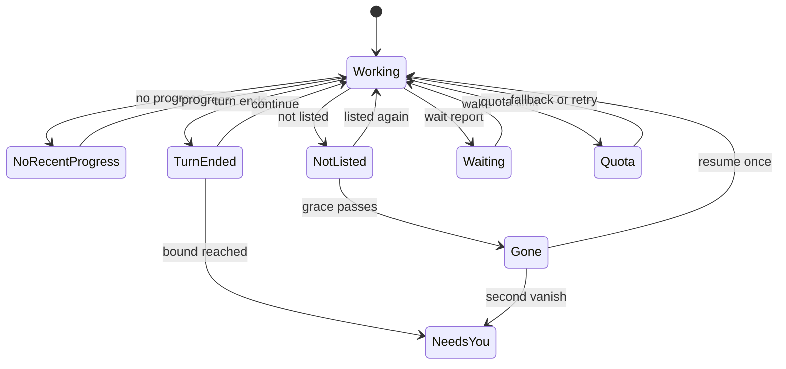

# Stalled workers

## Requirements

### Introduction

In flight shows what Avoozl observed about each worker, how long it has been
in that state, and what Avoozl does next. A worker whose turn ended, whose
session is gone, that waits on something outside the repository, or that hit
its provider's quota recovers in its own worktree with one active worker per
task.

#### Done when

- A terminated turn, a timed wait and a quota failure each show a distinct
  cause and next action in In flight.
- Recovery from each of them keeps the task's worktree, commits and last
  report, and never runs a second active worker for the task.

#### Related specs

[avoozl](avoozl.md) is the product spec. This spec builds on its
Requirement 88.4 (one resume of a vanished chat), Requirement 96 (one way to
finish) and Requirement 114 (git owns state, SQLite is a cache), and on
[Workflow v1](../docs/github-workflow.md#15-claims) section 15 (claims
and leases).

#### Dependency

Timed waits (SW6) need the lease commit of rule 15.1 and the lease renewal of
rule 15.6 on main. Today `takeLease` (`src/app/workers/claims.ts`) points the
lease at the claim head and never renews it. That work is built outside this
spec. Phase 4 starts only after it lands.

#### Scope

- The worker role's sessions on the `kirocrew` and `process` executors.
- The In flight view, Needs you rows and the settings these states read.

#### Out of scope

- Review roles, the responder and plugin decide calls. They keep the retry
  path they have.
- Time boxes (`delivery.timeboxMinutes`). They stay as they are.
- Waking on events Avoozl does not observe itself, such as a third-party
  webhook. A script reaches the task through `avoozl wake TASK`.

#### Words

| Word | Meaning |
| --- | --- |
| Attempt | One worker session on a task, numbered in `task_deliveries.attempts` |
| Active worker | A worker session whose executor has not confirmed that it ended |
| Turn ended | The executor confirms the session stopped working and can take another message: a Kiro Crew chat reads `idle`, a `process` child exited and its definition has `resume` |
| Gone | The executor confirms it does not hold the session: Kiro Crew lists no such chat for `GONE_GRACE_MS`, or the supervisor reads `gone` |
| Continue | A message Avoozl sends to a session whose turn ended, asking it to go on |
| Progress | A new report from the attempt, or a new commit on the task's worktree since the last continue |
| Checkpoint | The worktree's head commit and the attempt's last report, with its time |
| Timed wait | A worker's `wait` report: a reason and a wake time |
| Quota limit | The harness's own signal that its provider refused more work for now |
| Fallback harness | The harness named in `roles.worker.fallback` |


#### Requirement SW1: Each worker state reads plainly

**User story:** As the owner, I want In flight to say what Avoozl saw, for
how long, and what it does next, so that I can tell a recovering worker from
a running one without opening it.

##### Acceptance criteria

1. Each worker row in In flight SHALL show one state from the table in
   design §D3: its label, its cause, the elapsed time since the state began,
   and its next action with a time when one is scheduled. The strings SHALL
   be exactly those of §D3.
2. "Session gone" and "No recent progress" SHALL never share a label, a
   cause or a next action.
3. The state SHALL come from one backend function, `workerState`, that the
   page, `avoozl lanes` and Needs you all read.
4. Times SHALL show in the viewer's local time as `HH:MM` on a 24-hour
   clock, with the short month and day before them when the time is not
   today.
5. At 320px width the row SHALL wrap with no horizontal scroll and no text
   cut off. The state chip SHALL take its colors from theme variables
   (`TONE`), and nothing in the row SHALL animate.
6. A task in a timed wait or a quota wait, which has no live session, SHALL
   still show one row in In flight.

#### Requirement SW2: One active worker per task

**User story:** As the owner, I want a task to have one worker at a time, so
that two sessions never write the same worktree.

##### Acceptance criteria

1. Avoozl SHALL start a new attempt for a task only after its executor
   confirmed the previous attempt ended: the session reads `closed` or
   `lost`, reads `gone` for `GONE_GRACE_MS`, or reads `idle` after a final
   report (`done`, `blocked` or `wait`) that Avoozl answers with no message.
2. A stop Avoozl sends counts as ended only once a later status read
   confirms it. A refused or failed status read SHALL count as not ended.
3. Avoozl SHALL NOT replace a worker because it went quiet, missed a
   continue or its activity lease expired.
4. Every recovery path in this spec (continue, vanished resume, wake, quota
   retry and fallback) SHALL pass the same guard, `previousAttemptEnded`.

#### Requirement SW3: A turn that ends before done continues

**User story:** As the owner, I want a worker whose turn ended early to keep
going in its own session, so that I do not lose its context.

##### Acceptance criteria

1. WHEN the executor confirms a worker's turn ended with no final report
   and no quota limit THEN Avoozl SHALL send the same session a continue
   after a delay of `delivery.continueMinutes`, doubling after each continue
   without progress, up to `delivery.continueMaxMinutes`.
2. A `process` child that exits with no result file, under a definition
   with `resume`, SHALL count as a turn ended, not as a closed session.
   Avoozl SHALL commit its changes first, as it does today.
3. Progress SHALL reset the delay and the count.
4. WHEN `delivery.continueAttempts` continues pass with no progress THEN
   Avoozl SHALL stop sending them and open one Needs you row naming the
   cause and the checkpoint.
5. A `process` child under a definition with no `resume` SHALL take
   today's retry path, which counts against `delivery.retries`.

#### Requirement SW4: A gone session resumes once in its worktree

**User story:** As the owner, I want a worker whose session disappeared to
pick up where it stopped, so that a gateway restart costs me nothing.

##### Acceptance criteria

1. WHILE the executor reports a worker `gone` for less than `GONE_GRACE_MS`
   Avoozl SHALL start nothing and SHALL show the time it reads again.
2. WHEN the gone status settles THEN Avoozl SHALL keep today's rule (avoozl
   Requirement 88.4): one new attempt in the same worktree with the same
   brief and the last report quoted as data, on a free worker lane.
3. That resume SHALL NOT count against `delivery.retries` or
   `delivery.continueAttempts`.
4. A second vanish since the last person's retry SHALL open one Needs you
   row naming the cause and the checkpoint.

#### Requirement SW5: A running worker with no progress is shown, not replaced

**User story:** As the owner, I want to see a worker that runs but reports
nothing, so that I can look at it or steer it myself.

##### Acceptance criteria

1. WHEN a worker's executor reads `working` and the attempt has no
   progress for `delivery.stallMinutes` THEN In flight SHALL show it as "No
   recent progress" with the time of the last report.
2. Avoozl SHALL start, stop and message nothing for that state.
3. The row SHALL offer **Open session** and, for a session that accepts
   messages, **Send message**.

#### Requirement SW6: A worker can wait on something outside the repository

**User story:** As the owner, I want a worker that waits for a test rig or a
person outside the repository to give its lane back and come back later, so
that a lane does not sit idle for hours.

##### Acceptance criteria

1. A worker SHALL report a timed wait with a reason and a wake time:
   `avoozl runner report TASK wait --until TIME --text REASON` from a chat,
   or `{"state": "waiting", "text": ..., "until": ...}` in a `process`
   child's result file. `TIME` SHALL be an ISO 8601 time with a zone, in the
   future, and at most `delivery.waitMaxHours` ahead. Avoozl SHALL refuse
   any other with the reason.
2. A wait report SHALL end the attempt as `waiting`. It SHALL count against
   no bound.
3. The task SHALL keep its claim branch and lease. Avoozl SHALL write the
   reason and wake time into the lease commit as `Wait:` and `Reason:` lines
   and keep them through every renewal. SQLite SHALL hold only a copy that
   `avoozl rebuild` remakes from the lease commit.
4. The lane SHALL be free for another task once the executor confirms the
   waiting session ended (SW2).
5. WHEN the wake time passes, or a person presses **Wake now** or runs
   `avoozl wake TASK` THEN the tick SHALL start one new attempt in the same
   worktree with the approved brief, the wait reason and the last report
   quoted as data, on a free worker lane.
6. A wake SHALL wait while the task is held: its spec stopped (Workflow
   v1 10.1), Stop the line, Autopilot off, the spec text not approved (7.3)
   or changed since the lease (15.10), or the spec issue not assigned to
   this runner (8.3). In flight SHALL name the hold.
7. `avoozl wake TASK` and **Wake now** SHALL be a person's. A call from MCP
   or from an agent session SHALL be refused.

#### Requirement SW7: A quota limit falls back or waits

**User story:** As the owner, I want a worker that hits its provider's limit
to go on under another harness I approved, or to wait for the limit with a
time I can see.

##### Acceptance criteria

1. Avoozl SHALL detect a quota limit only from the harness's own exit and
   output, by the definition's `quota` key (design §D7). A harness with no
   `quota` key, and the `kirocrew` executor, SHALL have no quota state, and
   In flight SHALL say so in its settings line.
2. `roles.worker.fallback` SHALL name a harness. Avoozl SHALL use it only
   when its definition is approved on this machine by its current hash.
3. A fallback SHALL NOT loosen permissions. Avoozl SHALL refuse it when it
   runs with a wider permission class, a write root, an allowed command or
   an unconfined mark the primary does not have, or when it is `kirocrew`
   and the primary is a `process` harness. Its own sandbox rules SHALL
   apply.
4. WHEN a quota limit ends an attempt and a usable fallback exists THEN
   the tick SHALL start one fallback attempt in the same worktree with the
   approved brief, the last report and the worktree's head commit, after
   SW2's guard. In flight SHALL name the fallback harness, the primary, and
   the cause.
5. WHEN no usable fallback exists THEN In flight SHALL show when Avoozl
   retries: the reset time the harness gave, or `delivery.quotaRetryMinutes`
   after the exit. A retry SHALL resume the primary's own session when its
   definition has `resume`. When the fallback is set but refused, the row
   SHALL say why and what the owner must do.
6. A quota retry or fallback SHALL NOT count against `delivery.retries`. It
   SHALL count against `delivery.continueAttempts` when it makes no
   progress.
7. A harness that reports a quota limit while it still runs SHALL stay
   running. In flight SHALL show the limit and offer **Stop and fall back**,
   which stops the session and falls back once the stop is confirmed.

#### Requirement SW8: Recovery settings

**User story:** As the owner, I want to set how fast and how often Avoozl
recovers a worker, so that I can trade lane time for patience.

##### Acceptance criteria

1. `.avoozl.json` `delivery` SHALL accept these whole-number settings with
   these defaults and bounds, refusing a value out of bounds by name:

   | Setting | Default | Bounds |
   | --- | --- | --- |
   | `continueMinutes` | 2 | 1-1440 |
   | `continueMaxMinutes` | 30 | 1-1440 |
   | `continueAttempts` | 3 | 0-10 |
   | `stallMinutes` | 30 | 5-1440 |
   | `waitMaxHours` | 72 | 1-720 |
   | `quotaRetryMinutes` | 60 | 5-1440 |

2. `checkInMinutes` and `missedCheckIns` SHALL be removed; the continue
   settings replace them. A file that holds either SHALL be refused, naming
   the key and its replacement.
3. `roles.worker.fallback` SHALL be a field of the worker's row in
   Settings › Models.
4. **Settings › Autopilot › Run limits** SHALL edit the `delivery` settings
   above.

#### Requirement SW9: Every state is tested and proved

**User story:** As the owner, I want each state checked by tests and seen
once live, so that a regression shows before I meet it.

##### Acceptance criteria

1. Each state in design §D3 SHALL have a test with fake executors and an
   isolated workspace that reaches it, reads its strings, and asserts the
   next action happens or does not.
2. A workflow kit case SHALL check that a lease carrying a timed wait and
   renewed on time is not stale, and that another runner does not take the
   claim over.
3. A manual live proof SHALL reach a turn ended, a timed wait and a quota
   limit with real harnesses and record a receipt under `docs/evidence/`.

## Design

`SW` numbers are in [Requirements](#requirements). `R` numbers and `§`
sections without a `D` are in [avoozl](avoozl.md). Rule numbers such as
15.6 are [Workflow v1](../docs/github-workflow.md) rules.

### D1. The shape

Every worker attempt is in one state that Avoozl derives from what the
executor last said, the attempt's last report and the task's delivery row.
The tick acts on the state, and In flight shows it.



Recovery reuses what is there today. `reconcileDeliveries`
(`src/app/delivery/delivery.ts`) records each attempt's outcome and plans
messages; the planner starts attempts; `drainProcessRequests`
(`src/app/executors/process.ts`) and `observeSessions`
(`src/app/executors/kirocrew/session-observer.ts`) record what each executor
says. This spec adds three outcomes (`waiting`, `quota`, and a `turn-ended`
binding status for a resumable child), one guard, one state function and a
text table.

### D2. One active worker

`previousAttemptEnded(binding, now)` in `src/app/delivery/delivery.ts` is
the only test of whether a task may get a new attempt. It returns true when
the binding's status is in `FINAL_STATUSES` (`closed`, `lost`), when
`goneSettled(binding, now)` holds, or when the status is `idle` and the
report is final (`done`, `blocked`, `wait`). It returns false for any other
status, including a status Avoozl could not read: a failed read leaves the
stored status as it was (`observeSessions` and `drainProcessRequests` push an
error and skip the binding), so no read failure becomes evidence of an end.

Every path that opens a worker attempt calls it first: the planner's start
of a retry, the vanished resume, a wake, a quota retry that opens a new
attempt, and a fallback. A continue and a quota retry that resumes the same
session open no attempt, so they need no guard.

**Stop and fall back** (SW7.7) calls the executor's `stop`, then waits for a
later status read that passes the guard. The fallback starts on the first
tick after that read.

A table test lists each path and drives it with a fake executor that reads
`working`, then `idle` with no report, then a failed read. The path must
start nothing in all three.

### D3. States and their words

`workerState` (`src/app/delivery/worker-state.ts`) returns one state per
worker attempt, or per task in a timed or quota wait:

```json
{
  "state": "turn-ended",
  "since": "2026-11-24T16:38:00.000Z",
  "nextAt": "2026-11-24T16:42:00.000Z",
  "try": 2,
  "tries": 3
}
```

`workerStateText(state, {now})` (`src/app/delivery/worker-state-text.ts`)
turns it into the label, cause and next action. The page, `avoozl lanes` and
Needs you import the same function, so the strings live once. `{time}` is
`HH:MM` on a 24-hour clock in the viewer's local time, with the short month
and day first when the day is not today (`Nov 25, 14:00`). `{age}` is the
time since, in words: `1 minute`, `28 minutes`, `2 hours 5 minutes`,
`3 days`.

| State | Label | Cause | Next action |
| --- | --- | --- | --- |
| `working` | Working | Worker is running. Last progress report was {age} ago. | Nothing to do. |
| `working`, no report yet | Working | Worker is running. It has not reported yet. | Nothing to do. |
| `stalled` | No recent progress | Worker is still running. Last progress report was {age} ago. | Avoozl will not replace it. Open or message the session. |
| `stalled`, no report yet | No recent progress | Worker is still running. It has not reported in {age}. | Avoozl will not replace it. Open or message the session. |
| `turn-ended` | Turn ended | The worker's turn ended before a done report. | Continuing in the same session at {time} (try {try} of {tries}). |
| `not-listed` | Session not listed | Kiro Crew does not list the session. | Checking again until {time}. |
| `gone` on `kirocrew` | Session gone | Kiro Crew confirmed the session disappeared. | Retrying in the same worktree at {time}. |
| `gone` on `process` | Session gone | The supervisor confirmed the {harness} process is gone. | Retrying in the same worktree at {time}. |
| `waiting` | Waiting | Worker is waiting: {reason} | Resuming at {time}, or when you press Wake now. |
| `wait-held` | Waiting, held | Worker is waiting: {reason} | Wake-up was due at {time}. Held: {hold}. |
| `quota-fallback` | Quota limit | {primary} hit its usage limit. | Starting {fallback} in the same worktree at {time}. |
| `quota-retry` | Quota limit | {primary} hit its usage limit. No fallback is set. | Retrying {primary} at {time}. |
| `quota-refused` | Quota limit | {primary} hit its usage limit. Fallback {fallback} {refusal}. | {fix} Retrying {primary} at {time}. |
| `quota-running` | Quota limit | {primary} is waiting for its usage limit to reset. | Avoozl will not replace it while it runs. Stop and fall back to {fallback}, or let it wait. |
| `quota-running`, no fallback | Quota limit | {primary} is waiting for its usage limit to reset. | Avoozl will not replace it while it runs. |
| `needs-you`, turns | Needs you | The worker's turn ended {n} times without progress. | Last checkpoint: commit {sha}, report "{report}" at {time}. Open the session or retry the task. |
| `needs-you`, vanished | Needs you | The session disappeared twice without a report. | Last checkpoint: commit {sha}, report "{report}" at {time}. Open the session or retry the task. |

The holds, in the order `workerState` checks them, are `the spec is
stopped`, `Stop the line`, `Autopilot is off`, `the spec changed since the
lease`, `the spec is not approved` and `the spec issue is assigned to
someone else`. The refusals and their fixes are:

| Refusal | Fix |
| --- | --- |
| `is not approved on this machine` | `Approve it in Settings › Models.` |
| `changed since it was approved` | `Approve the new version in Settings › Models.` |
| `would loosen permissions: {field}` | `Choose a fallback with the same sandbox.` |

A row that ran on a fallback carries one more line under its state:
`Running on {fallback} because {primary} hit its usage limit at {time}.` A
checkpoint with no report reads `report none`. `{report}` is the first 120
characters of the report text.

The row shows the label in a chip, then `{label} · {elapsed}` where
`{elapsed}` is `duration(since)` from `src/app/insights/format.ts`, then the
cause and next action as one line. A `process` row keeps its
`processLine` and log tail below. The chip's colors come from `TONE`
(`hosts/kirocrew/ui/src/ui/tones.ts`): `ok` for Working, `warn` for every
recovering state, `danger` for Needs you, `muted` for Waiting. Nothing
animates. At 320px the chip, the label and the actions wrap onto their own
lines; `hosts/kirocrew/ui/test/` gets a phone-width layout test for one row
per state.

### D4. Turn ended

A turn has ended when a Kiro Crew chat reads `idle` with no final report,
or when a `process` child exited with no result file under a definition
that has `resume`. `drainProcessRequests` records that child as `idle`, the
way it records a child awaiting resume today, instead of `closed`, after
`commitChildWork` commits its changes. A child with a result file, a child
whose definition has no `resume`, and a child whose output matches its
`quota` key (D7) keep their own paths.

The continue replaces the check-in. `checkInStep` and `unansweredCheckIns`
(`src/app/sessions/session-bindings.ts`) become `continueStep` and
`unansweredContinues`, with this delay before continue `k` (counting from 0
since the last progress):

```text
delay(k) = min(continueMinutes * 2^k, continueMaxMinutes)
```

The delay counts from the later of the turn's end (`statusAt`) and the last
continue. Progress is a report newer than the last continue, or a worktree
`HEAD` other than the one recorded with the last continue. Progress resets
`k` to 0.

The message is one string per executor. A chat gets:

```text
Avoozl task {task}: your turn ended before a done report. Continue in the same worktree. When you reach a stopping point, report done, blocked, question or wait.
```

A child gets its resume prompt:

```text
Avoozl task {task}: your run ended before you wrote .avoozl/result.json. Continue in the same folder, then write the result file as your brief says.
```

When `k` reaches `continueAttempts`, `reconcileDeliveries` sets the
delivery to `decision` with `decisionStage: "turns"` and the checkpoint
(D9.4), and sends no more continues. A person's retry clears it, as today.

### D5. Gone and not listed

The vanished resume stays as it is in `reconcileDeliveries`: the first
settled `gone` since the last person's retry records a `vanished` attempt
with `lastReport`, marks the binding `lost`, and the next tick opens one
attempt in the same worktree. `failuresSince` keeps skipping `vanished`
attempts, so the resume costs nothing (SW4.3). A second settled `gone` opens
the decision, which now names the checkpoint.

What changes is what the page says. Before `GONE_GRACE_MS` passes the state
is `not-listed` with `nextAt = statusAt + GONE_GRACE_MS`. After it, the
state is `gone` with `nextAt` set to the next tick: the tick runs every
minute, so `{time}` is the next whole minute. A binding that reads
`working` again within the grace goes back to Working with nothing
recorded.

### D6. No recent progress

`stalled` is `working` with no progress for `stallMinutes`, measured from
the later of `boundAt` and the last report. It is a view only: no code path
reads it to act. The row's actions are the ones In flight has today:
`AttemptLink` for a chat, **Send message** for a child that accepts it, and
**Open session**.

### D7. Quota detection

A harness definition says how its quota limit looks with an optional
`quota` key. Avoozl reads it from the same bounded log tail as `cost`
(`readTail` in `src/app/executors/process-view.ts`), one JSON object per
line:

```json
{
  "quota": {
    "from": "output",
    "match": [
      {
        "field": "result",
        "pattern": "usage limit|limit reached|rate_limit_error"
      }
    ],
    "reset": {
      "field": "result",
      "pattern": "\\|([0-9]{10})$"
    }
  }
}
```

A line matches when it parses as an object whose dotted `field` is a string
matching `pattern`, case-insensitive. `reset` is optional: its one capture
group is read as epoch seconds or an ISO 8601 time, and anything else gives
no reset time. Patterns are at most 200 characters and must compile;
`parseHarnessDefinition` (`src/app/executors/harness-definitions.ts`)
refuses any other value, naming the key. Adding `quota` changes the
definition's hash, so a machine approves the definition again.

`quotaOf(definition, tail, status)` in `src/app/executors/process.ts` reads
the tail when the child exited with a non-zero code or no result file, and
when it reads `working` (for `quota-running`). An exit 0 with a `done`
result is never a quota limit.

Each harness Avoozl ships states its own signal:

| Harness | Signal | Reset time |
| --- | --- | --- |
| `claude-code` (`examples/harnesses/claude-code.json`) | The final `--output-format json` object, `is_error` true, with `result` matching `usage limit\|limit reached\|rate_limit_error` | The `\|<epoch>` suffix of `result` when present |
| `claude-code` on Bedrock (`examples/harnesses/bedrock/claude-code.json`) | The same object, with `result` matching `ThrottlingException\|ServiceQuotaExceededException\|Too many tokens` | None |
| `codex` (`examples/harnesses/codex.json`) | A `codex exec --json` event whose `error.message` or `message` matches `usage limit\|usage_limit_reached` | None |
| `codex` on Bedrock (`examples/harnesses/bedrock/codex.json`) | The same event, with `ThrottlingException\|ServiceQuotaExceededException` | None |
| `kirocrew` | None. The slot read names no provider error | None |

The patterns come from each CLI's documented output and from synthetic
fixtures under `src/app/executors/test/fixtures/quota/`. The live proof
(`stall-p1`) records each harness's real output once and corrects a pattern
that does not match it.

Claude Code in `-p` mode may wait through a limit instead of exiting. Its
child then reads `working`, and its log tail matches `quota`, which is
`quota-running`. Avoozl leaves it running (SW7.7).

### D8. Fallback

`roles.worker.fallback` in `.avoozl.json` names a harness, set in
**Settings › Models** beside the worker's harness. `fallbackFor(store,
primary)` in `src/app/agents/role-table.ts` returns the fallback or a
refusal. It loads the definition with `loadHarnessDefinition`, which checks
the approval hash on this machine, then compares the two sandboxes.

| Field | Refused when the fallback |
| --- | --- |
| Executor | is `kirocrew` and the primary is a `process` harness |
| Permission class | maps the worker to a class other than `write` |
| Write roots | lists a write root the primary does not (`sandboxWriteRoots`) |
| Allowed commands | has no `allow` argv while the primary has one, so the repository's allow-list would not bind it |
| Unconfined | is marked in `harness-unconfined.json` and the primary is not |

The harness's own inner mode (`permission.write`, such as `acceptEdits`) is
not compared: two CLIs' modes share no scale, and the inner-sandbox-off
value already runs only inside Avoozl's sandbox (R94.4d). Egress hosts are
not compared either. Each definition's `egress` lists its own model's API,
its approval covers that list, and the egress proxy enforces it.

With the shipped definitions, the Bedrock `claude-code` definition,
installed under its own name such as `claude-code-bedrock`, is a usable
fallback for `claude-code`. `codex` is refused as a fallback for
`claude-code` because it has no `allow` argv.

A fallback attempt is a new attempt (`attempt + 1`) with `fallback:
{from, harness, at}` on its binding and its delivery attempt, on the lane
the task ran on when it is free, else on any free worker lane. It gets the
approved brief, the last report quoted as data, and the worktree's `HEAD`
as its start. The attempt that hit the limit records `outcome: "quota"`,
which `failuresSince` skips. One task falls back once per quota limit: a
fallback that hits its own limit takes the retry path below with the
primary.

With no usable fallback, the delivery's `quota` state sets `nextAt` to the
reset time or to the exit plus `quotaRetryMinutes`. At `nextAt` the tick
sends the primary's session a continue when its definition has `resume`,
else opens a new attempt on the primary after the guard.

### D9. Timed waits

#### D9.1 The report

A chat reports a wait from its worktree:

```sh
avoozl runner report task-1 wait --until 2026-11-24T14:00:00-06:00 --text "Check the hardware test result after 2 p.m."
```

A child writes the same in its result file:

```json
{
  "state": "waiting",
  "text": "Check the hardware test result after 2 p.m.",
  "until": "2026-11-24T14:00:00-06:00"
}
```

`REPORT_KINDS` gains `wait`, and `FINAL_REPORTS` holds it. `reportSession`
refuses a wait whose `until` is missing, has no zone, is not in the future
or is more than `waitMaxHours` ahead, and one whose text is empty or over
300 characters. `readChildResult` (`src/app/executors/supervisor.ts`)
accepts `waiting` with `until`. The worker brief in
`src/app/workers/worker-briefs.ts` gains one line naming the wait report.

#### D9.2 The lease

The lease commit carries the wait after the lines rule 15.1 records:

```text
Lease parser/p-2 generation 1

Start: 0a1b2c3d4e5f60718293a4b5c6d7e8f901234567
Task: Report unknown tokens
Done: An unknown token is reported with its line and column
Wait: 2026-11-24T20:00:00Z
Reason: Check the hardware test result after 2 p.m.
```

`Wait` is UTC. `Reason` is one line; the pre-push content rule (R40) checks
it, because the lease commit is pushed. Each renewal (15.6) copies both
lines until the wake. The renewal that starts the woken attempt drops them.
Other runners read rule 15 lines only and ignore these two.

The attempt's outcome is `waiting`, and the delivery holds
`wait: {until, reason, at}` as a cache. `avoozl rebuild` reads the newest
lease commit of each claim this runner holds and writes `wait` again.

#### D9.3 The wake

The planner wakes a task when `wait.until` has passed or a person woke it,
and the task is not held (D3's holds, read from the same checks the
planner runs for a claim today). The woken attempt opens after the guard,
in the same worktree, with the approved brief, the wait reason and the last
report quoted as data, on a free worker lane. It counts against no bound.

`avoozl wake TASK` and **Wake now** run one operation, `delivery.wake`,
class `protect` with policy `person("Only a person wakes a task.")`, as an
entry in `src/app/ops/delivery.ts` and a command entry in
`src/app/commands/`. It sets `wait.wokenAt`, and the next tick wakes the
task. A call over MCP or from a session caller is refused, as
`retryDelivery` refuses a session's reason today.

#### D9.4 The checkpoint

The checkpoint every Needs you row of this spec shows is the worktree's
`HEAD` (seven characters), the last report's text and its time. It is read
when the decision opens and stored on the delivery as
`checkpoint: {commit, report, at}`, so the row reads the same after the
worktree changes.

### D10. The view

`deliveryView` (`src/app/api/page-views.ts`) adds `workerState` to each
session it sends, and adds one row per task whose delivery is in `waiting`
or `quota` with no live session. `summarize` in
`hosts/kirocrew/ui/src/in-flight-api.ts` keeps those rows in `inFlight`,
and `InFlightRow` (`hosts/kirocrew/ui/src/InFlight.tsx`) renders the chip
and the line from `workerStateText`. **Wake now** shows on `waiting` and
`wait-held` rows, and **Stop and fall back** on `quota-running` rows with a
usable fallback.

`avoozl lanes` prints each lane's state as `{label} · {elapsed} · {cause}
{next}`. Needs you rows of stage `turns`, a second vanish, and a refused
fallback use the same text.

### D11. Settings

The settings are whole numbers in `DELIVERY_LIMITS` and
`DELIVERY_DEFAULTS`, and `src/avoozl-config.schema.json` holds the same
bounds:

```json
{
  "delivery": {
    "continueMinutes": 2,
    "continueMaxMinutes": 30,
    "continueAttempts": 3,
    "stallMinutes": 30,
    "waitMaxHours": 72,
    "quotaRetryMinutes": 60
  },
  "roles": {
    "worker": {
      "harness": "claude-code",
      "fallback": "claude-code-bedrock"
    }
  }
}
```

`deliveryPolicy` refuses `checkInMinutes` and `missedCheckIns` with
`Use continueMinutes and continueAttempts.` A `continueMaxMinutes` below
`continueMinutes` is refused by name. `AGENT_ROLE_FIELDS` gains `fallback`
for the worker row only. `docs/delivery.md` "Time boxes and check-ins"
becomes "Time boxes and continues" and gains sections for timed waits and
quota limits.

### D12. Tests

Each state of D3 gets one test in `src/app/delivery/test/worker-state.test.ts`
with an isolated workspace, a bare remote and fake executors. Each test
reaches the state through the tick, reads `workerStateText`, and asserts
what the tick did: the message sent, the attempt opened, or nothing.
`src/app/executors/test/process-executor.test.ts` covers the child's turn
ended and quota exits with the fixtures. The guard's table test is D2's.

The workflow kit gets two cases under `workflow-kit/cases/`:
`claim-wait-renewed`, where a lease with a `Wait` line renewed within half
the stale hours is not stale and a second runner's resume stops (15.6,
15.7), and `claim-wait-stale`, where the same lease left unrenewed past the
stale hours is taken over (15.7, 15.8). Both run through the adapter's
`readLeases` and `takeOver` steps.

## Tasks

Tasks run in list order, and each phase waits for the one above it.
Requirement numbers are in brackets (`SW1` to `SW9`, in [Requirements](#requirements));
`§D` sections are in [Design](#design).

Rules for every task: work in a task worktree; tests use isolated temporary
workspaces and state folders, real git with a bare remote, and fake
executors; Avoozl runs the repository's checks; no real workspace data,
machine configuration, credentials, transcripts or personal plans in the
repository (AGENTS.md). A task that changes the page shows the owner
screenshots at 320px and desktop width, light and dark, in chat before it
merges, and keeps them out of git.

Task IDs start with `stall-` so they never collide with the IDs of the other
specs.

### Phase 1: One guard, one state, the settings

- [ ] `stall-1.1` Guard every new worker attempt [SW2] (§D2)
  - `previousAttemptEnded` in `src/app/delivery/delivery.ts` returns true only for `closed`, `lost`, a settled `gone`, or `idle` after a final report
  - The planner's retry start and the vanished resume call it before they open an attempt
  - A table test drives each path with a fake executor that reads `working`, then `idle` with no report, then a failed read, and no path opens an attempt in any of the three
- [ ] `stall-1.2` Derive each worker's state and its words [SW1.1, SW1.2, SW1.3, SW1.4] (§D3)
  - `workerState` in `src/app/delivery/worker-state.ts` returns the state, `since` and `nextAt` for every row of the §D3 table
  - `workerStateText` in `src/app/delivery/worker-state-text.ts` returns each row's label, cause and next action exactly as §D3 writes them, with `{time}` and `{age}` formatted as §D3 says
  - A test fails when any two states share a label, cause and next action, and when "Session gone" and "No recent progress" share any of the three
- [ ] `stall-1.3` Add the recovery settings [SW8.1, SW8.2, SW8.4] (§D11)
  - `DELIVERY_LIMITS`, `DELIVERY_DEFAULTS` and `src/avoozl-config.schema.json` hold `continueMinutes`, `continueMaxMinutes`, `continueAttempts`, `stallMinutes`, `waitMaxHours` and `quotaRetryMinutes` with the defaults and bounds of SW8.1
  - A file with `checkInMinutes` or `missedCheckIns` is refused, naming the key and its replacement
  - A `continueMaxMinutes` below `continueMinutes` is refused by name
  - **Settings › Autopilot › Run limits** edits the six settings

### Phase 2: Turns that end, sessions that go, workers that go quiet

- [ ] `stall-2.1` Continue a worker whose turn ended [SW3] (§D4)
  - An `idle` chat with no final report gets the §D4 chat message after `continueMinutes`, then after doubling delays capped at `continueMaxMinutes`
  - A `process` child that exits with no result file under a definition with `resume` is recorded `idle` after `commitChildWork`, and gets the §D4 resume prompt through `executor.send`
  - A new report or a new worktree `HEAD` resets the delay and the count
  - After `continueAttempts` continues with no progress, the delivery goes to `decision` with stage `turns` and a stored checkpoint, and no further continue is sent
  - A child under a definition with no `resume` takes the retry path and counts against `retries`
  - `checkInStep` and `unansweredCheckIns` are gone, replaced by `continueStep` and `unansweredContinues`
- [ ] `stall-2.2` Show not listed and gone, and name the checkpoint [SW4] (§D5, §D9.4)
  - Before `GONE_GRACE_MS` passes the state is `not-listed` with `nextAt` at the end of the grace, and nothing starts
  - The first settled `gone` still records one `vanished` attempt with its last report and opens one attempt in the same worktree, which `failuresSince` and the continue count skip
  - A second settled `gone` opens a decision whose Needs you row shows the checkpoint's commit, report and time
- [ ] `stall-2.3` Show a running worker with no progress [SW5] (§D6)
  - A `working` attempt with no progress for `stallMinutes` reads `stalled`
  - A test runs the tick ten times over a `stalled` attempt and finds no message sent, no stop and no attempt opened
- [ ] `stall-2.4` Test the turn ended, not listed, gone and no recent progress states [SW9.1] (§D12)
  - `src/app/delivery/test/worker-state.test.ts` reaches `working`, `stalled`, `turn-ended`, `not-listed`, `gone` on both executors, and both `needs-you` rows through the tick
  - Each test reads the state's text and asserts the tick's action: the continue sent, the one attempt opened, or nothing

### Phase 3: Quota limits

- [ ] `stall-3.1` Detect a quota limit from the harness's own output [SW7.1] (§D7)
  - `parseHarnessDefinition` accepts the `quota` key of §D7 and refuses a pattern over 200 characters, one that does not compile, and any other field, naming the key
  - `quotaOf` reads the bounded log tail when a child exits non-zero or with no result file, and while it reads `working`; an exit 0 with a `done` result is never a quota limit
  - The four shipped definitions under `examples/harnesses/` carry the `quota` values of the §D7 table
  - Synthetic fixtures under `src/app/executors/test/fixtures/quota/` match each definition, and a plain failure fixture for each matches none
  - A definition with no `quota` key, and the `kirocrew` executor, never read a quota state
- [ ] `stall-3.2` Choose a fallback that keeps the sandbox [SW7.2, SW7.3, SW8.3] (§D8)
  - `roles.worker.fallback` is a field of the worker row only, and **Settings › Models** edits it
  - `fallbackFor` refuses a fallback whose definition is not approved on this machine or changed since approval
  - `fallbackFor` refuses a fallback that differs from the primary in any field of the §D8 table, naming the field
  - A test passes the Bedrock `claude-code` definition, installed as `claude-code-bedrock`, as a fallback for `claude-code`, and refuses `codex` for its missing `allow` argv
- [ ] `stall-3.3` Fall back or retry after a quota limit [SW7.4, SW7.5, SW7.6, SW7.7] (§D8, §D2)
  - An attempt that hit a quota limit records `outcome: "quota"`, which `failuresSince` skips
  - With a usable fallback, the next tick after the guard opens one fallback attempt in the same worktree with the approved brief, the last report and the worktree's `HEAD`, and its binding carries `fallback`
  - A fallback that hits its own limit retries the primary and does not fall back again
  - With no usable fallback, the primary's session gets a continue at the reset time or `quotaRetryMinutes` after the exit when its definition has `resume`, else one new attempt after the guard
  - A quota retry or fallback with no progress counts against `continueAttempts`
  - **Stop and fall back** stops a `quota-running` child and opens the fallback only after a later status read passes the guard
- [ ] `stall-3.4` Test the quota states [SW9.1] (§D12)
  - `worker-state.test.ts` reaches `quota-fallback`, `quota-retry`, each `quota-refused` refusal, and `quota-running` with and without a fallback
  - Each test reads the state's text and asserts the tick's action, and one test finds exactly one active worker through a fallback

### Phase 4: The view and the docs

- [ ] `stall-4.1` Show each state in In flight [SW1.1, SW1.5, SW1.6] (§D3, §D10)
  - `deliveryView` sends `workerState` on each session, and a row for each task in `quota` with no live session
  - `InFlightRow` shows the chip, `{label} · {elapsed}`, and the cause and next action, with the fallback line on a row that ran on a fallback
  - **Stop and fall back** shows on `quota-running` rows with a usable fallback
  - A phone-width test in `hosts/kirocrew/ui/test/` renders one row per state at 320px with no horizontal scroll and no cut-off text
  - A test finds the chip's colors only in `TONE` and no animation or transition in the row's styles
- [ ] `stall-4.2` Use the same words in `avoozl lanes` and Needs you [SW1.3] (§D10)
  - `avoozl lanes` prints each lane's state as `{label} · {elapsed} · {cause} {next}`
  - Needs you rows of stage `turns`, a second vanish and a refused fallback show the text of `workerStateText`
- [ ] `stall-4.3` Document continues, gone sessions and quota limits (§D11)
  - `docs/delivery.md` has "Time boxes and continues" and a "Quota limits" section with the fallback rule and the §D7 table
  - `docs/glossary.md` defines turn ended, continue, checkpoint and fallback harness

### Phase 5: Timed waits

- [ ] `stall-5.0` Confirm lease commits and lease renewal are on main (**MANUAL**)
  - Main's lease commit records the rule 15.1 lines, and a held lease is renewed at least once per half of the stale hours (rule 15.6)
- [ ] `stall-5.1` Take a wait report [SW6.1, SW6.2] (§D9.1)
  - `avoozl runner report TASK wait --until TIME --text REASON` and a `waiting` result file each end the attempt as `waiting`, which counts against no bound
  - A wait with no `until`, no zone, a past time, a time more than `waitMaxHours` ahead, or a reason that is empty or over 300 characters is refused with the reason
  - The worker brief in `src/app/workers/worker-briefs.ts` names the wait report on both executors
- [ ] `stall-5.2` Keep the wait in the lease [SW6.3, SW6.4] (§D9.2)
  - The lease commit carries `Wait:` in UTC and `Reason:` after the rule 15.1 lines, and every renewal until the wake copies them
  - The pre-push content rule checks the `Reason:` line
  - `avoozl rebuild` restores the delivery's `wait` from the newest lease commit
  - The lane takes another task once the waiting session passes the guard
- [ ] `stall-5.3` Wake a waiting task [SW6.5, SW6.6, SW6.7] (§D9.3)
  - At the wake time the tick opens one attempt in the same worktree with the approved brief, the wait reason and the last report quoted as data, after the guard
  - Each hold of §D3 keeps the task waiting and the row names it
  - `avoozl wake TASK` and **Wake now** wake the task on the next tick, and the same operation over MCP or from a session caller is refused
  - The renewal that starts the woken attempt drops the `Wait:` and `Reason:` lines
- [ ] `stall-5.4` Check waiting leases in the workflow kit [SW9.2] (§D12)
  - `workflow-kit/cases/claim-wait-renewed` passes: a renewed lease with a `Wait:` line is not stale and a second runner's resume stops
  - `workflow-kit/cases/claim-wait-stale` passes: the same lease left past the stale hours is taken over with a takeover commit
  - `docs/github-workflow.md` section 15 says a runner may add lines after `Done` and other runners ignore them, and the scenarios page is regenerated
- [ ] `stall-5.5` Show and test the waiting states [SW1.6, SW9.1] (§D10, §D12)
  - In flight shows one row for a waiting task with no live session, with **Wake now** on `waiting` and `wait-held` rows
  - `worker-state.test.ts` reaches `waiting` and `wait-held` for each hold, reads their text, and asserts the tick wakes the task only when no hold applies
  - `docs/delivery.md` has a "Timed waits" section with the report command and the lease lines

### Phase 6: Proof

- [ ] `stall-p1` Proof: a turn ends, a worker waits, a quota limit falls back [SW3, SW6, SW7] (**MANUAL**)
  - Expected: (1) each of the three shows its own state in In flight with the §D3 words; (2) each recovers in its own worktree with its commits and last report; (3) the supervisor and Kiro Crew never list two live worker sessions for one task
  - Expected result observed; receipt under `docs/evidence/`, screenshots checked and not kept in git
  - Setup: an isolated workspace and a scratch repository with a bare remote; the worker on `claude-code` with the Bedrock definition approved as `claude-code-bedrock` and set as `roles.worker.fallback`; one Kiro Crew lane and one `process` lane
  - Action: (1) end a chat worker's turn by hand before it reports; (2) have a worker report a wait 15 minutes ahead, then let it wake; (3) run a worker on a plan login with its usage limit spent, and record the harness's real output beside the §D7 pattern
  - Failure means: a state's words are wrong or shared, a recovery loses work, or two workers ran at once
  - Next decision: correct any §D7 pattern the real output does not match
